<div align="center">

# 01.01 · Text Preprocessing for Retrieval

   

**Clean text the same way on both sides, so the words a user types can meet the words in your documents.**

</div>

<p align="center"><a href="../../../README.md">Home</a> | <a href="../../README.md">Group 01: NLP Basics for RAG</a> | <a href="../README.md">Chapter page</a> | <a href="../../02.%20Tokens%20and%20Tokenization/README.md">Next: 01.02 Tokens and Tokenization</a></p>

## Contents

<table width="100%">
<thead><tr><th width="8%">Sr No</th><th width="38%">Section</th><th width="54%">Subtopics</th></tr></thead>
<tbody>
<tr><td align="center">01</td><td><a href="#basic-definitions-in-simple-words"><b>Basic Definitions in Simple Words</b></a></td><td>-</td></tr>
<tr><td align="center">02</td><td><a href="#1-where-preprocessing-fits-in-rag"><b>1. Where Preprocessing Fits in RAG</b></a></td><td>-</td></tr>
<tr><td align="center">03</td><td><a href="#2-why-preprocessing-matters-for-retrieval"><b>2. Why Preprocessing Matters for Retrieval</b></a></td><td>-</td></tr>
<tr><td align="center">04</td><td><a href="#3-the-golden-rule-same-pipeline-on-both-sides"><b>3. The Golden Rule: Same Pipeline on Both Sides</b></a></td><td>-</td></tr>
<tr><td align="center">05</td><td><a href="#4-unicode-normalization"><b>4. Unicode Normalization</b></a></td><td>-</td></tr>
<tr><td align="center">06</td><td><a href="#5-case-folding"><b>5. Case Folding</b></a></td><td>-</td></tr>
<tr><td align="center">07</td><td><a href="#6-accent-folding"><b>6. Accent Folding</b></a></td><td>-</td></tr>
<tr><td align="center">08</td><td><a href="#7-whitespace-line-breaks-and-hyphenation"><b>7. Whitespace, Line Breaks and Hyphenation</b></a></td><td>-</td></tr>
<tr><td align="center">09</td><td><a href="#8-tokenization-for-retrieval"><b>8. Tokenization for Retrieval</b></a></td><td>-</td></tr>
<tr><td align="center">10</td><td><a href="#9-stop-words"><b>9. Stop Words</b></a></td><td>-</td></tr>
<tr><td align="center">11</td><td><a href="#10-stemming-vs-lemmatization"><b>10. Stemming vs Lemmatization</b></a></td><td>-</td></tr>
<tr><td align="center">12</td><td><a href="#11-n-grams-for-phrases-and-typos"><b>11. N-grams for Phrases and Typos</b></a></td><td>-</td></tr>
<tr><td align="center">13</td><td><a href="#12-protecting-special-tokens"><b>12. Protecting Special Tokens</b></a></td><td>-</td></tr>
<tr><td align="center">14</td><td><a href="#13-a-configurable-preprocessing-pipeline"><b>13. A Configurable Preprocessing Pipeline</b></a></td><td>-</td></tr>
<tr><td align="center">15</td><td><a href="#14-preprocessing-for-sparse-vs-dense-retrieval"><b>14. Preprocessing for Sparse vs Dense Retrieval</b></a></td><td>-</td></tr>
<tr><td align="center">16</td><td><a href="#15-end-to-end-example-does-preprocessing-change-bm25-results"><b>15. End-to-End Example: Does Preprocessing Change BM25 Results?</b></a></td><td>-</td></tr>
<tr><td align="center">17</td><td><a href="#16-over-processing-failures"><b>16. Over-Processing Failures</b></a></td><td>-</td></tr>
<tr><td align="center">18</td><td><a href="#17-checkpoints-with-answers"><b>17. Checkpoints With Answers</b></a></td><td><a href="#checkpoint-1--fundamentals">Checkpoint 1 — Fundamentals</a><br><a href="#checkpoint-2--tokens">Checkpoint 2 — Tokens</a><br><a href="#checkpoint-3--sparse-vs-dense">Checkpoint 3 — Sparse vs Dense</a></td></tr>
<tr><td align="center">19</td><td><a href="#18-interview-questions"><b>18. Interview Questions</b></a></td><td><a href="#what-is-text-preprocessing-in-a-rag-system">What is text preprocessing in a RAG system?</a><br><a href="#why-does-bm25-need-more-preprocessing-than-dense-retrieval">Why does BM25 need more preprocessing than dense retrieval?</a><br><a href="#what-is-an-analyzer">What is an analyzer?</a><br><a href="#stemming-vs-lemmatization">Stemming vs lemmatization?</a><br><a href="#how-do-you-handle-product-codes-and-versions">How do you handle product codes and versions?</a><br><a href="#when-would-you-not-remove-stop-words">When would you not remove stop words?</a></td></tr>
<tr><td align="center">20</td><td><a href="#19-interview-scenarios"><b>19. Interview Scenarios</b></a></td><td><a href="#scenario-1--search-for-résumé-returns-nothing">Scenario 1 — Search for résumé returns nothing</a><br><a href="#scenario-2--query-python-312-returns-311-documents-first">Scenario 2 — Query Python 3.12 returns 3.11 documents first</a><br><a href="#scenario-3--compliance-bot-says-a-product-is-prohibited-when-the-policy-says-not-prohibited">Scenario 3 — Compliance bot says a product is prohibited when the policy says "not prohibited"</a><br><a href="#scenario-4--search-for-universe-returns-university-pages">Scenario 4 — Search for universe returns university pages</a></td></tr>
<tr><td align="center">21</td><td><a href="#20-one-page-revision-map"><b>20. One-Page Revision Map</b></a></td><td>-</td></tr>
<tr><td align="center">22</td><td><a href="#21-practice-tasks"><b>21. Practice Tasks</b></a></td><td>-</td></tr>
<tr><td align="center">23</td><td><a href="#22-final-takeaways"><b>22. Final Takeaways</b></a></td><td>-</td></tr>
</tbody>
</table>

## Basic Definitions in Simple Words

<table width="100%">
<thead><tr><th width="8%">Sr No</th><th width="28%">Term</th><th width="64%">Meaning in simple words</th></tr></thead>
<tbody>
<tr><td align="center">01</td><td><b>Text preprocessing</b></td><td>Every step that turns raw text into the tokens a retriever stores and compares.</td></tr>
<tr><td align="center">02</td><td><b>Token</b></td><td>One unit of text after splitting, usually a word, number or code like <code>e401</code>.</td></tr>
<tr><td align="center">03</td><td><b>Tokenization</b></td><td>Cutting text into tokens. <code>"reset password"</code> becomes <code>["reset", "password"]</code>.</td></tr>
<tr><td align="center">04</td><td><b>Normalization</b></td><td>Making different spellings of the same thing identical, for example <code>Café</code>, <code>CAFE</code> and <code>cafe</code> all become <code>cafe</code>.</td></tr>
<tr><td align="center">05</td><td><b>Unicode normalization</b></td><td>Making characters that look the same also have the same bytes. <code>fi</code> (one ligature character) becomes <code>fi</code>.</td></tr>
<tr><td align="center">06</td><td><b>Case folding</b></td><td>Turning text to one case so <code>Password</code> and <code>password</code> match.</td></tr>
<tr><td align="center">07</td><td><b>Accent folding</b></td><td>Removing accents so <code>résumé</code> matches <code>resume</code>.</td></tr>
<tr><td align="center">08</td><td><b>Stop words</b></td><td>Very common words such as <code>the</code>, <code>is</code>, <code>of</code> that carry little meaning on their own.</td></tr>
<tr><td align="center">09</td><td><b>Stemming</b></td><td>Chopping word endings by rules: <code>running</code>, <code>runs</code> become <code>run</code>. Fast, sometimes produces non-words.</td></tr>
<tr><td align="center">10</td><td><b>Lemmatization</b></td><td>Mapping a word to its dictionary form using a vocabulary: <code>ran</code> becomes <code>run</code>, <code>better</code> becomes <code>good</code>.</td></tr>
<tr><td align="center">11</td><td><b>N-gram</b></td><td>A sequence of N neighbouring tokens (<code>new york</code>) or characters (<code>pas</code>, <code>ass</code>, <code>ssw</code>).</td></tr>
<tr><td align="center">12</td><td><b>Analyzer</b></td><td>Search-engine name (Elasticsearch, OpenSearch, Lucene) for one complete preprocessing pipeline.</td></tr>
<tr><td align="center">13</td><td><b>Vocabulary mismatch</b></td><td>Query and document mean the same thing but use different tokens, so lexical search misses it.</td></tr>
<tr><td align="center">14</td><td><b>Over-processing</b></td><td>Cleaning so hard that different meanings collapse into the same token, for example removing <code>not</code>.</td></tr>
</tbody>
</table>

## 1. Where Preprocessing Fits in RAG

Preprocessing runs twice: once on every document at index time and once on every query at search time. Retrieval can only match what these two runs produce.

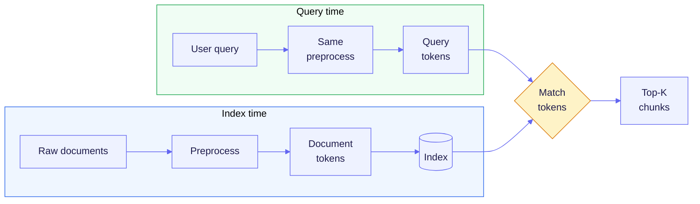

> [!TIP]
> **In simple words:** a lexical retriever compares strings. If the document says `Password` and the user types `password`, the strings differ unless preprocessing made them equal.

Where it matters most:

<table width="100%">
<thead><tr><th width="8%">Sr No</th><th width="24%">Retriever</th><th width="34%">How much preprocessing matters</th><th width="34%">Why</th></tr></thead>
<tbody>
<tr><td align="center">01</td><td><b>BM25 / TF-IDF (sparse)</b></td><td>A lot</td><td>It matches exact tokens, so every spelling difference is a miss.</td></tr>
<tr><td align="center">02</td><td><b>Dense embeddings</b></td><td>Less, but not zero</td><td>The embedding model has its own tokenizer; you mainly clean noise and keep text natural.</td></tr>
<tr><td align="center">03</td><td><b>Hybrid search</b></td><td>Both</td><td>The sparse branch needs the analyzer; the dense branch needs clean, natural text.</td></tr>
</tbody>
</table>

## 2. Why Preprocessing Matters for Retrieval

Users never type text exactly the way documents are written. Without preprocessing, exact matching fails on trivial differences.

```python
import re
import unicodedata
from collections import Counter

# Document text and four ways a user might ask about it
document = "Reset your Password after error E-401."
queries = ["password", "PASSWORD", "e401", "error e-401"]

# Naive tokens: split on spaces only, keep case and punctuation
doc_tokens = set(document.split())

for query in queries:
    # Which query words appear exactly in the document?
    hits = [word for word in query.split() if word in doc_tokens]

    print(f"{query!r:<15} matches: {hits}")
```

**Output**

```text
'password'      matches: []
'PASSWORD'      matches: []
'e401'          matches: []
'error e-401'   matches: ['error']
```

Only `error` matched. `Password`, `PASSWORD`, `E-401.` and `e401` are four different strings to a computer. The rest of this chapter fixes each cause one step at a time.

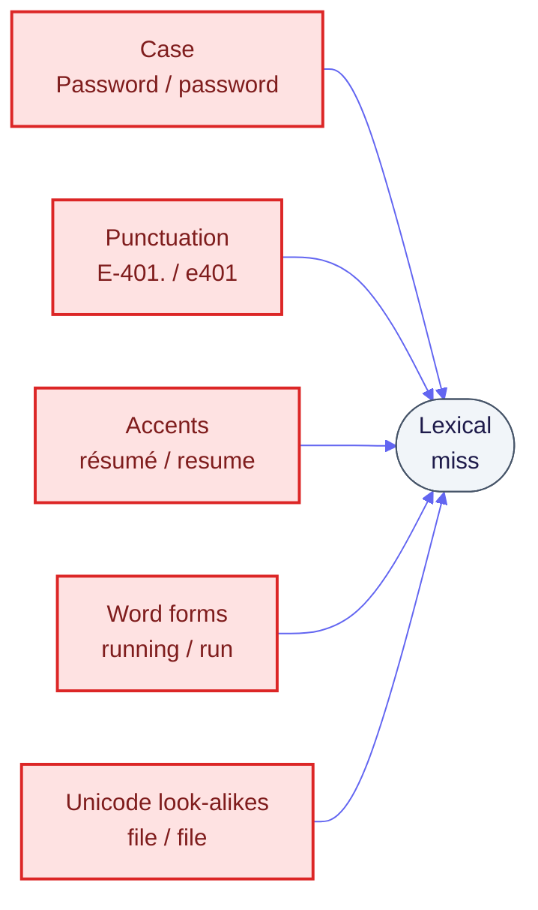

## 3. The Golden Rule: Same Pipeline on Both Sides

> [!IMPORTANT]
> Documents and queries must go through the **same** preprocessing function. A mismatch silently returns nothing, and no error is raised.

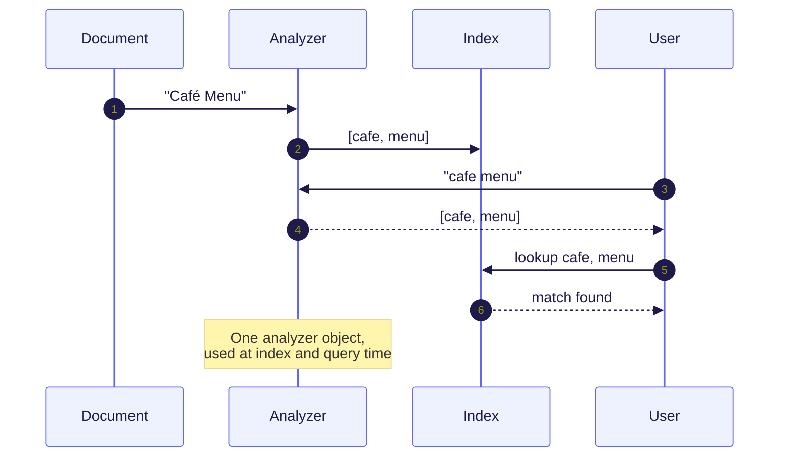

The bug in code: the index lowercases and folds accents, the query side forgot to.

```python
def analyzer(text):
    # Lowercase, fold accents, keep letters and digits
    text = unicodedata.normalize("NFKD", text.lower())
    text = "".join(ch for ch in text if not unicodedata.combining(ch))
    return re.findall(r"[a-z0-9]+", text)

# Index time: documents go through the analyzer
index_tokens = set(analyzer("Café Menu and Prices"))

# Query time, correct: same analyzer
good = [t for t in analyzer("café prices") if t in index_tokens]

# Query time, buggy: raw split, no analyzer
bad = [t for t in "café prices".split() if t in index_tokens]

print("index tokens :", sorted(index_tokens))
print("same analyzer:", good)
print("no analyzer  :", bad)
```

**Output**

```text
index tokens : ['and', 'cafe', 'menu', 'prices']
same analyzer: ['cafe', 'prices']
no analyzer  : ['prices']
```

## 4. Unicode Normalization

The same visible character can be stored in different ways. PDFs and web pages are full of them: ligatures, full-width letters, non-breaking spaces and accents stored as two code points.

<table width="100%">
<thead><tr><th width="8%">Sr No</th><th width="24%">Form</th><th width="34%">What it does</th><th width="34%">Use for retrieval?</th></tr></thead>
<tbody>
<tr><td align="center">01</td><td><b>NFC</b></td><td>Combines letter + accent into one code point</td><td>Safe default for display text</td></tr>
<tr><td align="center">02</td><td><b>NFD</b></td><td>Splits a letter and its accent into two code points</td><td>Step before accent folding</td></tr>
<tr><td align="center">03</td><td><b>NFKC</b></td><td>NFC plus "compatibility" mapping: <code>fi</code> to <code>fi</code>, <code>Ｅ</code> to <code>E</code>, no-break space to space</td><td>Best for the search index</td></tr>
<tr><td align="center">04</td><td><b>NFKD</b></td><td>NFD plus compatibility mapping</td><td>Before accent folding on the index side</td></tr>
</tbody>
</table>

```python
samples = {
    "ligature": "file",
    "full-width": "Ｅ４０１",
    "decomposed accent": "café",
    "no-break space": "price: 10",
}

for name, raw in samples.items():
    # Compatibility normalization turns look-alikes into plain characters
    clean = unicodedata.normalize("NFKC", raw)

    print(f"{name:<18} {raw!r:<14} -> {clean!r:<10} length {len(raw)} -> {len(clean)}")

# Composed and decomposed "café" look identical but are different strings
print("\ncomposed == decomposed before:", "café" == "café")
print("composed == decomposed after :", unicodedata.normalize("NFC", "café") == unicodedata.normalize("NFC", "café"))
```

**Output**

```text
ligature           'file'          -> 'file'     length 3 -> 4
full-width         'Ｅ４０１'         -> 'E401'     length 4 -> 4
decomposed accent  'café'        -> 'café'     length 5 -> 4
no-break space     'price:\xa010' -> 'price: 10' length 9 -> 9

composed == decomposed before: False
composed == decomposed after : True
```

> [!TIP]
> **In simple words:** normalize Unicode first, before any other step. Every later step (lowercasing, regex tokenizing) behaves predictably only on normalized text.

## 5. Case Folding

`lower()` handles English. `casefold()` is the stronger, language-aware version used for matching.

```python
for word in ["Password", "PASSWORD", "Straße", "ΣΊΣΥΦΟΣ"]:
    # lower() for display, casefold() for matching
    print(f"{word:<10} lower={word.lower():<10} casefold={word.casefold()}")

# German: casefold makes "Straße" and "STRASSE" match
print("\nStraße vs STRASSE matched with casefold:", "Straße".casefold() == "STRASSE".casefold())
```

**Output**

```text
Password   lower=password   casefold=password
PASSWORD   lower=password   casefold=password
Straße     lower=straße     casefold=strasse
ΣΊΣΥΦΟΣ    lower=σίσυφος    casefold=σίσυφοσ

Straße vs STRASSE matched with casefold: True
```

> [!WARNING]
> Case can carry meaning: `US` (country) vs `us`, `IT` (department) vs `it`, `Apple` vs `apple`. Most retrieval systems still fold case, because the misses it fixes are far more common than these collisions. A dense retriever or a reranker can recover the meaning later.

## 6. Accent Folding

Users rarely type accents. Folding them on both sides makes `résumé`, `resumé` and `resume` one token.

```python
def fold_accents(text):
    # Split letters from their accent marks
    decomposed = unicodedata.normalize("NFKD", text)

    # Drop the accent marks (combining characters)
    return "".join(ch for ch in decomposed if not unicodedata.combining(ch))

for word in ["résumé", "Café", "naïve", "São Paulo", "Ångström"]:
    print(f"{word:<10} -> {fold_accents(word)}")
```

**Output**

```text
résumé     -> resume
Café       -> Cafe
naïve      -> naive
São Paulo  -> Sao Paulo
Ångström   -> Angstrom
```

> [!NOTE]
> In some languages an accent changes the word (Spanish `año` "year" vs `ano`). For multilingual search, index both the folded and the original form, which Elasticsearch does with its `asciifolding` filter and `preserve_original`.

## 7. Whitespace, Line Breaks and Hyphenation

Extracted PDF text often contains broken lines, hyphenated words split across lines and repeated spaces.

```python
pdf_text = "The informa-\ntion retrieval   system\nhandles  multi-\nline text.\t\tDone."

# Join words hyphenated at a line break: "informa-\ntion" -> "information"
text = re.sub(r"(\w)-\n(\w)", r"\1\2", pdf_text)

# Every run of whitespace becomes one space
text = re.sub(r"\s+", " ", text).strip()

print(repr(pdf_text))
print(repr(text))
```

**Output**

```text
'The informa-\ntion retrieval   system\nhandles  multi-\nline text.\t\tDone.'
'The information retrieval system handles multiline text. Done.'
```

Note that `multi-\nline` became `multiline`. A real hyphen at the end of a line cannot be told apart from a split word without a dictionary; most pipelines accept this small error.

## 8. Tokenization for Retrieval

The tokenizer decides what a "word" is. For RAG the hardest cases are codes, versions, part numbers and symbols, which are often exactly what users search for.

```python
text = "Install Python 3.12 for part 6ES7513-1AL02-0AB0; read the C++ guide or mail support@example.com."

# 1. Split on spaces: punctuation stays glued to words
split_tokens = text.lower().split()

# 2. Letters and digits only: codes break into pieces
simple_tokens = re.findall(r"[a-z0-9]+", text.lower())

# 3. Code-aware: keep . - @ inside a token, keep a trailing ++
CODE_TOKEN = r"[a-z0-9]+(?:[.\-@][a-z0-9]+)*(?:\+\+)?"
code_tokens = re.findall(CODE_TOKEN, text.lower())

print("split      :", split_tokens)
print("simple     :", simple_tokens)
print("code-aware :", code_tokens)
```

**Output**

```text
split      : ['install', 'python', '3.12', 'for', 'part', '6es7513-1al02-0ab0;', 'read', 'the', 'c++', 'guide', 'or', 'mail', 'support@example.com.']
simple     : ['install', 'python', '3', '12', 'for', 'part', '6es7513', '1al02', '0ab0', 'read', 'the', 'c', 'guide', 'or', 'mail', 'support', 'example', 'com']
code-aware : ['install', 'python', '3.12', 'for', 'part', '6es7513-1al02-0ab0', 'read', 'the', 'c++', 'guide', 'or', 'mail', 'support@example.com']
```

<table width="100%">
<thead><tr><th width="8%">Sr No</th><th width="24%">Tokenizer</th><th width="17%">`3.12`</th><th width="17%">`6ES7513-1AL02-0AB0`</th><th width="17%">`C++`</th><th width="17%">Risk</th></tr></thead>
<tbody>
<tr><td align="center">01</td><td><b>Split on spaces</b></td><td><code>3.12</code></td><td>kept</td><td><code>c++</code></td><td><code>0ab0;</code> and <code>support@example.com.</code> keep punctuation, so they never match</td></tr>
<tr><td align="center">02</td><td><b>Letters and digits</b></td><td><code>3</code>, <code>12</code></td><td><code>6es7513</code>, <code>1al02</code>, <code>0ab0</code></td><td><code>c</code></td><td>Versions and codes lose identity; <code>3.12</code> also matches <code>3.11 ... 12</code></td></tr>
<tr><td align="center">03</td><td><b>Code-aware</b></td><td><code>3.12</code></td><td><code>6es7513-1al02-0ab0</code></td><td><code>c++</code></td><td>A query typed without the hyphens no longer matches</td></tr>
</tbody>
</table>

> [!TIP]
> Common production answer: index **both** forms. Keep the code-aware token for exact matches and also the split pieces for partial matches. Search engines call this a multi-field or `word_delimiter_graph` setup.

## 9. Stop Words

Stop words are frequent words such as `the`, `a`, `of`, `is`. Removing them shrinks the sparse index and speeds up search. BM25 already gives them a very low IDF, so removal changes ranking less than people expect.

```python
STOP_WORDS = {"the", "a", "an", "of", "to", "is", "are", "and", "or", "in", "on", "for", "not", "be", "this", "that", "with", "under"}

paragraph = ("The regulation of the European Union is a set of rules for the safety of products "
             "that are sold in the market and the duties of the suppliers of those products")

# Tokens before and after stop-word removal
tokens = re.findall(r"[a-z]+", paragraph.lower())
kept = [t for t in tokens if t not in STOP_WORDS]

print("tokens before:", len(tokens))
print("tokens after :", len(kept))
print("kept:", kept)
```

**Output**

```text
tokens before: 31
tokens after : 13
kept: ['regulation', 'european', 'union', 'set', 'rules', 'safety', 'products', 'sold', 'market', 'duties', 'suppliers', 'those', 'products']
```

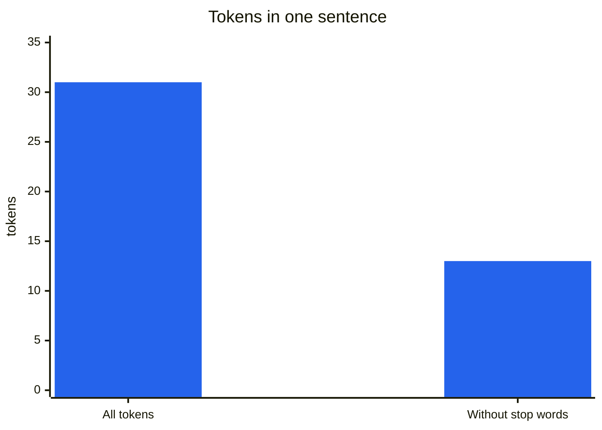

The danger: some stop words carry meaning.

```python
a = "Products are prohibited under Article 33"
b = "Products are not prohibited under Article 33"

# Same stop-word removal on both sentences
clean_a = [t for t in re.findall(r"[a-z0-9]+", a.lower()) if t not in STOP_WORDS]
clean_b = [t for t in re.findall(r"[a-z0-9]+", b.lower()) if t not in STOP_WORDS]

print(clean_a)
print(clean_b)
print("identical after removal:", clean_a == clean_b)
```

**Output**

```text
['products', 'prohibited', 'article', '33']
['products', 'prohibited', 'article', '33']
identical after removal: True
```

> [!WARNING]
> Never remove negations (`not`, `no`, `without`) in legal, medical or compliance RAG. Phrase queries like `to be or not to be` disappear completely with a standard stop list. Many modern systems keep all words in the index and rely on IDF instead.

## 10. Stemming vs Lemmatization

Both reduce word forms so `running`, `runs` and `run` can match.

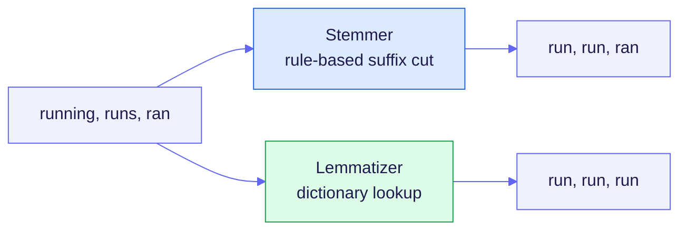

```python
from nltk.stem import PorterStemmer, SnowballStemmer, WordNetLemmatizer

porter = PorterStemmer()
snowball = SnowballStemmer("english")
lemmatizer = WordNetLemmatizer()

words = ["running", "runs", "ran", "studies", "studying", "better", "organization", "organ", "university", "universe"]

print(f"{'word':<14}{'porter':<12}{'snowball':<12}{'lemma (verb)':<14}{'lemma (adj)'}")

for w in words:
    # Rule-based stems and dictionary lemmas side by side
    print(f"{w:<14}{porter.stem(w):<12}{snowball.stem(w):<12}{lemmatizer.lemmatize(w, 'v'):<14}{lemmatizer.lemmatize(w, 'a')}")
```

**Output**

```text
word          porter      snowball    lemma (verb)  lemma (adj)
running       run         run         run           running
runs          run         run         run           runs
ran           ran         ran         run           ran
studies       studi       studi       study         studies
studying      studi       studi       study         studying
better        better      better      better        good
organization  organ       organ       organization  organization
organ         organ       organ       organ         organ
university    univers     univers     university    university
universe      univers     univers     universe      universe
```

Read the output carefully:

<table width="100%">
<thead><tr><th width="8%">Sr No</th><th width="24%">Observation</th><th width="34%">Example from the output</th><th width="34%">Consequence</th></tr></thead>
<tbody>
<tr><td align="center">01</td><td>Stems are not always words</td><td><code>studies</code> to <code>studi</code></td><td>Fine for matching, ugly for display</td></tr>
<tr><td align="center">02</td><td>Stemmers miss irregular forms</td><td><code>ran</code> stays <code>ran</code></td><td>Lemmatizer fixes it</td></tr>
<tr><td align="center">03</td><td>Stemmers over-merge</td><td><code>university</code> and <code>universe</code> both become <code>univers</code></td><td>False matches</td></tr>
<tr><td align="center">04</td><td>Lemmatizer needs the part of speech</td><td><code>better</code> becomes <code>good</code> only as an adjective</td><td>Needs a POS tagger in practice</td></tr>
</tbody>
</table>

> [!TIP]
> **In simple words:** for BM25 in English, a light stemmer (Snowball or Porter) is the usual choice: cheap and good enough. Use lemmatization when display quality or precision matters. Do **not** stem text that goes to an embedding model.

## 11. N-grams for Phrases and Typos

Word n-grams keep phrases together. Character n-grams make search tolerant to typos.

```python
def word_ngrams(tokens, n):
    # Every run of n neighbouring tokens
    return [" ".join(tokens[i:i + n]) for i in range(len(tokens) - n + 1)]

def char_ngrams(word, n=3):
    # Pad so the first and last letters get their own n-grams
    padded = f"#{word}#"
    return {padded[i:i + n] for i in range(len(padded) - n + 1)}

def jaccard(a, b):
    # Shared n-grams divided by all n-grams
    return len(a & b) / len(a | b)

print("word bigrams:", word_ngrams(["new", "york", "pizza", "places"], 2))

for typo in ["pasword", "passwrod", "banana"]:
    score = jaccard(char_ngrams("password"), char_ngrams(typo))
    print(f"password vs {typo:<9} char-trigram Jaccard = {score:.2f}")
```

**Output**

```text
word bigrams: ['new york', 'york pizza', 'pizza places']
password vs pasword   char-trigram Jaccard = 0.67
password vs passwrod  char-trigram Jaccard = 0.33
password vs banana    char-trigram Jaccard = 0.00
```

```math
J(A, B) = \frac{|A \cap B|}{|A \cup B|}
```

The typo `pasword` still shares two thirds of its trigrams with `password` (0.67), a swapped-letter typo shares a third (0.33), and an unrelated word shares none. Search engines use this idea for fuzzy matching and "did you mean" suggestions.

## 12. Protecting Special Tokens

Aggressive cleaning destroys exactly the tokens that make RAG queries precise: versions, IDs, amounts, emails. Protect them before the generic steps run.

```python
PROTECTED = re.compile(r"[a-z0-9]+(?:[.\-@/][a-z0-9]+)+")

def preprocess_naive(text):
    # Lowercase and keep runs of letters only: digits and codes are lost
    return re.findall(r"[a-z]+", text.lower())

def preprocess_protected(text):
    text = text.lower()

    # Pull out codes, versions and emails first, unchanged
    keep = PROTECTED.findall(text)
    rest = PROTECTED.sub(" ", text)

    # Generic tokens from the remaining text
    return keep + re.findall(r"[a-z0-9]+", rest)

sample = "Upgrade to Python 3.12 before 2025-01-31; ticket INC-4521 by ops@example.com"

print("naive    :", preprocess_naive(sample))
print("protected:", preprocess_protected(sample))
```

**Output**

```text
naive    : ['upgrade', 'to', 'python', 'before', 'ticket', 'inc', 'by', 'ops', 'example', 'com']
protected: ['3.12', '2025-01-31', 'inc-4521', 'ops@example.com', 'upgrade', 'to', 'python', 'before', 'ticket', 'by']
```

## 13. A Configurable Preprocessing Pipeline

All steps in one class, each switchable, so documents and queries share one object.

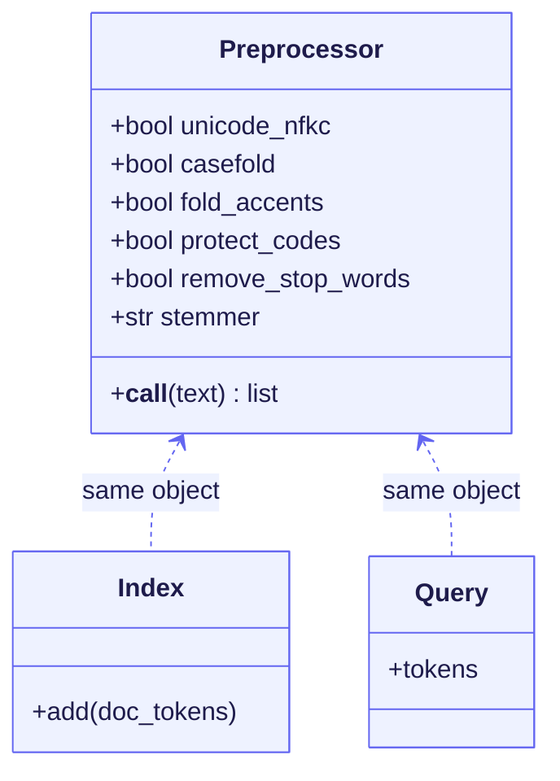

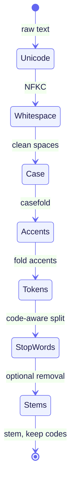

```python
from dataclasses import dataclass

@dataclass
class Preprocessor:
    unicode_nfkc: bool = True
    casefold: bool = True
    fold_accents: bool = True
    protect_codes: bool = True
    remove_stop_words: bool = False
    stemmer: str = "snowball"

    def __call__(self, text):
        # 1. Same characters for look-alike characters
        if self.unicode_nfkc:
            text = unicodedata.normalize("NFKC", text)

        # 2. Join hyphenated line breaks, collapse whitespace
        text = re.sub(r"(\w)-\n(\w)", r"\1\2", text)
        text = re.sub(r"\s+", " ", text)

        # 3. One case
        if self.casefold:
            text = text.casefold()

        # 4. Drop accents
        if self.fold_accents:
            text = fold_accents(text)

        # 5. Tokens: codes kept whole, or simple letters and digits
        pattern = CODE_TOKEN if self.protect_codes else r"[a-z0-9]+"
        tokens = re.findall(pattern, text)

        # 6. Optional stop-word removal
        if self.remove_stop_words:
            tokens = [t for t in tokens if t not in STOP_WORDS]

        # 7. Stem plain words only; leave codes and numbers untouched
        if self.stemmer == "snowball":
            tokens = [snowball.stem(t) if t.isalpha() else t for t in tokens]

        return tokens

analyze = Preprocessor()

print(analyze("Résumé writing TIPS for Running first-time interviews"))
print(analyze("Install Python 3.12 (part 6ES7513-1AL02-0AB0)"))
```

**Output**

```text
['resum', 'write', 'tip', 'for', 'run', 'first-time', 'interview']
['instal', 'python', '3.12', 'part', '6es7513-1al02-0ab0']
```

## 14. Preprocessing for Sparse vs Dense Retrieval

<table width="100%">
<thead><tr><th width="8%">Sr No</th><th width="24%">Step</th><th width="23%">BM25 / sparse</th><th width="23%">Dense embeddings</th><th width="23%">Why</th></tr></thead>
<tbody>
<tr><td align="center">01</td><td><b>Unicode NFKC</b></td><td>Yes</td><td>Yes</td><td>Removes invisible differences everywhere</td></tr>
<tr><td align="center">02</td><td><b>Whitespace / hyphenation fix</b></td><td>Yes</td><td>Yes</td><td>Broken words hurt both</td></tr>
<tr><td align="center">03</td><td><b>Case folding</b></td><td>Yes</td><td>Usually no</td><td>Most embedding models handle case themselves (MiniLM is uncased)</td></tr>
<tr><td align="center">04</td><td><b>Accent folding</b></td><td>Yes</td><td>No</td><td>Models learned accented text; keep it natural</td></tr>
<tr><td align="center">05</td><td><b>Stop-word removal</b></td><td>Optional</td><td>No</td><td>Embeddings need full sentences; "not" matters</td></tr>
<tr><td align="center">06</td><td><b>Stemming / lemmatization</b></td><td>Often yes</td><td>No</td><td>Model tokenizers expect real words</td></tr>
<tr><td align="center">07</td><td><b>Protect codes and versions</b></td><td>Yes</td><td>Yes</td><td>Both lose precision on IDs if they are mangled</td></tr>
</tbody>
</table>

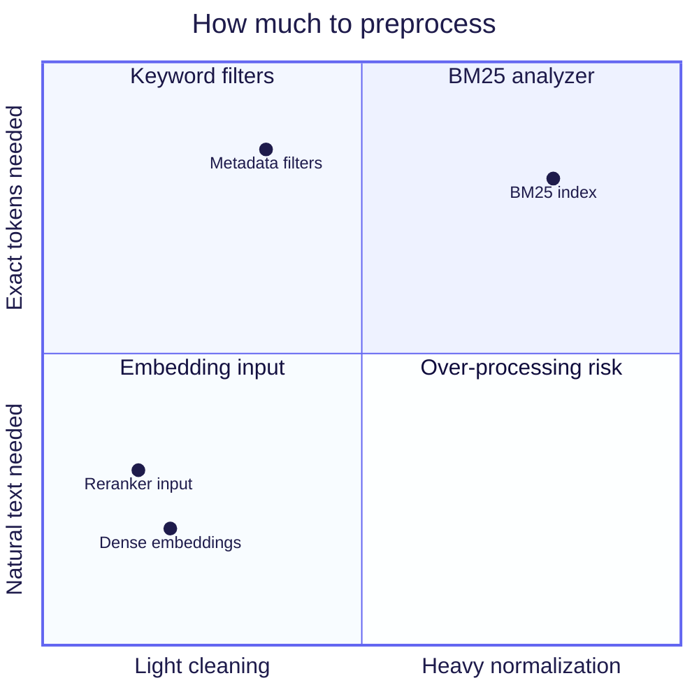

Real check with the dense model from group 06 (`all-MiniLM-L6-v2`, local run). Its tokenizer already lowercases and strips accents, so `Résumé` and `resume` give the identical vector (cosine 1.000). Word forms and versions are close but not identical, which is why the sparse side still needs stemming and why versions need exact tokens.

```python
import os
os.environ["HF_HUB_OFFLINE"] = "1"

from sentence_transformers import SentenceTransformer

model = SentenceTransformer("all-MiniLM-L6-v2")

pairs = [("Résumé writing tips", "resume writing tips"),
         ("PASSWORD RESET", "password reset"),
         ("running shoes", "run shoe"),
         ("Python 3.12", "Python 3.11")]

for a, b in pairs:
    # Cosine similarity of unit vectors = dot product
    va, vb = model.encode([a, b], normalize_embeddings=True)

    print(f"{a!r:<24} vs {b!r:<22} cosine = {float(va @ vb):.3f}")
```

**Output**

```text
'Résumé writing tips'    vs 'resume writing tips'  cosine = 1.000
'PASSWORD RESET'         vs 'password reset'       cosine = 1.000
'running shoes'          vs 'run shoe'             cosine = 0.903
'Python 3.12'            vs 'Python 3.11'          cosine = 0.899
```

## 15. End-to-End Example: Does Preprocessing Change BM25 Results?

Eight short documents, five queries written the way users really type (caps, no accents, base word forms). Each query has one correct document. Three pipelines feed the same BM25 index.

```python
from rank_bm25 import BM25Okapi

documents = {
    "D1": "How to reset your Password after error E-401",
    "D2": "Résumé writing tips for software engineers",
    "D3": "Installing Python 3.12 on Windows",
    "D4": "Running shoes: a buyer's guide",
    "D5": "Products are not prohibited under Article 33",
    "D6": "Office opening hours and holidays",
    "D7": "Python 3.11 release notes",
    "D8": "Café menu and prices",
}

queries = {
    "PASSWORD e401": "D1",
    "resume": "D2",
    "install python 3.12": "D3",
    "run shoe": "D4",
    "cafe price": "D8",
}

pipelines = {
    # P0: split on spaces, nothing else
    "P0 raw split": lambda t: t.split(),

    # P1: lowercase, letters and digits
    "P1 lowercase": lambda t: re.findall(r"[a-z0-9]+", t.lower()),

    # P2: the full Preprocessor from section 13
    "P2 full pipeline": Preprocessor(),
}

doc_ids = list(documents)
results = {}

for name, analyze in pipelines.items():
    # Index time: every document through this pipeline
    bm25 = BM25Okapi([analyze(documents[d]) for d in doc_ids])

    hits = 0

    for query, expected in queries.items():
        # Query time: the same pipeline
        scores = bm25.get_scores(analyze(query))

        # Top-1 document, or none if nothing scored above 0
        best = doc_ids[scores.argmax()] if scores.max() > 0 else "none"
        hits += best == expected

        print(f"{name:<17} {query!r:<24} top-1 = {best:<5} expected {expected}")

    results[name] = hits
    print()

print({name: f"{h}/{len(queries)}" for name, h in results.items()})
```

**Output**

```text
P0 raw split      'PASSWORD e401'          top-1 = none  expected D1
P0 raw split      'resume'                 top-1 = none  expected D2
P0 raw split      'install python 3.12'    top-1 = D3    expected D3
P0 raw split      'run shoe'               top-1 = none  expected D4
P0 raw split      'cafe price'             top-1 = none  expected D8

P1 lowercase      'PASSWORD e401'          top-1 = D1    expected D1
P1 lowercase      'resume'                 top-1 = none  expected D2
P1 lowercase      'install python 3.12'    top-1 = D3    expected D3
P1 lowercase      'run shoe'               top-1 = none  expected D4
P1 lowercase      'cafe price'             top-1 = none  expected D8

P2 full pipeline  'PASSWORD e401'          top-1 = D1    expected D1
P2 full pipeline  'resume'                 top-1 = D2    expected D2
P2 full pipeline  'install python 3.12'    top-1 = D3    expected D3
P2 full pipeline  'run shoe'               top-1 = D4    expected D4
P2 full pipeline  'cafe price'             top-1 = D8    expected D8

{'P0 raw split': '1/5', 'P1 lowercase': '2/5', 'P2 full pipeline': '5/5'}
```

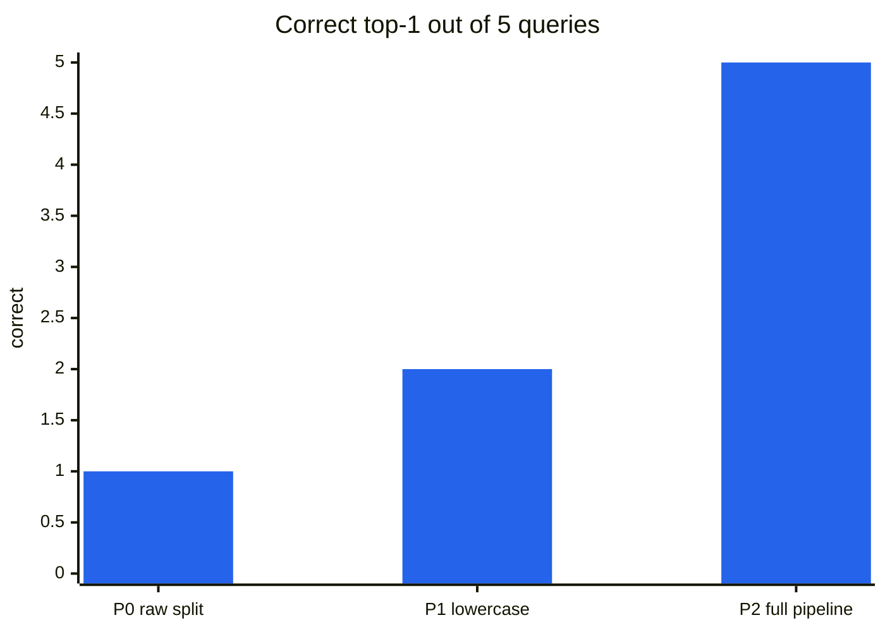

<table width="100%">
<thead><tr><th width="8%">Sr No</th><th width="24%">Query</th><th width="17%">P0 raw split</th><th width="17%">P1 lowercase</th><th width="17%">P2 full pipeline</th><th width="17%">What fixed it</th></tr></thead>
<tbody>
<tr><td align="center">01</td><td><code>PASSWORD e401</code></td><td>miss</td><td>D1</td><td>D1</td><td>Case folding: <code>PASSWORD</code> now meets <code>Password</code>. Note <code>e401</code> still does not meet <code>e-401</code>; section 8 shows how to index both forms</td></tr>
<tr><td align="center">02</td><td><code>resume</code></td><td>miss</td><td>miss</td><td>D2</td><td>Accent folding: without it the P1 regex cuts <code>résumé</code> into <code>r</code> and <code>sum</code></td></tr>
<tr><td align="center">03</td><td><code>install python 3.12</code></td><td>D3</td><td>D3</td><td>D3</td><td>Nothing needed: <code>python</code> and <code>3.12</code> already match exactly</td></tr>
<tr><td align="center">04</td><td><code>run shoe</code></td><td>miss</td><td>miss</td><td>D4</td><td>Stemming: <code>running</code> and <code>shoes</code> become <code>run</code> and <code>shoe</code></td></tr>
<tr><td align="center">05</td><td><code>cafe price</code></td><td>miss</td><td>miss</td><td>D8</td><td>Accent folding plus stemming <code>prices</code> to <code>price</code></td></tr>
</tbody>
</table>

> [!IMPORTANT]
> Same documents, same BM25, same queries: the only change is preprocessing, and correct top-1 answers go from **1 of 5 to 5 of 5**.

## 16. Over-Processing Failures

<table width="100%">
<thead><tr><th width="8%">Sr No</th><th width="24%">Step</th><th width="34%">Failure</th><th width="34%">Real example</th></tr></thead>
<tbody>
<tr><td align="center">01</td><td><b>Stemming</b></td><td>Different words merge</td><td><code>university</code> and <code>universe</code> to <code>univers</code></td></tr>
<tr><td align="center">02</td><td><b>Stop words</b></td><td>Meaning flips</td><td><code>not prohibited</code> and <code>prohibited</code> become identical</td></tr>
<tr><td align="center">03</td><td><b>Case folding</b></td><td>Acronym collisions</td><td><code>US</code> and <code>us</code>, <code>IT</code> and <code>it</code></td></tr>
<tr><td align="center">04</td><td><b>Digit removal</b></td><td>Versions and IDs vanish</td><td><code>Python 3.12</code> becomes <code>python</code></td></tr>
<tr><td align="center">05</td><td><b>Punctuation removal</b></td><td>Codes split</td><td><code>6ES7513-1AL02-0AB0</code> becomes three tokens</td></tr>
<tr><td align="center">06</td><td><b>Accent folding</b></td><td>Different words merge in some languages</td><td>Spanish <code>año</code> and <code>ano</code></td></tr>
</tbody>
</table>

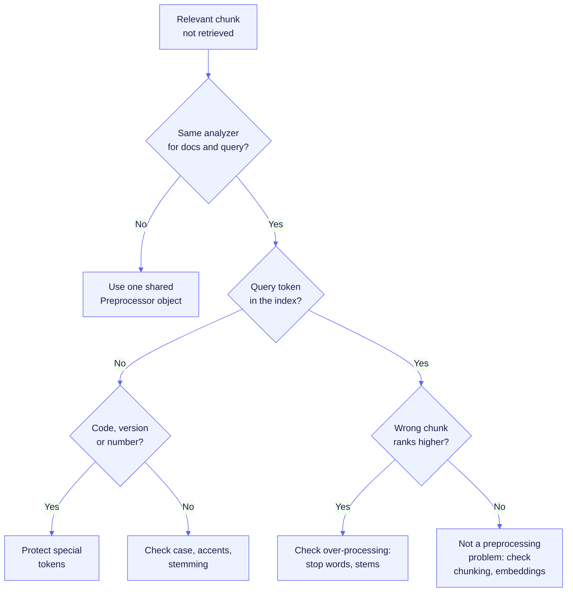

## 17. Checkpoints With Answers

### Checkpoint 1 — Fundamentals

**Q1. Why must documents and queries use the same preprocessing?**
Lexical retrieval compares tokens. Different pipelines produce different tokens for the same word, so matches silently fail.

**Q2. What does NFKC do that NFC does not?**
It also maps compatibility characters: ligatures, full-width letters and no-break spaces become their plain forms.

**Q3. Why use `casefold()` instead of `lower()` for matching?**
`casefold()` also handles language-specific cases, for example German `ß` matching `ss`.

### Checkpoint 2 — Tokens

**Q1. Why is a letters-and-digits tokenizer dangerous for RAG?**
It splits versions and codes (`3.12` to `3`, `12`), which are often the most precise part of a query.

**Q2. When are stop words harmful?**
When they carry meaning: negations, phrases like `to be or not to be`, and short queries.

**Q3. Stemming or lemmatization for BM25?**
Usually a light stemmer: fast and good enough. Lemmatization when precision or display quality matters.

### Checkpoint 3 — Sparse vs Dense

**Q1. Should text sent to an embedding model be stemmed?**
No. Embedding models expect natural text; stemming creates words they rarely saw in training.

**Q2. What should be preprocessed for both branches of hybrid search?**
Unicode normalization, whitespace and hyphenation fixes, and protection of codes and versions.

## 18. Interview Questions

#### What is text preprocessing in a RAG system?

All steps that turn raw document and query text into the tokens the retriever stores and compares: Unicode normalization, cleaning, case and accent folding, tokenization, optional stop-word removal and stemming.

#### Why does BM25 need more preprocessing than dense retrieval?

BM25 only matches identical tokens, so every surface difference is a miss. Embedding models map similar text to nearby vectors on their own.

#### What is an analyzer?

The search-engine term for one preprocessing pipeline (character filters, tokenizer, token filters), applied at both index and query time.

#### Stemming vs lemmatization?

Stemming cuts suffixes by rules and can produce non-words or merge unrelated words. Lemmatization maps to dictionary forms using a vocabulary and often the part of speech.

#### How do you handle product codes and versions?

Protect them with a pattern before generic cleaning, index them as whole tokens, and optionally also index their split pieces for partial matches.

#### When would you not remove stop words?

In legal, medical and compliance text (negations), for phrase search, and for any text sent to an embedding model.

## 19. Interview Scenarios

#### Scenario 1 — Search for `résumé` returns nothing

The index folded accents but the query path did not, or the reverse. Fix: one shared analyzer object for both paths.

#### Scenario 2 — Query `Python 3.12` returns 3.11 documents first

The tokenizer split `3.12` into `3` and `12`. Fix: a code-aware tokenizer that keeps versions whole.

#### Scenario 3 — Compliance bot says a product is prohibited when the policy says "not prohibited"

Stop-word removal deleted `not`. Fix: keep negations; never apply stop lists to text sent to the generator or embeddings.

#### Scenario 4 — Search for `universe` returns university pages

The stemmer merged both into `univers`. Fix: a lighter stemmer, a protected-words list, or lemmatization.

## 20. One-Page Revision Map

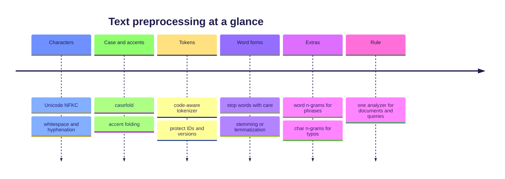

## 21. Practice Tasks

1. Run the section 2 example with your own document and five ways of typing it.
2. Find three ligatures or full-width characters in a real PDF and normalize them with NFKC.
3. Extend `CODE_TOKEN` to keep `#hashtags` and currency amounts such as `$1,299.00`.
4. Write a stop list that keeps all negations, and test it on ten policy sentences.
5. Compare Porter, Snowball and a lemmatizer on 30 words from your own domain.
6. Add a "protected words" list to the `Preprocessor` that is never stemmed.
7. Repeat the section 15 experiment with ten more queries and report correct top-1 per pipeline.
8. Build a typo-tolerant lookup with character trigrams and a Jaccard threshold.
9. Index both the code-aware token and its split pieces, and show which queries improve.
10. Write a unit test that fails if the query path and the index path produce different tokens.

## 22. Final Takeaways

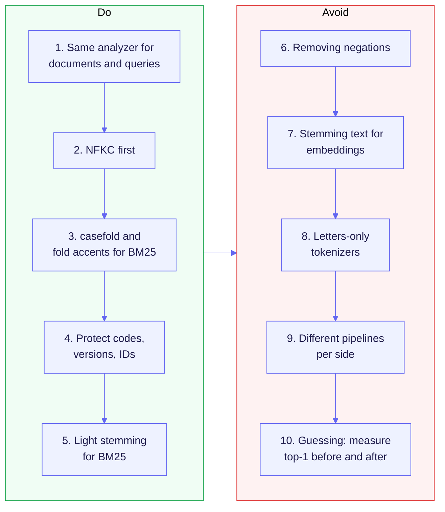

> [!TIP]
> **Study rule:** preprocessing is invisible when it works and silent when it fails. Always print the tokens of one document and one query side by side before tuning anything else.

<p align="center"><a href="../../../README.md">Home</a> | <a href="../../README.md">Group 01: NLP Basics for RAG</a> | <a href="../README.md">Chapter page</a> | <a href="../../02.%20Tokens%20and%20Tokenization/README.md">Next: 01.02 Tokens and Tokenization</a></p>
