<div align="center">

# 01.02 · Tokens and Tokenization

   

**Models read token IDs, not words: every chunk size, context limit and cost in RAG is counted in tokens.**

</div>

<p align="center"><a href="../../01.%20Text%20Preprocessing%20for%20Retrieval/README.md">Previous: 01.01 Text Preprocessing for Retrieval</a> | <a href="../../../README.md">Home</a> | <a href="../../README.md">Group 01: NLP Basics for RAG</a> | <a href="../README.md">Chapter page</a> | <a href="../../03.%20From%20Bag%20of%20Words%20to%20Embeddings/README.md">Next: 01.03 From Bag of Words to Embeddings</a></p>

## Contents

<table width="100%">
<thead><tr><th width="8%">Sr No</th><th width="38%">Section</th><th width="54%">Subtopics</th></tr></thead>
<tbody>
<tr><td align="center">01</td><td><a href="#introduction"><b>Introduction</b></a></td><td>-</td></tr>
<tr><td align="center">02</td><td><a href="#basic-definitions-in-simple-words"><b>Basic Definitions in Simple Words</b></a></td><td>-</td></tr>
<tr><td align="center">03</td><td><a href="#1-what-exactly-is-a-token"><b>1. What exactly is a token?</b></a></td><td>-</td></tr>
<tr><td align="center">04</td><td><a href="#2-token--word"><b>2. Token ≠ word</b></a></td><td>-</td></tr>
<tr><td align="center">05</td><td><a href="#3-why-dont-llms-simply-tokenize-by-words"><b>3. Why don't LLMs simply tokenize by words?</b></a></td><td>-</td></tr>
<tr><td align="center">06</td><td><a href="#4-character-tokenization"><b>4. Character tokenization?</b></a></td><td>-</td></tr>
<tr><td align="center">07</td><td><a href="#5-the-middle-ground-subword-tokenization"><b>5. The middle ground: subword tokenization</b></a></td><td>-</td></tr>
<tr><td align="center">08</td><td><a href="#6-why-tokenization-matters-specifically-in-rag"><b>6. Why tokenization matters specifically in RAG</b></a></td><td>-</td></tr>
<tr><td align="center">09</td><td><a href="#7-rag-token-flow"><b>7. RAG token flow</b></a></td><td>-</td></tr>
<tr><td align="center">10</td><td><a href="#8-context-window-mathematics"><b>8. Context-window mathematics</b></a></td><td>-</td></tr>
<tr><td align="center">11</td><td><a href="#9-if-each-chunk-is-500-tokens"><b>9. If each chunk is 500 tokens</b></a></td><td>-</td></tr>
<tr><td align="center">12</td><td><a href="#10-token-vocabulary"><b>10. Token vocabulary</b></a></td><td>-</td></tr>
<tr><td align="center">13</td><td><a href="#11-token-id--embedding"><b>11. Token ID → embedding</b></a></td><td>-</td></tr>
<tr><td align="center">14</td><td><a href="#12-main-tokenizer-families"><b>12. Main tokenizer families</b></a></td><td>-</td></tr>
<tr><td align="center">15</td><td><a href="#13-byte-pair-encoding--bpe"><b>13. Byte Pair Encoding — BPE</b></a></td><td>-</td></tr>
<tr><td align="center">16</td><td><a href="#14-bpe-intuition-visually"><b>14. BPE intuition visually</b></a></td><td>-</td></tr>
<tr><td align="center">17</td><td><a href="#15-why-bpe-works"><b>15. Why BPE works</b></a></td><td>-</td></tr>
<tr><td align="center">18</td><td><a href="#16-bpe-training-concept"><b>16. BPE training concept</b></a></td><td>-</td></tr>
<tr><td align="center">19</td><td><a href="#17-simple-bpe-implementation-from-scratch"><b>17. Simple BPE implementation from scratch</b></a></td><td><a href="#step-1--get-adjacent-pairs">Step 1 — Get adjacent pairs</a></td></tr>
<tr><td align="center">20</td><td><a href="#18-count-pair-frequencies"><b>18. Count pair frequencies</b></a></td><td>-</td></tr>
<tr><td align="center">21</td><td><a href="#19-merge-a-selected-pair"><b>19. Merge a selected pair</b></a></td><td>-</td></tr>
<tr><td align="center">22</td><td><a href="#20-perform-one-bpe-iteration"><b>20. Perform one BPE iteration</b></a></td><td>-</td></tr>
<tr><td align="center">23</td><td><a href="#21-real-bpe-is-more-sophisticated"><b>21. Real BPE is more sophisticated</b></a></td><td>-</td></tr>
<tr><td align="center">24</td><td><a href="#22-wordpiece"><b>22. WordPiece</b></a></td><td>-</td></tr>
<tr><td align="center">25</td><td><a href="#23-bpe-vs-wordpiece"><b>23. BPE vs WordPiece</b></a></td><td><a href="#bpe">BPE</a><br><a href="#wordpiece">WordPiece</a></td></tr>
<tr><td align="center">26</td><td><a href="#24-sentencepiece"><b>24. SentencePiece</b></a></td><td>-</td></tr>
<tr><td align="center">27</td><td><a href="#25-why-sentencepiece-matters-for-multilingual-models"><b>25. Why SentencePiece matters for multilingual models</b></a></td><td>-</td></tr>
<tr><td align="center">28</td><td><a href="#26-byte-level-tokenization"><b>26. Byte-level tokenization</b></a></td><td>-</td></tr>
<tr><td align="center">29</td><td><a href="#27-the-unknown-token-problem"><b>27. The unknown-token problem</b></a></td><td>-</td></tr>
<tr><td align="center">30</td><td><a href="#28-special-tokens"><b>28. Special tokens</b></a></td><td>-</td></tr>
<tr><td align="center">31</td><td><a href="#29-padding"><b>29. Padding</b></a></td><td>-</td></tr>
<tr><td align="center">32</td><td><a href="#30-attention-masks"><b>30. Attention masks</b></a></td><td>-</td></tr>
<tr><td align="center">33</td><td><a href="#31-why-different-models-tokenize-differently"><b>31. Why different models tokenize differently</b></a></td><td><a href="#experiment-added-three-tokenizers-same-text">Experiment (added): three tokenizers, same text</a></td></tr>
<tr><td align="center">34</td><td><a href="#32-practical-token-counting"><b>32. Practical token counting</b></a></td><td>-</td></tr>
<tr><td align="center">35</td><td><a href="#33-decode-tokens"><b>33. Decode tokens</b></a></td><td>-</td></tr>
<tr><td align="center">36</td><td><a href="#34-inspect-individual-tokens"><b>34. Inspect individual tokens</b></a></td><td>-</td></tr>
<tr><td align="center">37</td><td><a href="#35-why-spaces-can-be-part-of-tokens"><b>35. Why spaces can be part of tokens</b></a></td><td>-</td></tr>
<tr><td align="center">38</td><td><a href="#36-tokenization-and-chunking"><b>36. Tokenization and chunking</b></a></td><td>-</td></tr>
<tr><td align="center">39</td><td><a href="#37-better-token-aware-sentence-chunking"><b>37. Better token-aware sentence chunking</b></a></td><td>-</td></tr>
<tr><td align="center">40</td><td><a href="#38-token-aware-sentence-chunker"><b>38. Token-aware sentence chunker</b></a></td><td>-</td></tr>
<tr><td align="center">41</td><td><a href="#39-group-sentences-using-token-limits"><b>39. Group sentences using token limits</b></a></td><td>-</td></tr>
<tr><td align="center">42</td><td><a href="#40-what-if-one-sentence-exceeds-the-limit"><b>40. What if one sentence exceeds the limit?</b></a></td><td>-</td></tr>
<tr><td align="center">43</td><td><a href="#41-tokenization-and-embeddings"><b>41. Tokenization and embeddings</b></a></td><td>-</td></tr>
<tr><td align="center">44</td><td><a href="#42-why-silent-truncation-is-dangerous"><b>42. Why silent truncation is dangerous</b></a></td><td>-</td></tr>
<tr><td align="center">45</td><td><a href="#43-always-validate-embedding-token-length"><b>43. Always validate embedding-token length</b></a></td><td>-</td></tr>
<tr><td align="center">46</td><td><a href="#44-tokenization-and-multilingual-rag"><b>44. Tokenization and multilingual RAG</b></a></td><td>-</td></tr>
<tr><td align="center">47</td><td><a href="#45-why-multilingual-token-efficiency-matters"><b>45. Why multilingual token efficiency matters</b></a></td><td><a href="#experiment-added-the-same-sentence-in-five-languages">Experiment (added): the same sentence in five languages</a></td></tr>
<tr><td align="center">48</td><td><a href="#46-therefore-multilingual-chunking-should-be-token-aware"><b>46. Therefore multilingual chunking should be token-aware</b></a></td><td>-</td></tr>
<tr><td align="center">49</td><td><a href="#47-german-compound-words"><b>47. German compound words</b></a></td><td>-</td></tr>
<tr><td align="center">50</td><td><a href="#48-tokenization-and-exact-identifiers"><b>48. Tokenization and exact identifiers</b></a></td><td><a href="#experiment-added-how-identifiers-are-split">Experiment (added): how identifiers are split</a></td></tr>
<tr><td align="center">51</td><td><a href="#49-tokenization-and-code"><b>49. Tokenization and code</b></a></td><td>-</td></tr>
<tr><td align="center">52</td><td><a href="#50-tokenization-and-cost"><b>50. Tokenization and cost</b></a></td><td>-</td></tr>
<tr><td align="center">53</td><td><a href="#51-example-cost-comparison"><b>51. Example cost comparison</b></a></td><td>-</td></tr>
<tr><td align="center">54</td><td><a href="#52-chunk-overlap-increases-token-cost-twice"><b>52. Chunk overlap increases token cost twice</b></a></td><td><a href="#indexing">Indexing</a><br><a href="#querying">Querying</a></td></tr>
<tr><td align="center">55</td><td><a href="#53-rag-token-budget-architecture"><b>53. RAG token-budget architecture</b></a></td><td>-</td></tr>
<tr><td align="center">56</td><td><a href="#54-dynamic-token-budgeting"><b>54. Dynamic token budgeting</b></a></td><td>-</td></tr>
<tr><td align="center">57</td><td><a href="#55-context-packing"><b>55. Context packing</b></a></td><td>-</td></tr>
<tr><td align="center">58</td><td><a href="#56-simple-greedy-packing"><b>56. Simple greedy packing</b></a></td><td>-</td></tr>
<tr><td align="center">59</td><td><a href="#57-token-budgeting-vs-top-k"><b>57. Token budgeting vs Top-K</b></a></td><td>-</td></tr>
<tr><td align="center">60</td><td><a href="#58-tokenizer-vocabulary-size-trade-off"><b>58. Tokenizer vocabulary size trade-off</b></a></td><td>-</td></tr>
<tr><td align="center">61</td><td><a href="#59-small-vocabulary-trade-off"><b>59. Small vocabulary trade-off</b></a></td><td>-</td></tr>
<tr><td align="center">62</td><td><a href="#60-compression-ratio"><b>60. Compression ratio</b></a></td><td>-</td></tr>
<tr><td align="center">63</td><td><a href="#61-why-tokenizer-choice-affects-model-performance"><b>61. Why tokenizer choice affects model performance</b></a></td><td>-</td></tr>
<tr><td align="center">64</td><td><a href="#62-should-you-create-your-own-tokenizer-for-enterprise-rag"><b>62. Should you create your own tokenizer for enterprise RAG?</b></a></td><td>-</td></tr>
<tr><td align="center">65</td><td><a href="#63-very-important-misconception"><b>63. Very important misconception</b></a></td><td><a href="#tokenizer">Tokenizer</a><br><a href="#embedding-model">Embedding model</a><br><a href="#vector-database">Vector database</a></td></tr>
<tr><td align="center">66</td><td><a href="#64-another-misconception"><b>64. Another misconception</b></a></td><td>-</td></tr>
<tr><td align="center">67</td><td><a href="#65-another-misconception"><b>65. Another misconception</b></a></td><td>-</td></tr>
<tr><td align="center">68</td><td><a href="#66-tokenization-failure-in-rag-truncation"><b>66. Tokenization failure in RAG: truncation</b></a></td><td>-</td></tr>
<tr><td align="center">69</td><td><a href="#67-another-failure-wrong-token-budget-assumptions"><b>67. Another failure: wrong token budget assumptions</b></a></td><td>-</td></tr>
<tr><td align="center">70</td><td><a href="#68-another-failure-multilingual-expansion"><b>68. Another failure: multilingual expansion</b></a></td><td>-</td></tr>
<tr><td align="center">71</td><td><a href="#69-interview-question-what-is-tokenization"><b>69. Interview question: What is tokenization?</b></a></td><td>-</td></tr>
<tr><td align="center">72</td><td><a href="#70-interview-question-why-not-tokenize-by-words"><b>70. Interview question: Why not tokenize by words?</b></a></td><td>-</td></tr>
<tr><td align="center">73</td><td><a href="#71-interview-question-explain-bpe"><b>71. Interview question: Explain BPE</b></a></td><td>-</td></tr>
<tr><td align="center">74</td><td><a href="#72-interview-question-bpe-vs-wordpiece"><b>72. Interview question: BPE vs WordPiece</b></a></td><td>-</td></tr>
<tr><td align="center">75</td><td><a href="#73-interview-question-what-is-sentencepiece"><b>73. Interview question: What is SentencePiece?</b></a></td><td>-</td></tr>
<tr><td align="center">76</td><td><a href="#74-interview-question-why-does-tokenization-matter-to-rag"><b>74. Interview question: Why does tokenization matter to RAG?</b></a></td><td>-</td></tr>
<tr><td align="center">77</td><td><a href="#75-interview-question-should-chunk-size-be-characters-words-or-tokens"><b>75. Interview question: Should chunk size be characters, words, or tokens?</b></a></td><td>-</td></tr>
<tr><td align="center">78</td><td><a href="#76-interview-question-what-happens-if-a-chunk-exceeds-embedding-model-context"><b>76. Interview question: What happens if a chunk exceeds embedding-model context?</b></a></td><td>-</td></tr>
<tr><td align="center">79</td><td><a href="#77-interview-question-why-can-multilingual-rag-behave-differently"><b>77. Interview question: Why can multilingual RAG behave differently?</b></a></td><td>-</td></tr>
<tr><td align="center">80</td><td><a href="#78-faang-interview-trap"><b>78. FAANG interview trap</b></a></td><td><a href="#trap-token--word">Trap: "Token = word."</a><br><a href="#trap-one-token-is-always-four-characters">Trap: "One token is always four characters."</a><br><a href="#trap-bpe-simply-splits-words">Trap: "BPE simply splits words."</a><br><a href="#trap-sentencepiece-is-the-same-algorithm-as-bpe">Trap: "SentencePiece is the same algorithm as BPE."</a><br><a href="#trap-model-context--number-of-retrieved-tokens">Trap: "Model context = number of retrieved tokens."</a></td></tr>
<tr><td align="center">81</td><td><a href="#79-production-rag-token-architecture"><b>79. Production RAG token architecture</b></a></td><td>-</td></tr>
<tr><td align="center">82</td><td><a href="#80-most-important-equations"><b>80. Most important equations</b></a></td><td><a href="#context-limit">Context limit</a><br><a href="#retrieval-budget">Retrieval budget</a><br><a href="#approximate-inference-cost">Approximate inference cost</a><br><a href="#embedding-table-parameter-intuition">Embedding-table parameter intuition</a></td></tr>
<tr><td align="center">83</td><td><a href="#81-what-you-need-to-remember-for-interviews"><b>81. What you need to remember for interviews</b></a></td><td>-</td></tr>
<tr><td align="center">84</td><td><a href="#82-revision-sheet"><b>82. Revision sheet</b></a></td><td>-</td></tr>
<tr><td align="center">85</td><td><a href="#83-how-this-chapter-connects"><b>83. How this chapter connects</b></a></td><td>-</td></tr>
<tr><td align="center">86</td><td><a href="#84-practice-tasks"><b>84. Practice Tasks</b></a></td><td>-</td></tr>
<tr><td align="center">87</td><td><a href="#85-final-takeaways"><b>85. Final Takeaways</b></a></td><td>-</td></tr>
</tbody>
</table>

## Introduction

This chapter looks smaller than chunking or embeddings, but tokenization sits underneath almost every LLM and RAG operation.

It affects:

- chunk size
- context-window limits
- embedding limits
- prompt cost
- multilingual RAG
- retrieval context size
- latency
- truncation
- generation limits

The key idea is:

> **LLMs do not directly process words or characters. They process sequences of numerical token IDs.**

## Basic Definitions in Simple Words

<table width="100%">
<thead><tr><th width="8%">Sr No</th><th width="28%">Term</th><th width="64%">Meaning in simple words</th></tr></thead>
<tbody>
<tr><td align="center">01</td><td><b>Token</b></td><td>A small piece of text the model reads: a word, part of a word, a space plus a word, or punctuation.</td></tr>
<tr><td align="center">02</td><td><b>Token ID</b></td><td>The number that stands for a token in the model's vocabulary, e.g. <code>" love"</code> may be 3021.</td></tr>
<tr><td align="center">03</td><td><b>Tokenizer</b></td><td>The program that cuts text into tokens and turns them into token IDs (and back).</td></tr>
<tr><td align="center">04</td><td><b>Vocabulary</b></td><td>The fixed list of all tokens a tokenizer knows, often 30,000 to 200,000 entries.</td></tr>
<tr><td align="center">05</td><td><b>Subword</b></td><td>A piece smaller than a word, like <code>un</code>, <code>believ</code>, <code>able</code>. Lets rare words be built from common parts.</td></tr>
<tr><td align="center">06</td><td><b>BPE (Byte Pair Encoding)</b></td><td>Learns a vocabulary by repeatedly merging the most frequent neighbouring pair. Used by GPT models.</td></tr>
<tr><td align="center">07</td><td><b>WordPiece</b></td><td>A subword method used by BERT; pieces that continue a word start with <code>##</code>.</td></tr>
<tr><td align="center">08</td><td><b>SentencePiece</b></td><td>A toolkit that tokenizes raw text directly (spaces included) with BPE or Unigram; common for multilingual models.</td></tr>
<tr><td align="center">09</td><td><b>Byte-level tokenizer</b></td><td>Works on UTF-8 bytes, so any text can be encoded and nothing is ever "unknown".</td></tr>
<tr><td align="center">10</td><td><b>Special tokens</b></td><td>Reserved tokens with a job, like <code>[CLS]</code>, <code>[SEP]</code>, <code>&lt;eos></code>, <code>[PAD]</code>.</td></tr>
<tr><td align="center">11</td><td><b>Padding / attention mask</b></td><td>Filler tokens that make inputs the same length, and the 0/1 mask that tells the model to ignore them.</td></tr>
<tr><td align="center">12</td><td><b>Context window</b></td><td>The maximum number of tokens a model can read plus write in one request.</td></tr>
<tr><td align="center">13</td><td><b>Token budget</b></td><td>How many of those tokens you give to system prompt, history, query, retrieved chunks and the answer.</td></tr>
<tr><td align="center">14</td><td><b>Truncation</b></td><td>Cutting off tokens past the model's limit. Often silent: the cut text is simply ignored.</td></tr>
<tr><td align="center">15</td><td><b>Compression ratio</b></td><td>Characters (or bytes) per token. Higher means fewer tokens for the same text.</td></tr>
</tbody>
</table>

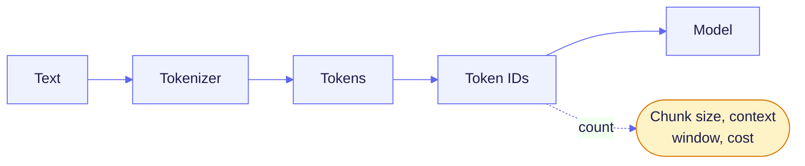

## 1. What exactly is a token?

> [!TIP]
> **In simple words:** A token is the unit an LLM reads. It is often a word, but can be part of a word, a space plus a word, or punctuation.

Consider:

```text
I love artificial intelligence.
```

A human thinks:

```text
I
love
artificial
intelligence
```

Four words.

But an LLM may internally see something conceptually like:

```text
"I"
" love"
" artificial"
" intelligence"
"."
```

or perhaps:

```text
"I"
" love"
" artific"
"ial"
" intelligence"
"."
```

depending on the tokenizer.

Each piece is a **token**.

The model ultimately receives numerical IDs:


So:

```math
\text{Text} \rightarrow \text{Tokens} \rightarrow \text{Token IDs} \rightarrow \text{Model}
```

## 2. Token ≠ word

This is the first important interview concept.

Consider:

```text
cat
```

Could be one token.

But:

```text
electroencephalography
```

could become several subword tokens.

Likewise:

```text
2026/1542
```

might get split into several pieces.

Therefore:

```math
\text{Number of words} \neq \text{Number of tokens}
```

And also:

```math
\text{Number of characters} \neq \text{Number of tokens}
```

## 3. Why don't LLMs simply tokenize by words?

> [!TIP]
> **In simple words:** Too many possible words and new words every day. Subwords keep the vocabulary small and still spell any word.

Imagine vocabulary contains every English word.

You immediately encounter:

```text
walk
walks
walked
walking
```

and:

```text
RAG
GraphRAG
AgenticRAG
```

and names:

```text
Ajay
Vaibhav
OpenAI
```

and millions of rare strings.

A word-level vocabulary becomes enormous.

Even worse:

> What happens when the model sees a completely new word?

Example:

```text
HyperQuantumRAG2027
```

If it's absent from the vocabulary, a pure word tokenizer has a problem.

## 4. Character tokenization?

Other extreme:

```text
intelligence
```

becomes:

```text
i
n
t
e
l
l
i
g
e
n
c
e
```

This solves unknown words because almost every word can be represented using characters.

But sequences become extremely long.

Suppose a document contains:

```math
100,000 \text{ characters}
```

Character tokenization might produce nearly:

```math
100,000 \text{ tokens}
```

Very inefficient.

## 5. The middle ground: subword tokenization

> [!TIP]
> **In simple words:** Common words stay whole; rare words are built from common pieces like un + believ + able.

Modern language models typically use **subword-based tokenization** or related schemes.

Instead of:

```text
unbelievable
```

as one unknown word or 12 separate characters, you might get something like:

```text
un
believ
able
```

Conceptually:

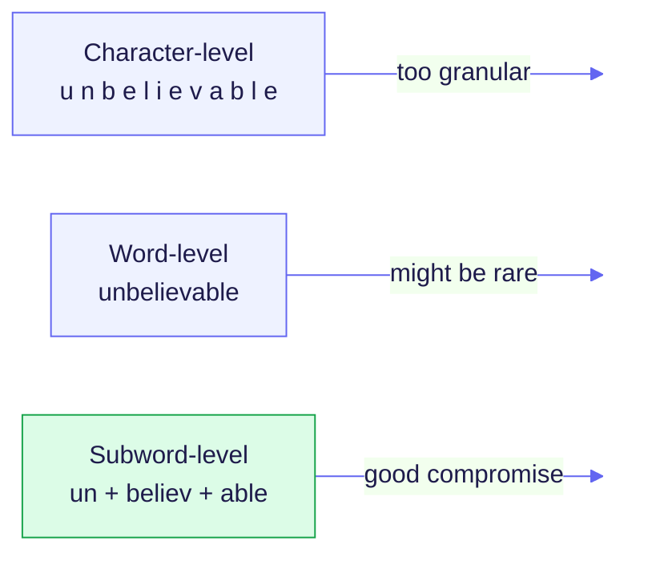

This provides:

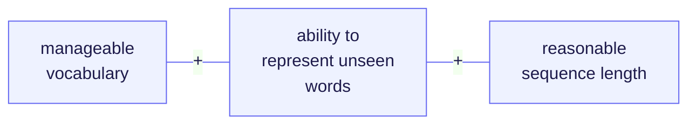

## 6. Why tokenization matters specifically in RAG

> [!TIP]
> **In simple words:** Every limit in RAG is counted in tokens: chunk size, embedding input, context window and price.

Recall 04.01 Document Chunking:


Suppose we say:

```text
chunk_size = 500
```

500 what?

Characters?

Words?

Tokens?

For LLM systems, tokens are often the most meaningful unit because both embedding models and generation models have token limits.

## 7. RAG token flow

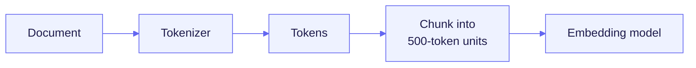

At query time:

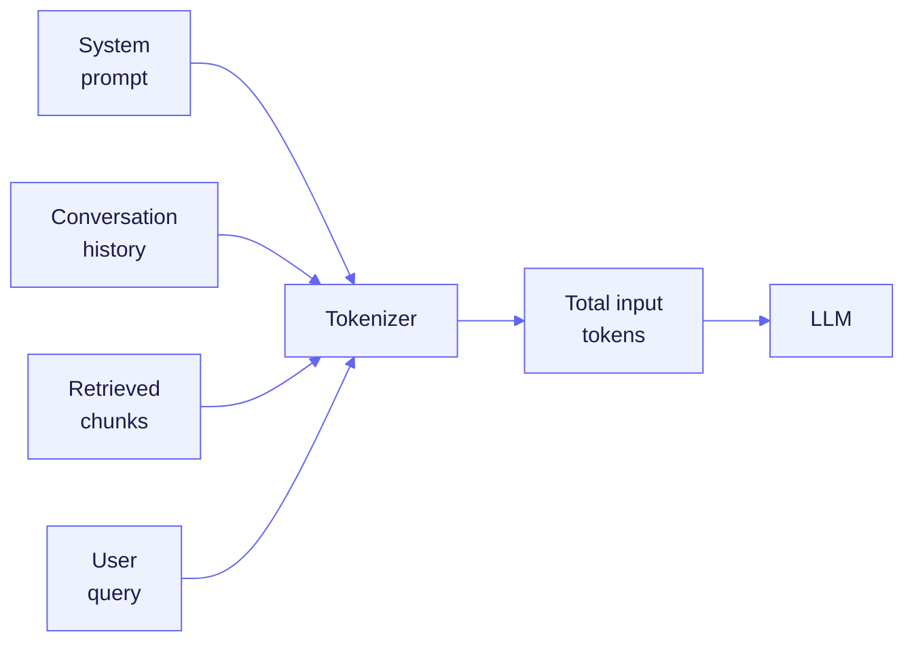

You must satisfy:

```math
T_{\text{input}}+T_{\text{output}} \leq T_{\text{context}}
```

## 8. Context-window mathematics

> [!TIP]
> **In simple words:** The window is shared: system prompt, history, query, retrieved chunks and the answer must all fit.

Suppose model context window:

```math
T_{\text{context}}=32,000
```

You reserve:

```math
T_{\text{output}}=4,000
```

System prompt:

```math
T_{\text{system}}=1,500
```

Conversation history:

```math
T_{\text{history}}=5,000
```

User query:

```math
T_{\text{query}}=500
```

Available retrieval budget:

```math
T_{\text{retrieval}} = T_{\text{context}} - T_{\text{output}} - T_{\text{system}} - T_{\text{history}} - T_{\text{query}}
```

Therefore:

```math
T_{\text{retrieval}} = 32,000 - 4,000 - 1,500 - 5,000 - 500 =21,000
```

So theoretically you have: $21,000$

tokens for retrieved evidence.

## 9. If each chunk is 500 tokens

Then theoretically:

```math
\frac{21,000}{500}=42
```

chunks could fit.

But should you retrieve 42?

Usually no.

Why?

Because:


You may create:

- irrelevant context
- redundancy
- increased latency
- increased cost
- lost-in-the-middle problems

So token budget gives you a **maximum**, not the optimal Top-K.

## 10. Token vocabulary

A tokenizer has a vocabulary:

```math
V=\{t_1,t_2,\ldots,t_n\}
```

Each token gets an integer ID.

Example:

```text
Token            ID

"the"            1032
"ing"            849
" RAG"           29173
"."              13
```

Conceptually:

```math
\text{token} \rightarrow \text{integer}
```

The neural network doesn't receive:

```text
"RAG"
```

It receives something like: $29173$

Then that ID is mapped to an embedding vector.

## 11. Token ID → embedding

Suppose vocabulary size: $|V|=100,000$

Embedding dimension: $d=4096$

There is conceptually an embedding matrix:

```math
E \in \mathbb{R}^{100000\times4096}
```

Token ID: $i=29173$

selects: $E_{29173}$

which is a vector of dimension 4096.

So:

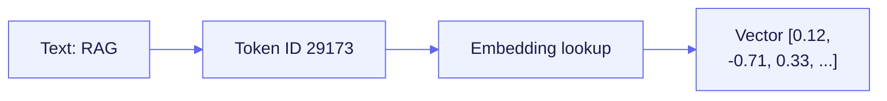

Do not confuse this internal **token embedding** with the document embeddings used for RAG retrieval. They are related ideas but different parts of the system.

<p align="center">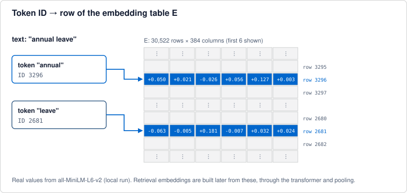</p>

Real numbers (all-MiniLM-L6-v2, local run): the table is 30,522 × 384. "annual" is ID 3296 and "leave" is ID 2681; each ID selects one 384-number row.

## 12. Main tokenizer families

For interviews, know these:

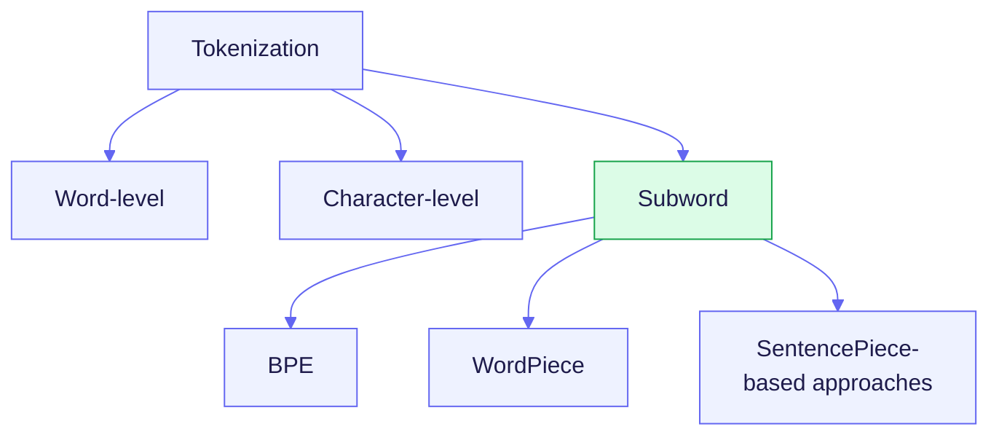

The most important ones to understand are:

1. **BPE**
2. **WordPiece**
3. **SentencePiece**

## 13. Byte Pair Encoding — BPE

> [!TIP]
> **In simple words:** Start from characters, find the most frequent neighbouring pair, glue it into one token, repeat.

BPE is extremely important.

The intuition:

> Start with small units and repeatedly merge frequently occurring adjacent pairs.

Consider corpus:

```text
low
lower
lowest
```

Initially:

```text
l o w
l o w e r
l o w e s t
```

Count adjacent pairs.

Possible frequencies:

```text
(l,o)    3
(o,w)    3
(w,e)    2
(e,r)    1
(e,s)    1
```

Most frequent pair:

```text
(l,o)
```

Merge:

```text
lo
```

Now:

```text
lo w
lo w e r
lo w e s t
```

Next frequent:

```text
(lo,w)
```

Merge:

```text
low
```

Now:

```text
low
low e r
low e s t
```

The tokenizer has learned a useful reusable subword:

```text
low
```

## 14. BPE intuition visually

Start:

```text
l o w e r
```

Merge:

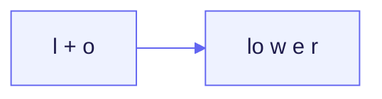

Next:

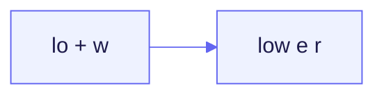

Eventually:

```text
low
lower
```

depending on vocabulary size and learned merge rules.

## 15. Why BPE works

Suppose vocabulary learned:

```text
play
ing
er
ed
```

Then it can represent:

```text
playing
player
played
```

using combinations:

```text
play + ing
play + er
play + ed
```

Instead of storing each complete word separately.

## 16. BPE training concept

Given training corpus: $C$

Start vocabulary from basic symbols.

Then repeatedly:

1. calculate adjacent-pair frequencies
2. identify most frequent pair
3. merge it
4. add merged symbol to vocabulary

until:

```math
|V|=V_{\text{target}}
```

## 17. Simple BPE implementation from scratch

Let's make a tiny educational version.

### Step 1 — Get adjacent pairs

```python
# Define a function that returns adjacent token pairs.
def get_adjacent_pairs(tokens):

    # Create an empty list for token pairs.
    pairs = []

    # Iterate until the second-last token.
    for index in range(len(tokens) - 1):

        # Create a pair from neighboring tokens.
        pair = (
            tokens[index],
            tokens[index + 1],
        )

        # Store the pair.
        pairs.append(pair)

    # Return all adjacent pairs.
    return pairs
```

## 18. Count pair frequencies

```python
# Import Counter for frequency counting.
from collections import Counter

# Define a function that counts adjacent pairs across words.
def count_pair_frequencies(tokenized_words):

    # Create a frequency counter.
    pair_counts = Counter()

    # Process every tokenized word.
    for tokens in tokenized_words:

        # Extract adjacent pairs.
        pairs = get_adjacent_pairs(tokens)

        # Add pair frequencies.
        pair_counts.update(pairs)

    # Return pair counts.
    return pair_counts
```

Example:

```python
# Create a tiny corpus.
words = [
    list("low"),
    list("lower"),
    list("lowest"),
]

# Count adjacent pair frequencies.
pair_counts = count_pair_frequencies(words)

# Display frequencies.
print(pair_counts)
```

**Output**

```text
Counter({('l', 'o'): 3, ('o', 'w'): 3, ('w', 'e'): 2, ('e', 'r'): 1, ('e', 's'): 1, ('s', 't'): 1})
```

## 19. Merge a selected pair

```python
# Define a function that merges one selected token pair.
def merge_pair(tokens, pair_to_merge):

    # Create a list for merged output.
    merged_tokens = []

    # Start at the first token.
    index = 0

    # Continue until all tokens are processed.
    while index < len(tokens):

        # Check whether the current and next token match the pair.
        if (
            index < len(tokens) - 1
            and tokens[index] == pair_to_merge[0]
            and tokens[index + 1] == pair_to_merge[1]
        ):

            # Combine the two tokens.
            merged_token = tokens[index] + tokens[index + 1]

            # Store the merged token.
            merged_tokens.append(merged_token)

            # Skip both original tokens.
            index += 2

        else:

            # Keep the current token unchanged.
            merged_tokens.append(tokens[index])

            # Move to the next token.
            index += 1

    # Return the transformed token sequence.
    return merged_tokens
```

## 20. Perform one BPE iteration

```python
# Count pair frequencies.
pair_counts = count_pair_frequencies(words)

# Find the most frequent pair.
most_common_pair = pair_counts.most_common(1)[0][0]

# Create a list for updated words.
updated_words = []

# Merge the selected pair inside every word.
for tokens in words:

    # Apply the merge operation.
    merged_tokens = merge_pair(
        tokens,
        most_common_pair,
    )

    # Store the updated representation.
    updated_words.append(merged_tokens)

# Display the selected merge.
print("Merged pair:", most_common_pair)

# Display updated words.
print(updated_words)
```

**Output**

```text
Merged pair: ('l', 'o')
[['lo', 'w'], ['lo', 'w', 'e', 'r'], ['lo', 'w', 'e', 's', 't']]
```

Repeat the process and BPE gradually learns larger units.

## 21. Real BPE is more sophisticated

Our implementation is educational.

Production tokenizers have additional concerns:

```text
byte handling
Unicode
whitespace
special tokens
pre-tokenization
vocabulary limits
merge ordering
efficient implementations
```

But the fundamental intuition remains:

```math
\text{frequent adjacent units} \rightarrow \text{merged token}
```

## 22. WordPiece

> [!TIP]
> **In simple words:** Like BPE, but pieces that continue a word are marked with ##, so the model knows they belong to the previous piece.

WordPiece is famously associated with BERT-family tokenization.

It is also subword-based.

Example conceptually:

```text
playing
```

could become:

```text
play
##ing
```

Here:

```text
##ing
```

means roughly:

> this subword continues an existing word.

Example:

```text
unhappiness
```

might conceptually become:

```text
un
##happi
##ness
```

Exact tokenization depends on the vocabulary.

## 23. BPE vs WordPiece

They are similar in spirit but differ in how merges/vocabulary are selected.

High-level interview distinction:

### BPE

Generally merges based strongly on frequent adjacent pairs.

### WordPiece

Uses a likelihood/scoring-based criterion to build useful subword vocabulary.

Don't spend interview time deriving obscure implementation differences unless explicitly asked.

Main point:

```text
Both solve the rare/unknown word problem
using subword units.
```

## 24. SentencePiece

> [!TIP]
> **In simple words:** It treats the space as a normal character, so it works for languages that do not use spaces.

SentencePiece is slightly different conceptually.

Many tokenizers first separate text into words using spaces.

SentencePiece can train directly on raw text.

This is useful for languages where whitespace isn't a reliable word separator.

It commonly uses algorithms such as:

```text
BPE
or
Unigram Language Model
```

Important distinction:

> **SentencePiece is a tokenization framework, not one single tokenization algorithm.**

That is a useful interview point.

## 25. Why SentencePiece matters for multilingual models

Consider Chinese:

```text
人工智能
```

Word boundaries aren't represented like English spaces.

Japanese has similar challenges.

A tokenizer that assumes:

```text
split on spaces
```

is not ideal.

SentencePiece can operate directly over raw Unicode sequences.

## 26. Byte-level tokenization

Some modern tokenizers operate at byte/subword level.

An advantage:

> Any input can theoretically be represented without requiring an unknown token for arbitrary Unicode strings.

Conceptually:

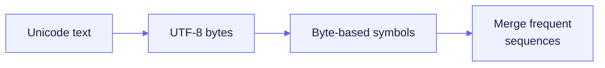

This gives robust coverage.

## 27. The unknown-token problem

Older word/subword systems may use:

```text
[UNK]
```

meaning unknown.

Example:

```text
SuperHyperRAGX
```

could theoretically become:

```text
[UNK]
```

This loses information.

Byte-level approaches reduce the need for such fallback behavior because arbitrary input can be represented via bytes.

## 28. Special tokens

Models also use special control tokens.

Examples conceptually:

```text
<BOS>   beginning of sequence
<EOS>   end of sequence
<PAD>   padding
<UNK>   unknown
```

Chat models may also have internal tokens related to:

```text
system
user
assistant
tool messages
```

These special tokens can consume context space too.

So exact API token accounting can include more than visible user text.

## 29. Padding

Suppose batch contains:

```text
Sentence A = 10 tokens
Sentence B = 6 tokens
Sentence C = 8 tokens
```

To build one rectangular tensor, models may pad shorter examples:

```text
A: 10 real tokens

B: 6 real + 4 PAD

C: 8 real + 2 PAD
```

Tensor: $3\times10$

Padding is mainly relevant during batching/training/inference internals.

## 30. Attention masks

Padding tokens generally should not participate as normal content.

Therefore an attention mask might be:

```text
Tokens:

[Hello, world, PAD, PAD]

Mask:

[1, 1, 0, 0]
```

where:

```text
1 = attend
0 = ignore padding
```

This is more transformer-level than RAG-specific, but worth knowing.

## 31. Why different models tokenize differently

The same text:

```text
Retrieval-Augmented Generation
```

can produce different token sequences because models may use:

- different training corpora
- different vocabulary sizes
- different algorithms
- different merge rules
- different byte handling

Therefore:

> Count tokens using the tokenizer corresponding to the model you are actually using.

Do not assume token count from another tokenizer is exact.

### Experiment (added): three tokenizers, same text

```python
import os
os.environ["HF_HUB_OFFLINE"] = "1"

import tiktoken
from transformers import AutoTokenizer

# GPT-4 style BPE, newer GPT-4o style BPE, and BERT-style WordPiece (all-MiniLM-L6-v2)
cl100k = tiktoken.get_encoding("cl100k_base")
o200k = tiktoken.get_encoding("o200k_base")
wordpiece = AutoTokenizer.from_pretrained("sentence-transformers/all-MiniLM-L6-v2")

text = "Unbelievable: tokenization splits unhappiness differently."

# Show the pieces each tokenizer produces
print("cl100k   :", [cl100k.decode([i]) for i in cl100k.encode(text)])
print("o200k    :", [o200k.decode([i]) for i in o200k.encode(text)])
print("wordpiece:", wordpiece.tokenize(text))
```

**Output**

```text
cl100k   : ['Un', 'belie', 'vable', ':', ' token', 'ization', ' splits', ' unh', 'appiness', ' differently', '.']
o200k    : ['Un', 'bel', 'ievable', ':', ' token', 'ization', ' splits', ' unh', 'appiness', ' differently', '.']
wordpiece: ['unbelievable', ':', 'token', '##ization', 'splits', 'un', '##ha', '##pp', '##iness', 'differently', '.']
```

Same sentence, three different token lists and counts. Always count tokens with the tokenizer of the model you will actually call.

## 32. Practical token counting

For OpenAI-style tokenization experiments, a common Python library is `tiktoken`.

```bash
pip install tiktoken
```

Example:

```python
# Import tiktoken.
import tiktoken

# Load an encoding.
encoding = tiktoken.get_encoding("cl100k_base")

# Define sample text.
text = "Retrieval-Augmented Generation is useful."

# Convert text into token IDs.
token_ids = encoding.encode(text)

# Display token IDs.
print(token_ids)

# Display the number of tokens.
print(len(token_ids))
```

**Output**

```text
[12289, 7379, 838, 62735, 28078, 24367, 374, 5505, 13]
9
```

For production, use the tokenizer/encoding appropriate to the model you're actually calling.

## 33. Decode tokens

```python
# Decode the token IDs back into text.
decoded_text = encoding.decode(token_ids)

# Display the reconstructed text.
print(decoded_text)
```

**Output**

```text
Retrieval-Augmented Generation is useful.
```

Pipeline:

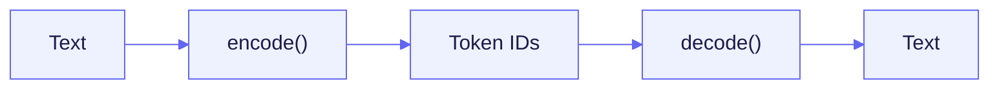

## 34. Inspect individual tokens

```python
# Iterate through each token ID.
for token_id in token_ids:

    # Decode one token at a time.
    token_text = encoding.decode([token_id])

    # Display its ID and textual representation.
    print(token_id, repr(token_text))
```

**Output**

```text
12289 'Ret'
7379 'rie'
838 'val'
62735 '-Aug'
28078 'mented'
24367 ' Generation'
374 ' is'
5505 ' useful'
13 '.'
```

This is a useful learning exercise because you'll see things such as:

```text
" Retrieval"
"-"
"Aug"
"mented"
```

depending on the tokenizer.

## 35. Why spaces can be part of tokens

A tokenizer may distinguish:

```text
"hello"
```

from:

```text
" hello"
```

because whitespace carries useful statistical information.

Therefore you may see tokens conceptually like:

```text
" the"
" and"
" model"
```

rather than:

```text
"the"
"and"
"model"
```

This is normal.

## 36. Tokenization and chunking

Suppose The chunking strategy from 04.01 Document Chunking says:

```math
\text{chunk size}=500\,\text{tokens}
```

You should ideally:


rather than:

```text
take exactly every 500 tokens
```

because exact token boundaries can cut sentences.

## 37. Better token-aware sentence chunking

Architecture:

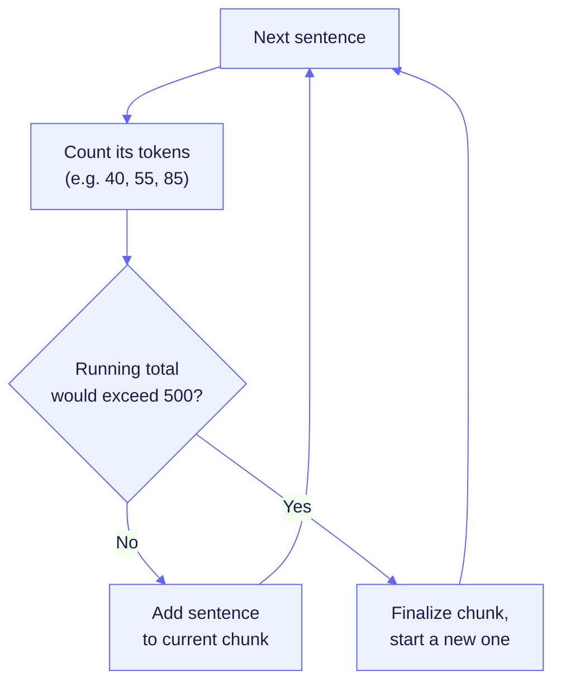

This gives:

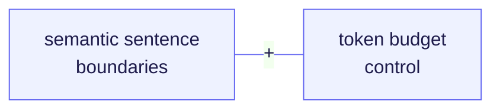

## 38. Token-aware sentence chunker

Setup (added): download the sentence splitter data once.

```python
import nltk

# Sentence-boundary model used by sent_tokenize
nltk.download("punkt_tab", quiet=True)
```

```python
# Import sentence tokenization.
from nltk.tokenize import sent_tokenize

# Import tiktoken.
import tiktoken

# Load an encoding.
encoding = tiktoken.get_encoding("cl100k_base")
```

Separate counting function:

```python
# Define a function that counts tokens.
def count_tokens(text, encoding):

    # Encode the text into token IDs.
    token_ids = encoding.encode(text)

    # Return the number of tokens.
    return len(token_ids)
```

## 39. Group sentences using token limits

```python
# Define a function that groups sentences under a token limit.
def chunk_sentences_by_token_limit(
    text,
    max_tokens,
    encoding,
):

    # Split the document into sentences.
    sentences = sent_tokenize(text)

    # Create the final chunk collection.
    chunks = []

    # Store sentences belonging to the current chunk.
    current_sentences = []

    # Track tokens currently used.
    current_token_count = 0

    # Process every sentence.
    for sentence in sentences:

        # Count tokens in the sentence.
        sentence_tokens = count_tokens(
            sentence,
            encoding,
        )

        # Determine whether adding the sentence exceeds the budget.
        exceeds_limit = (
            current_sentences
            and current_token_count + sentence_tokens > max_tokens
        )

        # Finalize the chunk when the limit would be exceeded.
        if exceeds_limit:

            # Join current sentences.
            chunk = " ".join(current_sentences)

            # Store the completed chunk.
            chunks.append(chunk)

            # Reset the current sentence collection.
            current_sentences = []

            # Reset token count.
            current_token_count = 0

        # Add the sentence to the active chunk.
        current_sentences.append(sentence)

        # Update token usage.
        current_token_count += sentence_tokens

    # Store any remaining sentences.
    if current_sentences:

        # Join remaining sentences.
        chunk = " ".join(current_sentences)

        # Store the final chunk.
        chunks.append(chunk)

    # Return all chunks.
    return chunks
```

Example (added):

```python
document = ("RAG retrieves evidence before generating. Chunk size is measured in tokens, not words. "
            "An embedding model silently truncates long inputs. Truncated text never reaches the index. "
            "Sentence-aware chunking keeps ideas whole. Token limits decide where a chunk must stop.")

# Group the sentences into chunks of at most 25 tokens
for chunk in chunk_sentences_by_token_limit(document, 25, encoding):

    # Show each chunk with its token count
    print(count_tokens(chunk, encoding), "|", chunk)
```

**Output**

```text
17 | RAG retrieves evidence before generating. Chunk size is measured in tokens, not words.
25 | An embedding model silently truncates long inputs. Truncated text never reaches the index. Sentence-aware chunking keeps ideas whole.
9 | Token limits decide where a chunk must stop.
```

This is much better RAG design than blind token slicing.

## 40. What if one sentence exceeds the limit?

Suppose:

```math
\text{sentence}=900\,\text{tokens}
```

and:

```math
\text{max\_chunk}=500
```

Sentence-aware splitting alone fails.

Use fallback:

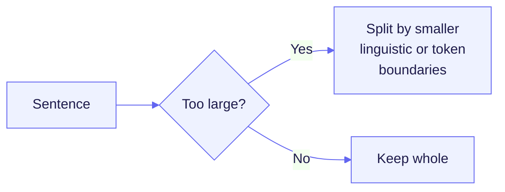

That's exactly why recursive chunking from 04.01 Document Chunking is useful.

## 41. Tokenization and embeddings

Embedding models also have maximum input lengths.

Suppose embedding model accepts: $M$

tokens.

Chunk: $C\gt M$

Then depending on implementation you might see:

```text
error
```

or worse:

```text
silent truncation
```

## 42. Why silent truncation is dangerous

> [!TIP]
> **In simple words:** If a chunk is longer than the embedding model's limit, the end is ignored and that part of the document can never be found.

Suppose chunk:

<p align="center">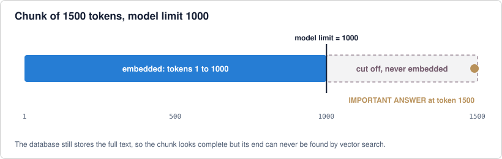</p>

Embedding model only processes first: $1000$

tokens.

Then:

```text
important answer
```

never contributes to the vector.

Yet your database stores the full chunk text.

So you may think:

> Why isn't retrieval finding this sentence? It exists in the chunk.

Because:

> It may not have existed in the embedding input.

Very important debugging insight.

## 43. Always validate embedding-token length

Conceptually:

Setup (added): a chunk that is too long for a 128-token embedding model.

```python
# A long chunk and a small model limit
chunk_text = "Ingestion, chunking and embedding must agree on token limits. " * 20
embedding_limit = 128
```

```python
# Count tokens before embedding.
token_count = count_tokens(
    chunk_text,
    encoding,
)

# Reject or split oversized chunks.
if token_count > embedding_limit:
    print("Chunk must be split.")
```

**Output**

```text
Chunk must be split.
```

Do not rely blindly on truncation.

## 44. Tokenization and multilingual RAG

This is particularly important.

Suppose English sentence:

```text
Artificial intelligence improves search.
```

Perhaps produces roughly a small number of tokens.

Equivalent content in another language might tokenize into significantly more or fewer tokens depending on tokenizer vocabulary.

So:

```math
\text{tokens per semantic unit}
```

can vary substantially between languages.

## 45. Why multilingual token efficiency matters

Suppose:

English document: 500 words become 650 tokens.

while another language might hypothetically require:

500 words-equivalent become 1100 tokens.

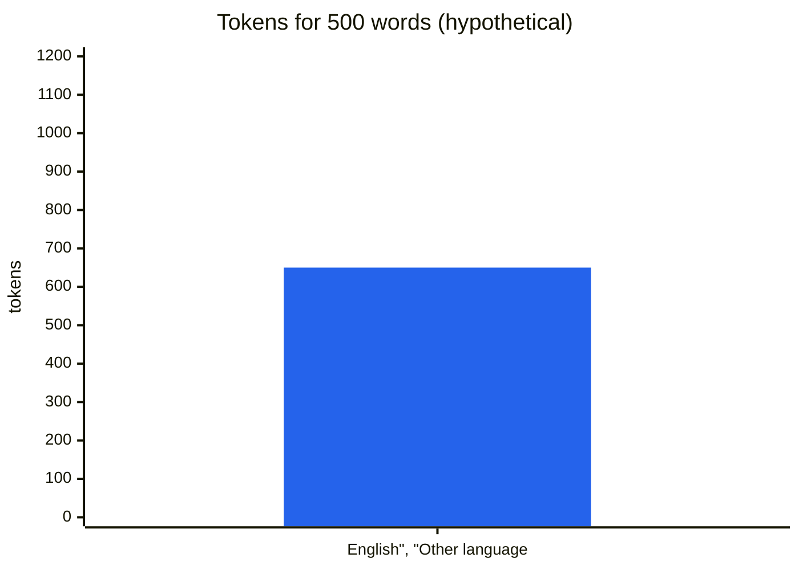

Then a fixed:

```text
500-token chunk
```

contains much less semantic content in the second language.

This can impact:

- retrieval granularity
- number of chunks
- storage
- embedding costs
- context capacity

### Experiment (added): the same sentence in five languages

```python
sentences = {
    "English": "The customer can return the product within thirty days for a full refund.",
    "German": "Der Kunde kann das Produkt innerhalb von dreißig Tagen gegen volle Rückerstattung zurückgeben.",
    "Spanish": "El cliente puede devolver el producto dentro de treinta días para un reembolso completo.",
    "Hindi": "ग्राहक पूर्ण धनवापसी के लिए तीस दिनों के भीतर उत्पाद वापस कर सकता है।",
    "Japanese": "お客様は全額返金のために30日以内に商品を返品できます。",
}

for language, sentence in sentences.items():
    # Token counts for the same meaning in each language
    print(f"{language:<9} cl100k = {len(cl100k.encode(sentence)):>3}   o200k = {len(o200k.encode(sentence)):>3}")
```

**Output**

```text
English   cl100k =  14   o200k =  14
German    cl100k =  25   o200k =  19
Spanish   cl100k =  20   o200k =  16
Hindi     cl100k =  67   o200k =  20
Japanese  cl100k =  30   o200k =  19
```

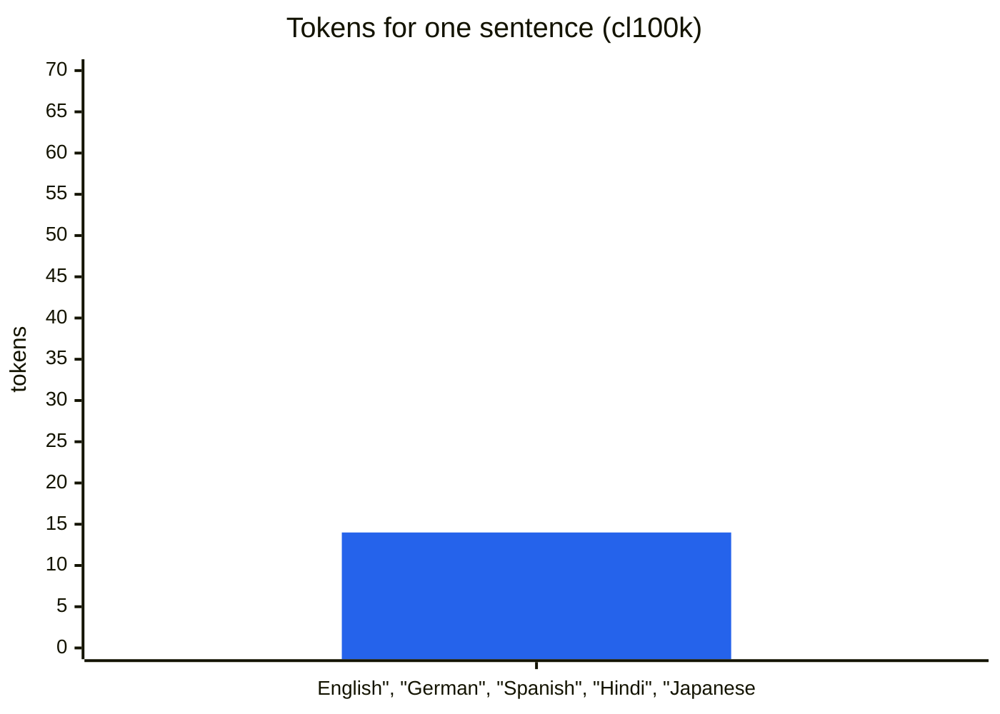

Same meaning, very different token counts. A "500-token chunk" holds much less Hindi text than English text with this tokenizer; the newer `o200k` vocabulary narrows the gap.

## 46. Therefore multilingual chunking should be token-aware

Avoid:

```text
500 English words
500 Japanese "words"
500 German words
```

as if they were comparable.

Instead evaluate:

```mermaid
%%{init: {'theme':'base','themeVariables':{'primaryColor':'#EEF2FF','primaryBorderColor':'#6366F1','primaryTextColor':'#1E1B4B','lineColor':'#6366F1','pie1':'#22C55E','pie2':'#F59E0B','pie3':'#EF4444','pie4':'#3B82F6','pie5':'#8B5CF6','xyChart':{'plotColorPalette':'#2563EB, #16A34A, #D97706, #DC2626, #7C3AED'}}}}%%
flowchart LR
    n0["token length"] ---|"+"| n1["semantic<br/>boundaries"] ---|"+"| n2["language"]
```

## 47. German compound words

For regulatory RAG, imagine German:

```text
Batterierecht-Durchführungsgesetz
```

A tokenizer may split this into multiple meaningful/unfamiliar subwords.

This can affect exact-match and dense retrieval behavior.

Similarly very long chemical/product/legal identifiers can consume several tokens.

## 48. Tokenization and exact identifiers

Consider:

```text
EU 2023/1542
```

or:

```text
G.S.R. 180(E)
```

or:

```text
ISO/IEC 27001:2022
```

The tokenizer may fragment these into several tokens.

Dense embeddings may still understand some semantics, but exact identifiers are another reason hybrid search/BM25 is valuable.

Preserve these strings exactly during ingestion.

### Experiment (added): how identifiers are split

```python
for text in ["E401", "error E-401", "6ES7513-1AL02-0AB0", "Python 3.12", "calculate_customer_refund_amount()"]:
    # BPE pieces for each identifier
    pieces = [cl100k.decode([i]) for i in cl100k.encode(text)]

    print(f"{text!r:<38} {len(pieces):>2} tokens  {pieces}")
```

**Output**

```text
'E401'                                  2 tokens  ['E', '401']
'error E-401'                           4 tokens  ['error', ' E', '-', '401']
'6ES7513-1AL02-0AB0'                   12 tokens  ['6', 'ES', '751', '3', '-', '1', 'AL', '02', '-', '0', 'AB', '0']
'Python 3.12'                           5 tokens  ['Python', ' ', '3', '.', '12']
'calculate_customer_refund_amount()'    6 tokens  ['calculate', '_customer', '_ref', 'und', '_amount', '()']
```

Part numbers and function names break into many small pieces. That is why exact identifiers are better handled by BM25 (05 Sparse Retrieval) than by embeddings alone.

## 49. Tokenization and code

Code may tokenize inefficiently because it contains:

```text
underscores
camelCase
parentheses
operators
indentation
long variable names
```

Example:

```python
calculate_customer_refund_amount()
```

could be split into several tokens.

Therefore:

```math
500\,\text{tokens of prose}
```

and:

```math
500\,\text{tokens of code}
```

may represent very different amounts of semantic content.

Again:

> Chunk by semantic unit first, token budget second.

## 50. Tokenization and cost

Suppose provider pricing is based on tokens.

Conceptually:

```math
\text{Cost} = T_{\text{input}}\times P_{\text{input}} + T_{\text{output}}\times P_{\text{output}}
```

where:

- $T_{input}$ = input tokens
- $T_{output}$ = generated tokens
- $P$ = price/token

For RAG, retrieved chunks can become the largest part of input cost.

## 51. Example cost comparison

Suppose each query retrieves: $10$

chunks.

Each: $500$

tokens.

Retrieval context: $5000$

tokens.

If 100,000 user questions are asked:

```math
5000\times100,000 = 500,000,000
```

retrieval-context tokens alone.

This is why context optimization matters financially.

## 52. Chunk overlap increases token cost twice

Overlap causes extra cost during:

### Indexing

You embed duplicated text.

### Querying

Multiple overlapping chunks may be retrieved and inserted into the prompt.

Example:

```text
Chunk A:
A B C D

Chunk B:
C D E F
```

Prompt includes:

```text
C D
```

twice.

So overlap can increase:

```mermaid
%%{init: {'theme':'base','themeVariables':{'primaryColor':'#EEF2FF','primaryBorderColor':'#6366F1','primaryTextColor':'#1E1B4B','lineColor':'#6366F1','pie1':'#22C55E','pie2':'#F59E0B','pie3':'#EF4444','pie4':'#3B82F6','pie5':'#8B5CF6','xyChart':{'plotColorPalette':'#2563EB, #16A34A, #D97706, #DC2626, #7C3AED'}}}}%%
flowchart LR
    n0["embedding cost"] ---|"+"| n1["LLM inference cost"]
```

## 53. RAG token-budget architecture

A production context builder might explicitly allocate:

Total context = 128K:

```mermaid
%%{init: {'theme':'base','themeVariables':{'primaryColor':'#EEF2FF','primaryBorderColor':'#6366F1','primaryTextColor':'#1E1B4B','lineColor':'#6366F1','pie1':'#22C55E','pie2':'#F59E0B','pie3':'#EF4444','pie4':'#3B82F6','pie5':'#8B5CF6','xyChart':{'plotColorPalette':'#2563EB, #16A34A, #D97706, #DC2626, #7C3AED'}}}}%%
pie showData
    title 128K context budget (K tokens)
    "Retrieved evidence" : 70
    "Output reserve" : 20
    "Conversation" : 15
    "Tool results" : 10
    "Safety reserve" : 8
    "System" : 4
    "Query" : 1
```

You don't necessarily hardcode these exact numbers, but designing with explicit budgets is valuable.

## 54. Dynamic token budgeting

> [!TIP]
> **In simple words:** Work out how many tokens are left for evidence after fixed parts, then fill only that space.

Suppose user has no chat history.

Then:

```text
history = 0
```

More room for retrieval.

If user has long history:

```text
history = 12,000
```

retrieval budget should shrink or history should be summarized.

Conceptually:

```math
T_{\text{retrieval}} = T_{\text{context}} - T_{\text{fixed}} - T_{\text{history}} - T_{\text{outputReserve}}
```

This should often be dynamic.

## 55. Context packing

Suppose candidate chunks:

```text
C1 = 600 tokens
C2 = 450
C3 = 900
C4 = 300
C5 = 800
```

Available budget: $2000$

You cannot blindly send all five.

Potential strategy:

```math
C_1 + C_2 + C_4 = 600 + 450 + 300 = 1350
```

Then potentially another chunk if it fits.

Context packing becomes a kind of constrained optimization problem.

## 56. Simple greedy packing

```python
# Define a function for packing ranked chunks under a token budget.
def pack_chunks(
    ranked_chunks,
    token_budget,
    encoding,
):

    # Create a list for selected chunks.
    selected_chunks = []

    # Track tokens already used.
    used_tokens = 0

    # Process chunks in ranking order.
    for chunk in ranked_chunks:

        # Count tokens in the current chunk.
        chunk_tokens = count_tokens(
            chunk,
            encoding,
        )

        # Check whether the chunk fits in the remaining budget.
        if used_tokens + chunk_tokens <= token_budget:

            # Keep the chunk.
            selected_chunks.append(chunk)

            # Update token usage.
            used_tokens += chunk_tokens

    # Return selected chunks and final token usage.
    return selected_chunks, used_tokens
```

Example (added):

```python
ranked = ["Password resets are done from the login page under Forgot password.",
          "Reset links expire after 30 minutes and can be requested again.",
          "The office is closed on public holidays.",
          "Accounts lock after five failed login attempts and unlock after 15 minutes."]

# Keep the best-ranked chunks that fit in 40 tokens
selected, used = pack_chunks(ranked, 40, encoding)

print("used tokens:", used)

for s in selected:
    print("-", s)
```

**Output**

```text
used tokens: 33
- Password resets are done from the login page under Forgot password.
- Reset links expire after 30 minutes and can be requested again.
- The office is closed on public holidays.
```

This is simplistic but captures the idea.

Production context selection may use:

```text
ranking score
diversity
parent relationships
token cost
answerability
```

## 57. Token budgeting vs Top-K

A naive retriever says:

```text
Top K = 10
```

A better architecture can say:

```mermaid
%%{init: {'theme':'base','themeVariables':{'primaryColor':'#EEF2FF','primaryBorderColor':'#6366F1','primaryTextColor':'#1E1B4B','lineColor':'#6366F1','pie1':'#22C55E','pie2':'#F59E0B','pie3':'#EF4444','pie4':'#3B82F6','pie5':'#8B5CF6','xyChart':{'plotColorPalette':'#2563EB, #16A34A, #D97706, #DC2626, #7C3AED'}}}}%%
flowchart LR
    n0["Retrieve Top 50"] --> n1["Rerank"] --> n2["Pack best evidence<br/>within an<br/>8,000-token budget"]
```

This is often stronger than fixed Top-K.

So later you'll see: $\text{TopK}$

replaced conceptually by:

```math
\text{Best Evidence Under Token Budget}
```

## 58. Tokenizer vocabulary size trade-off

Suppose vocabulary is larger.

Advantages:

```text
common words require fewer tokens
shorter sequences
```

But embedding/output matrices become larger.

Roughly, token embedding parameter count: $|V|\times d$

If: $|V|=100,000$

and: $d=4096$

then:

```math
100,000\times4096 = 409,600,000
```

parameters just for one embedding matrix representation, conceptually.

Large vocabularies aren't free.

## 59. Small vocabulary trade-off

Smaller vocabulary:

```text
fewer vocabulary entries
```

but words get split more often:

```mermaid
%%{init: {'theme':'base','themeVariables':{'primaryColor':'#EEF2FF','primaryBorderColor':'#6366F1','primaryTextColor':'#1E1B4B','lineColor':'#6366F1','pie1':'#22C55E','pie2':'#F59E0B','pie3':'#EF4444','pie4':'#3B82F6','pie5':'#8B5CF6','xyChart':{'plotColorPalette':'#2563EB, #16A34A, #D97706, #DC2626, #7C3AED'}}}}%%
flowchart LR
    W["electromagnetic"] --> A["elect"] & B["ro"] & C["mag"] & D["netic"]
```

Sequence becomes longer.

So tokenizer design balances:

```math
\text{Vocabulary Size} \leftrightarrow \text{Sequence Length}
```

## 60. Compression ratio

A useful tokenizer property is roughly:

```math
\text{Compression} = \frac{\text{characters or bytes}} {\text{tokens}}
```

Higher characters-per-token means shorter token sequences for the same text.

But efficiency differs significantly by:

```text
language
domain
code
identifiers
```

## 61. Why tokenizer choice affects model performance

Suppose a domain repeatedly contains:

```text
electrophotolithography
```

but tokenizer splits it into 15 tokens.

The model needs more positions and must learn relationships between many subpieces.

A tokenizer well matched to the domain might represent it with fewer useful subwords.

This affects:

```text
efficiency
context utilization
sometimes learning quality
```

## 62. Should you create your own tokenizer for enterprise RAG?

Usually **no**.

Why?

Your embedding model and LLM already expect their tokenizer.

Changing tokenizer independently will not change the pretrained model's vocabulary.

You normally:

```text
use model's existing tokenizer
```

rather than training a custom tokenizer for RAG.

Custom tokenization becomes more relevant when training/pretraining your own language model.

## 63. Very important misconception

Don't confuse:

### Tokenizer

```mermaid
%%{init: {'theme':'base','themeVariables':{'primaryColor':'#EEF2FF','primaryBorderColor':'#6366F1','primaryTextColor':'#1E1B4B','lineColor':'#6366F1','pie1':'#22C55E','pie2':'#F59E0B','pie3':'#EF4444','pie4':'#3B82F6','pie5':'#8B5CF6','xyChart':{'plotColorPalette':'#2563EB, #16A34A, #D97706, #DC2626, #7C3AED'}}}}%%
flowchart LR
    n0["text"] --> n1["token IDs"]
```

with:

### Embedding model

```mermaid
%%{init: {'theme':'base','themeVariables':{'primaryColor':'#EEF2FF','primaryBorderColor':'#6366F1','primaryTextColor':'#1E1B4B','lineColor':'#6366F1','pie1':'#22C55E','pie2':'#F59E0B','pie3':'#EF4444','pie4':'#3B82F6','pie5':'#8B5CF6','xyChart':{'plotColorPalette':'#2563EB, #16A34A, #D97706, #DC2626, #7C3AED'}}}}%%
flowchart LR
    n0["text/tokens"] --> n1["semantic vector"]
```

with:

### Vector database

```mermaid
%%{init: {'theme':'base','themeVariables':{'primaryColor':'#EEF2FF','primaryBorderColor':'#6366F1','primaryTextColor':'#1E1B4B','lineColor':'#6366F1','pie1':'#22C55E','pie2':'#F59E0B','pie3':'#EF4444','pie4':'#3B82F6','pie5':'#8B5CF6','xyChart':{'plotColorPalette':'#2563EB, #16A34A, #D97706, #DC2626, #7C3AED'}}}}%%
flowchart LR
    n0["semantic vectors"] --> n1["nearest-neighbor<br/>search"]
```

Full pipeline:

```mermaid
%%{init: {'theme':'base','themeVariables':{'primaryColor':'#EEF2FF','primaryBorderColor':'#6366F1','primaryTextColor':'#1E1B4B','lineColor':'#6366F1','pie1':'#22C55E','pie2':'#F59E0B','pie3':'#EF4444','pie4':'#3B82F6','pie5':'#8B5CF6','xyChart':{'plotColorPalette':'#2563EB, #16A34A, #D97706, #DC2626, #7C3AED'}}}}%%
flowchart TB
    n0["Text"] --> n1["Tokenizer"] --> n2["Token IDs"] --> n3["Neural embedding<br/>model"] --> n4["Dense vector"] --> n5["Vector database"]
```

## 64. Another misconception

> Tokens are always meaningful words or subwords.

Not necessarily.

They are vocabulary units optimized statistically.

A token could be:

```text
word
subword
punctuation
space-prefixed fragment
byte sequence
special control token
```

## 65. Another misconception

> One token ≈ four characters.

You may see this as a rough English heuristic.

It is **not a rule**.

It varies with:

- tokenizer
- language
- text type
- code
- numbers
- Unicode

Never use it for exact production limits.

Use the actual tokenizer.

## 66. Tokenization failure in RAG: truncation

Imagine:

```text
Chunk length = 1200 tokens
Embedding limit = 1000
```

The final 200 tokens contain the answer.

If truncated:

```mermaid
%%{init: {'theme':'base','themeVariables':{'primaryColor':'#EEF2FF','primaryBorderColor':'#6366F1','primaryTextColor':'#1E1B4B','lineColor':'#6366F1','pie1':'#22C55E','pie2':'#F59E0B','pie3':'#EF4444','pie4':'#3B82F6','pie5':'#8B5CF6','xyChart':{'plotColorPalette':'#2563EB, #16A34A, #D97706, #DC2626, #7C3AED'}}}}%%
flowchart LR
    n0["Retriever vector"] --> n1["Does not represent<br/>the answer"]
```

Then retrieval recall suffers.

This looks like:

```text
"embedding model is bad"
```

but root cause is actually:

```text
chunk/tokenization configuration
```

## 67. Another failure: wrong token budget assumptions

Suppose application uses:

```text
chunk_size = 1000 characters
```

because developer thinks:

```text
1000 characters = 1000 tokens
```

Wrong.

Depending on content:

```text
1000 characters
```

might produce far fewer or sometimes many more tokens than expected.

This can lead to inconsistent chunk sizes.

## 68. Another failure: multilingual expansion

Suppose the pipeline was tuned using English only.

Production adds Japanese documents.

Suddenly:

```text
more chunks/document
higher embedding cost
different retrieval granularity
context fills faster
```

because tokenization behavior differs.

Therefore evaluation sets should reflect actual production languages.

## 69. Interview question: What is tokenization?

Strong answer:

> Tokenization converts raw text into discrete units called tokens, which are mapped to numerical IDs before being processed by a language model. Modern LLMs generally use subword or byte-aware schemes because they provide a balance between manageable vocabulary size, efficient sequence length, and the ability to represent rare or unseen text.

## 70. Interview question: Why not tokenize by words?

Answer:

> Word-level tokenization requires an enormous vocabulary and has an out-of-vocabulary problem. Subword tokenization allows rare and unseen words to be represented by combinations of reusable components while keeping sequence lengths much shorter than character-level tokenization.

## 71. Interview question: Explain BPE

Strong short answer:

> Byte Pair Encoding starts with small symbols and repeatedly merges frequently occurring adjacent pairs. Over many iterations it learns reusable subwords. Common strings can therefore be represented with few tokens while rare strings remain representable through smaller units.

## 72. Interview question: BPE vs WordPiece

Good answer:

> Both are subword tokenizers. BPE traditionally performs frequent adjacent-pair merges, while WordPiece chooses subword units using a likelihood/scoring objective. Their engineering goal is similar: reduce vocabulary explosion while retaining the ability to represent rare words.

Don't overcomplicate this unless asked.

## 73. Interview question: What is SentencePiece?

> SentencePiece is a tokenizer training framework that works directly on raw text rather than requiring pre-segmented words. It can implement approaches such as BPE or the Unigram model and is particularly useful for multilingual languages where spaces don't reliably indicate word boundaries.

## 74. Interview question: Why does tokenization matter to RAG?

A strong answer:

> Tokenization determines the actual size of chunks seen by embedding models and the amount of retrieved evidence that fits in the LLM context window. It therefore affects truncation, retrieval granularity, context budgeting, inference cost, multilingual behavior, and the maximum amount of evidence that can be passed into generation.

## 75. Interview question: Should chunk size be characters, words, or tokens?

Good answer:

> I prefer semantic boundaries first and token limits second. Tokens are useful for enforcing model constraints, but blindly cutting every N tokens can fragment meaning. A good splitter preserves headings, paragraphs or sentences and uses token counts as minimum/maximum size constraints.

This connects 04.01 Document Chunking and this chapter nicely.

## 76. Interview question: What happens if a chunk exceeds embedding-model context?

Possible outcomes:

```text
request failure
or
truncation
```

The dangerous case is silent truncation because later content may never contribute to the embedding.

Strong production system:

```mermaid
%%{init: {'theme':'base','themeVariables':{'primaryColor':'#EEF2FF','primaryBorderColor':'#6366F1','primaryTextColor':'#1E1B4B','lineColor':'#6366F1','pie1':'#22C55E','pie2':'#F59E0B','pie3':'#EF4444','pie4':'#3B82F6','pie5':'#8B5CF6','xyChart':{'plotColorPalette':'#2563EB, #16A34A, #D97706, #DC2626, #7C3AED'}}}}%%
flowchart LR
    n0["Count tokens"] --> n1["Validate against<br/>limit"] --> n2["Split before<br/>embedding"]
```

## 77. Interview question: Why can multilingual RAG behave differently?

Because tokenizer efficiency differs between languages.

Equivalent semantic content may generate different token counts, which affects:

```text
chunk size
number of vectors
context utilization
cost
```

Therefore multilingual chunking and evaluation should use actual tokenizer statistics from each production language.

## 78. FAANG interview trap

### Trap: "Token = word."

Wrong.

### Trap: "One token is always four characters."

Wrong.

### Trap: "BPE simply splits words."

Incomplete.

BPE **learns merges** from frequent adjacent units.

### Trap: "SentencePiece is the same algorithm as BPE."

Wrong.

SentencePiece is a tokenization framework capable of using approaches such as BPE or Unigram.

### Trap: "Model context = number of retrieved tokens."

Wrong.

Context includes more than retrieved evidence:

```math
\text{System} + \text{History} + \text{Query} + \text{Retrieved Evidence} + \text{Tool Content} + \text{Generation Reserve}
```

## 79. Production RAG token architecture

A strong system can look like:

```mermaid
%%{init: {'theme':'base','themeVariables':{'primaryColor':'#EEF2FF','primaryBorderColor':'#6366F1','primaryTextColor':'#1E1B4B','lineColor':'#6366F1','pie1':'#22C55E','pie2':'#F59E0B','pie3':'#EF4444','pie4':'#3B82F6','pie5':'#8B5CF6','xyChart':{'plotColorPalette':'#2563EB, #16A34A, #D97706, #DC2626, #7C3AED'}}}}%%
flowchart TD
    D["Document"] --> S["Structure-aware<br/>split"] --> SE["Sentences"] --> T{"Token count<br/>within limit?"}
    T -->|Yes| C["Chunk"]
    T -->|No| R["Recursive split"] --> C
    C --> E["Embedding model"]
```

At query time:

```mermaid
%%{init: {'theme':'base','themeVariables':{'primaryColor':'#EEF2FF','primaryBorderColor':'#6366F1','primaryTextColor':'#1E1B4B','lineColor':'#6366F1','pie1':'#22C55E','pie2':'#F59E0B','pie3':'#EF4444','pie4':'#3B82F6','pie5':'#8B5CF6','xyChart':{'plotColorPalette':'#2563EB, #16A34A, #D97706, #DC2626, #7C3AED'}}}}%%
flowchart TB
    n0["Query"] --> n1["Retrieve Top 30"] --> n2["Rerank"] --> n3["Token-aware<br/>context packer"] --> n4["Fit best chunks<br/>under the context<br/>budget"] --> n5["LLM"]
```

## 80. Most important equations

### Context limit

```math
T_{\text{input}}+T_{\text{output}}\leq T_{\text{context}}
```

### Retrieval budget

```math
T_{\text{retrieval}} = T_{\text{context}} - T_{\text{system}} - T_{\text{history}} - T_{\text{query}} - T_{\text{outputReserve}}
```

### Approximate inference cost

```math
\text{Cost} = T_{\text{input}}P_{\text{input}} + T_{\text{output}}P_{\text{output}}
```

### Embedding-table parameter intuition

```math
\text{Parameters} \approx |V|\times d
```

## 81. What you need to remember for interviews

The entire chapter can be compressed into this diagram:

```mermaid
%%{init: {'theme':'base','themeVariables':{'primaryColor':'#EEF2FF','primaryBorderColor':'#6366F1','primaryTextColor':'#1E1B4B','lineColor':'#6366F1','pie1':'#22C55E','pie2':'#F59E0B','pie3':'#EF4444','pie4':'#3B82F6','pie5':'#8B5CF6','xyChart':{'plotColorPalette':'#2563EB, #16A34A, #D97706, #DC2626, #7C3AED'}}}}%%
flowchart TD
    R["Raw text"] --> T["Tokenizer"]
    T --> V["Vocabulary"]
    T --> RU["Rules"]
    V --> I["Token IDs"]
    RU --> I
    I --> N["Neural network"]
```

For RAG:

```mermaid
%%{init: {'theme':'base','themeVariables':{'primaryColor':'#EEF2FF','primaryBorderColor':'#6366F1','primaryTextColor':'#1E1B4B','lineColor':'#6366F1','pie1':'#22C55E','pie2':'#F59E0B','pie3':'#EF4444','pie4':'#3B82F6','pie5':'#8B5CF6','xyChart':{'plotColorPalette':'#2563EB, #16A34A, #D97706, #DC2626, #7C3AED'}}}}%%
flowchart LR
    subgraph IX["Index time"]
        direction TB
        D["Document"] --> S["Semantic<br/>splitting"] --> T["Token count"] --> C["Chunk"] --> E["Embedding"]
    end
    subgraph QT["Query time"]
        direction TB
        Q["Query"] --> R["Retrieval"] --> RC["Retrieved<br/>chunks"] --> B["Token budget"] --> P["Context<br/>packing"] --> L["LLM"]
    end
    style IX fill:#EFF6FF,stroke:#2563EB
    style QT fill:#F0FDF4,stroke:#16A34A
```

## 82. Revision sheet

Remember these **10 things**:

1. **Token ≠ word.**
2. Models operate on **token IDs**, not raw strings.
3. Modern tokenizers commonly use **subword/byte-aware techniques**.
4. BPE learns frequently occurring adjacent merges.
5. WordPiece is another subword strategy.
6. SentencePiece works directly on raw text and can use algorithms such as BPE or Unigram.
7. Different models can tokenize the same sentence differently.
8. Token counts determine chunk limits and context-window usage.
9. Never allow embedding-model truncation to silently destroy useful chunk content.
10. For RAG:

```math
\boxed{\text{semantic boundaries first, token limits second}}
```

That's the most important practical takeaway.

## 83. How this chapter connects

You now understand:

```mermaid
%%{init: {'theme':'base','themeVariables':{'primaryColor':'#EEF2FF','primaryBorderColor':'#6366F1','primaryTextColor':'#1E1B4B','lineColor':'#6366F1','pie1':'#22C55E','pie2':'#F59E0B','pie3':'#EF4444','pie4':'#3B82F6','pie5':'#8B5CF6','xyChart':{'plotColorPalette':'#2563EB, #16A34A, #D97706, #DC2626, #7C3AED'}}}}%%
flowchart TB
    n0["02.01 RAG<br/>Fundamentals: why<br/>RAG exists"] --> n1["03 Data Ingestion:<br/>raw documents<br/>become structured<br/>knowledge"] --> n2["04.01 Document<br/>Chunking:<br/>documents become<br/>retrievable chunks"] --> n3["01.02<br/>Tokenization:<br/>chunks within<br/>model token limits"] --> n4["01.04 Embeddings<br/>Fundamentals"]
```

**01.04 Embeddings Fundamentals** is a must-master topic and goes deeper than this chapter. It covers what embeddings really represent, semantic spaces, dimensions, query/document embeddings, bi-encoders, pooling, similarity, why similar concepts become nearby vectors, limitations of embeddings, model selection, multilingual/domain embeddings, and the connection from token-level transformer representations to a single document vector.

## 84. Practice Tasks

1. Count words, characters and tokens for five paragraphs of your own documents. What is your characters-per-token ratio?
2. Run the BPE functions for five merge iterations on `["low", "lower", "newest", "widest"]` and print each merge.
3. Tokenize ten product codes from your domain with `cl100k_base` and `o200k_base`; which tokenizer is more compact?
4. Find your embedding model's maximum input length and write a check that rejects longer chunks.
5. Change `chunk_sentences_by_token_limit` so a single sentence longer than the limit is split by tokens.
6. Compute a token budget for a 16,000-token model with a 1,000-token system prompt, 3,000 tokens of history and a 2,000-token answer reserve.
7. Measure how many tokens the same FAQ costs in two languages you support.

## 85. Final Takeaways

```mermaid
%%{init: {'theme':'base','themeVariables':{'primaryColor':'#EEF2FF','primaryBorderColor':'#6366F1','primaryTextColor':'#1E1B4B','lineColor':'#6366F1','pie1':'#22C55E','pie2':'#F59E0B','pie3':'#EF4444','pie4':'#3B82F6','pie5':'#8B5CF6','xyChart':{'plotColorPalette':'#2563EB, #16A34A, #D97706, #DC2626, #7C3AED'}}}}%%
timeline
    title Tokens and tokenization at a glance
    Units : token is not a word : models read token IDs
    Methods : BPE merges frequent pairs : WordPiece uses ## : SentencePiece handles raw text
    Limits : chunk size in tokens : embedding input limit : context window
    Budget : system + history + query + evidence + answer
    Risks : silent truncation : multilingual token growth : split identifiers
    Rule : semantic boundaries first, token limits second
```

> [!TIP]
> **Study rule:** whenever a number in RAG is a "size" or a "limit", ask which tokenizer counted it.

<p align="center"><a href="../../01.%20Text%20Preprocessing%20for%20Retrieval/README.md">Previous: 01.01 Text Preprocessing for Retrieval</a> | <a href="../../../README.md">Home</a> | <a href="../../README.md">Group 01: NLP Basics for RAG</a> | <a href="../README.md">Chapter page</a> | <a href="../../03.%20From%20Bag%20of%20Words%20to%20Embeddings/README.md">Next: 01.03 From Bag of Words to Embeddings</a></p>
