<div align="center">

# 01.03 · From Bag of Words to Embeddings

   

**One-hot, Bag of Words, TF-IDF, Word2Vec and contextual embeddings: how text became vectors that carry meaning.**

</div>

<p align="center"><a href="../../02.%20Tokens%20and%20Tokenization/README.md">Previous: 01.02 Tokens and Tokenization</a> | <a href="../../../README.md">Home</a> | <a href="../../README.md">Group 01: NLP Basics for RAG</a> | <a href="../README.md">Chapter page</a> | <a href="../../04.%20Embeddings%20Fundamentals/README.md">Next: 01.04 Embeddings Fundamentals</a></p>

## Contents

<table width="100%">
<thead><tr><th width="8%">Sr No</th><th width="38%">Section</th><th width="54%">Subtopics</th></tr></thead>
<tbody>
<tr><td align="center">01</td><td><a href="#basic-definitions-in-simple-words"><b>Basic Definitions in Simple Words</b></a></td><td>-</td></tr>
<tr><td align="center">02</td><td><a href="#1-why-do-we-need-numerical-text-representations"><b>1. Why do we need numerical text representations?</b></a></td><td>-</td></tr>
<tr><td align="center">03</td><td><a href="#2-one-hot-encoding"><b>2. One-Hot Encoding</b></a></td><td>-</td></tr>
<tr><td align="center">04</td><td><a href="#3-mathematical-representation"><b>3. Mathematical representation</b></a></td><td>-</td></tr>
<tr><td align="center">05</td><td><a href="#4-major-problem-with-one-hot-vectors"><b>4. Major problem with one-hot vectors</b></a></td><td><a href="#check-in-code-added">Check in code (added)</a></td></tr>
<tr><td align="center">06</td><td><a href="#5-one-hot-has-no-semantic-geometry"><b>5. One-hot has no semantic geometry</b></a></td><td>-</td></tr>
<tr><td align="center">07</td><td><a href="#6-another-problem-dimensionality"><b>6. Another problem: dimensionality</b></a></td><td>-</td></tr>
<tr><td align="center">08</td><td><a href="#7-sparse-vs-dense-vectors"><b>7. Sparse vs dense vectors</b></a></td><td><a href="#sparse-vector">Sparse vector</a><br><a href="#dense-vector">Dense vector</a></td></tr>
<tr><td align="center">09</td><td><a href="#8-from-words-to-documents--bag-of-words"><b>8. From words to documents — Bag of Words</b></a></td><td>-</td></tr>
<tr><td align="center">10</td><td><a href="#9-bag-of-words-example"><b>9. Bag-of-Words example</b></a></td><td>-</td></tr>
<tr><td align="center">11</td><td><a href="#10-why-is-it-called-a-bag"><b>10. Why is it called a "bag"?</b></a></td><td><a href="#check-in-code-added-1">Check in code (added)</a></td></tr>
<tr><td align="center">12</td><td><a href="#11-bow-architecture"><b>11. BoW architecture</b></a></td><td>-</td></tr>
<tr><td align="center">13</td><td><a href="#12-why-bow-was-useful"><b>12. Why BoW was useful</b></a></td><td>-</td></tr>
<tr><td align="center">14</td><td><a href="#13-problem-all-words-arent-equally-useful"><b>13. Problem: all words aren't equally useful</b></a></td><td>-</td></tr>
<tr><td align="center">15</td><td><a href="#14-tf-idf--important-bridge"><b>14. TF-IDF — important bridge</b></a></td><td>-</td></tr>
<tr><td align="center">16</td><td><a href="#15-term-frequency"><b>15. Term Frequency</b></a></td><td>-</td></tr>
<tr><td align="center">17</td><td><a href="#16-inverse-document-frequency"><b>16. Inverse Document Frequency</b></a></td><td>-</td></tr>
<tr><td align="center">18</td><td><a href="#17-tf-idf"><b>17. TF-IDF</b></a></td><td><a href="#tf-idf-by-hand-added">TF-IDF by hand (added)</a></td></tr>
<tr><td align="center">19</td><td><a href="#18-tf-idf-representation"><b>18. TF-IDF representation</b></a></td><td>-</td></tr>
<tr><td align="center">20</td><td><a href="#19-the-synonym-problem"><b>19. The synonym problem</b></a></td><td>-</td></tr>
<tr><td align="center">21</td><td><a href="#20-another-example"><b>20. Another example</b></a></td><td>-</td></tr>
<tr><td align="center">22</td><td><a href="#21-the-key-conceptual-shift"><b>21. The key conceptual shift</b></a></td><td>-</td></tr>
<tr><td align="center">23</td><td><a href="#22-distributional-hypothesis"><b>22. Distributional hypothesis</b></a></td><td>-</td></tr>
<tr><td align="center">24</td><td><a href="#23-word2vec"><b>23. Word2Vec</b></a></td><td>-</td></tr>
<tr><td align="center">25</td><td><a href="#24-word2vec-training-intuition"><b>24. Word2Vec training intuition</b></a></td><td>-</td></tr>
<tr><td align="center">26</td><td><a href="#25-cbow--continuous-bag-of-words"><b>25. CBOW — Continuous Bag of Words</b></a></td><td>-</td></tr>
<tr><td align="center">27</td><td><a href="#26-cbow-mermaid"><b>26. CBOW Mermaid</b></a></td><td>-</td></tr>
<tr><td align="center">28</td><td><a href="#27-skip-gram"><b>27. Skip-gram</b></a></td><td>-</td></tr>
<tr><td align="center">29</td><td><a href="#28-skip-gram-mermaid"><b>28. Skip-gram Mermaid</b></a></td><td>-</td></tr>
<tr><td align="center">30</td><td><a href="#29-why-word2vec-was-revolutionary"><b>29. Why Word2Vec was revolutionary</b></a></td><td>-</td></tr>
<tr><td align="center">31</td><td><a href="#30-dense-semantic-geometry"><b>30. Dense semantic geometry</b></a></td><td>-</td></tr>
<tr><td align="center">32</td><td><a href="#31-famous-vector-arithmetic-intuition"><b>31. Famous vector arithmetic intuition</b></a></td><td>-</td></tr>
<tr><td align="center">33</td><td><a href="#32-static-embeddings"><b>32. Static embeddings</b></a></td><td>-</td></tr>
<tr><td align="center">34</td><td><a href="#33-static-embedding-problem"><b>33. Static embedding problem</b></a></td><td>-</td></tr>
<tr><td align="center">35</td><td><a href="#34-contextual-embeddings"><b>34. Contextual embeddings</b></a></td><td>-</td></tr>
<tr><td align="center">36</td><td><a href="#35-static-vs-contextual"><b>35. Static vs contextual</b></a></td><td><a href="#static-vs-contextual-in-code-added">Static vs contextual in code (added)</a></td></tr>
<tr><td align="center">37</td><td><a href="#36-transformer-contextual-representations"><b>36. Transformer contextual representations</b></a></td><td>-</td></tr>
<tr><td align="center">38</td><td><a href="#37-from-token-embeddings-to-sentence-embeddings"><b>37. From token embeddings to sentence embeddings</b></a></td><td>-</td></tr>
<tr><td align="center">39</td><td><a href="#38-sentence-embedding-intuition"><b>38. Sentence embedding intuition</b></a></td><td>-</td></tr>
<tr><td align="center">40</td><td><a href="#39-why-fixed-size-dense-vectors-are-powerful"><b>39. Why fixed-size dense vectors are powerful</b></a></td><td>-</td></tr>
<tr><td align="center">41</td><td><a href="#40-sparse-vs-dense-retrieval"><b>40. Sparse vs dense retrieval</b></a></td><td><a href="#sparse">Sparse</a><br><a href="#dense">Dense</a></td></tr>
<tr><td align="center">42</td><td><a href="#41-comparison"><b>41. Comparison</b></a></td><td>-</td></tr>
<tr><td align="center">43</td><td><a href="#42-why-dense-vectors-are-called-embeddings"><b>42. Why dense vectors are called embeddings</b></a></td><td>-</td></tr>
<tr><td align="center">44</td><td><a href="#43-why-meaning-needs-learned-dense-representations"><b>43. Why meaning needs learned dense representations</b></a></td><td><a href="#check-in-code-added-2">Check in code (added)</a></td></tr>
<tr><td align="center">45</td><td><a href="#44-important-nuance--dense-does-not-understand-perfectly"><b>44. Important nuance — dense does not "understand" perfectly</b></a></td><td>-</td></tr>
<tr><td align="center">46</td><td><a href="#45-bag-of-words-python"><b>45. Bag of Words Python</b></a></td><td>-</td></tr>
<tr><td align="center">47</td><td><a href="#46-create-bow-manually"><b>46. Create BoW manually</b></a></td><td>-</td></tr>
<tr><td align="center">48</td><td><a href="#47-the-semantic-failure-in-code"><b>47. The semantic failure in code</b></a></td><td><a href="#check-in-code-added-3">Check in code (added)</a></td></tr>
<tr><td align="center">49</td><td><a href="#48-one-hot--bow--embeddings"><b>48. One-hot → BoW → embeddings</b></a></td><td>-</td></tr>
<tr><td align="center">50</td><td><a href="#49-why-did-we-not-simply-abandon-sparse-retrieval"><b>49. Why did we not simply abandon sparse retrieval?</b></a></td><td>-</td></tr>
<tr><td align="center">51</td><td><a href="#50-lexical-vs-semantic-retrieval-example"><b>50. Lexical vs semantic retrieval example</b></a></td><td><a href="#query-a">Query A</a><br><a href="#query-b">Query B</a><br><a href="#sparse-vs-dense-on-both-queries-added">Sparse vs dense on both queries (added)</a></td></tr>
<tr><td align="center">52</td><td><a href="#51-interview-question--why-is-one-hot-encoding-poor-for-semantics"><b>51. Interview question — Why is one-hot encoding poor for semantics?</b></a></td><td>-</td></tr>
<tr><td align="center">53</td><td><a href="#52-interview-question--what-is-bag-of-words"><b>52. Interview question — What is Bag of Words?</b></a></td><td>-</td></tr>
<tr><td align="center">54</td><td><a href="#53-interview-question--main-limitation-of-bow"><b>53. Interview question — Main limitation of BoW?</b></a></td><td>-</td></tr>
<tr><td align="center">55</td><td><a href="#54-interview-question--why-tf-idf-over-raw-bow"><b>54. Interview question — Why TF-IDF over raw BoW?</b></a></td><td>-</td></tr>
<tr><td align="center">56</td><td><a href="#55-interview-question--what-is-the-core-idea-behind-word2vec"><b>55. Interview question — What is the core idea behind Word2Vec?</b></a></td><td>-</td></tr>
<tr><td align="center">57</td><td><a href="#56-interview-question--cbow-vs-skip-gram"><b>56. Interview question — CBOW vs Skip-gram?</b></a></td><td>-</td></tr>
<tr><td align="center">58</td><td><a href="#57-interview-question--why-are-word2vec-embeddings-called-static"><b>57. Interview question — Why are Word2Vec embeddings called static?</b></a></td><td>-</td></tr>
<tr><td align="center">59</td><td><a href="#58-interview-question--what-are-contextual-embeddings"><b>58. Interview question — What are contextual embeddings?</b></a></td><td>-</td></tr>
<tr><td align="center">60</td><td><a href="#59-interview-question--sparse-vs-dense-vectors"><b>59. Interview question — Sparse vs dense vectors?</b></a></td><td>-</td></tr>
<tr><td align="center">61</td><td><a href="#60-interview-question--why-not-use-dense-retrieval-only"><b>60. Interview question — Why not use dense retrieval only?</b></a></td><td>-</td></tr>
<tr><td align="center">62</td><td><a href="#61-important-interview-progression"><b>61. Important interview progression</b></a></td><td>-</td></tr>
<tr><td align="center">63</td><td><a href="#62-common-traps"><b>62. Common traps</b></a></td><td><a href="#trap-bow-captures-sentence-order">Trap: BoW captures sentence order.</a><br><a href="#trap-one-hot-vectors-encode-similarity">Trap: One-hot vectors encode similarity.</a><br><a href="#trap-tf-idf-understands-semantics">Trap: TF-IDF understands semantics.</a><br><a href="#trap-word2vec-gives-different-vectors-for-every-occurrence-of-bank">Trap: Word2Vec gives different vectors for every occurrence of "bank."</a><br><a href="#trap-dense-embeddings-make-sparse-retrieval-obsolete">Trap: Dense embeddings make sparse retrieval obsolete.</a><br><a href="#trap-every-dimension-of-an-embedding-has-a-clear-human-readable-meaning">Trap: Every dimension of an embedding has a clear human-readable meaning.</a><br><a href="#trap-similar-embedding--factually-equivalent">Trap: Similar embedding = factually equivalent.</a><br><a href="#trap-dense-retrieval-automatically-handles-exact-numbers-and-codes-better">Trap: Dense retrieval automatically handles exact numbers and codes better.</a></td></tr>
<tr><td align="center">64</td><td><a href="#63-mental-model"><b>63. Mental model</b></a></td><td>-</td></tr>
<tr><td align="center">65</td><td><a href="#64-final-comparison-table"><b>64. Final comparison table</b></a></td><td>-</td></tr>
<tr><td align="center">66</td><td><a href="#65-final-revision"><b>65. Final revision</b></a></td><td><a href="#1-one-hot">1. One-hot</a><br><a href="#2-bag-of-words">2. Bag of Words</a><br><a href="#3-tf-idf">3. TF-IDF</a><br><a href="#4-word2vec">4. Word2Vec</a><br><a href="#5-contextual-embeddings">5. Contextual embeddings</a><br><a href="#one-line-interview-memory">One-line interview memory</a></td></tr>
<tr><td align="center">67</td><td><a href="#66-practice-tasks"><b>66. Practice Tasks</b></a></td><td>-</td></tr>
<tr><td align="center">68</td><td><a href="#67-final-takeaways"><b>67. Final Takeaways</b></a></td><td>-</td></tr>
</tbody>
</table>

This chapter fills an important conceptual gap between traditional NLP retrieval and the embedding-based RAG systems you already studied.

The progression is:


The key transition is:

> **Traditional representations capture which words occur. Embeddings try to capture what those words mean.**

## Basic Definitions in Simple Words

<table width="100%">
<thead><tr><th width="8%">Sr No</th><th width="28%">Term</th><th width="64%">Meaning in simple words</th></tr></thead>
<tbody>
<tr><td align="center">01</td><td><b>Vocabulary (V)</b></td><td>The list of all words (or tokens) the method knows.</td></tr>
<tr><td align="center">02</td><td><b>One-hot vector</b></td><td>A vector as long as the vocabulary with a single 1 at the word's position.</td></tr>
<tr><td align="center">03</td><td><b>Sparse vector</b></td><td>A vector where almost every value is 0.</td></tr>
<tr><td align="center">04</td><td><b>Dense vector</b></td><td>A short vector where almost every value is non-zero.</td></tr>
<tr><td align="center">05</td><td><b>Bag of Words (BoW)</b></td><td>A document as word counts, with word order thrown away.</td></tr>
<tr><td align="center">06</td><td><b>Term frequency (TF)</b></td><td>How often a word appears in one document.</td></tr>
<tr><td align="center">07</td><td><b>Document frequency (df)</b></td><td>How many documents contain the word.</td></tr>
<tr><td align="center">08</td><td><b>IDF</b></td><td>log(N / df): high for rare words, 0 for words in every document.</td></tr>
<tr><td align="center">09</td><td><b>TF-IDF</b></td><td>TF times IDF: frequent here, rare elsewhere means important.</td></tr>
<tr><td align="center">10</td><td><b>Lexical match</b></td><td>Matching on the same words or characters.</td></tr>
<tr><td align="center">11</td><td><b>Semantic match</b></td><td>Matching on meaning, even with different words.</td></tr>
<tr><td align="center">12</td><td><b>Distributional hypothesis</b></td><td>Words used in similar contexts tend to mean similar things.</td></tr>
<tr><td align="center">13</td><td><b>Word2Vec</b></td><td>A method that learns one dense vector per word from its neighbours.</td></tr>
<tr><td align="center">14</td><td><b>CBOW</b></td><td>Word2Vec variant: guess the middle word from its neighbours.</td></tr>
<tr><td align="center">15</td><td><b>Skip-gram</b></td><td>Word2Vec variant: guess the neighbours from the middle word.</td></tr>
<tr><td align="center">16</td><td><b>Static embedding</b></td><td>One fixed vector per word, the same in every sentence.</td></tr>
<tr><td align="center">17</td><td><b>Contextual embedding</b></td><td>A vector for a word that depends on the sentence around it.</td></tr>
<tr><td align="center">18</td><td><b>Sentence embedding</b></td><td>One fixed-size vector for a whole text, used for retrieval.</td></tr>
</tbody>
</table>

## 1. Why do we need numerical text representations?

Machine-learning models cannot directly process:

```text
"annual leave policy"
```

They need numbers.

So NLP needs some function:

```math
f(\text{text})\rightarrow\text{vector}
```

The real question is:

> What should the numbers represent?

Different generations of NLP answered this differently.

## 2. One-Hot Encoding

> [!TIP]
> **In simple words:** Give every word its own column and put a single 1 there. It tells you which word it is, nothing more.

Assume vocabulary:

```text
employee
annual
leave
salary
policy
```

Vocabulary size: $V=5$

Represent each word as a vector of length 5.

<p align="center">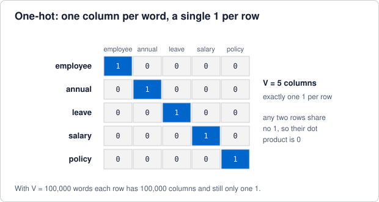</p>

Exactly one position contains: $1$

hence:

> **one-hot**

## 3. Mathematical representation

For vocabulary size $V$:

```math
x_w\in\mathbb{R}^{V}
```

For word $w_i$: $x_{w_i}[i]=1$

and every other dimension: $0$

## 4. Major problem with one-hot vectors

Consider:

```text
cat
dog
car
```

One-hot:

```math
\text{cat}=[1,0,0], \qquad \text{dog}=[0,1,0], \qquad \text{car}=[0,0,1]
```

Dot products:

```math
\text{cat}\cdot \text{dog}=0
```

and:

```math
\text{cat}\cdot \text{car}=0
```

According to this representation:

```text
cat vs dog
```

is exactly as unrelated as:

```text
cat vs car
```

But semantically that is obviously wrong.

### Check in code (added)

```python
import numpy as np

# One-hot vectors for a 3-word vocabulary
cat = np.array([1, 0, 0])
dog = np.array([0, 1, 0])
car = np.array([0, 0, 1])

# Every pair of different words has dot product 0
print("cat . dog =", cat @ dog)
print("cat . car =", cat @ car)
print("cat . cat =", cat @ cat)
```

**Output**

```text
cat . dog = 0
cat . car = 0
cat . cat = 1
```

## 5. One-hot has no semantic geometry

<p align="center">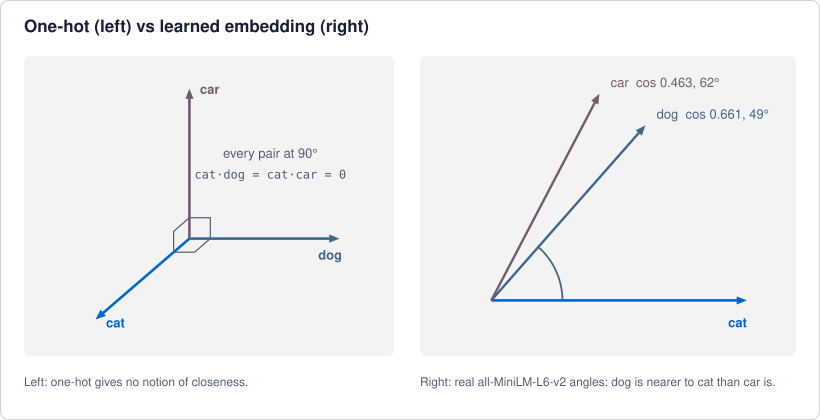</p>

Left: the one-hot picture, three axes at 90°. Right: real all-MiniLM-L6-v2 vectors (local run): cos(cat, dog) = 0.661, cos(cat, car) = 0.463.

This is the fundamental limitation.

## 6. Another problem: dimensionality

Suppose vocabulary has: $100,000$

words.

Every word needs: $100,000$

dimensions.

But only one value is nonzero.

Example:

```text
[0,0,0,0,...,1,...,0,0]
```

This is:

> **high-dimensional and sparse**

## 7. Sparse vs dense vectors

### Sparse vector

Most dimensions: $0$

Example:

```text
[0,0,0,5,0,0,2,0,0,...]
```

### Dense vector

Most dimensions contain meaningful numerical values:

```text
[0.21, -0.84, 0.13, 0.72, ...]
```

Modern embeddings are generally dense.

<p align="center">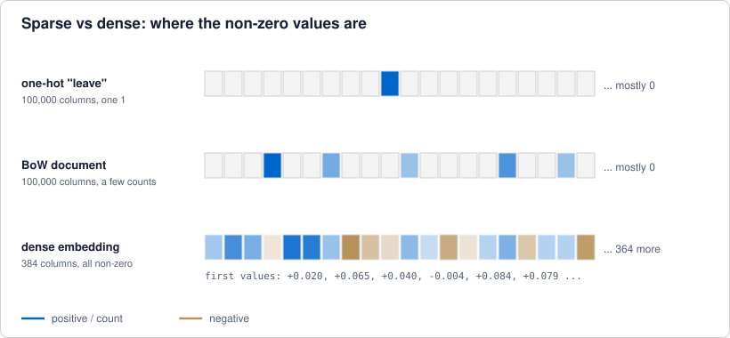</p>

The dense row shows the first 20 of the 384 real values for "employee annual leave policy" from all-MiniLM-L6-v2.

## 8. From words to documents — Bag of Words

> [!TIP]
> **In simple words:** Add up the one-hot rows of all words in a document and you get its Bag of Words.

One-hot represents individual words.

But suppose we want to represent:

```text
"employee annual leave policy"
```

One solution:

> Count how many times each vocabulary word occurs.

This produces a **Bag of Words — BoW** vector.

## 9. Bag-of-Words example

Vocabulary:

```text
annual
employee
leave
policy
salary
```

Document:

```text
employee annual leave policy
```

Vector: $[1,1,1,1,0]$

Another document:

```text
employee salary salary policy
```

Vector: $[0,1,0,1,2]$

Each dimension corresponds to a vocabulary term.

<p align="center"></p>

## 10. Why is it called a "bag"?

Because word order is discarded.

These sentences:

```text
dog bites man
```

and:

```text
man bites dog
```

produce essentially the same Bag-of-Words representation.

But their meanings are very different.

<p align="center">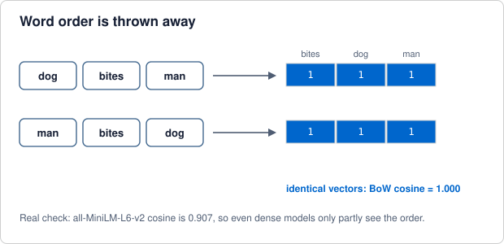</p>

Thus: $\text{BoW}(\text{text})$

captures:

> Which words and how often?

It does **not** naturally capture:

> In what order and with what contextual meaning?

### Check in code (added)

```python
from collections import Counter

# Count the words of each sentence, ignoring order
bag_1 = Counter("dog bites man".split())
bag_2 = Counter("man bites dog".split())

# Same counts, so the BoW vectors are identical
print(bag_1)
print(bag_2)
print("same bag:", bag_1 == bag_2)
```

**Output**

```text
Counter({'dog': 1, 'bites': 1, 'man': 1})
Counter({'man': 1, 'bites': 1, 'dog': 1})
same bag: True
```

## 11. BoW architecture

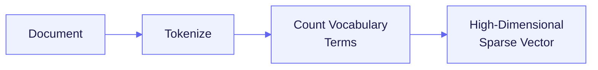

Example:

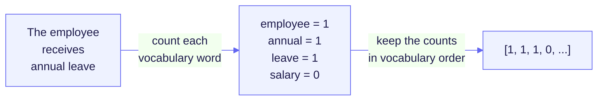

## 12. Why BoW was useful

Despite its limitations, BoW is useful because it is:

```text
simple
fast
interpretable
easy to index
```

It captures lexical evidence very well.

If query contains:

```text
Article 17
```

and document contains:

```text
Article 17
```

word-level matching can be extremely useful.

This is why sparse retrieval never completely disappeared.

## 13. Problem: all words aren't equally useful

Consider:

```text
the manufacturer shall submit the report
```

Words such as:

```text
the
shall
```

may occur extremely frequently.

Word:

```text
manufacturer
```

may provide much more useful retrieval information.

Plain BoW does not account for this sufficiently.

That motivates **TF-IDF**.

## 14. TF-IDF — important bridge

> [!TIP]
> **In simple words:** TF-IDF keeps the word counts but shrinks words that appear everywhere, like "the".

Although your roadmap primarily says BoW → embeddings, TF-IDF is an important intermediate representation.

TF-IDF means:

> **Term Frequency – Inverse Document Frequency**

Core intuition:

> A term is important when it appears frequently in this document but is relatively rare across the corpus.

## 15. Term Frequency

For term $t$ in document $d$: $\text{TF}(t,d)$

measures how frequently the term occurs in that document.

Simple version:

```math
\text{TF}(t,d)=\text{count}(t,d)
```

## 16. Inverse Document Frequency

If a word appears in nearly every document, it isn't very discriminative.

A common conceptual IDF form:

```math
\text{IDF}(t) = \log\left( \frac{N}{\text{df}(t)} \right)
```

where:

- $N$ = number of documents
- $\text{df}(t)$ = number of documents containing term $t$

Rare terms receive larger IDF.

## 17. TF-IDF

Combine:

```math
\boxed{ \text{TF-IDF}(t,d) = \text{TF}(t,d)\times \text{IDF}(t) }
```

So:

```text
"manufacturer"
```

might get high weight.

Whereas:

```text
"the"
```

gets low weight.

### TF-IDF by hand (added)

The formulas above on a 4-document corpus. "the" and "shall" occur in every document, so their IDF is log(4/4) = 0.

```python
import math

# Small corpus: every document uses "the" and "shall"
corpus = [
    "the manufacturer shall submit the report",
    "the importer shall keep the records",
    "the distributor shall check the label",
    "the authority shall publish the decision",
]
tokenized = [document.split() for document in corpus]
n_documents = len(tokenized)

# IDF(t) = log(N / df(t))
def idf(term):
    df = sum(1 for words in tokenized if term in words)
    return math.log(n_documents / df)

# TF-IDF(t, d) = count(t, d) x IDF(t) for the first document
first = tokenized[0]
for term in ["the", "shall", "manufacturer", "submit", "report"]:
    count = first.count(term)
    print(f"{term:<13} count = {count}   idf = {idf(term):.3f}   tf-idf = {count * idf(term):.3f}")
```

**Output**

```text
the           count = 2   idf = 0.000   tf-idf = 0.000
shall         count = 1   idf = 0.000   tf-idf = 0.000
manufacturer  count = 1   idf = 1.386   tf-idf = 1.386
submit        count = 1   idf = 1.386   tf-idf = 1.386
report        count = 1   idf = 1.386   tf-idf = 1.386
```

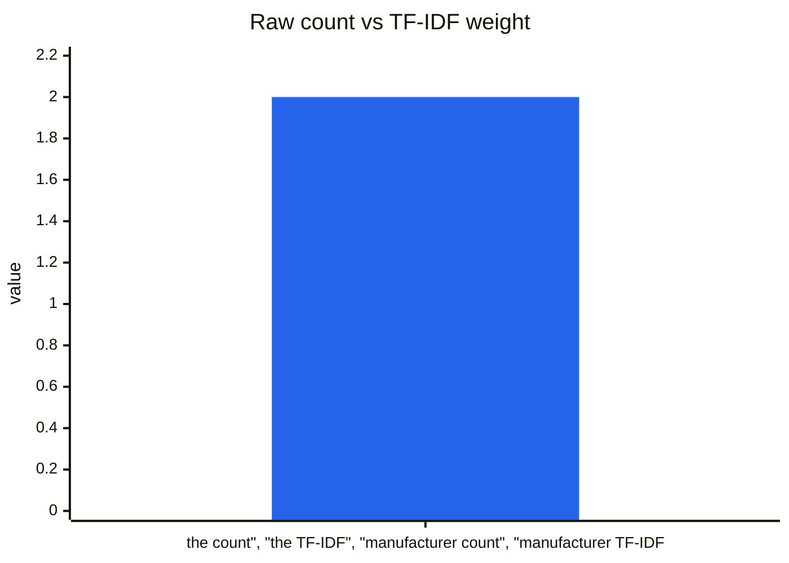

"the" has the highest raw count but a TF-IDF weight of 0; "manufacturer" keeps weight 1.386.

## 18. TF-IDF representation

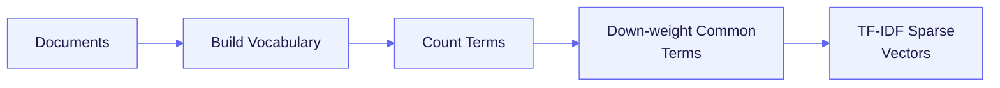

TF-IDF improves lexical retrieval considerably.

But it still doesn't truly understand semantics.

## 19. The synonym problem

> [!TIP]
> **In simple words:** Different words with the same meaning share no column, so word counting sees no match.

Document:

```text
employees receive annual leave
```

Query:

```text
paid vacation for workers
```

Semantically:

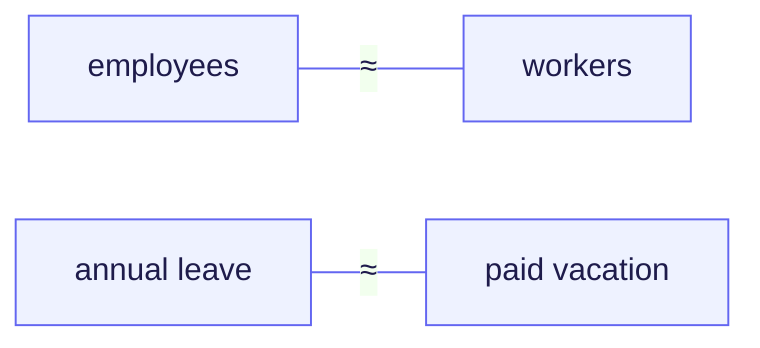

But lexical representation may see very little overlap.

This is one of the central motivations for embeddings.

<p align="center">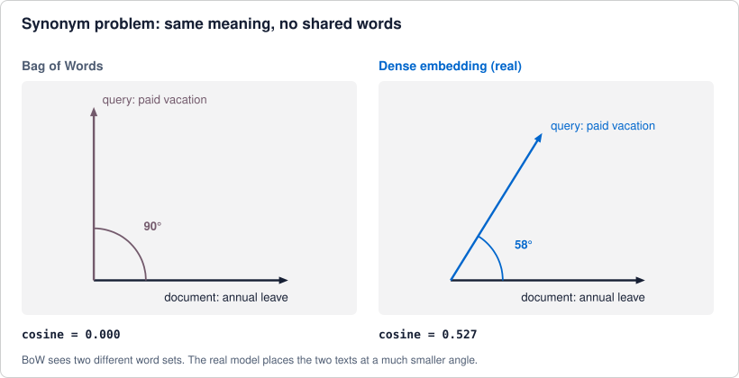</p>

Real numbers: BoW cosine 0.000 (no shared word), all-MiniLM-L6-v2 cosine 0.527.

## 20. Another example

Query:

```text
How can I terminate my employment?
```

Document:

```text
The employee may resign by providing 30 days notice.
```

Important semantic relation:

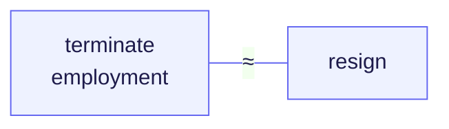

BoW/TF-IDF may miss or under-rank this relationship.

A dense embedding can potentially represent them close together.

## 21. The key conceptual shift

Traditional sparse representation asks:

> **Which words occur?**

Embeddings ask:

> **What does this text mean?**

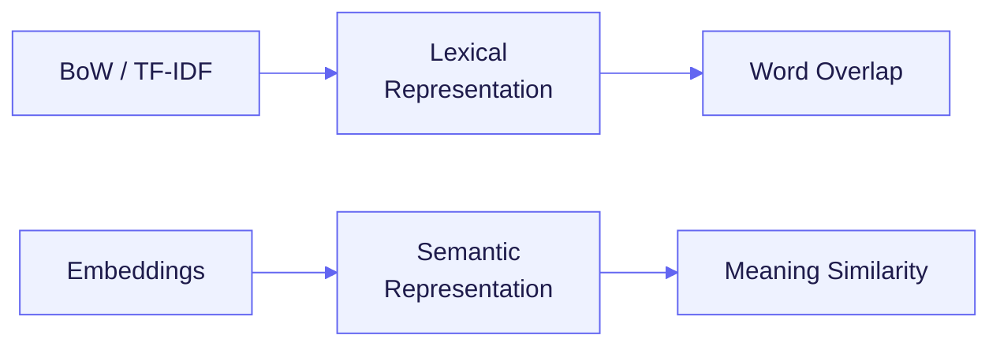

This is the central idea of the chapter.

## 22. Distributional hypothesis

> [!TIP]
> **In simple words:** You can guess what a word means from the company it keeps.

A major intuition behind learned word representations is:

> **Words occurring in similar contexts tend to have similar meanings.**

Example:

```text
The cat drank the milk.
The dog drank the water.
```

If words repeatedly occur in similar linguistic contexts, their representations can become similar.

This idea powers approaches such as Word2Vec.

## 23. Word2Vec

Word2Vec learns a dense vector:

```math
w\rightarrow v_w\in\mathbb{R}^{d}
```

Instead of: $100,000$

sparse dimensions, perhaps: $100,\ 300,\ 500$

dense dimensions.

Example conceptually:

<table width="100%">
<thead><tr><th width="8%">Sr No</th><th width="28%">Word</th><th width="64%">Dense vector (made-up numbers)</th></tr></thead>
<tbody>
<tr><td align="center">01</td><td>king</td><td><code>[0.21, -0.45, ..., 0.72]</code></td></tr>
<tr><td align="center">02</td><td>queen</td><td><code>[0.25, -0.41, ..., 0.69]</code></td></tr>
<tr><td align="center">03</td><td>car</td><td><code>[-0.62, 0.17, ..., -0.12]</code></td></tr>
</tbody>
</table>

King and queen might end up geometrically closer.

## 24. Word2Vec training intuition

Word2Vec learns meaning from context.

Two famous architectures:

```text
CBOW
Skip-gram
```

You do not need to over-focus on their training mechanics for RAG interviews, but you should know their intuition.

## 25. CBOW — Continuous Bag of Words

CBOW predicts the center word using surrounding words.

Example:

```text
The employee receives ___ leave
```

Context:

```text
employee
receives
leave
```

Target:

```text
annual
```

Conceptually:

```math
\text{Context Words}\rightarrow \text{Target Word}
```

## 26. CBOW Mermaid

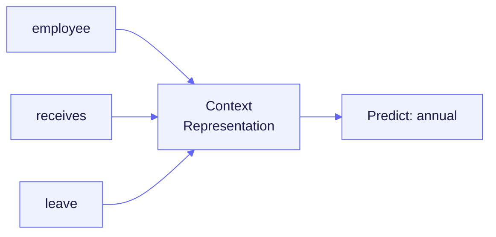

Repeated across massive text corpora, words used in similar contexts learn similar vectors.

## 27. Skip-gram

Skip-gram performs the reverse.

Given a center word:

```text
annual
```

predict surrounding words:

```text
employee
leave
entitlement
```

Conceptually:

```math
\text{Center Word}\rightarrow \text{Context Words}
```

## 28. Skip-gram Mermaid

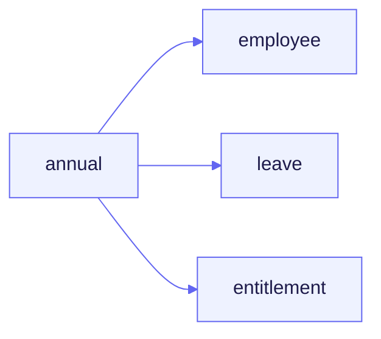

Again, the important part for RAG interviews isn't memorizing optimization equations.

It is understanding:

> **The vector space is learned from contextual co-occurrence patterns.**

<p align="center">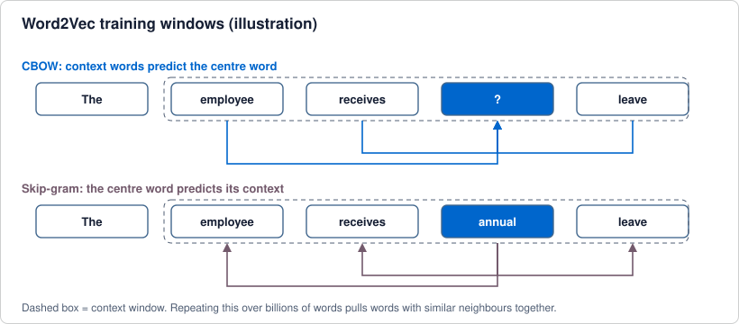</p>

## 29. Why Word2Vec was revolutionary

Before dense word embeddings:

```text
cat
dog
car
```

were essentially unrelated one-hot IDs.

After learned embeddings:

**cat and dog**

can have smaller geometric distance than:

**cat and database**.

Real check (all-MiniLM-L6-v2, local run): cos(cat, dog) = 0.661, cos(cat, database) = 0.239.

Now the vector space contains semantic structure.

## 30. Dense semantic geometry

Conceptually:

<p align="center">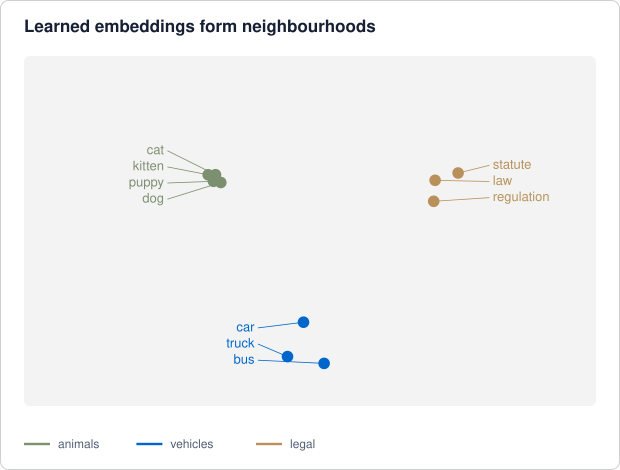</p>

This map is a 2D PCA projection of real all-MiniLM-L6-v2 embeddings (local run). The three neighbourhoods are real; the axes have no names.

This is conceptual, not literal dimensions.

Individual embedding dimensions do not necessarily correspond to human-readable concepts.

## 31. Famous vector arithmetic intuition

Word2Vec became famous for relationships roughly like:

```math
\text{king}-\text{man}+\text{woman}\approx \text{queen}
```

This demonstrates that learned vector space can encode relationships.

For RAG, however, this particular analogy is not the important part.

The important part is:

> semantically related language can occupy nearby regions in vector space.

## 32. Static embeddings

> [!TIP]
> **In simple words:** Static means one vector per word in the dictionary, whatever the sentence says.

Word2Vec creates one vector per word.

That means:

```text
bank
```

has one vector.

But consider:

```text
I deposited money in the bank.
```

versus:

```text
We sat on the river bank.
```

The meaning of:

```text
bank
```

is different.

Word2Vec gives essentially the same static embedding to both occurrences.

This is a major limitation.

## 33. Static embedding problem

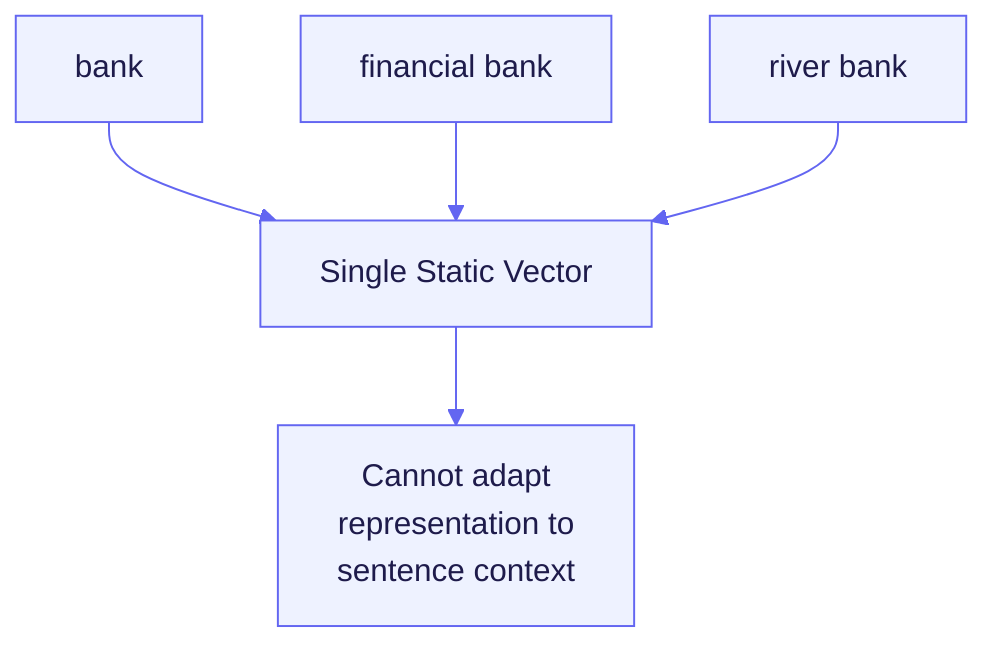

Meaning is often contextual.

So we need:

> **contextual embeddings**

## 34. Contextual embeddings

> [!TIP]
> **In simple words:** Contextual means the vector is computed again for each sentence, so the same word can get different vectors.

Modern Transformer models create a word/token representation based on its surrounding context.

So:

```text
bank
```

in:

```text
I deposited cash at the bank.
```

gets one contextual representation.

While:

```text
bank
```

in:

```text
The fisherman sat on the river bank.
```

gets another.

Conceptually:

```math
\text{Embedding}(\text{token}) = f(\text{token},\ \text{surrounding context})
```

not merely: $f(\text{token})$

## 35. Static vs contextual

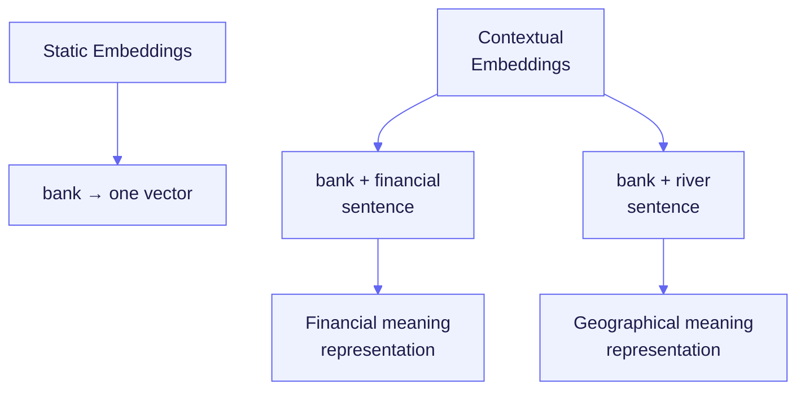

This is one of the most important NLP transitions.

<p align="center">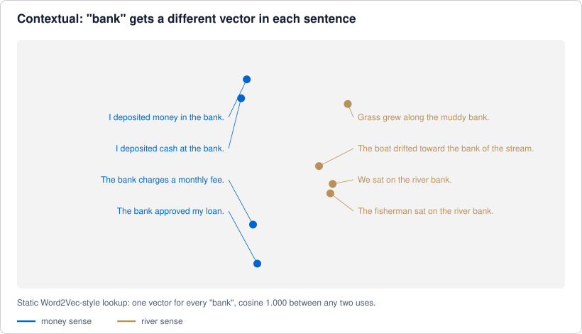</p>

Real numbers from the transformer inside all-MiniLM-L6-v2: the vector of "bank" in two money sentences has average cosine 0.864, while a money "bank" and a river "bank" average 0.759. A static lookup would give 1.000 for every pair.

### Static vs contextual in code (added)

The input embedding table of all-MiniLM-L6-v2 is a static lookup: one row per token. The transformer output for the same token changes with the sentence.

```python
import numpy as np
import torch
from transformers import AutoModel, AutoTokenizer

name = "sentence-transformers/all-MiniLM-L6-v2"
tokenizer = AutoTokenizer.from_pretrained(name)
encoder = AutoModel.from_pretrained(name)
bank_id = tokenizer.convert_tokens_to_ids("bank")

def bank_vectors(sentence):
    # Static row and contextual output for the token "bank"
    inputs = tokenizer(sentence, return_tensors="pt")
    position = inputs["input_ids"][0].tolist().index(bank_id)

    # Static: the same table row whatever the sentence
    static = encoder.embeddings.word_embeddings.weight[bank_id].detach().numpy()

    # Contextual: the output of all 6 transformer layers at that position
    with torch.no_grad():
        contextual = encoder(**inputs).last_hidden_state[0, position].numpy()

    return static, contextual

def cosine(a, b):
    # Cosine similarity of two vectors
    return float(a @ b / (np.linalg.norm(a) * np.linalg.norm(b)))

static_money, context_money = bank_vectors("I deposited money in the bank.")
static_river, context_river = bank_vectors("We sat on the river bank.")

print(f"static     bank (money) vs bank (river): {cosine(static_money, static_river):.3f}")
print(f"contextual bank (money) vs bank (river): {cosine(context_money, context_river):.3f}")
```

**Output**

```text
static     bank (money) vs bank (river): 1.000
contextual bank (money) vs bank (river): 0.773
```

## 36. Transformer contextual representations

Modern models roughly perform:

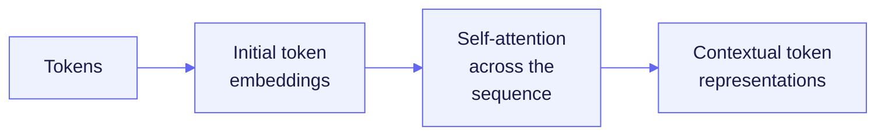

Example:

```text
"annual leave policy"
```

The representation of:

```text
leave
```

is influenced by:

```text
annual
policy
```

through attention.

The deeper Transformer and pooling details are in 01.04 Embeddings Fundamentals, so they are not repeated here.

## 37. From token embeddings to sentence embeddings

RAG retrieval usually does not search individual word vectors.

Instead we want:

```math
E(\text{What is the annual leave entitlement?})
```

to produce one vector.

And:

```math
E(\text{Employees receive 24 days of annual leave.})
```

to produce another.

Then:

```math
\text{sim}(E(\text{query}),E(\text{document}))
```

can be high.

## 38. Sentence embedding intuition

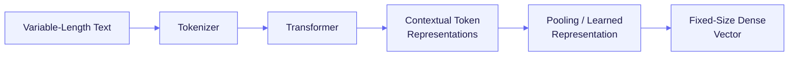

This is what eventually enables dense semantic retrieval.

## 39. Why fixed-size dense vectors are powerful

These sentences have different words:

```text
How much vacation do workers receive?
```

and:

```text
Employees are entitled to 24 annual leave days.
```

Yet a good embedding model may map them close together because their meanings are related.

That's the semantic retrieval capability BoW lacks.

## 40. Sparse vs dense retrieval

> [!TIP]
> **In simple words:** Sparse search is good at exact words and codes, dense search is good at meaning. RAG often runs both.

### Sparse

Example:

```text
BM25
TF-IDF
```

Representation is approximately:

```math
\mathbb{R}^{\text{vocabulary size}}
```

with mostly zeros.

Captures:

```text
exact words
rare terms
identifiers
```

### Dense

Representation: $\mathbb{R}^{d}$

with relatively small $d$, perhaps hundreds/thousands.

Captures:

```text
semantic relationships
paraphrases
concept similarity
```

## 41. Comparison

<table width="100%">
<thead><tr><th width="8%">Sr No</th><th width="24%">Property</th><th width="34%">BoW / TF-IDF</th><th width="34%">Dense Embeddings</th></tr></thead>
<tbody>
<tr><td align="center">01</td><td>Representation</td><td>Sparse</td><td>Dense</td></tr>
<tr><td align="center">02</td><td>Dimensions</td><td>Vocabulary size</td><td>Fixed small $d$</td></tr>
<tr><td align="center">03</td><td>Exact terms</td><td>Excellent</td><td>Variable</td></tr>
<tr><td align="center">04</td><td>Semantic similarity</td><td>Weak</td><td>Strong</td></tr>
<tr><td align="center">05</td><td>Synonyms</td><td>Weak</td><td>Stronger</td></tr>
<tr><td align="center">06</td><td>Rare IDs/codes</td><td>Strong</td><td>Can struggle</td></tr>
<tr><td align="center">07</td><td>Context-sensitive meaning</td><td>No</td><td>Modern embeddings: Yes</td></tr>
<tr><td align="center">08</td><td>Interpretability</td><td>Higher</td><td>Lower</td></tr>
</tbody>
</table>

This is why modern RAG often combines both.

## 42. Why dense vectors are called embeddings

Imagine high-dimensional semantic space.

Text is:

> embedded into that space.

Mathematically:

```math
f:\mathcal{T}\rightarrow\mathbb{R}^{d}
```

where: $\mathcal{T}$

is text space.

The output vector is an **embedding**.

## 43. Why meaning needs learned dense representations

Suppose vocabulary:

```text
car
automobile
vehicle
banana
```

One-hot representations say:

```math
\text{car}\perp \text{automobile}
```

because every different token is orthogonal.

But learned embeddings can produce:

```math
\text{sim}(\text{car},\text{automobile}) > \text{sim}(\text{car},\text{banana})
```

This geometry approximates semantic relationships.

That's the essential reason dense representations became important.

### Check in code (added)

```python
import os
os.environ["HF_HUB_OFFLINE"] = "1"

from sentence_transformers import SentenceTransformer

# A real sentence embedding model (384 dimensions)
model = SentenceTransformer("all-MiniLM-L6-v2", device="cpu")

# car vs automobile vs banana
words = ["car", "automobile", "banana"]
word_vectors = model.encode(words, normalize_embeddings=True)

print(f"sim(car, automobile) = {float(word_vectors[0] @ word_vectors[1]):.3f}")
print(f"sim(car, banana)     = {float(word_vectors[0] @ word_vectors[2]):.3f}")
```

**Output**

```text
sim(car, automobile) = 0.865
sim(car, banana)     = 0.390
```

## 44. Important nuance — dense does not "understand" perfectly

Do not say:

> "Embeddings understand meaning."

More accurate:

> **Embedding models learn vector representations where semantic/retrieval relationships are encoded geometrically based on their training objective and data.**

They remain imperfect.

They can fail with:

```text
numbers
negation
rare identifiers
domain terminology
temporal distinctions
```

## 45. Bag of Words Python

Simple example:

```python
# Define a small corpus.
documents = [
    "employee annual leave",
    "employee salary policy",
    "annual leave policy",
]

# Build a vocabulary from all unique terms.
vocabulary = sorted(
    set(
        word
        for document in documents
        for word in document.split()
    )
)

# Display the vocabulary.
print(vocabulary)
```

**Output**

```text
['annual', 'employee', 'leave', 'policy', 'salary']
```

## 46. Create BoW manually

```python
# Define a helper that converts one document
# into a Bag-of-Words vector.
def create_bow_vector(
    document,
    vocabulary,
):

    # Split document into words.
    words = document.split()

    # Store output values.
    vector = []

    # Process each vocabulary term.
    for vocabulary_word in vocabulary:

        # Count how many times the term appears.
        count = words.count(
            vocabulary_word
        )

        # Store its count.
        vector.append(count)

    # Return the sparse-style representation.
    return vector
```

Then:

```python
# Convert a document into BoW.
vector = create_bow_vector(
    "employee annual leave",
    vocabulary,
)

# Display the result.
print(vector)
```

**Output**

```text
[1, 1, 1, 0, 0]
```

The vector contains **counts**, not meaning.

## 47. The semantic failure in code

Suppose:

```text
Document:
employee receives annual leave

Query:
worker gets paid vacation
```

Vocabulary overlap could be: $0$

even though meaning overlap is high.

That's the exact failure dense retrieval tries to solve.

### Check in code (added)

```python
document = "employee receives annual leave"
query = "worker gets paid vacation"

# Lexical overlap: words that appear in both texts
overlap = set(document.split()) & set(query.split())
print("shared words:", overlap or "none")

# Dense similarity from the same embedding model as section 43
vectors = model.encode([document, query], normalize_embeddings=True)

print(f"embedding cosine: {float(vectors[0] @ vectors[1]):.3f}")
```

**Output**

```text
shared words: none
embedding cosine: 0.536
```

## 48. One-hot → BoW → embeddings

The conceptual evolution is:

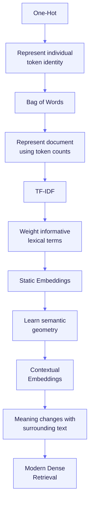

## 49. Why did we not simply abandon sparse retrieval?

Because dense retrieval introduces different weaknesses.

Query:

```text
G.S.R. 145(E)
```

BM25 can match the exact token sequence.

Dense model might retrieve semantically related regulations but fail to prioritize the exact code.

So production RAG often uses:

```math
\boxed{ \text{Sparse} + \text{Dense} }
```

through hybrid search.

Group 07 Hybrid Search covers how the two are combined, and group 12 Evaluation shows how to measure it.

## 50. Lexical vs semantic retrieval example

Consider:

### Query A

```text
EU 2023/1542 Article 77
```

Best retrieval signal:

```text
exact lexical match
```

### Query B

```text
What recycling duties do battery producers have?
```

Best retrieval signal may be:

```text
semantic meaning
```

Therefore:

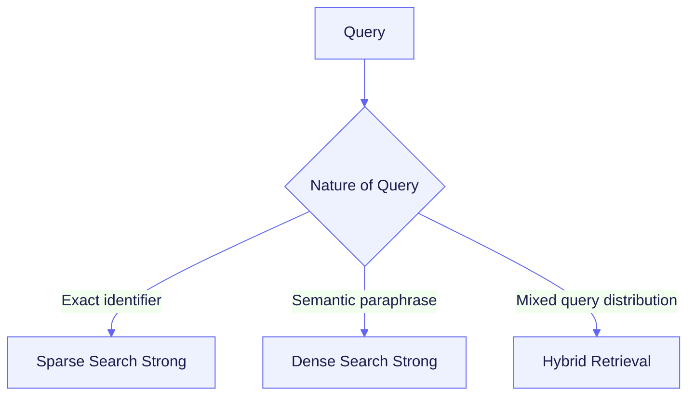

### Sparse vs dense on both queries (added)

BM25 (from `rank-bm25`) and all-MiniLM-L6-v2 on four short documents. Higher is better in both columns.

```python
from rank_bm25 import BM25Okapi

documents = [
    "EU 2023/1542 Article 77 sets the end-of-life obligations for batteries.",
    "Producers must collect and recycle waste batteries under extended producer responsibility.",
    "Article 12 of the same regulation covers labelling requirements.",
    "Battery passports store information about each industrial battery.",
]
queries = ["EU 2023/1542 Article 77", "What recycling duties do battery producers have?"]

# Lowercase words without the final punctuation
def words(text):
    return text.lower().replace("?", "").replace(".", "").split()

# Sparse: BM25 over word tokens
bm25 = BM25Okapi([words(d) for d in documents])

# Dense: cosine of unit vectors
document_vectors = model.encode(documents, normalize_embeddings=True)

for query in queries:
    sparse = bm25.get_scores(words(query))
    dense = document_vectors @ model.encode([query], normalize_embeddings=True)[0]

    # One row per document
    print(query)
    for k in range(len(documents)):
        print(f"  D{k + 1}   BM25 {sparse[k]:6.3f}   dense {dense[k]:.3f}")
```

**Output**

```text
EU 2023/1542 Article 77
  D1   BM25  2.483   dense 0.535
  D2   BM25  0.000   dense 0.051
  D3   BM25  0.000   dense 0.218
  D4   BM25  0.000   dense 0.064
What recycling duties do battery producers have?
  D1   BM25  0.000   dense 0.413
  D2   BM25  0.791   dense 0.780
  D3   BM25  0.000   dense 0.164
  D4   BM25  1.275   dense 0.490
```

For Query A only D1 contains the code, so BM25 gives every other document 0; the dense model also ranks D1 first here, but with a much smaller lead (0.535 vs 0.218). For Query B, BM25 puts D4 first because it repeats "battery"; the dense model puts D2, the recycling duty, first. That is the case for hybrid retrieval in one example.

## 51. Interview question — Why is one-hot encoding poor for semantics?

A strong answer:

> One-hot encoding represents every vocabulary item as an independent orthogonal dimension. Therefore two semantically related words such as "car" and "automobile" are just as distant as unrelated words. It captures identity but contains no learned semantic geometry.

## 52. Interview question — What is Bag of Words?

> Bag of Words represents a document using vocabulary-term occurrence counts while ignoring word order. It is simple and interpretable but produces high-dimensional sparse vectors and relies primarily on lexical overlap.

## 53. Interview question — Main limitation of BoW?

Strong answer:

> BoW ignores word order and semantic relationships. Synonyms such as "vacation" and "annual leave" occupy completely separate vocabulary dimensions, so semantically similar text with different wording may appear unrelated.

## 54. Interview question — Why TF-IDF over raw BoW?

> Raw term counts treat common words too generously. TF-IDF weights a term based on its frequency within a document and its rarity across the corpus, giving more retrieval weight to discriminative terms.

## 55. Interview question — What is the core idea behind Word2Vec?

> Word2Vec learns dense word representations from surrounding context. Words that occur in similar linguistic contexts receive similar vectors, allowing semantic relationships to emerge geometrically instead of representing every word as an unrelated vocabulary dimension.

## 56. Interview question — CBOW vs Skip-gram?

> CBOW predicts a target word from surrounding context words, whereas Skip-gram predicts surrounding context words from a center word. Both learn dense semantic word representations from co-occurrence patterns.

You do not need to go much deeper for a RAG-focused interview unless specifically asked about classic NLP.

## 57. Interview question — Why are Word2Vec embeddings called static?

> Each vocabulary word gets one learned vector regardless of sentence context. Therefore a polysemous word such as "bank" has essentially the same embedding in "financial bank" and "river bank", which cannot represent context-dependent meaning.

## 58. Interview question — What are contextual embeddings?

> Contextual embeddings generate a token representation based on its surrounding sequence. Therefore the representation of a word such as "bank" can differ between financial and geographical contexts. Transformer models produce contextual representations through interactions such as self-attention.

## 59. Interview question — Sparse vs dense vectors?

> Sparse representations such as TF-IDF or BM25 operate over vocabulary dimensions with mostly zero values and excel at lexical matching. Dense embeddings use smaller learned continuous vectors that encode semantic relationships and are stronger for paraphrases and conceptual similarity.

## 60. Interview question — Why not use dense retrieval only?

> Dense retrieval is strong for semantic matching but can struggle with exact identifiers, numbers, rare terms or domain-specific codes. Sparse retrieval preserves exact lexical evidence, which is why hybrid sparse-dense retrieval is often effective in production RAG.

## 61. Important interview progression

If asked:

> How did NLP representations evolve from BoW to embeddings?

Answer:

> We began with one-hot representations that encoded word identity but no semantic relationships. Bag of Words aggregated those identities into sparse document vectors but ignored word order and semantics. TF-IDF improved lexical importance weighting but remained based on token overlap. Word2Vec introduced learned dense vectors where words occurring in similar contexts were geometrically close, but these embeddings were static. Transformer-based contextual representations then allowed token meaning to depend on surrounding context, and modern embedding models aggregate these representations into fixed-size vectors suitable for semantic retrieval in RAG.

That's an excellent complete answer.

## 62. Common traps

### Trap: BoW captures sentence order.

No.

### Trap: One-hot vectors encode similarity.

No.

### Trap: TF-IDF understands semantics.

Not really; primarily lexical statistics.

### Trap: Word2Vec gives different vectors for every occurrence of "bank."

No. Static embedding.

### Trap: Dense embeddings make sparse retrieval obsolete.

No.

### Trap: Every dimension of an embedding has a clear human-readable meaning.

Generally no.

### Trap: Similar embedding = factually equivalent.

No.

### Trap: Dense retrieval automatically handles exact numbers and codes better.

Often the opposite.

## 63. Mental model

Think of the evolution like this:

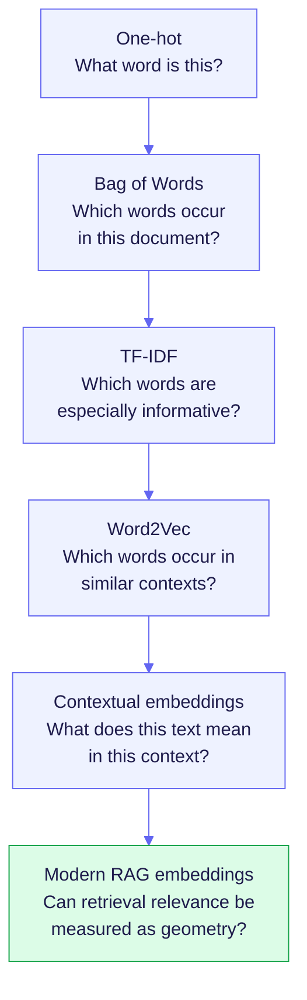

## 64. Final comparison table

<table width="100%">
<thead><tr><th width="8%">Sr No</th><th width="24%">Representation</th><th width="17%">Dense/Sparse</th><th width="17%">Semantics</th><th width="17%">Context-aware</th><th width="17%">Typical Retrieval Strength</th></tr></thead>
<tbody>
<tr><td align="center">01</td><td>One-hot</td><td>Sparse</td><td>No</td><td>No</td><td>Token identity</td></tr>
<tr><td align="center">02</td><td>BoW</td><td>Sparse</td><td>No</td><td>No</td><td>Lexical counts</td></tr>
<tr><td align="center">03</td><td>TF-IDF</td><td>Sparse</td><td>Limited</td><td>No</td><td>Informative lexical matching</td></tr>
<tr><td align="center">04</td><td>Word2Vec</td><td>Dense</td><td>Yes</td><td>No</td><td>Word similarity</td></tr>
<tr><td align="center">05</td><td>Contextual embeddings</td><td>Dense</td><td>Yes</td><td>Yes</td><td>Contextual meaning</td></tr>
<tr><td align="center">06</td><td>Modern retrieval embeddings</td><td>Dense</td><td>Yes</td><td>Yes</td><td>Semantic query-document retrieval</td></tr>
</tbody>
</table>

## 65. Final revision

The chapter can be compressed into five ideas:

### 1. One-hot

```math
\text{word}\rightarrow \text{sparse identity vector}
```

No semantics.

### 2. Bag of Words

```math
\text{document}\rightarrow \text{term counts}
```

Captures lexical occurrence but ignores order and meaning.

### 3. TF-IDF

```math
\text{term importance} = \text{frequency}\times \text{rarity}
```

Better sparse retrieval, still lexical.

### 4. Word2Vec

```math
\text{word}\rightarrow \text{learned dense vector}
```

Similar-context words become geometrically similar.

But representation is static.

### 5. Contextual embeddings

```math
\text{representation} = f(\text{word/text},\ \text{context})
```

Meaning can change with context.

This eventually leads to modern semantic retrieval.

### One-line interview memory

> **BoW represents what words occur; TF-IDF represents which words matter; Word2Vec learns which words mean similar things; contextual embeddings represent what text means in its specific context.**

## 66. Practice Tasks

1. Build the one-hot vectors for a 6-word vocabulary and check that all pairwise dot products are 0.
2. Write the BoW vectors for "leave policy for employees" and "employees policy leave for" and explain why they match.
3. Compute TF-IDF by hand for "report" in a corpus where it appears in 1 of 10 documents.
4. Find two sentences with no shared words that all-MiniLM-L6-v2 scores above 0.5.
5. Repeat the "bank" experiment with "apple" (fruit vs company).
6. Add a fifth document to the BM25 vs dense example that makes BM25 fail on Query A.

## 67. Final Takeaways

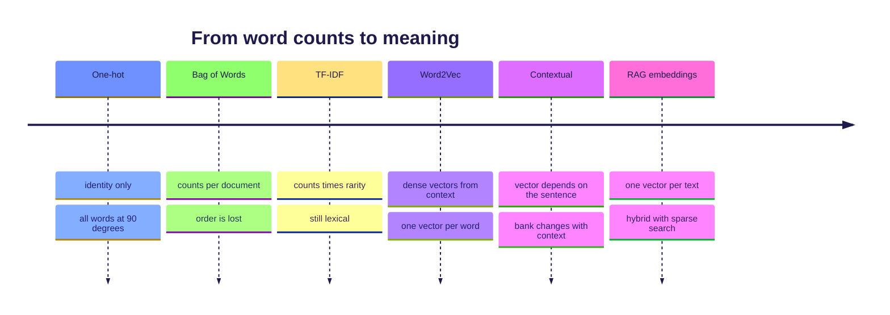

> [!TIP]
> **Study rule:** for any representation, ask two questions. Can it match different words with the same meaning? Can it match an exact code? Sparse answers the second, dense the first, hybrid both.

<p align="center"><a href="../../02.%20Tokens%20and%20Tokenization/README.md">Previous: 01.02 Tokens and Tokenization</a> | <a href="../../../README.md">Home</a> | <a href="../../README.md">Group 01: NLP Basics for RAG</a> | <a href="../README.md">Chapter page</a> | <a href="../../04.%20Embeddings%20Fundamentals/README.md">Next: 01.04 Embeddings Fundamentals</a></p>
