<div align="center">

# 01.04 · Embeddings Fundamentals

   

**An embedding turns a chunk of text into a point on a map of meaning, so a question can find chunks that mean the same thing even with different words.**

</div>

<p align="center"><a href="../../03.%20From%20Bag%20of%20Words%20to%20Embeddings/README.md">Previous: 01.03 From Bag of Words to Embeddings</a> | <a href="../../../README.md">Home</a> | <a href="../../README.md">Group 01: NLP Basics for RAG</a> | <a href="../README.md">Chapter page</a> | <a href="../../05.%20Embedding%20Mathematics/README.md">Next: 01.05 Embedding Mathematics</a></p>

## Contents

<table width="100%">
<thead><tr><th width="8%">Sr No</th><th width="38%">Section</th><th width="54%">Subtopics</th></tr></thead>
<tbody>
<tr><td align="center">01</td><td><a href="#introduction"><b>Introduction</b></a></td><td>-</td></tr>
<tr><td align="center">02</td><td><a href="#basic-definitions-in-simple-words"><b>Basic Definitions in Simple Words</b></a></td><td>-</td></tr>
<tr><td align="center">03</td><td><a href="#part-1--why-do-embeddings-exist"><b>Part 1 — Why do embeddings exist?</b></a></td><td><a href="#2-embedding-intuition">2. Embedding intuition</a><br><a href="#3-the-fundamental-idea">3. The fundamental idea</a><br><a href="#4-visual-intuition">4. Visual intuition</a><br><a href="#5-query-retrieval-intuition">5. Query retrieval intuition</a><br><a href="#6-embeddings-vs-keyword-matching">6. Embeddings vs keyword matching</a><br><a href="#7-sparse-vs-dense-representation">7. Sparse vs dense representation</a><br><a href="#sparse-representation">Sparse representation</a><br><a href="#8-dense-embedding">8. Dense embedding</a><br><a href="#9-sparse-vs-dense">9. Sparse vs dense</a><br><a href="#10-what-is-a-vector">10. What is a vector?</a><br><a href="#11-embedding-dimension">11. Embedding dimension</a><br><a href="#12-why-not-use-only-2-dimensions">12. Why not use only 2 dimensions?</a><br><a href="#13-does-one-dimension-mean-one-concept">13. Does one dimension mean one concept?</a><br><a href="#14-distributed-representation">14. Distributed representation</a><br><a href="#15-embedding-space">15. Embedding space</a></td></tr>
<tr><td align="center">04</td><td><a href="#part-2--different-kinds-of-embeddings"><b>Part 2 — Different kinds of embeddings</b></a></td><td><a href="#16-token-embeddings">16. Token embeddings</a><br><a href="#17-input-token-embedding-matrix">17. Input token embedding matrix</a><br><a href="#18-static-vs-contextual-representation">18. Static vs contextual representation</a><br><a href="#19-contextual-embeddings">19. Contextual embeddings</a><br><a href="#20-transformer-token-representations">20. Transformer token representations</a><br><a href="#21-sentencedocument-embeddings">21. Sentence/document embeddings</a></td></tr>
<tr><td align="center">05</td><td><a href="#part-3--pooling"><b>Part 3 — Pooling</b></a></td><td><a href="#22-mean-pooling">22. Mean pooling</a><br><a href="#23-mean-pooling-intuition">23. Mean pooling intuition</a><br><a href="#24-mean-pooling-with-padding">24. Mean pooling with padding</a><br><a href="#25-mean-pooling-python">25. Mean pooling Python</a><br><a href="#26-cls-pooling">26. CLS pooling</a><br><a href="#27-is-cls-always-best">27. Is CLS always best?</a><br><a href="#28-max-pooling">28. Max pooling</a><br><a href="#29-weighted-pooling">29. Weighted pooling</a><br><a href="#30-pooling-comparison">30. Pooling comparison</a></td></tr>
<tr><td align="center">06</td><td><a href="#part-4--how-text-embeddings-are-learned"><b>Part 4 — How text embeddings are learned</b></a></td><td><a href="#31-representation-learning">31. Representation learning</a><br><a href="#32-positive-pairs">32. Positive pairs</a><br><a href="#33-negative-pairs">33. Negative pairs</a><br><a href="#34-contrastive-learning-intuition">34. Contrastive learning intuition</a><br><a href="#35-triplet-loss">35. Triplet loss</a><br><a href="#36-triplet-example">36. Triplet example</a><br><a href="#37-contrastive-softmax-objective">37. Contrastive softmax objective</a><br><a href="#38-temperature-tau">38. Temperature $\tau$</a><br><a href="#39-in-batch-negatives">39. In-batch negatives</a><br><a href="#40-similarity-matrix-formulation">40. Similarity matrix formulation</a><br><a href="#41-why-negatives-matter-so-much">41. Why negatives matter so much</a><br><a href="#42-hard-negatives">42. Hard negatives</a><br><a href="#43-hard-negative-example">43. Hard-negative example</a><br><a href="#44-this-connects-to-rag-failure-modes">44. This connects to RAG failure modes</a></td></tr>
<tr><td align="center">07</td><td><a href="#part-5--bi-encoders"><b>Part 5 — Bi-encoders</b></a></td><td><a href="#45-what-is-a-bi-encoder">45. What is a bi-encoder?</a><br><a href="#46-why-bi-encoders-are-perfect-for-retrieval">46. Why bi-encoders are perfect for retrieval</a><br><a href="#47-bi-encoder-architecture">47. Bi-encoder architecture</a><br><a href="#48-same-encoder-or-different-encoders">48. Same encoder or different encoders?</a><br><a href="#shared-encoder">Shared encoder</a><br><a href="#separate-encoders">Separate encoders</a><br><a href="#49-symmetric-semantic-similarity">49. Symmetric semantic similarity</a><br><a href="#50-asymmetric-retrieval">50. Asymmetric retrieval</a><br><a href="#51-querydocument-prefixes">51. Query/document prefixes</a><br><a href="#52-bi-encoder-limitation">52. Bi-encoder limitation</a><br><a href="#53-cross-encoder-preview">53. Cross-encoder preview</a><br><a href="#54-bi-encoder-vs-cross-encoder">54. Bi-encoder vs cross-encoder</a></td></tr>
<tr><td align="center">08</td><td><a href="#part-6--similarity-mathematics"><b>Part 6 — Similarity mathematics</b></a></td><td><a href="#55-dot-product">55. Dot product</a><br><a href="#56-geometric-interpretation">56. Geometric interpretation</a><br><a href="#57-vector-norm">57. Vector norm</a><br><a href="#58-cosine-similarity">58. Cosine similarity</a><br><a href="#59-why-cosine-similarity-is-intuitive">59. Why cosine similarity is intuitive</a><br><a href="#60-cosine-similarity-ignores-magnitude">60. Cosine similarity ignores magnitude</a><br><a href="#61-euclidean-distance">61. Euclidean distance</a><br><a href="#62-dot-product-vs-cosine">62. Dot product vs cosine</a><br><a href="#63-l2-normalization">63. L2 normalization</a><br><a href="#64-normalization-python">64. Normalization Python</a><br><a href="#65-cosine-similarity-python">65. Cosine similarity Python</a><br><a href="#66-euclidean-distance-python">66. Euclidean distance Python</a><br><a href="#67-which-metric-should-we-use">67. Which metric should we use?</a><br><a href="#68-ranking-differences">68. Ranking differences</a></td></tr>
<tr><td align="center">09</td><td><a href="#part-7--building-embeddings-in-python"><b>Part 7 — Building embeddings in Python</b></a></td><td><a href="#69-install-sentence-transformers">69. Install Sentence Transformers</a><br><a href="#70-load-model">70. Load model</a><br><a href="#71-encode-sentences">71. Encode sentences</a><br><a href="#72-inspect-one-embedding">72. Inspect one embedding</a><br><a href="#73-compare-similarities">73. Compare similarities</a><br><a href="#74-build-brute-force-semantic-retrieval">74. Build brute-force semantic retrieval</a><br><a href="#75-score-documents">75. Score documents</a><br><a href="#76-rank-results">76. Rank results</a><br><a href="#77-time-complexity-of-brute-force-dense-retrieval">77. Time complexity of brute-force dense retrieval</a></td></tr>
<tr><td align="center">10</td><td><a href="#part-8--what-does-an-embedding-actually-encode"><b>Part 8 — What does an embedding actually encode?</b></a></td><td><a href="#78-embedding-model-quality-depends-on-objective">78. Embedding model quality depends on objective</a><br><a href="#79-semantic-similarity-vs-retrieval-relevance">79. Semantic similarity vs retrieval relevance</a><br><a href="#80-retrieval-trained-embedding-models">80. Retrieval-trained embedding models</a></td></tr>
<tr><td align="center">11</td><td><a href="#part-9--query-embeddings-vs-document-embeddings"><b>Part 9 — Query embeddings vs document embeddings</b></a></td><td><a href="#81-same-vector-space">81. Same vector space</a><br><a href="#82-query-instructions">82. Query instructions</a><br><a href="#83-embedding-instructions-are-model-specific">83. Embedding instructions are model-specific</a></td></tr>
<tr><td align="center">12</td><td><a href="#part-10--embedding-dimensionality"><b>Part 10 — Embedding dimensionality</b></a></td><td><a href="#84-higher-dimension-gives-capacity">84. Higher dimension gives capacity</a><br><a href="#85-example-vector-storage">85. Example vector storage</a><br><a href="#86-384-dimensions">86. 384 dimensions</a><br><a href="#87-is-more-dimensionality-always-better">87. Is more dimensionality always better?</a><br><a href="#88-dimensionality-reduction">88. Dimensionality reduction</a></td></tr>
<tr><td align="center">13</td><td><a href="#part-11--high-dimensional-geometry"><b>Part 11 — High-dimensional geometry</b></a></td><td><a href="#89-curse-of-dimensionality">89. Curse of dimensionality</a><br><a href="#90-distance-concentration">90. Distance concentration</a><br><a href="#91-why-embeddings-still-work">91. Why embeddings still work</a><br><a href="#92-manifold-intuition">92. Manifold intuition</a></td></tr>
<tr><td align="center">14</td><td><a href="#part-12--embedding-normalization"><b>Part 12 — Embedding normalization</b></a></td><td><a href="#93-why-normalize">93. Why normalize?</a><br><a href="#94-normalize-with-sentence-transformers">94. Normalize with Sentence Transformers</a></td></tr>
<tr><td align="center">15</td><td><a href="#part-13--embedding-similarity-thresholds"><b>Part 13 — Embedding similarity thresholds</b></a></td><td><a href="#experiment-added-what-do-real-cosine-scores-look-like">Experiment (added): what do real cosine scores look like?</a><br><a href="#95-threshold-calibration">95. Threshold calibration</a><br><a href="#96-threshold-trade-off">96. Threshold trade-off</a></td></tr>
<tr><td align="center">16</td><td><a href="#part-14--embedding-models-and-chunk-size"><b>Part 14 — Embedding models and chunk size</b></a></td><td><a href="#97-fixed-dimensional-bottleneck">97. Fixed-dimensional bottleneck</a><br><a href="#98-pooling-bottleneck">98. Pooling bottleneck</a><br><a href="#99-chunking--embeddings-interaction">99. Chunking + embeddings interaction</a></td></tr>
<tr><td align="center">17</td><td><a href="#part-15--domain-specific-embeddings"><b>Part 15 — Domain-specific embeddings</b></a></td><td><a href="#100-domain-example">100. Domain example</a><br><a href="#101-generic-vs-domain-specific">101. Generic vs domain-specific</a><br><a href="#102-fine-tuning-embeddings">102. Fine-tuning embeddings</a><br><a href="#103-when-fine-tuning-is-worth-it">103. When fine-tuning is worth it</a></td></tr>
<tr><td align="center">18</td><td><a href="#part-16--multilingual-embeddings"><b>Part 16 — Multilingual embeddings</b></a></td><td><a href="#104-cross-lingual-embedding-space">104. Cross-lingual embedding space</a><br><a href="#105-how-multilingual-training-works-conceptually">105. How multilingual training works conceptually</a><br><a href="#106-multilingual-challenge">106. Multilingual challenge</a></td></tr>
<tr><td align="center">19</td><td><a href="#part-17--embeddings-for-different-content-types"><b>Part 17 — Embeddings for different content types</b></a></td><td><a href="#107-image-embeddings">107. Image embeddings</a><br><a href="#108-code-embeddings">108. Code embeddings</a></td></tr>
<tr><td align="center">20</td><td><a href="#part-18--embedding-model-selection"><b>Part 18 — Embedding model selection</b></a></td><td><a href="#109-selection-dimensions">109. Selection dimensions</a><br><a href="#retrieval-quality">Retrieval quality</a><br><a href="#latency">Latency</a><br><a href="#throughput">Throughput</a><br><a href="#dimension">Dimension</a><br><a href="#maximum-token-length">Maximum token length</a><br><a href="#languages">Languages</a><br><a href="#domain">Domain</a><br><a href="#licensingdeployment">Licensing/deployment</a><br><a href="#cost">Cost</a><br><a href="#110-model-selection-pipeline">110. Model selection pipeline</a><br><a href="#111-do-not-compare-embeddings-with-different-chunking-setups">111. Do not compare embeddings with different chunking setups</a><br><a href="#112-retrieval-benchmark-example">112. Retrieval benchmark example</a></td></tr>
<tr><td align="center">21</td><td><a href="#part-19--embedding-caching"><b>Part 19 — Embedding caching</b></a></td><td><a href="#113-query-embedding-cache">113. Query embedding cache</a></td></tr>
<tr><td align="center">22</td><td><a href="#part-20--embedding-versioning"><b>Part 20 — Embedding versioning</b></a></td><td><a href="#114-embedding-space-incompatibility">114. Embedding-space incompatibility</a><br><a href="#115-model-migration">115. Model migration</a><br><a href="#116-store-embedding-metadata">116. Store embedding metadata</a></td></tr>
<tr><td align="center">23</td><td><a href="#part-21--updating-documents"><b>Part 21 — Updating documents</b></a></td><td>-</td></tr>
<tr><td align="center">24</td><td><a href="#part-22--embedding-batch-processing"><b>Part 22 — Embedding batch processing</b></a></td><td><a href="#117-batch-embedding-python">117. Batch embedding Python</a></td></tr>
<tr><td align="center">25</td><td><a href="#part-23--common-embedding-failure-modes"><b>Part 23 — Common embedding failure modes</b></a></td><td><a href="#118-failure-1--wrong-chunk-content">118. Failure 1 — wrong chunk content</a><br><a href="#119-failure-2--semantic-dilution">119. Failure 2 — semantic dilution</a><br><a href="#120-failure-3--truncation">120. Failure 3 — truncation</a><br><a href="#121-failure-4--domain-mismatch">121. Failure 4 — domain mismatch</a><br><a href="#122-failure-5--exact-identifier-retrieval">122. Failure 5 — exact identifier retrieval</a><br><a href="#123-failure-6--numbers">123. Failure 6 — numbers</a><br><a href="#124-failure-7--negation">124. Failure 7 — negation</a><br><a href="#experiment-added-numbers-and-negation">Experiment (added): numbers and negation</a><br><a href="#125-failure-8--temporality">125. Failure 8 — temporality</a><br><a href="#126-failure-9--contradictory-documents">126. Failure 9 — contradictory documents</a><br><a href="#127-failure-10--false-semantic-neighbors">127. Failure 10 — false semantic neighbors</a></td></tr>
<tr><td align="center">26</td><td><a href="#part-24--embeddings-are-lossy-compression"><b>Part 24 — Embeddings are lossy compression</b></a></td><td><a href="#128-information-cannot-be-perfectly-preserved">128. Information cannot be perfectly preserved</a><br><a href="#129-retriever-does-not-answer">129. Retriever does not answer</a></td></tr>
<tr><td align="center">27</td><td><a href="#part-25--why-vector-arithmetic-sometimes-works"><b>Part 25 — Why vector arithmetic sometimes works</b></a></td><td>-</td></tr>
<tr><td align="center">28</td><td><a href="#part-26--word2vec-intuition"><b>Part 26 — Word2Vec intuition</b></a></td><td><a href="#130-distributional-hypothesis">130. Distributional hypothesis</a><br><a href="#131-skip-gram-intuition">131. Skip-gram intuition</a><br><a href="#132-cbow-intuition">132. CBOW intuition</a><br><a href="#133-why-transformer-embeddings-are-stronger">133. Why Transformer embeddings are stronger</a></td></tr>
<tr><td align="center">29</td><td><a href="#part-27--transformer-to-sentence-embedding-pipeline"><b>Part 27 — Transformer-to-sentence-embedding pipeline</b></a></td><td><a href="#134-mathematical-representation">134. Mathematical representation</a></td></tr>
<tr><td align="center">30</td><td><a href="#part-28--self-attention-connection"><b>Part 28 — Self-attention connection</b></a></td><td>-</td></tr>
<tr><td align="center">31</td><td><a href="#part-29--positional-information"><b>Part 29 — Positional information</b></a></td><td>-</td></tr>
<tr><td align="center">32</td><td><a href="#part-30--similarity-is-model-dependent"><b>Part 30 — Similarity is model-dependent</b></a></td><td>-</td></tr>
<tr><td align="center">33</td><td><a href="#part-31--similarity-score-is-not-probability"><b>Part 31 — Similarity score is not probability</b></a></td><td>-</td></tr>
<tr><td align="center">34</td><td><a href="#part-32--what-is-a-good-cosine-score"><b>Part 32 — What is a good cosine score?</b></a></td><td>-</td></tr>
<tr><td align="center">35</td><td><a href="#part-33--embedding-retrieval-and-metadata-filters"><b>Part 33 — Embedding retrieval and metadata filters</b></a></td><td><a href="#135-separation-of-responsibilities">135. Separation of responsibilities</a></td></tr>
<tr><td align="center">36</td><td><a href="#part-34--embedding-security-considerations"><b>Part 34 — Embedding security considerations</b></a></td><td>-</td></tr>
<tr><td align="center">37</td><td><a href="#part-35--embedding-observability"><b>Part 35 — Embedding observability</b></a></td><td><a href="#136-why-vector-norm-monitoring-can-help">136. Why vector norm monitoring can help</a></td></tr>
<tr><td align="center">38</td><td><a href="#part-36--empty-chunks"><b>Part 36 — Empty chunks</b></a></td><td>-</td></tr>
<tr><td align="center">39</td><td><a href="#part-37--duplicates"><b>Part 37 — Duplicates</b></a></td><td>-</td></tr>
<tr><td align="center">40</td><td><a href="#part-38--production-embedding-architecture"><b>Part 38 — Production embedding architecture</b></a></td><td><a href="#138-online-query-architecture">138. Online query architecture</a></td></tr>
<tr><td align="center">41</td><td><a href="#part-39--scaling-embedding-generation"><b>Part 39 — Scaling embedding generation</b></a></td><td><a href="#139-throughput">139. Throughput</a></td></tr>
<tr><td align="center">42</td><td><a href="#part-40--embedding-latency-online"><b>Part 40 — Embedding latency online</b></a></td><td>-</td></tr>
<tr><td align="center">43</td><td><a href="#part-41--should-query-embeddings-be-generated-by-the-llm"><b>Part 41 — Should query embeddings be generated by the LLM?</b></a></td><td>-</td></tr>
<tr><td align="center">44</td><td><a href="#part-42--embeddings-vs-fine-tuning"><b>Part 42 — Embeddings vs fine-tuning</b></a></td><td>-</td></tr>
<tr><td align="center">45</td><td><a href="#part-43--evaluation"><b>Part 43 — Evaluation</b></a></td><td><a href="#140-recallk">140. Recall@K</a><br><a href="#141-why-recall-matters-before-reranking">141. Why Recall matters before reranking</a></td></tr>
<tr><td align="center">46</td><td><a href="#part-44--error-diagnosis"><b>Part 44 — Error diagnosis</b></a></td><td>-</td></tr>
<tr><td align="center">47</td><td><a href="#part-45--faang-interview-questions"><b>Part 45 — FAANG interview questions</b></a></td><td><a href="#q1-what-is-an-embedding">Q1. What is an embedding?</a><br><a href="#q2-why-use-embeddings-in-rag">Q2. Why use embeddings in RAG?</a><br><a href="#q3-token-embedding-vs-sentence-embedding">Q3. Token embedding vs sentence embedding?</a><br><a href="#q4-how-does-a-transformer-create-sentence-embeddings">Q4. How does a Transformer create sentence embeddings?</a><br><a href="#q5-what-is-pooling">Q5. What is pooling?</a><br><a href="#q6-mean-pooling-equation">Q6. Mean pooling equation?</a><br><a href="#q7-what-is-a-bi-encoder">Q7. What is a bi-encoder?</a><br><a href="#q8-bi-encoder-vs-cross-encoder">Q8. Bi-encoder vs cross-encoder?</a><br><a href="#q9-why-cosine-similarity">Q9. Why cosine similarity?</a><br><a href="#q10-dot-product-vs-cosine">Q10. Dot product vs cosine?</a><br><a href="#q11-does-higher-embedding-dimension-always-mean-better">Q11. Does higher embedding dimension always mean better?</a><br><a href="#q12-what-is-contrastive-learning">Q12. What is contrastive learning?</a><br><a href="#q13-why-are-hard-negatives-useful">Q13. Why are hard negatives useful?</a><br><a href="#q14-what-are-in-batch-negatives">Q14. What are in-batch negatives?</a><br><a href="#q15-why-can-embeddings-fail-on-numbers">Q15. Why can embeddings fail on numbers?</a><br><a href="#q16-why-can-embeddings-fail-on-negation">Q16. Why can embeddings fail on negation?</a><br><a href="#q17-are-cosine-scores-probabilities">Q17. Are cosine scores probabilities?</a><br><a href="#q18-can-i-change-embedding-models-without-re-indexing">Q18. Can I change embedding models without re-indexing?</a><br><a href="#q19-can-embeddings-alone-handle-access-control">Q19. Can embeddings alone handle access control?</a><br><a href="#q20-dense-retrieval-vs-bm25">Q20. Dense retrieval vs BM25?</a></td></tr>
<tr><td align="center">48</td><td><a href="#part-46--interview-traps"><b>Part 46 — Interview traps</b></a></td><td><a href="#trap-embedding-dimension-1536-means-1536-human-concepts">Trap: "Embedding dimension 1536 means 1536 human concepts."</a><br><a href="#trap-higher-dimension-always-means-higher-accuracy">Trap: "Higher dimension always means higher accuracy."</a><br><a href="#trap-cosine-09-means-90-relevant">Trap: "Cosine 0.9 means 90% relevant."</a><br><a href="#trap-the-nearest-embedding-must-contain-the-answer">Trap: "The nearest embedding must contain the answer."</a><br><a href="#trap-all-embedding-models-with-dimension-768-are-interchangeable">Trap: "All embedding models with dimension 768 are interchangeable."</a><br><a href="#trap-embedding-models-understand-numbers-perfectly">Trap: "Embedding models understand numbers perfectly."</a><br><a href="#trap-a-generic-bert-cls-vector-is-automatically-a-good-retrieval-embedding">Trap: "A generic BERT CLS vector is automatically a good retrieval embedding."</a><br><a href="#trap-if-the-embedding-model-has-an-8k-limit-an-8k-chunk-is-ideal">Trap: "If the embedding model has an 8K limit, an 8K chunk is ideal."</a><br><a href="#trap-dense-retrieval-replaces-bm25">Trap: "Dense retrieval replaces BM25."</a></td></tr>
<tr><td align="center">49</td><td><a href="#part-47--production-design-example"><b>Part 47 — Production design example</b></a></td><td>-</td></tr>
<tr><td align="center">50</td><td><a href="#part-48--full-mathematical-summary"><b>Part 48 — Full mathematical summary</b></a></td><td>-</td></tr>
<tr><td align="center">51</td><td><a href="#part-49--most-important-conceptual-diagram"><b>Part 49 — Most important conceptual diagram</b></a></td><td>-</td></tr>
<tr><td align="center">52</td><td><a href="#part-50--how-to-think-about-embeddings-in-one-sentence"><b>Part 50 — How to think about embeddings in one sentence</b></a></td><td>-</td></tr>
<tr><td align="center">53</td><td><a href="#part-51--what-embeddings-are-good-at-vs-bad-at"><b>Part 51 — What embeddings are good at vs bad at</b></a></td><td><a href="#very-good-at">Very good at</a><br><a href="#less-reliable-for">Less reliable for</a></td></tr>
<tr><td align="center">54</td><td><a href="#part-52--revision-cheat-sheet"><b>Part 52 — Revision cheat sheet</b></a></td><td><a href="#1">1.</a><br><a href="#2">2.</a><br><a href="#3">3.</a><br><a href="#4">4.</a><br><a href="#5">5.</a><br><a href="#6">6.</a><br><a href="#7">7.</a><br><a href="#8">8.</a><br><a href="#9">9.</a><br><a href="#10">10.</a><br><a href="#11">11.</a><br><a href="#12">12.</a><br><a href="#13">13.</a><br><a href="#14">14.</a><br><a href="#15">15.</a></td></tr>
<tr><td align="center">55</td><td><a href="#final-mental-model"><b>Final mental model</b></a></td><td><a href="#where-we-go-next">Where we go next</a></td></tr>
<tr><td align="center">56</td><td><a href="#practice-tasks"><b>Practice Tasks</b></a></td><td>-</td></tr>
<tr><td align="center">57</td><td><a href="#final-takeaways"><b>Final Takeaways</b></a></td><td>-</td></tr>
</tbody>
</table>

## Introduction

Embeddings are one of the most important concepts in RAG.

If chunking determines:

> **What unit can be retrieved?**

then embeddings determine:

> **How does the system understand what those chunks mean?**

At the end of this chapter, you should be able to explain:

- what an embedding really is
- why embeddings are vectors
- why semantically similar text becomes close in vector space
- token embeddings vs sentence embeddings vs document embeddings
- how a Transformer produces contextual token representations
- pooling strategies
- bi-encoders
- query/document encoders
- symmetric vs asymmetric embeddings
- contrastive learning
- positive and negative pairs
- cosine similarity, dot product and Euclidean distance
- normalization
- embedding dimensions
- semantic spaces
- dense retrieval
- multilingual embeddings
- domain-specific embeddings
- embedding failure modes
- model selection
- production trade-offs
- how embeddings fit into the complete RAG system

## Basic Definitions in Simple Words

<table width="100%">
<thead><tr><th width="8%">Sr No</th><th width="28%">Term</th><th width="64%">Meaning in simple words</th></tr></thead>
<tbody>
<tr><td align="center">01</td><td><b>Embedding</b></td><td>A list of numbers that stands for the meaning of a piece of text. Similar meanings get similar lists.</td></tr>
<tr><td align="center">02</td><td><b>Dense vector</b></td><td>A vector where almost every number is non-zero, unlike a sparse BM25 vector that is mostly zeros.</td></tr>
<tr><td align="center">03</td><td><b>Dimension</b></td><td>How many numbers the embedding has: 384 for all-MiniLM-L6-v2, 1536 for text-embedding-3-small.</td></tr>
<tr><td align="center">04</td><td><b>Vector space</b></td><td>The "map" where all embeddings live; distance on the map means difference in meaning.</td></tr>
<tr><td align="center">05</td><td><b>Token embedding</b></td><td>The vector for one token. A sentence has many token embeddings.</td></tr>
<tr><td align="center">06</td><td><b>Contextual embedding</b></td><td>A token vector that depends on the surrounding words: "bank" near "river" differs from "bank" near "money".</td></tr>
<tr><td align="center">07</td><td><b>Sentence / chunk embedding</b></td><td>One vector for a whole sentence or chunk, made from its token vectors.</td></tr>
<tr><td align="center">08</td><td><b>Pooling</b></td><td>Turning many token vectors into one: mean pooling averages them, CLS pooling takes one special token.</td></tr>
<tr><td align="center">09</td><td><b>Encoder / bi-encoder</b></td><td>A model that turns text into a vector. A bi-encoder encodes query and document separately, so documents can be embedded ahead of time.</td></tr>
<tr><td align="center">10</td><td><b>Cross-encoder</b></td><td>A model that reads query and document together and outputs one relevance score; more accurate, much slower.</td></tr>
<tr><td align="center">11</td><td><b>Contrastive learning</b></td><td>Training that pulls matching pairs together and pushes non-matching pairs apart.</td></tr>
<tr><td align="center">12</td><td><b>Positive / negative pair</b></td><td>A matching query-document pair / a non-matching pair.</td></tr>
<tr><td align="center">13</td><td><b>Hard negative</b></td><td>A non-matching document that looks very similar to the query; the most useful kind for training.</td></tr>
<tr><td align="center">14</td><td><b>Normalization</b></td><td>Scaling a vector to length 1 so dot product equals cosine similarity.</td></tr>
<tr><td align="center">15</td><td><b>Cosine similarity</b></td><td>How closely two vectors point the same way: 1 same, 0 unrelated, -1 opposite.</td></tr>
<tr><td align="center">16</td><td><b>Embedding model version</b></td><td>The exact model that made the vectors. Vectors from different models cannot be compared.</td></tr>
</tbody>
</table>

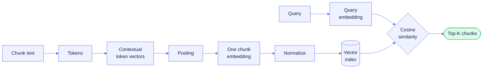

## Part 1 — Why do embeddings exist?

Computers fundamentally operate on numbers.

But RAG systems receive:

```text
"Employees receive 24 annual leave days."
```

A vector database cannot directly calculate:

```text
How similar is this sentence
to
"How much annual leave do employees get?"
```

using raw characters.

We need:

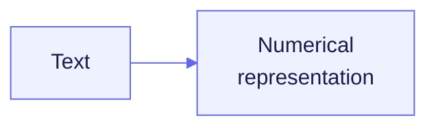

The naive representation could be:

```text
Employees → 1
receive   → 2
annual    → 3
leave     → 4
```

But these IDs contain no semantic information.

For example:

```text
cat = 10
dog = 11
airplane = 12
```

The numbers don't imply:

```text
cat is more similar to dog than airplane
```

So we need a representation where meaning is encoded geometrically.

That's what an **embedding** does.

### 2. Embedding intuition

> [!TIP]
> **In simple words:** An embedding turns text into a point on a map of meaning. Texts that mean similar things land close together.

An embedding converts an object into a vector.

For text:

```math
f(text)\rightarrow \mathbf{v}
```

where:

```math
\mathbf{v}\in\mathbb{R}^{d}
```

For example:

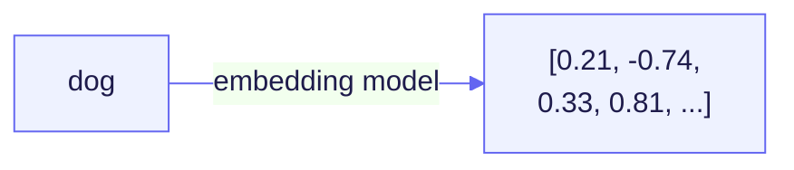

And:

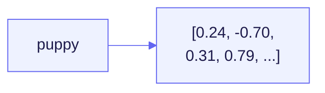

while:

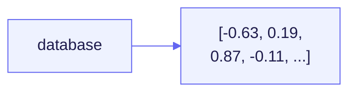

Ideally:

```text
dog ↔ puppy
```

are geometrically closer than:

```text
dog ↔ database
```

### 3. The fundamental idea

Embeddings try to transform:

```text
semantic similarity
```

into:

```text
geometric similarity
```

Conceptually:

```math
\text{SemanticSimilarity}(A,B) \approx \text{VectorSimilarity}(E(A),E(B))
```

where: $E(x)$

is the embedding model.

This is the foundation of dense retrieval.

### 4. Visual intuition

Imagine a 2-dimensional space.

Real embedding spaces have hundreds or thousands of dimensions, but 2D is easier to visualize.

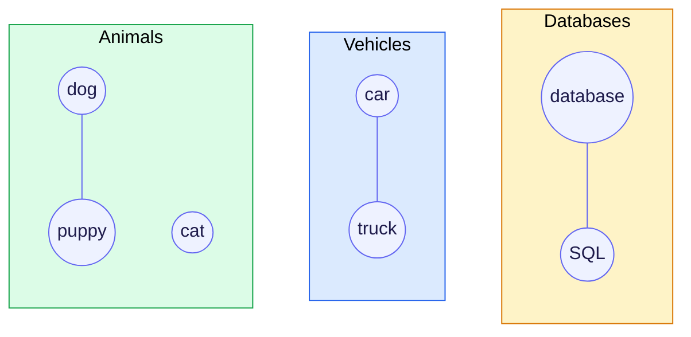

Semantically related concepts form neighborhoods.

Another region might contain:

```text
leave
vacation
annual holiday
paid time off
```

### 5. Query retrieval intuition

Suppose our knowledge base has:

```text
D1:
Employees receive 24 annual leave days.

D2:
The company provides medical insurance.

D3:
The office is located in Munich.

D4:
Employees may carry forward unused vacation days.
```

User asks:

```text
How much paid time off do employees receive?
```

Notice:

```text
paid time off
```

does not literally contain:

```text
annual leave
```

A keyword-only system might struggle.

But embedding model may understand:

```text
paid time off
≈
annual leave
≈
vacation entitlement
```

So:


That is **semantic retrieval**.

### 6. Embeddings vs keyword matching

Suppose query:

```text
How much vacation do workers receive?
```

Document:

```text
Employees are entitled to 24 annual leave days.
```

Keyword overlap may be low:

```text
vacation ≠ annual leave
workers ≠ employees
```

But semantic relationship is strong.

Dense embeddings aim to capture this.

### 7. Sparse vs dense representation

> [!TIP]
> **In simple words:** Sparse vectors say which words appear; dense vectors say what the text means.

This distinction is critical.

#### Sparse representation

Suppose vocabulary:

```text
["cat", "dog", "leave", "insurance", "travel"]
```

Document:

```text
"dog insurance"
```

could become: $[0,1,0,1,0]$

Most entries are zero.

Hence:

> sparse vector

### 8. Dense embedding

Instead:

```math
[0.18,-0.72,0.44,0.13,0.91,\ldots]
```

Almost every dimension contains some value.

Hence:

> dense vector

Dense representations generally encode distributed semantic information.

### 9. Sparse vs dense

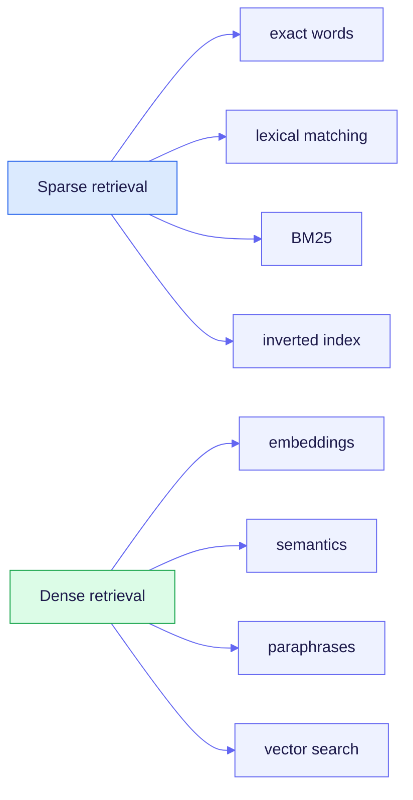

Both are useful.

Later:


is often stronger than either alone.

### 10. What is a vector?

A vector is an ordered collection of numbers.

For example:

```math
\mathbf{x} = [0.2,0.8,-0.4]
```

This is a vector in: $\mathbb{R}^3$

meaning a 3-dimensional real-valued vector space.

An embedding might instead be:

```math
\mathbf{x}\in\mathbb{R}^{384}
```

or:

```math
\mathbf{x}\in\mathbb{R}^{768}
```

or another dimensionality.

You cannot visualize 768 dimensions directly, but the mathematics remains the same.

### 11. Embedding dimension

If an embedding model outputs: $d=768$

then each piece of text becomes:

```math
\mathbf{v} = [v_1,v_2,\ldots,v_{768}]
```

For example:


Every chunk in your RAG index must use the same vector dimensionality for that index.

### 12. Why not use only 2 dimensions?

Imagine trying to represent all possible semantic properties using:

```text
x-axis
y-axis
```

Not enough representational capacity.

Text can encode:

```text
topic
emotion
domain
person
action
time
location
intent
syntax
relationships
technical concepts
```

Higher-dimensional spaces allow more complex structure.

### 13. Does one dimension mean one concept?

> [!TIP]
> **In simple words:** No. Meaning is spread across all dimensions together; a single number on its own means nothing.

Usually **no**.

This is an important misconception.

You should not expect:

```text
dimension 1 = happiness
dimension 2 = animals
dimension 3 = finance
```

Neural embeddings usually use **distributed representations**.

A concept is encoded across many dimensions.

Similarly, each dimension contributes to many concepts.

### 14. Distributed representation

Instead of:

```text
animal = dimension 7
```

you may have something conceptually like:

```text
dog:
[0.7, 0.1, -0.4, 0.8, ...]

cat:
[0.68, 0.12, -0.37, 0.76, ...]
```

Their overall vector patterns are similar.

Meaning emerges from the entire representation.

### 15. Embedding space

The collection of all possible embedding vectors defines an embedding space: $\mathbb{R}^d$

Different semantic regions emerge.

Conceptually:

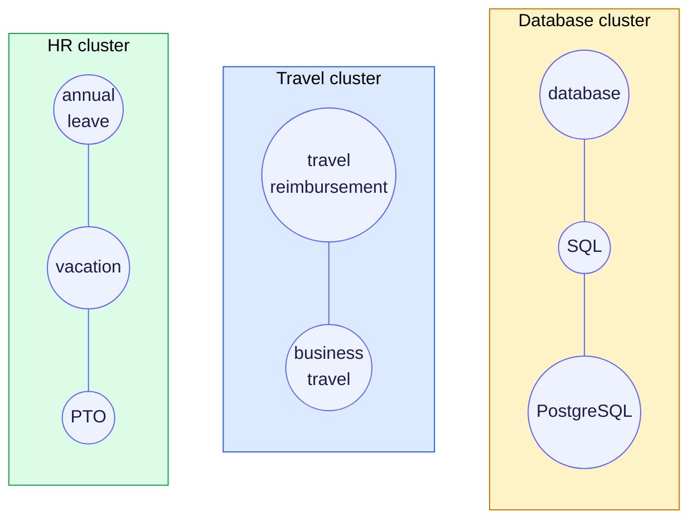

## Part 2 — Different kinds of embeddings

One of the biggest sources of confusion is that the word **embedding** is used for several related things.

We need to separate them.

### 16. Token embeddings

Suppose:

```text
"I love AI"
```

Tokenizer gives:

```text
["I", " love", " AI"]
```

Token IDs: $[42,813,9217]$

The Transformer begins by mapping each token ID into a vector.

Conceptually:

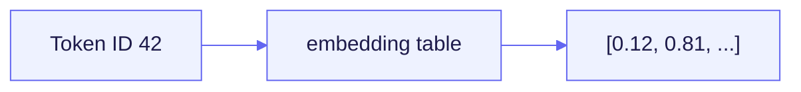

These are **token embeddings**.

### 17. Input token embedding matrix

Suppose: $V = 50,000$

vocabulary entries and hidden size: $d=768$

Then embedding matrix:

```math
W_E \in \mathbb{R}^{50000\times768}
```

For token ID $i$: $x_i=W_E[i]$

This gives an initial vector for that token.

### 18. Static vs contextual representation

Historically, systems like Word2Vec produced relatively static word vectors.

Conceptually:

```text
bank
```

always gets roughly the same vector.

But:

```text
I deposited cash at the bank.
```

and:

```text
I sat on the river bank.
```

have different meanings.

Modern Transformer representations solve this through contextualization.

### 19. Contextual embeddings

> [!TIP]
> **In simple words:** A Transformer gives each word a vector that depends on its neighbours, so 'bank' gets a different vector in 'river bank' and 'bank account'.

Transformer processes the entire sequence.

So representation of:

```text
bank
```

depends on surrounding words.

Sentence 1:

```text
I deposited money at the bank.
```

Representation:

```text
bank ≈ financial institution
```

Sentence 2:

```text
We sat beside the river bank.
```

Representation:

```text
bank ≈ land beside river
```

This is extremely important.

### 20. Transformer token representations

Suppose input token vectors: $X^{(0)}$

After Transformer layer 1: $X^{(1)}$

After layer 2: $X^{(2)}$

...

After final layer $L$: $X^{(L)}$

Each token representation now incorporates context.

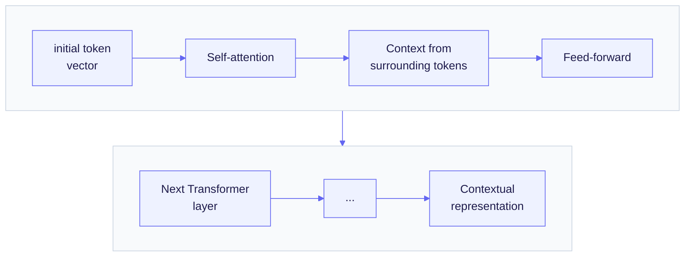

### 21. Sentence/document embeddings

For RAG, we usually need one vector for an entire chunk.

Suppose chunk contains 100 tokens.

Transformer gives:

```math
h_1,h_2,\ldots,h_{100}
```

where: $h_i\in\mathbb{R}^d$

But vector database wants:

```text
one chunk → one vector
```

So we must convert: $100\times d$

token representations into: $1\times d$

This is called:

> **pooling**

## Part 3 — Pooling

Pooling is a key embedding concept that is often skipped.

### 22. Mean pooling

> [!TIP]
> **In simple words:** Average all token vectors of the chunk (ignoring padding) to get one vector for the whole chunk.

Simplest useful method:

```math
v= \frac{1}{N} \sum_{i=1}^N h_i
```

Example token vectors:

```math
h_1=[1,2], \qquad h_2=[3,4], \qquad h_3=[5,6]
```

Mean:

```math
v= \frac{ [1,2]+[3,4]+[5,6] }{3} = [3,4]
```

Now the whole sentence is represented by: $[3,4]$

### 23. Mean pooling intuition

Sentence:

```text
Employees receive annual leave.
```

Transformer gives:

```text
Employees   → h1
receive     → h2
annual      → h3
leave       → h4
```

Mean pooling:

```text
h1 + h2 + h3 + h4
------------------
        4
```

produces sentence embedding.

### 24. Mean pooling with padding

Suppose batch:

```text
Sentence A:
5 tokens

Sentence B:
3 tokens + 2 PAD
```

You must not average padding vectors.

If attention mask: $m_i\in\{0,1\}$

then masked mean pooling:

```math
v = \frac{ \sum_i m_i h_i }{ \sum_i m_i }
```

This is the correct form.

### 25. Mean pooling Python

Let's implement it explicitly.

```python
# Import PyTorch.
import torch

# Define a function for mean pooling.
def mean_pool(
    token_embeddings,
    attention_mask,
):

    # Expand the attention mask so that it matches
    # the dimensions of token embeddings.
    expanded_mask = attention_mask.unsqueeze(-1)

    # Convert the mask to the same numeric type
    # as the token embeddings.
    expanded_mask = expanded_mask.float()

    # Zero out padding-token vectors.
    masked_embeddings = (
        token_embeddings
        * expanded_mask
    )

    # Sum all valid token vectors.
    summed_embeddings = (
        masked_embeddings.sum(dim=1)
    )

    # Count the number of valid tokens.
    token_counts = (
        expanded_mask.sum(dim=1)
    )

    # Prevent division by zero.
    token_counts = token_counts.clamp(
        min=1e-9
    )

    # Calculate the mean vector.
    sentence_embeddings = (
        summed_embeddings
        / token_counts
    )

    # Return the sentence embeddings.
    return sentence_embeddings
```

Check (added): run `mean_pool` on real token vectors from `all-MiniLM-L6-v2` and compare with the library's own sentence embedding.

```python
import os
os.environ["HF_HUB_OFFLINE"] = "1"

from transformers import AutoModel, AutoTokenizer
from sentence_transformers import SentenceTransformer

name = "sentence-transformers/all-MiniLM-L6-v2"
tokenizer = AutoTokenizer.from_pretrained(name)
encoder = AutoModel.from_pretrained(name)

# Two sentences of different length, so the shorter one gets padding
batch = tokenizer(["Employees receive annual leave.", "Unused leave may be carried forward to next year."],
                  padding=True, return_tensors="pt")

# Contextual token vectors: (sentences, tokens, 384)
with torch.no_grad():
    token_vectors = encoder(**batch).last_hidden_state

print("token vectors:", tuple(token_vectors.shape))
print("attention mask:", batch["attention_mask"].tolist())

# Our mean pooling, then the library's sentence embedding for the same text
ours = mean_pool(token_vectors, batch["attention_mask"])
library = SentenceTransformer(name, device="cpu").encode(["Employees receive annual leave."], convert_to_tensor=True, normalize_embeddings=False)

# all-MiniLM-L6-v2 = mean pooling + L2 normalization, so normalize ours before comparing
ours_unit = torch.nn.functional.normalize(ours[0], dim=0)
print("cosine(ours, library):", round(float(torch.nn.functional.cosine_similarity(ours_unit, library[0], dim=0)), 4))
```

**Output**

```text
token vectors: (2, 12, 384)
attention mask: [[1, 1, 1, 1, 1, 1, 1, 0, 0, 0, 0, 0], [1, 1, 1, 1, 1, 1, 1, 1, 1, 1, 1, 1]]
cosine(ours, library): 1.0
```

### 26. CLS pooling

BERT-style models often contain a special token:

```text
[CLS]
```

Input:

```text
[CLS] Employees receive annual leave [SEP]
```

The final representation of `[CLS]` can be used as the sentence representation: $v=h_{\text{CLS}}$

This is called:

> CLS pooling

### 27. Is CLS always best?

No.

This is another interview trap.

The usefulness of CLS pooling depends on how the model was trained.

A generic pretrained Transformer's CLS token is not automatically an excellent semantic-search embedding.

Sentence embedding models are specifically trained so their pooled representations work well for similarity/retrieval.

### 28. Max pooling

Another possibility:

For every vector dimension:

```math
v_j=\max_i h_{\text{ij}}
```

Suppose token vectors:

```math
[0.2,0.7], \qquad [0.9,0.1], \qquad [0.4,0.8]
```

Max pooling gives: $[0.9,0.8]$

This preserves strongest activations.

Less common as the default for modern retrieval embeddings, but conceptually useful.

### 29. Weighted pooling

You could also give different tokens different weights.

```math
v= \sum_i \alpha_i h_i
```

where: $\sum_i\alpha_i=1$

The weights could depend on:

```text
attention
position
importance
learned pooling
```

More sophisticated embedding architectures may learn how to pool.

### 30. Pooling comparison

<table width="100%">
<thead><tr><th width="8%">Sr No</th><th width="24%">Pooling</th><th width="34%">Intuition</th><th width="34%">Main consideration</th></tr></thead>
<tbody>
<tr><td align="center">01</td><td>Mean</td><td>Average all token representations</td><td>Strong common baseline</td></tr>
<tr><td align="center">02</td><td>CLS</td><td>Use special sequence representation</td><td>Depends heavily on training</td></tr>
<tr><td align="center">03</td><td>Max</td><td>Keep strongest feature per dimension</td><td>Can discard broader context</td></tr>
<tr><td align="center">04</td><td>Weighted</td><td>Learn token importance</td><td>More complexity</td></tr>
</tbody>
</table>

For practical RAG:

> Use the pooling strategy the embedding model was trained for.

Don't arbitrarily change it.

## Part 4 — How text embeddings are learned

Now we reach one of the most important sections.

Why should:

```text
"annual leave"
```

and:

```text
"paid vacation"
```

be close?

The model must be trained to produce that geometry.

### 31. Representation learning

We want embedding function: $E(x)$

such that:

For semantically related texts:

```math
\text{sim}(E(x),E(y))
```

is high.

For unrelated texts:

```math
\text{sim}(E(x),E(z))
```

is low.

Training shapes the vector space accordingly.

### 32. Positive pairs

Suppose:

```text
Query:
How many annual leave days do employees receive?

Positive passage:
Employees receive 24 annual leave days.
```

These should become close.

Training objective says conceptually:

```text
pull them together
```

### 33. Negative pairs

Negative passage:

```text
The company headquarters are in Munich.
```

This should be far from the annual-leave query.

Training says:

```text
push apart
```

Visual:

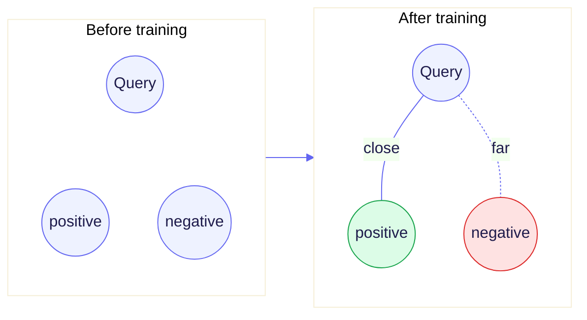

### 34. Contrastive learning intuition

> [!TIP]
> **In simple words:** Show the model pairs that should match and pairs that should not; it learns to put matches close and non-matches far.

This is central to modern embedding models.

For anchor $a$:

- positive $p$
- negative $n$

We want:

```math
\text{sim}(a,p)>\text{sim}(a,n)
```

Ideally by a margin.

### 35. Triplet loss

One classic formulation:

```math
L= \max( 0, d(a,p)-d(a,n)+m )
```

where:

- $a$ = anchor
- $p$ = positive
- $n$ = negative
- $d$ = distance
- $m$ = margin

Desired: $d(a,p)+m\lt d(a,n)$

Meaning the positive should be sufficiently closer than the negative.

### 36. Triplet example

Suppose:

```math
d(a,p)=0.2, \qquad d(a,n)=0.8, \qquad m=0.2
```

Then:

```math
L= \max(0,0.2-0.8+0.2) =\max(0,-0.4) =0
```

Good.

But if:

```math
d(a,p)=0.7, \qquad d(a,n)=0.6
```

then:

```math
L= \max(0,0.7-0.6+0.2) =0.3
```

Model gets penalized.

### 37. Contrastive softmax objective

Modern retrieval training often uses many negatives simultaneously.

Suppose query: $q$

has positive: $d^+$

and negatives:

```math
d_1^-,d_2^-,...,d_K^-
```

A common objective resembles:

```math
P(d^+|q) = \frac{ e^{\text{sim}(q,d^+)/\tau} }{ e^{\text{sim}(q,d^+)/\tau} + \sum_j e^{\text{sim}(q,d_j^-)/\tau} }
```

Loss: $L=-\log P(d^+|q)$

### 38. Temperature $\tau$

The parameter: $\tau$

controls how sharp the similarity distribution becomes.

Smaller temperature:

```text
magnifies differences
```

Larger temperature:

```text
makes scores softer
```

This appears frequently in contrastive learning.

### 39. In-batch negatives

This is a very important training trick.

Suppose training batch:

```text
(q1, d1+)
(q2, d2+)
(q3, d3+)
(q4, d4+)
```

For query: $q_1$

positive: $d_1$

But the other documents: $d_2,d_3,d_4$

can act as negatives.

So one batch provides many negative examples without explicitly generating all of them.

Matrix:

```text
             d1      d2      d3      d4

q1           P       -       -       -
q2           -       P       -       -
q3           -       -       P       -
q4           -       -       -       P
```

P = the matching (positive) document; - = an in-batch negative. The model learns to maximize the diagonal.

### 40. Similarity matrix formulation

Let query embeddings:

```math
Q\in\mathbb{R}^{B\times d}
```

Document embeddings:

```math
D\in\mathbb{R}^{B\times d}
```

Similarity matrix: $S=QD^T$

assuming normalized vectors/dot product.

Then:

```math
S\in\mathbb{R}^{B\times B}
```

Desired:

```text
large values on diagonal
small values off diagonal
```

### 41. Why negatives matter so much

Suppose training only sees positives:

```text
dog ↔ puppy
car ↔ automobile
leave ↔ vacation
```

It knows what should be close.

But it doesn't strongly learn:

```text
leave ≠ database
dog ≠ accounting
```

Negatives shape the geometry.

### 42. Hard negatives

> [!TIP]
> **In simple words:** The best training examples are wrong answers that look right, because they teach the finest distinctions.

Not all negatives are equally useful.

Easy negative:

```text
Query:
annual leave policy

Negative:
how to cook pasta
```

Obviously unrelated.

Hard negative:

```text
Query:
annual leave entitlement

Negative:
employees may carry forward 10 unused annual leave days
```

This is semantically related but does not answer the question.

Hard negatives teach fine-grained distinctions.

This is extremely important for retrieval quality.

### 43. Hard-negative example

Query:

> What is the maximum maternity leave duration?

Positive:

```text
Eligible employees may receive up to 26 weeks of maternity leave.
```

Hard negative:

```text
Employees must notify HR before taking maternity leave.
```

Both mention:

```text
maternity leave
```

but only one contains the requested duration.

Training with hard negatives helps answerability rather than mere topical similarity.

### 44. This connects to RAG failure modes

Recall from 04.01 Document Chunking:

```text
semantic similarity
≠
answerability
```

Embedding training with strong negatives can reduce this gap.

But no embedding model eliminates it completely.

That's one reason we later use:


## Part 5 — Bi-encoders

This is a critical RAG architecture.

### 45. What is a bi-encoder?

> [!TIP]
> **In simple words:** Two texts go into the encoder separately and come out as two vectors; the score is just their similarity.

A bi-encoder independently encodes:

```text
query
```

and:

```text
document
```

into vectors.


Then: $\text{sim}(q,d)$

is computed.

### 46. Why bi-encoders are perfect for retrieval

Documents can be embedded **offline**.

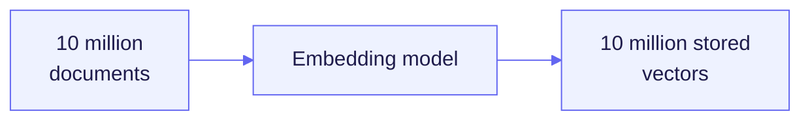

At query time:


You do not have to run the neural model jointly for every query-document pair.

This makes retrieval scalable.

### 47. Bi-encoder architecture

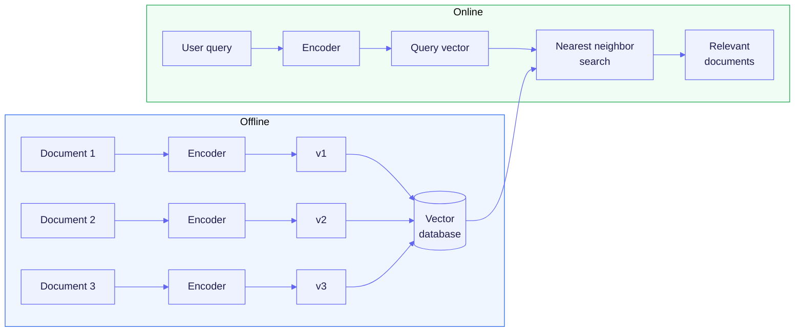

### 48. Same encoder or different encoders?

Possibilities:

#### Shared encoder

```math
E_q=E_d
```

same model/weights for query and document.

#### Separate encoders

```math
E_q\neq E_d
```

different query and document encoders.

Both architectures exist.

### 49. Symmetric semantic similarity

Use case:

```text
sentence ↔ sentence similarity
```

Example:

```text
"AI improves search."

"Machine intelligence enhances retrieval."
```

Both have similar linguistic roles.

A symmetric embedding model works well.

### 50. Asymmetric retrieval

RAG retrieval is often asymmetric.

Query:

```text
How many leave days do employees receive?
```

Document:

```text
Under Section 8.2 of the employment policy,
full-time employees shall be entitled to
twenty-four days of annual paid leave...
```

Query is short question.

Document is long informational passage.

Training should reflect:

```text
question → passage
```

not just generic sentence similarity.

### 51. Query/document prefixes

Some embedding models benefit from or require different prefixes.

Conceptually:

```text
query:
How many annual leave days?

passage:
Employees receive 24 annual leave days.
```

The model learns different roles.

This can improve asymmetric retrieval.

Always follow the embedding model's intended input format.

### 52. Bi-encoder limitation

> [!TIP]
> **In simple words:** Because query and document never see each other, fine details like negation or exact numbers can be missed.

Because query and document are encoded independently:

```text
query representation
```

cannot directly inspect every token of:

```text
document
```

during encoding.

This is efficient but loses fine-grained cross-interaction.

That leads to the **cross-encoder**.

### 53. Cross-encoder preview

Instead of independent encoding:


For example:

```text
[CLS]
How many leave days?
[SEP]
Employees receive 24 days...
[SEP]
```

The Transformer jointly attends across both texts.

Usually more precise, but far more expensive.

### 54. Bi-encoder vs cross-encoder

<table width="100%">
<thead><tr><th width="8%">Sr No</th><th width="24%">Property</th><th width="34%">Bi-encoder</th><th width="34%">Cross-encoder</th></tr></thead>
<tbody>
<tr><td align="center">01</td><td>Query/doc encoded independently</td><td>Yes</td><td>No</td></tr>
<tr><td align="center">02</td><td>Precompute document vectors</td><td>Yes</td><td>No</td></tr>
<tr><td align="center">03</td><td>Search millions quickly</td><td>Yes</td><td>No</td></tr>
<tr><td align="center">04</td><td>Fine-grained interactions</td><td>Limited</td><td>Strong</td></tr>
<tr><td align="center">05</td><td>Typical use</td><td>Retrieval</td><td>Reranking</td></tr>
</tbody>
</table>

Pipeline:

```mermaid
%%{init: {'theme':'base','themeVariables':{'primaryColor':'#EEF2FF','primaryBorderColor':'#6366F1','primaryTextColor':'#1E1B4B','lineColor':'#6366F1','pie1':'#22C55E','pie2':'#F59E0B','pie3':'#EF4444','pie4':'#3B82F6','pie5':'#8B5CF6','xyChart':{'plotColorPalette':'#2563EB, #16A34A, #D97706, #DC2626, #7C3AED'}}}}%%
flowchart LR
    n0["10M documents"]
    n1["Bi-encoder<br/>retrieval"]
    n2["Top 50"]
    n3["Cross-encoder<br/>reranking"]
    n4["Top 5"]
    n0 --> n1
    n1 --> n2
    n2 --> n3
    n3 --> n4
```

This architecture is very common.

## Part 6 — Similarity mathematics

Once we have embeddings:

```math
q,d\in\mathbb{R}^{k}
```

we need to compare them.

Three core metrics:

1. cosine similarity
2. dot product
3. Euclidean distance

### 55. Dot product

For:

```math
A=[a_1,\dots,a_n], \qquad B=[b_1,\dots,b_n]
```

dot product:

```math
A\cdot B = \sum_{i=1}^{n}a_ib_i
```

Example:

```math
A=[1,2], \qquad B=[3,4]
```

Then:

```math
A\cdot B = 1(3)+2(4) =11
```

### 56. Geometric interpretation

Dot product also equals:

```math
A\cdot B = \|A\|\|B\|\cos\theta
```

where: $\theta$

is the angle between vectors.

So dot product depends on:

```text
angle
+
magnitudes
```

### 57. Vector norm

L2 norm:

```math
\|A\| = \sqrt{ \sum_i a_i^2 }
```

For:

```math
A=[3,4], \qquad \|A\| = \sqrt{3^2+4^2} =5
```

### 58. Cosine similarity

Cosine similarity removes magnitude and compares direction:

```math
\cos(A,B) = \frac{ A\cdot B }{ \|A\|\|B\| }
```

Range theoretically: $[-1,1]$

where:

```text
1     same direction
0     perpendicular
-1    opposite direction
```

For many embedding spaces, practical distributions may occupy a narrower range.

### 59. Why cosine similarity is intuitive

Imagine:

```mermaid
%%{init: {'theme':'base','themeVariables':{'primaryColor':'#EEF2FF','primaryBorderColor':'#6366F1','primaryTextColor':'#1E1B4B','lineColor':'#6366F1','pie1':'#22C55E','pie2':'#F59E0B','pie3':'#EF4444','pie4':'#3B82F6','pie5':'#8B5CF6','xyChart':{'plotColorPalette':'#2563EB, #16A34A, #D97706, #DC2626, #7C3AED'}}}}%%
flowchart LR
    O(("origin")) --> A(("A"))
    O --> B(("B"))
    A -.-|"small angle θ<br/>= similar direction"| B
```

If vectors point in similar directions: $\theta\approx0$

then: $\cos\theta\approx1$

So the representations are considered similar.

### 60. Cosine similarity ignores magnitude

Suppose:

```math
A=[1,2], \qquad B=[10,20]
```

They point in exactly the same direction.

Cosine: $1$

even though: $\|B\|=10\|A\|$

This is often useful because vector magnitude may not be the semantic property we care about.

### 61. Euclidean distance

```math
d(A,B) = \sqrt{ \sum_i (a_i-b_i)^2 }
```

Example:

```math
A=[1,2], \qquad B=[4,6], \qquad d= \sqrt{ (4-1)^2+(6-2)^2 } = \sqrt{9+16} =5
```

Smaller means closer.

### 62. Dot product vs cosine

Dot product:

```math
A\cdot B = \|A\|\|B\|\cos\theta
```

Cosine:

```math
\frac{A\cdot B} {\|A\|\|B\|}
```

So if vectors are normalized: $\|A\|=\|B\|=1$

then:

```math
A\cdot B = \cos(A,B)
```

This is extremely important.

### 63. L2 normalization

Given vector: $v$

normalized version:

```math
\hat v = \frac{v}{\|v\|}
```

Then: $\|\hat v\|=1$

All vectors lie on the unit hypersphere.

### 64. Normalization Python

```python
# Import NumPy.
import numpy as np

# Define a function for L2 normalization.
def normalize_vector(vector):

    # Calculate the vector magnitude.
    magnitude = np.linalg.norm(vector)

    # Handle a zero-vector edge case.
    if magnitude == 0:
        return vector

    # Divide the vector by its magnitude.
    normalized_vector = (
        vector / magnitude
    )

    # Return the normalized vector.
    return normalized_vector
```

### 65. Cosine similarity Python

```python
# Import NumPy.
import numpy as np

# Define a function for cosine similarity.
def cosine_similarity(
    vector_a,
    vector_b,
):

    # Calculate the dot product.
    dot_product = np.dot(
        vector_a,
        vector_b,
    )

    # Calculate the magnitude
    # of the first vector.
    magnitude_a = np.linalg.norm(
        vector_a
    )

    # Calculate the magnitude
    # of the second vector.
    magnitude_b = np.linalg.norm(
        vector_b
    )

    # Calculate the denominator.
    denominator = (
        magnitude_a
        * magnitude_b
    )

    # Handle zero-vector cases.
    if denominator == 0:
        return 0.0

    # Calculate cosine similarity.
    similarity = (
        dot_product
        / denominator
    )

    # Return the score.
    return similarity
```

### 66. Euclidean distance Python

```python
# Import NumPy.
import numpy as np

# Define a function for Euclidean distance.
def euclidean_distance(
    vector_a,
    vector_b,
):

    # Calculate the difference vector.
    difference = (
        vector_a
        - vector_b
    )

    # Calculate its L2 norm.
    distance = np.linalg.norm(
        difference
    )

    # Return the distance.
    return distance
```

### 67. Which metric should we use?

The most correct answer:

> Use the similarity/distance metric recommended by the embedding model and supported appropriately by your vector index.

Do not blindly assume cosine is always best.

Different models may be trained assuming:

```text
cosine
dot product
L2 distance
```

### 68. Ranking differences

Suppose query: $q=[1,0]$

Document A: $A=[1,0]$

Document B: $B=[100,1]$

Cosine:

```text
A ≈ 1
B ≈ almost 1
```

Dot product:

```math
q\cdot A=1, \qquad q\cdot B=100
```

Very different ranking behavior.

Magnitude matters for dot product.

## Part 7 — Building embeddings in Python

Let's build the simplest useful embedding experiment.

### 69. Install Sentence Transformers

```bash
pip install sentence-transformers numpy
```

### 70. Load model

```python
import os
os.environ["HF_HUB_OFFLINE"] = "1"

# Import SentenceTransformer.
from sentence_transformers import SentenceTransformer

# Load a sentence embedding model.
model = SentenceTransformer(
    "all-MiniLM-L6-v2"
)
```

We'll use this as an educational local model.

### 71. Encode sentences

```python
# Define sample sentences.
sentences = [
    "Employees receive 24 annual leave days.",
    "Workers are entitled to paid vacation.",
    "The database server uses PostgreSQL.",
]

# Generate embeddings for the sentences.
embeddings = model.encode(
    sentences
)

# Display the embedding matrix shape.
print(embeddings.shape)
```

**Output**

```text
(3, 384)
```

Meaning:

```text
3 sentences
×
384 dimensions
```

### 72. Inspect one embedding

```python
# Select the first sentence embedding.
first_embedding = embeddings[0]

# Display the first ten dimensions.
print(first_embedding[:10])
```

**Output**

```text
[ 0.07082421  0.01254197  0.05001641  0.04145443 -0.01894867  0.07320872
 -0.01774628 -0.05810658 -0.03896533 -0.05031667]
```

These individual values usually aren't human-interpretable.

The geometry matters.

### 73. Compare similarities

```python
# Calculate similarity between
# sentence 1 and sentence 2.
similarity_1_2 = cosine_similarity(
    embeddings[0],
    embeddings[1],
)

# Calculate similarity between
# sentence 1 and sentence 3.
similarity_1_3 = cosine_similarity(
    embeddings[0],
    embeddings[2],
)

# Display both scores.
print(
    "Leave vs vacation:",
    similarity_1_2,
)

print(
    "Leave vs database:",
    similarity_1_3,
)
```

**Output**

```text
Leave vs vacation: 0.5165799
Leave vs database: -0.008364207
```

Expected relationship:

```math
\text{sim}(\text{leave},\text{vacation}) > \text{sim}(\text{leave},\text{database})
```

Exact scores vary.

### 74. Build brute-force semantic retrieval

Knowledge base:

```python
# Define a small knowledge base.
documents = [
    "Employees receive 24 annual leave days.",
    "The headquarters are located in Munich.",
    "Employees receive health insurance benefits.",
    "Unused leave may be carried forward.",
]
```

Create embeddings:

```python
# Generate an embedding for every document.
document_embeddings = model.encode(
    documents
)
```

Query:

```python
# Define the user query.
query = (
    "How much paid vacation "
    "do employees receive?"
)

# Generate the query embedding.
query_embedding = model.encode(
    query
)
```

### 75. Score documents

```python
# Create an empty list
# for query-document scores.
scores = []

# Iterate over every document embedding.
for index, document_embedding in enumerate(
    document_embeddings
):

    # Calculate semantic similarity.
    score = cosine_similarity(
        query_embedding,
        document_embedding,
    )

    # Store the document index and score.
    scores.append(
        (
            index,
            score,
        )
    )
```

### 76. Rank results

```python
# Sort documents by similarity
# from highest to lowest.
ranked_results = sorted(
    scores,
    key=lambda item: item[1],
    reverse=True,
)

# Display the ranked documents.
for index, score in ranked_results:

    # Print the similarity score.
    print(score)

    # Print the corresponding document.
    print(documents[index])

    # Print a separator.
    print("-----")
```

**Output**

```text
0.59762627
Employees receive 24 annual leave days.
-----
0.4663883
Employees receive health insurance benefits.
-----
0.2961422
Unused leave may be carried forward.
-----
0.10074237
The headquarters are located in Munich.
-----
```

This is the simplest dense retriever.

### 77. Time complexity of brute-force dense retrieval

Suppose: $N$

document vectors and dimension: $d$

Comparing query against every document costs approximately: $O(Nd)$

If: $N=1,000$

fine.

If: $N=100,000,000$

expensive.

This motivates:

> Approximate Nearest Neighbor search

which we'll cover later.

## Part 8 — What does an embedding actually encode?

This question is subtle.

An embedding is not a literal database of facts.

It is a learned representation shaped by training.

It may encode relationships involving:

```text
topic
meaning
syntax
intent
domain
entities
relationships
style
```

depending on the training objective.

### 78. Embedding model quality depends on objective

Suppose model trained for:

```text
generic sentence similarity
```

It may do well on:

```text
"This movie was great."
≈
"I really enjoyed the film."
```

But your RAG use case is:

```text
technical regulatory retrieval
```

Questions:

```text
Which Article imposes record retention?
```

Documents:

```text
Operators shall preserve documentation
for a period of five years...
```

Generic similarity training may not be optimal.

This is why embedding model selection matters.

### 79. Semantic similarity vs retrieval relevance

These are not exactly the same task.

Semantic similarity:

```text
Are these two sentences similar in meaning?
```

Retrieval relevance:

```text
Does this passage contain information
needed to answer this query?
```

Example:

Query:

> How many maternity leave weeks are provided?

Document A:

```text
Maternity leave is available to employees.
```

Document B:

```text
Eligible employees may receive up to 26 weeks.
```

A generic similarity model might rank A very highly because lexical/semantic overlap is stronger.

But B is more answerable.

This distinction is crucial.

### 80. Retrieval-trained embedding models

A good RAG embedding model is often trained on:

```text
query
↔
relevant passage
```

rather than only:

```text
sentence
↔
paraphrase
```

This teaches asymmetric retrieval behavior.

## Part 9 — Query embeddings vs document embeddings

Suppose:

```text
Q = "How many annual leave days?"
```

Document:

```text
D = "Full-time employees shall receive 24 days..."
```

Embedding model produces:

```math
q=E_q(Q), \qquad d=E_d(D)
```

Then: $\text{sim}(q,d)$

determines retrieval.

### 81. Same vector space

Even if query and document encoders differ, their outputs must inhabit a compatible vector space where meaningful comparison is possible.

Conceptually:

```mermaid
%%{init: {'theme':'base','themeVariables':{'primaryColor':'#EEF2FF','primaryBorderColor':'#6366F1','primaryTextColor':'#1E1B4B','lineColor':'#6366F1','pie1':'#22C55E','pie2':'#F59E0B','pie3':'#EF4444','pie4':'#3B82F6','pie5':'#8B5CF6','xyChart':{'plotColorPalette':'#2563EB, #16A34A, #D97706, #DC2626, #7C3AED'}}}}%%
flowchart LR
    QE["Query encoder"] --> QV["Query vector"]
    DE["Document encoder"] --> DV["Document vector"]
    QV --> S{{"similarity"}}
    DV --> S
```

### 82. Query instructions

Some models are instruction-aware.

Conceptually:

```text
Represent this query for retrieving
supporting passages:

How many annual leave days?
```

versus document:

```text
Employees receive 24 annual leave days.
```

The instruction can help shape the embedding for the intended task.

### 83. Embedding instructions are model-specific

Do not randomly prepend:

```text
query:
passage:
```

unless the model expects or benefits from it.

The embedding architecture and training procedure determine appropriate formatting.

## Part 10 — Embedding dimensionality

Suppose two models output:

```text
Model A → 384 dimensions
Model B → 1536 dimensions
```

Does 1536 automatically mean better?

No.

This is a major misconception.

### 84. Higher dimension gives capacity

Potential benefit:

```text
more representational capacity
```

But costs increase.

Storage:

```math
\text{Storage} \propto Nd
```

Similarity computation:

```math
\text{Compute} \propto Nd
```

where:

- $N$ = vectors
- $d$ = dimensions

### 85. Example vector storage

Suppose: $d=1536$

float32:

```math
4\,\text{bytes}/\text{value}
```

One vector:

```math
1536\times4 = 6144\,\text{bytes}
```

approximately: $6 KB$

For: $10M$

vectors: $\approx61.4GB$

raw vectors alone.

### 86. 384 dimensions

```math
384\times4 = 1536\,\text{bytes}
```

around:

```math
1.5KB/\text{vector}
```

For 10M: $\approx15.4GB$

Again, before:

```text
index structures
metadata
replication
```

So dimensions matter operationally.

### 87. Is more dimensionality always better?

No.

Quality depends on:

```text
training data
training objective
architecture
negative mining
domain match
model size
pooling
normalization
```

A strong 384-dimensional model may outperform a weak 1536-dimensional model.

### 88. Dimensionality reduction

Sometimes embedding systems support reducing dimensions.

Conceptually:

```math
1536 \rightarrow 768 \rightarrow 384
```

Potential benefits:

```text
less storage
faster search
smaller indexes
```

Potential cost:

```text
information loss
possible retrieval-quality reduction
```

Always benchmark.

## Part 11 — High-dimensional geometry

This is important at FAANG interview depth.

### 89. Curse of dimensionality

As dimensionality increases:

```text
space becomes enormous
```

Intuition:

A unit line in 1D: $[0,1]$

A unit square in 2D: $[0,1]^2$

A unit cube in $d$ dimensions: $[0,1]^d$

Volume grows across dimensions, and data becomes relatively sparse.

Nearest-neighbor search becomes more difficult.

### 90. Distance concentration

In high dimensions, distances between random points can become less distinguishable.

Conceptually:

```text
nearest point distance
≈
farthest point distance
```

relative to lower-dimensional geometry.

This is one reason high-dimensional nearest-neighbor search has special challenges.

### 91. Why embeddings still work

Learned embeddings are not typically arbitrary uniformly distributed points.

Training encourages meaningful structure:

```text
clusters
directions
semantic neighborhoods
```

So the model tries to create a useful manifold within high-dimensional space.

### 92. Manifold intuition

Although vectors live in: $\mathbb{R}^{768}$

meaningful language representations may occupy a lower-dimensional structured region.

Conceptually:

```mermaid
%%{init: {'theme':'base','themeVariables':{'primaryColor':'#EEF2FF','primaryBorderColor':'#6366F1','primaryTextColor':'#1E1B4B','lineColor':'#6366F1','pie1':'#22C55E','pie2':'#F59E0B','pie3':'#EF4444','pie4':'#3B82F6','pie5':'#8B5CF6','xyChart':{'plotColorPalette':'#2563EB, #16A34A, #D97706, #DC2626, #7C3AED'}}}}%%
flowchart LR
    subgraph AMB["768-D ambient space"]
        M(["curved semantic<br/>manifold: where real<br/>sentences live"])
    end
    style AMB fill:#F8FAFC,stroke:#94A3B8
    style M fill:#EDE9FE,stroke:#7C3AED
```

You don't need manifold mathematics deeply for RAG interviews, but the intuition is useful.

## Part 12 — Embedding normalization

Normalization deserves practical attention.

Suppose raw vector: $v=[3,4]$

Magnitude: $5$

Normalize: $\hat v=[0.6,0.8]$

Now: $\|\hat v\|=1$

### 93. Why normalize?

> [!TIP]
> **In simple words:** After normalizing, every vector has length 1, so only direction counts and dot product equals cosine.

If your similarity metric is cosine:

```text
normalizing once during embedding
```

lets similarity be calculated with: $\hat q\cdot\hat d$

instead of repeatedly calculating norms.

This can simplify/accelerate search.

### 94. Normalize with Sentence Transformers

```python
# Generate normalized document embeddings.
document_embeddings = model.encode(
    documents,
    normalize_embeddings=True,
)

# Generate a normalized query embedding.
query_embedding = model.encode(
    query,
    normalize_embeddings=True,
)
```

Check (added):

```python
# Every vector now has length 1, so dot product equals cosine
print("norms:", np.round(np.linalg.norm(document_embeddings, axis=1), 4))
print("dot   :", round(float(document_embeddings[0] @ query_embedding), 4))
print("cosine:", round(float(cosine_similarity(document_embeddings[0], query_embedding)), 4))
```

**Output**

```text
norms: [1. 1. 1. 1.]
dot   : 0.5976
cosine: 0.5976
```

Then:

```math
\text{dot}(q,d)=\cos(q,d)
```

assuming both are unit vectors.

## Part 13 — Embedding similarity thresholds

Suppose scores:

```text
D1 = 0.87
D2 = 0.81
D3 = 0.76
D4 = 0.40
```

Could retrieve:

```text
Top K = 3
```

or use:

```text
score > threshold
```

But don't assume:

```text
0.8 = universally relevant
```

Score distributions differ across:

```text
embedding models
domains
queries
document lengths
normalization
```

#### Experiment (added): what do real cosine scores look like?

```python
pairs = {
    "paraphrase": [("How many vacation days do I get?", "Employees receive 24 annual leave days."),
                   ("Reset my password", "How to change a forgotten password"),
                   ("Where is the head office?", "The headquarters are located in Munich.")],
    "unrelated": [("How many vacation days do I get?", "The database server uses PostgreSQL."),
                  ("Reset my password", "The headquarters are located in Munich."),
                  ("Where is the head office?", "Unused leave may be carried forward.")],
}

for kind, items in pairs.items():
    for a, b in items:
        # Unit vectors, so the dot product is the cosine
        va, vb = model.encode([a, b], normalize_embeddings=True)

        print(f"{kind:<10} {float(va @ vb):.3f}  {a} | {b}")
```

**Output**

```text
paraphrase 0.524  How many vacation days do I get? | Employees receive 24 annual leave days.
paraphrase 0.814  Reset my password | How to change a forgotten password
paraphrase 0.372  Where is the head office? | The headquarters are located in Munich.
unrelated  -0.048  How many vacation days do I get? | The database server uses PostgreSQL.
unrelated  -0.013  Reset my password | The headquarters are located in Munich.
unrelated  0.123  Where is the head office? | Unused leave may be carried forward.
```

Paraphrases score 0.37 to 0.81 and unrelated pairs -0.05 to 0.12 with this model. A fixed threshold of 0.5 would already drop the real "head office" match (0.372). The exact numbers belong to this model only. Another model can put the same pairs at 0.85 and 0.55, which is why thresholds must be calibrated per model.

### 95. Threshold calibration

Use validation data.

Example:

<table width="100%">
<thead><tr><th width="8%">Sr No</th><th width="24%">Threshold</th><th width="34%">Precision</th><th width="34%">Recall</th></tr></thead>
<tbody>
<tr><td align="center">01</td><td>0.55</td><td>0.62</td><td>0.96</td></tr>
<tr><td align="center">02</td><td>0.65</td><td>0.74</td><td>0.91</td></tr>
<tr><td align="center">03</td><td>0.75</td><td>0.86</td><td>0.79</td></tr>
<tr><td align="center">04</td><td>0.85</td><td>0.94</td><td>0.51</td></tr>
</tbody>
</table>

Choose based on application requirements.

### 96. Threshold trade-off

Higher threshold:

```text
higher precision
lower recall
```

Lower threshold:

```text
higher recall
more noise
```

For RAG first-stage retrieval, high recall is often important because a reranker can filter later.

## Part 14 — Embedding models and chunk size

This connects strongly to 04.01 Document Chunking.

Suppose chunk:

```text
500 tokens
```

and all text concerns one topic.

Good.

Now chunk:

```text
2000 tokens
```

with many topics.

Embedding has to compress all content into one fixed-size vector.

This produces an **information bottleneck**.

### 97. Fixed-dimensional bottleneck

> [!TIP]
> **In simple words:** A 3-line chunk and a 3-page chunk both become 384 numbers, so long chunks lose detail.

Whether text is:

```text
10 words
```

or:

```text
1000 words
```

it may still become: $384$

numbers.

So:

```mermaid
%%{init: {'theme':'base','themeVariables':{'primaryColor':'#EEF2FF','primaryBorderColor':'#6366F1','primaryTextColor':'#1E1B4B','lineColor':'#6366F1','pie1':'#22C55E','pie2':'#F59E0B','pie3':'#EF4444','pie4':'#3B82F6','pie5':'#8B5CF6','xyChart':{'plotColorPalette':'#2563EB, #16A34A, #D97706, #DC2626, #7C3AED'}}}}%%
flowchart LR
    n0["more source<br/>information"]
    n1["same output<br/>capacity"]
    n0 --> n1
```

As chunks become larger and more heterogeneous, semantic detail may be lost.

This explains semantic dilution from 04.01 Document Chunking more deeply.

### 98. Pooling bottleneck

Suppose 500 token vectors: $h_1,\ldots,h_{500}$

must become:

```math
v\in\mathbb{R}^{384}
```

The model compresses many token-level relationships into one vector.

Fine-grained facts may not dominate the representation.

### 99. Chunking + embeddings interaction

Poor chunking:

```text
HR policy
+
cybersecurity
+
travel
+
insurance
```

One vector.

Query:

```text
annual leave
```

may not get strong similarity.

Better:

```mermaid
%%{init: {'theme':'base','themeVariables':{'primaryColor':'#EEF2FF','primaryBorderColor':'#6366F1','primaryTextColor':'#1E1B4B','lineColor':'#6366F1','pie1':'#22C55E','pie2':'#F59E0B','pie3':'#EF4444','pie4':'#3B82F6','pie5':'#8B5CF6','xyChart':{'plotColorPalette':'#2563EB, #16A34A, #D97706, #DC2626, #7C3AED'}}}}%%
flowchart LR
    n0["Annual Leave<br/>section"]
    n1["focused embedding"]
    n0 --> n1
```

This is why chunking and embedding quality cannot be optimized independently.

## Part 15 — Domain-specific embeddings

Generic models learn broad semantic relationships.

But enterprise domains may contain specialized terminology.

Examples:

```text
legal
medical
finance
software code
patents
chemical regulations
scientific papers
```

### 100. Domain example

General-language model sees:

```text
battery
```

mostly as consumer battery.

Regulatory corpus may involve:

```text
waste battery
producer responsibility
cadmium threshold
extended producer responsibility
recycling efficiency
```

Domain training can improve these relationships.

### 101. Generic vs domain-specific

Generic model:

```text
broad coverage
strong general language
```

Domain-specific model:

```text
better specialized vocabulary
better domain relationships
possibly worse generalization
```

You need empirical testing.

### 102. Fine-tuning embeddings

Suppose you have:

```text
query
positive passage
hard negative passage
```

from your domain.

You can fine-tune an embedding model using contrastive objectives.

Example:

```text
Query:
Which battery producers must register?

Positive:
Producers placing batteries on the market
shall register with...

Hard negative:
Producers must provide recycling information...
```

This teaches your domain's notion of relevance.

### 103. When fine-tuning is worth it

Consider it when:

```text
strong baseline plateaus
large domain-specific dataset exists
terminology is specialized
retrieval errors are systematic
high-value application justifies effort
```

Don't fine-tune before benchmarking strong off-the-shelf models.

## Part 16 — Multilingual embeddings

Suppose documents are:

```text
German
French
English
Spanish
```

and query is English.

You may want:

```mermaid
%%{init: {'theme':'base','themeVariables':{'primaryColor':'#EEF2FF','primaryBorderColor':'#6366F1','primaryTextColor':'#1E1B4B','lineColor':'#6366F1','pie1':'#22C55E','pie2':'#F59E0B','pie3':'#EF4444','pie4':'#3B82F6','pie5':'#8B5CF6','xyChart':{'plotColorPalette':'#2563EB, #16A34A, #D97706, #DC2626, #7C3AED'}}}}%%
flowchart LR
    n0["English query"]
    n1["embedding"]
    n2["German document"]
    n0 --> n1
    n1 --> n2
```

to match semantically.

### 104. Cross-lingual embedding space

A multilingual embedding model attempts:

```math
E(\text{"annual leave"}) \approx E(\text{"Jahresurlaub"})
```

even though surface forms differ.

Conceptually:

```mermaid
%%{init: {'theme':'base','themeVariables':{'primaryColor':'#EEF2FF','primaryBorderColor':'#6366F1','primaryTextColor':'#1E1B4B','lineColor':'#6366F1','pie1':'#22C55E','pie2':'#F59E0B','pie3':'#EF4444','pie4':'#3B82F6','pie5':'#8B5CF6','xyChart':{'plotColorPalette':'#2563EB, #16A34A, #D97706, #DC2626, #7C3AED'}}}}%%
flowchart LR
    subgraph X["One meaning,<br/>three languages:<br/>nearby points"]
        en(("English<br/>annual leave")) --- de(("German<br/>Jahresurlaub")) --- fr(("French<br/>congé annuel"))
    end
    style X fill:#EDE9FE,stroke:#7C3AED
```

All occupy similar semantic region.

### 105. How multilingual training works conceptually

Positive pairs may include translations:

```text
Hello ↔ Hallo
Annual leave ↔ Jahresurlaub
```

or multilingual retrieval pairs.

Training aligns languages into a shared space.

### 106. Multilingual challenge

Performance can vary strongly by language.

You should evaluate:

```text
English query → English docs
German query → German docs
English query → German docs
German query → English docs
```

Don't assume "multilingual" means equally strong for every language.

## Part 17 — Embeddings for different content types

Text embeddings are not the only embeddings.

You can embed:

```text
text
images
audio
code
graphs
products
users
```

The principle remains:

```math
\text{object} \rightarrow \text{vector}
```

where geometry reflects useful relationships.

### 107. Image embeddings

Image:

```text
photo of a golden retriever
```

→ vector.

Text:

```text
"a golden retriever dog"
```

→ vector.

Multimodal model can align both:

```text
text vector ≈ image vector
```

This enables multimodal retrieval.

### 108. Code embeddings

Code:

```python
def calculate_refund(...):
```

can be embedded so query:

```text
function that calculates customer refunds
```

retrieves relevant code.

Domain-specific training matters again.

## Part 18 — Embedding model selection

This is a major production topic.

Don't select based only on leaderboard ranking.

Evaluate based on your actual RAG workload.

### 109. Selection dimensions

Consider:

#### Retrieval quality

```text
Recall@K
MRR
NDCG
```

#### Latency

How quickly can you embed queries?

#### Throughput

How many documents per second?

#### Dimension

Storage/index cost.

#### Maximum token length

Can it represent your chunks?

#### Languages

Does it support your corpus?

#### Domain

Legal? Technical? General?

#### Licensing/deployment

Local vs hosted.

#### Cost

Per-document and per-query embedding cost.

### 110. Model selection pipeline

```mermaid
%%{init: {'theme':'base','themeVariables':{'primaryColor':'#EEF2FF','primaryBorderColor':'#6366F1','primaryTextColor':'#1E1B4B','lineColor':'#6366F1','pie1':'#22C55E','pie2':'#F59E0B','pie3':'#EF4444','pie4':'#3B82F6','pie5':'#8B5CF6','xyChart':{'plotColorPalette':'#2563EB, #16A34A, #D97706, #DC2626, #7C3AED'}}}}%%
flowchart TB
    n0["Candidate Models"]
    n1["Same benchmark<br/>dataset"]
    n2["Same chunking<br/>strategy"]
    n3["Same retrieval<br/>Top-K"]
    n4["Compare Recall@K<br/>MRR Latency<br/>Storage Cost"]
    n5["Choose best<br/>trade-off"]
    n0 --> n1
    n1 --> n2
    n2 --> n3
    n3 --> n4
    n4 --> n5
```

### 111. Do not compare embeddings with different chunking setups

If:

```text
Model A
chunk size = 300
```

and:

```text
Model B
chunk size = 1000
```

you don't know whether performance difference came from:

```text
model
or
chunking
```

Control variables during experiments.

### 112. Retrieval benchmark example

Suppose 500 labeled questions.

<table width="100%">
<thead><tr><th width="8%">Sr No</th><th width="24%">Model</th><th width="17%">Dim</th><th width="17%">Recall@5</th><th width="17%">MRR</th><th width="17%">Query latency</th></tr></thead>
<tbody>
<tr><td align="center">01</td><td>A</td><td>384</td><td>0.89</td><td>0.81</td><td>8 ms</td></tr>
<tr><td align="center">02</td><td>B</td><td>768</td><td>0.92</td><td>0.84</td><td>15 ms</td></tr>
<tr><td align="center">03</td><td>C</td><td>1536</td><td>0.93</td><td>0.85</td><td>35 ms</td></tr>
</tbody>
</table>

If Model C costs far more for only +1% recall, Model B might be a better production choice.

## Part 19 — Embedding caching

Document embeddings are normally computed once.

```mermaid
%%{init: {'theme':'base','themeVariables':{'primaryColor':'#EEF2FF','primaryBorderColor':'#6366F1','primaryTextColor':'#1E1B4B','lineColor':'#6366F1','pie1':'#22C55E','pie2':'#F59E0B','pie3':'#EF4444','pie4':'#3B82F6','pie5':'#8B5CF6','xyChart':{'plotColorPalette':'#2563EB, #16A34A, #D97706, #DC2626, #7C3AED'}}}}%%
flowchart LR
    n0["Document"]
    n1["embedding"]
    n2["store"]
    n0 --> n1
    n1 --> n2
```

You don't recompute them on every user question.

### 113. Query embedding cache

If many users ask exactly or semantically similar questions, you may cache query embeddings.

Example:

```text
"What is annual leave policy?"
```

Repeated many times.

Cache:

```text
query hash
→
embedding vector
```

Useful at very high query volumes, though usually retrieval/LLM costs dominate.

## Part 20 — Embedding versioning

This is extremely important in production.

Suppose you switch:

```mermaid
%%{init: {'theme':'base','themeVariables':{'primaryColor':'#EEF2FF','primaryBorderColor':'#6366F1','primaryTextColor':'#1E1B4B','lineColor':'#6366F1','pie1':'#22C55E','pie2':'#F59E0B','pie3':'#EF4444','pie4':'#3B82F6','pie5':'#8B5CF6','xyChart':{'plotColorPalette':'#2563EB, #16A34A, #D97706, #DC2626, #7C3AED'}}}}%%
flowchart LR
    n0["Embedding Model v1"]
    n1["Embedding Model v2"]
    n0 --> n1
```

Can you compare:

```text
query vector from v2
```

with:

```text
document vectors from v1
```

Usually no.

They live in different learned vector spaces.

### 114. Embedding-space incompatibility

> [!TIP]
> **In simple words:** Vectors from two different models live on two different maps; never mix them in one index.

Even if both models output: $768$

dimensions:

```text
Model A dimension 42
```

does not mean the same thing as:

```text
Model B dimension 42
```

Therefore:

> Same dimensionality does not mean compatible vector space.

### 115. Model migration

When changing embedding models:

```mermaid
%%{init: {'theme':'base','themeVariables':{'primaryColor':'#EEF2FF','primaryBorderColor':'#6366F1','primaryTextColor':'#1E1B4B','lineColor':'#6366F1','pie1':'#22C55E','pie2':'#F59E0B','pie3':'#EF4444','pie4':'#3B82F6','pie5':'#8B5CF6','xyChart':{'plotColorPalette':'#2563EB, #16A34A, #D97706, #DC2626, #7C3AED'}}}}%%
flowchart TB
    n0["Existing canonical<br/>chunks"]
    n1["New embedding<br/>model"]
    n2["New vector index"]
    n3["Evaluate"]
    n4["Switch traffic"]
    n5["Retire old index"]
    n0 --> n1
    n1 --> n2
    n2 --> n3
    n3 --> n4
    n4 --> n5
```

Don't overwrite blindly before validation.

### 116. Store embedding metadata

Chunk metadata should ideally include:

```python
{
    "embedding_model": "model_name",
    "embedding_version": "v2",
    "dimension": 768,
}
```

This helps prevent accidental mixing.

## Part 21 — Updating documents

Suppose one document changes.

Do you re-embed entire corpus?

No.

Use stable chunk/document hashes.

```mermaid
%%{init: {'theme':'base','themeVariables':{'primaryColor':'#EEF2FF','primaryBorderColor':'#6366F1','primaryTextColor':'#1E1B4B','lineColor':'#6366F1','pie1':'#22C55E','pie2':'#F59E0B','pie3':'#EF4444','pie4':'#3B82F6','pie5':'#8B5CF6','xyChart':{'plotColorPalette':'#2563EB, #16A34A, #D97706, #DC2626, #7C3AED'}}}}%%
flowchart TB
    n0["document updated"]
    n1["reparse"]
    n2["rechunk"]
    n3["compare chunk<br/>hashes"]
    n3 --> n3b0["unchanged → reuse"]
    n3 --> n3b1["new → embed"]
    n3 --> n3b2["changed → re-embed"]
    n3 --> n3b3["deleted → remove"]
    n0 --> n1
    n1 --> n2
    n2 --> n3
```

This can massively reduce cost.

## Part 22 — Embedding batch processing

Embedding documents one at a time:

```text
Doc 1 → API/model
Doc 2 → API/model
Doc 3 → API/model
```

is inefficient.

Batch:

```mermaid
%%{init: {'theme':'base','themeVariables':{'primaryColor':'#EEF2FF','primaryBorderColor':'#6366F1','primaryTextColor':'#1E1B4B','lineColor':'#6366F1','pie1':'#22C55E','pie2':'#F59E0B','pie3':'#EF4444','pie4':'#3B82F6','pie5':'#8B5CF6','xyChart':{'plotColorPalette':'#2563EB, #16A34A, #D97706, #DC2626, #7C3AED'}}}}%%
flowchart LR
    n0["Docs 1–64"]
    n1["Model"]
    n2["64 embeddings"]
    n0 --> n1
    n1 --> n2
```

better hardware utilization.

### 117. Batch embedding Python

```python
# Define sample documents.
documents = [
    "Document one...",
    "Document two...",
    "Document three...",
]

# Generate embeddings in batches.
embeddings = model.encode(
    documents,
    batch_size=32,
    show_progress_bar=True,
)
```

```python
# One 384-dimensional vector per document
print(embeddings.shape)
```

**Output**

```text
(3, 384)
```

Batch size depends on:

```text
model
GPU/CPU memory
document length
hardware
```

## Part 23 — Common embedding failure modes

This section is extremely important.

### 118. Failure 1 — wrong chunk content

If chunk doesn't contain answer:

```text
embedding cannot retrieve it
```

Embedding is not magic.

### 119. Failure 2 — semantic dilution

Chunk too broad:

```mermaid
%%{init: {'theme':'base','themeVariables':{'primaryColor':'#EEF2FF','primaryBorderColor':'#6366F1','primaryTextColor':'#1E1B4B','lineColor':'#6366F1','pie1':'#22C55E','pie2':'#F59E0B','pie3':'#EF4444','pie4':'#3B82F6','pie5':'#8B5CF6','xyChart':{'plotColorPalette':'#2563EB, #16A34A, #D97706, #DC2626, #7C3AED'}}}}%%
flowchart LR
    n0["15 unrelated<br/>topics"]
    n1["one vector"]
    n0 --> n1
```

Query relevance weakens.

### 120. Failure 3 — truncation

Chunk:

```math
2000\,\text{tokens}
```

model processes: $1000$

Important content in final 1000 is invisible to embedding.

### 121. Failure 4 — domain mismatch

Generic model may misunderstand:

```text
rare legal
chemical
medical
engineering terminology
```

### 122. Failure 5 — exact identifier retrieval

Query:

```text
2023/1542 Article 77(3)
```

Embeddings may not be as reliable as exact lexical retrieval.

Use:

```text
BM25
+
dense retrieval
```

### 123. Failure 6 — numbers

Embeddings can struggle with fine numerical distinctions.

Example:

```text
threshold = 0.01%
```

vs:

```text
threshold = 0.1%
```

Semantically almost identical.

But legally, radically different.

Hybrid retrieval/reranking and careful grounding matter.

### 124. Failure 7 — negation

Compare:

```text
Operators must register.
```

and:

```text
Operators are not required to register.
```

They share most words and topic.

Some embedding models may place them close.

Semantic similarity does not necessarily mean logical equivalence.

#### Experiment (added): numbers and negation

```python
tests = [("Employees receive 24 annual leave days.", "Employees receive 30 annual leave days."),
         ("Employees receive 24 annual leave days.", "Employees receive 2 annual leave days."),
         ("Exporting this product is allowed.", "Exporting this product is not allowed."),
         ("The contract can be cancelled.", "The contract cannot be cancelled.")]

for a, b in tests:
    # Opposite or different facts, near-identical wording
    va, vb = model.encode([a, b], normalize_embeddings=True)

    print(f"{float(va @ vb):.3f}  {a} | {b}")
```

**Output**

```text
0.889  Employees receive 24 annual leave days. | Employees receive 30 annual leave days.
0.883  Employees receive 24 annual leave days. | Employees receive 2 annual leave days.
0.939  Exporting this product is allowed. | Exporting this product is not allowed.
0.940  The contract can be cancelled. | The contract cannot be cancelled.
```

```mermaid
%%{init: {'theme':'base','themeVariables':{'primaryColor':'#EEF2FF','primaryBorderColor':'#6366F1','primaryTextColor':'#1E1B4B','lineColor':'#6366F1','pie1':'#22C55E','pie2':'#F59E0B','pie3':'#EF4444','pie4':'#3B82F6','pie5':'#8B5CF6','xyChart':{'plotColorPalette':'#2563EB, #16A34A, #D97706, #DC2626, #7C3AED'}}}}%%
xychart-beta
    title "Cosine of facts that differ"
    x-axis ["24 vs 30 days", "24 vs 2 days", "allowed vs not", "can vs cannot"]
    y-axis "cosine" 0 --> 1
    bar [0.889, 0.883, 0.939, 0.94]
```

Pairs that state different or opposite facts still score very high: the embedding sees the same topic and wording. This is why exact numbers and negations need BM25, metadata, a reranker or the LLM to check.

### 125. Failure 8 — temporality

```text
Policy valid in 2025
```

vs:

```text
Policy valid in 2026
```

Semantically almost identical.

Correctness requires metadata filtering/versioning.

Embeddings alone cannot enforce temporal truth.

### 126. Failure 9 — contradictory documents

```text
Version 1:
Leave = 24

Version 2:
Leave = 30
```

Both can be equally similar.

Use:

```text
effective date
version
status
```

metadata.

### 127. Failure 10 — false semantic neighbors

Two passages can share topic but answer different questions.

Query:

```text
What is the penalty?
```

Retrieved:

```text
This section explains the reporting requirement.
```

Same regulatory topic but wrong answer type.

Rerankers help.

## Part 24 — Embeddings are lossy compression

This is one of the deepest intuitions in the chapter.

A chunk might contain:

```math
1000\,\text{tokens}
```

perhaps thousands of characters.

Embedding converts it into: $384$

or: $768$

floating-point numbers.

This is a form of learned compression.

### 128. Information cannot be perfectly preserved

Mapping:

```math
text \rightarrow \text{fixed vector}
```

cannot preserve every detail perfectly.

The model learns to preserve information useful for its training objective.

This explains why:

```text
semantic search
```

is strong, but:

```text
exact factual reasoning
```

cannot rely solely on embeddings.

The actual source text must still be retrieved and passed to the LLM.

### 129. Retriever does not answer

This distinction matters:

```mermaid
%%{init: {'theme':'base','themeVariables':{'primaryColor':'#EEF2FF','primaryBorderColor':'#6366F1','primaryTextColor':'#1E1B4B','lineColor':'#6366F1','pie1':'#22C55E','pie2':'#F59E0B','pie3':'#EF4444','pie4':'#3B82F6','pie5':'#8B5CF6','xyChart':{'plotColorPalette':'#2563EB, #16A34A, #D97706, #DC2626, #7C3AED'}}}}%%
flowchart LR
    n0["Embedding"]
    n1["finds promising<br/>evidence"]
    n0 --> n1
```

It does not itself produce the final factual answer.

Pipeline:

```mermaid
%%{init: {'theme':'base','themeVariables':{'primaryColor':'#EEF2FF','primaryBorderColor':'#6366F1','primaryTextColor':'#1E1B4B','lineColor':'#6366F1','pie1':'#22C55E','pie2':'#F59E0B','pie3':'#EF4444','pie4':'#3B82F6','pie5':'#8B5CF6','xyChart':{'plotColorPalette':'#2563EB, #16A34A, #D97706, #DC2626, #7C3AED'}}}}%%
flowchart TB
    n0["Query"]
    n1["Embedding"]
    n2["Retrieve likely<br/>chunks"]
    n3["Rerank"]
    n4["LLM reads raw text"]
    n5["Answer"]
    n0 --> n1
    n1 --> n2
    n2 --> n3
    n3 --> n4
    n4 --> n5
```

## Part 25 — Why vector arithmetic sometimes works

Classic embedding examples often mention:

```math
\text{king}-\text{man}+\text{woman}\approx \text{queen}
```

This showed relationships in some older word embedding spaces.

But do not overgeneralize this to sentence embeddings.

Modern retrieval embeddings are optimized for semantic proximity, not necessarily interpretable linear arithmetic.

For interviews:

> Vector arithmetic illustrates geometric representation, but retrieval systems primarily rely on similarity rather than manually manipulating semantic vectors.

## Part 26 — Word2Vec intuition

Although modern RAG uses Transformer embeddings, understanding Word2Vec provides historical intuition.

Two common architectures:

```text
CBOW
Skip-gram
```

### 130. Distributional hypothesis

A famous NLP idea:

> Words appearing in similar contexts tend to have similar meanings.

Example:

```text
I drank a cup of coffee.
I drank a cup of tea.
```

`coffee` and `tea` appear in similar contexts.

Training can place them nearby.

### 131. Skip-gram intuition

Given center word:

```text
dog
```

predict surrounding words:

```text
barks
pet
animal
walk
```

Through this prediction task, useful embeddings emerge.

### 132. CBOW intuition

Given surrounding words:

```text
the ___ barked loudly
```

predict:

```text
dog
```

Again, embeddings emerge as learned internal representations.

### 133. Why Transformer embeddings are stronger

Word2Vec:

```text
one mostly static vector per word
```

Transformer:

```text
contextual representation
```

Example:

```text
bank
```

gets different representation depending on surrounding sentence.

This is a major improvement.

## Part 27 — Transformer-to-sentence-embedding pipeline

Let's see the full path.

```mermaid
%%{init: {'theme':'base','themeVariables':{'primaryColor':'#EEF2FF','primaryBorderColor':'#6366F1','primaryTextColor':'#1E1B4B','lineColor':'#6366F1','pie1':'#22C55E','pie2':'#F59E0B','pie3':'#EF4444','pie4':'#3B82F6','pie5':'#8B5CF6','xyChart':{'plotColorPalette':'#2563EB, #16A34A, #D97706, #DC2626, #7C3AED'}}}}%%
flowchart TB
    subgraph R0[" "]
        direction LR
        n0["Raw text"] --> n1["Tokenizer"] --> n2["Token IDs"] --> n3["Input token<br/>embeddings"]
    end
    style R0 fill:#F8FAFC,stroke:#CBD5E1
    subgraph R1[" "]
        direction LR
        n4["Positional<br/>information"] --> n5["Transformer layers"] --> n6["Contextual token<br/>representations"] --> n7["Pooling"]
    end
    style R1 fill:#F8FAFC,stroke:#CBD5E1
    subgraph R2[" "]
        direction LR
        n8["Sentence embedding"] --> n9["Optional<br/>normalization"]
    end
    style R2 fill:#F8FAFC,stroke:#CBD5E1
    R0 --> R1
    R1 --> R2
```

### 134. Mathematical representation

Tokens: $t_1,\ldots,t_n$

Initial embeddings: $x_i=W_E[t_i]$

Transformer:

```math
H=\text{Transformer}(X)
```

where: $H=[h_1,\ldots,h_n]$

Pooling: $v=\text{Pool}(H)$

Normalization:

```math
\hat v=\frac{v}{\|v\|}
```

Final: $E(text)=\hat v$

This is the core embedding pipeline.

## Part 28 — Self-attention connection

We won't re-teach full Transformer theory here, but embedding quality depends on self-attention.

For token $i$, attention lets it incorporate information from other tokens.

Conceptually:

```mermaid
%%{init: {'theme':'base','themeVariables':{'primaryColor':'#EEF2FF','primaryBorderColor':'#6366F1','primaryTextColor':'#1E1B4B','lineColor':'#6366F1','pie1':'#22C55E','pie2':'#F59E0B','pie3':'#EF4444','pie4':'#3B82F6','pie5':'#8B5CF6','xyChart':{'plotColorPalette':'#2563EB, #16A34A, #D97706, #DC2626, #7C3AED'}}}}%%
flowchart TB
    n0[""bank""]
    n0 --> n0b0["attends to "money""]
    n0 --> n0b1["attends to<br/>"deposit""]
    n0 --> n0b2["attends to<br/>"account""]
```

So final representation becomes financial.

For:

```text
"river bank"
```

`bank` attends to:

```text
river
water
shore
```

and gets a different contextual representation.

## Part 29 — Positional information

Token sequence:

```text
dog bites man
```

differs from:

```text
man bites dog
```

Same words, different order.

Therefore Transformers incorporate positional information.

Sentence embeddings therefore represent not just bag-of-words frequency, but contextual ordered relationships.

## Part 30 — Similarity is model-dependent

Suppose Model A says:

```math
\text{sim}(\text{query},D_1)=0.82
```

Model B: $0.57$

You cannot directly compare raw thresholds across models.

Each embedding model creates its own geometry.

Therefore score calibration must be model-specific.

## Part 31 — Similarity score is not probability

Another major misconception.

If: $\text{cosine}=0.83$

that does **not** mean:

```text
83% probability document is relevant
```

It's simply a similarity measure.

To interpret it probabilistically, you'd need separate calibration.

## Part 32 — What is a good cosine score?

There is no universal answer.

Depends on:

```text
model
domain
query
chunking
document length
normalization
```

Use validation distributions.

Example:

```text
relevant scores:
0.68–0.91

irrelevant:
0.31–0.73
```

Notice overlap.

That's why a single threshold can never perfectly separate them.

## Part 33 — Embedding retrieval and metadata filters

Suppose query:

```text
Germany parental leave policy
```

Dense retrieval might find:

```text
Germany
France
India
Austria
```

all semantically similar.

Better:

```mermaid
%%{init: {'theme':'base','themeVariables':{'primaryColor':'#EEF2FF','primaryBorderColor':'#6366F1','primaryTextColor':'#1E1B4B','lineColor':'#6366F1','pie1':'#22C55E','pie2':'#F59E0B','pie3':'#EF4444','pie4':'#3B82F6','pie5':'#8B5CF6','xyChart':{'plotColorPalette':'#2563EB, #16A34A, #D97706, #DC2626, #7C3AED'}}}}%%
flowchart LR
    n0["metadata filter:<br/>country = Germany"]
    n1["dense similarity"]
    n0 --> n1
```

Embedding model handles meaning.

Metadata handles exact constraints.

### 135. Separation of responsibilities

```text
Embeddings:
semantic relevance

Metadata:
exact attributes

BM25:
lexical identifiers

Reranker:
fine-grained relevance

LLM:
reasoning/generation
```

A production RAG system combines tools instead of expecting embeddings to solve everything.

## Part 34 — Embedding security considerations

Embedding vectors are not automatically anonymous.

They are derived from potentially sensitive text.

Treat embeddings as derived sensitive data if source content is sensitive.

Security considerations:

```text
ACLs
tenant isolation
encryption
access control
deletion
data residency
```

Do not assume:

> "It's only a vector, so the information is harmless."

## Part 35 — Embedding observability

Track:

```text
model/version
dimension
chunk count
average token length
embedding failures
truncation events
query latency
embedding latency
vector norm distributions
retrieval score distributions
```

This helps detect pipeline problems.

### 136. Why vector norm monitoring can help

If model normally produces normalized vectors: $\|v\|\approx1$

and suddenly vectors have:

```text
norm = 0
```

or strange distribution, something broke.

Maybe:

```text
bad preprocessing
empty text
model change
normalization disabled
```

## Part 36 — Empty chunks

Embedding:

```text
""
```

or:

```text
"Page 3"
```

produces a vector, but it's useless.

Always validate chunk content before embedding.

## Part 37 — Duplicates

If you embed 100 duplicate chunks:

```text
Top K
```

may contain the same content repeatedly.

Deduplication before embedding saves:

```text
cost
storage
retrieval diversity
```

## Part 38 — Production embedding architecture

A strong offline pipeline:

```mermaid
%%{init: {'theme':'base','themeVariables':{'primaryColor':'#EEF2FF','primaryBorderColor':'#6366F1','primaryTextColor':'#1E1B4B','lineColor':'#6366F1','pie1':'#22C55E','pie2':'#F59E0B','pie3':'#EF4444','pie4':'#3B82F6','pie5':'#8B5CF6','xyChart':{'plotColorPalette':'#2563EB, #16A34A, #D97706, #DC2626, #7C3AED'}}}}%%
flowchart TB
    subgraph R0[" "]
        direction LR
        n0["Canonical<br/>Documents"] --> n1["Chunking"] --> n2["Chunk Validation"] --> n3["Token-Length Check"]
    end
    style R0 fill:#F8FAFC,stroke:#CBD5E1
    subgraph R1[" "]
        direction LR
        n4["Dedup"] --> n5["Embedding Batch<br/>Queue"] --> n6["Embedding Workers"] --> n7["Normalization"]
    end
    style R1 fill:#F8FAFC,stroke:#CBD5E1
    subgraph R2[" "]
        direction LR
        n8["Vector Database"] --> n9["Version Metadata"]
    end
    style R2 fill:#F8FAFC,stroke:#CBD5E1
    R0 --> R1
    R1 --> R2
```

### 138. Online query architecture

```mermaid
%%{init: {'theme':'base','themeVariables':{'primaryColor':'#EEF2FF','primaryBorderColor':'#6366F1','primaryTextColor':'#1E1B4B','lineColor':'#6366F1','pie1':'#22C55E','pie2':'#F59E0B','pie3':'#EF4444','pie4':'#3B82F6','pie5':'#8B5CF6','xyChart':{'plotColorPalette':'#2563EB, #16A34A, #D97706, #DC2626, #7C3AED'}}}}%%
flowchart TB
    subgraph R0[" "]
        direction LR
        n0["User Query"] --> n1["Query<br/>preprocessing"] --> n2["Embedding model"] --> n3["Query vector"]
    end
    style R0 fill:#F8FAFC,stroke:#CBD5E1
    subgraph R1[" "]
        direction LR
        n4["Optional<br/>normalization"] --> n5["Vector search"] --> n6["Top candidates"] --> n7["Reranker"]
    end
    style R1 fill:#F8FAFC,stroke:#CBD5E1
    subgraph R2[" "]
        direction LR
        n8["LLM"]
    end
    style R2 fill:#F8FAFC,stroke:#CBD5E1
    R0 --> R1
    R1 --> R2
```

## Part 39 — Scaling embedding generation

Suppose: $100M$

chunks.

If one embedding takes: $10ms$

serially:

```math
100M\times0.01s = 1,000,000s
```

approximately: $11.6\,\text{days}$

serial processing.

Therefore use:

```text
batching
parallel workers
GPU acceleration
distributed processing
incremental indexing
```

### 139. Throughput

If system processes:

```math
R=1000\,\text{chunks}/\text{sec}
```

and corpus: $N=10M$

time:

```math
T=\frac{N}{R} = 10,000s
```

approximately: $2.78\,\text{hours}$

Ignoring overhead.

Throughput matters during re-indexing/model migration.

## Part 40 — Embedding latency online

Document embedding can be offline.

But every user query requires:

```text
query → embedding
```

So query embedding latency directly contributes to end-user latency.

Suppose:

```text
query embedding       20 ms
vector search         15 ms
reranker             100 ms
LLM                  1500 ms
```

Embedding isn't dominant here, but it still matters at scale.

## Part 41 — Should query embeddings be generated by the LLM?

Usually no.

Embedding model is specifically optimized to produce vectors efficiently.

LLM:

```text
text → generated text
```

Embedding model:

```text
text → semantic vector
```

Different tasks.

## Part 42 — Embeddings vs fine-tuning

Embedding model fine-tuning changes retrieval geometry.

LLM fine-tuning changes generation behavior.

Different stages:

```mermaid
%%{init: {'theme':'base','themeVariables':{'primaryColor':'#EEF2FF','primaryBorderColor':'#6366F1','primaryTextColor':'#1E1B4B','lineColor':'#6366F1','pie1':'#22C55E','pie2':'#F59E0B','pie3':'#EF4444','pie4':'#3B82F6','pie5':'#8B5CF6','xyChart':{'plotColorPalette':'#2563EB, #16A34A, #D97706, #DC2626, #7C3AED'}}}}%%
flowchart LR
    n0["Embedding<br/>fine-tuning"]
    n1["better retrieval<br/>LLM fine-tuning"]
    n2["better generation<br/>behavior"]
    n0 --> n1
    n1 --> n2
```

They can be independently optimized.

## Part 43 — Evaluation

Never evaluate embedding models only with random cosine examples.

Use retrieval tasks.

Given:

```text
query
ground-truth relevant document(s)
```

measure:

```text
Recall@K
MRR
NDCG
Precision@K
```

We'll go deep on these later.

### 140. Recall@K

Suppose relevant chunk should be retrieved.

If Top-5 contains it:

```text
success
```

Across queries: $\text{Recall}@5$

tells you how often relevant evidence survives retrieval.

This is one of the most important metrics for embedding selection.

### 141. Why Recall matters before reranking

Reranker can only rerank:

```text
what was retrieved
```

If correct document is absent from Top-50:

```text
reranker cannot recover it
```

Therefore first-stage embedding retrieval often targets high recall.

## Part 44 — Error diagnosis

Suppose wrong RAG answer.

Debug:

```mermaid
%%{init: {'theme':'base','themeVariables':{'primaryColor':'#EEF2FF','primaryBorderColor':'#6366F1','primaryTextColor':'#1E1B4B','lineColor':'#6366F1','pie1':'#22C55E','pie2':'#F59E0B','pie3':'#EF4444','pie4':'#3B82F6','pie5':'#8B5CF6','xyChart':{'plotColorPalette':'#2563EB, #16A34A, #D97706, #DC2626, #7C3AED'}}}}%%
flowchart TD
    W["Wrong answer"] --> A{"Correct chunk<br/>indexed?"}
    A -->|No| A1["Ingestion /<br/>chunking issue"]
    A -->|Yes| B{"Chunk embedding<br/>complete?"}
    B -->|No| B1["Truncation /<br/>model issue"]
    B -->|Yes| C{"Dense retrieval<br/>returned it?"}
    C -->|No| C1["Embedding /<br/>retrieval issue"]
    C -->|Yes| D{"Removed by<br/>reranker?"}
    D -->|Yes| D1["Reranking issue"]
    D -->|No| E["LLM misused it:<br/>generation issue"]
```

This stage-based debugging is a major Applied AI skill.

## Part 45 — FAANG interview questions

### Q1. What is an embedding?

A strong answer:

> An embedding is a learned mapping from an object such as text into a fixed-dimensional dense vector space where geometrical relationships are designed to reflect useful semantic relationships. In RAG, queries and chunks are embedded into the same or compatible vector space, and similarity search is used to retrieve semantically relevant evidence.

### Q2. Why use embeddings in RAG?

> They enable semantic retrieval. Instead of relying only on exact keyword overlap, an embedding model can place paraphrases and related concepts near one another, allowing a query such as "paid vacation entitlement" to retrieve a passage containing "annual leave allowance."

### Q3. Token embedding vs sentence embedding?

> A token embedding represents an individual token and is an internal input/contextual representation in a Transformer. A sentence or document embedding compresses the representations of an entire sequence into one fixed-dimensional vector, often using pooling, and is what dense retrieval systems typically index.

### Q4. How does a Transformer create sentence embeddings?

Strong answer:

> The input is tokenized, token IDs are mapped to initial token embeddings, Transformer layers contextualize those representations using self-attention, and a pooling operation such as mean pooling or a trained CLS representation aggregates token-level outputs into one vector. Retrieval models are then typically trained contrastively so semantically relevant query-document pairs are close in that vector space.

### Q5. What is pooling?

> Pooling converts a sequence of contextual token vectors into a single fixed-dimensional sentence or document vector. Common approaches include mean pooling, CLS pooling, max pooling, or learned weighted pooling.

### Q6. Mean pooling equation?

```math
v = \frac{ \sum_i m_i h_i }{ \sum_i m_i }
```

where:

- $h_i$ = token representations
- $m_i$ = attention mask

### Q7. What is a bi-encoder?

> A bi-encoder independently encodes queries and documents into vectors. Because document embeddings can be precomputed, nearest-neighbor search can efficiently scale to very large corpora. This makes bi-encoders ideal for first-stage dense retrieval.

### Q8. Bi-encoder vs cross-encoder?

> Bi-encoders are fast because query and document representations are computed independently and document vectors can be indexed. Cross-encoders jointly process a query-document pair and capture fine-grained token interactions, making them more accurate but too expensive for searching millions of documents. Therefore bi-encoders are commonly used for candidate retrieval and cross-encoders for reranking.

### Q9. Why cosine similarity?

> Cosine similarity compares vector direction while ignoring magnitude, which is often useful for semantic embeddings. If both vectors are L2-normalized, cosine similarity is equal to their dot product, enabling efficient search. However, the correct metric should match the embedding model's training assumptions.

### Q10. Dot product vs cosine?

```math
\text{dot}(A,B)=\|A\|\|B\|\cos\theta
```

Cosine normalizes out magnitude.

With unit vectors:

```math
\text{dot}(A,B)=\cos(A,B)
```

### Q11. Does higher embedding dimension always mean better?

> No. Higher dimensionality provides more representational capacity but increases vector storage and search cost. Retrieval quality depends more broadly on training data, training objective, model architecture, negatives, domain match and pooling. Model quality should be measured empirically using retrieval benchmarks.

### Q12. What is contrastive learning?

> Contrastive learning trains the embedding space by pulling semantically relevant pairs closer and pushing irrelevant pairs apart. In retrieval, a query and its relevant passage form a positive pair, while unrelated or hard-negative passages provide negative examples.

### Q13. Why are hard negatives useful?

> Easy negatives teach coarse topic separation, but hard negatives share the same topic or vocabulary while failing to answer the query. Training against them teaches the model finer distinctions between topical similarity and true retrieval relevance.

### Q14. What are in-batch negatives?

> In a batch of query-positive pairs, the positive passages belonging to other queries can be treated as negatives for the current query. This creates many negative examples efficiently without explicitly sampling each one.

### Q15. Why can embeddings fail on numbers?

> Two passages differing only by a critical numerical value can have nearly identical semantic representations. Embeddings optimize semantic similarity rather than exact symbolic correctness, so precise identifiers, numbers and legal references often benefit from sparse retrieval, metadata filters and reranking.

### Q16. Why can embeddings fail on negation?

```text
"must register"
```

and:

```text
"must not register"
```

are topically almost identical.

A dense embedding may place them close even though their logical meaning is opposite.

This is another reason retrieval similarity isn't equivalent to factual equivalence.

### Q17. Are cosine scores probabilities?

No.

```math
\text{cosine}=0.85
```

does not mean:

```text
85% relevant
```

It is a geometric similarity value.

### Q18. Can I change embedding models without re-indexing?

Usually no.

New model:

```text
new vector space
```

Existing document vectors:

```text
old vector space
```

They are generally incompatible.

Re-embed and build a new index.

### Q19. Can embeddings alone handle access control?

No.

Use metadata/ACL filters before retrieval.

Embeddings represent semantics, not authorization.

### Q20. Dense retrieval vs BM25?

Dense:

```text
semantic/paraphrase matching
```

BM25:

```text
lexical/exact term matching
```

Hybrid retrieval often combines both.

## Part 46 — Interview traps

#### Trap: "Embedding dimension 1536 means 1536 human concepts."

Wrong.

Representation is distributed.

#### Trap: "Higher dimension always means higher accuracy."

Wrong.

#### Trap: "Cosine 0.9 means 90% relevant."

Wrong.

#### Trap: "The nearest embedding must contain the answer."

Wrong.

It may simply be topically similar.

#### Trap: "All embedding models with dimension 768 are interchangeable."

Absolutely wrong.

#### Trap: "Embedding models understand numbers perfectly."

Wrong.

#### Trap: "A generic BERT CLS vector is automatically a good retrieval embedding."

Wrong.

It must be appropriately trained/poolled for semantic retrieval.

#### Trap: "If the embedding model has an 8K limit, an 8K chunk is ideal."

Wrong.

Maximum input length: $\neq$

optimal retrieval granularity.

#### Trap: "Dense retrieval replaces BM25."

Usually not universally.

They are complementary.

## Part 47 — Production design example

Suppose we build a 10M-chunk enterprise RAG system.

```mermaid
%%{init: {'theme':'base','themeVariables':{'primaryColor':'#EEF2FF','primaryBorderColor':'#6366F1','primaryTextColor':'#1E1B4B','lineColor':'#6366F1','pie1':'#22C55E','pie2':'#F59E0B','pie3':'#EF4444','pie4':'#3B82F6','pie5':'#8B5CF6','xyChart':{'plotColorPalette':'#2563EB, #16A34A, #D97706, #DC2626, #7C3AED'}}}}%%
flowchart LR
    subgraph S0["Offline"]
        direction TB
        s0n0["Documents"]
        s0n1["Parse + Clean"]
        s0n2["Structure-aware<br/>Chunking"]
        s0n3["Token Validation"]
        s0n4["Deduplication"]
        s0n5["Embedding Batch<br/>Workers"]
        s0n6["L2 Normalize"]
        s0n7["Vector Index"]
        s0n7 --> s0n7b0["embedding_model=v3"]
        s0n7 --> s0n7b1["document_id"]
        s0n7 --> s0n7b2["section"]
        s0n7 --> s0n7b3["ACL"]
        s0n7 --> s0n7b4["version"]
        s0n0 --> s0n1
        s0n1 --> s0n2
        s0n2 --> s0n3
        s0n3 --> s0n4
        s0n4 --> s0n5
        s0n5 --> s0n6
        s0n6 --> s0n7
    end
    subgraph S1["Online"]
        direction TB
        s1n0["User Query"]
        s1n1["Authorization<br/>Context"]
        s1n2["Query Embedding"]
        s1n3["Metadata Filtering"]
        s1n4["ANN Search"]
        s1n5["Top 50"]
        s1n6["Reranking"]
        s1n7["Top 5–10"]
        s1n8["Context Builder"]
        s1n9["LLM"]
        s1n0 --> s1n1
        s1n1 --> s1n2
        s1n2 --> s1n3
        s1n3 --> s1n4
        s1n4 --> s1n5
        s1n5 --> s1n6
        s1n6 --> s1n7
        s1n7 --> s1n8
        s1n8 --> s1n9
    end
    S0 ~~~ S1
```

That is a production-grade mental model.

## Part 48 — Full mathematical summary

Embedding model:

```math
E:x\rightarrow\mathbb{R}^{d}
```

Tokenization:

```math
x\rightarrow(t_1,\ldots,t_n)
```

Initial token embeddings: $x_i=W_E[t_i]$

Transformer contextualization:

```math
H=\text{Transformer}(X)
```

Pooling: $v=\text{Pool}(H)$

Normalization:

```math
\hat v=\frac{v}{\|v\|}
```

Query: $q=E_q(Q)$

Document: $d_i=E_d(D_i)$

Cosine similarity:

```math
s_i = \frac{ q\cdot d_i }{ \|q\|\|d_i\| }
```

Retrieval:

```math
\text{TopK}(Q) = \operatorname{arg\,topk}_{D_i} s_i
```

Contrastive training:

```math
P(d^+|q) = \frac{ e^{\text{sim}(q,d^+)/\tau} }{ \sum_j e^{\text{sim}(q,d_j)/\tau} }
```

Loss: $L = -\log P(d^+|q)$

This is the mathematical backbone of modern dense retrieval.

## Part 49 — Most important conceptual diagram

Memorize this:

```mermaid
%%{init: {'theme':'base','themeVariables':{'primaryColor':'#EEF2FF','primaryBorderColor':'#6366F1','primaryTextColor':'#1E1B4B','lineColor':'#6366F1','pie1':'#22C55E','pie2':'#F59E0B','pie3':'#EF4444','pie4':'#3B82F6','pie5':'#8B5CF6','xyChart':{'plotColorPalette':'#2563EB, #16A34A, #D97706, #DC2626, #7C3AED'}}}}%%
flowchart TB
    subgraph R0[" "]
        direction LR
        n0["TEXT"] --> n1["TOKENIZER"] --> n2["Token IDs"] --> n3["Input Embeddings"]
    end
    style R0 fill:#F8FAFC,stroke:#CBD5E1
    subgraph R1[" "]
        direction LR
        n4["TRANSFORMER"] --> n5["Contextual Token<br/>Vectors"] --> n6["POOLING"] --> n7["Sentence Embedding"]
    end
    style R1 fill:#F8FAFC,stroke:#CBD5E1
    subgraph R2[" "]
        direction LR
        n8["NORMALIZATION"] --> n9["Dense Vector Space"]
    end
    style R2 fill:#F8FAFC,stroke:#CBD5E1
    R0 --> R1
    R1 --> R2
```

And then RAG:

```mermaid
%%{init: {'theme':'base','themeVariables':{'primaryColor':'#EEF2FF','primaryBorderColor':'#6366F1','primaryTextColor':'#1E1B4B','lineColor':'#6366F1','pie1':'#22C55E','pie2':'#F59E0B','pie3':'#EF4444','pie4':'#3B82F6','pie5':'#8B5CF6','xyChart':{'plotColorPalette':'#2563EB, #16A34A, #D97706, #DC2626, #7C3AED'}}}}%%
flowchart LR
    subgraph S0["Document Side"]
        direction TB
        s0n0["Document"]
        s0n1["Chunk"]
        s0n2["Embedding Model"]
        s0n3["Vector"]
        s0n4["Vector DB"]
        s0n0 --> s0n1
        s0n1 --> s0n2
        s0n2 --> s0n3
        s0n3 --> s0n4
    end
    subgraph S1["Query Side"]
        direction TB
        s1n0["Question"]
        s1n1["Embedding Model"]
        s1n2["Query Vector"]
        s1n3["Similarity Search"]
        s1n4["Relevant Chunks"]
        s1n5["Reranker"]
        s1n6["LLM"]
        s1n0 --> s1n1
        s1n1 --> s1n2
        s1n2 --> s1n3
        s1n3 --> s1n4
        s1n4 --> s1n5
        s1n5 --> s1n6
    end
    S0 ~~~ S1
```

## Part 50 — How to think about embeddings in one sentence

The most useful mental model is:

> **An embedding model is a learned semantic compression function that maps variable-length text into a fixed-dimensional vector space where geometrical closeness is optimized to represent useful relationships such as retrieval relevance.**

That sentence is interview-grade.

## Part 51 — What embeddings are good at vs bad at

#### Very good at

```text
semantic similarity
paraphrases
topic matching
concept discovery
fuzzy semantic retrieval
multilingual matching with appropriate model
```

#### Less reliable for

```text
exact numbers
negation
dates/versions
exact legal identifiers
fine logical distinctions
authorization
multi-hop reasoning
complex tables
```

Therefore strong RAG uses:

```text
Dense Embeddings
       +
BM25
       +
Metadata
       +
Reranking
       +
LLM reasoning
```

rather than expecting one representation to solve everything.

## Part 52 — Revision cheat sheet

You should be able to recall these **15 points** without notes.

#### 1.
An embedding maps:

```math
text\rightarrow\mathbb{R}^{d}
```

#### 2.
The goal is:

```math
\text{semantic similarity} \rightarrow \text{geometric similarity}
```

#### 3.
Token embeddings and document embeddings are different things.

#### 4.
Transformer produces contextual token representations.

#### 5.
Pooling converts:

```math
N\times d \rightarrow 1\times d
```

#### 6.
Mean pooling:

```math
v= \frac{\sum_i m_i h_i} {\sum_i m_i}
```

#### 7.
A **bi-encoder** independently embeds query and document.

#### 8.
Bi-encoder is fast enough for large-scale retrieval.

#### 9.
Cross-encoder is slower but more precise and is typically used for reranking.

#### 10.
Cosine similarity:

```math
\cos(A,B) = \frac{A\cdot B} {\|A\|\|B\|}
```

#### 11.
If embeddings are normalized:

```math
\text{dot}(A,B)=\cos(A,B)
```

#### 12.
Contrastive learning:

```text
positive pairs → pull together
negative pairs → push apart
```

#### 13.
Hard negatives are especially important because:

```math
\text{topic similarity} \neq \text{answerability}
```

#### 14.
Higher dimension does not automatically mean better retrieval.

#### 15.
Embedding retrieval should be evaluated with real query-document benchmarks such as:

```text
Recall@K
MRR
NDCG
```

not by casually looking at cosine scores.

## Final mental model

If an interviewer asks:

> **"How does dense retrieval in RAG actually work?"**

You should now be able to explain:

```mermaid
%%{init: {'theme':'base','themeVariables':{'primaryColor':'#EEF2FF','primaryBorderColor':'#6366F1','primaryTextColor':'#1E1B4B','lineColor':'#6366F1','pie1':'#22C55E','pie2':'#F59E0B','pie3':'#EF4444','pie4':'#3B82F6','pie5':'#8B5CF6','xyChart':{'plotColorPalette':'#2563EB, #16A34A, #D97706, #DC2626, #7C3AED'}}}}%%
flowchart LR
    subgraph S0["Offline"]
        direction TB
        s0n0["Raw Documents"]
        s0n1["Chunking"]
        s0n2["Tokenization"]
        s0n3["Transformer<br/>Encoder"]
        s0n4["Contextual Token<br/>Representations"]
        s0n5["Pooling"]
        s0n6["Document Embedding"]
        s0n7["Normalization"]
        s0n8["Vector Database"]
        s0n0 --> s0n1
        s0n1 --> s0n2
        s0n2 --> s0n3
        s0n3 --> s0n4
        s0n4 --> s0n5
        s0n5 --> s0n6
        s0n6 --> s0n7
        s0n7 --> s0n8
    end
    subgraph S1["Online"]
        direction TB
        s1n0["User Query"]
        s1n1["Tokenization"]
        s1n2["Query Encoder"]
        s1n3["Query Embedding"]
        s1n4["Similarity / ANN<br/>Search"]
        s1n5["Top-K Candidate<br/>Chunks"]
        s1n6["Reranker"]
        s1n7["Best Evidence"]
        s1n8["LLM"]
        s1n9["Grounded Answer"]
        s1n0 --> s1n1
        s1n1 --> s1n2
        s1n2 --> s1n3
        s1n3 --> s1n4
        s1n4 --> s1n5
        s1n5 --> s1n6
        s1n6 --> s1n7
        s1n7 --> s1n8
        s1n8 --> s1n9
    end
    S0 ~~~ S1
```

And, more importantly, you should understand **why every arrow exists**.

### Where we go next

The syllabus lists **01.05 Embedding Mathematics** next. Because we already covered the essential geometry here, 01.05 Embedding Mathematics goes deeper rather than repeat this chapter: vectors and vector spaces, dot products geometrically, norms, cosine derivation, Euclidean/L1 distance, normalization, hyperspheres, dimensionality, distance concentration, curse of dimensionality, PCA intuition, and why those mathematics affect nearest-neighbor retrieval.

After that, **06.02 Vector Databases** will take these embeddings and answer the next engineering problem:

> **How do we store and search millions or billions of vectors efficiently?**

## Practice Tasks

1. Encode ten sentences from your own documents and print the cosine matrix; which pairs surprise you?
2. Implement CLS pooling next to `mean_pool` and compare both on the same sentences.
3. Build the brute-force retriever from Part 7 for 50 of your chunks and test five real questions.
4. Find three hard negatives for one query in your domain and check their scores.
5. Measure how many of your chunks exceed the embedding model's maximum input length.
6. Store `embedding_model`, `embedding_version` and `dimension` with every vector in a small index.
7. Re-embed the same chunks with a second model and show that mixing the two indexes gives wrong rankings.

## Final Takeaways

```mermaid
%%{init: {'theme':'base','themeVariables':{'primaryColor':'#EEF2FF','primaryBorderColor':'#6366F1','primaryTextColor':'#1E1B4B','lineColor':'#6366F1','pie1':'#22C55E','pie2':'#F59E0B','pie3':'#EF4444','pie4':'#3B82F6','pie5':'#8B5CF6','xyChart':{'plotColorPalette':'#2563EB, #16A34A, #D97706, #DC2626, #7C3AED'}}}}%%
timeline
    title Embeddings at a glance
    What : text becomes a dense vector : similar meaning, nearby vectors
    How : Transformer token vectors : pooling to one vector : normalize
    Learned : contrastive training : positives close, negatives far : hard negatives
    Retrieval : bi-encoder : embed documents once : embed each query
    Limits : numbers and negation : truncation : one vector per chunk
    Production : same model for query and documents : version every vector
```

> [!TIP]
> **Study rule:** an embedding finds text that is *about* the same thing. It does not check whether the text *says* the same thing; that is the job of BM25, the reranker and the LLM.

<p align="center"><a href="../../03.%20From%20Bag%20of%20Words%20to%20Embeddings/README.md">Previous: 01.03 From Bag of Words to Embeddings</a> | <a href="../../../README.md">Home</a> | <a href="../../README.md">Group 01: NLP Basics for RAG</a> | <a href="../README.md">Chapter page</a> | <a href="../../05.%20Embedding%20Mathematics/README.md">Next: 01.05 Embedding Mathematics</a></p>
