<div align="center">

# 01.05 · Embedding Mathematics

   

**Vectors, norms, dot product, cosine and distance: what close and similar mean for embeddings, in numbers.**

</div>

<p align="center"><a href="../../04.%20Embeddings%20Fundamentals/README.md">Previous: 01.04 Embeddings Fundamentals</a> | <a href="../../../README.md">Home</a> | <a href="../../README.md">Group 01: NLP Basics for RAG</a> | <a href="../README.md">Chapter page</a> | <a href="../../06.%20Similarity%20Metrics%20for%20Dense%20Search/README.md">Next: 01.06 Similarity Metrics for Dense Search</a></p>

## Contents

<table width="100%">
<thead><tr><th width="8%">Sr No</th><th width="38%">Section</th><th width="54%">Subtopics</th></tr></thead>
<tbody>
<tr><td align="center">01</td><td><a href="#basic-definitions-in-simple-words"><b>Basic Definitions in Simple Words</b></a></td><td>-</td></tr>
<tr><td align="center">02</td><td><a href="#1-why-mathematics-matters-for-rag"><b>1. Why mathematics matters for RAG</b></a></td><td>-</td></tr>
<tr><td align="center">03</td><td><a href="#2-scalars-vs-vectors"><b>2. Scalars vs vectors</b></a></td><td>-</td></tr>
<tr><td align="center">04</td><td><a href="#3-vector-dimensionality"><b>3. Vector dimensionality</b></a></td><td>-</td></tr>
<tr><td align="center">05</td><td><a href="#4-geometric-meaning-of-a-vector"><b>4. Geometric meaning of a vector</b></a></td><td>-</td></tr>
<tr><td align="center">06</td><td><a href="#5-vector-as-point-vs-vector-as-arrow"><b>5. Vector as point vs vector as arrow</b></a></td><td>-</td></tr>
<tr><td align="center">07</td><td><a href="#6-adding-vectors"><b>6. Adding vectors</b></a></td><td>-</td></tr>
<tr><td align="center">08</td><td><a href="#7-scalar-multiplication"><b>7. Scalar multiplication</b></a></td><td>-</td></tr>
<tr><td align="center">09</td><td><a href="#8-linear-combinations"><b>8. Linear combinations</b></a></td><td>-</td></tr>
<tr><td align="center">10</td><td><a href="#9-basis-vectors"><b>9. Basis vectors</b></a></td><td>-</td></tr>
<tr><td align="center">11</td><td><a href="#10-vector-spaces"><b>10. Vector spaces</b></a></td><td>-</td></tr>
<tr><td align="center">12</td><td><a href="#11-magnitude-of-a-vector"><b>11. Magnitude of a vector</b></a></td><td>-</td></tr>
<tr><td align="center">13</td><td><a href="#12-general-l2-norm"><b>12. General L2 norm</b></a></td><td>-</td></tr>
<tr><td align="center">14</td><td><a href="#13-python--l2-norm-from-scratch"><b>13. Python — L2 norm from scratch</b></a></td><td>-</td></tr>
<tr><td align="center">15</td><td><a href="#14-general-lp-norm"><b>14. General Lp norm</b></a></td><td>-</td></tr>
<tr><td align="center">16</td><td><a href="#15-l1-norm"><b>15. L1 norm</b></a></td><td>-</td></tr>
<tr><td align="center">17</td><td><a href="#16-unit-vector"><b>16. Unit vector</b></a></td><td>-</td></tr>
<tr><td align="center">18</td><td><a href="#17-why-normalization-matters"><b>17. Why normalization matters</b></a></td><td>-</td></tr>
<tr><td align="center">19</td><td><a href="#18-python--normalization-from-scratch"><b>18. Python — normalization from scratch</b></a></td><td>-</td></tr>
<tr><td align="center">20</td><td><a href="#19-dot-product"><b>19. Dot product</b></a></td><td>-</td></tr>
<tr><td align="center">21</td><td><a href="#20-python--dot-product"><b>20. Python — dot product</b></a></td><td>-</td></tr>
<tr><td align="center">22</td><td><a href="#21-why-dot-product-is-more-than-multiplication"><b>21. Why dot product is more than multiplication</b></a></td><td>-</td></tr>
<tr><td align="center">23</td><td><a href="#22-understanding-the-angle"><b>22. Understanding the angle</b></a></td><td>-</td></tr>
<tr><td align="center">24</td><td><a href="#23-perpendicular-vectors"><b>23. Perpendicular vectors</b></a></td><td>-</td></tr>
<tr><td align="center">25</td><td><a href="#24-opposite-vectors"><b>24. Opposite vectors</b></a></td><td>-</td></tr>
<tr><td align="center">26</td><td><a href="#25-dot-product-cases"><b>25. Dot product cases</b></a></td><td>-</td></tr>
<tr><td align="center">27</td><td><a href="#26-deriving-cosine-similarity"><b>26. Deriving cosine similarity</b></a></td><td>-</td></tr>
<tr><td align="center">28</td><td><a href="#27-cosine-similarity"><b>27. Cosine similarity</b></a></td><td>-</td></tr>
<tr><td align="center">29</td><td><a href="#28-worked-cosine-example"><b>28. Worked cosine example</b></a></td><td>-</td></tr>
<tr><td align="center">30</td><td><a href="#29-python--cosine-from-scratch"><b>29. Python — cosine from scratch</b></a></td><td>-</td></tr>
<tr><td align="center">31</td><td><a href="#30-why-cosine-works-well-for-embeddings"><b>30. Why cosine works well for embeddings</b></a></td><td>-</td></tr>
<tr><td align="center">32</td><td><a href="#31-normalized-vectors-simplify-cosine"><b>31. Normalized vectors simplify cosine</b></a></td><td>-</td></tr>
<tr><td align="center">33</td><td><a href="#32-why-pre-normalize-embeddings"><b>32. Why pre-normalize embeddings?</b></a></td><td>-</td></tr>
<tr><td align="center">34</td><td><a href="#33-euclidean-distance"><b>33. Euclidean distance</b></a></td><td>-</td></tr>
<tr><td align="center">35</td><td><a href="#34-euclidean-example"><b>34. Euclidean example</b></a></td><td>-</td></tr>
<tr><td align="center">36</td><td><a href="#35-python--euclidean-distance"><b>35. Python — Euclidean distance</b></a></td><td>-</td></tr>
<tr><td align="center">37</td><td><a href="#36-squared-euclidean-distance"><b>36. Squared Euclidean distance</b></a></td><td>-</td></tr>
<tr><td align="center">38</td><td><a href="#37-relationship-between-cosine-and-euclidean-distance"><b>37. Relationship between cosine and Euclidean distance</b></a></td><td><a href="#check-added-the-identity-on-real-embeddings">Check (added): the identity on real embeddings</a></td></tr>
<tr><td align="center">39</td><td><a href="#38-what-does-this-imply"><b>38. What does this imply?</b></a></td><td>-</td></tr>
<tr><td align="center">40</td><td><a href="#39-manhattan-distance"><b>39. Manhattan distance</b></a></td><td>-</td></tr>
<tr><td align="center">41</td><td><a href="#40-manhattan-example"><b>40. Manhattan example</b></a></td><td>-</td></tr>
<tr><td align="center">42</td><td><a href="#41-python--manhattan-distance"><b>41. Python — Manhattan distance</b></a></td><td>-</td></tr>
<tr><td align="center">43</td><td><a href="#42-why-manhattan-is-less-common-in-modern-text-embedding-search"><b>42. Why Manhattan is less common in modern text embedding search</b></a></td><td>-</td></tr>
<tr><td align="center">44</td><td><a href="#43-comparing-the-metrics"><b>43. Comparing the metrics</b></a></td><td>-</td></tr>
<tr><td align="center">45</td><td><a href="#44-magnitude-vs-direction"><b>44. Magnitude vs direction</b></a></td><td>-</td></tr>
<tr><td align="center">46</td><td><a href="#45-similarity-vs-distance"><b>45. Similarity vs distance</b></a></td><td>-</td></tr>
<tr><td align="center">47</td><td><a href="#46-ranking-example"><b>46. Ranking example</b></a></td><td>-</td></tr>
<tr><td align="center">48</td><td><a href="#47-orthogonality"><b>47. Orthogonality</b></a></td><td>-</td></tr>
<tr><td align="center">49</td><td><a href="#48-projection-intuition"><b>48. Projection intuition</b></a></td><td>-</td></tr>
<tr><td align="center">50</td><td><a href="#49-hyperplanes"><b>49. Hyperplanes</b></a></td><td>-</td></tr>
<tr><td align="center">51</td><td><a href="#50-what-is-a-hypersphere"><b>50. What is a hypersphere?</b></a></td><td>-</td></tr>
<tr><td align="center">52</td><td><a href="#51-why-normalization-turns-search-into-angular-geometry"><b>51. Why normalization turns search into angular geometry</b></a></td><td>-</td></tr>
<tr><td align="center">53</td><td><a href="#52-high-dimensional-spaces"><b>52. High-dimensional spaces</b></a></td><td>-</td></tr>
<tr><td align="center">54</td><td><a href="#53-why-high-dimensions-help"><b>53. Why high dimensions help</b></a></td><td>-</td></tr>
<tr><td align="center">55</td><td><a href="#54-curse-of-dimensionality"><b>54. Curse of dimensionality</b></a></td><td>-</td></tr>
<tr><td align="center">56</td><td><a href="#55-sparse-population-intuition"><b>55. Sparse population intuition</b></a></td><td>-</td></tr>
<tr><td align="center">57</td><td><a href="#56-distance-concentration"><b>56. Distance concentration</b></a></td><td><a href="#experiment-added-distance-concentration-measured">Experiment (added): distance concentration, measured</a></td></tr>
<tr><td align="center">58</td><td><a href="#57-why-distance-concentration-matters"><b>57. Why distance concentration matters</b></a></td><td>-</td></tr>
<tr><td align="center">59</td><td><a href="#58-random-vector-intuition"><b>58. Random-vector intuition</b></a></td><td><a href="#experiment-added-random-unit-vectors-are-nearly-orthogonal">Experiment (added): random unit vectors are nearly orthogonal</a></td></tr>
<tr><td align="center">60</td><td><a href="#59-why-learned-embeddings-are-not-random"><b>59. Why learned embeddings are not random</b></a></td><td>-</td></tr>
<tr><td align="center">61</td><td><a href="#60-high-dimensional-nearest-neighbor-complexity"><b>60. High-dimensional nearest-neighbor complexity</b></a></td><td>-</td></tr>
<tr><td align="center">62</td><td><a href="#61-dimensionality-and-storage"><b>61. Dimensionality and storage</b></a></td><td><a href="#calculator-added-raw-storage-by-dimension">Calculator (added): raw storage by dimension</a></td></tr>
<tr><td align="center">63</td><td><a href="#62-float32-vs-float16"><b>62. Float32 vs float16</b></a></td><td>-</td></tr>
<tr><td align="center">64</td><td><a href="#63-quantization-preview"><b>63. Quantization preview</b></a></td><td>-</td></tr>
<tr><td align="center">65</td><td><a href="#64-dimensionality-reduction"><b>64. Dimensionality reduction</b></a></td><td>-</td></tr>
<tr><td align="center">66</td><td><a href="#65-pca-intuition"><b>65. PCA intuition</b></a></td><td>-</td></tr>
<tr><td align="center">67</td><td><a href="#66-variance-intuition"><b>66. Variance intuition</b></a></td><td>-</td></tr>
<tr><td align="center">68</td><td><a href="#67-mean-centering"><b>67. Mean centering</b></a></td><td>-</td></tr>
<tr><td align="center">69</td><td><a href="#68-covariance-matrix"><b>68. Covariance matrix</b></a></td><td>-</td></tr>
<tr><td align="center">70</td><td><a href="#69-eigenvector-intuition"><b>69. Eigenvector intuition</b></a></td><td>-</td></tr>
<tr><td align="center">71</td><td><a href="#70-pca-workflow"><b>70. PCA workflow</b></a></td><td>-</td></tr>
<tr><td align="center">72</td><td><a href="#71-pca-projection"><b>71. PCA projection</b></a></td><td>-</td></tr>
<tr><td align="center">73</td><td><a href="#72-python--pca-with-sklearn"><b>72. Python — PCA with sklearn</b></a></td><td>-</td></tr>
<tr><td align="center">74</td><td><a href="#73-should-you-blindly-apply-pca-to-production-embeddings"><b>73. Should you blindly apply PCA to production embeddings?</b></a></td><td>-</td></tr>
<tr><td align="center">75</td><td><a href="#74-variance-explained"><b>74. Variance explained</b></a></td><td>-</td></tr>
<tr><td align="center">76</td><td><a href="#75-cosine-similarity-matrix"><b>75. Cosine similarity matrix</b></a></td><td>-</td></tr>
<tr><td align="center">77</td><td><a href="#76-example-matrix"><b>76. Example matrix</b></a></td><td>-</td></tr>
<tr><td align="center">78</td><td><a href="#77-matrix-multiplication-is-why-gpus-are-good-at-embeddings"><b>77. Matrix multiplication is why GPUs are good at embeddings</b></a></td><td>-</td></tr>
<tr><td align="center">79</td><td><a href="#78-cosine-ranking-with-numpy"><b>78. Cosine ranking with NumPy</b></a></td><td>-</td></tr>
<tr><td align="center">80</td><td><a href="#79-numerical-stability"><b>79. Numerical stability</b></a></td><td>-</td></tr>
<tr><td align="center">81</td><td><a href="#80-python--numerically-safe-angle"><b>80. Python — numerically safe angle</b></a></td><td>-</td></tr>
<tr><td align="center">82</td><td><a href="#81-zero-vectors"><b>81. Zero vectors</b></a></td><td>-</td></tr>
<tr><td align="center">83</td><td><a href="#82-vector-norm-distribution"><b>82. Vector norm distribution</b></a></td><td>-</td></tr>
<tr><td align="center">84</td><td><a href="#83-similarity-distributions"><b>83. Similarity distributions</b></a></td><td>-</td></tr>
<tr><td align="center">85</td><td><a href="#84-roc-like-threshold-reasoning"><b>84. ROC-like threshold reasoning</b></a></td><td>-</td></tr>
<tr><td align="center">86</td><td><a href="#85-metric-mismatch-failure"><b>85. Metric mismatch failure</b></a></td><td>-</td></tr>
<tr><td align="center">87</td><td><a href="#86-example-metric-mismatch"><b>86. Example metric mismatch</b></a></td><td>-</td></tr>
<tr><td align="center">88</td><td><a href="#87-exact-nearest-neighbor-search"><b>87. Exact nearest-neighbor search</b></a></td><td>-</td></tr>
<tr><td align="center">89</td><td><a href="#88-why-approximate-nearest-neighbor-exists"><b>88. Why approximate nearest neighbor exists</b></a></td><td>-</td></tr>
<tr><td align="center">90</td><td><a href="#89-recall-of-ann"><b>89. Recall of ANN</b></a></td><td>-</td></tr>
<tr><td align="center">91</td><td><a href="#90-why-euclidean-geometry-relates-to-hnsw"><b>90. Why Euclidean geometry relates to HNSW</b></a></td><td>-</td></tr>
<tr><td align="center">92</td><td><a href="#91-mathematical-picture-of-rag-retrieval"><b>91. Mathematical picture of RAG retrieval</b></a></td><td>-</td></tr>
<tr><td align="center">93</td><td><a href="#92-geometry-does-not-equal-truth"><b>92. Geometry does not equal truth</b></a></td><td>-</td></tr>
<tr><td align="center">94</td><td><a href="#93-numbers-are-geometrically-tricky"><b>93. Numbers are geometrically tricky</b></a></td><td>-</td></tr>
<tr><td align="center">95</td><td><a href="#94-negation-is-geometrically-tricky"><b>94. Negation is geometrically tricky</b></a></td><td>-</td></tr>
<tr><td align="center">96</td><td><a href="#95-angular-similarity-vs-semantic-equivalence"><b>95. Angular similarity vs semantic equivalence</b></a></td><td>-</td></tr>
<tr><td align="center">97</td><td><a href="#96-mahalanobis-distance--awareness-topic"><b>96. Mahalanobis distance — awareness topic</b></a></td><td>-</td></tr>
<tr><td align="center">98</td><td><a href="#97-why-cosine-is-often-preferred-for-semantic-embeddings"><b>97. Why cosine is often preferred for semantic embeddings</b></a></td><td>-</td></tr>
<tr><td align="center">99</td><td><a href="#98-why-dot-product-may-still-be-preferred"><b>98. Why dot product may still be preferred</b></a></td><td>-</td></tr>
<tr><td align="center">100</td><td><a href="#99-why-euclidean-may-be-used"><b>99. Why Euclidean may be used</b></a></td><td>-</td></tr>
<tr><td align="center">101</td><td><a href="#100-distance-metric-decision-rule"><b>100. Distance metric decision rule</b></a></td><td>-</td></tr>
<tr><td align="center">102</td><td><a href="#101-building-a-complete-vector-math-demo"><b>101. Building a complete vector-math demo</b></a></td><td>-</td></tr>
<tr><td align="center">103</td><td><a href="#102-compare-cosine"><b>102. Compare cosine</b></a></td><td>-</td></tr>
<tr><td align="center">104</td><td><a href="#103-compare-euclidean"><b>103. Compare Euclidean</b></a></td><td>-</td></tr>
<tr><td align="center">105</td><td><a href="#104-brute-force-top-k-search"><b>104. Brute-force Top-K search</b></a></td><td>-</td></tr>
<tr><td align="center">106</td><td><a href="#105-time-complexity"><b>105. Time complexity</b></a></td><td>-</td></tr>
<tr><td align="center">107</td><td><a href="#106-space-complexity"><b>106. Space complexity</b></a></td><td>-</td></tr>
<tr><td align="center">108</td><td><a href="#107-example-system-design-calculation"><b>107. Example system-design calculation</b></a></td><td>-</td></tr>
<tr><td align="center">109</td><td><a href="#108-cosine-similarity-as-an-angle"><b>108. Cosine similarity as an angle</b></a></td><td>-</td></tr>
<tr><td align="center">110</td><td><a href="#109-example-cosine-08"><b>109. Example: cosine 0.8</b></a></td><td>-</td></tr>
<tr><td align="center">111</td><td><a href="#110-similarity-thresholds-should-be-calibrated"><b>110. Similarity thresholds should be calibrated</b></a></td><td>-</td></tr>
<tr><td align="center">112</td><td><a href="#111-z-score-intuition-for-score-distributions"><b>111. Z-score intuition for score distributions</b></a></td><td>-</td></tr>
<tr><td align="center">113</td><td><a href="#112-centroid"><b>112. Centroid</b></a></td><td>-</td></tr>
<tr><td align="center">114</td><td><a href="#113-cluster-intuition"><b>113. Cluster intuition</b></a></td><td>-</td></tr>
<tr><td align="center">115</td><td><a href="#114-k-means-preview"><b>114. K-means preview</b></a></td><td>-</td></tr>
<tr><td align="center">116</td><td><a href="#115-mean-vector-of-normalized-embeddings"><b>115. Mean vector of normalized embeddings</b></a></td><td>-</td></tr>
<tr><td align="center">117</td><td><a href="#116-distance-matrix"><b>116. Distance matrix</b></a></td><td>-</td></tr>
<tr><td align="center">118</td><td><a href="#117-pairwise-complexity"><b>117. Pairwise complexity</b></a></td><td>-</td></tr>
<tr><td align="center">119</td><td><a href="#118-high-dimensional-density-intuition"><b>118. High-dimensional density intuition</b></a></td><td>-</td></tr>
<tr><td align="center">120</td><td><a href="#119-why-tree-based-nearest-neighbor-methods-degrade"><b>119. Why tree-based nearest-neighbor methods degrade</b></a></td><td>-</td></tr>
<tr><td align="center">121</td><td><a href="#120-random-projection-awareness"><b>120. Random projection awareness</b></a></td><td>-</td></tr>
<tr><td align="center">122</td><td><a href="#121-johnsonlindenstrauss-intuition"><b>121. Johnson–Lindenstrauss intuition</b></a></td><td>-</td></tr>
<tr><td align="center">123</td><td><a href="#122-metric-properties"><b>122. Metric properties</b></a></td><td><a href="#non-negativity">Non-negativity</a><br><a href="#identity">Identity</a><br><a href="#symmetry">Symmetry</a><br><a href="#triangle-inequality">Triangle inequality</a></td></tr>
<tr><td align="center">124</td><td><a href="#123-is-cosine-similarity-a-distance-metric"><b>123. Is cosine similarity a distance metric?</b></a></td><td>-</td></tr>
<tr><td align="center">125</td><td><a href="#124-angular-distance"><b>124. Angular distance</b></a></td><td>-</td></tr>
<tr><td align="center">126</td><td><a href="#125-why-monotonic-transformations-preserve-ranking"><b>125. Why monotonic transformations preserve ranking</b></a></td><td>-</td></tr>
<tr><td align="center">127</td><td><a href="#126-numerical-precision-and-ranking"><b>126. Numerical precision and ranking</b></a></td><td>-</td></tr>
<tr><td align="center">128</td><td><a href="#127-vector-similarity-is-only-stage-one"><b>127. Vector similarity is only stage one</b></a></td><td>-</td></tr>
<tr><td align="center">129</td><td><a href="#128-interview-question--what-is-the-l2-norm"><b>128. Interview question — What is the L2 norm?</b></a></td><td>-</td></tr>
<tr><td align="center">130</td><td><a href="#129-interview-question--why-normalize-embeddings"><b>129. Interview question — Why normalize embeddings?</b></a></td><td>-</td></tr>
<tr><td align="center">131</td><td><a href="#130-interview-question--cosine-vs-dot-product"><b>130. Interview question — Cosine vs dot product?</b></a></td><td>-</td></tr>
<tr><td align="center">132</td><td><a href="#131-interview-question--cosine-vs-euclidean"><b>131. Interview question — Cosine vs Euclidean?</b></a></td><td>-</td></tr>
<tr><td align="center">133</td><td><a href="#132-interview-question--why-not-always-use-cosine"><b>132. Interview question — Why not always use cosine?</b></a></td><td>-</td></tr>
<tr><td align="center">134</td><td><a href="#133-interview-question--what-is-the-curse-of-dimensionality"><b>133. Interview question — What is the curse of dimensionality?</b></a></td><td>-</td></tr>
<tr><td align="center">135</td><td><a href="#134-interview-question--why-are-random-high-dimensional-vectors-nearly-orthogonal"><b>134. Interview question — Why are random high-dimensional vectors nearly orthogonal?</b></a></td><td>-</td></tr>
<tr><td align="center">136</td><td><a href="#135-interview-question--does-1536-dimensions-mean-1536-concepts"><b>135. Interview question — Does 1536 dimensions mean 1536 concepts?</b></a></td><td>-</td></tr>
<tr><td align="center">137</td><td><a href="#136-interview-question--why-can-embeddings-fail-on-numbers"><b>136. Interview question — Why can embeddings fail on numbers?</b></a></td><td>-</td></tr>
<tr><td align="center">138</td><td><a href="#137-interview-question--why-can-embeddings-fail-on-negation"><b>137. Interview question — Why can embeddings fail on negation?</b></a></td><td>-</td></tr>
<tr><td align="center">139</td><td><a href="#138-interview-question--what-is-pca"><b>138. Interview question — What is PCA?</b></a></td><td>-</td></tr>
<tr><td align="center">140</td><td><a href="#139-interview-question--exact-vs-ann"><b>139. Interview question — Exact vs ANN?</b></a></td><td>-</td></tr>
<tr><td align="center">141</td><td><a href="#140-interview-traps"><b>140. Interview traps</b></a></td><td><a href="#trap-cosine-08-means-80-relevant">Trap: "Cosine 0.8 means 80% relevant."</a><br><a href="#trap-euclidean-and-cosine-always-give-the-same-result">Trap: "Euclidean and cosine always give the same result."</a><br><a href="#trap-dot-product-is-cosine-similarity">Trap: "Dot product is cosine similarity."</a><br><a href="#trap-higher-dimension-automatically-means-better-embeddings">Trap: "Higher dimension automatically means better embeddings."</a><br><a href="#trap-all-nearest-neighbor-metrics-are-interchangeable">Trap: "All nearest-neighbor metrics are interchangeable."</a><br><a href="#trap-high-dimensional-embeddings-avoid-the-curse-of-dimensionality-because-neural-networks-are-smart">Trap: "High-dimensional embeddings avoid the curse of dimensionality because neural networks are smart."</a><br><a href="#trap-pca-always-improves-embeddings">Trap: "PCA always improves embeddings."</a></td></tr>
<tr><td align="center">142</td><td><a href="#141-full-formula-sheet"><b>141. Full formula sheet</b></a></td><td><a href="#l1-norm">L1 norm</a><br><a href="#l2-norm">L2 norm</a><br><a href="#general-lp-norm">General Lp norm</a><br><a href="#dot-product">Dot product</a><br><a href="#geometric-dot-product">Geometric dot product</a><br><a href="#cosine-similarity">Cosine similarity</a><br><a href="#normalization">Normalization</a><br><a href="#euclidean-distance">Euclidean distance</a><br><a href="#manhattan-distance">Manhattan distance</a><br><a href="#unit-vector-cosinedot-identity">Unit-vector cosine/dot identity</a><br><a href="#unit-vector-euclideancosine-identity">Unit-vector Euclidean/cosine identity</a><br><a href="#raw-vector-storage">Raw vector storage</a><br><a href="#exact-retrieval-complexity">Exact retrieval complexity</a></td></tr>
<tr><td align="center">143</td><td><a href="#142-the-one-diagram-to-memorize"><b>142. The one diagram to memorize</b></a></td><td>-</td></tr>
<tr><td align="center">144</td><td><a href="#143-the-deepest-practical-lesson"><b>143. The deepest practical lesson</b></a></td><td>-</td></tr>
<tr><td align="center">145</td><td><a href="#144-revision-sheet"><b>144. Revision sheet</b></a></td><td>-</td></tr>
<tr><td align="center">146</td><td><a href="#145-how-0104-and-0105-fit-together"><b>145. How 01.04 and 01.05 fit together</b></a></td><td>-</td></tr>
<tr><td align="center">147</td><td><a href="#146-practice-tasks"><b>146. Practice Tasks</b></a></td><td>-</td></tr>
<tr><td align="center">148</td><td><a href="#147-final-takeaways"><b>147. Final Takeaways</b></a></td><td>-</td></tr>
</tbody>
</table>

This chapter is the mathematical backbone of dense retrieval.

In 01.04 Embeddings Fundamentals, we used equations such as:

```math
\text{cosine}(q,d) = \frac{q\cdot d}{\|q\|\|d\|}
```

but now we will understand exactly what every symbol means, why the equations work, and what happens geometrically inside a vector database.

The most important goal is this:

> [!IMPORTANT]
> When you see two embedding vectors, you should understand exactly what “close,” “similar,” “normalized,” “high-dimensional,” and “nearest neighbor” mean mathematically.

## Basic Definitions in Simple Words

<table width="100%">
<thead><tr><th width="8%">Sr No</th><th width="28%">Term</th><th width="64%">Meaning in simple words</th></tr></thead>
<tbody>
<tr><td align="center">01</td><td><b>Scalar</b></td><td>One single number, like <code>5</code> or a similarity score <code>0.84</code>.</td></tr>
<tr><td align="center">02</td><td><b>Vector</b></td><td>An ordered list of numbers, like <code>[3, 4]</code>. An embedding is a vector.</td></tr>
<tr><td align="center">03</td><td><b>Dimension (d)</b></td><td>How many numbers the vector has. MiniLM gives 384, many API models give 1536.</td></tr>
<tr><td align="center">04</td><td><b>Vector space (R^d)</b></td><td>The set of all possible vectors with d real numbers: where embeddings live.</td></tr>
<tr><td align="center">05</td><td><b>Magnitude / norm</b></td><td>The length of the vector arrow. For <code>[3, 4]</code> it is 5.</td></tr>
<tr><td align="center">06</td><td><b>L2 norm</b></td><td>Normal straight-line length: square, add, square root.</td></tr>
<tr><td align="center">07</td><td><b>L1 norm</b></td><td>Sum of absolute values; "city-block" length.</td></tr>
<tr><td align="center">08</td><td><b>Unit vector</b></td><td>A vector of length exactly 1.</td></tr>
<tr><td align="center">09</td><td><b>Normalization</b></td><td>Dividing a vector by its length so it becomes a unit vector; keeps direction, drops size.</td></tr>
<tr><td align="center">10</td><td><b>Dot product</b></td><td>Multiply matching positions and add. Grows with both angle and length.</td></tr>
<tr><td align="center">11</td><td><b>Angle (θ)</b></td><td>How far apart two directions are: 0° same way, 90° unrelated, 180° opposite.</td></tr>
<tr><td align="center">12</td><td><b>Cosine similarity</b></td><td>The cosine of that angle: 1 same direction, 0 unrelated, -1 opposite. Length is ignored.</td></tr>
<tr><td align="center">13</td><td><b>Orthogonal</b></td><td>At 90° to each other; dot product 0.</td></tr>
<tr><td align="center">14</td><td><b>Euclidean distance</b></td><td>Straight-line distance between two vector tips.</td></tr>
<tr><td align="center">15</td><td><b>Manhattan distance</b></td><td>Distance when you can only move along the axes, like city streets.</td></tr>
<tr><td align="center">16</td><td><b>Hypersphere</b></td><td>All points at the same distance from the centre. Unit vectors lie on the unit hypersphere.</td></tr>
<tr><td align="center">17</td><td><b>Curse of dimensionality</b></td><td>Effects that make high-dimensional search hard, like all distances looking alike.</td></tr>
<tr><td align="center">18</td><td><b>PCA</b></td><td>A method that keeps the directions with the most variation, to shrink dimensions.</td></tr>
<tr><td align="center">19</td><td><b>Centroid</b></td><td>The average vector of a group of vectors.</td></tr>
<tr><td align="center">20</td><td><b>Exact (brute-force) search</b></td><td>Compare the query with every stored vector: cost grows as N times d.</td></tr>
</tbody>
</table>

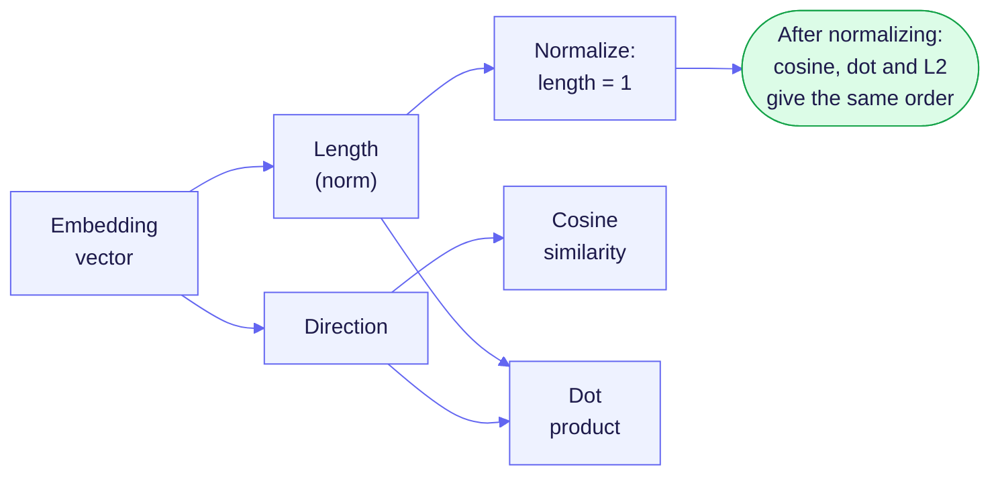

## 1. Why mathematics matters for RAG

Suppose a query becomes: $q=[0.2,0.7,-0.1]$

and three document chunks become:

```math
d_1=[0.21,0.68,-0.08], \qquad d_2=[0.9,-0.2,0.3], \qquad d_3=[0.1,0.4,-0.05]
```

The vector database needs to answer:

> Which document vector is most similar to $q$?

To answer that, it needs a mathematical definition of similarity.

Possibilities include:

```math
\text{Dot Product}, \qquad \text{Cosine Similarity}, \qquad \text{Euclidean Distance}, \qquad \text{Manhattan Distance}
```

Different metrics produce different geometries and sometimes different rankings.

So the retrieval pipeline is really:


## 2. Scalars vs vectors

> [!TIP]
> **In simple words:** A scalar is one number. A vector is a list of numbers in a fixed order; swapping two positions makes a different vector.

A **scalar** is one number.

Example: $x=5$

Temperature: $T=32^\circ$

Similarity: $s=0.84$

A **vector** is an ordered collection of numbers.

```math
v=[2,5]
```

or: $v=[0.1,-0.4,0.8]$

or a real embedding:

```math
v=[v_1,v_2,\ldots,v_{1536}]
```

The order matters.

```math
[1,2]\neq[2,1]
```

## 3. Vector dimensionality

If: $v=[1,2]$

then: $v\in\mathbb{R}^2$

If: $v=[1,2,3]$

then: $v\in\mathbb{R}^3$

If an embedding model returns 768 values:

```math
v\in\mathbb{R}^{768}
```

where: $\mathbb{R}$

means real numbers.

So: $\mathbb{R}^{768}$

means:

> a 768-dimensional real-valued vector space.

## 4. Geometric meaning of a vector

Consider: $v=[3,2]$

In two dimensions:

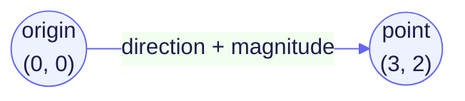

The vector has:

- direction
- magnitude

This becomes crucial for cosine similarity.

## 5. Vector as point vs vector as arrow

Mathematically, we often visualize: $[3,2]$

as either a point:

```text
(3,2)
```

or an arrow from the origin:

```text
(0,0) → (3,2)
```

In embedding search, both interpretations are useful.

Euclidean distance emphasizes:

```text
distance between points
```

Cosine emphasizes:

```text
angle between arrows
```

## 6. Adding vectors

Let:

```math
A=[1,2], \qquad B=[3,4]
```

Then: $A+B=[4,6]$

because: $[1+3,2+4]=[4,6]$

Geometrically:

```text
A + B
means
move along A
then move along B
```

## 7. Scalar multiplication

Let: $A=[2,3]$

and scalar: $c=4$

Then: $cA=[8,12]$

This changes magnitude.

If: $c\gt 0$

direction stays the same.

If: $c\lt 0$

direction reverses.

For example: $-1[2,3]=[-2,-3]$

## 8. Linear combinations

A linear combination of vectors is: $aV_1+bV_2$

Example:

```math
V_1=[1,0], \qquad V_2=[0,1]
```

Then: $3V_1+2V_2=[3,2]$

This concept matters because neural networks repeatedly perform linear transformations of vectors.

## 9. Basis vectors

In 2D, standard basis:

```math
e_1=[1,0], \qquad e_2=[0,1]
```

Any vector: $v=[x,y]$

can be written: $v=xe_1+ye_2$

For:

```math
v=[3,5], \qquad v=3e_1+5e_2
```

In 768-dimensional embedding space, there are 768 coordinate axes.

But remember from 01.04 Embeddings Fundamentals:

> individual embedding dimensions normally do not map cleanly to human concepts.

## 10. Vector spaces

A vector space is a set of vectors where operations such as addition and scalar multiplication behave consistently.

You don't need abstract linear algebra axioms for most RAG interviews.

For us, think: $\mathbb{R}^d$

is the space where embeddings live.

Example:

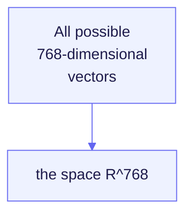

The embedding model maps language into a structured region of that space.

## 11. Magnitude of a vector

> [!TIP]
> **In simple words:** Magnitude is the length of the arrow, found with Pythagoras: square each number, add them, take the square root.

Consider: $v=[3,4]$

How long is the arrow?

Using Pythagoras:

```math
\|v\| = \sqrt{3^2+4^2} =\sqrt{25} =5
```

This is called the:

> **L2 norm**

## 12. General L2 norm

For:

```math
v=[v_1,v_2,\ldots,v_d], \qquad \boxed{ \|v\|_2 = \sqrt{ \sum_{i=1}^{d}v_i^2 } }
```

Example:

```math
v=[1,2,2], \qquad \|v\| = \sqrt{ 1^2+2^2+2^2 } =\sqrt9 =3
```

## 13. Python — L2 norm from scratch

```python
# Import the math module.
import math

# Define a function that calculates the L2 norm.
def calculate_l2_norm(vector):

    # Start the sum of squared values at zero.
    squared_sum = 0.0

    # Process every value in the vector.
    for value in vector:

        # Square the current value.
        squared_value = value * value

        # Add the squared value.
        squared_sum += squared_value

    # Take the square root.
    magnitude = math.sqrt(squared_sum)

    # Return the vector magnitude.
    return magnitude
```

Example:

```python
# Create a vector.
vector = [3, 4]

# Calculate its magnitude.
magnitude = calculate_l2_norm(vector)

# Display the result.
print(magnitude)
```

**Output**

```text
5.0
```

## 14. General Lp norm

More generally:

```math
\|x\|_p = \left( \sum_i |x_i|^p \right)^{1/p}
```

For: $p=2$

we get Euclidean/L2 norm.

For: $p=1$

we get Manhattan/L1 norm.

For:

```math
p\rightarrow\infty
```

we get:

```math
\|x\|_\infty = \max_i|x_i|
```

## 15. L1 norm

For: $v=[-3,4]$

L1:

```math
\|v\|_1 = |-3|+|4| =7
```

Compare L2: $\|v\|_2=5$

Different norms create different geometries.

## 16. Unit vector

> [!TIP]
> **In simple words:** Dividing by the length shrinks or stretches any arrow to length 1 without changing where it points.

A unit vector has magnitude: $1$

Suppose: $v=[3,4]$

Magnitude: $5$

Normalized vector:

```math
\hat v = \frac{v}{\|v\|}
```

Therefore:

```math
\hat v= \left[ \frac35,\frac45 \right] =[0.6,0.8]
```

Check:

```math
\sqrt{0.6^2+0.8^2} = 1
```

## 17. Why normalization matters

Suppose:

```math
A=[1,2], \qquad B=[10,20]
```

They point in exactly the same direction.

But their magnitudes differ greatly.

Cosine says: $\cos(A,B)=1$

because direction is identical.

After normalization: $\hat A = \hat B$

So normalization removes magnitude information.

## 18. Python — normalization from scratch

```python
# Import math.
import math

# Define a function for L2 normalization.
def normalize_vector(vector):

    # Calculate the sum of squared values.
    squared_sum = 0.0

    # Process every value.
    for value in vector:

        # Add its square.
        squared_sum += value * value

    # Calculate magnitude.
    magnitude = math.sqrt(squared_sum)

    # Handle the zero-vector case.
    if magnitude == 0:
        return vector

    # Create an empty normalized vector.
    normalized_vector = []

    # Process every original value.
    for value in vector:

        # Divide by the magnitude.
        normalized_value = value / magnitude

        # Store the normalized value.
        normalized_vector.append(normalized_value)

    # Return the unit vector.
    return normalized_vector
```

Example (added):

```python
# Normalize the 3-4-5 vector from section 16
unit = normalize_vector([3, 4])

# Its length is now 1
print(unit, calculate_l2_norm(unit))
```

**Output**

```text
[0.6, 0.8] 1.0
```

## 19. Dot product

> [!TIP]
> **In simple words:** Multiply the numbers at the same position, then add everything up. Pointing the same way gives a big positive number.

Now we reach one of the most important operations.

For:

```math
A=[a_1,a_2,\ldots,a_d], \qquad B=[b_1,b_2,\ldots,b_d]
```

dot product:

```math
\boxed{ A\cdot B = \sum_{i=1}^{d}a_ib_i }
```

Example:

```math
A=[1,2], \qquad B=[3,4]
```

Then:

```math
A\cdot B = 1\times3+2\times4 =3+8 =11
```

## 20. Python — dot product

```python
# Define a function that calculates the dot product.
def calculate_dot_product(vector_a, vector_b):

    # Ensure both vectors have equal dimensions.
    if len(vector_a) != len(vector_b):
        raise ValueError("Vectors must have equal dimensions.")

    # Start the result at zero.
    dot_product = 0.0

    # Iterate over matching vector positions.
    for index in range(len(vector_a)):

        # Multiply values at the same dimension.
        product = vector_a[index] * vector_b[index]

        # Add the product to the running sum.
        dot_product += product

    # Return the final dot product.
    return dot_product
```

Example (added):

```python
# The worked example from section 19
print(calculate_dot_product([1, 2], [3, 4]))
```

**Output**

```text
11.0
```

## 21. Why dot product is more than multiplication

The geometric identity is:

```math
\boxed{ A\cdot B = \|A\|\|B\|\cos\theta }
```

This equation is incredibly important.

It connects:

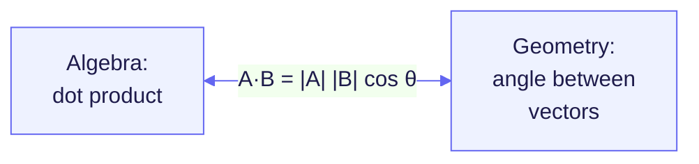

## 22. Understanding the angle

Suppose:

```text
          B
         /
        /
       /
      /
-----●------------ A
```

The angle between A and B is: $\theta$

If vectors point in almost the same direction:

```math
\theta\approx0^\circ
```

Then:

```math
\cos\theta\approx1
```

Dot product becomes large and positive.

## 23. Perpendicular vectors

Consider:

```math
A=[1,0], \qquad B=[0,1]
```

Dot product:

```math
A\cdot B = 1(0)+0(1) =0
```

Therefore: $\cos\theta=0$

which means: $\theta=90^\circ$

The vectors are orthogonal.

## 24. Opposite vectors

Consider:

```math
A=[1,0], \qquad B=[-1,0]
```

Dot product: $-1$

Cosine: $-1$

Angle: $180^\circ$

They point in opposite directions.

## 25. Dot product cases

Conceptually:

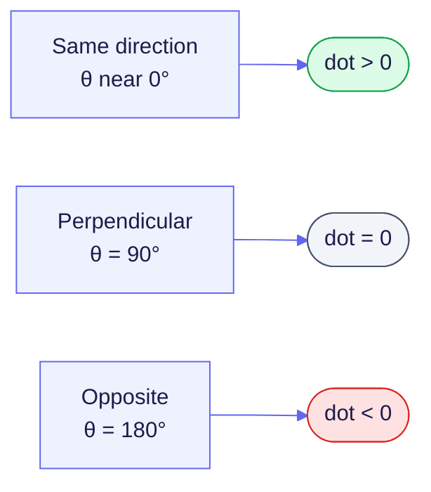

## 26. Deriving cosine similarity

Start with:

```math
A\cdot B = \|A\|\|B\|\cos\theta
```

Divide both sides by: $\|A\|\|B\|$

Then:

```math
\boxed{ \cos\theta = \frac{ A\cdot B }{ \|A\|\|B\| } }
```

This gives cosine similarity.

## 27. Cosine similarity

> [!TIP]
> **In simple words:** Cosine is the dot product after removing both lengths, so only the angle is left: 1 same, 0 unrelated, -1 opposite.

```math
\boxed{ \text{cosine}(A,B) = \frac{ \sum_i a_ib_i }{ \sqrt{\sum_i a_i^2} \sqrt{\sum_i b_i^2} } }
```

Theoretically:

```math
-1\le\cos(A,B)\le1
```

Interpretation:

```text
1      same direction
0      orthogonal
-1     opposite direction
```

For practical learned embeddings, score distributions often occupy only part of this full range.

## 28. Worked cosine example

Let:

```math
A=[1,2], \qquad B=[2,3]
```

Dot:

```math
A\cdot B = 1(2)+2(3) =8
```

Magnitude A:

```math
\|A\| = \sqrt{1^2+2^2} = \sqrt5
```

Magnitude B:

```math
\sqrt{2^2+3^2} = \sqrt{13}
```

Cosine:

```math
\frac8{\sqrt5\sqrt{13}} = \frac8{\sqrt{65}}
```

Approximately: $0.992$

Very similar directions.

## 29. Python — cosine from scratch

```python
# Import math.
import math

# Define a cosine similarity function.
def calculate_cosine_similarity(vector_a, vector_b):

    # Ensure equal dimensions.
    if len(vector_a) != len(vector_b):
        raise ValueError("Vectors must have equal dimensions.")

    # Start dot product at zero.
    dot_product = 0.0

    # Start squared magnitude for A.
    squared_magnitude_a = 0.0

    # Start squared magnitude for B.
    squared_magnitude_b = 0.0

    # Process all dimensions.
    for index in range(len(vector_a)):

        # Read the current value from A.
        value_a = vector_a[index]

        # Read the current value from B.
        value_b = vector_b[index]

        # Accumulate the dot product.
        dot_product += value_a * value_b

        # Accumulate squared magnitude of A.
        squared_magnitude_a += value_a * value_a

        # Accumulate squared magnitude of B.
        squared_magnitude_b += value_b * value_b

    # Calculate magnitude of A.
    magnitude_a = math.sqrt(squared_magnitude_a)

    # Calculate magnitude of B.
    magnitude_b = math.sqrt(squared_magnitude_b)

    # Calculate denominator.
    denominator = magnitude_a * magnitude_b

    # Handle zero-vector input.
    if denominator == 0:
        return 0.0

    # Calculate cosine similarity.
    similarity = dot_product / denominator

    # Return the result.
    return similarity
```

Example (added):

```python
# Worked example from section 28, then same direction and opposite direction
print(round(calculate_cosine_similarity([1, 2], [2, 3]), 4))
print(round(calculate_cosine_similarity([1, 2], [10, 20]), 4))
print(round(calculate_cosine_similarity([1, 0], [-1, 0]), 4))
```

**Output**

```text
0.9923
1.0
-1.0
```

## 30. Why cosine works well for embeddings

Suppose:

```math
A=[1,2], \qquad B=[100,200]
```

Semantically we may want to treat these as equivalent direction.

Cosine: $1$

Dot product: $500$

Magnitude changes dot score dramatically.

Cosine ignores scale.

For many semantic embedding models, direction is deliberately made meaningful.

## 31. Normalized vectors simplify cosine

If: $\|A\|=1$

and: $\|B\|=1$

then:

```math
\cos(A,B) = A\cdot B
```

because: $\|A\|\|B\|=1$

Therefore:

```math
\boxed{ \text{cosine similarity} = \text{dot product} }
```

for L2-normalized vectors.

This is very useful in vector search.

## 32. Why pre-normalize embeddings?

Without normalization, every comparison needs:

```text
dot product
+
norm of query
+
norm of document
```

If document vectors are normalized when indexed:


and query is normalized once:


then search becomes simple dot-product scoring.

## 33. Euclidean distance

> [!TIP]
> **In simple words:** Euclidean distance is what a ruler measures between the two arrow tips. Smaller means closer.

Euclidean distance measures straight-line distance between points.

For vectors:

```math
A=[a_1,\ldots,a_d], \qquad B=[b_1,\ldots,b_d], \qquad \boxed{ d(A,B) = \sqrt{ \sum_i(a_i-b_i)^2 } }
```

Smaller means more similar.

## 34. Euclidean example

```math
A=[1,2], \qquad B=[4,6]
```

Difference: $B-A=[3,4]$

Distance:

```math
\sqrt{3^2+4^2} =5
```

## 35. Python — Euclidean distance

```python
# Import math.
import math

# Define a function for Euclidean distance.
def calculate_euclidean_distance(vector_a, vector_b):

    # Ensure equal dimensions.
    if len(vector_a) != len(vector_b):
        raise ValueError("Vectors must have equal dimensions.")

    # Start the squared-distance sum.
    squared_difference_sum = 0.0

    # Process every vector dimension.
    for index in range(len(vector_a)):

        # Calculate the difference.
        difference = vector_a[index] - vector_b[index]

        # Square the difference.
        squared_difference = difference * difference

        # Add the squared difference.
        squared_difference_sum += squared_difference

    # Take the square root.
    distance = math.sqrt(squared_difference_sum)

    # Return the distance.
    return distance
```

Example (added):

```python
# Distance between (1, 2) and (4, 6): a 3-4-5 triangle
print(calculate_euclidean_distance([1, 2], [4, 6]))
```

**Output**

```text
5.0
```

## 36. Squared Euclidean distance

Often we don't actually need: $\sqrt{}$

because square root is monotonically increasing.

If: $d_1^2\lt d_2^2$

then: $d_1\lt d_2$

Therefore ranking by:

```math
\sum_i(a_i-b_i)^2
```

gives the same order as Euclidean distance.

This can save computation.

## 37. Relationship between cosine and Euclidean distance

> [!TIP]
> **In simple words:** When every vector has length 1, a bigger cosine always means a smaller distance, so both rank documents the same way.

This is a critical interview result.

For unit-normalized vectors: $\|A\|=\|B\|=1$

Euclidean squared distance: $\|A-B\|^2$

Expand:

```math
(A-B)\cdot(A-B) =A\cdot A-2A\cdot B+B\cdot B
```

Since normalized:

```math
A\cdot A=1, \qquad B\cdot B=1
```

Therefore:

```math
\|A-B\|^2 = 1-2A\cdot B+1 = 2-2A\cdot B
```

Since:

```math
A\cdot B=\cos\theta
```

we get:

```math
\boxed{ \|A-B\|^2 = 2-2\cos\theta }
```

This is extremely important.

### Check (added): the identity on real embeddings

```python
import os
os.environ["HF_HUB_OFFLINE"] = "1"

import numpy as np
from sentence_transformers import SentenceTransformer

# Unit vectors from a real model
st_model = SentenceTransformer("all-MiniLM-L6-v2")
a, b = st_model.encode(["reset my password", "I forgot my login password"], normalize_embeddings=True)

# Left side: squared Euclidean distance; right side: 2 - 2 x cosine
left = float(np.sum((a - b) ** 2))
right = float(2 - 2 * (a @ b))

print(f"cosine            = {float(a @ b):.4f}")
print(f"||a - b||^2       = {left:.4f}")
print(f"2 - 2 x cosine    = {right:.4f}")
```

**Output**

```text
cosine            = 0.8013
||a - b||^2       = 0.3974
2 - 2 x cosine    = 0.3974
```

## 38. What does this imply?

For normalized vectors:

```text
max cosine similarity
```

is equivalent to:

```text
min Euclidean distance
```

because:

```math
d^2=2-2\cos\theta
```

If cosine increases: $d^2$

decreases.

So normalized cosine search and normalized Euclidean search induce equivalent rankings.

## 39. Manhattan distance

> [!TIP]
> **In simple words:** Manhattan distance adds the steps along each axis, like walking city blocks instead of cutting across.

Manhattan or L1 distance:

```math
\boxed{ d_1(A,B) = \sum_i |a_i-b_i| }
```

Why "Manhattan"?

Imagine city streets.

Instead of walking diagonally:

```text
A ●
   \
    \
     ● B
```

you move along blocks:

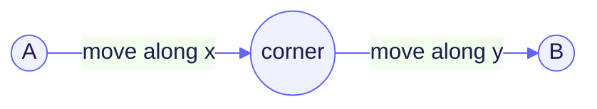

## 40. Manhattan example

```math
A=[1,2], \qquad B=[4,6]
```

Then:

```math
|1-4|+|2-6| =3+4 =7
```

Euclidean was: $5$

## 41. Python — Manhattan distance

```python
# Define a function for Manhattan distance.
def calculate_manhattan_distance(vector_a, vector_b):

    # Ensure equal dimensions.
    if len(vector_a) != len(vector_b):
        raise ValueError("Vectors must have equal dimensions.")

    # Start total distance at zero.
    total_distance = 0.0

    # Process all dimensions.
    for index in range(len(vector_a)):

        # Calculate absolute difference.
        difference = abs(
            vector_a[index] - vector_b[index]
        )

        # Add the difference.
        total_distance += difference

    # Return the L1 distance.
    return total_distance
```

Example (added):

```python
# Same two points: 3 steps along x plus 4 along y
print(calculate_manhattan_distance([1, 2], [4, 6]))
```

**Output**

```text
7.0
```

## 42. Why Manhattan is less common in modern text embedding search

Many modern embedding models are trained around:

```text
cosine
dot product
```

or sometimes L2.

L1 geometry may not match the training objective.

The correct metric should follow:

> **the geometry the embedding model was trained to optimize.**

## 43. Comparing the metrics

For the same vectors:

```math
A=[1,2], \qquad B=[4,6]
```

We have:

```math
\text{L1}=7, \qquad \text{L2}=5
```

Cosine is approximately: $0.992$

Notice something interesting.

Euclidean says:

```text
the points are 5 units apart
```

Cosine says:

```text
their directions are almost identical
```

Both can be true.

This is why metric choice matters.

## 44. Magnitude vs direction

Suppose:

```math
A=[1,1], \qquad B=[100,100]
```

Cosine: $1$

Euclidean distance: $\sqrt{99^2+99^2}$

huge.

Therefore:

```text
Cosine:
same direction

Euclidean:
far apart
```

If magnitude has semantic meaning, Euclidean/dot behavior can matter.

If magnitude should be ignored, normalization + cosine makes sense.

## 45. Similarity vs distance

A **similarity** score generally behaves:

```text
larger = more similar
```

Examples:

```math
\text{cosine}, \qquad \text{dot product}
```

A **distance** behaves:

```text
smaller = more similar
```

Examples:

```math
\text{Euclidean}, \qquad \text{Manhattan}
```

Never accidentally sort distances descending.

## 46. Ranking example

Suppose query has:

```text
D1 cosine = 0.92
D2 cosine = 0.75
D3 cosine = 0.31
```

Rank:

```text
D1
D2
D3
```

For Euclidean:

```text
D1 distance = 0.2
D2 distance = 0.6
D3 distance = 1.3
```

Rank:

```text
D1
D2
D3
```

because smaller is better.

## 47. Orthogonality

Two vectors are orthogonal if: $A\cdot B=0$

Geometrically: $90^\circ$

In embeddings, exact orthogonality isn't usually interpreted as:

> "completely unrelated"

in a strict semantic sense.

Learned vector spaces have complex score distributions.

But orthogonality is still fundamental mathematically.

## 48. Projection intuition

Suppose you want the component of $A$ in direction $B$.

The projection is:

```math
\text{proj}_B(A) = \frac{A\cdot B}{\|B\|^2}B
```

If $B$ is unit length:

```math
\text{proj}_B(A) = (A\cdot B)B
```

The dot product effectively measures how much one vector points along another.

This helps explain why dot product acts like similarity.

## 49. Hyperplanes

In high-dimensional spaces, a hyperplane is a generalization of a line or plane.

2D:

```text
line
```

3D:

```text
plane
```

d-dimensional:

```text
hyperplane
```

Neural models often use linear transformations and decision boundaries represented by hyperplanes.

You don't need deep geometry for RAG, but this is useful when understanding vector classification.

## 50. What is a hypersphere?

In 2D: $x^2+y^2=1$

forms a circle.

In 3D: $x^2+y^2+z^2=1$

forms a sphere.

In $d$ dimensions: $\sum_i x_i^2=1$

forms a:

> unit hypersphere

When embeddings are L2-normalized: $\|v\|=1$

all embeddings lie on the surface of this hypersphere.

## 51. Why normalization turns search into angular geometry

If all vectors lie on the unit hypersphere, their magnitudes are identical.

The only remaining distinction is:

```text
direction / angle
```

Therefore retrieval becomes primarily angular similarity.

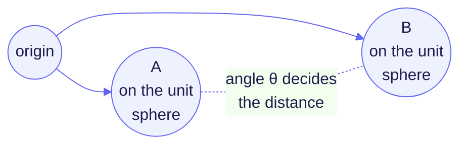

Closer angular directions correspond to higher cosine similarity.

## 52. High-dimensional spaces

> [!TIP]
> **In simple words:** Our 2D and 3D intuition breaks in 384 or 1536 dimensions; the experiments in sections 56 and 58 show how.

Embedding dimension may be:

```math
384, \qquad 768, \qquad 1024, \qquad 1536
```

or more.

Our 2D diagrams stop being visualizable.

But formulas remain valid.

For:

```math
x\in\mathbb{R}^{1536}
```

Euclidean:

```math
\sqrt{ (x_1-y_1)^2+ (x_2-y_2)^2+ \cdots+ (x_{1536}-y_{1536})^2 }
```

## 53. Why high dimensions help

More dimensions allow a model to encode richer structure.

Conceptually, text can vary by:

```text
topic
intent
entity
sentiment
domain
tense
relationship
style
specificity
```

Many independent patterns can coexist in a large vector space.

But high-dimensional spaces create computational and statistical difficulties.

## 54. Curse of dimensionality

> [!TIP]
> **In simple words:** With many dimensions, space becomes so large that points are far from everything, which makes 'nearest' harder to find.

This phrase refers to several problems that arise as dimension $d$ grows.

One major issue:

> volume grows extremely quickly.

Consider a cube: $[-1,1]^d$

Volume: $2^d$

For:

```math
d=2, \qquad 2^2=4
```

For:

```math
d=10, \qquad 2^{10}=1024
```

For:

```math
d=100, \qquad 2^{100}
```

enormous.

Data becomes sparse relative to the available space.

## 55. Sparse population intuition

Imagine:

```text
2D room
```

with 1000 points.

Looks dense.

Now place same 1000 points into:

```text
1000-dimensional space
```

The space is astronomically larger.

Points become very sparse.

This makes nearest-neighbor indexing harder.

## 56. Distance concentration

Another high-dimensional phenomenon:

> distances between randomly distributed points tend to become relatively similar.

Consider random vectors.

As dimensions increase:

```text
nearest distance
and
farthest distance
```

can become less distinguishable relative to their average scale.

Conceptually:

```math
\frac{d_{\max}-d_{\min}}{d_{\min}}
```

may shrink under some distributions.

### Experiment (added): distance concentration, measured

1,000 random points and one random query in each dimension. The gap between the farthest and the nearest point, divided by the nearest distance, shrinks as dimensions grow.

```python
import numpy as np

# Reproducible random numbers
rng = np.random.default_rng(0)

for d in [2, 10, 100, 1000, 10000]:
    # 1,000 random points and one query, uniform in [0, 1]^d
    points = rng.random((1000, d))
    query = rng.random(d)

    # Euclidean distance from the query to every point
    distances = np.linalg.norm(points - query, axis=1)

    # Relative contrast: (farthest - nearest) / nearest
    contrast = (distances.max() - distances.min()) / distances.min()

    print(f"d = {d:>5}   relative contrast = {contrast:.3f}")
```

**Output**

```text
d =     2   relative contrast = 134.618
d =    10   relative contrast = 3.484
d =   100   relative contrast = 0.389
d =  1000   relative contrast = 0.114
d = 10000   relative contrast = 0.040
```

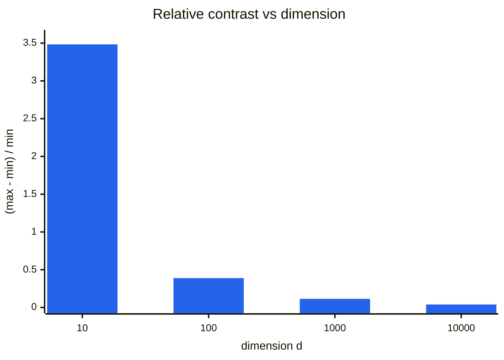

At d = 2 the farthest point is over 100 times farther than the nearest; at d = 10,000 it is only 4% farther. "Nearest" almost stops meaning anything for random data.

## 57. Why distance concentration matters

Nearest-neighbor algorithms rely on:

```text
good points are clearly closer
than bad points
```

If all distances become similar:

```text
nearest = 1.02
next = 1.03
next = 1.04
...
```

discrimination becomes harder.

Learned embeddings fight this by structuring the space around semantic tasks, but the computational challenge remains.

## 58. Random-vector intuition

For high-dimensional random unit vectors, something surprising happens:

> they tend to be nearly orthogonal.

So cosine similarities often cluster around: $0$

for random unrelated directions.

This gives neural models a lot of angular space to organize information.

### Experiment (added): random unit vectors are nearly orthogonal

```python
for d in [2, 10, 100, 1000, 10000]:
    # 2,000 random directions, scaled to length 1
    vectors = rng.normal(size=(2000, d))
    vectors /= np.linalg.norm(vectors, axis=1, keepdims=True)

    # Cosine of 1,000 random pairs (unit vectors: dot product)
    cosines = (vectors[:1000] * vectors[1000:]).sum(axis=1)

    print(f"d = {d:>5}   spread of cosine (std) = {cosines.std():.3f}")
```

**Output**

```text
d =     2   spread of cosine (std) = 0.702
d =    10   spread of cosine (std) = 0.315
d =   100   spread of cosine (std) = 0.103
d =  1000   spread of cosine (std) = 0.033
d = 10000   spread of cosine (std) = 0.010
```

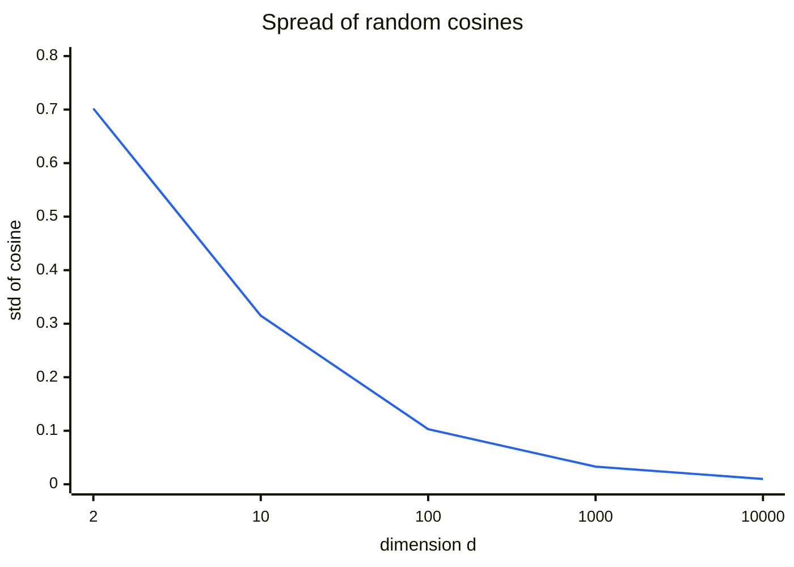

In 1,000 dimensions two random directions almost always have cosine within about ±0.1 of 0. That is why a learned similarity of 0.5 or 0.7 between real embeddings is a strong signal, not noise.

## 59. Why learned embeddings are not random

If embeddings were random:

```text
annual leave
```

and:

```text
vacation entitlement
```

would have no reason to be close.

Contrastive training deliberately reshapes geometry:

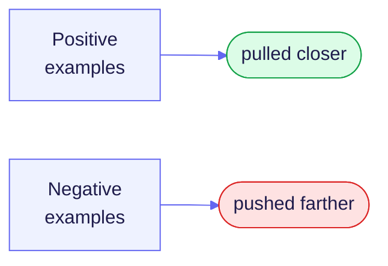

Therefore useful semantic neighborhoods emerge despite high-dimensional challenges.

## 60. High-dimensional nearest-neighbor complexity

Brute-force search compares query with every vector.

For: $N$

vectors of dimension: $d$

cost: $O(Nd)$

If: $N=100,000,000$

and: $d=1536$

that's enormous per query.

Hence the need for ANN algorithms:

```text
HNSW
IVF
PQ
ScaNN
```

which you'll study later.

## 61. Dimensionality and storage

For float32:

```math
4\text{ bytes/value}
```

One vector with dimension $d$: $4d\text{ bytes}$

For:

```math
d=1536, \qquad 1536\times4 = 6144\text{ bytes}
```

approximately 6 KB.

For 100 million vectors:

```math
6144\times100\text{M}
```

approximately: $614.4\text{ GB}$

raw vectors alone.

This is why dimensionality matters economically.

### Calculator (added): raw storage by dimension

```python
# Raw vector memory = N x d x bytes per value
n_vectors = 1_000_000

for d in [384, 768, 1536, 3072]:
    float32_gb = n_vectors * d * 4 / 1e9
    float16_gb = n_vectors * d * 2 / 1e9

    print(f"d = {d:>4}   float32 = {float32_gb:5.2f} GB   float16 = {float16_gb:5.2f} GB")
```

**Output**

```text
d =  384   float32 =  1.54 GB   float16 =  0.77 GB
d =  768   float32 =  3.07 GB   float16 =  1.54 GB
d = 1536   float32 =  6.14 GB   float16 =  3.07 GB
d = 3072   float32 = 12.29 GB   float16 =  6.14 GB
```

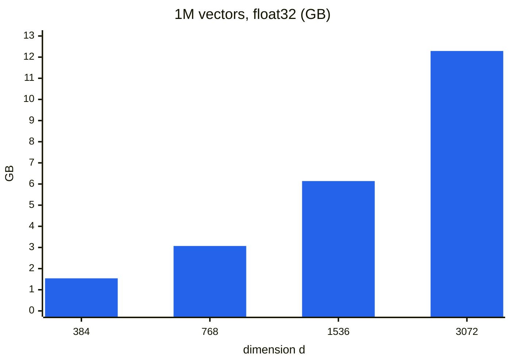

## 62. Float32 vs float16

Float32:

```math
32\text{ bits} = 4\text{ bytes}
```

Float16:

```math
16\text{ bits} = 2\text{ bytes}
```

Using float16 approximately halves raw vector memory.

Potential trade-off:

```text
lower precision
```

although retrieval impact may be small depending on model/index.

Vector databases may also use quantization techniques that reduce memory much further.

## 63. Quantization preview

Instead of storing each dimension as:

```text
32-bit float
```

you could compress to:

```text
8-bit value
```

This greatly reduces memory.

Later we'll study Product Quantization and related techniques.

Conceptually:

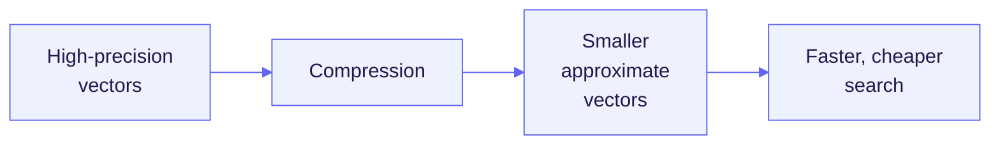

at some recall cost.

## 64. Dimensionality reduction

Suppose embedding dimension: $1536$

Could we reduce to: $384$

while preserving most useful information?

This is the purpose of dimensionality-reduction techniques such as PCA.

## 65. PCA intuition

> [!TIP]
> **In simple words:** PCA finds the few directions where the data varies most and keeps only those, like describing a long thin cloud by its length.

PCA = Principal Component Analysis.

Imagine 2D data:

```mermaid
%%{init: {'theme':'base','themeVariables':{'primaryColor':'#EEF2FF','primaryBorderColor':'#6366F1','primaryTextColor':'#1E1B4B','lineColor':'#6366F1','pie1':'#22C55E','pie2':'#F59E0B','pie3':'#EF4444','pie4':'#3B82F6','pie5':'#8B5CF6','xyChart':{'plotColorPalette':'#2563EB, #16A34A, #D97706, #DC2626, #7C3AED'}}}}%%
xychart-beta
    title "Data spread along one direction"
    x-axis "x" [1, 2, 3, 4, 5, 6]
    y-axis "y" 0 --> 7
    line [1.1, 2.0, 2.9, 4.1, 5.0, 6.0]
```

Most variation lies along one diagonal direction.

Instead of storing both x and y, PCA can find the most informative axis:

```text
principal direction
```

and project data onto it.

## 66. Variance intuition

Suppose a dataset varies a lot along one direction and barely at all along another.

```text
         narrow variation
              ↕
        ● ● ● ● ● ●
      /
    /
large variation
```

The high-variance direction contains more information.

PCA finds directions of maximum variance.

## 67. Mean centering

Given data vectors: $x_1,\dots,x_n$

calculate mean:

```math
\mu= \frac1n \sum_i x_i
```

Center each vector: $x_i'=x_i-\mu$

PCA works on centered data.

## 68. Covariance matrix

For centered dataset: $X$

covariance matrix conceptually measures how dimensions vary together.

```math
C = \frac{1}{n-1} X^TX
```

Its eigenvectors reveal principal directions.

## 69. Eigenvector intuition

If: $Av=\lambda v$

then $v$ is an eigenvector of matrix $A$.

The transformation changes only its magnitude:

```math
v \rightarrow \lambda v
```

not its direction.

For PCA:

```text
eigenvectors
=
principal directions

eigenvalues
=
amount of variance
```

## 70. PCA workflow

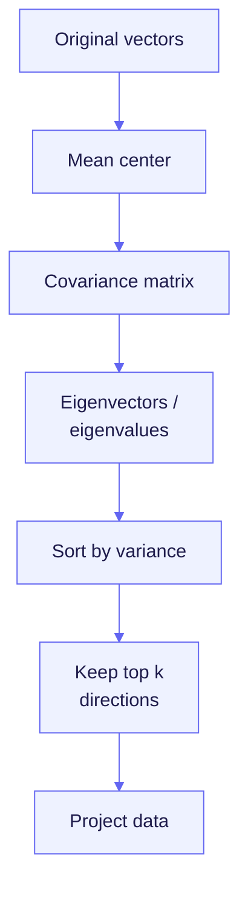

## 71. PCA projection

Suppose original:

```math
x\in\mathbb{R}^{1536}
```

and we choose: $k=384$

Projection matrix:

```math
W\in\mathbb{R}^{1536\times384}
```

Reduced vector: $z=W^T(x-\mu)$

Then:

```math
z\in\mathbb{R}^{384}
```

## 72. Python — PCA with sklearn

Setup (added): 300 real sentence embeddings from `all-MiniLM-L6-v2` (384 dimensions), so the PCA code below runs on real data.

```python
import os
os.environ["HF_HUB_OFFLINE"] = "1"

import numpy as np
from sentence_transformers import SentenceTransformer

model = SentenceTransformer("all-MiniLM-L6-v2")

# 300 short sentences: 30 topics x 10 phrasings
topics = ["password reset", "invoice payment", "battery recycling", "python install", "holiday policy", "data privacy",
          "shipping delay", "refund request", "network outage", "printer error", "contract renewal", "safety training",
          "expense report", "vpn access", "laptop upgrade", "tax form", "chemical safety", "office move", "job interview",
          "customer complaint", "database backup", "api rate limit", "cloud cost", "security audit", "onboarding",
          "travel booking", "meeting room", "software license", "parental leave", "performance review"]
phrasings = ["How do I handle {}?", "Guide to {}", "Problem with {}", "Policy on {}", "Steps for {}",
             "Question about {}", "Help with {} today", "Rules for {}", "Checklist: {}", "Who owns {}?"]
sentences = [p.format(t) for t in topics for p in phrasings]

# One unit vector per sentence
embeddings = model.encode(sentences, normalize_embeddings=True)

print(embeddings.shape)
```

**Output**

```text
(300, 384)
```

```python
# Import PCA.
from sklearn.decomposition import PCA

# Assume embeddings is a matrix:
# number_of_vectors × embedding_dimension.

# Create a PCA reducer.
pca = PCA(
    n_components=128
)

# Learn the principal directions
# and transform the embeddings.
reduced_embeddings = pca.fit_transform(
    embeddings
)

# Display the new dimensions.
print(reduced_embeddings.shape)
```

**Output**

```text
(300, 128)
```

Added: how much of the variance the kept directions explain.

```python
# Share of total variance kept by the first 8, 32 and 128 components
cumulative = np.cumsum(pca.explained_variance_ratio_)

for k in [8, 32, 128]:
    print(f"first {k:>3} components keep {cumulative[k - 1]:.1%} of the variance")
```

**Output**

```text
first   8 components keep 39.1% of the variance
first  32 components keep 90.9% of the variance
first 128 components keep 99.4% of the variance
```

If original:

```text
(10000, 768)
```

output:

```text
(10000, 128)
```

## 73. Should you blindly apply PCA to production embeddings?

No.

Reducing dimensions can:

```text
lower storage
increase search speed
```

but may reduce retrieval quality.

Benchmark:

```text
Recall@5
MRR
NDCG
latency
memory
```

before choosing.

Some embedding models are also explicitly designed to support truncation to lower dimensions; when available, model-native guidance is preferable.

## 74. Variance explained

PCA measures how much variance each component retains.

Suppose:

```text
PC1  = 30%
PC2  = 20%
PC3  = 10%
```

Top 3 capture: $60\%$

of dataset variance.

Cumulative explained variance helps select $k$.

But:

> variance preservation is not exactly the same as retrieval relevance preservation.

So evaluation still matters.

## 75. Cosine similarity matrix

Suppose we have query embeddings:

```math
Q \in \mathbb{R}^{m\times d}
```

and document embeddings:

```math
D \in \mathbb{R}^{n\times d}
```

If normalized: $S=QD^T$

Then:

```math
S \in \mathbb{R}^{m\times n}
```

Each cell: $S_{ij}$

is cosine similarity between query $i$ and document $j$.

This is exactly the math behind batched dense retrieval.

## 76. Example matrix

```text
                Doc1    Doc2    Doc3

Query1          .91     .22     .43
Query2          .31     .87     .49
Query3          .12     .40     .94
```

For each query, retrieve highest values.

Training with in-batch negatives often tries to make the diagonal large:

```text
.91
.87
.94
```

and off-diagonal values small.

## 77. Matrix multiplication is why GPUs are good at embeddings

Transformers and dense retrieval heavily use operations such as: $AB$

on large matrices.

GPUs are optimized for massively parallel matrix operations.

This is why:

```text
batch embeddings
```

are often much faster than embedding each text independently.

## 78. Cosine ranking with NumPy

```python
# Import NumPy.
import numpy as np

# Define a function for row-wise normalization.
def normalize_rows(matrix):

    # Calculate one norm per row.
    norms = np.linalg.norm(
        matrix,
        axis=1,
        keepdims=True,
    )

    # Prevent division by zero.
    norms = np.maximum(
        norms,
        1e-12,
    )

    # Normalize each row.
    normalized_matrix = matrix / norms

    # Return normalized rows.
    return normalized_matrix
```

Similarity:

Setup (added): two real queries and four real documents.

```python
queries = ["how do I reset my password", "when is the office closed"]
documents = ["Reset your password from the login page", "Office opening hours and holidays",
             "Battery recycling rules", "Change a forgotten password"]

# Raw (not yet normalized) vectors, so normalize_rows has work to do
query_embeddings = model.encode(queries)
document_embeddings = model.encode(documents)
```

```python
# Normalize query embeddings.
normalized_queries = normalize_rows(
    query_embeddings
)

# Normalize document embeddings.
normalized_documents = normalize_rows(
    document_embeddings
)

# Calculate all query-document similarities.
similarity_matrix = (
    normalized_queries
    @ normalized_documents.T
)
```

```python
# Print the 2 x 4 matrix: one row per query, one column per document
print(np.round(similarity_matrix, 3))
```

**Output**

```text
[[ 0.798 -0.029  0.117  0.795]
 [ 0.048  0.642  0.126  0.088]]
```

That single matrix multiplication calculates every pairwise cosine similarity.

## 79. Numerical stability

Floating-point computations are approximate.

For normalized vectors, mathematically: $\cos\theta\le1$

But numerical error might produce:

```text
1.0000001
```

If calculating: $\arccos(x)$

you should clamp: $x\in[-1,1]$

to prevent invalid values.

## 80. Python — numerically safe angle

```python
# Import NumPy.
import numpy as np

# Define a function to calculate
# the angle between vectors.
def calculate_angle(vector_a, vector_b):

    # Calculate cosine similarity.
    cosine_score = calculate_cosine_similarity(
        vector_a,
        vector_b,
    )

    # Clamp numerical noise.
    cosine_score = np.clip(
        cosine_score,
        -1.0,
        1.0,
    )

    # Convert cosine to angle in radians.
    angle_radians = np.arccos(
        cosine_score
    )

    # Convert radians to degrees.
    angle_degrees = np.degrees(
        angle_radians
    )

    # Return the angle.
    return angle_degrees
```

Example (added):

```python
# 45 degrees, 90 degrees and 180 degrees
print(round(float(calculate_angle([1, 0], [1, 1])), 2))
print(round(float(calculate_angle([1, 0], [0, 1])), 2))
print(round(float(calculate_angle([1, 0], [-1, 0])), 2))
```

**Output**

```text
45.0
90.0
180.0
```

## 81. Zero vectors

If: $v=[0,0,\ldots,0]$

then: $\|v\|=0$

Cosine:

```math
\frac{q\cdot v}{\|q\|\|v\|}
```

has division by zero.

A well-behaved embedding model normally shouldn't produce meaningful zero vectors, but pipeline bugs can.

Possible causes:

```text
empty text
invalid preprocessing
bad model output
numerical bug
```

Validate vectors.

## 82. Vector norm distribution

Suppose model is expected to return normalized embeddings.

Then: $\|v_i\|\approx1$

for every vector.

Monitor:

```text
mean norm
min norm
max norm
```

If suddenly:

```text
mean norm = 8.7
```

perhaps normalization got disabled.

This is practical observability.

## 83. Similarity distributions

Don't just inspect individual scores.

For your benchmark, compare score distributions:

<table width="100%">
<thead><tr><th width="8%">Sr No</th><th width="28%">Pair type</th><th width="64%">Typical cosine range in this example</th></tr></thead>
<tbody>
<tr><td align="center">01</td><td>Relevant pairs</td><td>0.65 to 0.95</td></tr>
<tr><td align="center">02</td><td>Irrelevant pairs</td><td>0.20 to 0.72</td></tr>
</tbody>
</table>

The ranges overlap between 0.65 and 0.72, so no single threshold separates them perfectly.

Notice overlap around:

```text
0.65–0.72
```

No perfect threshold exists.

This explains why reranking helps.

## 84. ROC-like threshold reasoning

Suppose threshold: $0.6$

You retrieve many relevant docs but also noise.

Higher threshold: $0.8$

reduces noise but may miss useful docs.

This is the classic:

```math
\text{precision} \leftrightarrow \text{recall}
```

trade-off.

## 85. Metric mismatch failure

Suppose embedding model was trained with normalized cosine similarity.

But your vector DB uses raw inner product on non-normalized vectors.

Then magnitude can unexpectedly influence ranking.

This can degrade retrieval.

Always ensure:

```text
embedding normalization
+
index metric
+
training objective
```

are compatible.

## 86. Example metric mismatch

Document A: $A=[1,0]$

Document B: $B=[100,5]$

Query: $q=[1,0]$

Dot:

```math
q\cdot A=1, \qquad q\cdot B=100
```

Dot picks B.

Cosine:

```math
\cos(q,A)=1, \qquad \cos(q,B) \approx0.99875
```

Cosine prefers A slightly.

Different metrics, different ranking.

## 87. Exact nearest-neighbor search

Given: $N$

document vectors.

For query $q$, calculate: $d(q,x_i)$

for every: $i=1,\ldots,N$

Then sort/select top K.

This is exact search.

Time: $O(Nd)$

For small datasets, this can be perfectly fine.

## 88. Why approximate nearest neighbor exists

At: $N=100\text{M}$

exactly comparing every vector becomes expensive.

ANN algorithms trade:

```text
perfect recall
```

for:

```text
much faster search
```

Example:

```text
Exact:
Recall = 100%
Latency = 400 ms

ANN:
Recall = 98%
Latency = 10 ms
```

The exact numbers depend on system, but that's the trade-off.

## 89. Recall of ANN

If true exact Top-10 contains:

```text
A B C D E F G H I J
```

ANN returns:

```text
A B C D E F G H I K
```

Nine of ten are correct.

ANN Recall@10: $\frac9{10}=0.9$

Later, HNSW parameters will let you trade:

```text
latency
↔
recall
```

## 90. Why Euclidean geometry relates to HNSW

HNSW builds a graph where vectors are connected to nearby vectors according to the selected distance metric.

So when we later talk about:

```text
neighbors
```

it literally means neighbors under:

```text
cosine
L2
inner product
```

depending on index configuration.

This chapter is the mathematical foundation for that one.

## 91. Mathematical picture of RAG retrieval

Let documents be:

```math
D=\{d_1,d_2,\ldots,d_N\}
```

Embedding function: $E(D_i)=v_i$

Query: $E(q)=u$

Similarity:

```math
s_i = \text{sim}(u,v_i)
```

Top K:

```math
\boxed{ R(q) = \operatorname{arg\,topk}_{i} s_i }
```

If using distance:

```math
\boxed{ R(q) = \operatorname{arg\,mink}_{i} d(u,v_i) }
```

That's dense retrieval mathematically.

## 92. Geometry does not equal truth

Suppose query:

```text
What is the current threshold?
```

Two chunks:

```text
2025 threshold = 10 mg
```

and:

```text
2026 threshold = 5 mg
```

Their embeddings can be almost identical.

The vector geometry tells you:

```text
both are topically relevant
```

It does not tell you:

```text
which one is currently legally valid
```

You need:

```text
metadata
effective date
version logic
```

This is an extremely important RAG lesson.

## 93. Numbers are geometrically tricky

Consider:

```text
The threshold is 0.01%.
```

and:

```text
The threshold is 0.1%.
```

Only one character differs.

Semantically, their vectors may be very close.

But numerically: $0.1=10\times0.01$

Huge legal/business difference.

Dense retrieval should locate candidates; exact source text and downstream reasoning must verify the value.

## 94. Negation is geometrically tricky

```text
Employees may carry leave forward.
```

versus:

```text
Employees may not carry leave forward.
```

Most tokens are identical.

Their embeddings may be relatively close.

But logically they are opposites.

Therefore:

```math
\text{semantic proximity} \neq \text{logical equivalence}
```

## 95. Angular similarity vs semantic equivalence

Cosine similarity answers:

> How aligned are these learned representations?

It does **not** guarantee:

```text
same factual claim
same truth value
same date
same numerical values
same legal applicability
```

Keep that distinction clear in interviews.

## 96. Mahalanobis distance — awareness topic

A more general distance is:

```math
d_M(x,y) = \sqrt{ (x-y)^T S^{-1} (x-y) }
```

where: $S$

is a covariance matrix.

Unlike Euclidean distance, it accounts for:

```text
different scales
correlated dimensions
```

It's useful in classical statistics/anomaly detection, but is much less common as the default metric for dense RAG retrieval.

Know the concept, but don't prioritize it over cosine/dot/L2.

## 97. Why cosine is often preferred for semantic embeddings

Because many embedding systems care more about:

```text
direction of semantic representation
```

than raw vector magnitude.

Cosine:

```math
\frac{A\cdot B}{\|A\|\|B\|}
```

removes magnitude.

And with normalization:

```text
cosine
=
dot product
```

which makes implementation efficient.

## 98. Why dot product may still be preferred

Some embedding models are trained explicitly with dot-product objectives.

Magnitude can be part of the learned scoring behavior.

If model documentation says:

```text
use inner product
```

use inner product.

Don't force cosine based on habit.

## 99. Why Euclidean may be used

Some indexes/models naturally optimize: $\text{L2}$

distance.

And for normalized vectors: $\text{L2}$

and cosine rankings are equivalent.

Therefore vector-database configuration often gives you several metric options.

## 100. Distance metric decision rule

The strongest practical rule:

```text
1. Check embedding model recommendation.

2. Check whether embeddings are normalized.

3. Configure vector DB with matching metric.

4. Benchmark retrieval.

5. Never infer from dimension alone.
```

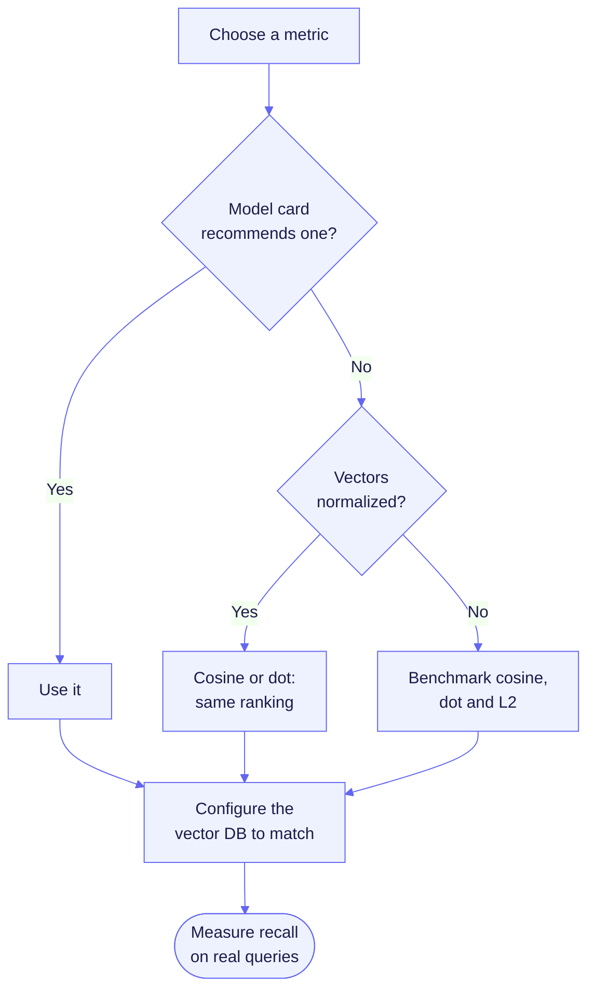

## 101. Building a complete vector-math demo

Let's create three vectors.

```python
# Import NumPy.
import numpy as np

# Create a query vector.
query = np.array(
    [0.8, 0.5, 0.1],
    dtype=float,
)

# Create a semantically close document.
document_a = np.array(
    [0.78, 0.52, 0.12],
    dtype=float,
)

# Create a less similar document.
document_b = np.array(
    [-0.2, 0.8, 0.4],
    dtype=float,
)
```

## 102. Compare cosine

```python
# Calculate cosine similarity
# between query and document A.
cosine_a = calculate_cosine_similarity(
    query,
    document_a,
)

# Calculate cosine similarity
# between query and document B.
cosine_b = calculate_cosine_similarity(
    query,
    document_b,
)

# Display both.
print("A cosine:", cosine_a)
print("B cosine:", cosine_b)
```

**Output**

```text
A cosine: 0.9993379905547844
B cosine: 0.3220305943597653
```

We expect:

```math
\cos(q,A)>\cos(q,B)
```

## 103. Compare Euclidean

```python
# Calculate Euclidean distance
# to document A.
distance_a = calculate_euclidean_distance(
    query,
    document_a,
)

# Calculate Euclidean distance
# to document B.
distance_b = calculate_euclidean_distance(
    query,
    document_b,
)

# Display both.
print("A distance:", distance_a)
print("B distance:", distance_b)
```

**Output**

```text
A distance: 0.03464101615137756
B distance: 1.0862780491200217
```

We expect: $d(q,A)\lt d(q,B)$

## 104. Brute-force Top-K search

```python
# Define a function that performs
# brute-force cosine retrieval.
def retrieve_top_k_by_cosine(
    query_vector,
    document_vectors,
    k,
):

    # Create an empty list
    # for index-score pairs.
    scores = []

    # Process every document vector.
    for index in range(
        len(document_vectors)
    ):

        # Read the current vector.
        document_vector = (
            document_vectors[index]
        )

        # Calculate cosine similarity.
        similarity = (
            calculate_cosine_similarity(
                query_vector,
                document_vector,
            )
        )

        # Store the index and score.
        scores.append(
            (
                index,
                similarity,
            )
        )

    # Sort from highest similarity
    # to lowest.
    ranked_scores = sorted(
        scores,
        key=lambda item: item[1],
        reverse=True,
    )

    # Select the first k items.
    top_k = ranked_scores[:k]

    # Return the top results.
    return top_k
```

Example (added):

```python
# Rank the two documents from section 101 for the query
for index, score in retrieve_top_k_by_cosine(query, [document_a, document_b], k=2):

    # One line per result: document index and cosine
    print(f"document {index}: cosine {float(score):.4f}")
```

**Output**

```text
document 0: cosine 0.9993
document 1: cosine 0.3220
```

This is mathematically what an exact dense retriever does before we introduce ANN optimization.

## 105. Time complexity

> [!TIP]
> **In simple words:** Exact search compares the query with every vector, so doubling the documents doubles the work.

For each of: $N$

documents, cosine compares: $d$

dimensions.

Therefore: $O(Nd)$

Selecting/sorting can add complexity depending on method.

Full sort: $O(N\log N)$

But Top-K can be implemented more efficiently using heaps or specialized selection.

Still, vector comparisons dominate at high $d$ and $N$.

## 106. Space complexity

Document matrix: $N\times d$

Thus storage: $O(Nd)$

For float32: $4Nd$

bytes before indexing overhead.

This simple equation is very useful in system-design interviews.

## 107. Example system-design calculation

Suppose: $N=20\text{M}$

chunks.

Dimension: $d=768$

float32: $4\text{ bytes}$

Raw vector memory:

```math
20\text{M}\times768\times4 =61.44\text{ billion bytes}
```

roughly: $61.4\text{ GB}$

before metadata, graph edges, indexes, replicas, and overhead.

This is exactly why:

```text
dimension
quantization
index architecture
```

matter.

## 108. Cosine similarity as an angle

If: $\cos\theta=1$

then: $\theta=0^\circ$

If: $\cos\theta=0.5$

then: $\theta=60^\circ$

If: $\cos\theta=0$

then: $90^\circ$

If: $\cos\theta=-1$

then: $180^\circ$

This gives strong geometric intuition.

## 109. Example: cosine 0.8

Angle:

```math
\theta=\cos^{-1}(0.8)
```

approximately: $36.87^\circ$

So cosine differences are nonlinear in angle.

For example:

```text
0.99
vs
0.95
```

may represent meaningful angular changes.

Don't assume raw score gaps have simple linear semantic meaning.

## 110. Similarity thresholds should be calibrated

Suppose relevant validation examples have:

```text
mean cosine = 0.78
```

and irrelevant:

```text
mean cosine = 0.52
```

But distributions overlap.

You should empirically study:

```text
threshold
precision
recall
```

rather than choosing:

```text
0.7
```

because someone online recommended it.

## 111. Z-score intuition for score distributions

Sometimes you may inspect how unusual a retrieval score is relative to a distribution.

Z-score:

```math
z= \frac{x-\mu}{\sigma}
```

where:

- $x$ = score
- $\mu$ = mean
- $\sigma$ = standard deviation

Useful for analysis, but raw cosine score calibration is generally more practical through labeled retrieval data.

## 112. Centroid

Given vectors:

```math
v_1,v_2,\ldots,v_n
```

centroid:

```math
\mu = \frac1n \sum_i v_i
```

This is the "average" vector.

Can be useful for:

```text
clustering
topic summarization
semantic variance
```

## 113. Cluster intuition

Suppose vectors:

```text
annual leave ●
vacation     ●
PTO          ●
holiday          ●
```

form a cluster.

Centroid is roughly:

```text
average semantic location
```

of that group.

Clustering methods such as K-means use this concept.

Later, hierarchical RAG techniques like RAPTOR can use clustering concepts.

## 114. K-means preview

Given $K$ clusters:

1. choose centroids
2. assign each vector to nearest centroid
3. recompute centroids
4. repeat

Objective:

```math
\min \sum_i \|x_i-\mu_{c_i}\|^2
```

This isn't core this chapter, but understanding Euclidean geometry makes clustering much easier later.

## 115. Mean vector of normalized embeddings

If you average unit vectors:

```math
v= \frac1n\sum_i v_i
```

the result generally does not have norm 1.

If you need cosine comparisons, normalize the centroid afterward:

```math
\hat v = \frac{v}{\|v\|}
```

Important implementation detail.

## 116. Distance matrix

Given document matrix:

```math
X\in\mathbb{R}^{N\times d}
```

a pairwise distance matrix contains: $N^2$

entries.

This becomes infeasible quickly.

If: $N=1\text{M}$

pairwise comparisons: $10^{12}$

This is why clustering/index-building algorithms need efficient strategies.

## 117. Pairwise complexity

All-pairs similarity: $O(N^2d)$

Huge.

Query-to-corpus similarity: $O(Nd)$

Much cheaper, but still costly at millions/billions of vectors.

This distinction matters.

## 118. High-dimensional density intuition

In low dimensions, we can divide space into grids.

In high dimensions, the number of cells grows exponentially.

Suppose each dimension is divided into 10 buckets.

Total cells: $10^d$

For: $d=2$

100 cells.

For: $d=10$

10 billion cells.

This is another intuition for the curse of dimensionality.

## 119. Why tree-based nearest-neighbor methods degrade

Methods like KD-trees work well in relatively low dimensions because they efficiently partition space.

As dimensions grow:

```text
too many partitions overlap
pruning becomes less effective
```

Eventually search approaches brute force.

That's why modern embedding systems favor methods such as HNSW and IVF.

## 120. Random projection awareness

Another dimensionality-reduction technique is random projection.

The Johnson–Lindenstrauss idea says, roughly:

> A set of high-dimensional points can often be projected into a lower-dimensional space while approximately preserving pairwise distances.

You don't need the proof for RAG interviews, but this explains why meaningful dimensionality reduction can sometimes work surprisingly well.

## 121. Johnson–Lindenstrauss intuition

For $n$ points, useful dimensionality may scale roughly like:

```math
O\left( \frac{\log n}{\epsilon^2} \right)
```

to preserve distances within distortion $\epsilon$, under the theorem's assumptions.

This is conceptual interview enrichment, not something you usually implement manually in RAG.

## 122. Metric properties

A mathematical distance metric usually satisfies:

### Non-negativity

```math
d(x,y)\ge0
```

### Identity

```math
d(x,y)=0 \iff x=y
```

### Symmetry

```math
d(x,y)=d(y,x)
```

### Triangle inequality

```math
d(x,z) \le d(x,y)+d(y,z)
```

Euclidean and Manhattan distances satisfy these.

## 123. Is cosine similarity a distance metric?

Cosine similarity itself is not a distance.

One derived quantity is: $1-\cos(x,y)$

often called cosine distance.

But depending on exact definition/domain, it doesn't always satisfy every metric property, particularly triangle inequality.

For vector search APIs, "cosine distance" often simply means a monotonic transformation of cosine similarity.

Know the implementation you're using.

## 124. Angular distance

A true angle-based distance can be:

```math
d_{\text{angular}} = \arccos( \cos(x,y) )
```

or normalized variations.

But calculating `arccos` is unnecessary for ranking because cosine is monotonic with angle over: $[0,\pi]$

So vector databases generally use cosine directly.

## 125. Why monotonic transformations preserve ranking

Suppose: $s_1\gt s_2$

If function $f$ is strictly increasing: $f(s_1)\gt f(s_2)$

So you don't need expensive transformations if they don't change rank.

This is why:

```text
squared Euclidean
```

can replace:

```text
Euclidean
```

for ranking.

## 126. Numerical precision and ranking

Suppose candidate scores:

```text
0.845001
0.845000
```

Tiny floating-point differences may alter rank.

Usually not an issue by itself, but approximate indexes and reduced precision can make close candidates unstable.

That's another reason:

```text
retrieve more candidates
then rerank
```

is often robust.

## 127. Vector similarity is only stage one

A typical production strategy:

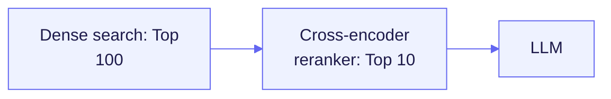

Why?

Dense vector math compresses text into one point.

Cross-encoder can inspect fine-grained token interactions.

So:

```math
\text{dense geometry}
```

gives speed,

while:

```math
\text{joint query-document reasoning}
```

gives precision.

## 128. Interview question — What is the L2 norm?

Strong answer:

> The L2 norm is the Euclidean magnitude of a vector. For $x\in\mathbb{R}^d$, it is $\sqrt{\sum_i x_i^2}$. It is used for vector normalization and Euclidean distance calculations.

## 129. Interview question — Why normalize embeddings?

> L2 normalization rescales each vector to unit magnitude. This removes magnitude as a factor and turns cosine similarity into a simple dot product, because for unit vectors $q\cdot d=\cos(q,d)$. It can also simplify vector-index configuration and search.

## 130. Interview question — Cosine vs dot product?

Strong answer:

> Dot product depends on both vector magnitude and angle, since $a\cdot b=\|a\|\|b\|\cos\theta$. Cosine divides out magnitudes and measures only directional alignment. If both vectors are L2-normalized, dot product and cosine are identical.

## 131. Interview question — Cosine vs Euclidean?

> Cosine compares direction while Euclidean compares absolute point distance. However, if vectors are L2-normalized, squared Euclidean distance equals $2-2\cos\theta$, so maximizing cosine and minimizing Euclidean produce the same ranking.

This is a very strong interview answer.

## 132. Interview question — Why not always use cosine?

> The scoring metric should match the embedding model's training objective and normalization assumptions. Some models are optimized for inner product or Euclidean distance. Using a mismatched metric can change rankings and hurt retrieval.

## 133. Interview question — What is the curse of dimensionality?

> As dimensionality increases, the available volume grows extremely quickly, points become sparse, nearest-neighbor indexing becomes harder, and distances between random points can become less discriminative. This makes exact search expensive and motivates approximate nearest-neighbor algorithms such as HNSW and IVF.

## 134. Interview question — Why are random high-dimensional vectors nearly orthogonal?

A concise answer:

> In high-dimensional isotropic spaces, positive and negative coordinate contributions tend to cancel in the dot product, so normalized random vectors concentrate around cosine similarity zero. Learned embedding models exploit the large directional capacity of these spaces while training semantic neighbors to be more aligned.

## 135. Interview question — Does 1536 dimensions mean 1536 concepts?

No.

> Neural embeddings are distributed representations. Meaning is encoded across combinations of dimensions rather than one interpretable semantic feature per coordinate.

## 136. Interview question — Why can embeddings fail on numbers?

> Dense embeddings are optimized primarily for semantic relationships, so passages differing only in precise numerical values can be very close geometrically. For numerical, date, identifier and legal-reference accuracy, dense retrieval should often be combined with lexical retrieval, metadata filtering and reranking.

## 137. Interview question — Why can embeddings fail on negation?

> Negated and affirmative sentences often share almost all vocabulary and topic context, making their dense representations relatively close even though their logical meanings differ. Similarity is not equivalent to logical entailment.

## 138. Interview question — What is PCA?

> PCA is a linear dimensionality-reduction technique that finds orthogonal directions of maximum variance. Data is mean-centered, covariance eigenvectors are computed, and the top principal directions are retained. It can reduce vector storage and computation, but retrieval quality must be benchmarked because variance preservation is not identical to relevance preservation.

## 139. Interview question — Exact vs ANN?

> Exact nearest-neighbor search compares the query with every vector and gives perfect nearest-neighbor recall but costs $O(Nd)$ per query. ANN algorithms search only a fraction of the space or use graph/index structures to dramatically reduce latency at the cost of potentially missing some true nearest neighbors.

## 140. Interview traps

### Trap: "Cosine 0.8 means 80% relevant."

Wrong.

It is not a calibrated probability.

### Trap: "Euclidean and cosine always give the same result."

Wrong.

Only under specific conditions such as normalized vectors do their rankings become equivalent.

### Trap: "Dot product is cosine similarity."

Only if vectors are unit normalized.

### Trap: "Higher dimension automatically means better embeddings."

Wrong.

Quality depends on training and domain fit, while dimensions increase storage and search cost.

### Trap: "All nearest-neighbor metrics are interchangeable."

Wrong.

Metric choice changes the geometry.

### Trap: "High-dimensional embeddings avoid the curse of dimensionality because neural networks are smart."

Wrong.

Learned structure helps semantic discrimination, but computational high-dimensional challenges still exist.

### Trap: "PCA always improves embeddings."

Wrong.

It trades information for compactness.

## 141. Full formula sheet

### L1 norm

```math
\boxed{ \|x\|_1 = \sum_i|x_i| }
```

### L2 norm

```math
\boxed{ \|x\|_2 = \sqrt{\sum_i x_i^2} }
```

### General Lp norm

```math
\boxed{ \|x\|_p = \left( \sum_i|x_i|^p \right)^{1/p} }
```

### Dot product

```math
\boxed{ x\cdot y = \sum_i x_i y_i }
```

### Geometric dot product

```math
\boxed{ x\cdot y = \|x\|\|y\|\cos\theta }
```

### Cosine similarity

```math
\boxed{ \cos(x,y) = \frac{x\cdot y} {\|x\|\|y\|} }
```

### Normalization

```math
\boxed{ \hat x = \frac{x}{\|x\|} }
```

### Euclidean distance

```math
\boxed{ d_2(x,y) = \sqrt{ \sum_i(x_i-y_i)^2 } }
```

### Manhattan distance

```math
\boxed{ d_1(x,y) = \sum_i|x_i-y_i| }
```

### Unit-vector cosine/dot identity

```math
\boxed{ \hat x\cdot\hat y = \cos(x,y) }
```

### Unit-vector Euclidean/cosine identity

```math
\boxed{ \|\hat x-\hat y\|^2 = 2-2\cos(x,y) }
```

### Raw vector storage

```math
\boxed{ \text{Memory} \approx N \times d \times \text{bytes per value} }
```

### Exact retrieval complexity

```math
\boxed{ O(Nd) }
```

## 142. The one diagram to memorize

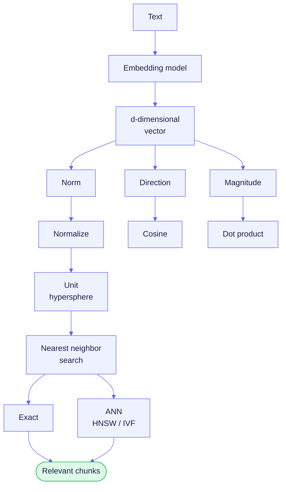

## 143. The deepest practical lesson

For RAG, vector mathematics should lead you to this mental model:

```mermaid
%%{init: {'theme':'base','themeVariables':{'primaryColor':'#EEF2FF','primaryBorderColor':'#6366F1','primaryTextColor':'#1E1B4B','lineColor':'#6366F1','pie1':'#22C55E','pie2':'#F59E0B','pie3':'#EF4444','pie4':'#3B82F6','pie5':'#8B5CF6','xyChart':{'plotColorPalette':'#2563EB, #16A34A, #D97706, #DC2626, #7C3AED'}}}}%%
flowchart LR
    M["Embedding model<br/>decides the<br/>geometry"] --> N["Normalization<br/>decides whether<br/>magnitude matters"] --> D["Distance metric<br/>decides what<br/>near means"] --> A["ANN index<br/>approximates<br/>near efficiently"] --> R["Reranker<br/>fixes closeness<br/>that is not<br/>relevance"]
```

Those are separate decisions.

## 144. Revision sheet

You should be able to answer these from memory:

1. A vector embedding lives in: $\mathbb{R}^d$

2. L2 norm gives magnitude:

```math
\|v\|_2=\sqrt{\sum_i v_i^2}
```

3. Normalize using:

```math
\hat v=\frac{v}{\|v\|}
```

4. Dot product:

```math
a\cdot b=\sum_i a_i b_i
```

5. Dot product also equals:

```math
\|a\|\|b\|\cos\theta
```

6. Cosine compares direction:

```math
\frac{a\cdot b}{\|a\|\|b\|}
```

7. Euclidean compares point distance.

8. Manhattan uses absolute coordinate differences.

9. For normalized vectors:

```math
\text{dot} = \text{cosine}
```

10. For normalized vectors:

```math
\text{L2}^2 = 2 - 2\,\text{cosine}
```

11. High dimensions increase representation capacity but also make indexing harder.

12. Exact nearest-neighbor search costs approximately: $O(Nd)$

13. Embedding dimension has direct memory cost: $O(Nd)$

14. PCA can reduce dimensions but must be benchmarked.

15. Vector similarity does not guarantee factual equivalence, numerical equality, legal applicability, or temporal correctness.

## 145. How 01.04 and 01.05 fit together

01.04 Embeddings Fundamentals answered:

```text
How does language become a semantic vector?
```

This chapter answered:

```text
Once we have vectors,
what does similarity mathematically mean?
```

So now you understand:

```mermaid
%%{init: {'theme':'base','themeVariables':{'primaryColor':'#EEF2FF','primaryBorderColor':'#6366F1','primaryTextColor':'#1E1B4B','lineColor':'#6366F1','pie1':'#22C55E','pie2':'#F59E0B','pie3':'#EF4444','pie4':'#3B82F6','pie5':'#8B5CF6','xyChart':{'plotColorPalette':'#2563EB, #16A34A, #D97706, #DC2626, #7C3AED'}}}}%%
flowchart TB
    n0["Text"] --> n1["Transformer"] --> n2["Pooling"] --> n3["Embedding vector<br/>(01.04)"] --> n4["Norm / angle /<br/>distance"] --> n5["Cosine / dot / L2<br/>(01.05)"] --> n6["Nearest-neighbor<br/>search"]
```

The natural next step is **06.02 Vector Databases**, where these equations become actual system architecture: collections/indexes, metadata storage, insertion, querying, filtering, persistence, FAISS vs Milvus vs Pinecone vs Qdrant vs pgvector, and how millions of embedding vectors are managed in production.

Then **06.03 to 06.05 (ANN, HNSW, IVF and PQ)** explain how the database avoids doing $O(Nd)$ brute-force search for every request.

## 146. Practice Tasks

1. Compute the L1, L2 and L-infinity norms of `[2, -3, 6]` by hand, then with the functions above.
2. Normalize five random vectors and check that every length is 1.
3. Show with code that cosine and dot product give the same ranking after normalization, and a different one before.
4. Verify the identity in section 37 on ten pairs of real sentence embeddings.
5. Repeat the section 56 experiment with Gaussian instead of uniform points.
6. Use PCA on the 300 sentence embeddings and find how many components keep 90% of the variance.
7. Compute the memory of 50 million 1,024-dimensional float16 vectors.
8. Write a test that fails if a zero vector reaches the cosine function.

## 147. Final Takeaways

```mermaid
%%{init: {'theme':'base','themeVariables':{'primaryColor':'#EEF2FF','primaryBorderColor':'#6366F1','primaryTextColor':'#1E1B4B','lineColor':'#6366F1','pie1':'#22C55E','pie2':'#F59E0B','pie3':'#EF4444','pie4':'#3B82F6','pie5':'#8B5CF6','xyChart':{'plotColorPalette':'#2563EB, #16A34A, #D97706, #DC2626, #7C3AED'}}}}%%
timeline
    title Embedding mathematics at a glance
    Vectors : list of numbers : length and direction
    Norms : L2 is the usual length : L1 sums absolute values
    Similarity : dot = length x length x cos : cosine keeps only the angle
    Distance : Euclidean = ruler : Manhattan = city blocks
    Unit vectors : dot = cosine : L2 squared = 2 - 2 cos
    High dimensions : distances concentrate : random vectors are orthogonal
    Cost : memory N x d x bytes : exact search O(Nd)
```

> [!TIP]
> **Study rule:** for any similarity question, ask two things first: are the vectors normalized, and which metric does the model expect? Most "mysterious" ranking bugs are one of those two.

<p align="center"><a href="../../04.%20Embeddings%20Fundamentals/README.md">Previous: 01.04 Embeddings Fundamentals</a> | <a href="../../../README.md">Home</a> | <a href="../../README.md">Group 01: NLP Basics for RAG</a> | <a href="../README.md">Chapter page</a> | <a href="../../06.%20Similarity%20Metrics%20for%20Dense%20Search/README.md">Next: 01.06 Similarity Metrics for Dense Search</a></p>
