<div align="center">

# 01.06 · Similarity Metrics for Dense Search

   

**Cosine, dot product and Euclidean distance: how dense search decides what is close.**

</div>

<p align="center"><a href="../../05.%20Embedding%20Mathematics/README.md">Previous: 01.05 Embedding Mathematics</a> | <a href="../../../README.md">Home</a> | <a href="../../README.md">Group 01: NLP Basics for RAG</a> | <a href="../README.md">Chapter page</a> | <a href="../../07.%20LLM%20Basics%20for%20RAG/README.md">Next: 01.07 LLM Basics for RAG</a></p>

## Contents

<table width="100%">
<thead><tr><th width="8%">Sr No</th><th width="38%">Section</th><th width="54%">Subtopics</th></tr></thead>
<tbody>
<tr><td align="center">01</td><td><a href="#basic-definitions-in-simple-words"><b>Basic Definitions in Simple Words</b></a></td><td>-</td></tr>
<tr><td align="center">02</td><td><a href="#1-where-similarity-metrics-fit"><b>1. Where Similarity Metrics Fit</b></a></td><td>-</td></tr>
<tr><td align="center">03</td><td><a href="#2-why-we-need-a-similarity-function"><b>2. Why We Need a Similarity Function</b></a></td><td>-</td></tr>
<tr><td align="center">04</td><td><a href="#3-vector-refresher"><b>3. Vector Refresher</b></a></td><td>-</td></tr>
<tr><td align="center">05</td><td><a href="#4-magnitude-and-direction"><b>4. Magnitude and Direction</b></a></td><td>-</td></tr>
<tr><td align="center">06</td><td><a href="#5-cosine-similarity"><b>5. Cosine Similarity</b></a></td><td>-</td></tr>
<tr><td align="center">07</td><td><a href="#6-cosine-similarity-from-scratch"><b>6. Cosine Similarity From Scratch</b></a></td><td>-</td></tr>
<tr><td align="center">08</td><td><a href="#7-dot-product"><b>7. Dot Product</b></a></td><td>-</td></tr>
<tr><td align="center">09</td><td><a href="#8-dot-product-from-scratch"><b>8. Dot Product From Scratch</b></a></td><td>-</td></tr>
<tr><td align="center">10</td><td><a href="#9-euclidean-distance"><b>9. Euclidean Distance</b></a></td><td>-</td></tr>
<tr><td align="center">11</td><td><a href="#10-euclidean-distance-from-scratch"><b>10. Euclidean Distance From Scratch</b></a></td><td>-</td></tr>
<tr><td align="center">12</td><td><a href="#11-similarity-vs-distance"><b>11. Similarity vs Distance</b></a></td><td>-</td></tr>
<tr><td align="center">13</td><td><a href="#12-vector-normalization"><b>12. Vector Normalization</b></a></td><td>-</td></tr>
<tr><td align="center">14</td><td><a href="#13-why-normalization-changes-rankings"><b>13. Why Normalization Changes Rankings</b></a></td><td>-</td></tr>
<tr><td align="center">15</td><td><a href="#14-cosine-vs-dot-product"><b>14. Cosine vs Dot Product</b></a></td><td>-</td></tr>
<tr><td align="center">16</td><td><a href="#15-cosine-vs-euclidean-distance"><b>15. Cosine vs Euclidean Distance</b></a></td><td>-</td></tr>
<tr><td align="center">17</td><td><a href="#16-when-metrics-become-equivalent"><b>16. When Metrics Become Equivalent</b></a></td><td>-</td></tr>
<tr><td align="center">18</td><td><a href="#17-ranking-example-with-three-documents"><b>17. Ranking Example With Three Documents</b></a></td><td>-</td></tr>
<tr><td align="center">19</td><td><a href="#18-metric-choice-in-real-embedding-models"><b>18. Metric Choice in Real Embedding Models</b></a></td><td>-</td></tr>
<tr><td align="center">20</td><td><a href="#19-metric-choice-in-vector-databases"><b>19. Metric Choice in Vector Databases</b></a></td><td>-</td></tr>
<tr><td align="center">21</td><td><a href="#20-top-k-search"><b>20. Top-K Search</b></a></td><td>-</td></tr>
<tr><td align="center">22</td><td><a href="#21-score-interpretation"><b>21. Score Interpretation</b></a></td><td>-</td></tr>
<tr><td align="center">23</td><td><a href="#22-thresholds"><b>22. Thresholds</b></a></td><td>-</td></tr>
<tr><td align="center">24</td><td><a href="#23-numerical-stability"><b>23. Numerical Stability</b></a></td><td>-</td></tr>
<tr><td align="center">25</td><td><a href="#24-zero-vectors"><b>24. Zero Vectors</b></a></td><td>-</td></tr>
<tr><td align="center">26</td><td><a href="#25-high-dimensional-intuition"><b>25. High-Dimensional Intuition</b></a></td><td>-</td></tr>
<tr><td align="center">27</td><td><a href="#26-metric-mismatch-failure"><b>26. Metric Mismatch Failure</b></a></td><td>-</td></tr>
<tr><td align="center">28</td><td><a href="#27-normalization-mismatch-failure"><b>27. Normalization Mismatch Failure</b></a></td><td>-</td></tr>
<tr><td align="center">29</td><td><a href="#28-similarity-metrics-and-ann"><b>28. Similarity Metrics and ANN</b></a></td><td>-</td></tr>
<tr><td align="center">30</td><td><a href="#29-dense-retrieval-debugging"><b>29. Dense Retrieval Debugging</b></a></td><td>-</td></tr>
<tr><td align="center">31</td><td><a href="#30-bm25-scores-vs-dense-similarity-scores"><b>30. BM25 Scores vs Dense Similarity Scores</b></a></td><td>-</td></tr>
<tr><td align="center">32</td><td><a href="#31-similarity-metrics-inside-hybrid-search"><b>31. Similarity Metrics Inside Hybrid Search</b></a></td><td>-</td></tr>
<tr><td align="center">33</td><td><a href="#end-to-end-example--three-metrics-on-real-embeddings"><b>End-to-End Example — Three Metrics on Real Embeddings</b></a></td><td><a href="#step-1-embed-five-documents-and-one-query">Step 1. Embed five documents and one query</a><br><a href="#step-2-a-configurable-search-function">Step 2. A configurable search function</a><br><a href="#step-3-check-the-unit-vector-identity">Step 3. Check the unit-vector identity</a><br><a href="#step-4-normalization-mismatch">Step 4. Normalization mismatch</a><br><a href="#step-5-wrong-sort-direction">Step 5. Wrong sort direction</a><br><a href="#what-the-results-show">What the results show</a></td></tr>
<tr><td align="center">34</td><td><a href="#32-checkpoints-with-answers"><b>32. Checkpoints With Answers</b></a></td><td><a href="#checkpoint-1--fundamentals">Checkpoint 1 — Fundamentals</a><br><a href="#checkpoint-2--normalization">Checkpoint 2 — Normalization</a><br><a href="#checkpoint-3--ranking-direction">Checkpoint 3 — Ranking Direction</a><br><a href="#checkpoint-4--production-configuration">Checkpoint 4 — Production Configuration</a><br><a href="#checkpoint-5--hybrid-search">Checkpoint 5 — Hybrid Search</a></td></tr>
<tr><td align="center">35</td><td><a href="#33-interview-questions"><b>33. Interview Questions</b></a></td><td>-</td></tr>
<tr><td align="center">36</td><td><a href="#34-interview-scenarios"><b>34. Interview Scenarios</b></a></td><td><a href="#scenario-1">Scenario 1</a><br><a href="#scenario-2">Scenario 2</a><br><a href="#scenario-3">Scenario 3</a><br><a href="#scenario-4">Scenario 4</a><br><a href="#scenario-5">Scenario 5</a></td></tr>
<tr><td align="center">37</td><td><a href="#35-one-page-revision-map"><b>35. One-Page Revision Map</b></a></td><td>-</td></tr>
<tr><td align="center">38</td><td><a href="#36-practice-tasks"><b>36. Practice Tasks</b></a></td><td>-</td></tr>
<tr><td align="center">39</td><td><a href="#37-final-takeaways"><b>37. Final Takeaways</b></a></td><td>-</td></tr>
<tr><td align="center">40</td><td><a href="#next-chapter--chapter-9-approximate-nearest-neighbor-search"><b>Next Chapter — Chapter 9: Approximate Nearest Neighbor Search</b></a></td><td>-</td></tr>
</tbody>
</table>

> [!NOTE]
> **Goal:** understand how dense retrieval decides whether a query vector and document vector are similar, and how **cosine similarity**, **dot product**, **Euclidean distance**, and **vector normalization** affect ranking.

## Basic Definitions in Simple Words

<table width="100%">
<thead><tr><th width="8%">Sr No</th><th width="27%">Term</th><th width="65%">Meaning in simple words</th></tr></thead>
<tbody>
<tr><td align="center">01</td><td><b>Vector</b></td><td>An ordered list of numbers, like <code>[3, 4]</code>. Think of it as an arrow from the origin to that point.</td></tr>
<tr><td align="center">02</td><td><b>Embedding</b></td><td>A vector produced by a model to represent the meaning of a piece of text.</td></tr>
<tr><td align="center">03</td><td><b>Dimension</b></td><td>How many numbers the vector has. <code>[3, 4]</code> has 2; all-MiniLM-L6-v2 embeddings have 384.</td></tr>
<tr><td align="center">04</td><td><b>Magnitude (norm, length)</b></td><td>How long the arrow is. For <code>[3, 4]</code> it is <code>sqrt(3² + 4²) = 5</code>. Written <code>||v||</code>.</td></tr>
<tr><td align="center">05</td><td><b>Direction</b></td><td>Where the arrow points, ignoring its length. <code>[1, 2]</code> and <code>[10, 20]</code> point the same way.</td></tr>
<tr><td align="center">06</td><td><b>Angle</b></td><td>How far apart two directions are. 0° = same direction, 90° = unrelated (orthogonal), 180° = opposite.</td></tr>
<tr><td align="center">07</td><td><b>Similarity metric</b></td><td>A rule that turns two vectors into one number saying how alike they are. Bigger = more alike.</td></tr>
<tr><td align="center">08</td><td><b>Distance metric</b></td><td>A rule that turns two vectors into one number saying how far apart they are. Smaller = more alike.</td></tr>
<tr><td align="center">09</td><td><b>Dot product (inner product, IP)</b></td><td>Multiply matching positions and add them up. Grows with both angle and length.</td></tr>
<tr><td align="center">10</td><td><b>Cosine similarity</b></td><td>The dot product after removing length. Only the angle matters. Range -1 to 1.</td></tr>
<tr><td align="center">11</td><td><b>Cosine distance</b></td><td><code>1 - cosine similarity</code>. Many vector databases report this, so smaller is better.</td></tr>
<tr><td align="center">12</td><td><b>Euclidean (L2) distance</b></td><td>The straight-line distance between the two arrow tips, like a ruler measurement.</td></tr>
<tr><td align="center">13</td><td><b>Unit vector</b></td><td>A vector of length exactly 1.</td></tr>
<tr><td align="center">14</td><td><b>Normalization</b></td><td>Dividing a vector by its length so it becomes a unit vector. Keeps direction, removes size.</td></tr>
<tr><td align="center">15</td><td><b>Top-K</b></td><td>The K best results after sorting by score (or by distance, smallest first).</td></tr>
<tr><td align="center">16</td><td><b>ANN (Approximate Nearest Neighbor)</b></td><td>A fast index that finds almost-the-closest vectors without comparing against every vector.</td></tr>
<tr><td align="center">17</td><td><b>Calibration</b></td><td>Mapping a raw score to a real probability. Similarity scores are not calibrated by default.</td></tr>
</tbody>
</table>

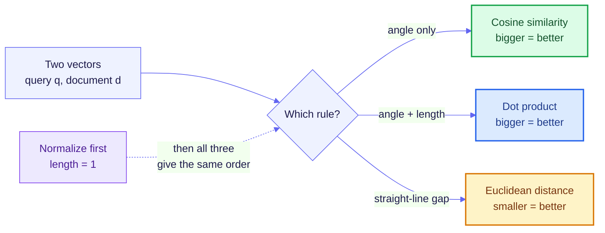

## 1. Where Similarity Metrics Fit

Chapter 7 gave us embeddings.

Now we need a mathematical rule for comparing them.


Dense retrieval therefore has two distinct jobs:

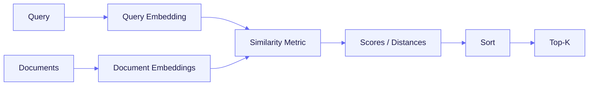

Embedding quality decides **what the vectors represent**.

The similarity metric decides **how those vectors are compared**.

## 2. Why We Need a Similarity Function

Suppose we already have:

```text
Query embedding:
[0.21, -0.42, 0.71, ...]

Document embedding:
[0.24, -0.39, 0.68, ...]
```

The vectors alone do not tell us a ranking.

We need:

```math
f(q,d)
```

where:

```text
q = query vector
d = document vector
f = comparison function
```

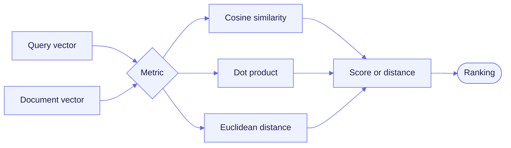

Different metrics define **closeness** differently.

## 3. Vector Refresher

> [!TIP]
> **In simple words:** A vector is just a list of numbers. In 2D you can draw it as an arrow from `(0, 0)` to the point.

A vector is an ordered collection of numbers.

```math
A = [1,2], \qquad B = [2,4]
```

In two dimensions, each vector can be visualized as an arrow.

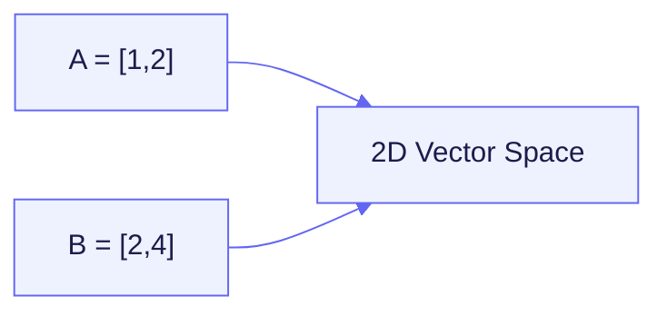

Real embeddings may contain hundreds or thousands of dimensions.

Example:

```text
[0.012, -0.221, 0.553, 0.102, ..., -0.087]
```

The geometry still follows the same mathematical ideas.

## 4. Magnitude and Direction

> [!TIP]
> **In simple words:** Magnitude = how long the arrow is. Direction = where it points. Two arrows can point the same way but have different lengths.

Two fundamental properties of a vector are:

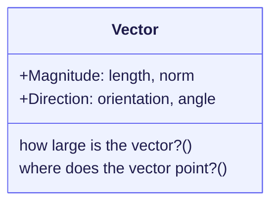

Magnitude:

```math
\|A\| = \sqrt{ A_1^2+A_2^2+\dots+A_n^2 }
```

Python:

```python
import numpy as np

A = np.array([3.0, 4.0])

# Length of the vector: sqrt(3^2 + 4^2)
magnitude = np.linalg.norm(A)

print(magnitude)
# 5.0
```

Why this matters:

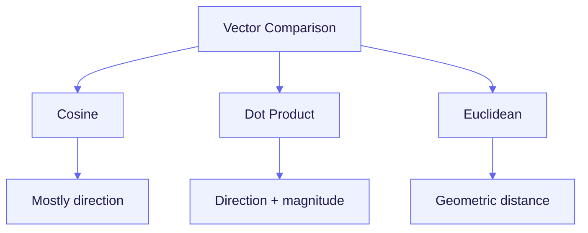

## 5. Cosine Similarity

> [!TIP]
> **In simple words:** Cosine asks only: do the two arrows point the same way? 1 = same way, 0 = unrelated, -1 = opposite. Length is ignored.

Cosine similarity measures the angle between vectors.

```math
\cos(\theta) = \frac{ A\cdot B }{ \|A\|\|B\| }
```

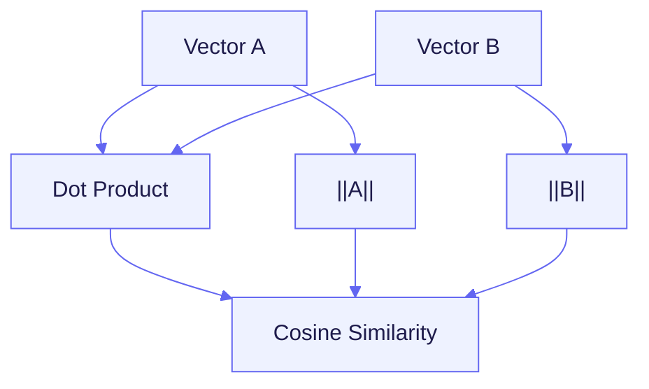

Intuition:

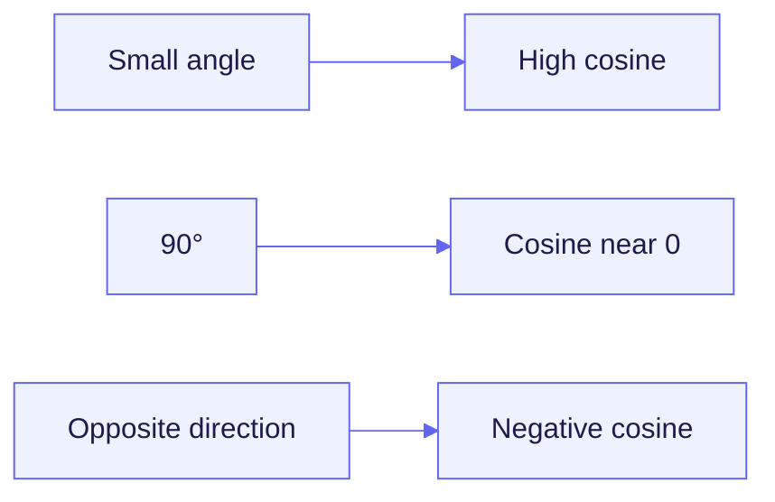

#### Important idea

Cosine similarity ignores overall scale.

These vectors:

```math
[1,2]
```

and:

```math
[10,20]
```

point in the same direction.

Their cosine similarity is `1`.

## 6. Cosine Similarity From Scratch

Let:

```math
A = [1,2], \qquad B = [2,4]
```

Dot product:

```math
A\cdot B = 1(2)+2(4) = 10
```

Norms:

```math
\|A\| = \sqrt{1^2+2^2} = \sqrt5, \qquad \|B\| = \sqrt{2^2+4^2} = \sqrt{20}
```

Therefore:

```math
\cos(\theta) = \frac{10} {\sqrt5\sqrt{20}} = 1
```

Python:

```python
import numpy as np

def cosine_similarity_manual(a, b):
    # Work with float arrays
    a = np.asarray(a, dtype=float)
    b = np.asarray(b, dtype=float)

    # Top of the formula
    dot_product = np.dot(a, b)

    # Bottom of the formula
    norm_a = np.linalg.norm(a)
    norm_b = np.linalg.norm(b)

    # A zero vector has no direction
    if norm_a == 0 or norm_b == 0:
        return 0.0

    return dot_product / (norm_a * norm_b)
```

Result: `cosine_similarity_manual([1, 2], [2, 4])` = **1.0**, and `cosine_similarity_manual([1, 2], [10, 20])` = **1.0**. Same direction, so the length difference does not matter.

#### Internal flow

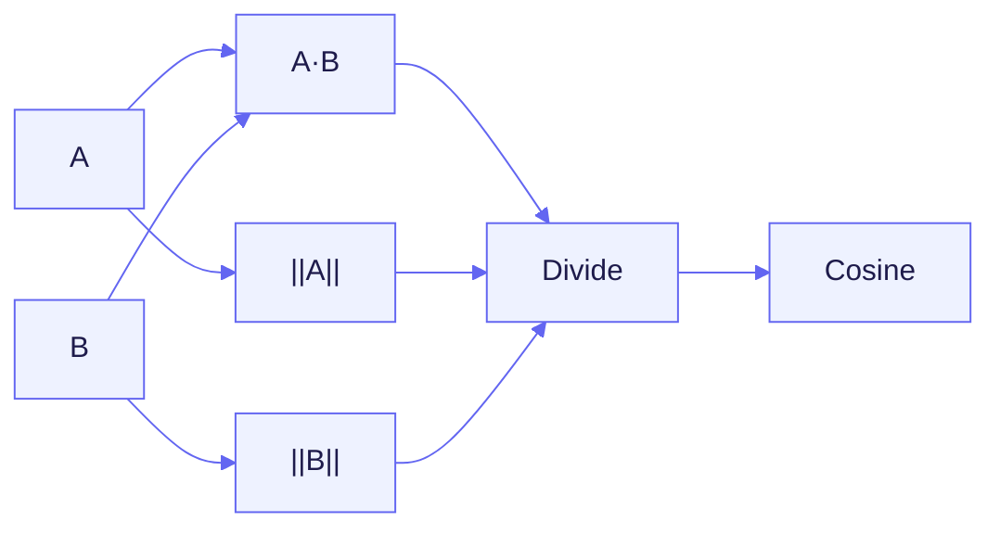

## 7. Dot Product

> [!TIP]
> **In simple words:** Dot product multiplies matching numbers and adds them. Long arrows give big numbers, so it rewards both direction and size.

Dot product is:

```math
A\cdot B = \sum_{i = 1}^{n}A_iB_i
```

For:

```math
A = [1,2], \qquad B = [2,4], \qquad A\cdot B = 10
```

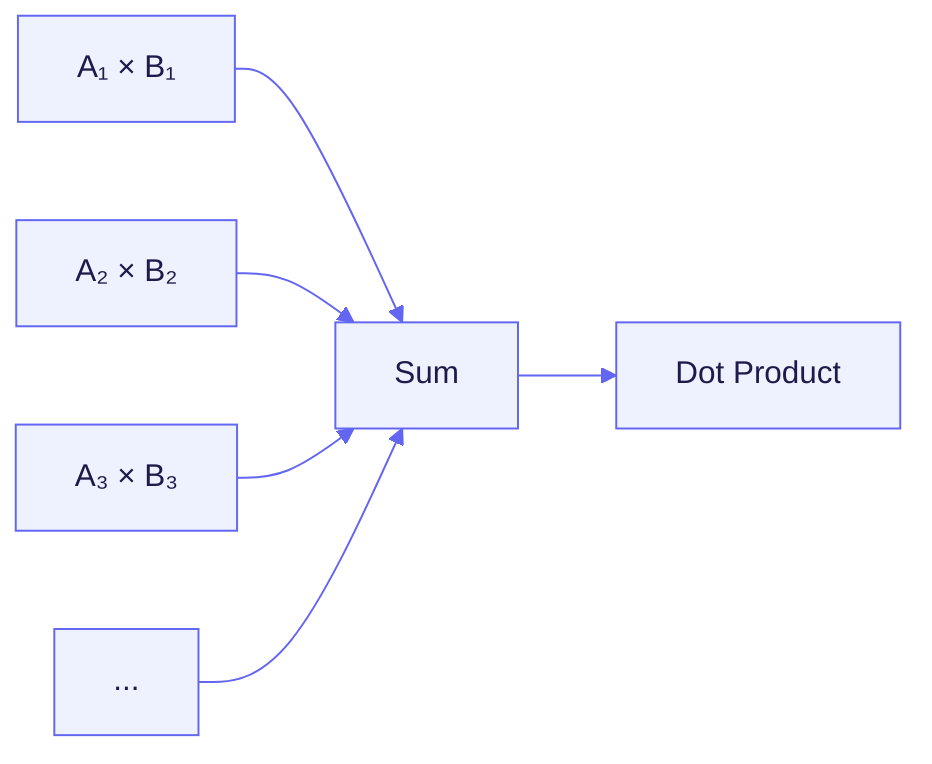

Dot product depends on:

```text
angle
AND
vector magnitude
```

Because:

```math
A\cdot B = \|A\|\|B\|\cos(\theta)
```

## 8. Dot Product From Scratch

```python
def dot_product_manual(a, b):
    # Both vectors must have the same number of values
    if len(a) != len(b):
        raise ValueError("Vectors must have same dimension.")

    total = 0.0

    # Multiply matching positions and add them up
    for x, y in zip(a, b):
        total += x * y

    return total
```

Result: `dot_product_manual([1, 2], [2, 4])` = 1·2 + 2·4 = **10.0**.

Equivalent NumPy:

```python
# Same result, much faster on long vectors
score = np.dot(a, b)
```

#### Important distinction

If two vectors point similarly but one has much larger magnitude, raw dot product may strongly favor the larger vector.

## 9. Euclidean Distance

> [!TIP]
> **In simple words:** Euclidean distance is the ruler distance between the two arrow tips. 0 = identical; bigger = further apart.

Euclidean distance measures straight-line distance.

```math
d(A,B) = \sqrt{ \sum_i(A_i-B_i)^2 }
```

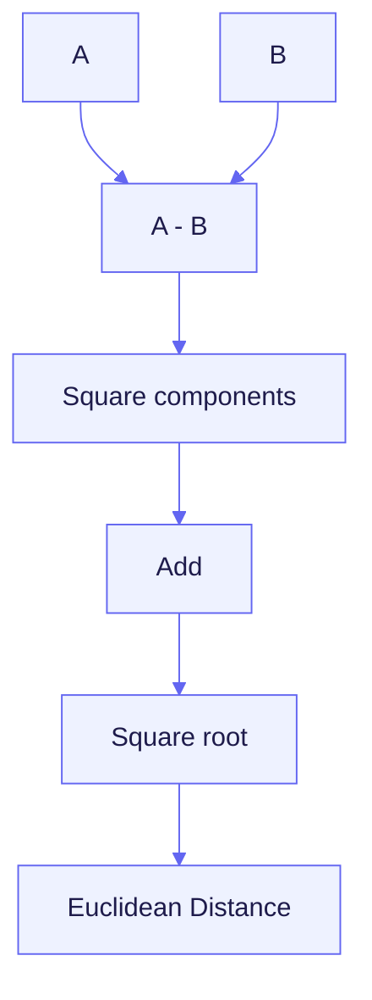

Interpretation:

```text
small distance
→ vectors are close

large distance
→ vectors are far apart
```

This is opposite to similarity scoring:

```text
cosine / dot
→ bigger is usually better

Euclidean distance
→ smaller is better
```

## 10. Euclidean Distance From Scratch

Let:

```math
A = [1,2], \qquad B = [2,4]
```

Then:

```math
A-B = [-1,-2]
```

Squares:

```math
[1,4]
```

Sum:

```math
5
```

Distance:

```math
\sqrt5
```

Python:

```python
def euclidean_distance_manual(a, b):
    a = np.asarray(a, dtype=float)
    b = np.asarray(b, dtype=float)

    # Difference per position, squared
    squared_difference = (a - b) ** 2

    # Add up, then take the square root
    return np.sqrt(np.sum(squared_difference))
```

Result: `euclidean_distance_manual([1, 2], [2, 4])` = sqrt(5) = **2.2361**.

## 11. Similarity vs Distance

> [!TIP]
> **In simple words:** Similarity: bigger is better. Distance: smaller is better. Mixing these up turns the best result into the worst.

A common engineering bug is sorting in the wrong direction.

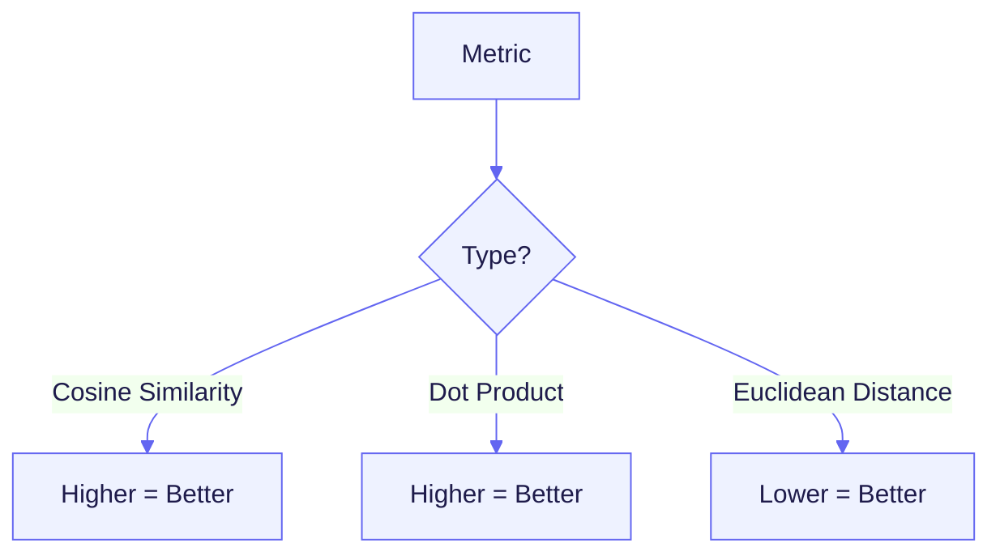

Correct ranking:

```python
# Higher similarity is better: sort descending
similarity_ranking = np.argsort(similarities)[::-1]

# Lower distance is better: sort ascending
distance_ranking = np.argsort(distances)
```

If you sort L2 distance descending, you retrieve the **least similar vectors first**.

## 12. Vector Normalization

> [!TIP]
> **In simple words:** Normalization shrinks or stretches the arrow to length 1 without changing where it points.

Normalization converts any non-zero vector to length 1.

```math
\hat{v} = \frac{v}{\|v\|}
```

Example:

```math
v = [3,4], \qquad \|v\| = 5
```

Normalized:

```math
\hat{v} = [0.6,0.8]
```

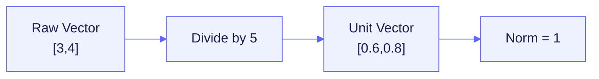

Python:

```python
def normalize_vector(vector):
    vector = np.asarray(vector, dtype=float)

    # Length of the vector
    norm = np.linalg.norm(vector)

    # A zero vector cannot be normalized
    if norm == 0:
        return vector

    # Same direction, length 1
    return vector / norm
```

Result: `normalize_vector([3, 4])` = **[0.6, 0.8]**, and its norm is **1.0**.

## 13. Why Normalization Changes Rankings

Consider:

```math
Q = [1,0]
```

Documents:

```math
D_1 = [1,0], \qquad D_2 = [10,1]
```

Dot products:

```math
Q\cdot D_1 = 1, \qquad Q\cdot D_2 = 10
```

Raw dot product strongly prefers $D_2$.

But why?

Because $D_2$ has much larger magnitude.

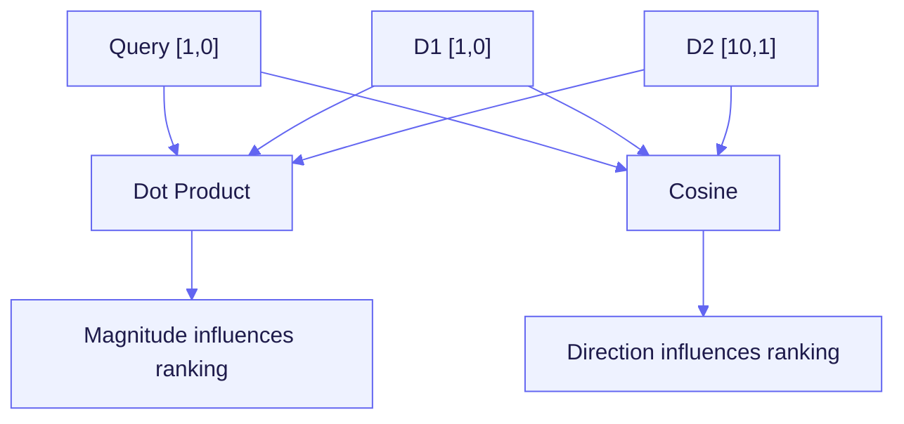

Normalization removes magnitude as a variable.

Real output:

<table width="100%">
<thead><tr><th width="8%">Sr No</th><th width="12%">Doc</th><th width="20%">Vector</th><th width="20%">Dot with Q</th><th width="20%">Cosine with Q</th><th width="20%">Euclidean to Q</th></tr></thead>
<tbody>
<tr><td align="center">01</td><td>D1</td><td><code>[1, 0]</code></td><td align="center">1.0</td><td><b>1.0000</b></td><td><b>0.0000</b></td></tr>
<tr><td align="center">02</td><td>D2</td><td><code>[10, 1]</code></td><td><b>10.0</b></td><td align="center">0.9950</td><td align="center">9.0554</td></tr>
</tbody>
</table>

## 14. Cosine vs Dot Product

The relationship is:

```math
A\cdot B = \|A\|\|B\|\cos(\theta)
```

So:

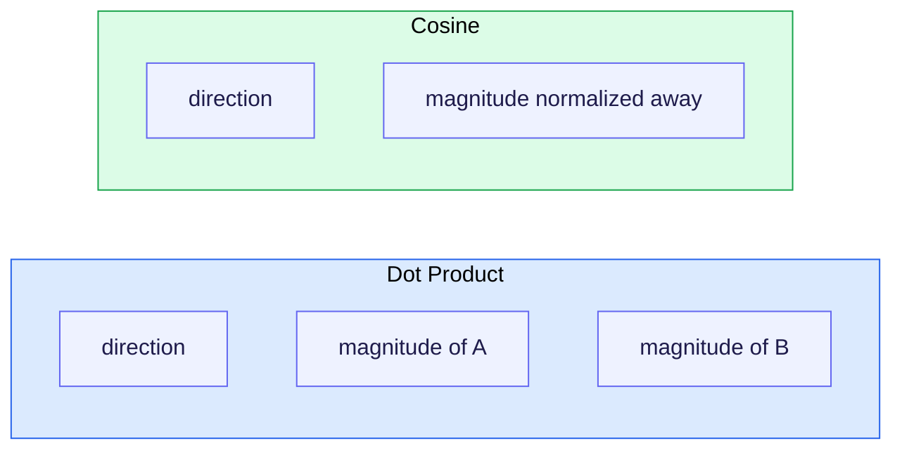

This distinction matters if your embedding model produces vectors with meaningful magnitude.

Some models intentionally use dot product.

Others are designed around cosine.

## 15. Cosine vs Euclidean Distance

Suppose:

```math
A = [1,0], \qquad B = [10,0]
```

Both point in exactly the same direction.

Cosine:

```math
1
```

Euclidean distance:

```math
9
```

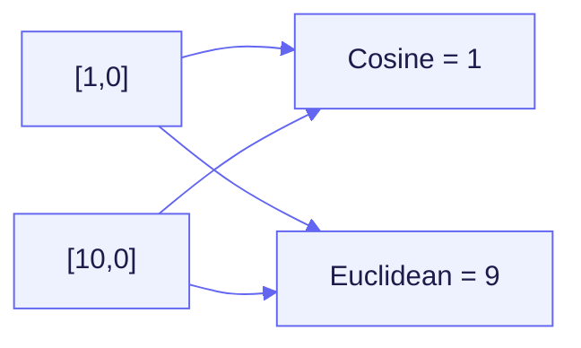

So:

```text
cosine
→ considers them maximally directionally similar

Euclidean
→ considers them far apart geometrically
```

## 16. When Metrics Become Equivalent

> [!TIP]
> **In simple words:** If every arrow has length 1, the only thing left to compare is direction, so all three metrics agree on the order.

For normalized vectors:

```math
\|A\| = \|B\| = 1
```

Then:

```math
A\cdot B = \cos(\theta)
```

Also:

```math
\|A-B\|^2 = 2-2(A\cdot B)
```

Therefore for unit vectors:

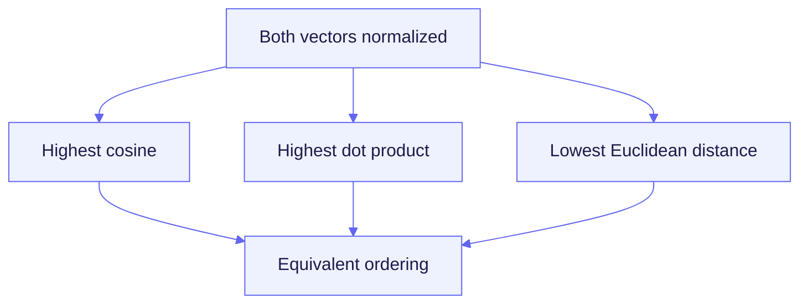

This is a very important interview concept.

Check on random 8-dimensional unit vectors: `||A - B||² = 2.497731` and `2 - 2(A·B) = 2.497731`. The identity holds, so a smaller distance always means a larger dot product.

## 17. Ranking Example With Three Documents

Let:

```math
Q = [1,0], \qquad D_1 = [1,0], \qquad D_2 = [3,0.3], \qquad D_3 = [0,1]
```

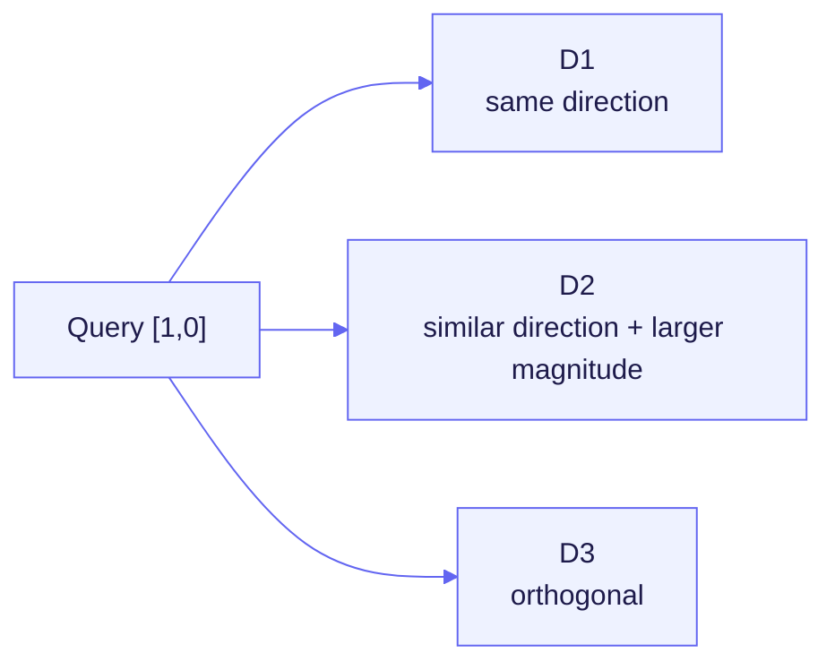

Experiment:

```python
query = np.array([1.0, 0.0])

documents = {
    "D1": np.array([1.0, 0.0]),
    "D2": np.array([3.0, 0.3]),
    "D3": np.array([0.0, 1.0]),
}

for doc_id, vector in documents.items():
    # Direction only
    cosine = cosine_similarity_manual(query, vector)

    # Direction and length
    dot = np.dot(query, vector)

    # Straight-line gap
    euclidean = np.linalg.norm(query - vector)

    print(doc_id, "cosine=", cosine, "dot=", dot, "euclidean=", euclidean)
```

Expected conceptual result:

```text
Cosine:
D1 and D2 both strong

Dot:
D2 strongly benefits from magnitude

Euclidean:
D1 is closest
```

Real output:

<table width="100%">
<thead><tr><th width="8%">Sr No</th><th width="12%">Doc</th><th width="20%">Vector</th><th width="20%">Cosine</th><th width="20%">Dot</th><th width="20%">Euclidean</th></tr></thead>
<tbody>
<tr><td align="center">01</td><td>D1</td><td><code>[1, 0]</code></td><td><b>1.0000</b></td><td align="center">1.0</td><td><b>0.0000</b></td></tr>
<tr><td align="center">02</td><td>D2</td><td><code>[3, 0.3]</code></td><td align="center">0.9950</td><td><b>3.0</b></td><td align="center">2.0224</td></tr>
<tr><td align="center">03</td><td>D3</td><td><code>[0, 1]</code></td><td align="center">0.0000</td><td align="center">0.0</td><td align="center">1.4142</td></tr>
</tbody>
</table>

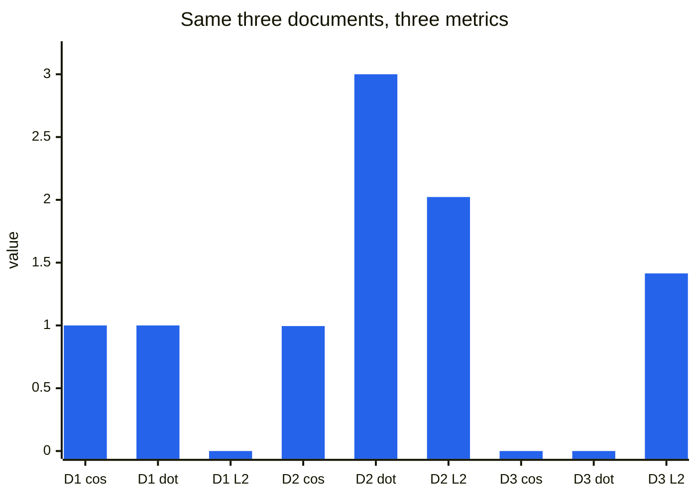

<p align="center">cos and dot: higher = better · L2 (Euclidean): lower = better</p>

Winner by metric: cosine D1 (D2 almost tied), dot **D2** (length 3x), Euclidean **D1**. Three metrics, two different winners.

## 18. Metric Choice in Real Embedding Models

Do not choose the similarity metric randomly.

Start with the embedding model's intended geometry.

```mermaid
%%{init: {'theme':'base','themeVariables':{'primaryColor':'#EEF2FF','primaryBorderColor':'#6366F1','primaryTextColor':'#1E1B4B','lineColor':'#6366F1','pie1':'#22C55E','pie2':'#F59E0B','pie3':'#EF4444','pie4':'#3B82F6','pie5':'#8B5CF6','xyChart':{'plotColorPalette':'#2563EB, #16A34A, #D97706, #DC2626, #7C3AED'}}}}%%
flowchart TD
    M["Embedding Model"] --> DOC["Read model docs / model card"]
    DOC --> R{"Recommended scoring?"}

    R -->|Cosine| COS["Configure cosine"]
    R -->|Dot / IP| DOT["Configure dot / inner product"]
    R -->|L2| L2["Configure Euclidean / L2"]
```

Questions to ask:

```text
Does the model return normalized vectors?
What metric was used during training?
What metric was used in retrieval benchmarks?
Does the model documentation recommend cosine or dot product?
```

## 19. Metric Choice in Vector Databases

Common vector-index metrics include:

```text
COSINE
DOT PRODUCT
INNER PRODUCT / IP
L2 / EUCLIDEAN
```

```mermaid
%%{init: {'theme':'base','themeVariables':{'primaryColor':'#EEF2FF','primaryBorderColor':'#6366F1','primaryTextColor':'#1E1B4B','lineColor':'#6366F1','pie1':'#22C55E','pie2':'#F59E0B','pie3':'#EF4444','pie4':'#3B82F6','pie5':'#8B5CF6','xyChart':{'plotColorPalette':'#2563EB, #16A34A, #D97706, #DC2626, #7C3AED'}}}}%%
flowchart LR
    EM["Embedding Model"] --> M["Metric Policy"]
    M --> VDB["Vector Database"]
    VDB --> IDX["ANN Index"]
    IDX --> Q["Query Search"]
```

#### Configuration consistency

```mermaid
%%{init: {'theme':'base','themeVariables':{'primaryColor':'#EEF2FF','primaryBorderColor':'#6366F1','primaryTextColor':'#1E1B4B','lineColor':'#6366F1','pie1':'#22C55E','pie2':'#F59E0B','pie3':'#EF4444','pie4':'#3B82F6','pie5':'#8B5CF6','xyChart':{'plotColorPalette':'#2563EB, #16A34A, #D97706, #DC2626, #7C3AED'}}}}%%
stateDiagram-v2
    [*] --> ModelSelected
    ModelSelected --> MetricSelected
    MetricSelected --> NormalizationPolicy
    NormalizationPolicy --> VectorIndexConfigured
    VectorIndexConfigured --> RetrievalReady
```

#### Metric names in popular vector stores

<table width="100%">
<thead><tr><th width="8%">Sr No</th><th width="20%">Store</th><th width="24%">Cosine</th><th width="24%">Dot / inner product</th><th width="24%">Euclidean / L2</th></tr></thead>
<tbody>
<tr><td align="center">01</td><td>FAISS</td><td><code>IndexFlatIP</code> on normalized vectors</td><td><code>METRIC_INNER_PRODUCT</code> (<code>IndexFlatIP</code>)</td><td><code>METRIC_L2</code> (<code>IndexFlatL2</code>)</td></tr>
<tr><td align="center">02</td><td>pgvector</td><td><code>&lt;=&gt;</code> (cosine distance)</td><td><code>&lt;#&gt;</code> (negative inner product)</td><td><code>&lt;-&gt;</code></td></tr>
<tr><td align="center">03</td><td>Qdrant</td><td><code>Cosine</code></td><td><code>Dot</code></td><td><code>Euclid</code></td></tr>
<tr><td align="center">04</td><td>Milvus</td><td><code>COSINE</code></td><td><code>IP</code></td><td><code>L2</code></td></tr>
<tr><td align="center">05</td><td>Pinecone</td><td><code>cosine</code></td><td><code>dotproduct</code></td><td><code>euclidean</code></td></tr>
<tr><td align="center">06</td><td>Elasticsearch <code>dense_vector</code></td><td><code>cosine</code></td><td><code>dot_product</code>, <code>max_inner_product</code></td><td><code>l2_norm</code></td></tr>
</tbody>
</table>

> [!CAUTION]
> Some stores return a **distance** even for cosine (pgvector `<=>` returns `1 - cosine`; pgvector `<#>` returns the negative inner product). Always check whether the returned number should be sorted ascending or descending.

## 20. Top-K Search

Dense retrieval typically ranks vectors and returns Top-K.

```mermaid
%%{init: {'theme':'base','themeVariables':{'primaryColor':'#EEF2FF','primaryBorderColor':'#6366F1','primaryTextColor':'#1E1B4B','lineColor':'#6366F1','pie1':'#22C55E','pie2':'#F59E0B','pie3':'#EF4444','pie4':'#3B82F6','pie5':'#8B5CF6','xyChart':{'plotColorPalette':'#2563EB, #16A34A, #D97706, #DC2626, #7C3AED'}}}}%%
flowchart TD
    Q["Query Vector"] --> S["Compute scores / distances"]
    S --> SORT["Sort"]
    SORT --> R1["Rank 1"]
    SORT --> R2["Rank 2"]
    SORT --> R3["Rank 3"]
    SORT --> RK["... Rank K"]
```

Cosine/dot:

```python
# Cosine / dot: highest K scores
top_indices = np.argsort(scores)[::-1][:top_k]
```

Euclidean:

```python
# Euclidean: smallest K distances
top_indices = np.argsort(distances)[:top_k]
```

## 21. Score Interpretation

> [!TIP]
> **In simple words:** A cosine of 0.82 means "more similar than 0.70". It does not mean "82% relevant".

Similarity score is not automatically a probability.

```mermaid
%%{init: {'theme':'base','themeVariables':{'primaryColor':'#EEF2FF','primaryBorderColor':'#6366F1','primaryTextColor':'#1E1B4B','lineColor':'#6366F1','pie1':'#22C55E','pie2':'#F59E0B','pie3':'#EF4444','pie4':'#3B82F6','pie5':'#8B5CF6','xyChart':{'plotColorPalette':'#2563EB, #16A34A, #D97706, #DC2626, #7C3AED'}}}}%%
flowchart TD
    S["Cosine = 0.82"] --> I{"Interpretation"}
    I -->|Correct| R["Relative vector similarity"]
    I -->|Wrong| P["82% probability of relevance"]
    I -->|Wrong| C["82% confidence"]
```

The same warning applies to BM25.

Both are ranking signals unless calibrated.

## 22. Thresholds

A rule such as:

```text
cosine >= 0.75
```

may or may not work.

Threshold quality depends on:

- model
- corpus
- query types
- chunk size
- domain
- normalization
- task

```mermaid
%%{init: {'theme':'base','themeVariables':{'primaryColor':'#EEF2FF','primaryBorderColor':'#6366F1','primaryTextColor':'#1E1B4B','lineColor':'#6366F1','pie1':'#22C55E','pie2':'#F59E0B','pie3':'#EF4444','pie4':'#3B82F6','pie5':'#8B5CF6','xyChart':{'plotColorPalette':'#2563EB, #16A34A, #D97706, #DC2626, #7C3AED'}}}}%%
flowchart LR
    T["Candidate threshold"] --> E["Evaluate on labeled data"]
    E --> PR["Precision / Recall trade-off"]
    PR --> C["Choose threshold"]
```

A safer starting point is often:

```text
Top-K
```

and then tune with evaluation data.

## 23. Numerical Stability

Dense retrieval code should defend against numerical problems.

```mermaid
%%{init: {'theme':'base','themeVariables':{'primaryColor':'#EEF2FF','primaryBorderColor':'#6366F1','primaryTextColor':'#1E1B4B','lineColor':'#6366F1','pie1':'#22C55E','pie2':'#F59E0B','pie3':'#EF4444','pie4':'#3B82F6','pie5':'#8B5CF6','xyChart':{'plotColorPalette':'#2563EB, #16A34A, #D97706, #DC2626, #7C3AED'}}}}%%
flowchart TD
    V["Input Vector"] --> Z{"Zero norm?"}
    Z -->|Yes| H1["Handle explicitly"]
    Z -->|No| N{"NaN / Inf?"}

    N -->|Yes| H2["Investigate embedding generation"]
    N -->|No| D{"Correct dimension?"}

    D -->|No| H3["Reject mismatch"]
    D -->|Yes| S["Compute similarity"]
```

Potential issues:

- zero vector
- `NaN`
- infinity
- dimension mismatch
- wrong dtype
- unintended integer vectors

## 24. Zero Vectors

Cosine similarity requires non-zero norms.

If:

```math
\|A\| = 0
```

then division by zero occurs.

Safe function:

```python
def cosine_similarity_safe(a, b):
    norm_a = np.linalg.norm(a)
    norm_b = np.linalg.norm(b)

    # Avoid division by zero
    if norm_a == 0 or norm_b == 0:
        return 0.0

    return np.dot(a, b) / (norm_a * norm_b)
```

A zero vector can signal:

```mermaid
%%{init: {'theme':'base','themeVariables':{'primaryColor':'#EEF2FF','primaryBorderColor':'#6366F1','primaryTextColor':'#1E1B4B','lineColor':'#6366F1','pie1':'#22C55E','pie2':'#F59E0B','pie3':'#EF4444','pie4':'#3B82F6','pie5':'#8B5CF6','xyChart':{'plotColorPalette':'#2563EB, #16A34A, #D97706, #DC2626, #7C3AED'}}}}%%
pie showData
    title "Zero vector causes to check (equal weight, checklist only)"
    "Empty text" : 1
    "Failed embedding" : 1
    "Invalid preprocessing" : 1
    "Model bug" : 1
    "Missing data" : 1
```

## 25. High-Dimensional Intuition

Real text embeddings may have hundreds of dimensions.

```mermaid
%%{init: {'theme':'base','themeVariables':{'primaryColor':'#EEF2FF','primaryBorderColor':'#6366F1','primaryTextColor':'#1E1B4B','lineColor':'#6366F1','pie1':'#22C55E','pie2':'#F59E0B','pie3':'#EF4444','pie4':'#3B82F6','pie5':'#8B5CF6','xyChart':{'plotColorPalette':'#2563EB, #16A34A, #D97706, #DC2626, #7C3AED'}}}}%%
flowchart LR
    T["Sentence"] --> E["Embedding Model"]
    E --> V["[v₁,v₂,v₃,...,v₇₆₈]"]
    V --> M["Similarity Metric"]
    M --> R["Ranking"]
```

2D diagrams are only educational approximations.

Do not assume:

```text
dimension 1 = sentiment
dimension 2 = topic
dimension 3 = grammar
```

Semantic information is usually distributed.

## 26. Metric Mismatch Failure

Suppose the embedding model expects cosine-like geometry.

The vector database is configured incorrectly.

```mermaid
%%{init: {'theme':'base','themeVariables':{'primaryColor':'#EEF2FF','primaryBorderColor':'#6366F1','primaryTextColor':'#1E1B4B','lineColor':'#6366F1','pie1':'#22C55E','pie2':'#F59E0B','pie3':'#EF4444','pie4':'#3B82F6','pie5':'#8B5CF6','xyChart':{'plotColorPalette':'#2563EB, #16A34A, #D97706, #DC2626, #7C3AED'}}}}%%
flowchart TD
    M["Embedding Model"] --> G["Expected geometry"]
    G --> WRONG["Wrong DB metric"]
    WRONG --> R["Different ranking"]
    R --> LOSS["Retrieval quality drops"]
```

This kind of bug is dangerous because the system may still return plausible-looking results.

## 27. Normalization Mismatch Failure

Example:

```text
documents normalized
query unnormalized
```

or the reverse.

```mermaid
%%{init: {'theme':'base','themeVariables':{'primaryColor':'#EEF2FF','primaryBorderColor':'#6366F1','primaryTextColor':'#1E1B4B','lineColor':'#6366F1','pie1':'#22C55E','pie2':'#F59E0B','pie3':'#EF4444','pie4':'#3B82F6','pie5':'#8B5CF6','xyChart':{'plotColorPalette':'#2563EB, #16A34A, #D97706, #DC2626, #7C3AED'}}}}%%
flowchart LR
    Q["Query Vector"] --> QN{"Normalized?"}
    D["Document Vectors"] --> DN{"Normalized?"}

    QN --> SAME{"Same policy?"}
    DN --> SAME

    SAME -->|Yes| OK["Consistent scoring"]
    SAME -->|No| BAD["Potential ranking distortion"]
```

Use a single explicit vector policy.

> [!WARNING]
> See the end-to-end example below: when document vectors have different lengths and the query is normalized, raw dot product put `office opening hours` first for the query `how can I work from home?`.

## 28. Similarity Metrics and ANN

> [!TIP]
> **In simple words:** ANN makes the search faster; it still needs to know which metric defines "nearest".

Approximate Nearest Neighbor indexes still search under a chosen vector metric.

```mermaid
%%{init: {'theme':'base','themeVariables':{'primaryColor':'#EEF2FF','primaryBorderColor':'#6366F1','primaryTextColor':'#1E1B4B','lineColor':'#6366F1','pie1':'#22C55E','pie2':'#F59E0B','pie3':'#EF4444','pie4':'#3B82F6','pie5':'#8B5CF6','xyChart':{'plotColorPalette':'#2563EB, #16A34A, #D97706, #DC2626, #7C3AED'}}}}%%
flowchart LR
    Q["Query Vector"] --> ANN["ANN Index"]
    M["Cosine / Dot / L2"] --> ANN
    ANN --> C["Approximate candidates"]
    C --> K["Top-K"]
```

ANN changes **how efficiently** we search.

It does not remove the need to define **what nearest means**.

## 29. Dense Retrieval Debugging

A practical decision tree:

```mermaid
%%{init: {'theme':'base','themeVariables':{'primaryColor':'#EEF2FF','primaryBorderColor':'#6366F1','primaryTextColor':'#1E1B4B','lineColor':'#6366F1','pie1':'#22C55E','pie2':'#F59E0B','pie3':'#EF4444','pie4':'#3B82F6','pie5':'#8B5CF6','xyChart':{'plotColorPalette':'#2563EB, #16A34A, #D97706, #DC2626, #7C3AED'}}}}%%
flowchart TD
    S["Bad Dense Result"] --> V{"Vectors valid?"}

    V -->|No| F1["Fix embedding pipeline"]
    V -->|Yes| DIM{"Dimensions match?"}

    DIM -->|No| F2["Use same model/version"]
    DIM -->|Yes| N{"Normalization consistent?"}

    N -->|No| F3["Fix normalization"]
    N -->|Yes| M{"Metric correct?"}

    M -->|No| F4["Fix metric configuration"]
    M -->|Yes| C{"Chunk meaningful?"}

    C -->|No| F5["Fix chunking"]
    C -->|Yes| K{"Top-K sufficient?"}

    K -->|No| F6["Increase candidate pool"]
    K -->|Yes| MODEL["Inspect model/domain quality"]
```

Debug checklist:

<table width="100%">
<thead><tr><th width="8%">Sr No</th><th width="28%">Layer</th><th width="64%">Check</th></tr></thead>
<tbody>
<tr><td align="center">01</td><td>Model</td><td>Same embedding model for query/docs?</td></tr>
<tr><td align="center">02</td><td>Version</td><td>Same embedding model version?</td></tr>
<tr><td align="center">03</td><td>Dimension</td><td>Same vector size?</td></tr>
<tr><td align="center">04</td><td>Normalization</td><td>Consistent?</td></tr>
<tr><td align="center">05</td><td>Metric</td><td>Cosine/dot/L2 configured correctly?</td></tr>
<tr><td align="center">06</td><td>Sort</td><td>Higher/lower direction correct?</td></tr>
<tr><td align="center">07</td><td>Chunking</td><td>Semantic context preserved?</td></tr>
<tr><td align="center">08</td><td>Top-K</td><td>Large enough?</td></tr>
<tr><td align="center">09</td><td>ANN</td><td>Approximation losing recall?</td></tr>
</tbody>
</table>

## 30. BM25 Scores vs Dense Similarity Scores

Example:

```text
BM25 score = 8.4

Cosine score = 0.79
```

These are not directly comparable.

```mermaid
%%{init: {'theme':'base','themeVariables':{'primaryColor':'#EEF2FF','primaryBorderColor':'#6366F1','primaryTextColor':'#1E1B4B','lineColor':'#6366F1','pie1':'#22C55E','pie2':'#F59E0B','pie3':'#EF4444','pie4':'#3B82F6','pie5':'#8B5CF6','xyChart':{'plotColorPalette':'#2563EB, #16A34A, #D97706, #DC2626, #7C3AED'}}}}%%
flowchart LR
    BM["BM25 Score<br/>8.4"] --> D["Different score scales"]
    DE["Dense Score<br/>0.79"] --> D

    D --> X["Do NOT simply add"]
    X --> L["Later: normalize or use rank fusion"]
```

Bad:

```python
# Bad: BM25 (unbounded) + cosine (-1 to 1) on different scales
hybrid_score = bm25_score + cosine_score
```

Later chapters will cover proper fusion.

## 31. Similarity Metrics Inside Hybrid Search

```mermaid
%%{init: {'theme':'base','themeVariables':{'primaryColor':'#EEF2FF','primaryBorderColor':'#6366F1','primaryTextColor':'#1E1B4B','lineColor':'#6366F1','pie1':'#22C55E','pie2':'#F59E0B','pie3':'#EF4444','pie4':'#3B82F6','pie5':'#8B5CF6','xyChart':{'plotColorPalette':'#2563EB, #16A34A, #D97706, #DC2626, #7C3AED'}}}}%%
flowchart LR
    Q["Query"] --> BM["BM25 Branch"]
    Q --> DE["Dense Branch"]

    DE --> E["Embedding"]
    E --> M["Similarity Metric"]
    M --> DT["Dense Top-K"]

    BM --> ST["Sparse Top-K"]

    ST --> F["Fusion"]
    DT --> F

    F --> R["Reranker"]
    R --> K["Final Top-K"]
```

A bad metric configuration can prevent the correct documents from ever reaching fusion.

## End-to-End Example — Three Metrics on Real Embeddings

This section runs every idea of the chapter on real sentence embeddings (`all-MiniLM-L6-v2`, 384 dimensions): one configurable search function, the unit-vector identity, a normalization-mismatch bug and a wrong-sort bug. All outputs are real results from running the code.

```mermaid
%%{init: {'theme':'base','themeVariables':{'primaryColor':'#EEF2FF','primaryBorderColor':'#6366F1','primaryTextColor':'#1E1B4B','lineColor':'#6366F1','pie1':'#22C55E','pie2':'#F59E0B','pie3':'#EF4444','pie4':'#3B82F6','pie5':'#8B5CF6','xyChart':{'plotColorPalette':'#2563EB, #16A34A, #D97706, #DC2626, #7C3AED'}}}}%%
sequenceDiagram
    autonumber
    participant D as Documents
    participant M as Embedding model
    participant S as search(metric)
    participant U as User
    D->>M: encode, normalize
    M-->>S: unit document vectors
    U->>M: query text
    M-->>S: unit query vector
    alt metric = cosine or dot
        S->>S: score, sort descending
    else metric = l2
        S->>S: distance, sort ascending
    end
    S-->>U: Top-K
```

### Step 1. Embed five documents and one query

Same model as Chapter 7. `normalize_embeddings=True` makes every vector length 1.

```python
import numpy as np
from sentence_transformers import SentenceTransformer

# Small 384-dimensional embedding model
model = SentenceTransformer("all-MiniLM-L6-v2")

# Five short documents
documents = [
    "employees may work remotely",
    "remote work policy for staff",
    "office opening hours",
    "authentication failure caused by expired credentials",
    "banana fruit salad recipe",
]

# Index time: one unit vector per document
doc_vectors = model.encode(documents, normalize_embeddings=True)

# Query time: one unit vector for the query
query_vector = model.encode("how can I work from home?", normalize_embeddings=True)

# Every stored vector should have length 1
print("shape:", doc_vectors.shape)
print("document norms:", np.round(np.linalg.norm(doc_vectors, axis=1), 4))
```

**Output**

```text
shape: (5, 384)
document norms: [1. 1. 1. 1. 1.]
```

### Step 2. A configurable search function

One function for all three metrics. The only real difference is the sort direction.

```python
def search(query_vector, doc_vectors, metric="cosine", top_k=3):
    if metric == "dot":
        # Dot product of the query with every document
        values = doc_vectors @ query_vector

        # Bigger is better: sort descending
        order = np.argsort(values)[::-1]

    elif metric == "cosine":
        # Length of each document times length of the query
        norms = np.linalg.norm(doc_vectors, axis=1) * np.linalg.norm(query_vector)

        # Dot product divided by both lengths
        values = (doc_vectors @ query_vector) / norms

        # Bigger is better: sort descending
        order = np.argsort(values)[::-1]

    elif metric == "l2":
        # Straight-line distance to every document
        values = np.linalg.norm(doc_vectors - query_vector, axis=1)

        # Smaller is better: sort ascending
        order = np.argsort(values)

    else:
        # Fail loudly on a typo such as "cos"
        raise ValueError(f"unknown metric: {metric}")

    # Top-K documents with their score or distance
    return [(documents[i], round(float(values[i]), 4)) for i in order[:top_k]]

# Same query, three metrics
for metric in ["cosine", "dot", "l2"]:
    print(metric, search(query_vector, doc_vectors, metric))
```

**Output**

```text
cosine [('employees may work remotely', 0.4086), ('remote work policy for staff', 0.2892), ('office opening hours', 0.1807)]
dot [('employees may work remotely', 0.4086), ('remote work policy for staff', 0.2892), ('office opening hours', 0.1807)]
l2 [('employees may work remotely', 1.0876), ('remote work policy for staff', 1.1923), ('office opening hours', 1.28)]
```

### Step 3. Check the unit-vector identity

For unit vectors, `||q - d||² = 2 - 2(q·d)`, so all three metrics must give the same order.

```python
# Unit vectors, so dot product = cosine
cosine = doc_vectors @ query_vector

# Straight-line distances
l2 = np.linalg.norm(doc_vectors - query_vector, axis=1)

# Largest gap between the two sides of the identity
print("max |L2^2 - (2 - 2cos)|:", f"{np.abs(l2**2 - (2 - 2 * cosine)).max():.1e}")
print("order by cosine:", np.argsort(-cosine).tolist())
print("order by L2:    ", np.argsort(l2).tolist())
```

**Output**

```text
max |L2^2 - (2 - 2cos)|: 2.4e-07
order by cosine: [0, 1, 2, 4, 3]
order by L2:     [0, 1, 2, 4, 3]
```

### Step 4. Normalization mismatch

Simulate a pipeline bug: documents stored with different lengths (for example a model without a normalization layer, or vectors rescaled by mistake), query still normalized.

```python
# Different length for each stored document vector
lengths = np.array([1.0, 0.8, 3.0, 1.2, 2.5])
raw_doc_vectors = doc_vectors * lengths[:, None]

# Search the broken vectors with each metric
for metric in ["cosine", "dot", "l2"]:
    print(metric, search(query_vector, raw_doc_vectors, metric, top_k=2))
```

**Output**

```text
cosine [('employees may work remotely', 0.4086), ('remote work policy for staff', 0.2892)]
dot [('office opening hours', 0.5422), ('employees may work remotely', 0.4086)]
l2 [('remote work policy for staff', 1.085), ('employees may work remotely', 1.0876)]
```

### Step 5. Wrong sort direction

Sorting L2 distances descending, as if they were similarities.

```python
# Straight-line distances
distances = np.linalg.norm(doc_vectors - query_vector, axis=1)

# Bug: distances sorted like scores
wrong_order = np.argsort(distances)[::-1]

print("top-2 with the bug:", [documents[i] for i in wrong_order[:2]])
```

**Output**

```text
top-2 with the bug: ['authentication failure caused by expired credentials', 'banana fruit salad recipe']
```

### What the results show

```mermaid
%%{init: {'theme':'base','themeVariables':{'primaryColor':'#EEF2FF','primaryBorderColor':'#6366F1','primaryTextColor':'#1E1B4B','lineColor':'#6366F1','pie1':'#22C55E','pie2':'#F59E0B','pie3':'#EF4444','pie4':'#3B82F6','pie5':'#8B5CF6','xyChart':{'plotColorPalette':'#2563EB, #16A34A, #D97706, #DC2626, #7C3AED'}}}}%%
xychart-beta
    title "Dot product: correct vs bug"
    x-axis ["remotely ok", "remotely bug", "policy ok", "policy bug", "office ok", "office bug", "auth ok", "auth bug", "banana ok", "banana bug"]
    y-axis "dot product" 0 --> 0.6
    bar [0.4086, 0.4086, 0.2892, 0.2314, 0.1807, 0.5422, 0.0211, 0.0253, 0.037, 0.0924]
```

<p align="center">Query: "how can I work from home?" · ok = unit vectors · bug = document lengths changed</p>

<table width="100%">
<thead><tr><th width="8%">Sr No</th><th width="24%">Case</th><th width="30%">Top-1</th><th width="38%">Lesson</th></tr></thead>
<tbody>
<tr><td align="center">01</td><td>Unit vectors, any metric</td><td><code>employees may work remotely</code></td><td>Cosine, dot and L2 give the same order (identity holds to 2.4e-07).</td></tr>
<tr><td align="center">02</td><td>Mismatch, cosine</td><td><code>employees may work remotely</code></td><td>Cosine divides out length, so it is immune to the bug.</td></tr>
<tr><td align="center">03</td><td>Mismatch, dot</td><td><code>office opening hours</code></td><td>The 3x-long vector wins on length, not meaning.</td></tr>
<tr><td align="center">04</td><td>Mismatch, L2</td><td><code>remote work policy for staff</code></td><td>The shortest stored vector sits closest to the unit query.</td></tr>
<tr><td align="center">05</td><td>L2 sorted descending</td><td><code>authentication failure ...</code></td><td>The least similar documents come first.</td></tr>
</tbody>
</table>

> [!IMPORTANT]
> Pick one vector policy (normalize or not), apply it to documents **and** queries, configure the store with the metric the model expects, and test the sort direction with a known query.

## 32. Checkpoints With Answers

### Checkpoint 1 — Fundamentals

**Q1. Why do embeddings need a similarity metric?**  
Because vectors alone do not define which document is most relevant.

**Q2. What does cosine focus on?**  
Direction / angle.

**Q3. What does dot product include?**  
Direction and magnitude.

**Q4. What does Euclidean distance represent?**  
Straight-line geometric distance.

### Checkpoint 2 — Normalization

**Q1. What is normalization?**  
Scaling a vector so its norm becomes 1.

**Q2. When does dot product equal cosine?**  
When both vectors are unit normalized.

**Q3. Can normalization change rankings?**  
Yes. It removes magnitude as a factor.

```mermaid
%%{init: {'theme':'base','themeVariables':{'primaryColor':'#EEF2FF','primaryBorderColor':'#6366F1','primaryTextColor':'#1E1B4B','lineColor':'#6366F1','pie1':'#22C55E','pie2':'#F59E0B','pie3':'#EF4444','pie4':'#3B82F6','pie5':'#8B5CF6','xyChart':{'plotColorPalette':'#2563EB, #16A34A, #D97706, #DC2626, #7C3AED'}}}}%%
flowchart LR
    RAW["Raw Embeddings"] --> DOT1["Dot includes magnitude"]
    RAW --> N["Normalize"]
    N --> DOT2["Dot ≈ cosine"]
```

### Checkpoint 3 — Ranking Direction

**Q1. Cosine: higher or lower?**  
Higher is better.

**Q2. Dot product?**  
Higher is better.

**Q3. Euclidean distance?**  
Lower is better.

**Q4. Why is this important?**  
Sorting in the wrong direction completely reverses retrieval quality.

### Checkpoint 4 — Production Configuration

**Q1. Why follow model metric recommendations?**  
Because embedding models are trained/evaluated under a particular vector geometry.

**Q2. Why should normalization policies match?**  
Mismatch can change scores and ranking.

**Q3. Can similarity scores be interpreted as confidence?**  
Not without calibration.

### Checkpoint 5 — Hybrid Search

**Q1. Can BM25 and cosine be directly added?**  
No.

**Q2. Why?**  
They operate on different scales.

**Q3. What will solve this later?**  
Normalization, weighted fusion, or rank fusion such as RRF.

## 33. Interview Questions

#### What is cosine similarity?

A normalized dot product measuring directional similarity between vectors.

#### What is dot product?

The sum of element-wise products; it depends on direction and magnitude.

#### What is Euclidean distance?

Straight-line distance between vectors in vector space.

#### Why normalize embeddings?

To remove magnitude effects and obtain unit-length vectors.

#### When does dot product equal cosine?

When query and document vectors are unit normalized.

#### Why can metric choice change retrieval?

Each metric defines closeness differently.

#### What is metric mismatch?

The embedding model expects one comparison geometry but the vector index uses another.

#### Why is a universal cosine threshold risky?

Different models and datasets have different score distributions.

#### Similarity vs distance?

Similarity usually ranks larger values first; distance ranks smaller values first.

#### How does this connect to ANN?

ANN indexes approximate nearest neighbors under a chosen metric.

## 34. Interview Scenarios

### Scenario 1

Both vectors are unit normalized.

**Question:** cosine vs dot product?

**Answer:** They are equal.

### Scenario 2

You use L2 distance but sort descending.

**Result:** the farthest vectors rank first.

### Scenario 3

A vector has large magnitude.

**Question:** which metric is more affected?

**Answer:** raw dot product.

### Scenario 4

Model documentation says cosine; vector DB is configured for raw IP.

**What do you inspect?**

- normalization
- DB metric
- score behavior
- retrieval ranking

### Scenario 5

BM25 = `9.1`, cosine = `0.83`.

**Can they be directly added?**

No.

## 35. One-Page Revision Map

```mermaid
%%{init: {'theme':'base','themeVariables':{'primaryColor':'#EEF2FF','primaryBorderColor':'#6366F1','primaryTextColor':'#1E1B4B','lineColor':'#6366F1','pie1':'#22C55E','pie2':'#F59E0B','pie3':'#EF4444','pie4':'#3B82F6','pie5':'#8B5CF6','xyChart':{'plotColorPalette':'#2563EB, #16A34A, #D97706, #DC2626, #7C3AED'}}}}%%
flowchart TB
    ROOT["Vector Comparison"] --> C["Cosine"]
    ROOT --> D["Dot Product"]
    ROOT --> E["Euclidean"]

    C --> C1["Angle / Direction"]
    D --> D1["Direction + Magnitude"]
    E --> E1["Geometric Distance"]

    C --> C2["Higher = Better"]
    D --> D2["Higher = Better"]
    E --> E2["Lower = Better"]

    N["Normalization"] --> U["Unit Vectors"]
    U --> EQ["Cosine = Dot<br/>L2 ranking monotonically related"]
```

```mermaid
%%{init: {'theme':'base','themeVariables':{'primaryColor':'#EEF2FF','primaryBorderColor':'#6366F1','primaryTextColor':'#1E1B4B','lineColor':'#6366F1','pie1':'#22C55E','pie2':'#F59E0B','pie3':'#EF4444','pie4':'#3B82F6','pie5':'#8B5CF6','xyChart':{'plotColorPalette':'#2563EB, #16A34A, #D97706, #DC2626, #7C3AED'}}}}%%
timeline
    title Similarity metrics at a glance
    Cosine : normalized dot product : direction
    Dot product : magnitude : direction
    Euclidean : distance : lower is better
    Normalization : unit norm : removes magnitude
    Production : correct metric : correct sorting : consistent normalization : safe zero-vector handling
    Hybrid : dense scores differ from BM25
```

## 36. Practice Tasks

1. Manually calculate cosine for two 2D vectors.
2. Implement cosine without NumPy.
3. Implement dot product without NumPy.
4. Implement Euclidean distance without NumPy.
5. Normalize `[3,4]` and verify norm = 1.
6. Verify normalized dot product equals cosine.
7. Find an example where raw dot and cosine rank differently.
8. Compare cosine and Euclidean for vectors with same direction but different magnitude.
9. Intentionally sort Euclidean distance incorrectly and inspect results.
10. Compare all three metrics over five document vectors.
11. Use sentence embeddings and compare cosine with normalized dot product.
12. Log norms of 100 document embeddings.
13. Create a unit test for zero vectors.
14. Create a unit test for dimension mismatch.
15. Make similarity metric configurable with `metric="cosine" | "dot" | "l2"`.

## 37. Final Takeaways

```mermaid
%%{init: {'theme':'base','themeVariables':{'primaryColor':'#EEF2FF','primaryBorderColor':'#6366F1','primaryTextColor':'#1E1B4B','lineColor':'#6366F1','pie1':'#22C55E','pie2':'#F59E0B','pie3':'#EF4444','pie4':'#3B82F6','pie5':'#8B5CF6','xyChart':{'plotColorPalette':'#2563EB, #16A34A, #D97706, #DC2626, #7C3AED'}}}}%%
flowchart LR
    subgraph MATH["The math"]
        direction TB
        t1["1. Embeddings need a comparison function"] --> t2["2. Cosine measures direction"] --> t3["3. Dot product includes magnitude"] --> t4["4. Euclidean measures geometric distance"] --> t5["5. Similarity: higher is better"]
    end
    subgraph PROD["In production"]
        direction TB
        t6["6. Distance: lower is better"] --> t7["7. Normalization can change ranking"] --> t8["8. Unit vectors make cosine and dot equivalent"] --> t9["9. Metric must match model/index configuration"] --> t10["10. Dense scores cannot be blindly combined with BM25"]
    end
    MATH --> PROD
    style MATH fill:#EFF6FF,stroke:#2563EB
    style PROD fill:#F0FDF4,stroke:#16A34A
```

## Next Chapter — Chapter 9: Approximate Nearest Neighbor Search

The next problem is scale:

> What happens when we have millions of vectors and cannot compare the query against every vector?

```mermaid
%%{init: {'theme':'base','themeVariables':{'primaryColor':'#EEF2FF','primaryBorderColor':'#6366F1','primaryTextColor':'#1E1B4B','lineColor':'#6366F1','pie1':'#22C55E','pie2':'#F59E0B','pie3':'#EF4444','pie4':'#3B82F6','pie5':'#8B5CF6','xyChart':{'plotColorPalette':'#2563EB, #16A34A, #D97706, #DC2626, #7C3AED'}}}}%%
flowchart LR
    Q["Query Vector"] --> EX["Exact Search"]
    EX --> ALL["Compare with every vector"]
    ALL --> COST["High cost at scale"]
    COST --> ANN["Approximate Nearest Neighbor"]
    ANN --> FAST["Fast candidate retrieval"]
    FAST --> TRADE["Recall vs latency trade-off"]
```

Chapter 9 will cover:

- exact nearest-neighbor search
- brute-force vector retrieval
- why exact search becomes expensive
- ANN intuition
- recall vs latency
- index build cost
- query-time cost
- candidate generation
- HNSW overview
- IVF overview
- Flat indexes
- ANN failure modes
- benchmarking
- interview questions

> [!TIP]
> **Study rule:** First make vector geometry correct. Only then optimize how efficiently nearest neighbors are found.

<p align="center"><a href="../../05.%20Embedding%20Mathematics/README.md">Previous: 01.05 Embedding Mathematics</a> | <a href="../../../README.md">Home</a> | <a href="../../README.md">Group 01: NLP Basics for RAG</a> | <a href="../README.md">Chapter page</a> | <a href="../../07.%20LLM%20Basics%20for%20RAG/README.md">Next: 01.07 LLM Basics for RAG</a></p>
