<div align="center">

# 01.07 · LLM Basics for RAG

   

**What the LLM does after retrieval: next-token prediction, parametric knowledge, context budgets, temperature and why hallucination remains.**

</div>

<p align="center"><a href="../../06.%20Similarity%20Metrics%20for%20Dense%20Search/README.md">Previous: 01.06 Similarity Metrics for Dense Search</a> | <a href="../../../README.md">Home</a> | <a href="../../README.md">Group 01: NLP Basics for RAG</a> | <a href="../README.md">Chapter page</a> | <a href="../../../02.%20RAG%20Introduction/01.%20RAG%20Fundamentals/README.md">Next: 02.01 RAG Fundamentals</a></p>

## Contents

<table width="100%">
<thead><tr><th width="8%">Sr No</th><th width="38%">Section</th><th width="54%">Subtopics</th></tr></thead>
<tbody>
<tr><td align="center">01</td><td><a href="#basic-definitions-in-simple-words"><b>Basic Definitions in Simple Words</b></a></td><td>-</td></tr>
<tr><td align="center">02</td><td><a href="#1-what-exactly-is-an-llm"><b>1. What exactly is an LLM?</b></a></td><td><a href="#real-check-added-ask-a-local-llm-for-its-next-token-probabilities">Real check (added): ask a local LLM for its next-token probabilities</a></td></tr>
<tr><td align="center">03</td><td><a href="#2-autoregressive-generation"><b>2. Autoregressive generation</b></a></td><td>-</td></tr>
<tr><td align="center">04</td><td><a href="#3-what-goes-into-an-llm-in-rag"><b>3. What goes into an LLM in RAG?</b></a></td><td>-</td></tr>
<tr><td align="center">05</td><td><a href="#4-rag-prompt-anatomy"><b>4. RAG prompt anatomy</b></a></td><td>-</td></tr>
<tr><td align="center">06</td><td><a href="#5-parametric-knowledge"><b>5. Parametric knowledge</b></a></td><td>-</td></tr>
<tr><td align="center">07</td><td><a href="#6-parametric-knowledge-is-different-from-a-database"><b>6. Parametric knowledge is different from a database</b></a></td><td>-</td></tr>
<tr><td align="center">08</td><td><a href="#7-why-parametric-knowledge-creates-problems-for-enterprise-rag"><b>7. Why parametric knowledge creates problems for enterprise RAG</b></a></td><td>-</td></tr>
<tr><td align="center">09</td><td><a href="#8-parametric-vs-non-parametric-knowledge"><b>8. Parametric vs non-parametric knowledge</b></a></td><td>-</td></tr>
<tr><td align="center">10</td><td><a href="#9-without-rag"><b>9. Without RAG</b></a></td><td>-</td></tr>
<tr><td align="center">11</td><td><a href="#10-with-rag"><b>10. With RAG</b></a></td><td>-</td></tr>
<tr><td align="center">12</td><td><a href="#11-why-retrieval-helps"><b>11. Why retrieval helps</b></a></td><td><a href="#real-check-added-the-same-question-without-and-with-retrieval">Real check (added): the same question without and with retrieval</a></td></tr>
<tr><td align="center">13</td><td><a href="#12-why-retrieval-does-not-eliminate-hallucination"><b>12. Why retrieval does NOT eliminate hallucination</b></a></td><td>-</td></tr>
<tr><td align="center">14</td><td><a href="#13-why-llms-hallucinate"><b>13. Why LLMs hallucinate</b></a></td><td><a href="#cause-1--next-token-objective">Cause 1 — Next-token objective</a><br><a href="#cause-2--missing-information">Cause 2 — Missing information</a><br><a href="#cause-3--conflicting-information">Cause 3 — Conflicting information</a><br><a href="#cause-4--weak-instructions">Cause 4 — Weak instructions</a><br><a href="#cause-5--parametric-knowledge-interference">Cause 5 — Parametric knowledge interference</a><br><a href="#cause-6--reasoning-mistakes">Cause 6 — Reasoning mistakes</a><br><a href="#real-check-added-parametric-knowledge-vs-the-context-cause-5">Real check (added): parametric knowledge vs the context (cause 5)</a></td></tr>
<tr><td align="center">15</td><td><a href="#14-hallucination-flow"><b>14. Hallucination flow</b></a></td><td>-</td></tr>
<tr><td align="center">16</td><td><a href="#15-context-window"><b>15. Context window</b></a></td><td>-</td></tr>
<tr><td align="center">17</td><td><a href="#16-what-consumes-context"><b>16. What consumes context?</b></a></td><td>-</td></tr>
<tr><td align="center">18</td><td><a href="#17-example-token-budget-calculation"><b>17. Example token-budget calculation</b></a></td><td><a href="#calculator-added">Calculator (added)</a></td></tr>
<tr><td align="center">19</td><td><a href="#18-context-budget-architecture"><b>18. Context-budget architecture</b></a></td><td>-</td></tr>
<tr><td align="center">20</td><td><a href="#19-why-larger-context-window-does-not-remove-retrieval"><b>19. Why larger context window does not remove retrieval</b></a></td><td>-</td></tr>
<tr><td align="center">21</td><td><a href="#20-retrieval-as-information-bottleneck"><b>20. Retrieval as information bottleneck</b></a></td><td>-</td></tr>
<tr><td align="center">22</td><td><a href="#21-more-context-is-not-always-better"><b>21. More context is not always better</b></a></td><td>-</td></tr>
<tr><td align="center">23</td><td><a href="#22-lost-in-the-middle-intuition"><b>22. Lost-in-the-middle intuition</b></a></td><td>-</td></tr>
<tr><td align="center">24</td><td><a href="#23-why-reranking-matters-to-llms"><b>23. Why reranking matters to LLMs</b></a></td><td>-</td></tr>
<tr><td align="center">25</td><td><a href="#24-temperature"><b>24. Temperature</b></a></td><td>-</td></tr>
<tr><td align="center">26</td><td><a href="#25-low-temperature"><b>25. Low temperature</b></a></td><td>-</td></tr>
<tr><td align="center">27</td><td><a href="#26-higher-temperature"><b>26. Higher temperature</b></a></td><td>-</td></tr>
<tr><td align="center">28</td><td><a href="#27-temperature-visualization"><b>27. Temperature visualization</b></a></td><td><a href="#real-check-added-temperature-on-real-logits">Real check (added): temperature on real logits</a><br><a href="#real-check-added-five-samples-at-two-temperatures">Real check (added): five samples at two temperatures</a></td></tr>
<tr><td align="center">29</td><td><a href="#28-important-temperature-misconception"><b>28. Important temperature misconception</b></a></td><td>-</td></tr>
<tr><td align="center">30</td><td><a href="#29-greedy-decoding-intuition"><b>29. Greedy decoding intuition</b></a></td><td>-</td></tr>
<tr><td align="center">31</td><td><a href="#30-top-k--top-p-awareness"><b>30. Top-k / top-p awareness</b></a></td><td><a href="#top-k">Top-k</a><br><a href="#top-p">Top-p</a></td></tr>
<tr><td align="center">32</td><td><a href="#31-prompting-in-rag"><b>31. Prompting in RAG</b></a></td><td><a href="#real-check-added-missing-evidence-with-and-without-an-abstain-rule">Real check (added): missing evidence, with and without an abstain rule</a></td></tr>
<tr><td align="center">33</td><td><a href="#32-grounded-generation"><b>32. Grounded generation</b></a></td><td>-</td></tr>
<tr><td align="center">34</td><td><a href="#33-retrieval-changes-the-llm-task"><b>33. Retrieval changes the LLM task</b></a></td><td>-</td></tr>
<tr><td align="center">35</td><td><a href="#34-but-retrieval-can-also-hurt-generation"><b>34. But retrieval can also hurt generation</b></a></td><td><a href="#real-check-added-grounded-but-wrong">Real check (added): grounded but wrong</a></td></tr>
<tr><td align="center">36</td><td><a href="#35-garbage-in-garbage-out"><b>35. Garbage-in-garbage-out</b></a></td><td>-</td></tr>
<tr><td align="center">37</td><td><a href="#36-llm-vs-embedding-model"><b>36. LLM vs embedding model</b></a></td><td><a href="#embedding-model">Embedding model</a><br><a href="#generative-llm">Generative LLM</a></td></tr>
<tr><td align="center">38</td><td><a href="#37-mermaid-comparison"><b>37. Mermaid comparison</b></a></td><td>-</td></tr>
<tr><td align="center">39</td><td><a href="#38-llm-context-vs-vector-database"><b>38. LLM context vs vector database</b></a></td><td>-</td></tr>
<tr><td align="center">40</td><td><a href="#39-three-knowledge-locations-in-rag"><b>39. Three knowledge locations in RAG</b></a></td><td>-</td></tr>
<tr><td align="center">41</td><td><a href="#40-conversation-history-also-competes-with-retrieval"><b>40. Conversation history also competes with retrieval</b></a></td><td>-</td></tr>
<tr><td align="center">42</td><td><a href="#41-context-budgeting-formula"><b>41. Context budgeting formula</b></a></td><td>-</td></tr>
<tr><td align="center">43</td><td><a href="#42-dynamic-context-construction"><b>42. Dynamic context construction</b></a></td><td><a href="#code-added-greedy-packing-under-a-token-budget">Code (added): greedy packing under a token budget</a></td></tr>
<tr><td align="center">44</td><td><a href="#43-why-rag-can-improve-factuality"><b>43. Why RAG can improve factuality</b></a></td><td>-</td></tr>
<tr><td align="center">45</td><td><a href="#44-why-rag-improves-auditability"><b>44. Why RAG improves auditability</b></a></td><td>-</td></tr>
<tr><td align="center">46</td><td><a href="#45-why-rag-vs-fine-tuning-for-knowledge-updates"><b>45. Why RAG vs fine-tuning for knowledge updates</b></a></td><td>-</td></tr>
<tr><td align="center">47</td><td><a href="#46-rag-vs-long-context-prompting"><b>46. RAG vs long-context prompting</b></a></td><td>-</td></tr>
<tr><td align="center">48</td><td><a href="#47-rag-failure-decomposition"><b>47. RAG failure decomposition</b></a></td><td>-</td></tr>
<tr><td align="center">49</td><td><a href="#48-example-end-to-end"><b>48. Example end-to-end</b></a></td><td>-</td></tr>
<tr><td align="center">50</td><td><a href="#49-interview-question--what-does-an-llm-actually-do"><b>49. Interview question — What does an LLM actually do?</b></a></td><td>-</td></tr>
<tr><td align="center">51</td><td><a href="#50-interview-question--what-is-parametric-knowledge"><b>50. Interview question — What is parametric knowledge?</b></a></td><td>-</td></tr>
<tr><td align="center">52</td><td><a href="#51-interview-question--why-do-llms-hallucinate"><b>51. Interview question — Why do LLMs hallucinate?</b></a></td><td>-</td></tr>
<tr><td align="center">53</td><td><a href="#52-interview-question--how-does-rag-reduce-hallucination"><b>52. Interview question — How does RAG reduce hallucination?</b></a></td><td>-</td></tr>
<tr><td align="center">54</td><td><a href="#53-interview-question--why-doesnt-rag-eliminate-hallucination"><b>53. Interview question — Why doesn't RAG eliminate hallucination?</b></a></td><td>-</td></tr>
<tr><td align="center">55</td><td><a href="#54-interview-question--what-is-a-context-window"><b>54. Interview question — What is a context window?</b></a></td><td>-</td></tr>
<tr><td align="center">56</td><td><a href="#55-interview-question--how-do-you-calculate-rag-context-budget"><b>55. Interview question — How do you calculate RAG context budget?</b></a></td><td>-</td></tr>
<tr><td align="center">57</td><td><a href="#56-interview-question--why-not-put-the-entire-corpus-into-a-large-context-window"><b>56. Interview question — Why not put the entire corpus into a large context window?</b></a></td><td>-</td></tr>
<tr><td align="center">58</td><td><a href="#57-interview-question--what-does-temperature-do"><b>57. Interview question — What does temperature do?</b></a></td><td>-</td></tr>
<tr><td align="center">59</td><td><a href="#58-interview-question--does-temperature-solve-hallucination"><b>58. Interview question — Does temperature solve hallucination?</b></a></td><td>-</td></tr>
<tr><td align="center">60</td><td><a href="#59-interview-question--embedding-model-vs-llm"><b>59. Interview question — Embedding model vs LLM?</b></a></td><td>-</td></tr>
<tr><td align="center">61</td><td><a href="#60-interview-question--rag-vs-fine-tuning"><b>60. Interview question — RAG vs fine-tuning?</b></a></td><td>-</td></tr>
<tr><td align="center">62</td><td><a href="#61-interview-question--rag-vs-long-context"><b>61. Interview question — RAG vs long context?</b></a></td><td>-</td></tr>
<tr><td align="center">63</td><td><a href="#62-common-interview-traps"><b>62. Common interview traps</b></a></td><td><a href="#trap-an-llm-searches-its-training-data-when-answering">Trap: An LLM searches its training data when answering.</a><br><a href="#trap-parametric-knowledge-is-always-current">Trap: Parametric knowledge is always current.</a><br><a href="#trap-rag-guarantees-factual-answers">Trap: RAG guarantees factual answers.</a><br><a href="#trap-lower-temperature-guarantees-truth">Trap: Lower temperature guarantees truth.</a><br><a href="#trap-larger-context-means-retrieval-is-unnecessary">Trap: Larger context means retrieval is unnecessary.</a><br><a href="#trap-more-retrieved-chunks-always-improve-answers">Trap: More retrieved chunks always improve answers.</a><br><a href="#trap-embedding-model-and-llm-are-the-same-component">Trap: Embedding model and LLM are the same component.</a><br><a href="#trap-fine-tuning-is-the-best-way-to-continuously-update-factual-knowledge">Trap: Fine-tuning is the best way to continuously update factual knowledge.</a></td></tr>
<tr><td align="center">64</td><td><a href="#63-complete-rag-mental-model"><b>63. Complete RAG mental model</b></a></td><td>-</td></tr>
<tr><td align="center">65</td><td><a href="#64-final-revision-sheet"><b>64. Final revision sheet</b></a></td><td><a href="#llm">LLM</a><br><a href="#parametric-knowledge">Parametric knowledge</a><br><a href="#rag-knowledge">RAG knowledge</a><br><a href="#without-rag">Without RAG</a><br><a href="#with-rag">With RAG</a><br><a href="#context-window">Context window</a><br><a href="#retrieval-budget">Retrieval budget</a><br><a href="#temperature">Temperature</a><br><a href="#hallucination">Hallucination</a><br><a href="#one-line-interview-memory">One-line interview memory</a></td></tr>
<tr><td align="center">66</td><td><a href="#65-practice-tasks"><b>65. Practice Tasks</b></a></td><td>-</td></tr>
<tr><td align="center">67</td><td><a href="#66-final-takeaways"><b>66. Final Takeaways</b></a></td><td>-</td></tr>
</tbody>
</table>

This chapter is not meant to turn into a full LLM/Transformer course. For RAG interviews, you mainly need to understand **what the LLM is doing after retrieval, why it can still fail, how the context window constrains the system, and why retrieval changes the generation problem**.

The complete mental model is:

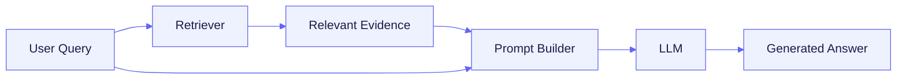

The LLM does **not** retrieve information by itself in a standard RAG pipeline.

Its job is primarily:

> **Given the query, instructions and retrieved context, predict a useful sequence of output tokens.**

## Basic Definitions in Simple Words

<table width="100%">
<thead><tr><th width="8%">Sr No</th><th width="28%">Term</th><th width="64%">Meaning in simple words</th></tr></thead>
<tbody>
<tr><td align="center">01</td><td><b>LLM</b></td><td>Large Language Model: a network that predicts the next token again and again.</td></tr>
<tr><td align="center">02</td><td><b>Token</b></td><td>A piece of text (word or word part) that the model reads and writes.</td></tr>
<tr><td align="center">03</td><td><b>Autoregressive</b></td><td>Each new token is predicted from all tokens before it, then appended.</td></tr>
<tr><td align="center">04</td><td><b>Logit</b></td><td>The raw score the model gives each possible next token before softmax.</td></tr>
<tr><td align="center">05</td><td><b>Softmax</b></td><td>Turns logits into probabilities that add up to 1.</td></tr>
<tr><td align="center">06</td><td><b>Parametric knowledge</b></td><td>What the model learned in training, stored in its weights.</td></tr>
<tr><td align="center">07</td><td><b>Non-parametric knowledge</b></td><td>Knowledge outside the model: documents, databases, APIs.</td></tr>
<tr><td align="center">08</td><td><b>Context window</b></td><td>The maximum number of tokens for input plus output in one call.</td></tr>
<tr><td align="center">09</td><td><b>Token budget</b></td><td>How the context window is split between system, history, query, evidence and output.</td></tr>
<tr><td align="center">10</td><td><b>Hallucination</b></td><td>A fluent answer that is not supported by the evidence or the facts.</td></tr>
<tr><td align="center">11</td><td><b>Grounded answer</b></td><td>An answer whose claims are all supported by the supplied context.</td></tr>
<tr><td align="center">12</td><td><b>Faithfulness</b></td><td>Does the answer stick to the context?</td></tr>
<tr><td align="center">13</td><td><b>Correctness</b></td><td>Is the answer actually true?</td></tr>
<tr><td align="center">14</td><td><b>Temperature</b></td><td>A setting that sharpens (low) or flattens (high) the next-token distribution.</td></tr>
<tr><td align="center">15</td><td><b>Greedy decoding</b></td><td>Always pick the single most likely next token.</td></tr>
<tr><td align="center">16</td><td><b>Top-k / top-p</b></td><td>Sample only from the k best tokens, or from the smallest set reaching probability p.</td></tr>
</tbody>
</table>

## 1. What exactly is an LLM?

> [!TIP]
> **In simple words:** An LLM is a very good next-word guesser. A whole answer is many guesses in a row.

LLM means:

> **Large Language Model**

At the simplest level, an autoregressive language model predicts:

```math
P(x_t\mid x_1,x_2,\ldots,x_{t-1})
```

In words:

> Given all previous tokens, what token should come next?

For example:

```text
The capital of France is ___
```

The model may assign:

```math
P(\text{Paris})=0.94
```

and much smaller probabilities to alternatives.

<p align="center">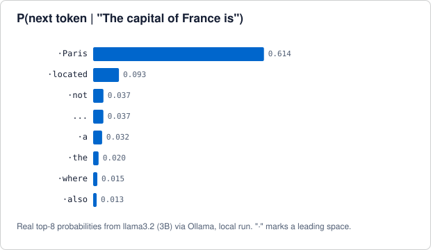</p>

The 0.94 above is a made-up number. In a real local run of llama3.2 (3B), P(Paris) = 0.614; the rest is spread over tokens such as "located" (0.093) and "not" (0.037).

### Real check (added): ask a local LLM for its next-token probabilities

All LLM outputs in this chapter come from a local run of **llama3.2 (3B)** through [Ollama](https://ollama.com), temperature 0 unless stated.

```python
import json
import math
import urllib.request

def generate(prompt, temperature=0.0, num_predict=80, raw=False, top_logprobs=0, seed=7):
    # Request body for the local Ollama server
    body = {"model": "llama3.2", "prompt": prompt, "stream": False, "raw": raw,
            "options": {"temperature": temperature, "num_predict": num_predict, "seed": seed}}

    # Optionally ask for the most likely tokens at every step
    if top_logprobs:
        body["logprobs"] = True
        body["top_logprobs"] = top_logprobs

    # Send the request and return the parsed JSON answer
    request = urllib.request.Request("http://localhost:11434/api/generate", data=json.dumps(body).encode(),
                                     headers={"Content-Type": "application/json"})
    return json.load(urllib.request.urlopen(request, timeout=300))

# raw=True: plain text continuation, no chat template
result = generate("The capital of France is", raw=True, num_predict=1, top_logprobs=8)
candidates = result["logprobs"][0]["top_logprobs"]

# Log-probability -> probability
for candidate in candidates:
    print(f"{candidate['token']!r:<12} P = {math.exp(candidate['logprob']):.3f}")
```

**Output**

```text
' Paris'     P = 0.614
' located'   P = 0.093
' not'       P = 0.037
'...'        P = 0.037
' a'         P = 0.032
' the'       P = 0.020
' where'     P = 0.015
' also'      P = 0.013
```

After generating `Paris`, it predicts the next token again.

So generation is repeated next-token prediction.

## 2. Autoregressive generation

Conceptually:

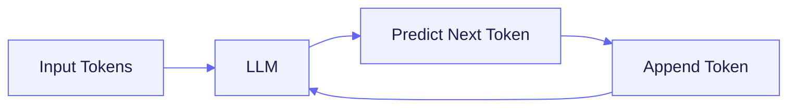

For a response:

```text
Records must be retained for five years.
```

generation happens approximately as:

<p align="center">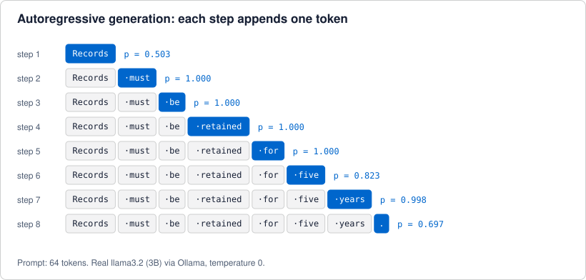</p>

Real llama3.2 run on the RAG prompt from section 3. Most steps are almost certain (p = 1.000); the first word, "five" and the final full stop are the real choices.

```python
rag_prompt = """You are a regulatory compliance assistant.
Use only the provided context.

Context:
Article 7 states that records must be retained for five years.

Question:
How long must records be retained?

Answer:"""

# Greedy generation with the probability of every chosen token
result = generate(rag_prompt, num_predict=20, top_logprobs=3)

print("prompt tokens:", result["prompt_eval_count"])
for step, item in enumerate(result["logprobs"], 1):
    print(f"step {step}: {item['token']!r:<12} p = {math.exp(item['logprob']):.3f}")
```

**Output**

```text
prompt tokens: 64
step 1: 'Records'    p = 0.503
step 2: ' must'      p = 1.000
step 3: ' be'        p = 1.000
step 4: ' retained'  p = 1.000
step 5: ' for'       p = 1.000
step 6: ' five'      p = 0.823
step 7: ' years'     p = 0.998
step 8: '.'          p = 0.697
```

One token at a time.

## 3. What goes into an LLM in RAG?

The LLM generally sees a sequence similar to:

```text
System Instructions

User Question

Retrieved Context

Conversation History

Formatting Instructions
```

For example:

```text
You are a regulatory compliance assistant.

Use only the provided context.

Context:
Article 7 states that records must be retained for five years.

Question:
How long must records be retained?

Answer:
```

Everything is eventually converted into tokens.

## 4. RAG prompt anatomy

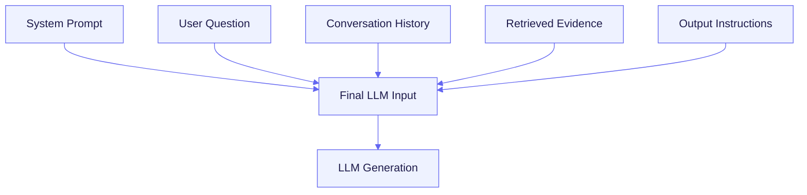

All of these consume the model's context budget.

## 5. Parametric knowledge

> [!TIP]
> **In simple words:** Parametric knowledge is what the model remembers from training. It can be old, incomplete or wrong.

An LLM learns information during training.

That learned information is encoded implicitly in the model's parameters.

We call this:

> **Parametric knowledge**

Conceptually:

```math
\text{Training Data} \rightarrow \text{Model Parameters}
```

The model does not usually have a conventional database inside it containing rows such as:

<table width="100%">
<thead><tr><th width="8%">Sr No</th><th width="24%">Key</th><th width="34%">Attribute</th><th width="34%">Value</th></tr></thead>
<tbody>
<tr><td align="center">01</td><td>Germany</td><td>retention period</td><td>5 years</td></tr>
</tbody>
</table>

Instead, statistical relationships are encoded throughout the neural network.

## 6. Parametric knowledge is different from a database

A database:

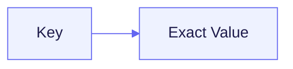

An LLM:

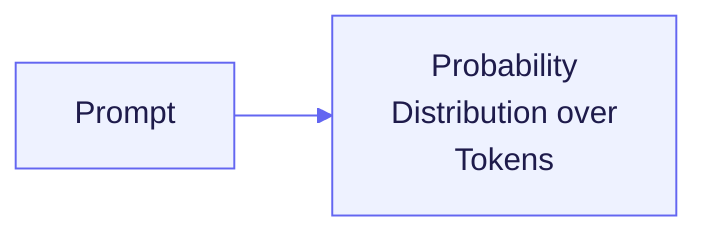

This distinction explains many LLM limitations.

You cannot reliably say:

> "The fact definitely exists in neuron number 83."

Knowledge is distributed across model parameters.

## 7. Why parametric knowledge creates problems for enterprise RAG

Suppose your company has:

```text
Private policy updated yesterday.
```

The base model may never have seen it.

Or its training data may contain:

```text
2023 regulation
```

while you need:

```text
2026 regulation
```

Parametric knowledge can therefore be:

```text
outdated
incomplete
not organization-specific
difficult to audit
```

RAG introduces external knowledge at inference time.

## 8. Parametric vs non-parametric knowledge

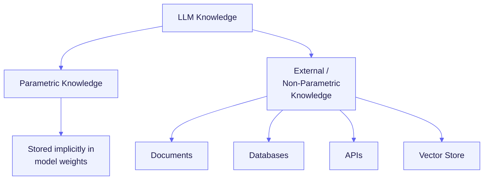

RAG combines both.

## 9. Without RAG

A normal LLM answering a question behaves conceptually as: $P(Y\mid Q)$

where:

- $Q$ = question
- $Y$ = generated answer

Example:

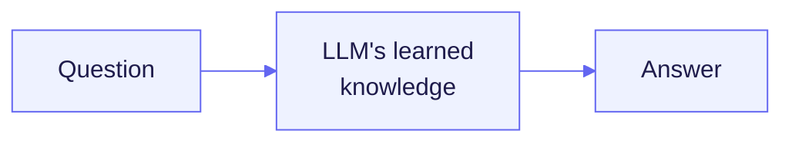

## 10. With RAG

> [!TIP]
> **In simple words:** RAG adds the documents D to the input, so the model answers from Q and D, not from Q alone.

We retrieve evidence:

```math
D=\{d_1,d_2,\ldots,d_k\}
```

and generate:

```math
\boxed{ P(Y\mid Q,D) }
```

Now the answer is conditioned on:

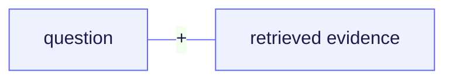

This is the fundamental mathematical idea behind RAG.

## 11. Why retrieval helps

Suppose user asks:

```text
What is our company's current travel reimbursement limit?
```

A general LLM cannot reliably know your internal current policy.

RAG does:

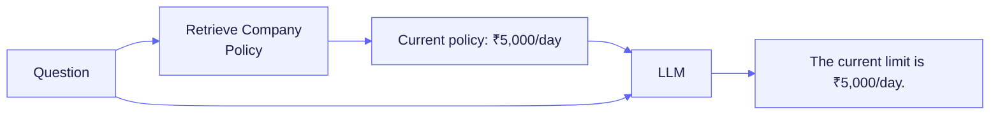

The LLM's job changes from:

> Recall the answer from model weights.

to:

> Read supplied evidence and synthesize the answer.

That is a much easier and more controllable task.

### Real check (added): the same question without and with retrieval

```python
question = "What is our company's current travel reimbursement limit? Answer in one sentence."
context = "Travel policy (current): the reimbursement limit is ₹5,000 per day."

# Without RAG: only the question, so only parametric knowledge
print("Without RAG:", generate(question)["response"])

# With RAG: the retrieved policy is placed in the prompt
print("With RAG:   ", generate(f"Context:\n{context}\n\nUsing only the context, answer: {question}")["response"])
```

**Output**

```text
Without RAG: I don't have access to that information.
With RAG:    Our company's current travel reimbursement limit is ₹5,000 per day.
```

This model declines instead of inventing a number, which is the good case. The answer itself only appears once the policy is in the context.

## 12. Why retrieval does NOT eliminate hallucination

This is critical.

Even with correct context, an LLM is still a generative probabilistic model.

Suppose context says:

```text
Retention period = five years.
```

The model might answer:

```text
Retention period is seven years.
```

or add:

```text
and records must be encrypted with AES-256.
```

Neither is guaranteed by retrieval.

Therefore:

```math
\boxed{ \text{RAG reduces hallucination risk} \neq \text{RAG eliminates hallucination} }
```

## 13. Why LLMs hallucinate

Hallucination has several causes.

### Cause 1 — Next-token objective

The model is optimized to generate plausible continuations, not inherently to verify truth.

### Cause 2 — Missing information

If context doesn't contain the answer, the model may still continue.

### Cause 3 — Conflicting information

Multiple sources may disagree.

### Cause 4 — Weak instructions

Prompt may not tell the model to abstain.

### Cause 5 — Parametric knowledge interference

Model may use remembered information rather than supplied evidence.

### Cause 6 — Reasoning mistakes

The evidence may be correct, but the model may infer incorrectly.

### Real check (added): parametric knowledge vs the context (cause 5)

The context below is deliberately wrong. Watch which source wins.

```python
wrong_context = "Context:\nThe capital of Australia is Sydney.\n\n"
ask_capital = "Question: What is the capital of Australia? Answer in one sentence."

# Plain prompt: the model's own knowledge overrides the context
print("Plain: ", generate(wrong_context + ask_capital)["response"])

# Strict prompt: the model follows the context, even though it is wrong
strict = "Use only the context, even if it disagrees with what you know.\n\n"
print("Strict:", generate(strict + wrong_context + ask_capital)["response"])
```

**Output**

```text
Plain:  I'm happy to help, but I need to correct you - the capital of Australia is actually Canberra, not Sydney.
Strict: The capital of Australia is Sydney.
```

With a plain prompt the model ignores the supplied evidence and answers from its weights. With a strict prompt it repeats the wrong context. Neither behaviour is safe on its own, which is why sources must be correct and answers must be checked.

## 14. Hallucination flow

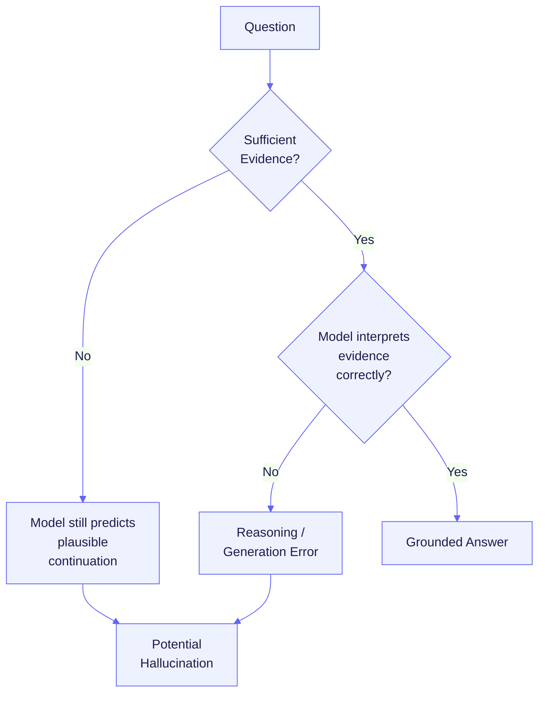

## 15. Context window

> [!TIP]
> **In simple words:** The context window is a fixed box. Everything you send and everything the model writes must fit in it.

An LLM cannot process infinite text.

It has a maximum **context window**.

Conceptually:

```math
T_{\text{input}}+T_{\text{output}}\le T_{\text{context}}
```

where:

- $T_{\text{input}}$ = all input tokens
- $T_{\text{output}}$ = generated output tokens
- $T_{\text{context}}$ = model's maximum context capacity

## 16. What consumes context?

Your input may include:

```math
T_{\text{input}} = T_{\text{system}} + T_{\text{history}} + T_{\text{query}} + T_{\text{retrieved}} + T_{\text{formatting}}
```

Then:

```math
T_{\text{input}} + T_{\text{output}} \le T_{\text{context}}
```

This equation is very important for RAG.

## 17. Example token-budget calculation

Assume:

```math
T_{\text{context}}=32{,}000
```

Reserve output:

```math
T_{\text{output}}=4{,}000
```

System prompt:

```math
T_{\text{system}}=2{,}000
```

History:

```math
T_{\text{history}}=5{,}000
```

Query:

```math
T_{\text{query}}=500
```

Then maximum theoretical retrieval budget:

```math
T_{\text{retrieved}} = 32{,}000 - 4{,}000 - 2{,}000 - 5{,}000 - 500, \qquad \boxed{ T_{\text{retrieved}}=20{,}500 }
```

You cannot blindly send unlimited retrieved documents.

### Calculator (added)

```python
def retrieval_budget(context, system, history, query, output_reserve):
    # Tokens left for retrieved evidence
    return context - (system + history + query + output_reserve)

# Section 17 numbers
print("retrieval budget:", retrieval_budget(32_000, 2_000, 5_000, 500, 4_000))

# Longer chat history leaves less room for evidence
for history in [0, 5_000, 10_000, 15_000, 20_000]:
    print(f"history {history:>6,} -> retrieval budget {retrieval_budget(32_000, 2_000, history, 500, 4_000):>6,}")
```

**Output**

```text
retrieval budget: 20500
history      0 -> retrieval budget 25,500
history  5,000 -> retrieval budget 20,500
history 10,000 -> retrieval budget 15,500
history 15,000 -> retrieval budget 10,500
history 20,000 -> retrieval budget  5,500
```

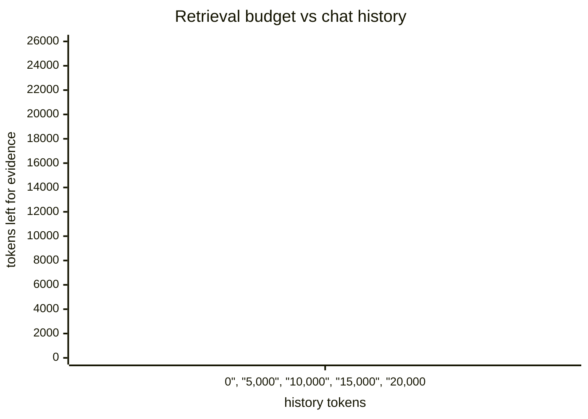

## 18. Context-budget architecture

<p align="center">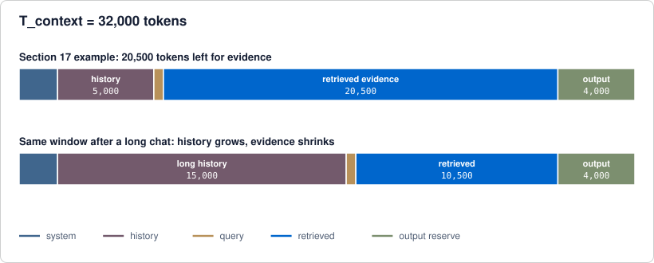</p>

## 19. Why larger context window does not remove retrieval

A common interview question:

> If LLMs support huge context windows, why use RAG?

Because dumping everything into context creates:

```text
high token cost
higher latency
irrelevant information
conflicting information
harder evidence prioritization
poor scalability
```

A million-document corpus cannot simply be placed into every prompt.

RAG performs:

> **information selection before generation**

## 20. Retrieval as information bottleneck

Suppose corpus contains: $10^7$

tokens.

LLM context supports: $10^5$

tokens.

You need to select a small subset.

Conceptually:

```math
\text{Huge Corpus} \rightarrow \text{Retriever} \rightarrow \text{Small Relevant Context} \rightarrow \text{LLM}
```

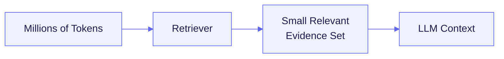

This is one of the most fundamental roles of retrieval.

<p align="center">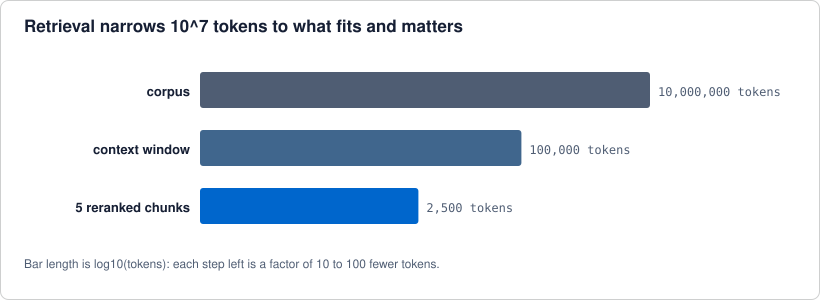</p>

## 21. More context is not always better

Suppose the correct answer exists in one chunk.

You send:

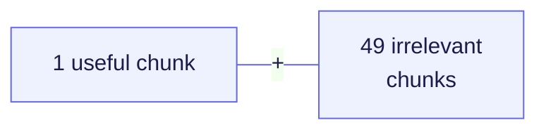

Now the model must identify the useful information among noise.

Problems:

```text
context dilution
higher cost
higher latency
conflicts
attention competition
```

This is why: $\text{High Recall}$

must eventually be balanced with:

```math
\text{High Precision}
```

## 22. Lost-in-the-middle intuition

LLMs can sometimes use information differently depending on where it appears within a long context.

Very long contexts can make important evidence harder to use reliably.

Therefore context construction should prioritize:

```text
best evidence
high-ranking chunks
low redundancy
clear formatting
```

rather than merely maximizing token usage.

## 23. Why reranking matters to LLMs

Retriever may find:

```text
50 candidate chunks
```

Reranker reduces to:

```text
5 strongest chunks
```

Now LLM gets:

```text
less noise
more relevant evidence
lower token cost
```

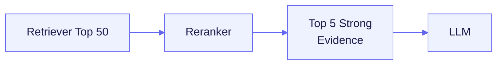

The reranker improves the **quality of the LLM's input**.

## 24. Temperature

> [!TIP]
> **In simple words:** Divide every score by T before softmax. Small T makes the winner win bigger; large T evens things out.

Temperature controls how strongly generation favors the highest-probability tokens.

A common conceptual formulation is:

```math
P_i = \frac{ e^{z_i/T} }{ \sum_j e^{z_j/T} }
```

where:

- $z_i$ = model logit
- $T$ = temperature

## 25. Low temperature

When: $T$

is relatively low, the probability distribution becomes sharper.

The model tends to choose high-probability tokens more strongly.

Conceptually:

```text
more deterministic
less varied
more conservative
```

For factual RAG, lower temperature is often preferred.

## 26. Higher temperature

A higher temperature flattens the distribution.

More alternative tokens become plausible.

Useful for:

```text
creative writing
brainstorming
diverse generation
```

Usually less desirable for strict factual compliance RAG.

## 27. Temperature visualization

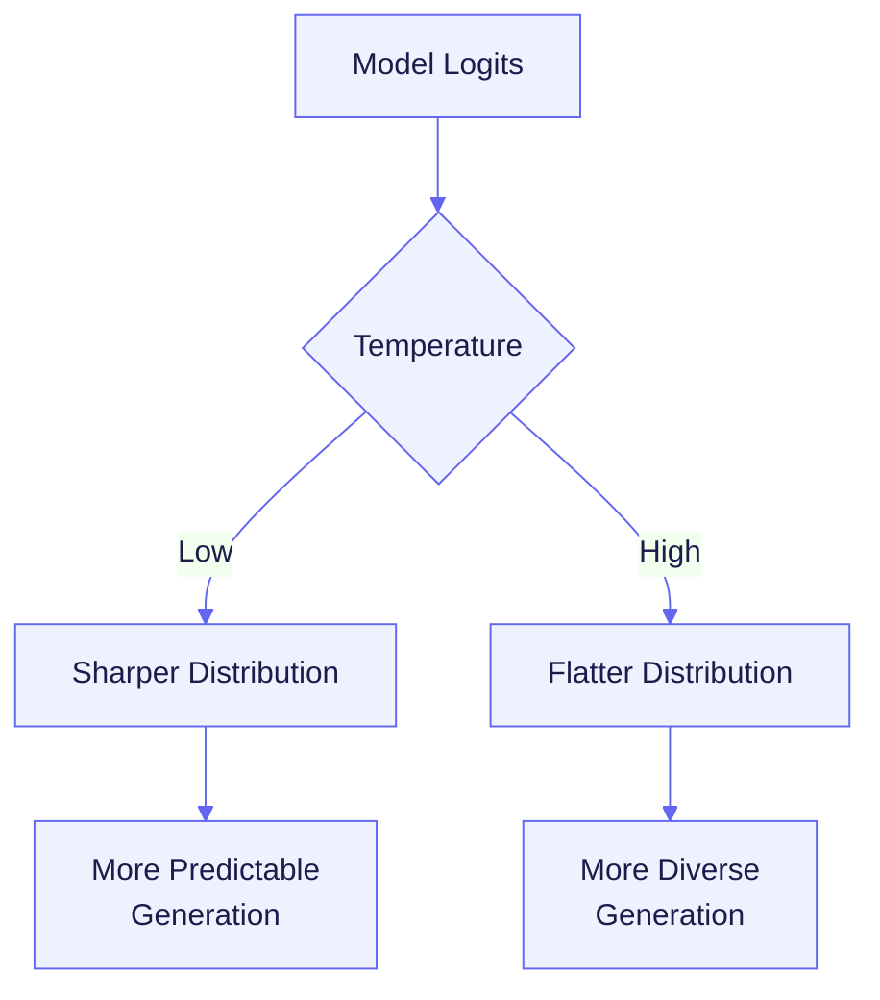

### Real check (added): temperature on real logits

The top-8 log-probabilities from section 1, re-scaled with the softmax formula from section 24.

```python
logits = [candidate["logprob"] for candidate in candidates]
tokens = [candidate["token"] for candidate in candidates]

def softmax_with_temperature(values, temperature):
    # exp(z / T), normalized to sum to 1
    scaled = [math.exp(v / temperature) for v in values]
    return [s / sum(scaled) for s in scaled]

for temperature in [0.5, 1.0, 2.0]:
    probabilities = softmax_with_temperature(logits, temperature)
    top3 = ", ".join(f"{tok.strip() or tok!r} {p:.3f}" for tok, p in zip(tokens[:3], probabilities[:3]))
    print(f"T = {temperature}: {top3}")
```

**Output**

```text
T = 0.5: 'Paris' 0.966, 'located' 0.022, 'not' 0.004
T = 1.0: 'Paris' 0.714, 'located' 0.108, 'not' 0.043
T = 2.0: 'Paris' 0.387, 'located' 0.150, 'not' 0.095
```

<p align="center">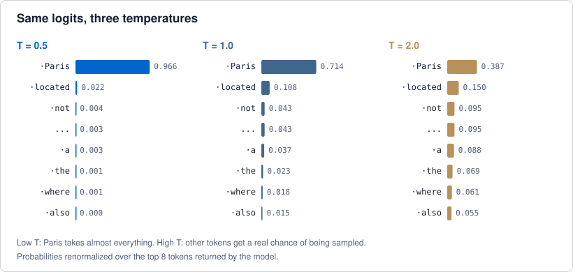</p>

### Real check (added): five samples at two temperatures

```python
prompt = "Write a five-word slogan for a recycling campaign."

for temperature in [0.0, 1.5]:
    # Five runs with different random seeds
    outputs = [generate(prompt, temperature=temperature, num_predict=20, seed=seed)["response"].strip()
               for seed in range(5)]

    print(f"T = {temperature}: {len(set(outputs))} different answers")
    for output in outputs:
        print("   ", output)
```

**Output**

```text
T = 0.0: 1 different answers
    "Close the Loop, Save Tomorrow"
    "Close the Loop, Save Tomorrow"
    "Close the Loop, Save Tomorrow"
    "Close the Loop, Save Tomorrow"
    "Close the Loop, Save Tomorrow"
T = 1.5: 5 different answers
    "Small actions save our planet."
    "Closing the loop, one can."
    "Closing the Loop, One Bottle"
    "Small Actions, Big Impact Matters"
    "Close the Loop, Save Tomorrow"
```

## 28. Important temperature misconception

Do not say:

> Temperature controls hallucination directly.

It doesn't.

Lower temperature can reduce random variation, but:

```text
wrong context
bad reasoning
missing evidence
stale source
```

can still produce a confidently wrong answer at low temperature.

Therefore:

```math
\text{Low Temperature} \neq \text{Truth}
```

## 29. Greedy decoding intuition

At every step:

```math
\text{token}^* = \arg\max_i P(\text{token}_i)
```

Choose the highest-probability next token.

This is deterministic given fixed model behavior/settings.

But the locally highest-probability sequence is not guaranteed to be factually correct.

Again:

> Probability is not truth.

## 30. Top-k / top-p awareness

You may encounter generation settings such as:

```text
top-k
top-p / nucleus sampling
```

You don't need deep decoding theory for RAG interviews.

Know the intuition:

### Top-k

Sample only from the top $k$ candidate tokens.

### Top-p

Use the smallest candidate set whose cumulative probability reaches $p$.

These control generation diversity.

<p align="center">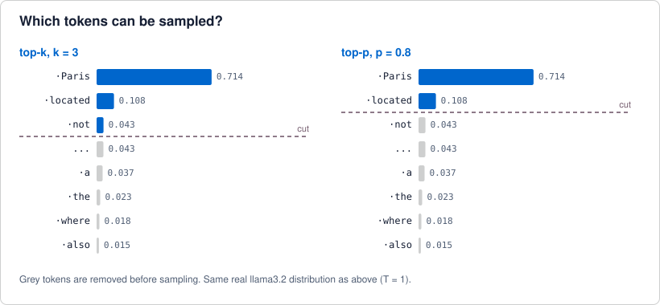</p>

For strict factual RAG, we usually emphasize controlled generation rather than creativity.

## 31. Prompting in RAG

Prompt engineering does not replace retrieval.

But a good RAG prompt helps tell the model:

```text
what evidence to use
what to do if evidence is missing
how to cite sources
what output structure to produce
```

Example:

```text
Use only the supplied context.
If the answer is not supported by the context,
state that the available evidence is insufficient.
```

This can improve grounding.

But it is not a mathematical guarantee.

### Real check (added): missing evidence, with and without an abstain rule

```python
evidence = "Context:\nArticle 7 states that records must be retained for five years.\n\n"
question = "Question: Which encryption standard must the records use?"

# No rule about missing evidence
print("No rule:  ", generate(evidence + question + " Answer in one sentence.")["response"])

# Explicit abstain instruction
rule = ("Use only the context. If the context does not contain the answer, "
        "reply exactly: The available evidence is insufficient.\n\n")
print("With rule:", generate(rule + evidence + question)["response"])
```

**Output**

```text
No rule:   There is no information provided about the encryption standard that the records must use, only that records must be retained for five years according to Article 7.
With rule: The available evidence is insufficient.
```

Both answers avoid inventing a standard here, but only the rule gives a fixed, testable reply. That makes abstentions easy to count in evaluation.

## 32. Grounded generation

We want:

```math
\text{answer claims} \subseteq \text{claims supported by the context}
```

Conceptually:

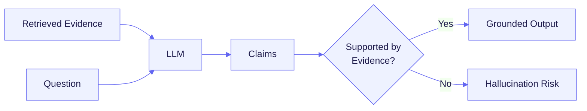

Group 12 Evaluation covers the faithfulness metrics that measure this.

## 33. Retrieval changes the LLM task

Without RAG:

> Find/remember the information and formulate the answer.

With RAG:

> Read the supplied information, select what matters, reason over it and formulate the answer.

This is a major reduction in burden.

## 34. But retrieval can also hurt generation

Suppose retrieved context is wrong:

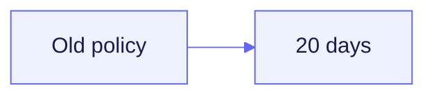

while current truth is:

```text
24 days
```

A well-grounded LLM may answer:

```text
20 days
```

So:

```math
\text{Garbage Retrieval} \rightarrow \text{Grounded but Wrong Answer}
```

This is why RAG quality is bounded by retrieval/data quality.

### Real check (added): grounded but wrong

```python
# The retrieved chunk is the old policy; the true value is now 24 days
stale = "Use only the context.\n\nContext:\nLeave policy: employees receive 20 days of annual leave.\n\n"
print(generate(stale + "Question: How many days of annual leave do employees receive? Answer in one sentence.")["response"])
```

**Output**

```text
Employees receive 20 days of annual leave.
```

The answer is faithful to the context and still wrong.

## 35. Garbage-in-garbage-out

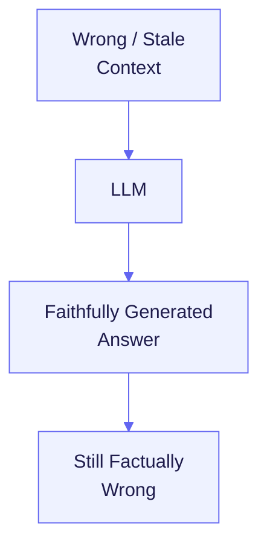

This is the exact difference between:

```text
faithfulness
```

and:

```text
correctness
```

from group 12 Evaluation.

## 36. LLM vs embedding model

> [!TIP]
> **In simple words:** The embedding model turns text into a vector to find evidence. The LLM reads the evidence and writes the answer.

A common interview confusion.

### Embedding model

Input:

```text
text
```

Output: $\text{vector}$

Used mainly for:

```text
retrieval
similarity
clustering
```

### Generative LLM

Input:

```text
tokens/context
```

Output:

```text
new tokens
```

Used for:

```text
answer generation
summarization
reasoning
```

## 37. Mermaid comparison

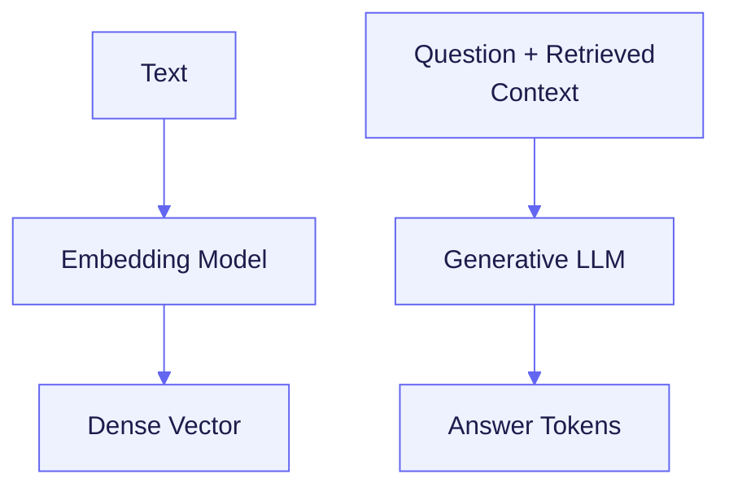

Don't confuse these components.

## 38. LLM context vs vector database

Another interview distinction:

Vector database:

> stores/searches representations of external knowledge.

LLM context:

> temporary evidence available during this inference request.

Model parameters:

> learned information stored inside model weights.

These are three different memory layers.

## 39. Three knowledge locations in RAG

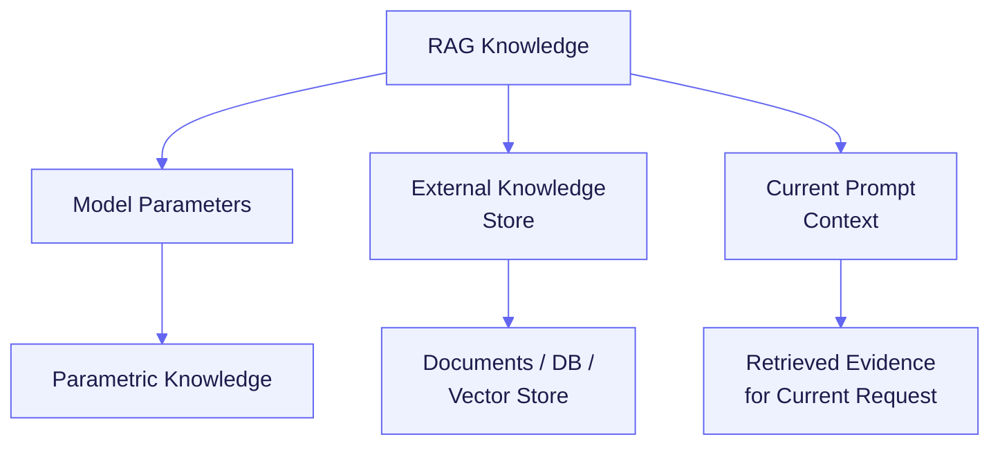

This is a strong interview mental model.

## 40. Conversation history also competes with retrieval

In conversational RAG:

```mermaid
%%{init: {'theme':'base','themeVariables':{'primaryColor':'#EEF2FF','primaryBorderColor':'#6366F1','primaryTextColor':'#1E1B4B','lineColor':'#6366F1','pie1':'#22C55E','pie2':'#F59E0B','pie3':'#EF4444','pie4':'#3B82F6','pie5':'#8B5CF6','xyChart':{'plotColorPalette':'#2563EB, #16A34A, #D97706, #DC2626, #7C3AED'}}}}%%
flowchart LR
    n0["System prompt"] ---|"+"| n1["long chat history"] ---|"+"| n2["query"] ---|"+"| n3["retrieved context"]
```

all compete for tokens.

As conversation grows:

```math
T_{\text{history}}\uparrow
```

therefore available retrieval budget may decrease:

```math
T_{\text{retrieved}}\downarrow
```

unless the system summarizes/truncates history.

## 41. Context budgeting formula

A practical formulation:

```math
T_{\text{retrieval}} = T_{\text{context}} - ( T_{\text{system}} + T_{\text{query}} + T_{\text{history}} + T_{\text{output reserve}} )
```

This is a very useful RAG design equation.

## 42. Dynamic context construction

Instead of:

```text
always retrieve exactly 10 chunks
```

better architecture can do:

```mermaid
%%{init: {'theme':'base','themeVariables':{'primaryColor':'#EEF2FF','primaryBorderColor':'#6366F1','primaryTextColor':'#1E1B4B','lineColor':'#6366F1','pie1':'#22C55E','pie2':'#F59E0B','pie3':'#EF4444','pie4':'#3B82F6','pie5':'#8B5CF6','xyChart':{'plotColorPalette':'#2563EB, #16A34A, #D97706, #DC2626, #7C3AED'}}}}%%
flowchart LR
    n0["Retrieve<br/>candidates"] --> n1["Rerank"] --> n2["Pack highest-value<br/>evidence until the<br/>token budget is<br/>reached"]
```

```mermaid
%%{init: {'theme':'base','themeVariables':{'primaryColor':'#EEF2FF','primaryBorderColor':'#6366F1','primaryTextColor':'#1E1B4B','lineColor':'#6366F1','pie1':'#22C55E','pie2':'#F59E0B','pie3':'#EF4444','pie4':'#3B82F6','pie5':'#8B5CF6','xyChart':{'plotColorPalette':'#2563EB, #16A34A, #D97706, #DC2626, #7C3AED'}}}}%%
flowchart TD
    A["Retrieve Candidates"] --> B["Rerank"]
    B --> C["Estimate Token Sizes"]
    C --> D["Pack Best Chunks<br/>Under Budget"]
    D --> E["LLM"]
```

This is much more production-oriented.

### Code (added): greedy packing under a token budget

```python
# Candidates after reranking: (chunk id, rerank score, token count)
candidates_ranked = [("C17", 0.94, 420), ("C03", 0.91, 650), ("C21", 0.88, 900),
                     ("C08", 0.72, 300), ("C11", 0.55, 380)]
budget = 1_500

packed, used = [], 0
for chunk_id, score, tokens_needed in sorted(candidates_ranked, key=lambda c: -c[1]):
    # Take the chunk only if it still fits
    if used + tokens_needed <= budget:
        packed.append(chunk_id)
        used += tokens_needed

    # Otherwise skip it and try the next, smaller one
    else:
        print(f"skip {chunk_id}: needs {tokens_needed}, only {budget - used} left")

print("packed:", packed, "tokens used:", used)
```

**Output**

```text
skip C21: needs 900, only 430 left
skip C11: needs 380, only 130 left
packed: ['C17', 'C03', 'C08'] tokens used: 1370
```

## 43. Why RAG can improve factuality

The LLM receives explicit evidence.

Instead of relying only on: $P(Y\mid Q)$

it can condition on: $P(Y\mid Q,D)$

where $D$ contains relevant facts.

This can:

```text
increase freshness
increase domain specificity
provide private knowledge
enable citations
improve grounding
```

## 44. Why RAG improves auditability

Without retrieval:

```text
"Why did the model say this?"
```

Hard to answer.

With RAG:

```mermaid
%%{init: {'theme':'base','themeVariables':{'primaryColor':'#EEF2FF','primaryBorderColor':'#6366F1','primaryTextColor':'#1E1B4B','lineColor':'#6366F1','pie1':'#22C55E','pie2':'#F59E0B','pie3':'#EF4444','pie4':'#3B82F6','pie5':'#8B5CF6','xyChart':{'plotColorPalette':'#2563EB, #16A34A, #D97706, #DC2626, #7C3AED'}}}}%%
flowchart LR
    n0["Answer"] --> n1["Retrieved Chunk<br/>C17"] --> n2["Document Article 8"]
```

Now you have provenance.

This matters greatly for:

```text
legal
regulatory
enterprise
healthcare
finance
```

systems.

## 45. Why RAG vs fine-tuning for knowledge updates

Suppose a regulation changes tomorrow.

With RAG:

```text
Update document/index
```

Knowledge can become available quickly.

With knowledge encoded through fine-tuning:

```text
prepare dataset
train/update model
validate
deploy
```

Fine-tuning is usually better for changing:

```text
behavior
style
task specialization
```

than continuously updating factual knowledge.

## 46. RAG vs long-context prompting

Suppose you have:

```text
500 documents
```

You could theoretically concatenate many of them.

But RAG can first identify:

```text
3 relevant documents
```

This generally improves:

```text
efficiency
cost
latency
focus
```

The two techniques are complementary, not mutually exclusive.

## 47. RAG failure decomposition

A final wrong answer can be caused by:

```mermaid
%%{init: {'theme':'base','themeVariables':{'primaryColor':'#EEF2FF','primaryBorderColor':'#6366F1','primaryTextColor':'#1E1B4B','lineColor':'#6366F1','pie1':'#22C55E','pie2':'#F59E0B','pie3':'#EF4444','pie4':'#3B82F6','pie5':'#8B5CF6','xyChart':{'plotColorPalette':'#2563EB, #16A34A, #D97706, #DC2626, #7C3AED'}}}}%%
flowchart TD
    A["Wrong RAG Answer"] --> B{"Correct evidence<br/>retrieved?"}

    B -->|"No"| C["Retrieval Failure"]
    B -->|"Yes"| D{"Correct evidence<br/>reached LLM?"}

    D -->|"No"| E["Context Construction<br/>Failure"]
    D -->|"Yes"| F{"LLM used it<br/>correctly?"}

    F -->|"No"| G["Generation Failure"]
    F -->|"Yes"| H{"Source itself<br/>correct/current?"}

    H -->|"No"| I["Data / Version<br/>Failure"]
    H -->|"Yes"| J["Check Evaluation<br/>Ground Truth"]
```

This ties this chapter directly to group 12 Evaluation.

## 48. Example end-to-end

Question:

```text
What is the current employee leave entitlement?
```

Corpus contains:

```text
24 days
```

Retriever returns:

```text
24-day leave chunk
```

Prompt:

```text
Use only provided evidence.
```

LLM answers:

```text
Employees receive 24 days.
```

Pipeline:

```mermaid
%%{init: {'theme':'base','themeVariables':{'primaryColor':'#EEF2FF','primaryBorderColor':'#6366F1','primaryTextColor':'#1E1B4B','lineColor':'#6366F1','pie1':'#22C55E','pie2':'#F59E0B','pie3':'#EF4444','pie4':'#3B82F6','pie5':'#8B5CF6','xyChart':{'plotColorPalette':'#2563EB, #16A34A, #D97706, #DC2626, #7C3AED'}}}}%%
flowchart LR
    A["Question"] --> B["Retriever"]
    B --> C["24-Day Policy"]
    C --> D["Prompt"]
    A --> D
    D --> E["LLM"]
    E --> F["24-Day Answer"]
```

This is the ideal RAG behavior.

## 49. Interview question — What does an LLM actually do?

Strong answer:

> An autoregressive LLM predicts a probability distribution over the next token conditioned on the previous tokens in its context. Generation repeatedly selects or samples a next token and appends it until the response is complete.

## 50. Interview question — What is parametric knowledge?

> Parametric knowledge is information implicitly encoded in the model's learned weights during training. It differs from external RAG knowledge, which is retrieved from documents, databases or other sources at inference time.

## 51. Interview question — Why do LLMs hallucinate?

Strong answer:

> An LLM is trained primarily to predict plausible token sequences rather than to query a guaranteed source of truth. Hallucinations can occur when information is absent, conflicting or misinterpreted, or when the model relies on its parametric knowledge instead of supplied evidence.

## 52. Interview question — How does RAG reduce hallucination?

> RAG retrieves external evidence and places it in the model's context, changing generation from relying primarily on parametric memory to answering conditioned on relevant source material. This improves grounding, although it does not eliminate generation or retrieval errors.

## 53. Interview question — Why doesn't RAG eliminate hallucination?

> Retrieval only supplies evidence. The LLM still generates probabilistically and may misinterpret, omit or extend beyond that evidence. RAG can also retrieve stale or incorrect information, so both retrieval and generation must be evaluated.

## 54. Interview question — What is a context window?

> The context window is the maximum token budget available for the model's input and output sequence. In RAG, system instructions, chat history, the query, retrieved chunks and reserved output tokens all consume this budget.

## 55. Interview question — How do you calculate RAG context budget?

Strong answer:

```math
T_{\text{retrieval}} = T_{\text{context}} - T_{\text{system}} - T_{\text{history}} - T_{\text{query}} - T_{\text{output reserve}}
```

Then pack the highest-value retrieved evidence within that remaining budget.

## 56. Interview question — Why not put the entire corpus into a large context window?

> Large-context models still have finite token limits, and passing unnecessary documents increases cost, latency, noise and conflicting evidence. Retrieval acts as an information-selection mechanism that narrows a large corpus to the small amount of evidence most relevant to the query.

## 57. Interview question — What does temperature do?

> Temperature rescales the model's token probability distribution. Lower temperature makes the distribution sharper and generation more predictable, while higher temperature increases diversity. For factual RAG, relatively controlled generation is usually preferred, but low temperature does not guarantee correctness.

## 58. Interview question — Does temperature solve hallucination?

> No. It affects sampling diversity, not factual grounding. A low-temperature model can consistently produce the same incorrect answer if the context is missing, stale or misunderstood.

## 59. Interview question — Embedding model vs LLM?

> An embedding model converts text into a fixed-dimensional vector used for retrieval or similarity. A generative LLM consumes token sequences and predicts new tokens to produce an answer. In RAG, embeddings often help select evidence and the LLM uses that evidence to generate the response.

## 60. Interview question — RAG vs fine-tuning?

> RAG is generally preferable when knowledge is private, large, frequently updated or needs citations because information can be updated externally without retraining the model. Fine-tuning is more appropriate for changing model behavior, style or specialized task patterns. They can also be combined.

## 61. Interview question — RAG vs long context?

> Long context increases how much information an LLM can process, while RAG determines which information should be placed into that context. Even with large context windows, retrieval remains useful for selecting evidence from very large corpora and controlling latency, cost and noise.

## 62. Common interview traps

### Trap: An LLM searches its training data when answering.

Not like a database search.

### Trap: Parametric knowledge is always current.

No.

### Trap: RAG guarantees factual answers.

No.

### Trap: Lower temperature guarantees truth.

No.

### Trap: Larger context means retrieval is unnecessary.

No.

### Trap: More retrieved chunks always improve answers.

No.

### Trap: Embedding model and LLM are the same component.

No.

### Trap: Fine-tuning is the best way to continuously update factual knowledge.

Usually not.

## 63. Complete RAG mental model

```mermaid
%%{init: {'theme':'base','themeVariables':{'primaryColor':'#EEF2FF','primaryBorderColor':'#6366F1','primaryTextColor':'#1E1B4B','lineColor':'#6366F1','pie1':'#22C55E','pie2':'#F59E0B','pie3':'#EF4444','pie4':'#3B82F6','pie5':'#8B5CF6','xyChart':{'plotColorPalette':'#2563EB, #16A34A, #D97706, #DC2626, #7C3AED'}}}}%%
flowchart TD
    A["External Knowledge"] --> B["Chunk / Index"]
    B --> C["Retriever"]

    D["User Query"] --> C
    D --> E["Prompt Builder"]

    C --> F["Relevant Evidence"]
    F --> E

    G["System Instructions"] --> E
    H["Conversation History"] --> E

    E --> I["Token-Limited<br/>Context"]
    I --> J["Generative LLM"]

    J --> K["Next-Token<br/>Prediction"]
    K --> L["Final Answer"]

    L --> M["Correctness"]
    L --> N["Faithfulness"]
    L --> O["Completeness"]
```

This connects almost the entire RAG course.

## 64. Final revision sheet

You need to remember these core ideas:

### LLM

```math
P(\text{next token}\mid \text{previous tokens})
```

Repeated next-token prediction generates responses.

### Parametric knowledge

Information implicitly encoded in model weights.

### RAG knowledge

External evidence retrieved at inference time.

### Without RAG

```math
P(Y\mid Q)
```

### With RAG

```math
P(Y\mid Q,D)
```

### Context window

```math
T_{\text{input}}+T_{\text{output}}\le T_{\text{context}}
```

### Retrieval budget

```math
T_{\text{retrieved}} = T_{\text{context}} - T_{\text{system}} - T_{\text{history}} - T_{\text{query}} - T_{\text{output}}
```

### Temperature

Controls sampling distribution, **not truth**.

### Hallucination

RAG reduces the risk but cannot eliminate it.

### One-line interview memory

> **The retriever decides what the LLM gets to know for this request; the LLM decides how to use that evidence to generate the answer.**

## 65. Practice Tasks

1. Change the section 1 prompt to "The capital of Germany is" and compare the top probability with Paris.
2. Compute the retrieval budget for a 128,000-token window with 3,000 system, 20,000 history, 1,000 query and 8,000 output tokens.
3. Run the temperature sampling at T = 0.7 and count the different answers.
4. Write a prompt that makes the model cite the chunk ID it used.
5. Give the stale-context example a second, newer chunk with 24 days. Which one does the model use?
6. Change the packing budget to 1,000 tokens and predict the packed chunks before running.

## 66. Final Takeaways

```mermaid
%%{init: {'theme':'base','themeVariables':{'primaryColor':'#EEF2FF','primaryBorderColor':'#6366F1','primaryTextColor':'#1E1B4B','lineColor':'#6366F1','pie1':'#22C55E','pie2':'#F59E0B','pie3':'#EF4444','pie4':'#3B82F6','pie5':'#8B5CF6','xyChart':{'plotColorPalette':'#2563EB, #16A34A, #D97706, #DC2626, #7C3AED'}}}}%%
timeline
    title LLM basics for RAG
    Generation : next-token prediction : one token at a time
    Knowledge : weights are parametric : RAG adds context at query time
    Context window : input plus output must fit : history competes with evidence
    Decoding : temperature reshapes probabilities : greedy, top-k, top-p
    Failure : missing, stale or ignored evidence : RAG reduces but never removes hallucination
```

> [!TIP]
> **Study rule:** when a RAG answer is wrong, ask in order: was the right chunk retrieved, did it reach the prompt, did the model use it, and was the source itself correct?

<p align="center"><a href="../../06.%20Similarity%20Metrics%20for%20Dense%20Search/README.md">Previous: 01.06 Similarity Metrics for Dense Search</a> | <a href="../../../README.md">Home</a> | <a href="../../README.md">Group 01: NLP Basics for RAG</a> | <a href="../README.md">Chapter page</a> | <a href="../../../02.%20RAG%20Introduction/01.%20RAG%20Fundamentals/README.md">Next: 02.01 RAG Fundamentals</a></p>
