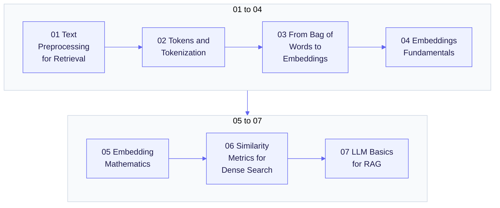

# 01 · NLP Basics for RAG

 

**Only the NLP needed for retrieval: text cleaning, tokens, representations, embeddings, similarity, LLM basics.**

<a href="../README.md">Home</a> | <a href="../02.%20RAG%20Introduction/README.md">Next group: 02 RAG Introduction</a>

## Learning flow

## Chapters

**Done** = notes + notebook · **Notebook** = notebook ready, notes coming · **Planned** = folder ready

<table width="100%">
<thead><tr><th width="6%">Sr&nbsp;No</th><th width="22%">Chapter</th><th width="46%">Key Concepts</th><th width="8%">Interview Priority</th><th width="6%">Notes</th><th width="6%">Notebook</th><th width="6%">Status</th></tr></thead>
<tbody>
<tr><td align="center">01</td><td><a href="01.%20Text%20Preprocessing%20for%20Retrieval/notes/01.%20Text%20Preprocessing%20for%20Retrieval.md"><b>Text Preprocessing for Retrieval</b></a></td><td>Normalization, stop words, stemming vs lemmatization, n-grams, why the same preprocessing must run on documents and queries</td><td align="center">Medium</td><td align="center"><a href="01.%20Text%20Preprocessing%20for%20Retrieval/notes/01.%20Text%20Preprocessing%20for%20Retrieval.md">Read</a></td><td align="center"><a href="01.%20Text%20Preprocessing%20for%20Retrieval/notebooks/01.%20Text%20Preprocessing%20for%20Retrieval.ipynb">Open</a></td><td align="center">Done</td></tr>
<tr><td align="center">02</td><td><a href="02.%20Tokens%20and%20Tokenization/notes/02.%20Tokens%20and%20Tokenization.md"><b>Tokens and Tokenization</b></a></td><td>BPE/WordPiece/SentencePiece, token-budget math, how tokenization silently breaks retrieval on non-English text</td><td align="center">Medium</td><td align="center"><a href="02.%20Tokens%20and%20Tokenization/notes/02.%20Tokens%20and%20Tokenization.md">Read</a></td><td align="center"><a href="02.%20Tokens%20and%20Tokenization/notebooks/02.%20Tokens%20and%20Tokenization.ipynb">Open</a></td><td align="center">Done</td></tr>
<tr><td align="center">03</td><td><a href="03.%20From%20Bag%20of%20Words%20to%20Embeddings/notes/03.%20From%20Bag%20of%20Words%20to%20Embeddings.md"><b>From Bag of Words to Embeddings</b></a></td><td>One-hot and bag-of-words vectors, word2vec intuition, contextual embeddings, why meaning needs dense vectors</td><td align="center">Medium</td><td align="center"><a href="03.%20From%20Bag%20of%20Words%20to%20Embeddings/notes/03.%20From%20Bag%20of%20Words%20to%20Embeddings.md">Read</a></td><td align="center">-</td><td align="center">Done</td></tr>
<tr><td align="center">04</td><td><a href="04.%20Embeddings%20Fundamentals/notes/04.%20Embeddings%20Fundamentals.md"><b>Embeddings Fundamentals</b></a></td><td>Dense vectors, model selection, domain-specific and multilingual embeddings</td><td align="center">High</td><td align="center"><a href="04.%20Embeddings%20Fundamentals/notes/04.%20Embeddings%20Fundamentals.md">Read</a></td><td align="center"><a href="04.%20Embeddings%20Fundamentals/notebooks/04.%20Embeddings%20Fundamentals.ipynb">Open</a></td><td align="center">Done</td></tr>
<tr><td align="center">05</td><td><a href="05.%20Embedding%20Mathematics/notes/05.%20Embedding%20Mathematics.md"><b>Embedding Mathematics</b></a></td><td>Vector spaces, distance metrics, the curse of dimensionality</td><td align="center">Medium</td><td align="center"><a href="05.%20Embedding%20Mathematics/notes/05.%20Embedding%20Mathematics.md">Read</a></td><td align="center"><a href="05.%20Embedding%20Mathematics/notebooks/05.%20Embedding%20Mathematics.ipynb">Open</a></td><td align="center">Done</td></tr>
<tr><td align="center">06</td><td><a href="06.%20Similarity%20Metrics%20for%20Dense%20Search/notes/06.%20Similarity%20Metrics%20for%20Dense%20Search.md"><b>Similarity Metrics for Dense Search</b></a></td><td>Cosine similarity, dot product, Euclidean distance, normalization effects</td><td align="center">Medium</td><td align="center"><a href="06.%20Similarity%20Metrics%20for%20Dense%20Search/notes/06.%20Similarity%20Metrics%20for%20Dense%20Search.md">Read</a></td><td align="center">-</td><td align="center">Done</td></tr>
<tr><td align="center">07</td><td><a href="07.%20LLM%20Basics%20for%20RAG/notes/07.%20LLM%20Basics%20for%20RAG.md"><b>LLM Basics for RAG</b></a></td><td>What an LLM does, context window, token cost, temperature, why LLMs hallucinate and why retrieval helps</td><td align="center">Medium</td><td align="center"><a href="07.%20LLM%20Basics%20for%20RAG/notes/07.%20LLM%20Basics%20for%20RAG.md">Read</a></td><td align="center">-</td><td align="center">Done</td></tr>
</tbody>
</table>
