<div align="center">

# 02.02 · What is Hybrid Search RAG

   

**Sparse finds exact words, dense finds meaning, hybrid combines both.**

</div>

<p align="center"><a href="../../01.%20RAG%20Fundamentals/README.md">Previous: 02.01 RAG Fundamentals</a> | <a href="../../../README.md">Home</a> | <a href="../../README.md">Group 02: RAG Introduction</a> | <a href="../README.md">Chapter page</a> | <a href="../../03.%20Lexical%20vs%20Semantic%20Retrieval/README.md">Next: 02.03 Lexical vs Semantic Retrieval</a></p>

## Contents

<table width="100%">
<thead><tr><th width="8%">Sr No</th><th width="38%">Section</th><th width="54%">Subtopics</th></tr></thead>
<tbody>
<tr><td align="center">01</td><td><a href="#0-the-big-picture-before-any-code"><b>0. The Big Picture Before Any Code</b></a></td><td><a href="#01-basic-terms--do-not-skip-these">0.1 Basic Terms | Do Not Skip These</a></td></tr>
<tr><td align="center">02</td><td><a href="#1-rag-architecture--visual-mental-model"><b>1. RAG Architecture | Visual Mental Model</b></a></td><td><a href="#what-just-happened-in-the-diagram">What just happened in the diagram?</a></td></tr>
<tr><td align="center">03</td><td><a href="#2-why-hybrid-search-exists"><b>2. Why Hybrid Search Exists</b></a></td><td>-</td></tr>
<tr><td align="center">04</td><td><a href="#3-sparse-retrieval-from-first-principles"><b>3. Sparse Retrieval From First Principles</b></a></td><td><a href="#31-why-is-it-called-sparse">3.1 Why is it called "sparse"?</a></td></tr>
<tr><td align="center">05</td><td><a href="#4-create-our-tiny-enterprise-corpus"><b>4. Create Our Tiny Enterprise Corpus</b></a></td><td>-</td></tr>
<tr><td align="center">06</td><td><a href="#5-tokenization--the-first-hidden-step-in-keyword-search"><b>5. Tokenization | The First Hidden Step in Keyword Search</b></a></td><td><a href="#why-this-basic-step-matters">Why this basic step matters</a></td></tr>
<tr><td align="center">07</td><td><a href="#6-build-a-sparse-tf-idf-index"><b>6. Build a Sparse TF-IDF Index</b></a></td><td>-</td></tr>
<tr><td align="center">08</td><td><a href="#7-sparse-search--show-every-important-internal-step"><b>7. Sparse Search — Show Every Important Internal Step</b></a></td><td><a href="#71-experiment--exact-legal-reference">7.1 Experiment — Exact Legal Reference</a><br><a href="#72-experiment--exact-error-code">7.2 Experiment — Exact Error Code</a><br><a href="#73-experiment--exact-product-code">7.3 Experiment — Exact Product Code</a></td></tr>
<tr><td align="center">09</td><td><a href="#8-where-sparse-search-can-fail--vocabulary-mismatch"><b>8. Where Sparse Search Can Fail — Vocabulary Mismatch</b></a></td><td>-</td></tr>
<tr><td align="center">10</td><td><a href="#9-dense-retrieval-from-first-principles"><b>9. Dense Retrieval From First Principles</b></a></td><td><a href="#91-why-is-it-called-dense">9.1 Why is it called "dense"?</a></td></tr>
<tr><td align="center">11</td><td><a href="#10-cosine-similarity--explained-before-we-use-it"><b>10. Cosine Similarity — Explained Before We Use It</b></a></td><td>-</td></tr>
<tr><td align="center">12</td><td><a href="#11-build-a-dense-embedding-index"><b>11. Build a Dense Embedding Index</b></a></td><td><a href="#111-experiment--semantic-login-question">11.1 Experiment — Semantic Login Question</a></td></tr>
<tr><td align="center">13</td><td><a href="#12-visualize-embedding-space-in-2d"><b>12. Visualize Embedding Space in 2D</b></a></td><td>-</td></tr>
<tr><td align="center">14</td><td><a href="#13-why-dense-search-alone-is-not-enough"><b>13. Why Dense Search Alone Is Not Enough</b></a></td><td>-</td></tr>
<tr><td align="center">15</td><td><a href="#14-query-types--a-very-useful-mental-model"><b>14. Query Types — A Very Useful Mental Model</b></a></td><td>-</td></tr>
<tr><td align="center">16</td><td><a href="#15-hybrid-search--combine-the-signals"><b>15. Hybrid Search = Combine the Signals</b></a></td><td>-</td></tr>
<tr><td align="center">17</td><td><a href="#16-score-normalization--explain-it-before-using-it"><b>16. Score Normalization — Explain It Before Using It</b></a></td><td>-</td></tr>
<tr><td align="center">18</td><td><a href="#17-weighted-fusion"><b>17. Weighted Fusion</b></a></td><td><a href="#171-mixed-query--ideal-hybrid-search-example">17.1 Mixed Query — Ideal Hybrid Search Example</a></td></tr>
<tr><td align="center">19</td><td><a href="#18-alpha-experiment--see-how-ranking-changes"><b>18. Alpha Experiment — See How Ranking Changes</b></a></td><td><a href="#what-should-you-learn-from-alpha">What should you learn from alpha?</a></td></tr>
<tr><td align="center">20</td><td><a href="#19-fusion-vs-reranking--do-not-confuse-them"><b>19. Fusion vs Reranking — Do Not Confuse Them</b></a></td><td><a href="#fusion">Fusion</a><br><a href="#reranking">Reranking</a></td></tr>
<tr><td align="center">21</td><td><a href="#20-high-recall-first-high-precision-later"><b>20. High Recall First, High Precision Later</b></a></td><td>-</td></tr>
<tr><td align="center">22</td><td><a href="#21-why-retrieval-quality-can-limit-the-entire-rag-system"><b>21. Why Retrieval Quality Can Limit the Entire RAG System</b></a></td><td>-</td></tr>
<tr><td align="center">23</td><td><a href="#22-search-vs-rag--another-important-distinction"><b>22. Search vs RAG — Another Important Distinction</b></a></td><td>-</td></tr>
<tr><td align="center">24</td><td><a href="#23-hybrid-search-does-not-fix-everything"><b>23. Hybrid Search Does NOT Fix Everything</b></a></td><td>-</td></tr>
<tr><td align="center">25</td><td><a href="#24-production-debugging-framework"><b>24. Production Debugging Framework</b></a></td><td><a href="#241-debug-three-different-query-styles">24.1 Debug Three Different Query Styles</a></td></tr>
<tr><td align="center">26</td><td><a href="#25-a-simple-end-to-end-hybrid-rag-pseudocode"><b>25. A Simple End-to-End Hybrid RAG Pseudocode</b></a></td><td>-</td></tr>
<tr><td align="center">27</td><td><a href="#26-when-should-you-use-hybrid-search"><b>26. When Should You Use Hybrid Search?</b></a></td><td><a href="#when-might-dense-search-alone-be-enough">When might dense search alone be enough?</a><br><a href="#when-might-lexical-or-exact-lookup-be-enough">When might lexical or exact lookup be enough?</a></td></tr>
<tr><td align="center">28</td><td><a href="#27-regulatory-example--why-hybrid-is-a-natural-fit"><b>27. Regulatory Example — Why Hybrid Is a Natural Fit</b></a></td><td>-</td></tr>
<tr><td align="center">29</td><td><a href="#28-common-beginner-misconceptions"><b>28. Common Beginner Misconceptions</b></a></td><td>-</td></tr>
<tr><td align="center">30</td><td><a href="#29-interview-questions--with-strong-answers"><b>29. Interview Questions — With Strong Answers</b></a></td><td><a href="#q1-what-is-hybrid-search">Q1. What is Hybrid Search?</a><br><a href="#q2-why-not-use-vector-search-alone">Q2. Why not use vector search alone?</a><br><a href="#q3-why-not-use-bm25-alone">Q3. Why not use BM25 alone?</a><br><a href="#q4-is-hybrid-search-the-same-as-rag">Q4. Is Hybrid Search the same as RAG?</a><br><a href="#q5-what-is-fusion">Q5. What is fusion?</a><br><a href="#q6-what-is-reranking">Q6. What is reranking?</a><br><a href="#q7-why-is-retrieval-quality-critical">Q7. Why is retrieval quality critical?</a></td></tr>
<tr><td align="center">31</td><td><a href="#30-interview-scenarios"><b>30. Interview Scenarios</b></a></td><td>-</td></tr>
<tr><td align="center">32</td><td><a href="#31-final-concept-map"><b>31. Final Concept Map</b></a></td><td>-</td></tr>
<tr><td align="center">33</td><td><a href="#32-chapter-1-revision-cheat-sheet"><b>32. Chapter 1 Revision Cheat Sheet</b></a></td><td>-</td></tr>
<tr><td align="center">34</td><td><a href="#33-practice-tasks--do-these-before-chapter-2"><b>33. Practice Tasks — Do These Before Chapter 2</b></a></td><td>-</td></tr>
</tbody>
</table>

### What you should understand by the end

You should be able to explain, from first principles:

1. What RAG is and why retrieval is needed.
2. What a **query**, **document**, **chunk**, **index**, and **Top-K** mean.
3. What **sparse / lexical retrieval** means.
4. What **dense / semantic retrieval** means.
5. Why sparse search is strong for exact words, IDs, codes, and article numbers.
6. Why dense search is strong for meaning, synonyms, and paraphrases.
7. Why either retrieval method alone can fail.
8. What Hybrid Search actually combines.
9. What **fusion** does.
10. Why **reranking** is separate from fusion.
11. Why retrieval quality can become the bottleneck of a RAG system.
12. How to debug a Hybrid RAG pipeline stage by stage.

## 0. The Big Picture Before Any Code

Suppose your organization has thousands of documents:

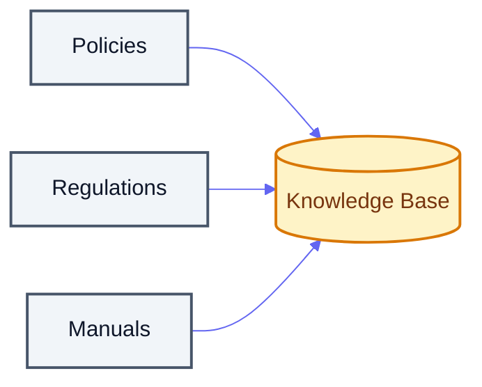

A user asks:

```text
"What are the supplier obligations under REACH Article 33?"
```

An LLM should not be expected to magically know which internal or current document contains the answer. A RAG system first **retrieves evidence**, then asks the LLM to answer using that evidence.

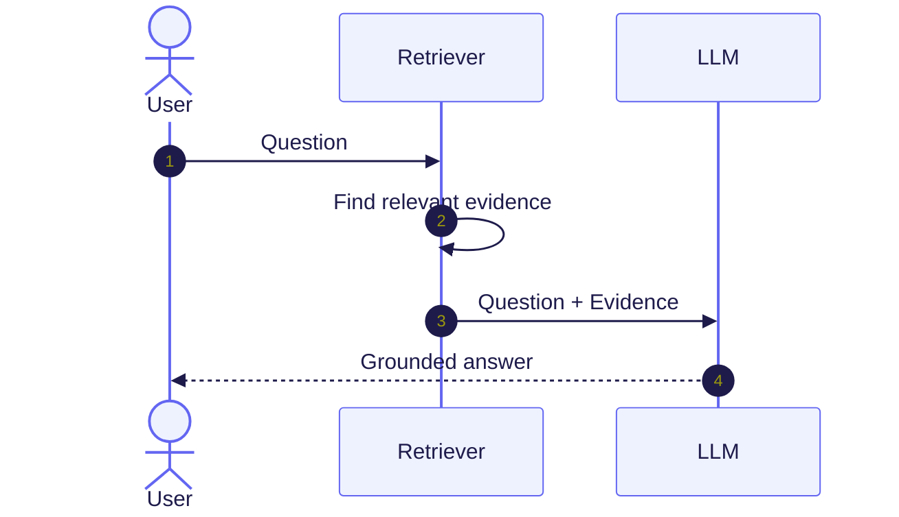

#### One sentence to remember

> **RAG = Retrieve relevant external information first, then generate an answer using it.**

### 0.1 Basic Terms | Do Not Skip These

These words will appear throughout the entire Hybrid Search course.

| Term | Meaning | Tiny example |
|---|---|---|
| **Query** | What the user searches or asks | `REACH Article 33` |
| **Document** | A source file or logical record | a 50-page regulation PDF |
| **Chunk** | A smaller piece cut from a document | one paragraph / 500 tokens |
| **Index** | A data structure prepared for fast search | TF-IDF matrix, BM25 index, vector DB |
| **Retriever** | Component that finds likely relevant chunks | BM25 or vector search |
| **Top-K** | Return the best K matches | Top-5 = best five chunks |
| **Score** | Number representing retrieval relevance | similarity = 0.82 |
| **Candidate** | A retrieved item not yet finally accepted | Top-20 before reranking |
| **Fusion** | Combine results from multiple retrievers | sparse + dense |
| **Reranking** | Re-evaluate candidates more carefully | Top-20 → Top-5 |
| **Context** | Retrieved text finally sent to the LLM | 5 best chunks |

#### Important distinction

A **document** can be huge. Search systems often retrieve **chunks**, not entire documents.

##### How the basic terms relate

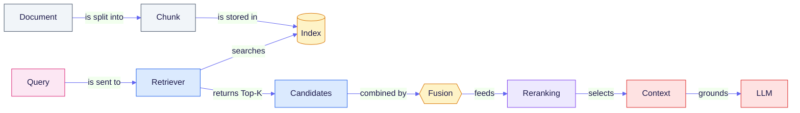

## 1. RAG Architecture | Visual Mental Model

A common RAG system has two broad phases.

#### A. Offline / ingestion phase

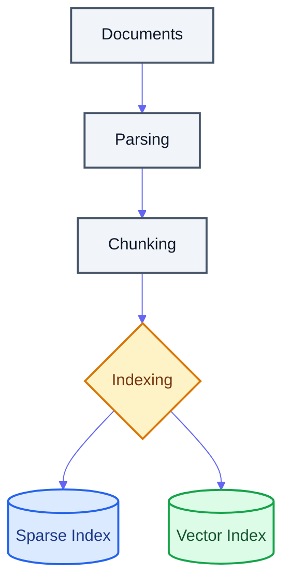

#### B. Online / query phase


Hybrid Search mainly improves the **retrieval** portion.


### What just happened in the diagram?

1. The **user query** is the search question.
2. The **retriever** searches previously indexed data.
3. It returns a small **Top-K** set instead of every document.
4. Those chunks become **context** for the LLM.
5. The LLM generates the final response.

#### Why Top-K exists

If you have 1,000,000 chunks, you cannot send all of them to the LLM. Retrieval reduces:

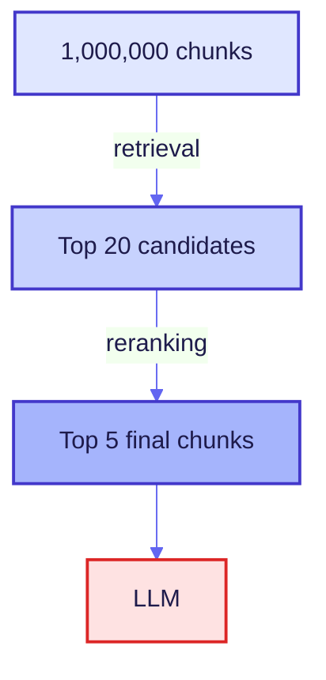

So retrieval is a **search-space reduction problem**.

## 2. Why Hybrid Search Exists

There are two major ways we will retrieve text.

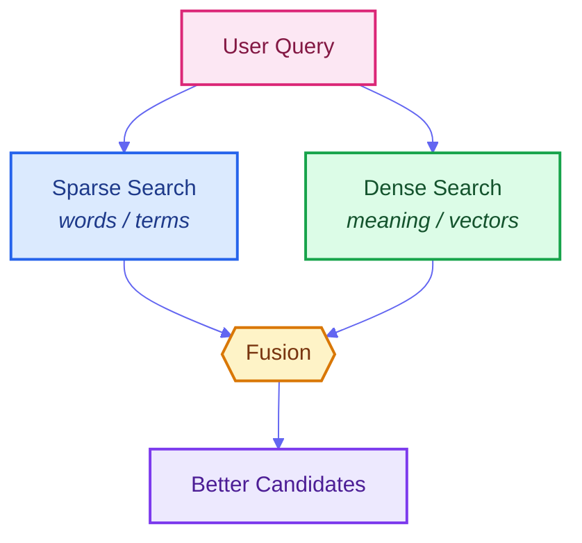

The key idea is not that one retriever is "bad" and another is "good".

> **They observe different relevance signals.**

Sparse search asks roughly:

> "Do the query words appear in this document?"

Dense search asks roughly:

> "Does this document mean something similar to the query?"

## 3. Sparse Retrieval From First Principles

Sparse retrieval is usually called:

- lexical retrieval
- keyword retrieval
- term-based retrieval

A production Hybrid Search system often uses **BM25** for the sparse side. In this first chapter we use **TF-IDF** because it is easier to inspect. BM25 gets its own later chapter.

#### Basic intuition

Suppose the query is:

```text
REACH Article 33
```

A document containing these exact terms should receive strong lexical evidence.

But query:

```text
Why can't users log in?
```

and document:

```text
Authentication failure caused by invalid credentials.
```

have similar meaning but weak word overlap. That is where sparse retrieval can struggle.

### 3.1 Why is it called "sparse"?

Imagine your entire vocabulary has 100,000 possible terms.

A document contains only 100 of them.

Its conceptual vector may look like:

```text
[0, 0, 0, 4.2, 0, 0, 7.1, 0, 0, 0, ...]
```

Most positions are **zero**.

That is a **sparse vector**.

You do **not** need to memorize this yet. Just remember:

```text
Sparse vector → mostly zeros → usually term/vocabulary based
```

## 4. Create Our Tiny Enterprise Corpus

We intentionally mix multiple query types:

- exact legal references
- semantic legal descriptions
- error codes
- login/support language
- product codes
- product descriptions

This allows us to observe the strengths and weaknesses of each retriever.

## 5. Tokenization | The First Hidden Step in Keyword Search

Before a lexical system can match words, text is usually broken into **tokens**.

For example:

```text
"REACH Article 33 requires suppliers"
```

might become roughly:

```text
["reach", "article", "33", "requires", "suppliers"]
```

A **token** is simply a unit the search system works with. Often it resembles a word, but tokenization rules can be more complex.

This matters because product codes such as:

```text
6ES7513-1AL02-0AB0
```

may be split differently depending on the tokenizer.

```python
import re

def simple_tokenize(text):
    # Lowercase so "REACH" and "reach" become the same token
    lowered = text.lower()

    # Keep runs of letters and digits; punctuation splits tokens
    tokens = re.findall(r"[a-z0-9]+", lowered)

    return tokens

simple_tokenize("6ES7513-1AL02-0AB0")
# ['6es7513', '1al02', '0ab0']
```

### Why this basic step matters

If the user searches an exact code but your tokenizer breaks it in an unexpected way, search quality can drop.

Production search engines therefore often configure special analyzers for:

```text
Product IDs
Regulation IDs
Chemical IDs
Versions
URLs
Email addresses
Error codes
```

We will go much deeper into inverted indexes and tokenization in later chapters.

## 6. Build a Sparse TF-IDF Index

#### What does "fit" mean here?

When we run:

```python
vectorizer.fit_transform(corpus)
```

TF-IDF does two broad things:

1. Learns the vocabulary found in our documents.
2. Converts each document into a numerical sparse vector.

The result is a matrix:

```text
rows    = documents
columns = learned terms
values  = term weights
```

```python
from sklearn.feature_extraction.text import TfidfVectorizer
from sklearn.metrics.pairwise import cosine_similarity

# Learn the vocabulary and build one sparse vector per document
tfidf_vectorizer = TfidfVectorizer(lowercase=True)
tfidf_document_matrix = tfidf_vectorizer.fit_transform(corpus)

# Shape (8, 80): 8 documents, 80 terms; only 93 of 640 cells are non-zero
print(tfidf_document_matrix.shape)

def sparse_search(query, top_k=5):
    # Reuse the corpus vocabulary for the query
    query_vector = tfidf_vectorizer.transform([query])

    # Score every document against the query
    scores = cosine_similarity(query_vector, tfidf_document_matrix).flatten()

    # Highest scores first
    return scores.argsort()[::-1][:top_k], scores
```

#### Interpreting the matrix shape

If you see:

```text
(8, 57)
```

that means:

```text
8 rows      → 8 documents
57 columns  → 57 vocabulary features
```

Each document is represented using the **same vocabulary space** so the query can later be compared with every document.

## 7. Sparse Search — Show Every Important Internal Step

A query goes through roughly:


### 7.1 Experiment — Exact Legal Reference

Exact terms should help sparse retrieval.

<table width="100%">
<thead><tr><th width="25%">Retriever</th><th width="75%">Result in the notebook</th></tr></thead>
<tbody>
<tr><td><b>Sparse (TF-IDF)</b></td><td>Rank 1: <b>D3</b> (0.4096) · Rank 2: D1 (0.1603) · all others 0. Active query features: <code>33</code> 0.6083, <code>article</code> 0.6083, <code>reach</code> 0.5098</td></tr>
</tbody>
</table>

#### Interpretation

Sparse retrieval is strong here because terms such as:

```text
REACH
Article
33
```

occur explicitly in the correct document.

This is one of sparse retrieval's biggest strengths:

> **Exact lexical evidence remains visible and measurable.**

### 7.2 Experiment — Exact Error Code

`E401` has very little human-language meaning by itself. But it is a highly valuable exact identifier.

<table width="100%">
<thead><tr><th width="25%">Retriever</th><th width="75%">Result in the notebook</th></tr></thead>
<tbody>
<tr><td><b>Sparse (TF-IDF)</b></td><td>Rank 1: <b>D5</b> (0.2839) · every other document scores 0. The single token <code>e401</code> carries the whole query.</td></tr>
</tbody>
</table>

### 7.3 Experiment — Exact Product Code

Product codes are another important enterprise use case.

<table width="100%">
<thead><tr><th width="25%">Retriever</th><th width="75%">Result in the notebook</th></tr></thead>
<tbody>
<tr><td><b>Sparse (TF-IDF)</b></td><td>Rank 1: <b>D7</b> (0.5739) · all others 0. Query features <code>6es7513</code>, <code>1al02</code>, <code>0ab0</code> (0.5774 each).</td></tr>
</tbody>
</table>

## 8. Where Sparse Search Can Fail — Vocabulary Mismatch

Consider:

```text
Query:
"Why can't a user log in?"

Document:
"Error code E401 indicates an authentication failure caused by invalid credentials."
```

Humans understand relationships such as:

```text
log in
≈ sign in
≈ authentication
≈ credentials
```

But a lexical retriever mainly sees **tokens**. If words differ too much, the relevant document can receive a weak score.

This problem is called **vocabulary mismatch**.

Query `Why can't a user log in?` vs D6 `Users who cannot sign in should verify credentials...`. Humans see *log in = sign in = authentication*. TF-IDF only sees tokens, so the only active query features are `can` and `in`. Sparse ranks **D8** first (0.2346) because of the word `can`. The right document D6 scores only 0.1187.

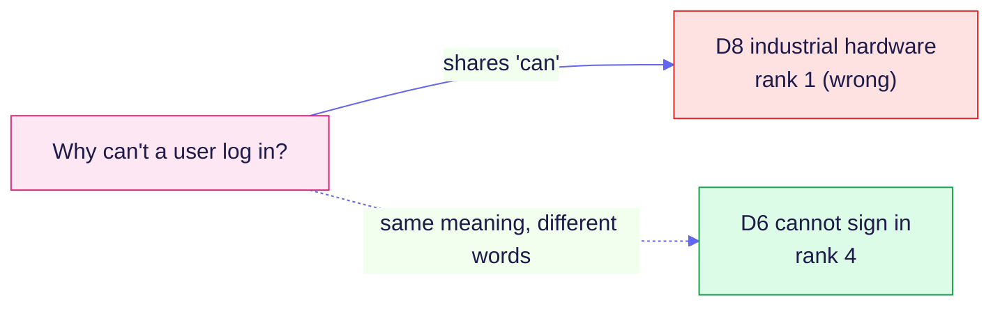

#### Key lesson

Sparse retrieval is not "bad". It simply observes a different signal.

```text
Sparse strength:
exact words / codes / IDs / rare terms

Sparse weakness:
meaning expressed using different vocabulary
```

> [!TIP]
> **Sparse = exact evidence.** It shines on `E401`, `Article 33`, `6ES7513-1AL02-0AB0`. It struggles when the document uses different words for the same idea.

## 9. Dense Retrieval From First Principles

Dense retrieval uses **embeddings**.

An embedding is a list of numbers representing text in a learned vector space.

For example, conceptually:

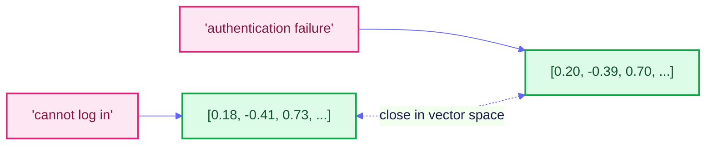

The actual numbers themselves are not meant to be interpreted one-by-one.

The important property is:

> Texts with related meaning should usually be located closer together in embedding space.

### 9.1 Why is it called "dense"?

Unlike a sparse lexical vector where most dimensions are zero, an embedding often looks like:

```text
[0.238, -0.119, 0.842, 0.092, -0.311, ...]
```

Many dimensions contain non-zero floating-point values.

Therefore:

```text
Dense vector → many non-zero values → semantic embedding representation
```

## 10. Cosine Similarity — Explained Before We Use It

Dense search needs a way to compare vectors.

One common metric is **cosine similarity**.

#### Intuition

Cosine similarity primarily asks:

> Do these two vectors point in a similar direction?

For normalized vectors:

```text
similar direction  → score near 1
unrelated direction → lower score
```

The mathematical formula is:

```math
\text{cosine}(A,B)=\frac{A\cdot B}{\|A\|\|B\|}
```

You do **not** need to memorize it yet. First understand it visually.

## 11. Build a Dense Embedding Index

We use `sentence-transformers` only for learning here.

The first time the model is loaded, it may need to download model files.

#### What the code will do

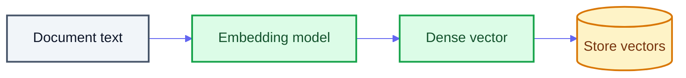

At query time:


```python
from sentence_transformers import SentenceTransformer

# Small general-purpose embedding model (384 dimensions)
embedding_model = SentenceTransformer("all-MiniLM-L6-v2")

# Normalized vectors: dot product equals cosine similarity
document_embeddings = embedding_model.encode(corpus, normalize_embeddings=True)

def dense_search(query, top_k=5):
    # Embed the query in the same space as the documents
    query_embedding = embedding_model.encode([query], normalize_embeddings=True)[0]

    # Cosine similarity with every document
    scores = document_embeddings @ query_embedding

    return scores.argsort()[::-1][:top_k], scores
```

#### What does an embedding shape like `(8, 384)` mean?

```text
8   = eight documents
384 = each document is represented by 384 learned numeric dimensions
```

Unlike TF-IDF, dimension 17 does **not** directly mean a visible word such as `REACH`.

Meaning is distributed across the vector.

### 11.1 Experiment — Semantic Login Question

Now we ask a query whose wording differs from some relevant documents.

For the same login question, dense ranks **D6 first (0.5517)** and **D5 second (0.3047)**: both are about authentication. Sparse ranked D8 first.

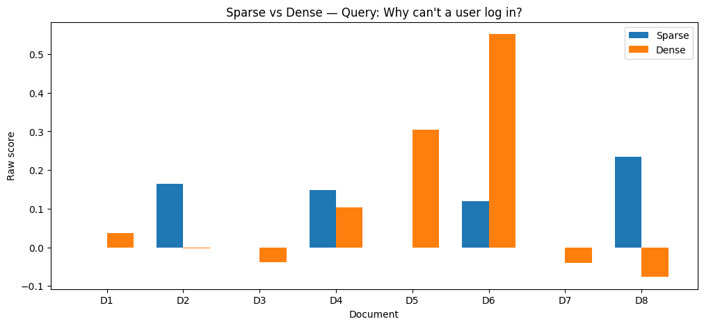

#### Important warning about the previous chart

Do **not** assume sparse score `0.6` and dense score `0.6` mean exactly the same thing.

They come from different scoring systems.

This matters later when we try to combine them.

That is why Hybrid Search needs a **fusion strategy**.

## 12. Visualize Embedding Space in 2D

Real embeddings may have hundreds or thousands of dimensions. Humans cannot directly visualize 384 dimensions.

For learning, we can use **PCA** to project those vectors into 2 dimensions.

#### Important

PCA is only a visualization aid here. The actual retrieval still uses the full embedding vectors.

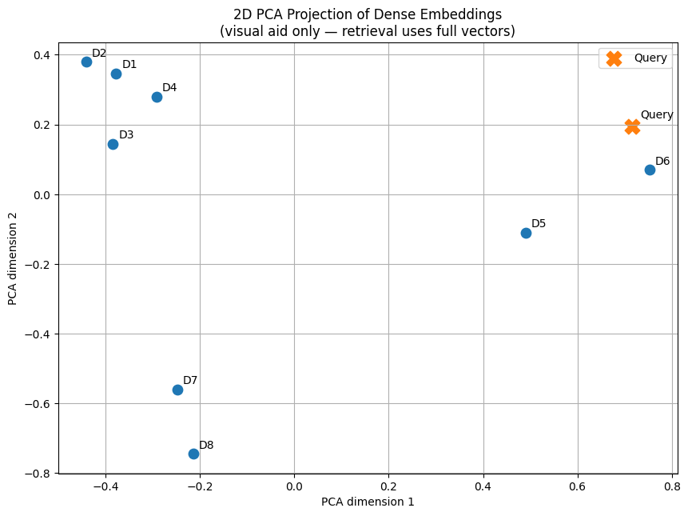

## 13. Why Dense Search Alone Is Not Enough

Dense retrieval is powerful, but enterprise data contains many exact values:

```text
Product codes
Regulation numbers
Article numbers
Error codes
Version numbers
Chemical IDs
Ticket IDs
Names and acronyms
```

Example:

```text
Query: 6ES7513-1AL02-0AB0
```

The exact string matters more than general semantic similarity.

Another example:

```text
Article 33
vs
Article 34
```

The sentences around them can be semantically similar, but legally the article number changes the meaning.

Therefore:

```text
Dense strength:
meaning / synonyms / paraphrases

Dense weakness:
exact identifiers can be under-emphasized
```

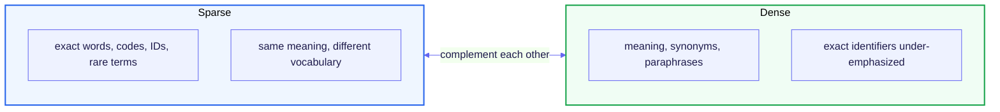

<table width="100%">
<thead><tr><th width="25%">Retriever</th><th width="75%">Query <code>6ES7513-1AL02-0AB0</code></th></tr></thead>
<tbody>
<tr><td><b>Sparse</b></td><td>D7 0.5739 · every other document 0 (clean, exact signal)</td></tr>
<tr><td><b>Dense</b></td><td>D7 0.5402 · D5 0.2719 · D1 0.1211 · D4 0.0931 (finds D7, but unrelated documents follow closely)</td></tr>
</tbody>
</table>

## 14. Query Types — A Very Useful Mental Model

Real queries can be grouped loosely into three types.

#### Type A — Exact lookup

```text
E401
REACH Article 33
6ES7513-1AL02-0AB0
```

Sparse retrieval often contributes strongly.

#### Type B — Semantic question

```text
Why can't users log in?
Which European law controls dangerous chemicals?
```

Dense retrieval often contributes strongly.

#### Type C — Mixed enterprise query

```text
What does REACH Article 33 require suppliers to disclose about SVHCs?
```

This contains both exact and semantic information.

Mixed queries are a major reason Hybrid Search is valuable.

##### Query-type map

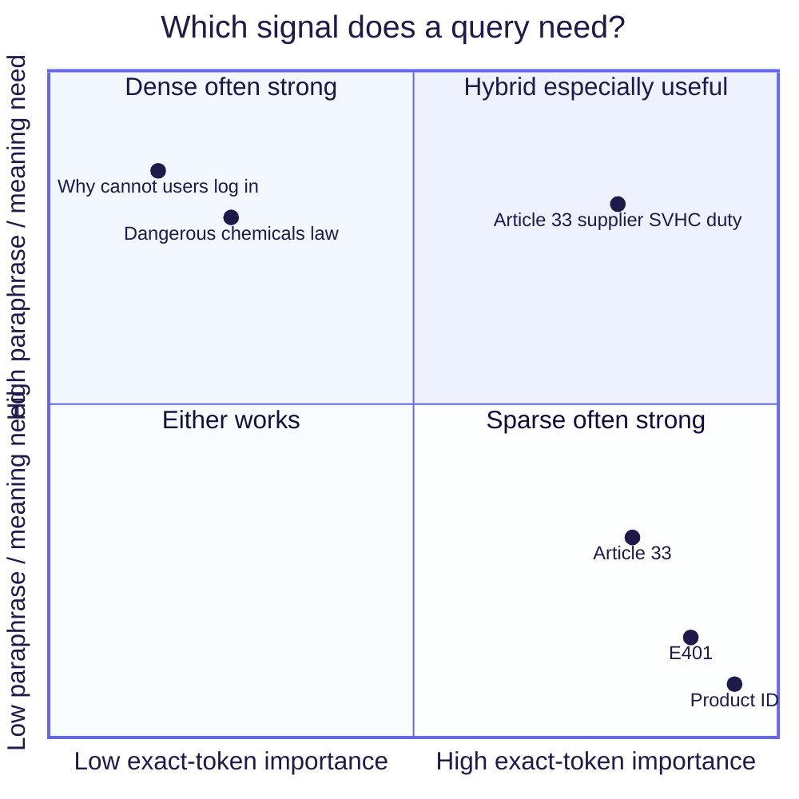

## 15. Hybrid Search = Combine the Signals

A basic Hybrid Search pipeline is:

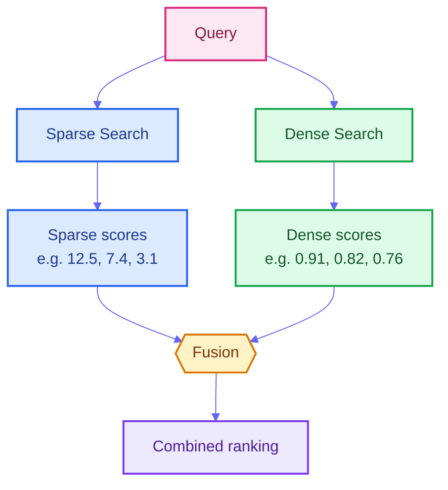

#### Fusion is necessary because

The sparse and dense score ranges are not guaranteed to be directly comparable.

For example:

```text
Sparse scores: 12.5, 7.4, 3.1
Dense scores : 0.91, 0.82, 0.76
```

Simply adding them would let the numeric scale dominate.

## 16. Score Normalization — Explain It Before Using It

One simple approach is **min-max normalization**.

It maps a score list into the range:

```text
0 to 1
```

Formula:

```math
\text{normalized}(x) = \frac{x - \min}{\max - \min}
```

Example:

```text
Original:  10, 20, 30
Normalized: 0, 0.5, 1
```

The highest score becomes `1`, the lowest becomes `0`, and the others fall in between.

## 17. Weighted Fusion

After normalization, a simple educational Hybrid score can be:

```math
\text{HybridScore} = \alpha \cdot \text{Dense} + (1-\alpha) \cdot \text{Sparse}
```

#### What is `alpha`?

`alpha` controls how much weight dense retrieval receives.

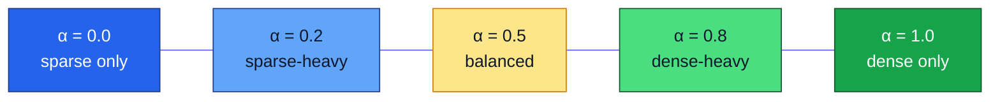

This is **not automatically the best production fusion method**. We use it because it makes the idea visible. Later we will study methods such as **Reciprocal Rank Fusion (RRF)**.

```python
import numpy as np

def min_max_normalize(values):
    # Convert to a float array
    values = np.asarray(values, dtype=float)

    # Avoid division by zero when all scores are equal
    if values.max() == values.min():
        return np.zeros_like(values)

    # Scale into 0..1
    return (values - values.min()) / (values.max() - values.min())

def hybrid_search(query, top_k=5, alpha=0.5):
    # Raw sparse scores (TF-IDF cosine)
    sparse_raw = cosine_similarity(tfidf_vectorizer.transform([query]), tfidf_document_matrix).flatten()

    # Raw dense scores (embedding cosine)
    dense_raw = document_embeddings @ embedding_model.encode([query], normalize_embeddings=True)[0]

    # Put both on the same 0..1 scale
    sparse_norm = min_max_normalize(sparse_raw)
    dense_norm = min_max_normalize(dense_raw)

    # Weighted fusion: alpha is the dense weight
    hybrid = (1 - alpha) * sparse_norm + alpha * dense_norm

    return hybrid.argsort()[::-1][:top_k], hybrid
```

### 17.1 Mixed Query — Ideal Hybrid Search Example

```text
What does REACH Article 33 require suppliers to disclose about SVHCs?
```

This query contains:

```text
Exact lexical clues:
REACH
Article 33
SVHC

Semantic intent:
what must suppliers disclose?
```

##### Hybrid score per document (α = 0.5, mixed REACH query)

from the notebook run.

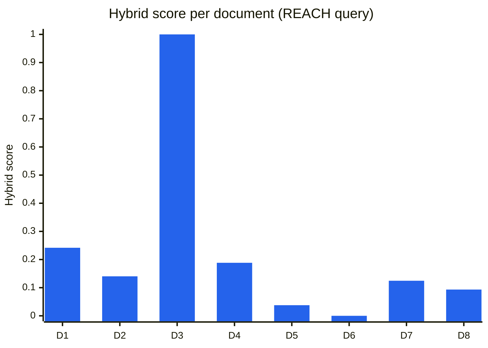

## 18. Alpha Experiment — See How Ranking Changes

The same query can behave differently depending on how much weight each retrieval signal receives.

We will compare:

```text
0.2 → sparse-heavy
0.5 → balanced
0.8 → dense-heavy
```

##### How α changes the hybrid score (notebook results)

The top-3 order stays `D1 → D2 → D4`, but the gap between the documents shrinks as α grows, because the dense signal is flatter than the sparse signal for this query.

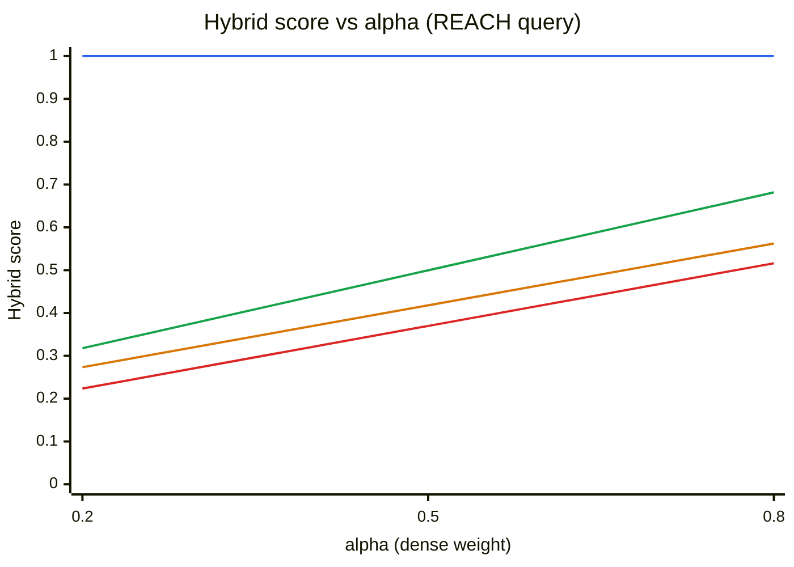

<table width="100%">
<thead><tr><th>Line colour</th><th>Document</th><th>α = 0.2</th><th>α = 0.5</th><th>α = 0.8</th></tr></thead>
<tbody>
<tr><td align="center"> Blue</td><td>D1 · REACH Regulation EC 1907/2006</td><td align="center">1.0000</td><td align="center">1.0000</td><td align="center">1.0000</td></tr>
<tr><td align="center"> Green</td><td>D2 · European rules on hazardous substances</td><td align="center">0.3177</td><td align="center">0.4997</td><td align="center">0.6817</td></tr>
<tr><td align="center"> Orange</td><td>D4 · RoHS hazardous substances</td><td align="center">0.2734</td><td align="center">0.4179</td><td align="center">0.5623</td></tr>
<tr><td align="center"> Red</td><td>D3 · REACH Article 33</td><td align="center">0.2235</td><td align="center">0.3698</td><td align="center">0.5161</td></tr>
</tbody>
</table>

### What should you learn from alpha?

Do **not** memorize a fixed value such as `0.5`.

Different datasets and query types may need different behavior.

Later we will learn:

- evaluation-driven weight tuning
- dynamic query weighting
- Reciprocal Rank Fusion

For now, the important lesson is:

> Hybrid Search needs a rule for combining multiple relevance signals.

## 19. Fusion vs Reranking — Do Not Confuse Them

These are separate stages.

### Fusion

Combines multiple retrieval result lists or scores.

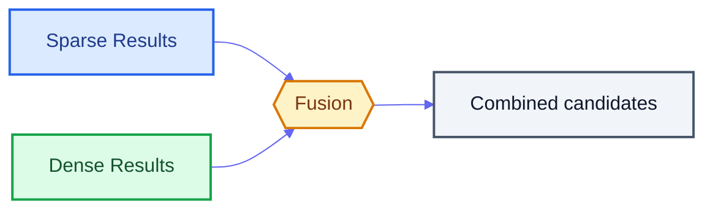

### Reranking

Uses a stronger and usually more expensive model to judge a **small candidate set** more carefully.

```mermaid
%%{init: {'theme':'base','themeVariables':{'primaryColor':'#EEF2FF','primaryBorderColor':'#6366F1','primaryTextColor':'#1E1B4B','lineColor':'#6366F1','pie1':'#22C55E','pie2':'#F59E0B','pie3':'#EF4444','pie4':'#3B82F6','pie5':'#8B5CF6','xyChart':{'plotColorPalette':'#2563EB, #16A34A, #D97706, #DC2626, #7C3AED'}}}}%%
flowchart LR
    H["Hybrid Top-20"] --> R["Reranker"] --> T["Top-5"]
    classDef q fill:#FCE7F3,stroke:#DB2777,color:#831843,stroke-width:2px
    classDef sp fill:#DBEAFE,stroke:#2563EB,color:#1E3A8A,stroke-width:2px
    classDef de fill:#DCFCE7,stroke:#16A34A,color:#14532D,stroke-width:2px
    classDef fu fill:#FEF3C7,stroke:#D97706,color:#78350F,stroke-width:2px
    classDef rr fill:#EDE9FE,stroke:#7C3AED,color:#4C1D95,stroke-width:2px
    classDef llm fill:#FEE2E2,stroke:#DC2626,color:#7F1D1D,stroke-width:2px
    classDef neu fill:#F1F5F9,stroke:#475569,color:#0F172A,stroke-width:2px
    class H fu
    class R rr
    class T llm
```

A reranker can be:

- cross-encoder model
- specialized reranking model
- LLM-based relevance judge

We will study reranking deeply in a later chapter.

```mermaid
%%{init: {'theme':'base','themeVariables':{'primaryColor':'#EEF2FF','primaryBorderColor':'#6366F1','primaryTextColor':'#1E1B4B','lineColor':'#6366F1','pie1':'#22C55E','pie2':'#F59E0B','pie3':'#EF4444','pie4':'#3B82F6','pie5':'#8B5CF6','xyChart':{'plotColorPalette':'#2563EB, #16A34A, #D97706, #DC2626, #7C3AED'}}}}%%
flowchart LR
    S["Sparse results"] --> F{{"Fusion"}}
    D["Dense results"] --> F
    F --> C["Hybrid Top-20<br/>high recall"] --> R["Reranker"] --> T["Top-5<br/>high precision"] --> L["LLM"]
    style S fill:#DBEAFE,stroke:#2563EB
    style D fill:#DCFCE7,stroke:#16A34A
    style F fill:#FEF3C7,stroke:#D97706
    style R fill:#EDE9FE,stroke:#7C3AED
    style L fill:#FEE2E2,stroke:#DC2626
```

## 20. High Recall First, High Precision Later

A useful production mental model is:

```mermaid
%%{init: {'theme':'base','themeVariables':{'primaryColor':'#EEF2FF','primaryBorderColor':'#6366F1','primaryTextColor':'#1E1B4B','lineColor':'#6366F1','pie1':'#22C55E','pie2':'#F59E0B','pie3':'#EF4444','pie4':'#3B82F6','pie5':'#8B5CF6','xyChart':{'plotColorPalette':'#2563EB, #16A34A, #D97706, #DC2626, #7C3AED'}}}}%%
flowchart TB
    A["Initial retrieval"] --> B["Try not to miss<br/>relevant documents"] --> C["High-recall<br/>candidate set"] --> D["Reranker"] --> E["Remove weak<br/>candidates"] --> F["High-precision<br/>final context"]
    style A fill:#DBEAFE,stroke:#2563EB,stroke-width:2px
    style B fill:#DBEAFE,stroke:#2563EB,stroke-width:2px
    style C fill:#DBEAFE,stroke:#2563EB,stroke-width:2px
    style D fill:#EDE9FE,stroke:#7C3AED,stroke-width:2px
    style E fill:#EDE9FE,stroke:#7C3AED,stroke-width:2px
    style F fill:#DCFCE7,stroke:#16A34A,stroke-width:2px
```

#### Recall intuition

> Of all truly relevant documents, how many did retrieval successfully find?

#### Precision intuition

> Of the documents we retrieved, how many are actually relevant?

A common design pattern is:

```text
Retriever → favor recall
Reranker  → improve precision
```

This is not an absolute law, but it is a very useful architecture principle.

## 21. Why Retrieval Quality Can Limit the Entire RAG System

Suppose the correct answer lives in `Document 837`.

But retrieval returns:

```text
D4
D10
D49
D82
D101
```

The LLM never receives `D837`.

Even a powerful LLM cannot reliably use evidence it was never given.

A useful mental model is:

```math
\text{AnswerQuality} \approx \text{RetrievalQuality} \times \text{GenerationQuality}
```

This is **not a formal equation**. It simply reminds us that bad evidence can ruin a good generator.

```mermaid
%%{init: {'theme':'base','themeVariables':{'primaryColor':'#EEF2FF','primaryBorderColor':'#6366F1','primaryTextColor':'#1E1B4B','lineColor':'#6366F1','pie1':'#22C55E','pie2':'#F59E0B','pie3':'#EF4444','pie4':'#3B82F6','pie5':'#8B5CF6','xyChart':{'plotColorPalette':'#2563EB, #16A34A, #D97706, #DC2626, #7C3AED'}}}}%%
flowchart LR
    C[("Correct answer<br/>in D837")] -.-x|"never retrieved"| R["Retrieved: D4, D10,<br/>D49, D82, D101"]
    R --> L["Strong LLM"] --> A["Wrong or ungrounded answer"]
    style C fill:#DCFCE7,stroke:#16A34A,stroke-width:2px
    style R fill:#FEF3C7,stroke:#D97706,stroke-width:2px
    style L fill:#EDE9FE,stroke:#7C3AED,stroke-width:2px
    style A fill:#FEE2E2,stroke:#DC2626,stroke-width:2px
```

## 22. Search vs RAG — Another Important Distinction

#### Search system

```mermaid
%%{init: {'theme':'base','themeVariables':{'primaryColor':'#EEF2FF','primaryBorderColor':'#6366F1','primaryTextColor':'#1E1B4B','lineColor':'#6366F1','pie1':'#22C55E','pie2':'#F59E0B','pie3':'#EF4444','pie4':'#3B82F6','pie5':'#8B5CF6','xyChart':{'plotColorPalette':'#2563EB, #16A34A, #D97706, #DC2626, #7C3AED'}}}}%%
flowchart LR
    Q["Query"] --> R["Retriever"] --> D["Documents"]
    classDef q fill:#FCE7F3,stroke:#DB2777,color:#831843,stroke-width:2px
    classDef sp fill:#DBEAFE,stroke:#2563EB,color:#1E3A8A,stroke-width:2px
    classDef de fill:#DCFCE7,stroke:#16A34A,color:#14532D,stroke-width:2px
    classDef fu fill:#FEF3C7,stroke:#D97706,color:#78350F,stroke-width:2px
    classDef rr fill:#EDE9FE,stroke:#7C3AED,color:#4C1D95,stroke-width:2px
    classDef llm fill:#FEE2E2,stroke:#DC2626,color:#7F1D1D,stroke-width:2px
    classDef neu fill:#F1F5F9,stroke:#475569,color:#0F172A,stroke-width:2px
    class Q q
    class R fu
    class D neu
```

It returns documents.

#### RAG system

```mermaid
%%{init: {'theme':'base','themeVariables':{'primaryColor':'#EEF2FF','primaryBorderColor':'#6366F1','primaryTextColor':'#1E1B4B','lineColor':'#6366F1','pie1':'#22C55E','pie2':'#F59E0B','pie3':'#EF4444','pie4':'#3B82F6','pie5':'#8B5CF6','xyChart':{'plotColorPalette':'#2563EB, #16A34A, #D97706, #DC2626, #7C3AED'}}}}%%
flowchart LR
    Q["Query"] --> R["Retriever"] --> D["Documents"] --> L["LLM"] --> A["Generated answer"]
    classDef q fill:#FCE7F3,stroke:#DB2777,color:#831843,stroke-width:2px
    classDef sp fill:#DBEAFE,stroke:#2563EB,color:#1E3A8A,stroke-width:2px
    classDef de fill:#DCFCE7,stroke:#16A34A,color:#14532D,stroke-width:2px
    classDef fu fill:#FEF3C7,stroke:#D97706,color:#78350F,stroke-width:2px
    classDef rr fill:#EDE9FE,stroke:#7C3AED,color:#4C1D95,stroke-width:2px
    classDef llm fill:#FEE2E2,stroke:#DC2626,color:#7F1D1D,stroke-width:2px
    classDef neu fill:#F1F5F9,stroke:#475569,color:#0F172A,stroke-width:2px
    class Q q
    class R fu
    class D neu
    class L,A llm
```

Therefore:

> **Hybrid Search can exist without an LLM.**

An ecommerce product search engine could use sparse + dense retrieval without any generation step.

## 23. Hybrid Search Does NOT Fix Everything

Hybrid Search is powerful, but it cannot automatically repair problems earlier or later in the pipeline.

It does not magically fix:

```text
Bad OCR
Missing documents
Poor PDF parsing
Incorrect chunks
Corrupted identifiers
Wrong metadata filters
Weak embedding model
Bad reranker
Hallucinating LLM
```

Think of RAG as a chain:

```mermaid
%%{init: {'theme':'base','themeVariables':{'primaryColor':'#EEF2FF','primaryBorderColor':'#6366F1','primaryTextColor':'#1E1B4B','lineColor':'#6366F1','pie1':'#22C55E','pie2':'#F59E0B','pie3':'#EF4444','pie4':'#3B82F6','pie5':'#8B5CF6','xyChart':{'plotColorPalette':'#2563EB, #16A34A, #D97706, #DC2626, #7C3AED'}}}}%%
flowchart LR
    A["Data"] --> B["Parsing"] --> C["Chunking"] --> D["Indexing"] --> E["Retrieval"] --> F["Fusion"] --> G["Reranking"] --> H["Context"] --> I["Generation"]
    E -.- N["Hybrid Search improves<br/>only this part"]
    classDef q fill:#FCE7F3,stroke:#DB2777,color:#831843,stroke-width:2px
    classDef sp fill:#DBEAFE,stroke:#2563EB,color:#1E3A8A,stroke-width:2px
    classDef de fill:#DCFCE7,stroke:#16A34A,color:#14532D,stroke-width:2px
    classDef fu fill:#FEF3C7,stroke:#D97706,color:#78350F,stroke-width:2px
    classDef rr fill:#EDE9FE,stroke:#7C3AED,color:#4C1D95,stroke-width:2px
    classDef llm fill:#FEE2E2,stroke:#DC2626,color:#7F1D1D,stroke-width:2px
    classDef neu fill:#F1F5F9,stroke:#475569,color:#0F172A,stroke-width:2px
    class A,B,C,D neu
    class E,F fu
    class G rr
    class H,I llm
    style N fill:#FFFBEB,stroke:#F59E0B,stroke-dasharray: 5 5
```

A failure at any stage can reduce final quality.

## 24. Production Debugging Framework

When the answer is wrong, debug in order instead of immediately changing the LLM.

```text
1. Does the correct source exist?
2. Was it parsed correctly?
3. Is the correct information inside a searchable chunk?
4. Did sparse retrieval find it?
5. Did dense retrieval find it?
6. Did fusion keep it?
7. Did the reranker remove it?
8. Did the final context include it?
9. Did the LLM misunderstand it?
```

#### This separation is extremely important

If the correct chunk is missing before the LLM stage, prompt engineering may not solve the root cause.

##### Debugging decision flow

```mermaid
%%{init: {'theme':'base','themeVariables':{'primaryColor':'#EEF2FF','primaryBorderColor':'#6366F1','primaryTextColor':'#1E1B4B','lineColor':'#6366F1','pie1':'#22C55E','pie2':'#F59E0B','pie3':'#EF4444','pie4':'#3B82F6','pie5':'#8B5CF6','xyChart':{'plotColorPalette':'#2563EB, #16A34A, #D97706, #DC2626, #7C3AED'}}}}%%
flowchart TB
    S(["Wrong answer"]) --> Q1{"1 · Correct source exists?"}
    Q1 -->|No| F1["Add / ingest the source"]
    Q1 -->|Yes| Q2{"2 · Parsed correctly?"}
    Q2 -->|No| F2["Fix parser / OCR"]
    Q2 -->|Yes| Q3{"3 · Info inside a searchable chunk?"}
    Q3 -->|No| F3["Fix chunking"]
    Q3 -->|Yes| Q4{"4-5 · Sparse or dense found it?"}
    Q4 -->|No| F4["Tune tokenizer / embeddings / Top-K"]
    Q4 -->|Yes| Q5{"6 · Fusion kept it?"}
    Q5 -->|No| F5["Tune normalization / alpha / RRF"]
    Q5 -->|Yes| Q6{"7 · Reranker kept it?"}
    Q6 -->|No| F6["Check reranker / candidate size"]
    Q6 -->|Yes| Q7{"8 · In final context?"}
    Q7 -->|No| F7["Fix context builder / token budget"]
    Q7 -->|Yes| F8["9 · LLM misunderstanding → prompt / model"]
    classDef bad fill:#FEE2E2,stroke:#DC2626,color:#7F1D1D
    classDef fix fill:#DCFCE7,stroke:#16A34A,color:#14532D
    classDef ask fill:#EEF2FF,stroke:#6366F1,color:#1E1B4B
    class S bad
    class F1,F2,F3,F4,F5,F6,F7,F8 fix
    class Q1,Q2,Q3,Q4,Q5,Q6,Q7 ask
```

### 24.1 Debug Three Different Query Styles

Observe how the retrievers behave differently.

Run all three retrievers on the same query and compare ranks.

```python
def debug_retrieval(query, top_k=5, alpha=0.5):
    # Rank lists from each retriever
    sparse_ids = sparse_search(query, top_k)[0]
    dense_ids = dense_search(query, top_k)[0]
    hybrid_ids = hybrid_search(query, top_k, alpha)[0]

    # One column per retriever, one row per rank
    return pd.DataFrame({
        "sparse_rank": df.iloc[sparse_ids]["id"].tolist(),
        "dense_rank": df.iloc[dense_ids]["id"].tolist(),
        "hybrid_rank": df.iloc[hybrid_ids]["id"].tolist(),
    })
```

<table width="100%">
<thead><tr><th width="34%">Query (top_k = 4, alpha = 0.5)</th><th width="22%">Sparse ranks</th><th width="22%">Dense ranks</th><th width="22%">Hybrid ranks</th></tr></thead>
<tbody>
<tr><td><b>Exact:</b> <code>E401</code></td><td>D5, D8, D7, D6</td><td>D5, D7, D1, D8</td><td>D5, D7, D1, D8</td></tr>
<tr><td><b>Semantic:</b> <code>Why can't users sign in?</code></td><td>D6, D8, D2, D4</td><td>D6, D5, D4, D1</td><td>D6, D5, D4, D8</td></tr>
<tr><td><b>Mixed:</b> <code>What does REACH Article 33 require suppliers to communicate?</code></td><td>D3, D1, D8, D7</td><td>D3, D1, D4, D7</td><td>D3, D1, D4, D7</td></tr>
</tbody>
</table>

All three put the right document first. The difference is in ranks 2 to 4: for the semantic query, dense and hybrid bring in D5 (E401 authentication failure) while sparse brings in unrelated D8 and D2 through common words like `can` and `in`.

## 25. A Simple End-to-End Hybrid RAG Pseudocode

Now that every stage has been introduced, the full logic becomes easier to understand.

```python
query = user_question

# Candidate retrieval
sparse_results = sparse_search(query, top_k=20)
dense_results = dense_search(query, top_k=20)

# Combine evidence
hybrid_candidates = fuse(sparse_results, dense_results)

# Expensive relevance refinement
reranked = rerank(query, hybrid_candidates)

# Keep a small amount of evidence
context = reranked[:5]

# Final generation
answer = llm(question=query, context=context)
```

#### The most important sequence

```mermaid
%%{init: {'theme':'base','themeVariables':{'primaryColor':'#EEF2FF','primaryBorderColor':'#6366F1','primaryTextColor':'#1E1B4B','lineColor':'#6366F1','pie1':'#22C55E','pie2':'#F59E0B','pie3':'#EF4444','pie4':'#3B82F6','pie5':'#8B5CF6','xyChart':{'plotColorPalette':'#2563EB, #16A34A, #D97706, #DC2626, #7C3AED'}}}}%%
sequenceDiagram
    autonumber
    participant Q as Query
    participant S as Sparse
    participant D as Dense
    participant F as Fusion
    participant R as Reranker
    participant L as LLM
    par Retrieve
        Q->>S: search terms
        Q->>D: search meaning
    end
    S->>F: sparse candidates
    D->>F: dense candidates
    F->>R: fused list
    R->>L: build context (Top-K)
    L-->>Q: generate answer
```

## 26. When Should You Use Hybrid Search?

Hybrid Search becomes especially attractive when your data contains both semantic text and exact entities.

Strong use cases include:

```text
Regulatory / legal search
Technical support
Machine manuals
Product catalogs
Cybersecurity
Scientific literature
Medical search
Code/documentation search
Enterprise knowledge bases
```

Why?

Because these domains commonly contain:

```text
Natural language
+
IDs
+
acronyms
+
versions
+
rare terminology
+
codes
```

### When might dense search alone be enough?

A small FAQ dataset where users mostly ask natural-language paraphrases.

Example:

```text
How do I reset my password?
I forgot my password.
How can I recover my account?
```

Dense retrieval may already perform very well.

### When might lexical or exact lookup be enough?

If users mostly search exact identifiers:

```text
Ticket ID
Invoice ID
SKU
Fault code
```

Adding embeddings may add little value.

#### Engineering principle

> Add Hybrid Search because evaluation shows it solves a retrieval problem — not simply because it sounds more advanced.

##### Should I use Hybrid Search?

```mermaid
%%{init: {'theme':'base','themeVariables':{'primaryColor':'#EEF2FF','primaryBorderColor':'#6366F1','primaryTextColor':'#1E1B4B','lineColor':'#6366F1','pie1':'#22C55E','pie2':'#F59E0B','pie3':'#EF4444','pie4':'#3B82F6','pie5':'#8B5CF6','xyChart':{'plotColorPalette':'#2563EB, #16A34A, #D97706, #DC2626, #7C3AED'}}}}%%
flowchart TB
    S(["What do users search?"]) --> A{"Mostly natural-language<br/>paraphrases?"}
    A -->|Yes| B{"Also IDs, codes,<br/>versions, acronyms?"}
    A -->|No| C{"Mostly exact IDs<br/>Ticket, SKU, fault code?"}
    B -->|No| D["Dense alone may be enough"]
    B -->|Yes| H["Hybrid Search"]
    C -->|Yes| E["Lexical / exact lookup may be enough"]
    C -->|No| H
    H --> V["Confirm with evaluation<br/>on representative queries"]
    D --> V
    E --> V
    style H fill:#FEF3C7,stroke:#D97706,stroke-width:2px
    style D fill:#DCFCE7,stroke:#16A34A
    style E fill:#DBEAFE,stroke:#2563EB
    style V fill:#EDE9FE,stroke:#7C3AED
```

## 27. Regulatory Example — Why Hybrid Is a Natural Fit

Regulatory text often contains:

```text
Regulation IDs
Article numbers
Chemical names
CAS numbers
Country names
Acronyms
Legal language
Semantic obligations
```

Example query:

```text
Does REACH Article 33 require suppliers to communicate SVHC information?
```

Sparse evidence:

```text
REACH
Article 33
SVHC
```

Dense evidence:

```text
require suppliers to communicate
≈
disclosure / information duty
```

That combination is exactly what Hybrid Search is designed to exploit.

```mermaid
%%{init: {'theme':'base','themeVariables':{'primaryColor':'#EEF2FF','primaryBorderColor':'#6366F1','primaryTextColor':'#1E1B4B','lineColor':'#6366F1','pie1':'#22C55E','pie2':'#F59E0B','pie3':'#EF4444','pie4':'#3B82F6','pie5':'#8B5CF6','xyChart':{'plotColorPalette':'#2563EB, #16A34A, #D97706, #DC2626, #7C3AED'}}}}%%
flowchart LR
    Q["Does REACH Article 33 require suppliers<br/>to communicate SVHC information?"] --> S["Sparse evidence<br/>REACH · Article 33 · SVHC"]
    Q --> D["Dense evidence<br/>require suppliers to communicate<br/>≈ disclosure / information duty"]
    S --> H{{"Hybrid"}}
    D --> H
    H --> A["D3 ranked first"]
    style Q fill:#FCE7F3,stroke:#DB2777
    style S fill:#DBEAFE,stroke:#2563EB
    style D fill:#DCFCE7,stroke:#16A34A
    style H fill:#FEF3C7,stroke:#D97706
    style A fill:#EDE9FE,stroke:#7C3AED
```

## 28. Common Beginner Misconceptions

#### Misconception 1

> "Embeddings understand everything, so BM25 is obsolete."

No. Exact IDs, numbers, acronyms, and rare terms remain extremely important.

#### Misconception 2

> "Hybrid means 50% sparse + 50% dense."

No. Hybrid means combining retrieval approaches. The fusion method can vary.

#### Misconception 3

> "Fusion and reranking are the same."

No. Fusion combines retriever evidence; reranking re-evaluates candidates.

#### Misconception 4

> "Hybrid always improves RAG."

No. It should be evaluated on representative queries.

#### Misconception 5

> "A bad RAG answer means I need a better LLM."

Often the real problem is retrieval, parsing, chunking, filters, or reranking.

## 29. Interview Questions — With Strong Answers

### Q1. What is Hybrid Search?

**Answer:**

Hybrid Search combines lexical retrieval, such as BM25, with dense semantic vector retrieval. Lexical retrieval is strong for exact terms, identifiers, acronyms, and rare words, while dense retrieval is strong for semantic similarity, synonyms, and paraphrases. Their results are fused into a combined candidate ranking and may then be reranked.

---

### Q2. Why not use vector search alone?

Vector search can under-emphasize exact identifiers such as product numbers, regulation IDs, error codes, article numbers, and versions. Lexical retrieval preserves those exact signals.

---

### Q3. Why not use BM25 alone?

BM25 depends heavily on lexical overlap and may miss relevant documents expressed using different vocabulary, synonyms, or paraphrases.

---

### Q4. Is Hybrid Search the same as RAG?

No. Hybrid Search is a retrieval technique. RAG is the broader architecture in which retrieved external evidence is supplied to an LLM for generation.

---

### Q5. What is fusion?

Fusion combines evidence or rankings from multiple retrieval systems.

---

### Q6. What is reranking?

Reranking applies a stronger relevance model to a smaller candidate set after initial retrieval.

---

### Q7. Why is retrieval quality critical?

The LLM cannot reliably use evidence that was never retrieved and included in its context.

## 30. Interview Scenarios

#### Scenario A — Machine manuals

Users search both:

```text
E401
```

and:

```text
Why does authentication keep failing?
```

**Recommended approach:** Hybrid Search.

Why?

- sparse handles the exact code
- dense handles the natural-language description

---

#### Scenario B — BM25 top-20 + dense top-20

What next?

```text
1. Combine / deduplicate candidates
2. Fuse rankings or scores
3. Optionally rerank
4. Keep the final Top-K
5. Send those chunks to the LLM
```

```mermaid
%%{init: {'theme':'base','themeVariables':{'primaryColor':'#EEF2FF','primaryBorderColor':'#6366F1','primaryTextColor':'#1E1B4B','lineColor':'#6366F1','pie1':'#22C55E','pie2':'#F59E0B','pie3':'#EF4444','pie4':'#3B82F6','pie5':'#8B5CF6','xyChart':{'plotColorPalette':'#2563EB, #16A34A, #D97706, #DC2626, #7C3AED'}}}}%%
flowchart LR
    B["BM25 Top-20"] --> M["1 · Combine /<br/>deduplicate"]
    D["Dense Top-20"] --> M
    M --> F["2 · Fuse ranks<br/>or scores"] --> R["3 · Optional<br/>rerank"] --> K["4 · Keep<br/>final Top-K"] --> L["5 · Send to LLM"]
    style B fill:#DBEAFE,stroke:#2563EB
    style D fill:#DCFCE7,stroke:#16A34A
    style F fill:#FEF3C7,stroke:#D97706
    style R fill:#EDE9FE,stroke:#7C3AED
    style L fill:#FEE2E2,stroke:#DC2626
```

## 31. Final Concept Map

```mermaid
%%{init: {'theme':'base','themeVariables':{'primaryColor':'#EEF2FF','primaryBorderColor':'#6366F1','primaryTextColor':'#1E1B4B','lineColor':'#6366F1','pie1':'#22C55E','pie2':'#F59E0B','pie3':'#EF4444','pie4':'#3B82F6','pie5':'#8B5CF6','xyChart':{'plotColorPalette':'#2563EB, #16A34A, #D97706, #DC2626, #7C3AED'}}}}%%
flowchart TB
    H(["HYBRID SEARCH RAG"]) --> S["Sparse Retrieval<br/><i>words / exact terms</i>"]
    H --> D["Dense Retrieval<br/><i>semantic meaning</i>"]
    S --> S1["IDs, codes, acronyms"]
    D --> D1["synonyms, paraphrases"]
    S1 --> F{{"Fusion"}}
    D1 --> F
    F --> C["Candidate Set"] --> R["Reranker"] --> K["Top-K"] --> X["LLM Context"] --> A["Answer"]
    classDef q fill:#FCE7F3,stroke:#DB2777,color:#831843,stroke-width:2px
    classDef sp fill:#DBEAFE,stroke:#2563EB,color:#1E3A8A,stroke-width:2px
    classDef de fill:#DCFCE7,stroke:#16A34A,color:#14532D,stroke-width:2px
    classDef fu fill:#FEF3C7,stroke:#D97706,color:#78350F,stroke-width:2px
    classDef rr fill:#EDE9FE,stroke:#7C3AED,color:#4C1D95,stroke-width:2px
    classDef llm fill:#FEE2E2,stroke:#DC2626,color:#7F1D1D,stroke-width:2px
    classDef neu fill:#F1F5F9,stroke:#475569,color:#0F172A,stroke-width:2px
    class H q
    class S,S1 sp
    class D,D1 de
    class F,C fu
    class R,K rr
    class X,A llm
```

## 32. Chapter 1 Revision Cheat Sheet

If you remember only one page, remember this:

```text
RAG
=
retrieve evidence + generate answer

Sparse Search
=
match words / terms
Strong: IDs, codes, exact names, article numbers
Weak: synonyms and paraphrases

Dense Search
=
match meaning using embeddings
Strong: synonyms, paraphrases, natural language
Weak: some exact IDs / numbers / rare strings

Hybrid Search
=
sparse + dense

Fusion
=
combine multiple retrieval signals

Reranking
=
carefully re-score a small candidate set

Common production pattern
=
high-recall retrieval → high-precision reranking → LLM
```

## 33. Practice Tasks — Do These Before Chapter 2

#### Task 1 — Add your own exact-code document

Add a document such as:

```text
Fault code XRQ-22931 means cooling system pressure failure.
```

Search using only `XRQ-22931` and compare sparse vs dense.

---

#### Task 2 — Create a vocabulary mismatch

Document:

```text
Employees may perform duties remotely.
```

Query:

```text
What is the work-from-home policy?
```

Observe sparse and dense behavior.

---

#### Task 3 — Change alpha

Run one mixed query with:

```python
alpha = 0.0
alpha = 0.2
alpha = 0.5
alpha = 0.8
alpha = 1.0
```

Explain why the ranking changes.

---

#### Task 4 — Debug deliberately

Add an irrelevant document with many keywords. Check whether sparse, dense, or hybrid retrieval ranks it too highly.

---

#### Task 5 — Explain without code

Be able to draw this from memory:

```mermaid
%%{init: {'theme':'base','themeVariables':{'primaryColor':'#EEF2FF','primaryBorderColor':'#6366F1','primaryTextColor':'#1E1B4B','lineColor':'#6366F1','pie1':'#22C55E','pie2':'#F59E0B','pie3':'#EF4444','pie4':'#3B82F6','pie5':'#8B5CF6','xyChart':{'plotColorPalette':'#2563EB, #16A34A, #D97706, #DC2626, #7C3AED'}}}}%%
flowchart TB
    Q["Query"] --> S["Sparse"]
    Q --> D["Dense"]
    S --> F{{"Fusion"}}
    D --> F
    F --> R["Reranker"] --> L["LLM"]
    classDef q fill:#FCE7F3,stroke:#DB2777,color:#831843,stroke-width:2px
    classDef sp fill:#DBEAFE,stroke:#2563EB,color:#1E3A8A,stroke-width:2px
    classDef de fill:#DCFCE7,stroke:#16A34A,color:#14532D,stroke-width:2px
    classDef fu fill:#FEF3C7,stroke:#D97706,color:#78350F,stroke-width:2px
    classDef rr fill:#EDE9FE,stroke:#7C3AED,color:#4C1D95,stroke-width:2px
    classDef llm fill:#FEE2E2,stroke:#DC2626,color:#7F1D1D,stroke-width:2px
    classDef neu fill:#F1F5F9,stroke:#475569,color:#0F172A,stroke-width:2px
    class Q q
    class S sp
    class D de
    class F fu
    class R rr
    class L llm
```

<p align="center"><a href="../../01.%20RAG%20Fundamentals/README.md">Previous: 02.01 RAG Fundamentals</a> | <a href="../../../README.md">Home</a> | <a href="../../README.md">Group 02: RAG Introduction</a> | <a href="../README.md">Chapter page</a> | <a href="../../03.%20Lexical%20vs%20Semantic%20Retrieval/README.md">Next: 02.03 Lexical vs Semantic Retrieval</a></p>
