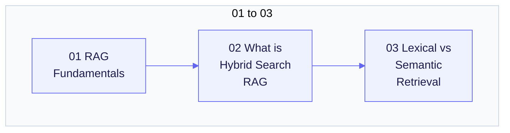

# 02 · RAG Introduction

 

**What RAG is, why it exists, and the two retrieval families it builds on.**

<a href="../01.%20NLP%20Basics%20for%20RAG/README.md">Previous group: 01 NLP Basics for RAG</a> | <a href="../README.md">Home</a> | <a href="../03.%20Data%20Ingestion/README.md">Next group: 03 Data Ingestion</a>

## Learning flow

## Chapters

**Done** = notes + notebook · **Notebook** = notebook ready, notes coming · **Planned** = folder ready

<table width="100%">
<thead><tr><th width="7%">Sr No</th><th width="25%">Chapter</th><th width="44%">Key Concepts</th><th width="8%">Notes</th><th width="8%">Notebook</th><th width="8%">Status</th></tr></thead>
<tbody>
<tr><td align="center">01</td><td><a href="01.%20RAG%20Fundamentals"><b>RAG Fundamentals</b></a></td><td>What RAG is and isn't, the two pipelines, cosine similarity from scratch, a naive RAG system built with no framework, the retrieval-vs-generation debugging split</td><td align="center">-</td><td align="center"><a href="01.%20RAG%20Fundamentals/notebooks/01.%20RAG%20Fundamentals.ipynb">Open</a></td><td align="center">Notebook</td></tr>
<tr><td align="center">02</td><td><a href="02.%20What%20is%20Hybrid%20Search%20RAG"><b>What is Hybrid Search RAG</b></a></td><td>Python, BM25, FAISS, Sentence Transformers, RRF. No framework hides the internals</td><td align="center"><a href="02.%20What%20is%20Hybrid%20Search%20RAG/notes/02.%20What%20is%20Hybrid%20Search%20RAG.md">Read</a></td><td align="center"><a href="02.%20What%20is%20Hybrid%20Search%20RAG/notebooks/02.%20What%20is%20Hybrid%20Search%20RAG.ipynb">Open</a></td><td align="center">Done</td></tr>
<tr><td align="center">03</td><td><a href="03.%20Lexical%20vs%20Semantic%20Retrieval"><b>Lexical vs Semantic Retrieval</b></a></td><td>FastAPI, Milvus or Elasticsearch, BM25, dense search, RRF, reranker, LLM</td><td align="center"><a href="03.%20Lexical%20vs%20Semantic%20Retrieval/notes/03.%20Lexical%20vs%20Semantic%20Retrieval.md">Read</a></td><td align="center"><a href="03.%20Lexical%20vs%20Semantic%20Retrieval/notebooks/03.%20Lexical%20vs%20Semantic%20Retrieval.ipynb">Open</a></td><td align="center">Done</td></tr>
</tbody>
</table>
