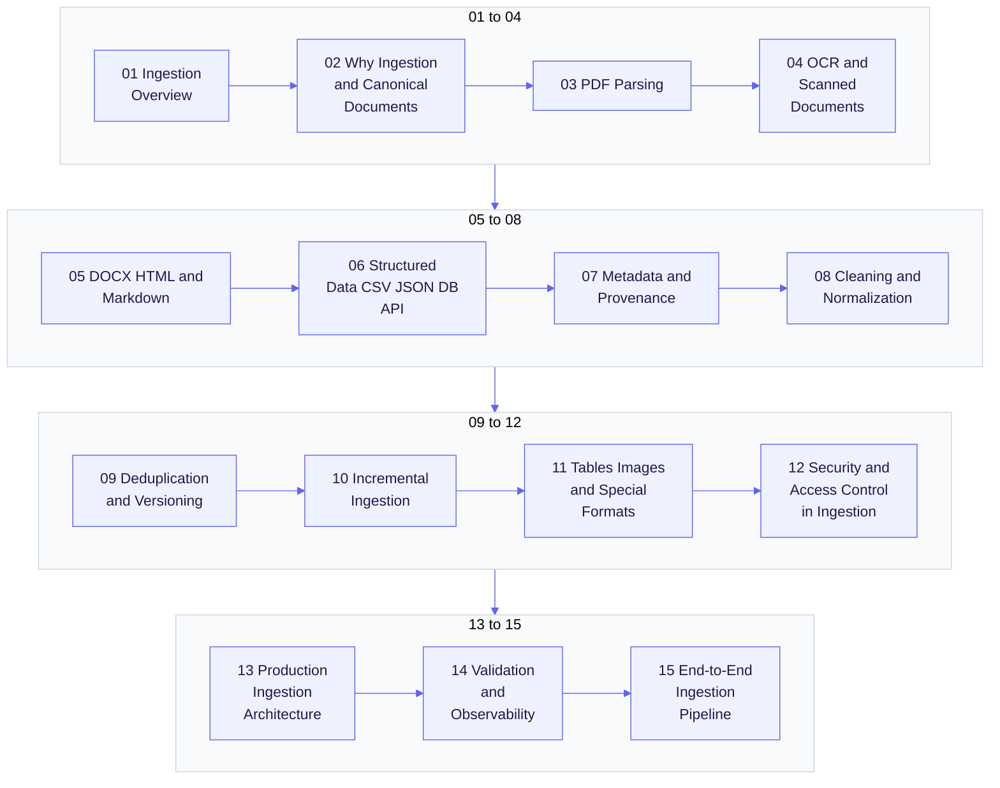

# 03 · Data Ingestion

 

**Turning PDFs, scans, office files and structured data into clean, versioned, retrievable documents.**

<a href="../02.%20RAG%20Introduction/README.md">Previous group: 02 RAG Introduction</a> | <a href="../README.md">Home</a> | <a href="../04.%20Chunking%20and%20Metadata/README.md">Next group: 04 Chunking and Metadata</a>

## Learning flow

## Chapters

**Done** = notes + notebook · **Notebook** = notebook ready, notes coming · **Planned** = folder ready

<table width="100%">
<thead><tr><th width="6%">Sr&nbsp;No</th><th width="22%">Chapter</th><th width="46%">Key Concepts</th><th width="8%">Interview Priority</th><th width="6%">Notes</th><th width="6%">Notebook</th><th width="6%">Status</th></tr></thead>
<tbody>
<tr><td align="center">01</td><td><b>Ingestion Overview</b></td><td>Why ingestion caps everything downstream, real PDF/OCR/DOCX parsing on real documents, metadata, dedup, versioning, incremental ingestion</td><td align="center">High</td><td align="center">-</td><td align="center"><a href="01.%20Ingestion%20Overview/notebooks/01.%20Ingestion%20Overview.ipynb">Open</a></td><td align="center">Notebook</td></tr>
<tr><td align="center">02</td><td><b>Why Ingestion and Canonical Documents</b></td><td>The quality ceiling, ingestion ≠ chunking, canonical schema, `raw_text` vs `clean_text`, connectors</td><td align="center">Medium</td><td align="center">-</td><td align="center"><a href="02.%20Why%20Ingestion%20and%20Canonical%20Documents/notebooks/02.%20Why%20Ingestion%20and%20Canonical%20Documents.ipynb">Open</a></td><td align="center">Notebook</td></tr>
<tr><td align="center">03</td><td><b>PDF Parsing</b></td><td>PDF is not a text format, page provenance, reading order, heading detection by font weight, what `get_text()` silently misses</td><td align="center">Medium</td><td align="center">-</td><td align="center"><a href="03.%20PDF%20Parsing/notebooks/03.%20PDF%20Parsing.ipynb">Open</a></td><td align="center">Notebook</td></tr>
<tr><td align="center">04</td><td><b>OCR and Scanned Documents</b></td><td>Rendering to image, real Tesseract confidence scores, three-tier routing, character confusions, cost modelling</td><td align="center">Medium</td><td align="center">-</td><td align="center"><a href="04.%20OCR%20and%20Scanned%20Documents/notebooks/04.%20OCR%20and%20Scanned%20Documents.ipynb">Open</a></td><td align="center">Notebook</td></tr>
<tr><td align="center">05</td><td><b>DOCX HTML and Markdown</b></td><td>Native structure extraction, heading context, boilerplate removal</td><td align="center">Medium</td><td align="center">-</td><td align="center"><a href="05.%20DOCX%20HTML%20and%20Markdown/notebooks/05.%20DOCX%20HTML%20and%20Markdown.ipynb">Open</a></td><td align="center">Notebook</td></tr>
<tr><td align="center">06</td><td><b>Structured Data CSV JSON DB API</b></td><td>What is one retrievable unit, row serialization, nested JSON, when not to embed, live APIs</td><td align="center">Medium</td><td align="center">-</td><td align="center"><a href="06.%20Structured%20Data%20CSV%20JSON%20DB%20API/notebooks/06.%20Structured%20Data%20CSV%20JSON%20DB%20API.ipynb">Open</a></td><td align="center">Notebook</td></tr>
<tr><td align="center">07</td><td><b>Metadata and Provenance</b></td><td>Six metadata categories, filtering precision, deterministic vs LLM extraction, citation chains</td><td align="center">Medium</td><td align="center">-</td><td align="center"><a href="07.%20Metadata%20and%20Provenance/notebooks/07.%20Metadata%20and%20Provenance.ipynb">Open</a></td><td align="center">Notebook</td></tr>
<tr><td align="center">08</td><td><b>Cleaning and Normalization</b></td><td>Whitespace, line wrap, hyphenation, Unicode, header/footer detection on real pages, the over-cleaning trap</td><td align="center">Medium</td><td align="center">-</td><td align="center"><a href="08.%20Cleaning%20and%20Normalization/notebooks/08.%20Cleaning%20and%20Normalization.ipynb">Open</a></td><td align="center">Notebook</td></tr>
<tr><td align="center">09</td><td><b>Deduplication and Versioning</b></td><td>SHA-256, Jaccard similarity, MinHash/LSH at scale, effective vs publication date, amendments</td><td align="center">Medium</td><td align="center">-</td><td align="center"><a href="09.%20Deduplication%20and%20Versioning/notebooks/09.%20Deduplication%20and%20Versioning.ipynb">Open</a></td><td align="center">Notebook</td></tr>
<tr><td align="center">10</td><td><b>Incremental Ingestion</b></td><td>Change detection, deletion handling, stable IDs, idempotency, atomic replacement</td><td align="center">Medium</td><td align="center">-</td><td align="center"><a href="10.%20Incremental%20Ingestion/notebooks/10.%20Incremental%20Ingestion.ipynb">Open</a></td><td align="center">Notebook</td></tr>
<tr><td align="center">11</td><td><b>Tables Images and Special Formats</b></td><td>Table serialization, figures, PowerPoint, Excel, email, code, legal documents</td><td align="center">Medium</td><td align="center">-</td><td align="center">-</td><td align="center">Planned</td></tr>
<tr><td align="center">12</td><td><b>Security and Access Control in Ingestion</b></td><td>Permissions travel with the document, ACL inheritance, PII handling</td><td align="center">Medium</td><td align="center">-</td><td align="center">-</td><td align="center">Planned</td></tr>
<tr><td align="center">13</td><td><b>Production Ingestion Architecture</b></td><td>Three-layer storage, batch vs event-driven, backpressure, retries, dead-letter queues, cost</td><td align="center">Medium</td><td align="center">-</td><td align="center">-</td><td align="center">Planned</td></tr>
<tr><td align="center">14</td><td><b>Validation and Observability</b></td><td>Pre-chunking validation, anomaly detection, metrics, golden document sets, parser benchmarking</td><td align="center">Medium</td><td align="center">-</td><td align="center">-</td><td align="center">Planned</td></tr>
<tr><td align="center">15</td><td><b>End-to-End Ingestion Pipeline</b></td><td>Anti-patterns, the debugging ladder, interview preparation</td><td align="center">Medium</td><td align="center">-</td><td align="center">-</td><td align="center">Planned</td></tr>
</tbody>
</table>
