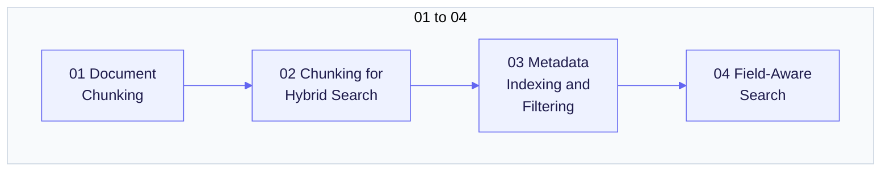

# 04 · Chunking and Metadata

 

**How documents are split and labelled before indexing.**

<a href="../03.%20Data%20Ingestion/README.md">Previous group: 03 Data Ingestion</a> | <a href="../README.md">Home</a> | <a href="../05.%20Sparse%20Retrieval/README.md">Next group: 05 Sparse Retrieval</a>

## Learning flow

## Chapters

**Done** = notes + notebook · **Notebook** = notebook ready, notes coming · **Planned** = folder ready

<table width="100%">
<thead><tr><th width="7%">Sr No</th><th width="25%">Chapter</th><th width="44%">Key Concepts</th><th width="8%">Notes</th><th width="8%">Notebook</th><th width="8%">Status</th></tr></thead>
<tbody>
<tr><td align="center">01</td><td><a href="01.%20Document%20Chunking"><b>Document Chunking</b></a></td><td>Why chunk size and overlap decide retrieval quality; fixed, semantic, recursive and structure-aware chunking</td><td align="center">-</td><td align="center">-</td><td align="center">Planned</td></tr>
<tr><td align="center">02</td><td><a href="02.%20Chunking%20for%20Hybrid%20Search"><b>Chunking for Hybrid Search</b></a></td><td>Fixed, recursive, semantic, paragraph, sliding-window, parent-child chunking</td><td align="center">-</td><td align="center">-</td><td align="center">Planned</td></tr>
<tr><td align="center">03</td><td><a href="03.%20Metadata%20Indexing%20and%20Filtering"><b>Metadata Indexing and Filtering</b></a></td><td>Metadata schema, pre-filtering vs post-filtering, structured + unstructured search; Pre- vs post-filtering, self-query retrieval, access-control filters, field-aware search</td><td align="center">-</td><td align="center">-</td><td align="center">Planned</td></tr>
<tr><td align="center">04</td><td><a href="04.%20Field-Aware%20Search"><b>Field-Aware Search</b></a></td><td>Title, summary and body fields, field weights, BM25F-style boosting</td><td align="center">-</td><td align="center">-</td><td align="center">Planned</td></tr>
</tbody>
</table>
