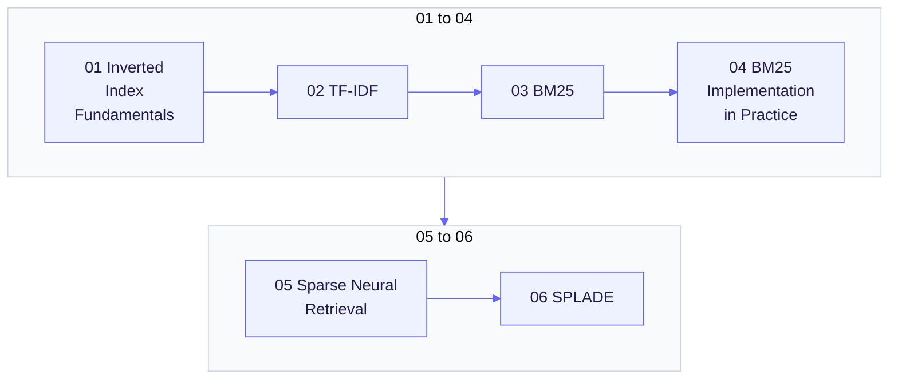

# 05 · Sparse Retrieval

 

**Keyword search from the inverted index to BM25 and learned sparse models.**

<a href="../04.%20Chunking%20and%20Metadata/README.md">Previous group: 04 Chunking and Metadata</a> | <a href="../README.md">Home</a> | <a href="../06.%20Dense%20Retrieval%20and%20Vector%20Search/README.md">Next group: 06 Dense Retrieval and Vector Search</a>

## Learning flow

## Chapters

**Done** = notes + notebook · **Notebook** = notebook ready, notes coming · **Planned** = folder ready

<table width="100%">
<thead><tr><th width="6%">Sr&nbsp;No</th><th width="22%">Chapter</th><th width="46%">Key Concepts</th><th width="8%">Interview Priority</th><th width="6%">Notes</th><th width="6%">Notebook</th><th width="6%">Status</th></tr></thead>
<tbody>
<tr><td align="center">01</td><td><a href="01.%20Inverted%20Index%20Fundamentals/notes/01.%20Inverted%20Index%20Fundamentals.md"><b>Inverted Index Fundamentals</b></a></td><td>Forward vs inverted index, posting lists, TF, DF, Boolean AND/OR, phrase search, tokenization, stemming; Lexical vs semantic, inverted indexes, TF-IDF, BM25 from first principles, learned sparse retrieval</td><td align="center">High</td><td align="center"><a href="01.%20Inverted%20Index%20Fundamentals/notes/01.%20Inverted%20Index%20Fundamentals.md">Read</a></td><td align="center"><a href="01.%20Inverted%20Index%20Fundamentals/notebooks/01.%20Inverted%20Index%20Fundamentals.ipynb">Open</a></td><td align="center">Done</td></tr>
<tr><td align="center">02</td><td><a href="02.%20TF-IDF/notes/02.%20TF-IDF.md"><b>TF-IDF</b></a></td><td>TF variants, DF, IDF, TF-IDF formula, sparse matrix, cosine ranking, OOV and synonym limits</td><td align="center">Medium</td><td align="center"><a href="02.%20TF-IDF/notes/02.%20TF-IDF.md">Read</a></td><td align="center"><a href="02.%20TF-IDF/notebooks/02.%20TF-IDF.ipynb">Open</a></td><td align="center">Done</td></tr>
<tr><td align="center">03</td><td><a href="03.%20BM25/notes/03.%20BM25.md"><b>BM25</b></a></td><td>BM25 formula, BM25 IDF, TF saturation (k1), length normalization (b), BM25 vs TF-IDF</td><td align="center">High</td><td align="center"><a href="03.%20BM25/notes/03.%20BM25.md">Read</a></td><td align="center"><a href="03.%20BM25/notebooks/03.%20BM25.ipynb">Open</a></td><td align="center">Done</td></tr>
<tr><td align="center">04</td><td><a href="04.%20BM25%20Implementation%20in%20Practice/notes/04.%20BM25%20Implementation%20in%20Practice.md"><b>BM25 Implementation in Practice</b></a></td><td>rank_bm25, simplified BM25 from scratch, tokenization pipeline, BM25 index to Top-K</td><td align="center">Medium</td><td align="center"><a href="04.%20BM25%20Implementation%20in%20Practice/notes/04.%20BM25%20Implementation%20in%20Practice.md">Read</a></td><td align="center"><a href="04.%20BM25%20Implementation%20in%20Practice/notebooks/04.%20BM25%20Implementation%20in%20Practice.ipynb">Open</a></td><td align="center">Done</td></tr>
<tr><td align="center">05</td><td><b>Sparse Neural Retrieval</b></td><td>Learned sparse representations, vocabulary-space neural retrieval</td><td align="center">Medium</td><td align="center">-</td><td align="center">-</td><td align="center">Planned</td></tr>
<tr><td align="center">06</td><td><b>SPLADE</b></td><td>SPLADE term expansion, BM25 + dense vs SPLADE + dense</td><td align="center">Medium</td><td align="center">-</td><td align="center">-</td><td align="center">Planned</td></tr>
</tbody>
</table>
