<div align="center">

# 06.01 · Dense Vector Retrieval

   

**Embed text as vectors and rank by meaning, not by shared words.**

</div>

<p align="center"><a href="../../../05.%20Sparse%20Retrieval/06.%20SPLADE/README.md">Previous: 05.06 SPLADE</a> | <a href="../../../README.md">Home</a> | <a href="../../README.md">Group 06: Dense Retrieval and Vector Search</a> | <a href="../README.md">Chapter page</a> | <a href="../../02.%20Vector%20Databases/README.md">Next: 06.02 Vector Databases</a></p>

## Contents

<table width="100%">
<thead><tr><th width="8%">Sr No</th><th width="38%">Section</th><th width="54%">Subtopics</th></tr></thead>
<tbody>
<tr><td align="center">01</td><td><a href="#1-where-dense-retrieval-fits"><b>1. Where Dense Retrieval Fits</b></a></td><td>-</td></tr>
<tr><td align="center">02</td><td><a href="#2-why-dense-retrieval-exists"><b>2. Why Dense Retrieval Exists</b></a></td><td>-</td></tr>
<tr><td align="center">03</td><td><a href="#3-from-text-to-embeddings"><b>3. From Text to Embeddings</b></a></td><td>-</td></tr>
<tr><td align="center">04</td><td><a href="#4-what-is-a-dense-vector"><b>4. What Is a Dense Vector?</b></a></td><td>-</td></tr>
<tr><td align="center">05</td><td><a href="#5-semantic-similarity"><b>5. Semantic Similarity</b></a></td><td>-</td></tr>
<tr><td align="center">06</td><td><a href="#6-query-and-document-embeddings"><b>6. Query and Document Embeddings</b></a></td><td>-</td></tr>
<tr><td align="center">07</td><td><a href="#7-bi-encoder-architecture"><b>7. Bi-Encoder Architecture</b></a></td><td>-</td></tr>
<tr><td align="center">08</td><td><a href="#8-embedding-space-intuition"><b>8. Embedding Space Intuition</b></a></td><td>-</td></tr>
<tr><td align="center">09</td><td><a href="#9-cosine-similarity"><b>9. Cosine Similarity</b></a></td><td>-</td></tr>
<tr><td align="center">10</td><td><a href="#10-dot-product"><b>10. Dot Product</b></a></td><td>-</td></tr>
<tr><td align="center">11</td><td><a href="#11-euclidean-distance"><b>11. Euclidean Distance</b></a></td><td>-</td></tr>
<tr><td align="center">12</td><td><a href="#12-which-similarity-metric-should-you-use"><b>12. Which Similarity Metric Should You Use?</b></a></td><td>-</td></tr>
<tr><td align="center">13</td><td><a href="#13-end-to-end-dense-retrieval"><b>13. End-to-End Dense Retrieval</b></a></td><td>-</td></tr>
<tr><td align="center">14</td><td><a href="#14-dense-retrieval-with-sentence-transformers"><b>14. Dense Retrieval With Sentence Transformers</b></a></td><td>-</td></tr>
<tr><td align="center">15</td><td><a href="#15-why-normalization-matters"><b>15. Why Normalization Matters</b></a></td><td>-</td></tr>
<tr><td align="center">16</td><td><a href="#16-semantic-neighborhoods"><b>16. Semantic Neighborhoods</b></a></td><td>-</td></tr>
<tr><td align="center">17</td><td><a href="#17-dense-retrieval-strengths"><b>17. Dense Retrieval Strengths</b></a></td><td>-</td></tr>
<tr><td align="center">18</td><td><a href="#18-vocabulary-mismatch"><b>18. Vocabulary Mismatch</b></a></td><td>-</td></tr>
<tr><td align="center">19</td><td><a href="#19-dense-retrieval-weaknesses"><b>19. Dense Retrieval Weaknesses</b></a></td><td>-</td></tr>
<tr><td align="center">20</td><td><a href="#20-exact-ids-versions-and-numbers"><b>20. Exact IDs, Versions, and Numbers</b></a></td><td>-</td></tr>
<tr><td align="center">21</td><td><a href="#21-negation-and-near-duplicate-meaning"><b>21. Negation and Near-Duplicate Meaning</b></a></td><td>-</td></tr>
<tr><td align="center">22</td><td><a href="#22-domain-vocabulary"><b>22. Domain Vocabulary</b></a></td><td>-</td></tr>
<tr><td align="center">23</td><td><a href="#23-chunking-and-dense-retrieval"><b>23. Chunking and Dense Retrieval</b></a></td><td>-</td></tr>
<tr><td align="center">24</td><td><a href="#24-embedding-model-selection"><b>24. Embedding Model Selection</b></a></td><td>-</td></tr>
<tr><td align="center">25</td><td><a href="#25-index-time-vs-query-time"><b>25. Index-Time vs Query-Time</b></a></td><td>-</td></tr>
<tr><td align="center">26</td><td><a href="#26-dense-retrieval-api-design"><b>26. Dense Retrieval API Design</b></a></td><td>-</td></tr>
<tr><td align="center">27</td><td><a href="#27-caching"><b>27. Caching</b></a></td><td>-</td></tr>
<tr><td align="center">28</td><td><a href="#28-batching"><b>28. Batching</b></a></td><td>-</td></tr>
<tr><td align="center">29</td><td><a href="#29-latency"><b>29. Latency</b></a></td><td>-</td></tr>
<tr><td align="center">30</td><td><a href="#30-debugging-dense-retrieval"><b>30. Debugging Dense Retrieval</b></a></td><td>-</td></tr>
<tr><td align="center">31</td><td><a href="#31-dense-retrieval-vs-bm25"><b>31. Dense Retrieval vs BM25</b></a></td><td>-</td></tr>
<tr><td align="center">32</td><td><a href="#32-how-dense-retrieval-becomes-the-semantic-branch-of-hybrid-search"><b>32. How Dense Retrieval Becomes the Semantic Branch of Hybrid Search</b></a></td><td>-</td></tr>
<tr><td align="center">33</td><td><a href="#33-checkpoints-with-answers"><b>33. Checkpoints With Answers</b></a></td><td><a href="#checkpoint-1--embeddings">Checkpoint 1 — Embeddings</a><br><a href="#checkpoint-2--similarity">Checkpoint 2 — Similarity</a><br><a href="#checkpoint-3--strengths-and-weaknesses">Checkpoint 3 — Strengths and Weaknesses</a><br><a href="#checkpoint-4--engineering">Checkpoint 4 — Engineering</a><br><a href="#checkpoint-5--hybrid-search">Checkpoint 5 — Hybrid Search</a></td></tr>
<tr><td align="center">34</td><td><a href="#34-interview-questions"><b>34. Interview Questions</b></a></td><td><a href="#what-is-dense-retrieval">What is dense retrieval?</a><br><a href="#what-is-a-bi-encoder">What is a bi-encoder?</a><br><a href="#why-is-dense-retrieval-fast-enough-for-search">Why is dense retrieval fast enough for search?</a><br><a href="#what-is-vocabulary-mismatch">What is vocabulary mismatch?</a><br><a href="#why-does-dense-retrieval-help-synonyms">Why does dense retrieval help synonyms?</a><br><a href="#why-can-dense-retrieval-fail-on-exact-ids">Why can dense retrieval fail on exact IDs?</a><br><a href="#cosine-vs-dot-product">Cosine vs dot product?</a><br><a href="#what-is-the-role-of-the-vector-index">What is the role of the vector index?</a><br><a href="#why-is-chunking-important">Why is chunking important?</a><br><a href="#what-comes-next-after-dense-retrieval">What comes next after dense retrieval?</a></td></tr>
<tr><td align="center">35</td><td><a href="#35-interview-scenarios"><b>35. Interview Scenarios</b></a></td><td><a href="#scenario-1--synonym-query">Scenario 1 — Synonym Query</a><br><a href="#scenario-2--exact-version">Scenario 2 — Exact Version</a><br><a href="#scenario-3--unknown-internal-acronym">Scenario 3 — Unknown Internal Acronym</a><br><a href="#scenario-4--correct-document-missing">Scenario 4 — Correct Document Missing</a><br><a href="#scenario-5--similarity-score-082">Scenario 5 — Similarity Score 0.82</a></td></tr>
<tr><td align="center">36</td><td><a href="#36-one-page-revision-map"><b>36. One-Page Revision Map</b></a></td><td>-</td></tr>
<tr><td align="center">37</td><td><a href="#37-practice-tasks"><b>37. Practice Tasks</b></a></td><td>-</td></tr>
<tr><td align="center">38</td><td><a href="#38-final-takeaways"><b>38. Final Takeaways</b></a></td><td>-</td></tr>
<tr><td align="center">39</td><td><a href="#next-chapter--chapter-8-similarity-metrics-for-dense-search"><b>Next Chapter — Chapter 8: Similarity Metrics for Dense Search</b></a></td><td>-</td></tr>
</tbody>
</table>

> [!NOTE]
> **Goal:** understand how semantic retrieval works from text → embeddings → vector similarity → ranked documents, and where dense retrieval succeeds or fails.

## 1. Where Dense Retrieval Fits

We have already built the lexical side:


Dense retrieval gives us the second major retrieval signal:

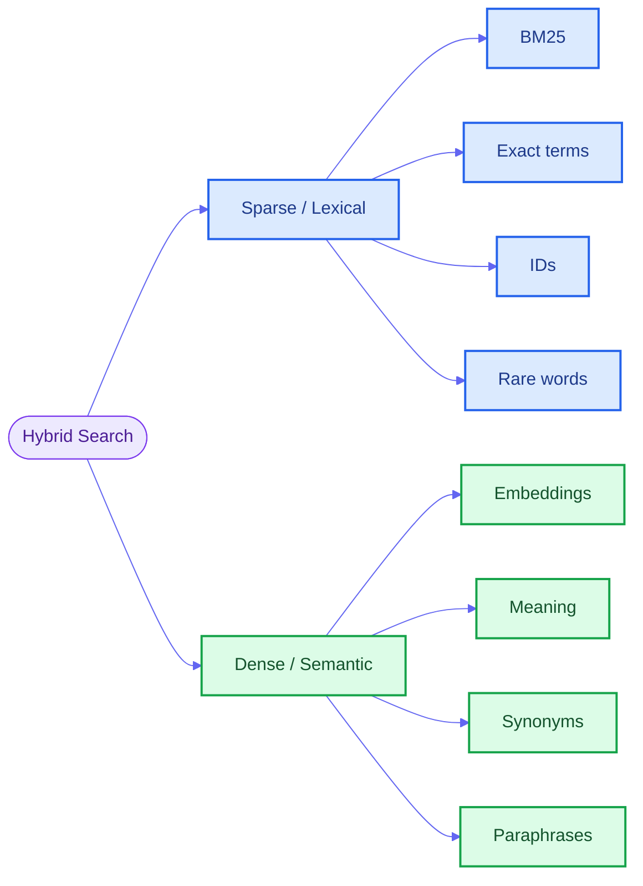

## 2. Why Dense Retrieval Exists

Lexical search is powerful when words overlap.

But users often express the same meaning using different vocabulary.

Example:

```text
Query:
"How can I work from home?"

Document:
"Employees may perform duties remotely."
```

A human sees the relationship:

```text
work from home ≈ work remotely
```

A purely lexical system may not.

This is **vocabulary mismatch**.

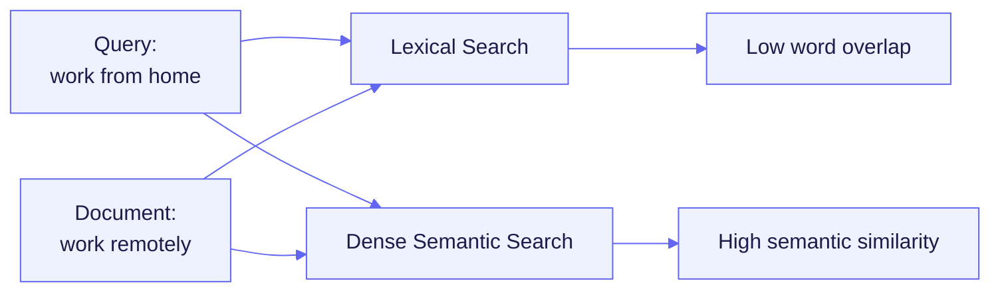

Dense retrieval exists to answer:

> **Does the meaning match, even when the words differ?**

## 3. From Text to Embeddings

Dense retrieval converts text into numerical vectors.

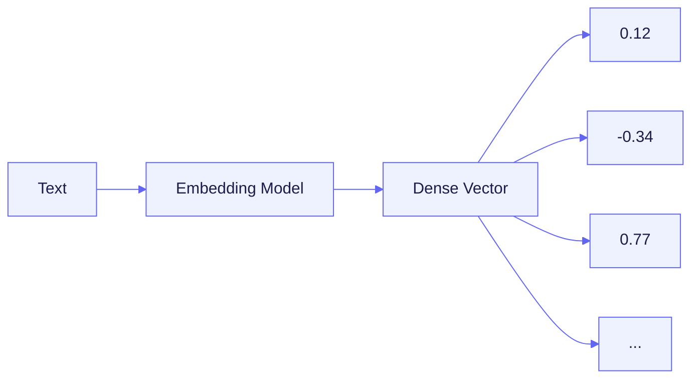

Example:

```text
"cat drinks milk"

→

[0.17, -0.42, 0.08, 0.91, ...]
```

These numbers are called an **embedding**.

Real output of `all-MiniLM-L6-v2` for `"cat drinks milk"`:

```text
shape: (384,)
first 6 values: [0.0437, -0.0228, -0.0019, 0.0538, -0.0022, 0.0207, ...]
non-zero values: 384 of 384
vector length: 1.0
```

## 4. What Is a Dense Vector?

A dense vector contains many numerical dimensions, and most values are non-zero.

Example:

```text
[0.13, -0.55, 0.72, 0.08, -0.31, ...]
```

Compare this with sparse lexical vectors:

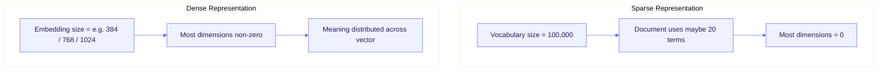

#### Sparse vs Dense

<table width="100%">
<thead><tr><th width="8%">Sr No</th><th width="28%">Property</th><th width="32%">Sparse</th><th width="32%">Dense</th></tr></thead>
<tbody>
<tr><td align="center">01</td><td>Representation</td><td>term-based</td><td>embedding-based</td></tr>
<tr><td align="center">02</td><td>Dimensions</td><td>often huge</td><td>fixed smaller dimension</td></tr>
<tr><td align="center">03</td><td>Mostly zero?</td><td>yes</td><td>no</td></tr>
<tr><td align="center">04</td><td>Exact terms</td><td>strong</td><td>variable</td></tr>
<tr><td align="center">05</td><td>Semantic meaning</td><td>weak</td><td>strong</td></tr>
<tr><td align="center">06</td><td>Synonyms</td><td>weak</td><td>strong</td></tr>
</tbody>
</table>

## 5. Semantic Similarity

Dense retrieval tries to place semantically related texts near each other in vector space.

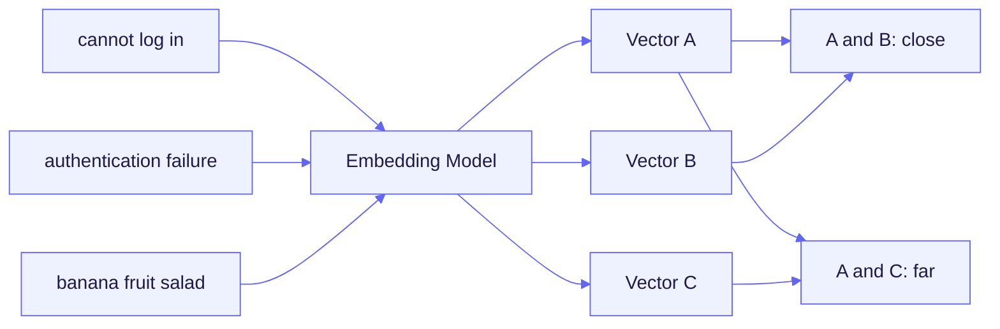

Conceptually:

```text
similar meaning
→ nearby vectors

different meaning
→ distant vectors
```

Result (real run, `all-MiniLM-L6-v2`, cosine):

<table width="100%">
<thead><tr><th width="8%">Sr No</th><th width="46%">Pair</th><th width="22%">Cosine</th><th width="24%">Reading</th></tr></thead>
<tbody>
<tr><td align="center">01</td><td><code>cannot log in</code> vs <code>authentication failure</code></td><td align="center"><b>0.6722</b></td><td align="center">close</td></tr>
<tr><td align="center">02</td><td><code>cannot log in</code> vs <code>banana fruit salad</code></td><td align="center">0.0479</td><td align="center">far</td></tr>
<tr><td align="center">03</td><td><code>authentication failure</code> vs <code>banana fruit salad</code></td><td align="center">0.0280</td><td align="center">far</td></tr>
</tbody>
</table>

## 6. Query and Document Embeddings

Dense search normally embeds documents ahead of time.

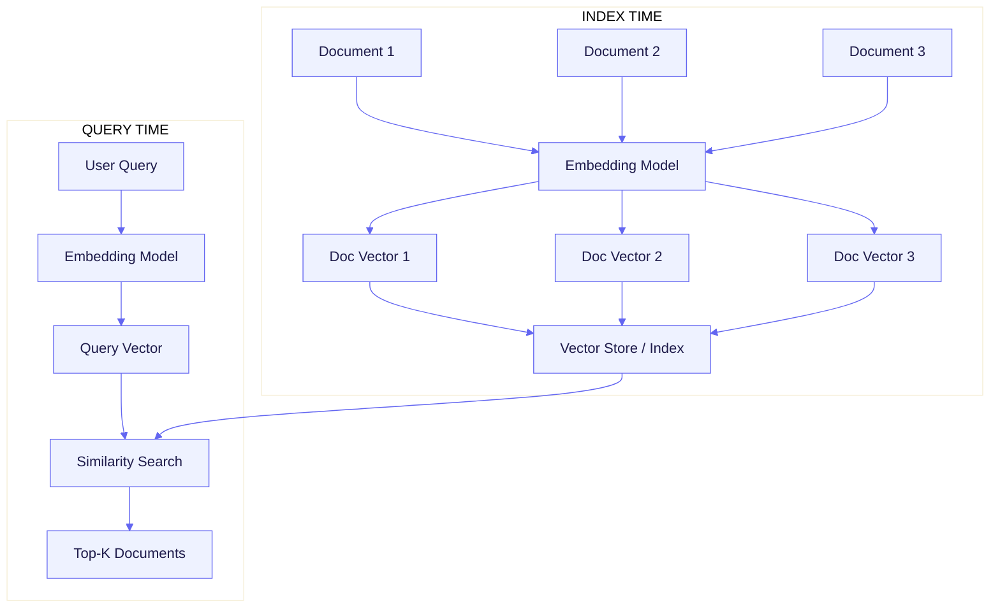

The key engineering principle is the same as BM25:

> [!IMPORTANT]
> **Precompute reusable document work. Do not embed every document for every query.**

## 7. Bi-Encoder Architecture

Most dense retrieval systems use a **bi-encoder** pattern.

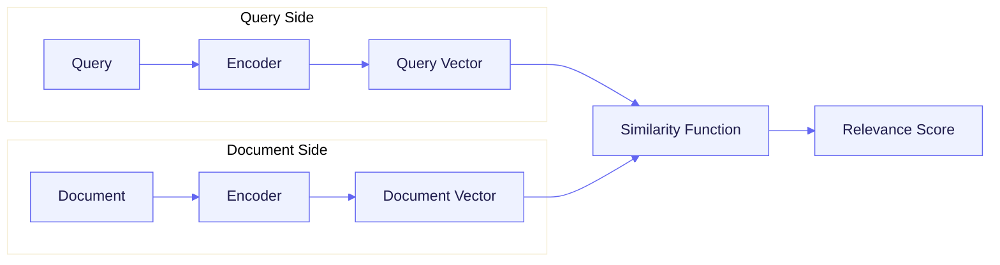

Why is this useful?

Because document vectors can be precomputed and stored.

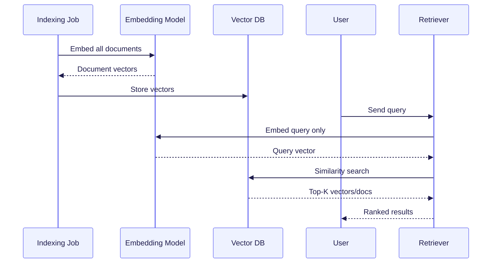

## 8. Embedding Space Intuition

Imagine a simplified 2D semantic space:

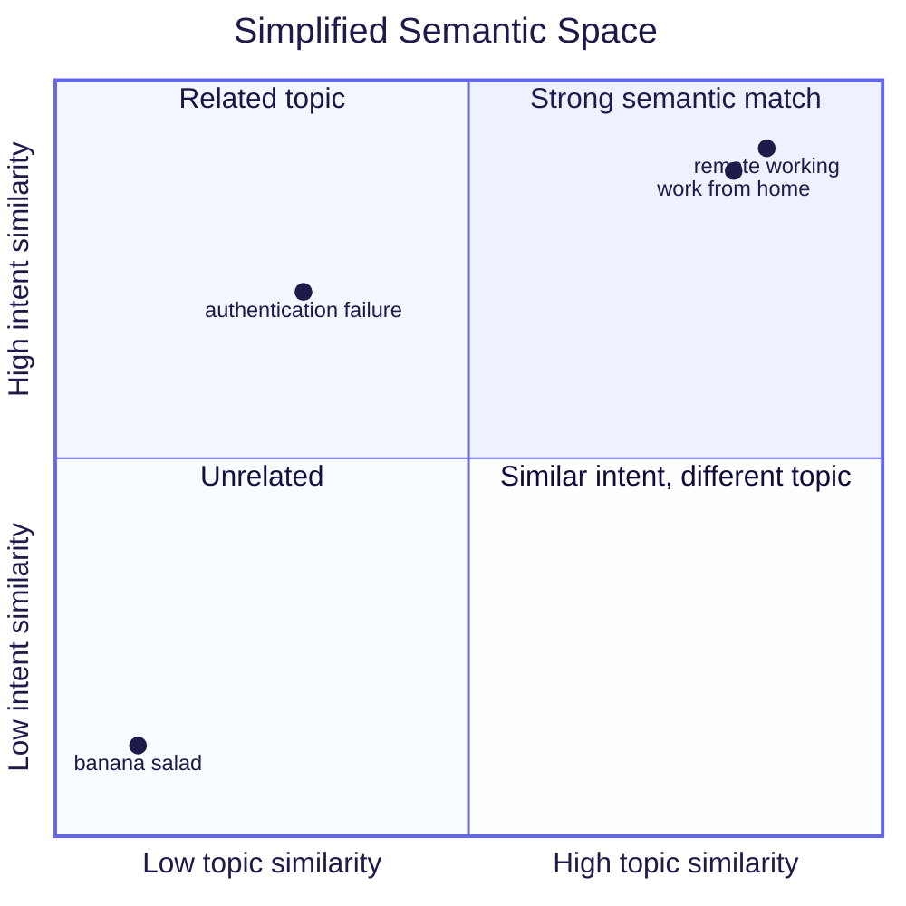

Real embedding spaces have hundreds or thousands of dimensions.

The 2D diagram is only for intuition.

## 9. Cosine Similarity

Cosine similarity compares the **direction** of two vectors.

```math
\cos(\theta) = \frac{A \cdot B}{\|A\|\,\|B\|}
```

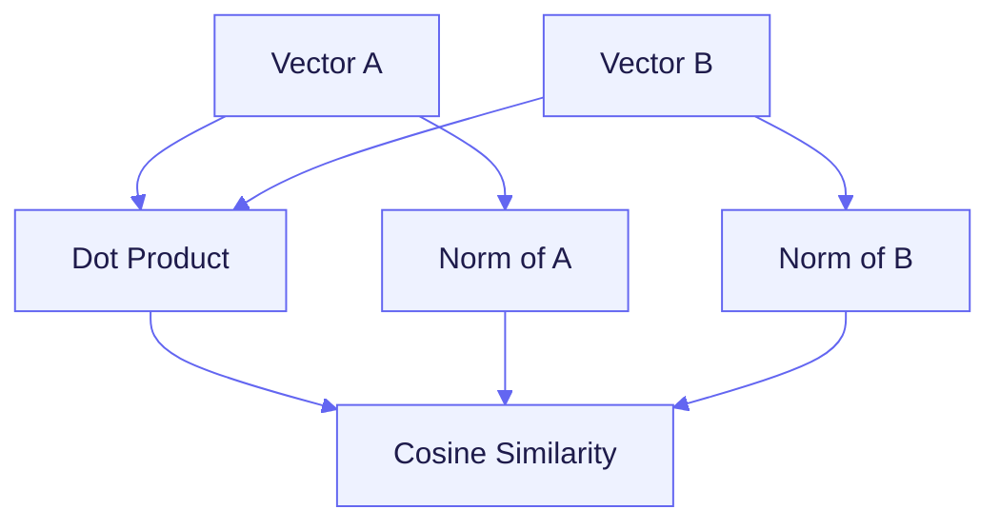

#### Interpretation

```text
cosine close to 1
→ similar direction

cosine near 0
→ weak relation

cosine negative
→ opposite directions in the embedding space
```

#### Manual Python

```python
import numpy as np

def cosine_similarity_manual(a, b):
    # Dot product: how much the vectors point the same way
    dot = np.dot(a, b)

    # Vector lengths
    norm_a = np.linalg.norm(a)
    norm_b = np.linalg.norm(b)

    # A zero vector has no direction
    if norm_a == 0 or norm_b == 0:
        return 0.0

    return dot / (norm_a * norm_b)
```

Result on toy vectors `A = [1, 2, 3]`, `B = [2, 4, 6.1]`, `C = [3, -1, 0.5]`:

<table width="100%">
<thead><tr><th width="8%">Sr No</th><th width="20%">Pair</th><th width="24%">Cosine</th><th width="24%">Dot product</th><th width="24%">Euclidean distance</th></tr></thead>
<tbody>
<tr><td align="center">01</td><td align="center">A, B</td><td align="center"><b>1.0000</b></td><td align="center">28.30</td><td align="center">3.82</td></tr>
<tr><td align="center">02</td><td align="center">A, C</td><td align="center">0.2087</td><td align="center">2.50</td><td align="center">4.39</td></tr>
</tbody>
</table>

B is almost exactly `2 x A`, so the direction is the same and cosine is 1.0, even though B is twice as long. Sections 10 and 11 explain the other two columns.

## 10. Dot Product

Dot product:

```math
A \cdot B = \sum_i A_i B_i
```

Python:

```python
# Sum of element-wise products
score = np.dot(query_vector, document_vector)
```

When vectors are normalized to unit length:

```math
\|A\| = 1, \quad \|B\| = 1
```

then:

```math
A \cdot B = \cos(\theta)
```

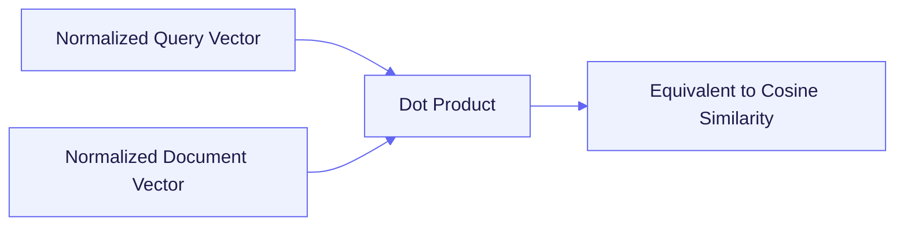

This is why many embedding systems normalize vectors.

## 11. Euclidean Distance

Euclidean distance measures straight-line distance.

```math
d(A,B) = \sqrt{\sum_i (A_i - B_i)^2}
```

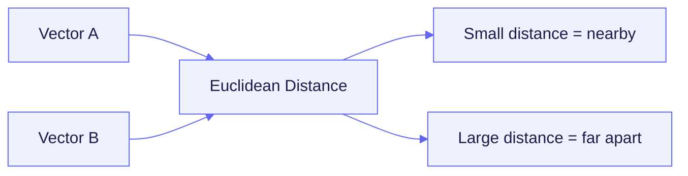

Unlike cosine similarity:

```text
cosine
→ angle/direction

Euclidean
→ geometric distance
```

## 12. Which Similarity Metric Should You Use?

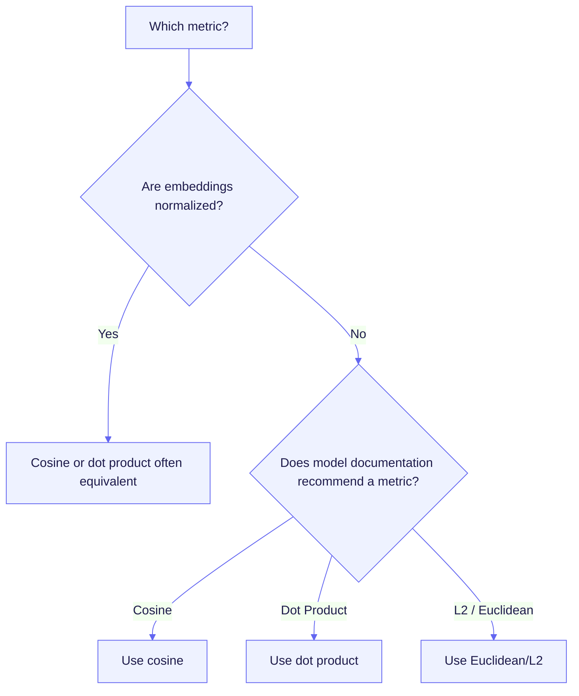

#### Practical rule

> Follow the embedding model and vector database recommendations.

Do not assume one metric is always universally best.

## 13. End-to-End Dense Retrieval

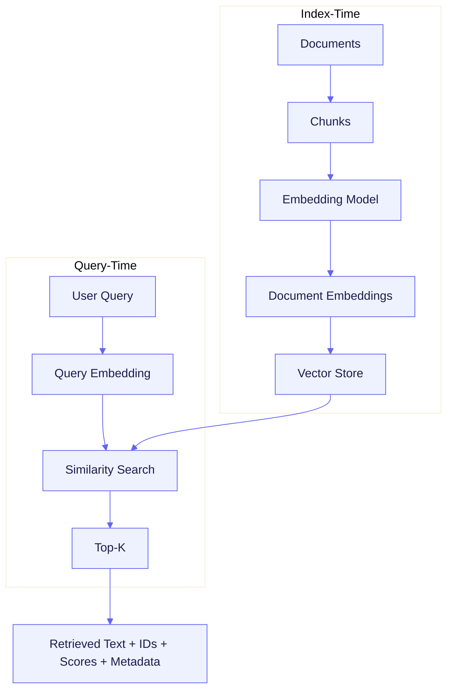

The simplest dense retriever performs:

```text
1. embed documents
2. store vectors
3. embed query
4. compare query vector with document vectors
5. sort scores
6. return Top-K
```

## 14. Dense Retrieval With Sentence Transformers

A simple example:

```python
import numpy as np
from sentence_transformers import SentenceTransformer

# Small general-purpose model: 384-dimensional embeddings
model = SentenceTransformer("all-MiniLM-L6-v2")

documents = [
    "employees may work remotely",
    "authentication failure caused by expired credentials",
    "banana fruit salad recipe",
]

# Index time: embed all documents once, as unit vectors
document_embeddings = model.encode(documents, normalize_embeddings=True)

# Query time: embed only the query
query = "how can I work from home?"
query_embedding = model.encode([query], normalize_embeddings=True)[0]
```

Similarity:

```python
# Unit vectors, so dot product = cosine similarity
scores = document_embeddings @ query_embedding
```

Ranking:

```python
# Document indexes, highest score first
ranking = np.argsort(scores)[::-1]
```

Result (real run, `all-MiniLM-L6-v2`):

<table width="100%">
<thead><tr><th width="8%">Sr No</th><th width="44%">Document</th><th width="24%"><code>how can I work from home?</code></th><th width="24%"><code>my login keeps failing</code></th></tr></thead>
<tbody>
<tr><td align="center">01</td><td><code>employees may work remotely</code></td><td align="center"><b>0.4086</b></td><td align="center">-0.0175</td></tr>
<tr><td align="center">02</td><td><code>authentication failure caused by expired credentials</code></td><td align="center">0.0211</td><td align="center"><b>0.5320</b></td></tr>
<tr><td align="center">03</td><td><code>banana fruit salad recipe</code></td><td align="center">0.0370</td><td align="center">0.0195</td></tr>
</tbody>
</table>

Both queries find the right document with **zero shared words**: `work from home` vs `work remotely` shares only `work`, and `login keeps failing` vs `authentication failure` shares nothing. BM25 would score the second pair 0.

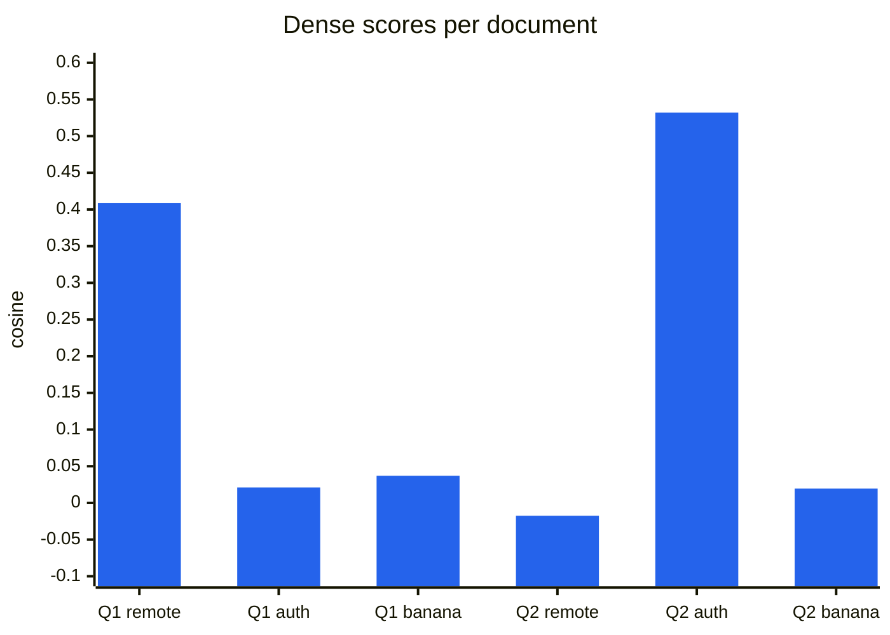

<p align="center">Q1 = "how can I work from home?" · Q2 = "my login keeps failing"</p>

## 15. Why Normalization Matters

Vector magnitude can affect dot-product scores.

Normalization turns vectors into unit vectors.


Python:

```python
# Divide by the length so the vector has length 1
vector = vector / np.linalg.norm(vector)
```

Many embedding libraries can normalize automatically.

```python
# Let the library return unit vectors
model.encode(texts, normalize_embeddings=True)
```

Result: how normalization changes the ranking. Query `q = [0.6, 0.8]` against three documents:

<table width="100%">
<thead><tr><th width="8%">Sr No</th><th width="28%">Document vector</th><th width="22%">Length</th><th width="21%">Dot product</th><th width="21%">Cosine</th></tr></thead>
<tbody>
<tr><td align="center">01</td><td align="center"><code>[3.0, 4.0]</code></td><td align="center">5.0</td><td align="center"><b>5.0</b></td><td align="center">1.0</td></tr>
<tr><td align="center">02</td><td align="center"><code>[0.6, 0.8]</code></td><td align="center">1.0</td><td align="center">1.0</td><td align="center">1.0</td></tr>
<tr><td align="center">03</td><td align="center"><code>[1.0, 0.0]</code></td><td align="center">1.0</td><td align="center">0.6</td><td align="center">0.6</td></tr>
</tbody>
</table>

Documents 01 and 02 point the same way. Raw dot product gives 01 a 5x higher score only because it is longer. After normalization both get 1.0.

> [!NOTE]
> `all-MiniLM-L6-v2` already ends with a normalization layer: its raw output for `cat drinks milk` has length 1.0. Other models do not, so check the model card, or pass `normalize_embeddings=True` anyway.

## 16. Semantic Neighborhoods

Dense embeddings create local neighborhoods of related meaning.

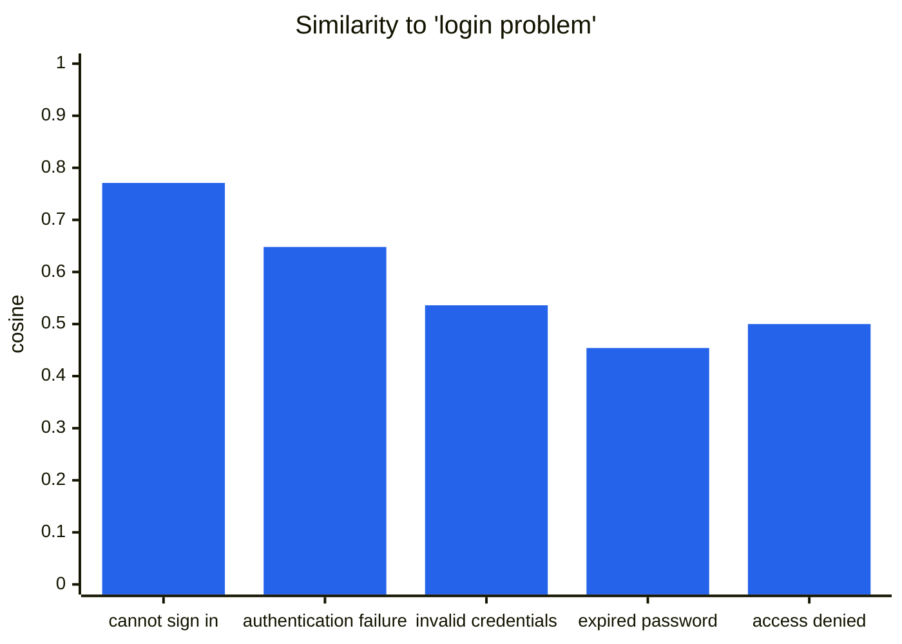

Another neighborhood:

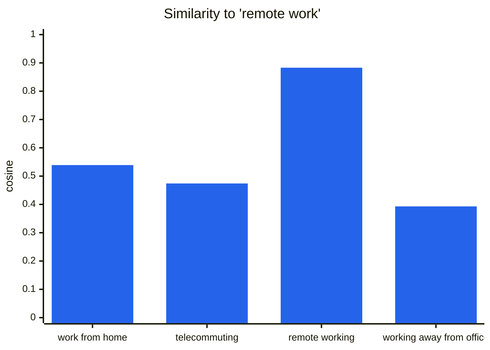

Result: inside its own neighborhood every phrase scores **0.39 to 0.88**. Across neighborhoods (a login phrase against `remote work`, or a remote-work phrase against `login problem`) every score is **0.24 or lower**.

<table width="100%">
<thead><tr><th width="8%">Sr No</th><th width="32%">Query</th><th width="30%">Same neighborhood</th><th width="30%">Other neighborhood</th></tr></thead>
<tbody>
<tr><td align="center">01</td><td><code>login problem</code></td><td align="center">0.454 to 0.771</td><td align="center">-0.006 to 0.238</td></tr>
<tr><td align="center">02</td><td><code>remote work</code></td><td align="center">0.393 to 0.883</td><td align="center">0.065 to 0.156</td></tr>
</tbody>
</table>

Dense retrieval succeeds because these phrases may be close even when lexical overlap is low.

## 17. Dense Retrieval Strengths

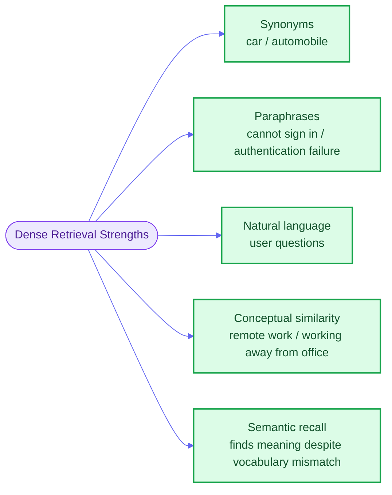

#### Good dense-search use cases

- FAQs
- knowledge bases
- natural-language support questions
- semantic document search
- paraphrased questions
- concept discovery

## 18. Vocabulary Mismatch

This is dense retrieval's biggest advantage over purely lexical methods.

```mermaid
%%{init: {'theme':'base','themeVariables':{'primaryColor':'#EEF2FF','primaryBorderColor':'#6366F1','primaryTextColor':'#1E1B4B','lineColor':'#6366F1','pie1':'#22C55E','pie2':'#F59E0B','pie3':'#EF4444','pie4':'#3B82F6','pie5':'#8B5CF6','xyChart':{'plotColorPalette':'#2563EB, #16A34A, #D97706, #DC2626, #7C3AED'}}}}%%
flowchart LR
    Q["Query:<br/>car repair"] --> SP["Sparse Search"]
    D["Document:<br/>automobile maintenance"] --> SP
    SP --> LOW["Low overlap"]

    Q --> DE["Dense Search"]
    D --> DE
    DE --> HIGH["Semantic match"]
```

Dense embeddings can map:

```text
car ≈ automobile
repair ≈ maintenance
```

without exact word equality.

Result (real run, query `car repair`):

<table width="100%">
<thead><tr><th width="8%">Sr No</th><th width="40%">Document</th><th width="18%">Shared words</th><th width="17%">BM25</th><th width="17%">Dense cosine</th></tr></thead>
<tbody>
<tr><td align="center">01</td><td><code>automobile maintenance</code></td><td align="center">none</td><td align="center">0</td><td align="center"><b>0.7334</b></td></tr>
<tr><td align="center">02</td><td><code>car insurance policy</code></td><td align="center"><code>car</code></td><td align="center">&gt; 0</td><td align="center">0.4786</td></tr>
<tr><td align="center">03</td><td><code>bicycle repair manual</code></td><td align="center"><code>repair</code></td><td align="center">&gt; 0</td><td align="center">0.4362</td></tr>
</tbody>
</table>

BM25 ranks the true match last (Chapter 5, section 22). Dense retrieval ranks it first.

## 19. Dense Retrieval Weaknesses

Dense retrieval is not "understanding everything."

```mermaid
%%{init: {'theme':'base','themeVariables':{'primaryColor':'#EEF2FF','primaryBorderColor':'#6366F1','primaryTextColor':'#1E1B4B','lineColor':'#6366F1','pie1':'#22C55E','pie2':'#F59E0B','pie3':'#EF4444','pie4':'#3B82F6','pie5':'#8B5CF6','xyChart':{'plotColorPalette':'#2563EB, #16A34A, #D97706, #DC2626, #7C3AED'}}}}%%
flowchart LR
    F(["Dense Failure Modes"]) --> A["Exact IDs<br/>ABC-123, E401"]
    F --> B["Versions<br/>3.11 vs 3.12"]
    F --> C["Numbers<br/>24 vs 36 months"]
    F --> D["Negation<br/>prohibited vs not prohibited"]
    F --> E["Similar legal clauses<br/>Article 33 vs Article 34"]
    F --> G["Rare internal terms<br/>proprietary acronyms"]
    F --> H["Embedding model mismatch<br/>domain vocabulary"]
    classDef bad fill:#FEE2E2,stroke:#DC2626,color:#7F1D1D,stroke-width:2px
    class A,B,C,D,E,G,H bad
    style F fill:#F1F5F9,stroke:#475569,color:#0F172A
```

This is why dense-only RAG can still fail.

## 20. Exact IDs, Versions, and Numbers

Dense vectors can blur very small textual differences.

Example:

```text
Python 3.11 installation guide
Python 3.12 installation guide
```

Semantically, the sentences are nearly identical.

But operationally, version `3.11` and `3.12` may matter a lot.

```mermaid
%%{init: {'theme':'base','themeVariables':{'primaryColor':'#EEF2FF','primaryBorderColor':'#6366F1','primaryTextColor':'#1E1B4B','lineColor':'#6366F1','pie1':'#22C55E','pie2':'#F59E0B','pie3':'#EF4444','pie4':'#3B82F6','pie5':'#8B5CF6','xyChart':{'plotColorPalette':'#2563EB, #16A34A, #D97706, #DC2626, #7C3AED'}}}}%%
flowchart LR
    A["Python 3.11 installation"] --> E["Embedding Model"]
    B["Python 3.12 installation"] --> E
    E --> V1["Very similar vector"]
    E --> V2["Very similar vector"]
    V1 --> R["Dense model may rank both highly"]
    V2 --> R
```

Lexical retrieval is often better at preserving exact version identity.

Result (real run, query `Python 3.12 installation`):

<table width="100%">
<thead><tr><th width="8%">Sr No</th><th width="52%">Document</th><th width="40%">Dense cosine</th></tr></thead>
<tbody>
<tr><td align="center">01</td><td><code>Python 3.12 installation guide</code> (correct)</td><td align="center"><b>0.9144</b></td></tr>
<tr><td align="center">02</td><td><code>Python 3.11 installation guide</code> (wrong version)</td><td align="center">0.7939</td></tr>
</tbody>
</table>

The correct version wins here, but the wrong one still scores 0.79. With a few more near-duplicates, or a longer chunk where the version is one token among many, the gap shrinks and the wrong guide can enter the Top-K.

## 21. Negation and Near-Duplicate Meaning

Compare:

```text
Products are prohibited.
Products are not prohibited.
```

The texts share almost every token and topic.

Dense embeddings can place them close together.

```mermaid
%%{init: {'theme':'base','themeVariables':{'primaryColor':'#EEF2FF','primaryBorderColor':'#6366F1','primaryTextColor':'#1E1B4B','lineColor':'#6366F1','pie1':'#22C55E','pie2':'#F59E0B','pie3':'#EF4444','pie4':'#3B82F6','pie5':'#8B5CF6','xyChart':{'plotColorPalette':'#2563EB, #16A34A, #D97706, #DC2626, #7C3AED'}}}}%%
flowchart TD
    A["Products are prohibited"] --> E["Embedding Model"]
    B["Products are not prohibited"] --> E

    E --> C["Both vectors may be close"]
    C --> R["Retriever sees topical similarity"]
    R --> X["But factual meaning is opposite"]
```

Important rule:

> **Retrieval similarity is not factual reasoning.**

Result (real run, `all-MiniLM-L6-v2`):

<table width="100%">
<thead><tr><th width="8%">Sr No</th><th width="56%">Pair</th><th width="36%">Cosine</th></tr></thead>
<tbody>
<tr><td align="center">01</td><td><code>Products are prohibited.</code> vs <code>Products are not prohibited.</code></td><td align="center"><b>0.9454</b></td></tr>
<tr><td align="center">02</td><td><code>Products are prohibited.</code> vs <code>Products are allowed.</code></td><td align="center">0.9148</td></tr>
<tr><td align="center">03</td><td><code>Products are not prohibited.</code> vs <code>Products are allowed.</code></td><td align="center">0.8291</td></tr>
</tbody>
</table>

The sentence with the opposite meaning (01) is the **most** similar pair, more similar than the sentence with the same meaning in other words (03).

A later reranker or LLM may need to interpret the exact meaning.

## 22. Domain Vocabulary

Embedding model quality depends on training data and domain alignment.

```mermaid
%%{init: {'theme':'base','themeVariables':{'primaryColor':'#EEF2FF','primaryBorderColor':'#6366F1','primaryTextColor':'#1E1B4B','lineColor':'#6366F1','pie1':'#22C55E','pie2':'#F59E0B','pie3':'#EF4444','pie4':'#3B82F6','pie5':'#8B5CF6','xyChart':{'plotColorPalette':'#2563EB, #16A34A, #D97706, #DC2626, #7C3AED'}}}}%%
flowchart TD
    Q["Domain Query"] --> G["General Embedding Model"]
    G --> U{"Understands domain vocabulary?"}

    U -->|Yes| GOOD["Useful semantic retrieval"]
    U -->|No| BAD["Weak semantic representation"]

    BAD --> OPTIONS["Options"]
    OPTIONS --> O1["Better domain model"]
    OPTIONS --> O2["Fine-tuning"]
    OPTIONS --> O3["Hybrid BM25 + Dense"]
    OPTIONS --> O4["Query expansion"]
```

#### Examples of difficult terms

- internal abbreviations
- rare scientific terms
- specialized legal phrases
- unusual product codes
- organization-specific vocabulary

## 23. Chunking and Dense Retrieval

Dense embeddings are created for text chunks, not usually entire huge documents.

```mermaid
%%{init: {'theme':'base','themeVariables':{'primaryColor':'#EEF2FF','primaryBorderColor':'#6366F1','primaryTextColor':'#1E1B4B','lineColor':'#6366F1','pie1':'#22C55E','pie2':'#F59E0B','pie3':'#EF4444','pie4':'#3B82F6','pie5':'#8B5CF6','xyChart':{'plotColorPalette':'#2563EB, #16A34A, #D97706, #DC2626, #7C3AED'}}}}%%
flowchart LR
    D["Long Document"] --> C1["Chunk 1"]
    D --> C2["Chunk 2"]
    D --> C3["Chunk 3"]

    C1 --> E["Embedding Model"]
    C2 --> E
    C3 --> E

    E --> V1["Vector 1"]
    E --> V2["Vector 2"]
    E --> V3["Vector 3"]
```

#### Too-small chunks

```mermaid
%%{init: {'theme':'base','themeVariables':{'primaryColor':'#EEF2FF','primaryBorderColor':'#6366F1','primaryTextColor':'#1E1B4B','lineColor':'#6366F1','pie1':'#22C55E','pie2':'#F59E0B','pie3':'#EF4444','pie4':'#3B82F6','pie5':'#8B5CF6','xyChart':{'plotColorPalette':'#2563EB, #16A34A, #D97706, #DC2626, #7C3AED'}}}}%%
flowchart LR
    S["Very small chunk"] --> C["Little context"]
    C --> E["Weak semantic representation"]
```

#### Too-large chunks

```mermaid
%%{init: {'theme':'base','themeVariables':{'primaryColor':'#EEF2FF','primaryBorderColor':'#6366F1','primaryTextColor':'#1E1B4B','lineColor':'#6366F1','pie1':'#22C55E','pie2':'#F59E0B','pie3':'#EF4444','pie4':'#3B82F6','pie5':'#8B5CF6','xyChart':{'plotColorPalette':'#2563EB, #16A34A, #D97706, #DC2626, #7C3AED'}}}}%%
flowchart LR
    L["Very large chunk"] --> M["Many topics mixed"]
    M --> D["Meaning diluted"]
    D --> E["Less precise embedding"]
```

Chunking therefore directly affects dense retrieval quality.

## 24. Embedding Model Selection

Do not choose an embedding model only because it is popular.

Evaluate it for your corpus.

```mermaid
%%{init: {'theme':'base','themeVariables':{'primaryColor':'#EEF2FF','primaryBorderColor':'#6366F1','primaryTextColor':'#1E1B4B','lineColor':'#6366F1','pie1':'#22C55E','pie2':'#F59E0B','pie3':'#EF4444','pie4':'#3B82F6','pie5':'#8B5CF6','xyChart':{'plotColorPalette':'#2563EB, #16A34A, #D97706, #DC2626, #7C3AED'}}}}%%
quadrantChart
    title Embedding model trade-offs
    x-axis Small and fast --> Large and slow
    y-axis Lower retrieval quality --> Higher retrieval quality
    quadrant-1 Best quality, highest cost
    quadrant-2 Sweet spot
    quadrant-3 Prototypes, edge devices
    quadrant-4 Avoid
    384-dim small model: [0.2, 0.45]
    768-dim base model: [0.5, 0.65]
    1024-dim large model: [0.8, 0.8]
    Domain-tuned base model: [0.5, 0.85]
```

<table width="100%">
<thead><tr><th width="8%">Sr No</th><th width="22%">Criterion</th><th width="70%">What to check</th></tr></thead>
<tbody>
<tr><td align="center">01</td><td><b>Quality</b></td><td>Semantic retrieval accuracy, domain vocabulary</td></tr>
<tr><td align="center">02</td><td><b>Dimension</b></td><td>Memory, storage, ANN cost</td></tr>
<tr><td align="center">03</td><td><b>Latency</b></td><td>Query embedding speed, batch throughput</td></tr>
<tr><td align="center">04</td><td><b>Language</b></td><td>Monolingual or multilingual</td></tr>
<tr><td align="center">05</td><td><b>Context length</b></td><td>Chunk size compatibility</td></tr>
<tr><td align="center">06</td><td><b>Licensing</b></td><td>Deployment constraints</td></tr>
<tr><td align="center">07</td><td><b>Hardware</b></td><td>CPU, GPU, local inference</td></tr>
</tbody>
</table>

The quadrant positions are illustrative, not benchmark results.

#### Evaluation questions

```text
Does it retrieve paraphrases?
Does it preserve technical meaning?
Does it work in my languages?
Does it distinguish near-duplicate documents?
How fast is inference?
How large are vectors?
```

## 25. Index-Time vs Query-Time

The same architectural split from BM25 appears again.

```mermaid
%%{init: {'theme':'base','themeVariables':{'primaryColor':'#EEF2FF','primaryBorderColor':'#6366F1','primaryTextColor':'#1E1B4B','lineColor':'#6366F1','pie1':'#22C55E','pie2':'#F59E0B','pie3':'#EF4444','pie4':'#3B82F6','pie5':'#8B5CF6','xyChart':{'plotColorPalette':'#2563EB, #16A34A, #D97706, #DC2626, #7C3AED'}}}}%%
flowchart TB
    subgraph INDEX["INDEX TIME"]
        D["Documents"] --> C["Chunk"]
        C --> E["Embed"]
        E --> V["Store vectors"]
    end

    subgraph QUERY["QUERY TIME"]
        Q["Query"] --> QE["Embed query"]
        QE --> S["Vector search"]
        V --> S
        S --> K["Top-K"]
    end
```

#### Expensive work to precompute

- document parsing
- chunking
- document embeddings
- vector indexing

#### Query-time work

- query embedding
- ANN / similarity search
- Top-K retrieval

## 26. Dense Retrieval API Design

A practical result should preserve:

```mermaid
%%{init: {'theme':'base','themeVariables':{'primaryColor':'#EEF2FF','primaryBorderColor':'#6366F1','primaryTextColor':'#1E1B4B','lineColor':'#6366F1','pie1':'#22C55E','pie2':'#F59E0B','pie3':'#EF4444','pie4':'#3B82F6','pie5':'#8B5CF6','xyChart':{'plotColorPalette':'#2563EB, #16A34A, #D97706, #DC2626, #7C3AED'}}}}%%
classDiagram
    class DenseSearchResult {
        +string document_id
        +string chunk_id
        +string text
        +float similarity_score
        +int rank
        +object metadata
    }

    class DenseSearchResponse {
        +string query
        +int top_k
        +DenseSearchResult[] results
    }

    DenseSearchResponse "1" *-- "*" DenseSearchResult
```

Example:

```json
{
  "query": "how can I work from home?",
  "top_k": 3,
  "results": [
    {
      "document_id": "D12",
      "chunk_id": "D12_C3",
      "score": 0.84,
      "text": "Employees may perform duties remotely...",
      "metadata": {
        "category": "policy"
      }
    }
  ]
}
```

## 27. Caching

Dense retrieval can benefit from caching.

```mermaid
%%{init: {'theme':'base','themeVariables':{'primaryColor':'#EEF2FF','primaryBorderColor':'#6366F1','primaryTextColor':'#1E1B4B','lineColor':'#6366F1','pie1':'#22C55E','pie2':'#F59E0B','pie3':'#EF4444','pie4':'#3B82F6','pie5':'#8B5CF6','xyChart':{'plotColorPalette':'#2563EB, #16A34A, #D97706, #DC2626, #7C3AED'}}}}%%
flowchart LR
    C(["Dense Retrieval Caching"]) --> A["Document embeddings<br/>always precompute"]
    C --> B["Query embeddings<br/>repeated queries"]
    C --> D["Search results<br/>popular queries"]
    C --> E["Metadata<br/>avoid repeated fetches"]
    classDef c fill:#FEF3C7,stroke:#D97706,color:#78350F,stroke-width:2px
    class A,B,D,E c
    style C fill:#EDE9FE,stroke:#7C3AED,color:#4C1D95
```

#### Query embedding cache flow

```mermaid
%%{init: {'theme':'base','themeVariables':{'primaryColor':'#EEF2FF','primaryBorderColor':'#6366F1','primaryTextColor':'#1E1B4B','lineColor':'#6366F1','pie1':'#22C55E','pie2':'#F59E0B','pie3':'#EF4444','pie4':'#3B82F6','pie5':'#8B5CF6','xyChart':{'plotColorPalette':'#2563EB, #16A34A, #D97706, #DC2626, #7C3AED'}}}}%%
flowchart TD
    Q["Query"] --> C{"Embedding cached?"}
    C -->|Yes| V["Reuse query vector"]
    C -->|No| E["Run embedding model"]
    E --> V
    V --> S["Vector search"]
```

## 28. Batching

Embedding models are often more efficient when processing multiple texts together.

```mermaid
%%{init: {'theme':'base','themeVariables':{'primaryColor':'#EEF2FF','primaryBorderColor':'#6366F1','primaryTextColor':'#1E1B4B','lineColor':'#6366F1','pie1':'#22C55E','pie2':'#F59E0B','pie3':'#EF4444','pie4':'#3B82F6','pie5':'#8B5CF6','xyChart':{'plotColorPalette':'#2563EB, #16A34A, #D97706, #DC2626, #7C3AED'}}}}%%
flowchart LR
    D1["Text 1"] --> B["Batch"]
    D2["Text 2"] --> B
    D3["Text 3"] --> B
    D4["Text 4"] --> B

    B --> M["Embedding Model"]
    M --> V["Vector Batch"]
```

Instead of:

```python
# One model call per text
for text in texts:
    model.encode(text)
```

prefer:

```python
# One call, texts processed 32 at a time
embeddings = model.encode(texts, batch_size=32)
```

when supported and appropriate.

Result (real run, 256 short texts, CPU laptop; timings vary by machine):

<table width="100%">
<thead><tr><th width="8%">Sr No</th><th width="44%">Method</th><th width="24%">Time</th><th width="24%">Speed-up</th></tr></thead>
<tbody>
<tr><td align="center">01</td><td>One <code>encode()</code> call per text</td><td align="center">1.437 s</td><td align="center">1.0x</td></tr>
<tr><td align="center">02</td><td>One call, <code>batch_size=32</code></td><td align="center"><b>0.339 s</b></td><td align="center"><b>4.2x</b></td></tr>
</tbody>
</table>

## 29. Latency

Dense retrieval latency often has multiple components.

```mermaid
%%{init: {'theme':'base','themeVariables':{'primaryColor':'#EEF2FF','primaryBorderColor':'#6366F1','primaryTextColor':'#1E1B4B','lineColor':'#6366F1','pie1':'#22C55E','pie2':'#F59E0B','pie3':'#EF4444','pie4':'#3B82F6','pie5':'#8B5CF6','xyChart':{'plotColorPalette':'#2563EB, #16A34A, #D97706, #DC2626, #7C3AED'}}}}%%
flowchart LR
    Q["Query"] --> E["Embedding latency"]
    E --> N["Network / DB latency"]
    N --> ANN["ANN search latency"]
    ANN --> M["Metadata fetch"]
    M --> R["Response"]
```

Total retrieval latency is approximately:

```math
T_{\text{dense}} = T_{\text{embedding}} + T_{\text{vector search}} + T_{\text{metadata}} + T_{\text{network}}
```

Measure each stage separately.

Result: query-embedding time for five queries with `all-MiniLM-L6-v2` on a CPU laptop (one run; numbers vary by machine):

```mermaid
%%{init: {'theme':'base','themeVariables':{'primaryColor':'#EEF2FF','primaryBorderColor':'#6366F1','primaryTextColor':'#1E1B4B','lineColor':'#6366F1','pie1':'#22C55E','pie2':'#F59E0B','pie3':'#EF4444','pie4':'#3B82F6','pie5':'#8B5CF6','xyChart':{'plotColorPalette':'#2563EB, #16A34A, #D97706, #DC2626, #7C3AED'}}}}%%
xychart-beta
    title "Query embedding latency (ms)"
    x-axis ["work from home", "login problem", "car repair", "python 3.12", "reset password"]
    y-axis "milliseconds" 0 --> 8
    bar [6.24, 5.36, 5.84, 6.27, 5.49]
```

About **6 ms** per query, before any vector search. A larger model or a remote embedding API can easily take 10x more, so this stage is often the biggest part of `T_dense`.

## 30. Debugging Dense Retrieval

When a relevant document is missing:

```mermaid
%%{init: {'theme':'base','themeVariables':{'primaryColor':'#EEF2FF','primaryBorderColor':'#6366F1','primaryTextColor':'#1E1B4B','lineColor':'#6366F1','pie1':'#22C55E','pie2':'#F59E0B','pie3':'#EF4444','pie4':'#3B82F6','pie5':'#8B5CF6','xyChart':{'plotColorPalette':'#2563EB, #16A34A, #D97706, #DC2626, #7C3AED'}}}}%%
flowchart TD
    START["Relevant document missing"] --> I{"Indexed?"}

    I -->|No| FIX1["Fix ingestion / embedding job"]
    I -->|Yes| C{"Chunk contains enough context?"}

    C -->|No| FIX2["Fix chunking"]
    C -->|Yes| E{"Correct embedding model?"}

    E -->|No| FIX3["Use better/domain model"]
    E -->|Yes| Q{"Query embedding sensible?"}

    Q -->|No| FIX4["Inspect query rewriting / preprocessing"]
    Q -->|Yes| M{"Correct metric?"}

    M -->|No| FIX5["Fix cosine/dot/L2 configuration"]
    M -->|Yes| K{"Top-K large enough?"}

    K -->|No| FIX6["Increase candidate pool"]
    K -->|Yes| F{"Metadata filter excluded it?"}

    F -->|Yes| FIX7["Inspect filters"]
    F -->|No| LIMIT["Model / semantic retrieval limitation"]
```

#### Debug checklist

<table width="100%">
<thead><tr><th width="8%">Sr No</th><th width="28%">Layer</th><th width="64%">What to inspect</th></tr></thead>
<tbody>
<tr><td align="center">01</td><td>Ingestion</td><td>Was the document embedded?</td></tr>
<tr><td align="center">02</td><td>Chunking</td><td>Is relevant context inside one chunk?</td></tr>
<tr><td align="center">03</td><td>Model</td><td>Is it appropriate for the domain?</td></tr>
<tr><td align="center">04</td><td>Query</td><td>Was query rewriting correct?</td></tr>
<tr><td align="center">05</td><td>Vector</td><td>Was normalization correct?</td></tr>
<tr><td align="center">06</td><td>Metric</td><td>Cosine, dot product, or L2?</td></tr>
<tr><td align="center">07</td><td>Top-K</td><td>Is candidate pool large enough?</td></tr>
<tr><td align="center">08</td><td>Metadata</td><td>Was filtering too aggressive?</td></tr>
<tr><td align="center">09</td><td>ANN</td><td>Did approximate search lose recall?</td></tr>
</tbody>
</table>

## 31. Dense Retrieval vs BM25

```mermaid
%%{init: {'theme':'base','themeVariables':{'primaryColor':'#EEF2FF','primaryBorderColor':'#6366F1','primaryTextColor':'#1E1B4B','lineColor':'#6366F1','pie1':'#22C55E','pie2':'#F59E0B','pie3':'#EF4444','pie4':'#3B82F6','pie5':'#8B5CF6','xyChart':{'plotColorPalette':'#2563EB, #16A34A, #D97706, #DC2626, #7C3AED'}}}}%%
flowchart TB
    Q["User Query"] --> TYPE{"What kind of signal matters?"}

    TYPE -->|"Exact term / code / version"| BM["BM25 stronger"]
    TYPE -->|"Paraphrase / synonym"| DE["Dense stronger"]
    TYPE -->|"Both exact + semantic"| HY["Hybrid strongest starting point"]
```

| Query Type | BM25 | Dense |
|---|---:|---:|
| Exact error code | Excellent | Variable |
| Product/model ID | Excellent | Weak/Variable |
| Synonym | Weak | Strong |
| Paraphrase | Weak | Strong |
| Natural language | Moderate | Strong |
| Article/version distinction | Strong | Can blur |
| Semantic concept | Weak | Strong |

## 32. How Dense Retrieval Becomes the Semantic Branch of Hybrid Search

```mermaid
%%{init: {'theme':'base','themeVariables':{'primaryColor':'#EEF2FF','primaryBorderColor':'#6366F1','primaryTextColor':'#1E1B4B','lineColor':'#6366F1','pie1':'#22C55E','pie2':'#F59E0B','pie3':'#EF4444','pie4':'#3B82F6','pie5':'#8B5CF6','xyChart':{'plotColorPalette':'#2563EB, #16A34A, #D97706, #DC2626, #7C3AED'}}}}%%
flowchart LR
    Q["User Query"] --> SP["Sparse Branch"]
    Q --> DE["Dense Branch"]

    SP --> BM["BM25"]
    BM --> ST["Sparse Top-K"]

    DE --> EM["Query Embedding"]
    EM --> VS["Vector Search"]
    VS --> DT["Dense Top-K"]

    ST --> F["Fusion"]
    DT --> F

    F --> R["Reranker"]
    R --> K["Final Top-K"]
```

The two branches solve different problems.

```mermaid
%%{init: {'theme':'base','themeVariables':{'primaryColor':'#EEF2FF','primaryBorderColor':'#6366F1','primaryTextColor':'#1E1B4B','lineColor':'#6366F1','pie1':'#22C55E','pie2':'#F59E0B','pie3':'#EF4444','pie4':'#3B82F6','pie5':'#8B5CF6','xyChart':{'plotColorPalette':'#2563EB, #16A34A, #D97706, #DC2626, #7C3AED'}}}}%%
quadrantChart
    title Two complementary signals
    x-axis Weak exact match --> Strong exact match
    y-axis Weak semantic match --> Strong semantic match
    quadrant-1 Hybrid target
    quadrant-2 Dense
    quadrant-3 Neither
    quadrant-4 BM25
    BM25 IDs, rare terms, versions: [0.85, 0.2]
    Dense synonyms, paraphrases: [0.2, 0.85]
    Hybrid fusion: [0.8, 0.8]
```

## 33. Checkpoints With Answers

### Checkpoint 1 — Embeddings

**Q1. What is an embedding?**  
A fixed-length numerical vector representing information about the meaning/content of text.

**Q2. Why are dense vectors called dense?**  
Because most dimensions contain non-zero values.

**Q3. Why precompute document embeddings?**  
Because document encoding is expensive and documents are reused across many queries.

**Q4. What happens at query time?**  
Embed only the query, then compare/search against precomputed document vectors.

```mermaid
%%{init: {'theme':'base','themeVariables':{'primaryColor':'#EEF2FF','primaryBorderColor':'#6366F1','primaryTextColor':'#1E1B4B','lineColor':'#6366F1','pie1':'#22C55E','pie2':'#F59E0B','pie3':'#EF4444','pie4':'#3B82F6','pie5':'#8B5CF6','xyChart':{'plotColorPalette':'#2563EB, #16A34A, #D97706, #DC2626, #7C3AED'}}}}%%
flowchart LR
    D["Documents"] --> P["Precompute vectors"]
    P --> STORE["Store"]
    Q["Query"] --> QE["Embed once"]
    QE --> SEARCH["Search stored vectors"]
    STORE --> SEARCH
```

### Checkpoint 2 — Similarity

**Q1. What does cosine similarity measure?**  
The angle/direction similarity between vectors.

**Q2. Why can normalized dot product equal cosine similarity?**  
Because the vector norms become 1.

**Q3. What does Euclidean distance measure?**  
Straight-line geometric distance.

**Q4. Which metric should you use?**  
Use the metric recommended for the embedding model and vector index.

### Checkpoint 3 — Strengths and Weaknesses

**Q1. Why does dense retrieval solve vocabulary mismatch?**  
Because it compares meaning in embedding space instead of only exact token overlap.

**Q2. Why can dense retrieval struggle with IDs?**  
IDs may carry little semantic structure and can be blurred in embeddings.

**Q3. Why are versions dangerous?**  
`3.11` and `3.12` may produce almost identical semantic context.

**Q4. Why can negation be difficult?**  
Opposite statements can share nearly identical vocabulary and topics.

### Checkpoint 4 — Engineering

**Q1. What should happen at index time?**  
Chunk documents, embed chunks, store vectors and metadata.

**Q2. What happens at query time?**  
Embed query, run vector search, return Top-K.

**Q3. Why batch document embeddings?**  
Batching can improve inference throughput.

**Q4. Why cache query embeddings?**  
Repeated queries can avoid repeated model inference.

### Checkpoint 5 — Hybrid Search

**Q1. What does BM25 contribute?**  
Exact lexical evidence.

**Q2. What does dense retrieval contribute?**  
Semantic relevance.

**Q3. Why combine them?**  
Because each fails on cases the other often handles well.

## 34. Interview Questions

### What is dense retrieval?

Dense retrieval converts queries and documents into embedding vectors and retrieves documents using vector similarity.

### What is a bi-encoder?

A retrieval architecture where query and document are encoded separately into vectors, allowing document embeddings to be precomputed.

### Why is dense retrieval fast enough for search?

Because documents are embedded once; query-time work only requires one query embedding plus vector search.

### What is vocabulary mismatch?

A relevant document uses different words from the query despite expressing the same meaning.

### Why does dense retrieval help synonyms?

Embedding models can place semantically related words and phrases near one another.

### Why can dense retrieval fail on exact IDs?

IDs often have little natural-language meaning, so exact identity may not dominate embedding similarity.

### Cosine vs dot product?

Cosine focuses on direction. Dot product also incorporates magnitude unless vectors are normalized.

### What is the role of the vector index?

To efficiently locate document vectors near the query vector.

### Why is chunking important?

Embedding the wrong text span can dilute or remove the semantic signal needed for retrieval.

### What comes next after dense retrieval?

Approximate Nearest Neighbor (ANN) search, which makes vector retrieval practical at larger scale.

## 35. Interview Scenarios

### Scenario 1 — Synonym Query

Query:

```text
work from home
```

Document:

```text
employees may work remotely
```

Dense retrieval is likely stronger than BM25.

### Scenario 2 — Exact Version

Query:

```text
Python 3.12 installation
```

Document A:

```text
Python 3.11 installation
```

Document B:

```text
Python 3.12 installation
```

Dense retrieval may consider both highly similar. BM25 preserves the exact version signal better.

### Scenario 3 — Unknown Internal Acronym

If the embedding model never learned an internal acronym, semantic quality may be poor.

Options:

```mermaid
%%{init: {'theme':'base','themeVariables':{'primaryColor':'#EEF2FF','primaryBorderColor':'#6366F1','primaryTextColor':'#1E1B4B','lineColor':'#6366F1','pie1':'#22C55E','pie2':'#F59E0B','pie3':'#EF4444','pie4':'#3B82F6','pie5':'#8B5CF6','xyChart':{'plotColorPalette':'#2563EB, #16A34A, #D97706, #DC2626, #7C3AED'}}}}%%
flowchart LR
    P["Poor acronym retrieval"] --> A["Hybrid BM25 + Dense"]
    P --> B["Query expansion"]
    P --> C["Domain-specific embedding model"]
    P --> D["Fine-tuning"]
```

### Scenario 4 — Correct Document Missing

Inspect:

```text
indexing
chunking
embedding model
query rewriting
normalization
similarity metric
Top-K
metadata filters
ANN recall
```

### Scenario 5 — Similarity Score 0.82

Does 0.82 mean 82% relevance?

No. It is a similarity/ranking signal, not necessarily a calibrated probability.

## 36. One-Page Revision Map

```mermaid
%%{init: {'theme':'base','themeVariables':{'primaryColor':'#EEF2FF','primaryBorderColor':'#6366F1','primaryTextColor':'#1E1B4B','lineColor':'#6366F1','pie1':'#22C55E','pie2':'#F59E0B','pie3':'#EF4444','pie4':'#3B82F6','pie5':'#8B5CF6','xyChart':{'plotColorPalette':'#2563EB, #16A34A, #D97706, #DC2626, #7C3AED'}}}}%%
flowchart TB
    subgraph INDEX["INDEX TIME"]
        D["Documents"] --> C["Chunk"]
        C --> E["Embedding Model"]
        E --> DV["Dense Vectors"]
        DV --> VDB["Vector Index / Store"]
    end

    subgraph QUERY["QUERY TIME"]
        Q["User Query"] --> QE["Query Embedding"]
        QE --> SIM["Similarity / ANN Search"]
        VDB --> SIM
        SIM --> TOP["Dense Top-K"]
    end

    TOP --> F["Hybrid Fusion"]
    F --> R["Reranker"]
    R --> L["Context / LLM"]
```

```mermaid
%%{init: {'theme':'base','themeVariables':{'primaryColor':'#EEF2FF','primaryBorderColor':'#6366F1','primaryTextColor':'#1E1B4B','lineColor':'#6366F1','pie1':'#22C55E','pie2':'#F59E0B','pie3':'#EF4444','pie4':'#3B82F6','pie5':'#8B5CF6','xyChart':{'plotColorPalette':'#2563EB, #16A34A, #D97706, #DC2626, #7C3AED'}}}}%%
timeline
    title Dense retrieval at a glance
    Representation : Embeddings : Dense vectors
    Similarity : Cosine : Dot product : Euclidean
    Architecture : Bi-encoder : Vector store
    Strengths : Synonyms : Paraphrases : Semantic recall
    Weaknesses : IDs : Numbers : Versions : Negation
    Engineering : Precompute : Cache : Batch : Measure latency
    Hybrid : Complements BM25
```

## 37. Practice Tasks

1. Encode 10 simple sentences with `sentence-transformers`.
2. Print the first 20 values of one embedding.
3. Compute cosine similarity manually.
4. Compare cosine and dot product before/after normalization.
5. Create synonym pairs and measure similarity.
6. Create unrelated pairs and compare scores.
7. Compare `Python 3.11` vs `Python 3.12`.
8. Compare positive vs negated statements.
9. Build a simple dense retriever with `Top-K`.
10. Cache document embeddings to disk.
11. Measure query embedding latency.
12. Test batching vs one-by-one encoding.
13. Create a 20-query evaluation set.
14. Compare BM25 and dense retrieval failures.
15. Prepare dense results in an API-ready JSON structure.

## 38. Final Takeaways

```mermaid
%%{init: {'theme':'base','themeVariables':{'primaryColor':'#EEF2FF','primaryBorderColor':'#6366F1','primaryTextColor':'#1E1B4B','lineColor':'#6366F1','pie1':'#22C55E','pie2':'#F59E0B','pie3':'#EF4444','pie4':'#3B82F6','pie5':'#8B5CF6','xyChart':{'plotColorPalette':'#2563EB, #16A34A, #D97706, #DC2626, #7C3AED'}}}}%%
flowchart LR
    subgraph HOW["How it works"]
        direction TB
        t1["1. Dense retrieval represents meaning with embeddings"] --> t2["2. Document vectors should be precomputed"] --> t3["3. Query is embedded at search time"] --> t4["4. Similarity ranks semantic closeness"] --> t5["5. Cosine is common but not universally mandatory"]
    end
    subgraph USE["When to trust it"]
        direction TB
        t6["6. Dense retrieval solves vocabulary mismatch"] --> t7["7. Exact IDs and versions can be weak points"] --> t8["8. Chunking strongly affects embedding quality"] --> t9["9. Model selection must match domain and constraints"] --> t10["10. Dense retrieval is the semantic branch of Hybrid Search"]
    end
    HOW --> USE
    style HOW fill:#EFF6FF,stroke:#2563EB
    style USE fill:#F0FDF4,stroke:#16A34A
```

## Next Chapter — Chapter 8: Similarity Metrics for Dense Search

The next chapter deep-dives into:

```mermaid
%%{init: {'theme':'base','themeVariables':{'primaryColor':'#EEF2FF','primaryBorderColor':'#6366F1','primaryTextColor':'#1E1B4B','lineColor':'#6366F1','pie1':'#22C55E','pie2':'#F59E0B','pie3':'#EF4444','pie4':'#3B82F6','pie5':'#8B5CF6','xyChart':{'plotColorPalette':'#2563EB, #16A34A, #D97706, #DC2626, #7C3AED'}}}}%%
flowchart LR
    A["Vector Similarity"] --> B["Cosine Similarity"]
    A --> C["Dot Product"]
    A --> D["Euclidean / L2"]
    A --> E["Normalization"]
    A --> F["Ranking Behavior"]
```

Topics:

- vector norms
- angle vs magnitude
- cosine from scratch
- dot product from scratch
- Euclidean distance from scratch
- normalized vs unnormalized embeddings
- how metric choice changes rankings
- practical experiments
- vector database metric configuration
- interview questions and failure cases

> [!TIP]
> **Study rule:** Dense retrieval is not "AI magic." It is a pipeline of text encoding, vector representation, a similarity function, and ranking. Debug each layer independently.

<p align="center"><a href="../../../05.%20Sparse%20Retrieval/06.%20SPLADE/README.md">Previous: 05.06 SPLADE</a> | <a href="../../../README.md">Home</a> | <a href="../../README.md">Group 06: Dense Retrieval and Vector Search</a> | <a href="../README.md">Chapter page</a> | <a href="../../02.%20Vector%20Databases/README.md">Next: 06.02 Vector Databases</a></p>
