<div align="center">

# 06.03 · Approximate Nearest Neighbor Search

   

**Search only the promising part of vector space: trade a little recall for a lot of speed.**

</div>

<p align="center"><a href="../../02.%20Vector%20Databases/README.md">Previous: 06.02 Vector Databases</a> | <a href="../../../README.md">Home</a> | <a href="../../README.md">Group 06: Dense Retrieval and Vector Search</a> | <a href="../README.md">Chapter page</a> | <a href="../../04.%20HNSW%20Fundamentals/README.md">Next: 06.04 HNSW Fundamentals</a></p>

## Contents

<table width="100%">
<thead><tr><th width="8%">Sr No</th><th width="38%">Section</th><th width="54%">Subtopics</th></tr></thead>
<tbody>
<tr><td align="center">01</td><td><a href="#1-where-ann-fits"><b>1. Where ANN Fits</b></a></td><td>-</td></tr>
<tr><td align="center">02</td><td><a href="#2-definitions"><b>2. Definitions</b></a></td><td><a href="#21-nearest-neighbor">2.1 Nearest Neighbor</a><br><a href="#22-k-nearest-neighbors">2.2 K-Nearest Neighbors</a><br><a href="#23-exact-nearest-neighbor-search">2.3 Exact Nearest Neighbor Search</a><br><a href="#24-approximate-nearest-neighbor-search">2.4 Approximate Nearest Neighbor Search</a><br><a href="#25-recall-in-ann">2.5 Recall in ANN</a><br><a href="#26-latency">2.6 Latency</a><br><a href="#27-index-build-time">2.7 Index Build Time</a><br><a href="#28-candidate-set">2.8 Candidate Set</a><br><a href="#29-search-parameter">2.9 Search Parameter</a><br><a href="#210-more-terms-in-simple-words">2.10 More Terms in Simple Words</a></td></tr>
<tr><td align="center">03</td><td><a href="#3-why-exact-vector-search-becomes-expensive"><b>3. Why Exact Vector Search Becomes Expensive</b></a></td><td>-</td></tr>
<tr><td align="center">04</td><td><a href="#4-exact-nearest-neighbor-search"><b>4. Exact Nearest Neighbor Search</b></a></td><td>-</td></tr>
<tr><td align="center">05</td><td><a href="#5-brute-force-search"><b>5. Brute-Force Search</b></a></td><td>-</td></tr>
<tr><td align="center">06</td><td><a href="#6-time-complexity-intuition"><b>6. Time Complexity Intuition</b></a></td><td>-</td></tr>
<tr><td align="center">07</td><td><a href="#7-what-is-approximate-nearest-neighbor-search"><b>7. What Is Approximate Nearest Neighbor Search?</b></a></td><td>-</td></tr>
<tr><td align="center">08</td><td><a href="#8-why-approximation-helps"><b>8. Why Approximation Helps</b></a></td><td>-</td></tr>
<tr><td align="center">09</td><td><a href="#9-recall-vs-latency"><b>9. Recall vs Latency</b></a></td><td>-</td></tr>
<tr><td align="center">10</td><td><a href="#10-ann-search-pipeline"><b>10. ANN Search Pipeline</b></a></td><td>-</td></tr>
<tr><td align="center">11</td><td><a href="#11-index-build-vs-query-search"><b>11. Index Build vs Query Search</b></a></td><td>-</td></tr>
<tr><td align="center">12</td><td><a href="#12-candidate-generation"><b>12. Candidate Generation</b></a></td><td>-</td></tr>
<tr><td align="center">13</td><td><a href="#13-flat-index"><b>13. Flat Index</b></a></td><td>-</td></tr>
<tr><td align="center">14</td><td><a href="#14-hnsw-overview"><b>14. HNSW Overview</b></a></td><td>-</td></tr>
<tr><td align="center">15</td><td><a href="#15-ivf-overview"><b>15. IVF Overview</b></a></td><td>-</td></tr>
<tr><td align="center">16</td><td><a href="#16-product-quantization-overview"><b>16. Product Quantization Overview</b></a></td><td>-</td></tr>
<tr><td align="center">17</td><td><a href="#17-ann-families-compared"><b>17. ANN Families Compared</b></a></td><td>-</td></tr>
<tr><td align="center">18</td><td><a href="#18-recallk-for-ann"><b>18. Recall@K for ANN</b></a></td><td>-</td></tr>
<tr><td align="center">19</td><td><a href="#19-latency-measurement"><b>19. Latency Measurement</b></a></td><td>-</td></tr>
<tr><td align="center">20</td><td><a href="#20-index-build-time"><b>20. Index Build Time</b></a></td><td>-</td></tr>
<tr><td align="center">21</td><td><a href="#21-memory-trade-offs"><b>21. Memory Trade-offs</b></a></td><td>-</td></tr>
<tr><td align="center">22</td><td><a href="#22-search-parameters"><b>22. Search Parameters</b></a></td><td>-</td></tr>
<tr><td align="center">23</td><td><a href="#23-ann-and-similarity-metrics"><b>23. ANN and Similarity Metrics</b></a></td><td>-</td></tr>
<tr><td align="center">24</td><td><a href="#24-simple-exact-search-in-python"><b>24. Simple Exact Search in Python</b></a></td><td>-</td></tr>
<tr><td align="center">25</td><td><a href="#25-simple-ann-simulation"><b>25. Simple ANN Simulation</b></a></td><td>-</td></tr>
<tr><td align="center">26</td><td><a href="#26-exact-vs-approximate-ranking-comparison"><b>26. Exact vs Approximate Ranking Comparison</b></a></td><td>-</td></tr>
<tr><td align="center">27</td><td><a href="#27-benchmarking-ann"><b>27. Benchmarking ANN</b></a></td><td>-</td></tr>
<tr><td align="center">28</td><td><a href="#28-failure-modes"><b>28. Failure Modes</b></a></td><td>-</td></tr>
<tr><td align="center">29</td><td><a href="#29-debugging-ann"><b>29. Debugging ANN</b></a></td><td>-</td></tr>
<tr><td align="center">30</td><td><a href="#30-ann-in-vector-databases"><b>30. ANN in Vector Databases</b></a></td><td>-</td></tr>
<tr><td align="center">31</td><td><a href="#31-ann-inside-dense-retrieval"><b>31. ANN Inside Dense Retrieval</b></a></td><td>-</td></tr>
<tr><td align="center">32</td><td><a href="#32-ann-inside-hybrid-search"><b>32. ANN Inside Hybrid Search</b></a></td><td>-</td></tr>
<tr><td align="center">33</td><td><a href="#end-to-end-example--from-exact-search-to-a-tiny-ivf-index"><b>End-to-End Example — From Exact Search to a Tiny IVF Index</b></a></td><td><a href="#step-1-build-a-clustered-vector-collection">Step 1. Build a clustered vector collection</a><br><a href="#step-2-exact-flat-search--ground-truth">Step 2. Exact (Flat) search = ground truth</a><br><a href="#step-3-a-recallk-helper">Step 3. A recall@K helper</a><br><a href="#step-4-random-candidates-the-section-25-idea-do-not-work">Step 4. Random candidates (the section 25 idea) do not work</a><br><a href="#step-5-build-a-tiny-ivf-index-from-scratch">Step 5. Build a tiny IVF index from scratch</a><br><a href="#step-6-ivf-search-with-nprobe">Step 6. IVF search with nprobe</a><br><a href="#what-the-results-show">What the results show</a></td></tr>
<tr><td align="center">34</td><td><a href="#33-checkpoints-with-answers"><b>33. Checkpoints With Answers</b></a></td><td><a href="#checkpoint-1--fundamentals">Checkpoint 1 — Fundamentals</a><br><a href="#checkpoint-2--recall-and-latency">Checkpoint 2 — Recall and Latency</a><br><a href="#checkpoint-3--ann-families">Checkpoint 3 — ANN Families</a><br><a href="#checkpoint-4--debugging">Checkpoint 4 — Debugging</a><br><a href="#checkpoint-5--hybrid-search">Checkpoint 5 — Hybrid Search</a></td></tr>
<tr><td align="center">35</td><td><a href="#34-interview-questions"><b>34. Interview Questions</b></a></td><td>-</td></tr>
<tr><td align="center">36</td><td><a href="#35-interview-scenarios"><b>35. Interview Scenarios</b></a></td><td><a href="#scenario-1--exact-finds-it-ann-misses-it">Scenario 1 — Exact Finds It, ANN Misses It</a><br><a href="#scenario-2--both-exact-and-ann-miss-it">Scenario 2 — Both Exact and ANN Miss It</a><br><a href="#scenario-3--ann-is-fast-but-recall10--055">Scenario 3 — ANN Is Fast but Recall@10 = 0.55</a><br><a href="#scenario-4--ann-recall-is-excellent-but-latency-is-too-high">Scenario 4 — ANN Recall Is Excellent but Latency Is Too High</a><br><a href="#scenario-5--large-memory-usage">Scenario 5 — Large Memory Usage</a></td></tr>
<tr><td align="center">37</td><td><a href="#36-one-page-revision-map"><b>36. One-Page Revision Map</b></a></td><td>-</td></tr>
<tr><td align="center">38</td><td><a href="#37-practice-tasks"><b>37. Practice Tasks</b></a></td><td>-</td></tr>
<tr><td align="center">39</td><td><a href="#38-final-takeaways"><b>38. Final Takeaways</b></a></td><td>-</td></tr>
<tr><td align="center">40</td><td><a href="#next-chapter--chapter-10-hnsw-fundamentals"><b>Next Chapter — Chapter 10: HNSW Fundamentals</b></a></td><td>-</td></tr>
</tbody>
</table>

> [!NOTE]
> **Goal:** understand why exact vector search becomes expensive at scale, how Approximate Nearest Neighbor search reduces latency, and how to reason about recall, latency, indexing cost, candidate search, and ANN trade-offs.

## 1. Where ANN Fits

Dense retrieval gave us:

```text
query
→ query embedding
→ compare with document embeddings
→ rank
```

But there is a scale problem.

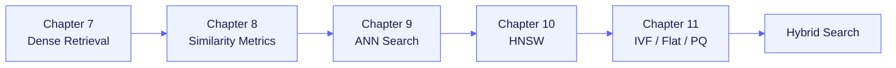

ANN exists because comparing one query vector against **every stored vector** can become too expensive.

## 2. Definitions

### 2.1 Nearest Neighbor

**Definition:**  
A nearest neighbor is the stored vector that is most similar to the query vector according to a chosen similarity or distance metric.

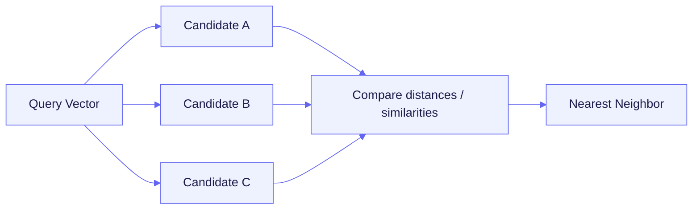

### 2.2 K-Nearest Neighbors

**Definition:**  
K-Nearest Neighbors retrieval returns the `K` closest vectors to the query.

Example:

```text
K = 5
→ return the 5 nearest document vectors
```

### 2.3 Exact Nearest Neighbor Search

**Definition:**  
Exact nearest-neighbor search compares the query against all relevant stored vectors and guarantees the true nearest results under the chosen metric.

### 2.4 Approximate Nearest Neighbor Search

**Definition:**  
Approximate Nearest Neighbor (ANN) search uses an index or search structure to avoid checking every vector, returning results that are usually very close to the true nearest neighbors but are not always guaranteed to be exact.

### 2.5 Recall in ANN

**Definition:**  
ANN recall measures how many of the true exact nearest neighbors were successfully returned by the approximate search.

Example:

```text
Exact Top-10 contains:
10 truly nearest vectors

ANN returns:
8 of those 10

Recall@10 = 8 / 10 = 0.8
```

### 2.6 Latency

**Definition:**  
Latency is the time taken to answer one search request.

### 2.7 Index Build Time

**Definition:**  
Index build time is the time required to construct the ANN data structure before queries can be served efficiently.

### 2.8 Candidate Set

**Definition:**  
A candidate set is the smaller subset of vectors that an ANN method considers likely enough to contain the nearest neighbors.

### 2.9 Search Parameter

**Definition:**  
A search parameter controls how much work the ANN algorithm performs at query time.

More search work usually means:

```text
higher recall
higher latency
```

Less search work usually means:

```text
lower latency
lower recall
```

### 2.10 More Terms in Simple Words

<table width="100%">
<thead><tr><th width="8%">Sr No</th><th width="24%">Term</th><th width="68%">Meaning in simple words</th></tr></thead>
<tbody>
<tr><td align="center">01</td><td><b>Vector index</b></td><td>A data structure that stores vectors so the nearest ones can be found quickly, like the index at the back of a book.</td></tr>
<tr><td align="center">02</td><td><b>Brute force / Flat</b></td><td>Check every stored vector, one by one. Always correct, slow when there are millions.</td></tr>
<tr><td align="center">03</td><td><b>Cluster</b></td><td>A group of vectors that are close to each other, for example all chunks about password resets.</td></tr>
<tr><td align="center">04</td><td><b>Centroid</b></td><td>The average point of a cluster. IVF compares the query with centroids first, not with every vector.</td></tr>
<tr><td align="center">05</td><td><b>Inverted list (IVF)</b></td><td>The list of vector ids that belong to one centroid. Same idea as a BM25 posting list, but for clusters.</td></tr>
<tr><td align="center">06</td><td><b><code>nprobe</code></b></td><td>How many IVF clusters to open per query. More clusters = higher recall, slower search.</td></tr>
<tr><td align="center">07</td><td><b>Graph neighbors (HNSW)</b></td><td>Each vector keeps links to a few similar vectors. Search walks along these links toward the query.</td></tr>
<tr><td align="center">08</td><td><b><code>efSearch</code></b></td><td>How many candidates HNSW keeps while walking the graph. Bigger = higher recall, slower search.</td></tr>
<tr><td align="center">09</td><td><b>Quantization</b></td><td>Storing numbers with fewer bits (rounding them), so vectors take less memory.</td></tr>
<tr><td align="center">10</td><td><b>Codebook</b></td><td>The list of representative values PQ rounds to. Each vector is stored as a few small codebook ids.</td></tr>
<tr><td align="center">11</td><td><b>Ground truth</b></td><td>The exact Top-K from brute-force search. ANN recall is measured against it.</td></tr>
<tr><td align="center">12</td><td><b>p95 / p99 latency</b></td><td>95% (or 99%) of queries finish faster than this time. Shows the slow tail that an average hides.</td></tr>
<tr><td align="center">13</td><td><b>Throughput (QPS)</b></td><td>How many queries per second the system can answer.</td></tr>
<tr><td align="center">14</td><td><b>Stale index</b></td><td>An index built before new vectors were added, so the new vectors cannot be found.</td></tr>
</tbody>
</table>

## 3. Why Exact Vector Search Becomes Expensive

> [!TIP]
> **In simple words:** Exact search is like reading every book in a library to find the five most similar ones. Fine for 100 books, too slow for a million.

Suppose:

```text
1 query vector
1,000,000 document vectors
768 dimensions
```

Exact search may compare:

```text
query vs document 1
query vs document 2
query vs document 3
...
query vs document 1,000,000
```

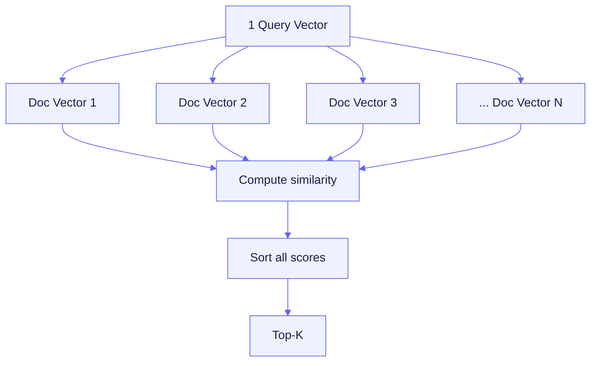

This is accurate but increasingly expensive.

## 4. Exact Nearest Neighbor Search

**Definition:**  
Exact nearest-neighbor search finds the mathematically correct nearest vectors by evaluating every relevant candidate.

For cosine search:

```text
query
→ cosine(query, D1)
→ cosine(query, D2)
→ ...
→ cosine(query, DN)
→ sort
→ Top-K
```

#### Advantages

- maximum retrieval accuracy
- simple mental model
- useful as a gold-standard baseline

#### Disadvantages

- query cost grows with corpus size
- large memory bandwidth usage
- can become too slow for real-time systems

## 5. Brute-Force Search

**Definition:**  
Brute-force vector search means evaluating the similarity or distance between the query and every stored vector.

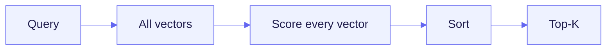

Brute-force search is often called:

```text
Flat search
Exact search
Exhaustive search
```

depending on the vector database/library.

## 6. Time Complexity Intuition

Suppose:

```text
N = number of stored vectors
D = embedding dimension
```

A rough exact-search comparison cost is:

```math
O(N \cdot D)
```

because:

```text
N vectors
×
D dimensions per comparison
```

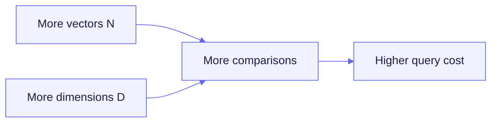

Important:

> ANN aims to reduce how much of the full search space must be explored.

## 7. What Is Approximate Nearest Neighbor Search?

> [!TIP]
> **In simple words:** ANN first jumps to the right shelf, then reads only the books there. Very fast, and it almost always finds the same books.

**Definition:**  
ANN search builds an index that organizes vectors so the system can search only promising regions rather than scanning every vector.

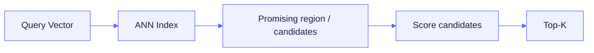

Instead of:

```text
search everything
```

ANN does:

```text
search intelligently
```

## 8. Why Approximation Helps

The key idea:

```text
Do much less work
while losing very little retrieval quality
```

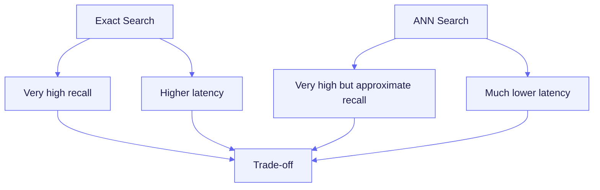

ANN is useful when:

- corpus is large
- low latency matters
- approximate results are acceptable
- retrieval recall can be tuned

## 9. Recall vs Latency

> [!TIP]
> **In simple words:** Look at more candidates and you miss fewer true neighbors, but each search takes longer. Tuning ANN means picking a point on this curve.

This is the central ANN trade-off.

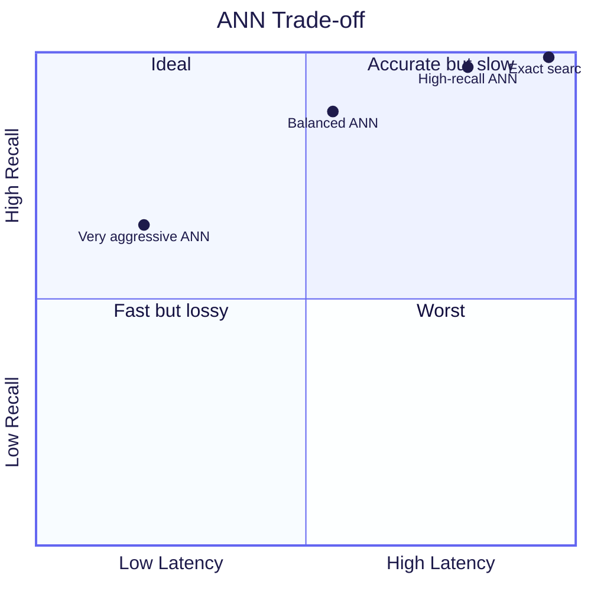

General relationship:

```text
search more candidates
→ higher recall
→ higher latency

search fewer candidates
→ lower latency
→ possibly lower recall
```

## 10. ANN Search Pipeline

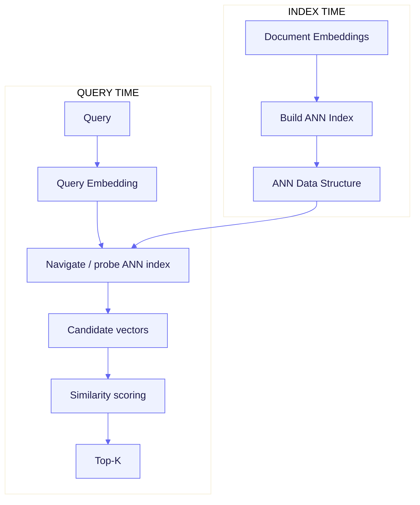

## 11. Index Build vs Query Search

ANN shifts work from query time to index time.

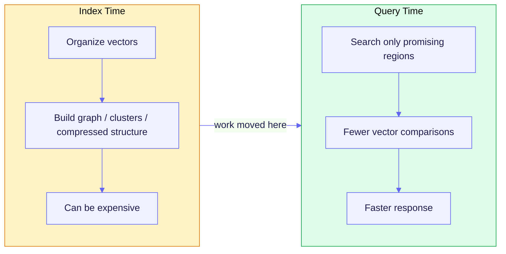

This is similar to BM25:

```text
do more preparation
→ answer queries faster
```

## 12. Candidate Generation

**Definition:**  
Candidate generation is the ANN step that finds a smaller subset of vectors likely to contain the true nearest neighbors.

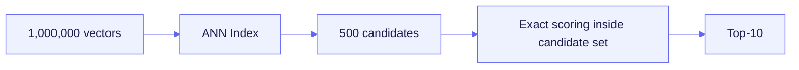

The exact numbers vary, but the concept is fundamental.

## 13. Flat Index

**Definition:**  
A Flat index stores vectors directly and performs exhaustive comparisons.

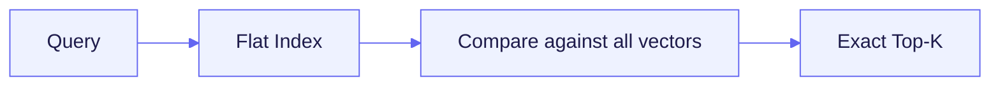

#### Flat index properties

<table width="100%">
<thead><tr><th width="8%">Sr No</th><th width="30%">Property</th><th width="62%">Flat index</th></tr></thead>
<tbody>
<tr><td align="center">01</td><td><b>Accuracy</b></td><td>Exact, best possible recall</td></tr>
<tr><td align="center">02</td><td><b>Query cost</b></td><td>High at scale</td></tr>
<tr><td align="center">03</td><td><b>Build cost</b></td><td>Low / simple</td></tr>
<tr><td align="center">04</td><td><b>Memory</b></td><td>Stores full vectors</td></tr>
<tr><td align="center">05</td><td><b>Use cases</b></td><td>Small corpora, baseline, evaluation ground truth</td></tr>
</tbody>
</table>

## 14. HNSW Overview

> [!TIP]
> **In simple words:** Like a road network: highways (upper layers) get you near the destination fast, local streets (bottom layer) find the exact house.

**Definition:**  
HNSW stands for **Hierarchical Navigable Small World**. It is a graph-based ANN method that connects vectors in a navigable multi-layer graph.

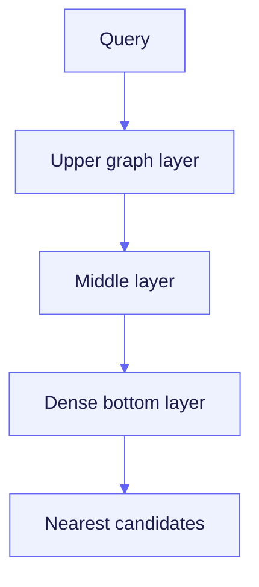

Intuition:

```text
upper layers
→ large jumps

lower layers
→ fine local search
```

HNSW is covered deeply in Chapter 10.

## 15. IVF Overview

> [!TIP]
> **In simple words:** Sort vectors into labeled boxes at index time. At query time, open only the few boxes whose label is closest to the query.

**Definition:**  
IVF stands for **Inverted File Index**. It partitions vectors into clusters and searches only selected clusters for a query.

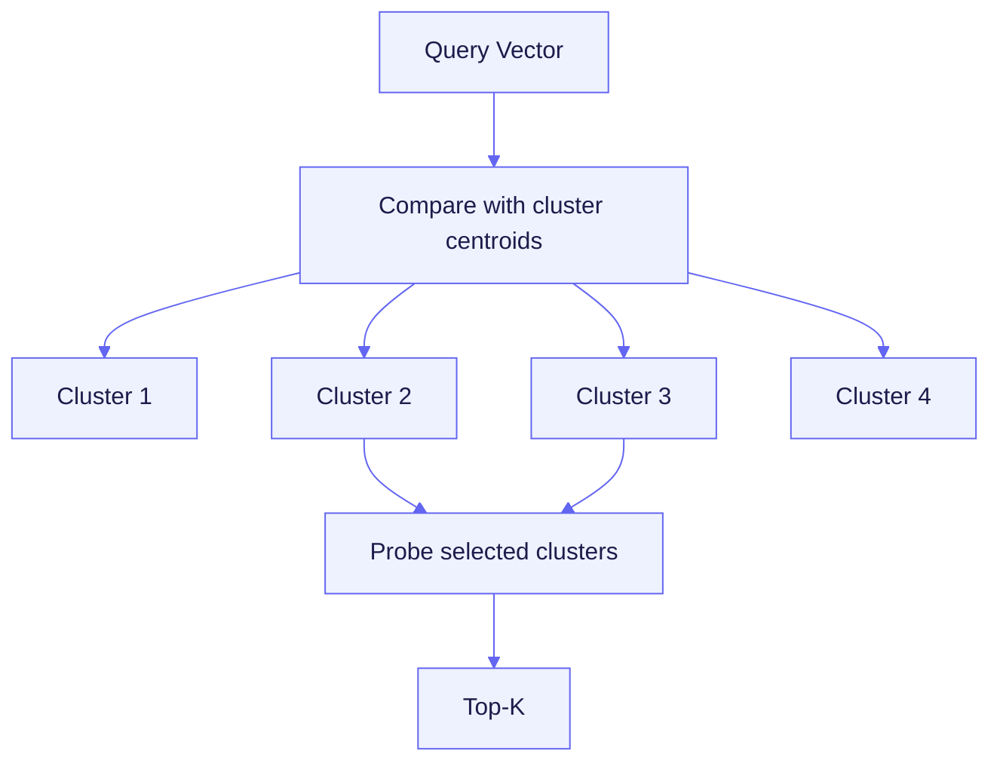

Intuition:

```text
find relevant neighborhoods first
→ search only those neighborhoods
```

## 16. Product Quantization Overview

> [!TIP]
> **In simple words:** Cut each vector into small pieces and replace each piece with the id of its closest standard piece. Much less memory, a little less accuracy.

**Definition:**  
Product Quantization (PQ) compresses vectors into compact codes so large vector collections can use less memory.

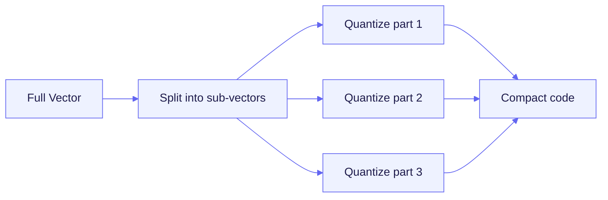

PQ trades some accuracy for:

- lower memory
- faster search in some settings
- larger scale

Deep treatment comes in Chapter 11.

## 17. ANN Families Compared

| Method | Exact? | Main Idea | Typical Trade-off |
|---|---:|---|---|
| Flat | Yes | compare every vector | high recall, high cost |
| HNSW | No | graph navigation | strong recall, fast queries, more memory |
| IVF | No | cluster/probe | tunable recall/latency |
| PQ | No | compress vectors | lower memory, some quality loss |

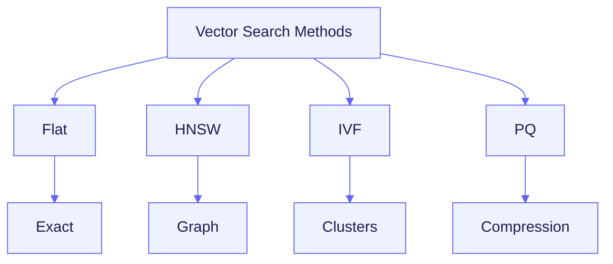

## 18. Recall@K for ANN

> [!TIP]
> **In simple words:** Of the K results exact search would return, how many did ANN also return?

**Definition:**  
Recall@K measures what fraction of the exact Top-K nearest neighbors are recovered by ANN.

Formula:

```math
\text{Recall@K} = \frac{|\text{ANN Top-K} \cap \text{Exact Top-K}|}{K}
```

Example:

```text
Exact Top-5:
A, B, C, D, E

ANN Top-5:
A, B, C, X, Y

Intersection:
A, B, C

Recall@5 = 3/5 = 0.6
```

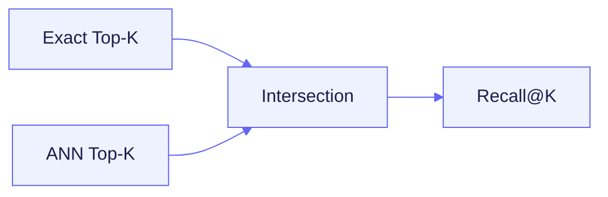

## 19. Latency Measurement

**Definition:**  
ANN query latency is the time taken from starting the vector search to receiving the ranked ANN candidates.

Example pattern:

```python
# Import the timing utility.
import time

# Record the start time.
start = time.perf_counter()

# Run the search operation.
results = search_function(query_vector)

# Record the elapsed time.
elapsed = time.perf_counter() - start

# Print the measured latency.
print(elapsed)
```

For real systems, track:

- average latency
- median
- p95
- p99

## 20. Index Build Time

ANN indexes can take time to construct.

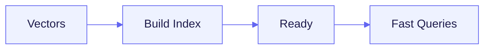

A common trade-off:

```text
more sophisticated index
→ more build time
→ faster queries later
```

This is especially visible with graph indexes and clustering-based indexes.

## 21. Memory Trade-offs

ANN speed often requires additional structures.

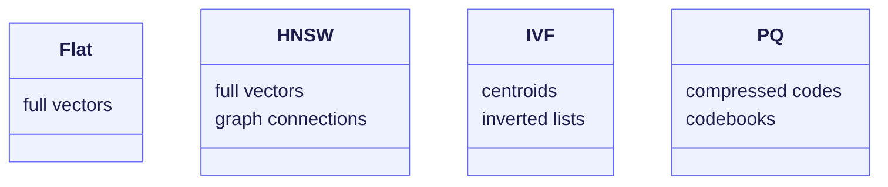

Rough memory for **1,000,000 vectors x 768 dimensions** (estimates for intuition, not benchmarks):

<table width="100%">
<thead><tr><th width="8%">Sr No</th><th width="26%">Storage</th><th width="18%">Bytes per vector</th><th width="16%">Total</th><th width="32%">Note</th></tr></thead>
<tbody>
<tr><td align="center">01</td><td>Full vectors, float32</td><td>768 x 4 = 3,072</td><td>about 3.1 GB</td><td>Flat, and the base of HNSW and IVF-Flat</td></tr>
<tr><td align="center">02</td><td>Full vectors, float16</td><td>768 x 2 = 1,536</td><td>about 1.5 GB</td><td>Half precision, small quality loss</td></tr>
<tr><td align="center">03</td><td>HNSW links (M = 32)</td><td>about 64 x 4 = 256</td><td>about 0.26 GB extra</td><td>Bottom-layer neighbor ids, on top of the vectors</td></tr>
<tr><td align="center">04</td><td>PQ codes (96 sub-vectors x 8 bits)</td><td align="center">96</td><td>about 0.1 GB</td><td>Plus small codebooks; lossy</td></tr>
</tbody>
</table>

ANN tuning is not only:

```text
recall vs latency
```

It is also:

```text
recall
latency
memory
build time
```

## 22. Search Parameters

**Definition:**  
Search parameters control how aggressively the ANN index explores candidates at query time.

General principle:

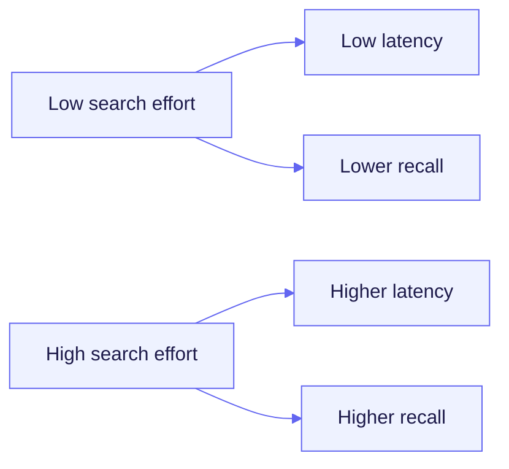

Examples of parameters you will meet later:

```text
HNSW:
efSearch

IVF:
nprobe

Search depth / candidate count
```

## 23. ANN and Similarity Metrics

ANN still requires a definition of "nearest."

```mermaid
%%{init: {'theme':'base','themeVariables':{'primaryColor':'#EEF2FF','primaryBorderColor':'#6366F1','primaryTextColor':'#1E1B4B','lineColor':'#6366F1','pie1':'#22C55E','pie2':'#F59E0B','pie3':'#EF4444','pie4':'#3B82F6','pie5':'#8B5CF6','xyChart':{'plotColorPalette':'#2563EB, #16A34A, #D97706, #DC2626, #7C3AED'}}}}%%
flowchart LR
    Q["Query"] --> ANN["ANN Index"]
    M["Cosine / Dot / L2"] --> ANN
    ANN --> TOP["Approximate Top-K"]
```

Wrong metric configuration means ANN efficiently finds the wrong notion of closeness.

## 24. Simple Exact Search in Python

Below is a small exact cosine-search implementation.

```python
# Import NumPy for vector operations.
import numpy as np

# Create a query vector.
query = np.array([1.0, 0.0])

# Create three document vectors.
documents = np.array([
    [1.0, 0.0],
    [0.9, 0.2],
    [0.0, 1.0],
])

# Normalize the query vector to unit length.
query = query / np.linalg.norm(query)

# Normalize every document vector to unit length.
documents = documents / np.linalg.norm(documents, axis=1, keepdims=True)

# Compute cosine similarity using dot product on normalized vectors.
scores = documents @ query

# Sort document indices from highest score to lowest score.
ranking = np.argsort(scores)[::-1]

# Print the similarity scores.
print(scores)

# Print the ranking order.
print(ranking)
```

**Output**

```text
[1.     0.9762 0.    ]
[0 1 2]
```

## 25. Simple ANN Simulation

This is **not a production ANN algorithm**.

It only demonstrates the principle:

```text
search a subset
instead of everything
```

```python
# Import NumPy for numerical operations.
import numpy as np

# Create a reproducible random generator.
rng = np.random.default_rng(42)

# Generate 1000 random document vectors.
documents = rng.normal(size=(1000, 32))

# Generate one random query vector.
query = rng.normal(size=(32,))

# Normalize all document vectors.
documents = documents / np.linalg.norm(documents, axis=1, keepdims=True)

# Normalize the query vector.
query = query / np.linalg.norm(query)

# Select only 100 random candidate document indices.
candidate_indices = rng.choice(1000, size=100, replace=False)

# Extract only those candidate vectors.
candidate_vectors = documents[candidate_indices]

# Score only the candidate vectors against the query.
candidate_scores = candidate_vectors @ query

# Sort the approximate candidate scores in descending order.
local_ranking = np.argsort(candidate_scores)[::-1]

# Map the candidate-local ranking back to original document indices.
approximate_top_indices = candidate_indices[local_ranking[:10]]

# Print the approximate Top-10 document indices.
print(approximate_top_indices)
```

**Output**

```text
[268 329 849 417  59 234 854 928 953 253]
```

Again:

> This demonstrates reduced search space, not HNSW or IVF.

## 26. Exact vs Approximate Ranking Comparison

We can compare exact Top-K with approximate Top-K.

```python
# Compute exact similarity scores against every document.
exact_scores = documents @ query

# Sort exact scores from highest to lowest.
exact_ranking = np.argsort(exact_scores)[::-1]

# Keep only the exact Top-10.
exact_top_10 = exact_ranking[:10]

# Convert exact Top-10 indices to a Python set.
exact_set = set(exact_top_10.tolist())

# Convert approximate Top-10 indices to a Python set.
approximate_set = set(approximate_top_indices.tolist())

# Find how many true Top-10 results were recovered.
overlap = len(exact_set.intersection(approximate_set))

# Calculate Recall@10.
recall_at_10 = overlap / 10

# Print the exact Top-10.
print("Exact:", exact_top_10)

# Print the approximate Top-10.
print("Approx:", approximate_top_indices)

# Print Recall@10.
print("Recall@10:", recall_at_10)
```

**Output**

```text
Exact: [998 870 120 818 457 983 214 268 804 443]
Approx: [268 329 849 417  59 234 854 928 953 253]
Recall@10: 0.1
```

> [!WARNING]
> Only 1 of the true Top-10 (document 268) was found. A **random** 10% subset gives about 10% recall, because the subset knows nothing about the query. Real ANN indexes pick candidates **near** the query; the end-to-end example below shows an IVF index reaching 0.99 recall while scanning far fewer vectors.

## 27. Benchmarking ANN

A proper ANN benchmark compares:

```mermaid
%%{init: {'theme':'base','themeVariables':{'primaryColor':'#EEF2FF','primaryBorderColor':'#6366F1','primaryTextColor':'#1E1B4B','lineColor':'#6366F1','pie1':'#22C55E','pie2':'#F59E0B','pie3':'#EF4444','pie4':'#3B82F6','pie5':'#8B5CF6','xyChart':{'plotColorPalette':'#2563EB, #16A34A, #D97706, #DC2626, #7C3AED'}}}}%%
flowchart TB
    METHODS["Methods"] --> EXACT["Exact"]
    METHODS --> ANN["ANN"]

    EXACT --> R1["Recall"]
    EXACT --> L1["Latency"]

    ANN --> R2["Recall"]
    ANN --> L2["Latency"]

    R1 --> CMP["Compare"]
    L1 --> CMP
    R2 --> CMP
    L2 --> CMP
```

Important metrics:

```text
Recall@K
query latency
index build time
memory usage
throughput
```

Example timing pattern:

```python
# Import the timing utility.
import time

# Record exact-search start time.
exact_start = time.perf_counter()

# Compute exact scores against all vectors.
exact_scores = documents @ query

# Record exact-search elapsed time.
exact_time = time.perf_counter() - exact_start

# Record approximate-search start time.
approx_start = time.perf_counter()

# Compute scores only for the candidate subset.
approx_scores = candidate_vectors @ query

# Record approximate-search elapsed time.
approx_time = time.perf_counter() - approx_start

# Print exact-search latency.
print("Exact time:", exact_time)

# Print approximate-search latency.
print("Approx time:", approx_time)
```

Result (median of 200 runs on a laptop; numbers vary by machine): exact over 1,000 vectors **4.5 µs**, candidate subset of 100 vectors **1.0 µs**. Scanning 10% of the vectors took about 20% of the time; fixed overhead does not shrink.

## 28. Failure Modes

ANN introduces new failure modes beyond ordinary dense retrieval.

```mermaid
%%{init: {'theme':'base','themeVariables':{'primaryColor':'#EEF2FF','primaryBorderColor':'#6366F1','primaryTextColor':'#1E1B4B','lineColor':'#6366F1','pie1':'#22C55E','pie2':'#F59E0B','pie3':'#EF4444','pie4':'#3B82F6','pie5':'#8B5CF6','xyChart':{'plotColorPalette':'#2563EB, #16A34A, #D97706, #DC2626, #7C3AED'}}}}%%
flowchart LR
    F(["ANN Failure Modes"]) --> A["Search too aggressive<br/>low recall"]
    F --> B["Wrong search parameter<br/>too few candidates"]
    F --> C["Wrong metric<br/>wrong geometry"]
    F --> D["Stale index<br/>new vectors missing"]
    F --> E["Bad embeddings<br/>ANN cannot fix representation"]
    F --> G["Poor chunking<br/>relevant context absent"]
    F --> H["Memory pressure<br/>degraded configuration"]
    classDef ann fill:#FEF3C7,stroke:#D97706,color:#78350F,stroke-width:2px
    classDef up fill:#FEE2E2,stroke:#DC2626,color:#7F1D1D,stroke-width:2px
    class A,B,C,D,H ann
    class E,G up
    style F fill:#F1F5F9,stroke:#475569,color:#0F172A
```

<p align="center">Orange: ANN-side problems · Red: upstream problems ANN cannot fix</p>

ANN cannot fix:

```text
bad embeddings
bad chunking
bad metadata
wrong query
```

It only changes **how efficiently nearest vectors are located**.

## 29. Debugging ANN

```mermaid
%%{init: {'theme':'base','themeVariables':{'primaryColor':'#EEF2FF','primaryBorderColor':'#6366F1','primaryTextColor':'#1E1B4B','lineColor':'#6366F1','pie1':'#22C55E','pie2':'#F59E0B','pie3':'#EF4444','pie4':'#3B82F6','pie5':'#8B5CF6','xyChart':{'plotColorPalette':'#2563EB, #16A34A, #D97706, #DC2626, #7C3AED'}}}}%%
flowchart TD
    START["Relevant vector missing"] --> EXACT{"Does exact search find it?"}

    EXACT -->|No| EMB["Embedding / chunking / query problem"]
    EXACT -->|Yes| ANN["ANN-specific problem"]

    ANN --> PARAM{"Search effort too low?"}
    PARAM -->|Yes| TUNE["Increase search parameter"]

    PARAM -->|No| METRIC{"Metric correct?"}
    METRIC -->|No| FIX1["Fix metric"]

    METRIC -->|Yes| INDEX{"Index fresh?"}
    INDEX -->|No| FIX2["Rebuild / refresh index"]

    INDEX -->|Yes| CONFIG["Inspect index configuration / candidate count"]
```

#### Key debugging rule

> [!IMPORTANT]
> Always compare ANN against exact search.

Exact search is the baseline that tells you whether the problem is:

```text
embedding quality
or
ANN approximation
```

## 30. ANN in Vector Databases

Vector databases usually provide ANN indexes so you do not implement these algorithms manually.

```mermaid
%%{init: {'theme':'base','themeVariables':{'primaryColor':'#EEF2FF','primaryBorderColor':'#6366F1','primaryTextColor':'#1E1B4B','lineColor':'#6366F1','pie1':'#22C55E','pie2':'#F59E0B','pie3':'#EF4444','pie4':'#3B82F6','pie5':'#8B5CF6','xyChart':{'plotColorPalette':'#2563EB, #16A34A, #D97706, #DC2626, #7C3AED'}}}}%%
flowchart LR
    APP["Application"] --> VDB["Vector DB"]
    VDB --> H["HNSW"]
    VDB --> I["IVF"]
    VDB --> F["Flat"]
    VDB --> P["PQ / compressed variants"]
```

Common systems expose:

- vector insertion
- index creation
- metric configuration
- ANN parameters
- Top-K search
- filtering
- metadata

## 31. ANN Inside Dense Retrieval

```mermaid
%%{init: {'theme':'base','themeVariables':{'primaryColor':'#EEF2FF','primaryBorderColor':'#6366F1','primaryTextColor':'#1E1B4B','lineColor':'#6366F1','pie1':'#22C55E','pie2':'#F59E0B','pie3':'#EF4444','pie4':'#3B82F6','pie5':'#8B5CF6','xyChart':{'plotColorPalette':'#2563EB, #16A34A, #D97706, #DC2626, #7C3AED'}}}}%%
flowchart TB
    D["Documents"] --> E["Embeddings"]
    E --> ANN["ANN Index"]

    Q["Query"] --> QE["Query Embedding"]
    QE --> ANN

    ANN --> C["Approximate Candidates"]
    C --> S["Similarity Scores"]
    S --> K["Top-K"]
```

ANN is therefore the **scaling layer** of dense retrieval.

## 32. ANN Inside Hybrid Search

```mermaid
%%{init: {'theme':'base','themeVariables':{'primaryColor':'#EEF2FF','primaryBorderColor':'#6366F1','primaryTextColor':'#1E1B4B','lineColor':'#6366F1','pie1':'#22C55E','pie2':'#F59E0B','pie3':'#EF4444','pie4':'#3B82F6','pie5':'#8B5CF6','xyChart':{'plotColorPalette':'#2563EB, #16A34A, #D97706, #DC2626, #7C3AED'}}}}%%
flowchart LR
    Q["User Query"] --> SP["Sparse Branch"]
    Q --> DE["Dense Branch"]

    SP --> BM["BM25"]
    BM --> ST["Sparse Top-K"]

    DE --> EMB["Query Embedding"]
    EMB --> ANN["ANN Search"]
    ANN --> DT["Dense Top-K"]

    ST --> F["Fusion"]
    DT --> F

    F --> R["Reranker"]
    R --> FINAL["Final Top-K"]
```

If ANN recall is poor, good dense candidates never reach fusion.

## End-to-End Example — From Exact Search to a Tiny IVF Index

This section builds the chapter's ideas into working code on 20,000 clustered unit vectors: exact search as ground truth, a Recall@K helper, random candidates, and a small IVF index written from scratch with an `nprobe` sweep. All outputs are real results from running the code on a laptop; timings vary by machine.

```mermaid
%%{init: {'theme':'base','themeVariables':{'primaryColor':'#EEF2FF','primaryBorderColor':'#6366F1','primaryTextColor':'#1E1B4B','lineColor':'#6366F1','pie1':'#22C55E','pie2':'#F59E0B','pie3':'#EF4444','pie4':'#3B82F6','pie5':'#8B5CF6','xyChart':{'plotColorPalette':'#2563EB, #16A34A, #D97706, #DC2626, #7C3AED'}}}}%%
sequenceDiagram
    autonumber
    participant B as Build (index time)
    participant I as IVF index
    participant Q as Query
    participant E as Exact search
    B->>I: k-means: 100 centroids + inverted lists
    Q->>I: compare with 100 centroids
    I-->>Q: nprobe closest lists
    Q->>Q: score only vectors in those lists
    Q->>E: same query, all 20,000 vectors
    E-->>Q: ground-truth Top-10
    Q->>Q: Recall@10 = overlap / 10
```

### Step 1. Build a clustered vector collection

Real embeddings form topic clusters, so the test data has clusters too: 20,000 unit vectors, 64 dimensions, 100 hidden topics.

```python
import time

import numpy as np

# Reproducible random numbers
rng = np.random.default_rng(7)

# 100 hidden topic centers
centers = rng.normal(size=(100, 64))

# Topic of each of the 20,000 documents
topic = rng.integers(0, 100, size=20_000)

# Document = its topic center + noise
vectors = centers[topic] + 1.6 * rng.normal(size=(20_000, 64))

# Unit length, so dot product = cosine
vectors = vectors / np.linalg.norm(vectors, axis=1, keepdims=True)

# 200 test queries drawn the same way
query_topic = rng.integers(0, 100, size=200)
queries = centers[query_topic] + 1.6 * rng.normal(size=(200, 64))
queries = queries / np.linalg.norm(queries, axis=1, keepdims=True)

print("documents:", vectors.shape, "queries:", queries.shape)
```

**Output**

```text
documents: (20000, 64) queries: (200, 64)
```

### Step 2. Exact (Flat) search = ground truth

Score every vector. This is the gold standard every ANN result is compared with.

```python
def exact_top_k(query, k=10):
    # Cosine with every stored vector
    scores = vectors @ query

    # Indexes of the k highest scores
    return np.argsort(scores)[::-1][:k]

# Ground truth for all test queries, timed
start = time.perf_counter()
truth = [exact_top_k(q) for q in queries]
exact_ms = (time.perf_counter() - start) / len(queries) * 1000

# Average time per query
print(f"exact search: {exact_ms:.3f} ms per query, scans 100% of vectors")
```

**Output**

```text
exact search: 1.077 ms per query, scans 100% of vectors
```

### Step 3. A recall@K helper

Recall@K from section 18: the share of the exact Top-K that the approximate search also returned.

```python
def recall_at_k(approx, exact):
    # Overlap between the two Top-K sets, divided by K
    return len(set(approx.tolist()) & set(exact.tolist())) / len(exact)

# Sanity check: exact search has perfect recall
print("exact vs exact:", recall_at_k(truth[0], truth[0]))
```

**Output**

```text
exact vs exact: 1.0
```

### Step 4. Random candidates (the section 25 idea) do not work

Scoring a random subset only finds what happens to be in the subset, so recall is about the fraction scanned.

```python
def random_subset_top_k(query, n_candidates, k=10):
    # Pick candidates with no knowledge of the query
    candidates = rng.choice(len(vectors), size=n_candidates, replace=False)

    # Score only those candidates
    scores = vectors[candidates] @ query

    # Map local ranking back to global indexes
    return candidates[np.argsort(scores)[::-1][:k]]

# Try three subset sizes
for n in [1_000, 5_000, 10_000]:
    # Average recall over all test queries
    r = np.mean([recall_at_k(random_subset_top_k(q, n), t) for q, t in zip(queries, truth)])

    print(f"random {n:>6} candidates ({n / len(vectors):.0%} scanned): recall@10 = {r:.3f}")
```

**Output**

```text
random   1000 candidates (5% scanned): recall@10 = 0.053
random   5000 candidates (25% scanned): recall@10 = 0.248
random  10000 candidates (50% scanned): recall@10 = 0.485
```

### Step 5. Build a tiny IVF index from scratch

IVF (section 15): group vectors into clusters at index time, using a few rounds of k-means.

```python
def build_ivf(data, n_lists=100, n_iter=10):
    # Start from random data points as centroids
    centroids = data[rng.choice(len(data), size=n_lists, replace=False)]

    # Repeat assign + update a few times
    for _ in range(n_iter):
        # Assign every vector to its most similar centroid
        assign = np.argmax(data @ centroids.T, axis=1)

        # Move each centroid to the mean of its vectors
        for c in range(n_lists):
            # Vectors currently in cluster c
            members = data[assign == c]

            # Keep the old centroid if the cluster is empty
            if len(members):
                centroids[c] = members.mean(axis=0) / np.linalg.norm(members.mean(axis=0))

    # Inverted lists: centroid id -> vector ids
    lists = [np.where(assign == c)[0] for c in range(n_lists)]

    return centroids, lists

# Index time work, done once
start = time.perf_counter()
centroids, inverted_lists = build_ivf(vectors)
build_s = time.perf_counter() - start

# Build time and cluster sizes
print(f"IVF build: {build_s:.2f} s, {len(inverted_lists)} lists, "
      f"list sizes {min(map(len, inverted_lists))} to {max(map(len, inverted_lists))}")
```

**Output**

```text
IVF build: 0.09 s, 100 lists, list sizes 29 to 350
```

### Step 6. IVF search with `nprobe`

At query time: find the `nprobe` closest centroids, then score only the vectors in those lists.

```python
def ivf_top_k(query, nprobe, k=10):
    # Closest centroids to the query
    probe = np.argsort(centroids @ query)[::-1][:nprobe]

    # Candidate set = vectors in the probed lists
    candidates = np.concatenate([inverted_lists[c] for c in probe])

    # Exact scoring inside the candidate set
    scores = vectors[candidates] @ query

    # Top-k, mapped back to global ids
    return candidates[np.argsort(scores)[::-1][:k]], len(candidates)

# Sweep the recall-vs-latency dial
for nprobe in [1, 2, 4, 8, 16, 32]:
    # Start the clock
    start = time.perf_counter()

    # Run every test query
    runs = [ivf_top_k(q, nprobe) for q in queries]

    # Average latency, recall and share of vectors scanned
    ms = (time.perf_counter() - start) / len(queries) * 1000
    r = np.mean([recall_at_k(top, t) for (top, _), t in zip(runs, truth)])
    scanned = np.mean([n for _, n in runs]) / len(vectors)

    print(f"nprobe={nprobe:<3} scanned={scanned:6.1%}  recall@10={r:.3f}  {ms:.3f} ms/query")
```

**Output**

```text
nprobe=1   scanned=  1.0%  recall@10=0.728  0.023 ms/query
nprobe=2   scanned=  2.0%  recall@10=0.809  0.043 ms/query
nprobe=4   scanned=  4.0%  recall@10=0.871  0.075 ms/query
nprobe=8   scanned=  8.0%  recall@10=0.922  0.149 ms/query
nprobe=16  scanned= 16.0%  recall@10=0.963  0.396 ms/query
nprobe=32  scanned= 32.0%  recall@10=0.990  0.698 ms/query
```

### What the results show

```mermaid
%%{init: {'theme':'base','themeVariables':{'primaryColor':'#EEF2FF','primaryBorderColor':'#6366F1','primaryTextColor':'#1E1B4B','lineColor':'#6366F1','pie1':'#22C55E','pie2':'#F59E0B','pie3':'#EF4444','pie4':'#3B82F6','pie5':'#8B5CF6','xyChart':{'plotColorPalette':'#2563EB, #16A34A, #D97706, #DC2626, #7C3AED'}}}}%%
xychart-beta
    title "IVF recall@10 vs nprobe"
    x-axis "nprobe (lists opened)" [1, 2, 4, 8, 16, 32]
    y-axis "recall@10" 0.6 --> 1
    line [0.728, 0.809, 0.871, 0.922, 0.963, 0.99]
```

```mermaid
%%{init: {'theme':'base','themeVariables':{'primaryColor':'#EEF2FF','primaryBorderColor':'#6366F1','primaryTextColor':'#1E1B4B','lineColor':'#6366F1','pie1':'#22C55E','pie2':'#F59E0B','pie3':'#EF4444','pie4':'#3B82F6','pie5':'#8B5CF6','xyChart':{'plotColorPalette':'#2563EB, #16A34A, #D97706, #DC2626, #7C3AED'}}}}%%
xychart-beta
    title "Recall@10 by share of vectors scanned"
    x-axis ["IVF 1%", "IVF 8%", "IVF 32%", "Random 5%", "Random 25%", "Random 50%"]
    y-axis "recall@10" 0 --> 1
    bar [0.728, 0.922, 0.99, 0.053, 0.248, 0.485]
```

<table width="100%">
<thead><tr><th width="8%">Sr No</th><th width="22%">Method</th><th width="16%">Vectors scanned</th><th width="14%">Recall@10</th><th width="16%">Latency / query</th><th width="24%">Reading</th></tr></thead>
<tbody>
<tr><td align="center">01</td><td>Exact (Flat)</td><td align="center">100%</td><td align="center">1.000</td><td align="center">1.08 ms</td><td>Ground truth, slowest</td></tr>
<tr><td align="center">02</td><td>Random 50% subset</td><td align="center">50%</td><td align="center">0.485</td><td align="center">-</td><td>Recall = share scanned. Useless.</td></tr>
<tr><td align="center">03</td><td>IVF, nprobe = 1</td><td align="center">1%</td><td align="center">0.728</td><td align="center">0.02 ms</td><td>Very fast, misses neighbors in other clusters</td></tr>
<tr><td align="center">04</td><td>IVF, nprobe = 8</td><td align="center">8%</td><td align="center">0.922</td><td align="center">0.15 ms</td><td>Balanced</td></tr>
<tr><td align="center">05</td><td>IVF, nprobe = 32</td><td align="center">32%</td><td align="center">0.990</td><td align="center">0.70 ms</td><td>High recall, still faster than exact</td></tr>
</tbody>
</table>

> [!IMPORTANT]
> Scanning **1% of the vectors chosen by IVF** gives better recall (0.728) than scanning **50% chosen at random** (0.485). ANN works because the index knows *where* to look, not because it looks at less. `nprobe` is the recall-vs-latency dial from section 9.

> [!NOTE]
> This IVF is for learning only. Libraries such as FAISS add trained quantizers, SIMD scoring and batching; HNSW (Chapter 10) uses a graph instead of clusters.

## 33. Checkpoints With Answers

### Checkpoint 1 — Fundamentals

**Q1. What is nearest-neighbor search?**  
Finding the closest stored vectors to a query under a chosen metric.

**Q2. What is exact search?**  
Comparing against all vectors and returning the true nearest results.

**Q3. What is ANN?**  
An indexed approximate search that explores only promising parts of the vector space.

**Q4. Why use ANN?**  
To reduce search latency at scale.

### Checkpoint 2 — Recall and Latency

**Q1. What is ANN Recall@K?**  
The fraction of exact Top-K neighbors recovered by ANN.

**Q2. What happens when ANN search effort increases?**  
Recall usually improves and latency usually increases.

**Q3. What happens when search effort decreases?**  
Latency improves but some nearest neighbors may be missed.

### Checkpoint 3 — ANN Families

**Q1. What is Flat?**  
Exact exhaustive vector search.

**Q2. What is HNSW?**  
A graph-based ANN structure.

**Q3. What is IVF?**  
A cluster-based index that probes selected vector partitions.

**Q4. What is PQ?**  
A vector-compression technique.

### Checkpoint 4 — Debugging

**Q1. Why compare ANN with exact search?**  
To separate embedding-quality problems from ANN approximation problems.

**Q2. Exact search finds the document but ANN does not. What does that suggest?**  
ANN search configuration/index quality is likely responsible.

**Q3. Neither exact nor ANN finds the document. What should you inspect?**  
Embeddings, chunking, query representation, metadata filters, and indexing.

### Checkpoint 5 — Hybrid Search

**Q1. What does ANN contribute to Hybrid Search?**  
Fast dense candidate retrieval.

**Q2. What happens if ANN recall is too low?**  
Relevant dense candidates may never reach fusion/reranking.

## 34. Interview Questions

#### What is ANN?

Approximate Nearest Neighbor search is a family of methods that find near-nearest vectors efficiently without exhaustively comparing against every stored vector.

#### Why is ANN needed?

Exact search becomes expensive as vector count and embedding dimension grow.

#### What is the main ANN trade-off?

Recall versus latency, with additional trade-offs around memory and index build time.

#### What is Recall@K in ANN?

The fraction of exact Top-K nearest neighbors recovered by the approximate search.

#### What is a Flat index?

An exact index that performs exhaustive similarity comparisons.

#### What is HNSW?

A hierarchical graph-based ANN algorithm.

#### What is IVF?

A cluster-based ANN method that searches selected partitions.

#### What is PQ?

A vector-compression approach that represents vectors using compact quantized codes.

#### How do you debug low ANN recall?

Compare with exact search, then tune search parameters, metric configuration, index freshness, and index settings.

#### Does ANN change the embedding model?

No. ANN changes how vectors are searched, not how they are generated.

## 35. Interview Scenarios

### Scenario 1 — Exact Finds It, ANN Misses It

Likely issue:

```text
ANN recall / configuration
```

Tune search effort or index parameters.

### Scenario 2 — Both Exact and ANN Miss It

Likely issue:

```text
embedding quality
chunking
query representation
filtering
```

### Scenario 3 — ANN Is Fast but Recall@10 = 0.55

You likely configured search too aggressively for speed.

Increase candidate exploration.

### Scenario 4 — ANN Recall Is Excellent but Latency Is Too High

Search effort may be too large.

Tune toward a better latency/recall balance.

### Scenario 5 — Large Memory Usage

Potential causes:

- high-dimensional full vectors
- HNSW graph overhead
- very large index

Possible options:

- compression
- PQ
- lower-dimensional embeddings
- different ANN strategy

## 36. One-Page Revision Map

```mermaid
%%{init: {'theme':'base','themeVariables':{'primaryColor':'#EEF2FF','primaryBorderColor':'#6366F1','primaryTextColor':'#1E1B4B','lineColor':'#6366F1','pie1':'#22C55E','pie2':'#F59E0B','pie3':'#EF4444','pie4':'#3B82F6','pie5':'#8B5CF6','xyChart':{'plotColorPalette':'#2563EB, #16A34A, #D97706, #DC2626, #7C3AED'}}}}%%
flowchart TB
    ROOT["Vector Search"] --> EXACT["Exact Search"]
    ROOT --> ANN["ANN Search"]

    EXACT --> FLAT["Flat"]
    EXACT --> E1["Maximum recall"]
    EXACT --> E2["High cost at scale"]

    ANN --> HNSW["HNSW"]
    ANN --> IVF["IVF"]
    ANN --> PQ["PQ"]

    HNSW --> G["Graph navigation"]
    IVF --> C["Cluster probing"]
    PQ --> COMP["Compression"]

    ANN --> T["Trade-offs"]
    T --> R["Recall"]
    T --> L["Latency"]
    T --> M["Memory"]
    T --> B["Build Time"]
```

```mermaid
%%{init: {'theme':'base','themeVariables':{'primaryColor':'#EEF2FF','primaryBorderColor':'#6366F1','primaryTextColor':'#1E1B4B','lineColor':'#6366F1','pie1':'#22C55E','pie2':'#F59E0B','pie3':'#EF4444','pie4':'#3B82F6','pie5':'#8B5CF6','xyChart':{'plotColorPalette':'#2563EB, #16A34A, #D97706, #DC2626, #7C3AED'}}}}%%
timeline
    title ANN at a glance
    Purpose : Scale dense retrieval
    Exact baseline : Flat : Gold standard
    Approximate methods : HNSW : IVF : PQ
    Evaluation : Recall@K : Latency : Build time : Memory
    Debugging : Compare exact vs ANN : Tune search effort : Check metric : Refresh index
    Hybrid Search : Supplies dense Top-K
```

## 37. Practice Tasks

1. Implement exact cosine search over 1,000 vectors.
2. Measure exact-search latency.
3. Simulate approximate search using a candidate subset.
4. Compute Recall@10.
5. Plot Recall@10 vs candidate count.
6. Plot latency vs candidate count.
7. Find the candidate count that gives Recall@10 ≥ 0.9.
8. Compare exact and approximate Top-5 rankings.
9. Add a stale-index simulation.
10. Create a benchmark table with recall, latency, and candidate count.
11. Experiment with 32, 128, and 768 dimensions.
12. Measure how exact-search latency changes as vector count increases.
13. Write a reusable `recall_at_k()` function.
14. Add a unit test verifying ANN recall is above a chosen threshold.
15. Prepare for HNSW by reviewing graph search intuition.

## 38. Final Takeaways

```mermaid
%%{init: {'theme':'base','themeVariables':{'primaryColor':'#EEF2FF','primaryBorderColor':'#6366F1','primaryTextColor':'#1E1B4B','lineColor':'#6366F1','pie1':'#22C55E','pie2':'#F59E0B','pie3':'#EF4444','pie4':'#3B82F6','pie5':'#8B5CF6','xyChart':{'plotColorPalette':'#2563EB, #16A34A, #D97706, #DC2626, #7C3AED'}}}}%%
flowchart LR
    subgraph WHY["Why ANN"]
        direction TB
        t1["1. Exact search checks every vector"] --> t2["2. Exact search gives true nearest neighbors"] --> t3["3. ANN searches only promising regions"] --> t4["4. ANN trades a little recall for much lower latency"] --> t5["5. Recall@K measures approximation quality"]
    end
    subgraph HOW["How"]
        direction TB
        t6["6. Flat is the exact baseline"] --> t7["7. HNSW uses graphs"] --> t8["8. IVF uses clusters"] --> t9["9. PQ compresses vectors"] --> t10["10. ANN is the scaling layer of dense retrieval"]
    end
    WHY --> HOW
    style WHY fill:#EFF6FF,stroke:#2563EB
    style HOW fill:#F0FDF4,stroke:#16A34A
```

## Next Chapter — Chapter 10: HNSW Fundamentals

Next we go deep into the most important graph-based ANN structure:

```mermaid
%%{init: {'theme':'base','themeVariables':{'primaryColor':'#EEF2FF','primaryBorderColor':'#6366F1','primaryTextColor':'#1E1B4B','lineColor':'#6366F1','pie1':'#22C55E','pie2':'#F59E0B','pie3':'#EF4444','pie4':'#3B82F6','pie5':'#8B5CF6','xyChart':{'plotColorPalette':'#2563EB, #16A34A, #D97706, #DC2626, #7C3AED'}}}}%%
flowchart LR
    Q["Query"] --> TOP["Upper HNSW Layer"]
    TOP --> MID["Middle Layers"]
    MID --> LOW["Bottom Layer"]
    LOW --> NN["Nearest Candidates"]
```

Chapter 10 will cover:

- small-world graphs
- hierarchical graph intuition
- neighbor connections
- entry points
- greedy search
- `M`
- `efConstruction`
- `efSearch`
- recall vs latency
- memory trade-offs
- index build cost
- HNSW failure modes
- practical parameter tuning
- interview questions

> [!TIP]
> **Study rule:** Exact search defines correctness. ANN defines how much search work we can avoid while still recovering almost the same nearest neighbors.

<p align="center"><a href="../../02.%20Vector%20Databases/README.md">Previous: 06.02 Vector Databases</a> | <a href="../../../README.md">Home</a> | <a href="../../README.md">Group 06: Dense Retrieval and Vector Search</a> | <a href="../README.md">Chapter page</a> | <a href="../../04.%20HNSW%20Fundamentals/README.md">Next: 06.04 HNSW Fundamentals</a></p>
