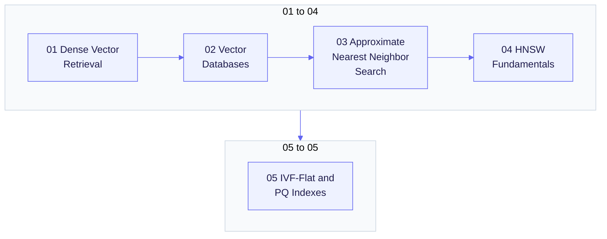

# 06 · Dense Retrieval and Vector Search

 

**Embedding-based retrieval and the indexes that make it fast.**

<a href="../05.%20Sparse%20Retrieval/README.md">Previous group: 05 Sparse Retrieval</a> | <a href="../README.md">Home</a> | <a href="../07.%20Hybrid%20Search/README.md">Next group: 07 Hybrid Search</a>

## Learning flow

## Chapters

**Done** = notes + notebook · **Notebook** = notebook ready, notes coming · **Planned** = folder ready

<table width="100%">
<thead><tr><th width="7%">Sr No</th><th width="25%">Chapter</th><th width="44%">Key Concepts</th><th width="8%">Notes</th><th width="8%">Notebook</th><th width="8%">Status</th></tr></thead>
<tbody>
<tr><td align="center">01</td><td><a href="01.%20Dense%20Vector%20Retrieval"><b>Dense Vector Retrieval</b></a></td><td>Embeddings, query and document vectors, embedding models, dense Top-K search; Bi-encoders, Dense Passage Retrieval, why dense alone misses exact matches</td><td align="center"><a href="01.%20Dense%20Vector%20Retrieval/notes/01.%20Dense%20Vector%20Retrieval.md">Read</a></td><td align="center">-</td><td align="center">Done</td></tr>
<tr><td align="center">02</td><td><a href="02.%20Vector%20Databases"><b>Vector Databases</b></a></td><td>FAISS, Milvus, Pinecone, Qdrant, pgvector: when each one fits</td><td align="center">-</td><td align="center">-</td><td align="center">Planned</td></tr>
<tr><td align="center">03</td><td><a href="03.%20Approximate%20Nearest%20Neighbor%20Search"><b>Approximate Nearest Neighbor Search</b></a></td><td>Exact vs approximate nearest neighbor, recall vs latency, vector databases; HNSW, IVF, product quantization, the recall-vs-latency trade-off</td><td align="center"><a href="03.%20Approximate%20Nearest%20Neighbor%20Search/notes/03.%20Approximate%20Nearest%20Neighbor%20Search.md">Read</a></td><td align="center">-</td><td align="center">Done</td></tr>
<tr><td align="center">04</td><td><a href="04.%20HNSW%20Fundamentals"><b>HNSW Fundamentals</b></a></td><td>HNSW graph layers, M, efConstruction, efSearch, recall and speed trade-offs</td><td align="center">-</td><td align="center">-</td><td align="center">Planned</td></tr>
<tr><td align="center">05</td><td><a href="05.%20IVF-Flat%20and%20PQ%20Indexes"><b>IVF-Flat and PQ Indexes</b></a></td><td>IVF clustering, nlist and nprobe, flat search, product quantization, memory vs accuracy</td><td align="center">-</td><td align="center">-</td><td align="center">Planned</td></tr>
</tbody>
</table>
