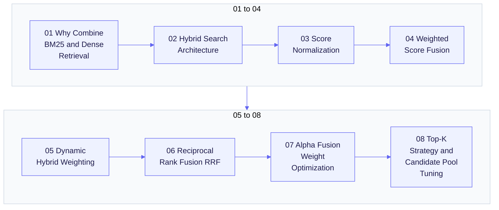

# 07 · Hybrid Search

 

**Combining sparse and dense retrieval: normalization, fusion, RRF and tuning.**

<a href="../06.%20Dense%20Retrieval%20and%20Vector%20Search/README.md">Previous group: 06 Dense Retrieval and Vector Search</a> | <a href="../README.md">Home</a> | <a href="../08.%20Query%20Understanding%20and%20Transformation/README.md">Next group: 08 Query Understanding and Transformation</a>

## Learning flow

## Chapters

**Done** = notes + notebook · **Notebook** = notebook ready, notes coming · **Planned** = folder ready

<table width="100%">
<thead><tr><th width="6%">Sr&nbsp;No</th><th width="22%">Chapter</th><th width="46%">Key Concepts</th><th width="8%">Interview Priority</th><th width="6%">Notes</th><th width="6%">Notebook</th><th width="6%">Status</th></tr></thead>
<tbody>
<tr><td align="center">01</td><td><b>Why Combine BM25 and Dense Retrieval</b></td><td>Where BM25 wins, where dense wins, both succeed, both fail, complementary signals</td><td align="center">Medium</td><td align="center">-</td><td align="center">-</td><td align="center">Planned</td></tr>
<tr><td align="center">02</td><td><b>Hybrid Search Architecture</b></td><td>Parallel sparse and dense branches, candidate pools, fusion, reranker, LLM; Why combine BM25 and dense, score normalization, weighted fusion, Reciprocal Rank Fusion, tuning alpha</td><td align="center">High</td><td align="center">-</td><td align="center">-</td><td align="center">Planned</td></tr>
<tr><td align="center">03</td><td><b>Score Normalization</b></td><td>Min-max, z-score, score scaling, relative score normalization</td><td align="center">High</td><td align="center">-</td><td align="center">-</td><td align="center">Planned</td></tr>
<tr><td align="center">04</td><td><b>Weighted Score Fusion</b></td><td>HybridScore = alpha x dense + (1 - alpha) x sparse, choosing weights</td><td align="center">High</td><td align="center">-</td><td align="center">-</td><td align="center">Planned</td></tr>
<tr><td align="center">05</td><td><b>Dynamic Hybrid Weighting</b></td><td>Query-dependent alpha, exact vs semantic query detection, production heuristics</td><td align="center">Medium</td><td align="center">-</td><td align="center">-</td><td align="center">Planned</td></tr>
<tr><td align="center">06</td><td><b>Reciprocal Rank Fusion RRF</b></td><td>RRF formula, k parameter, rank-based fusion, why RRF is robust, RRF vs weighted</td><td align="center">High</td><td align="center">-</td><td align="center">-</td><td align="center">Planned</td></tr>
<tr><td align="center">07</td><td><b>Alpha Fusion Weight Optimization</b></td><td>Alpha grid search on evaluation sets, picking the best weight</td><td align="center">High</td><td align="center">-</td><td align="center">-</td><td align="center">Planned</td></tr>
<tr><td align="center">08</td><td><b>Top-K Strategy and Candidate Pool Tuning</b></td><td>Top-K per retriever, candidate pool size, recall vs reranker cost</td><td align="center">Medium</td><td align="center">-</td><td align="center">-</td><td align="center">Planned</td></tr>
</tbody>
</table>
