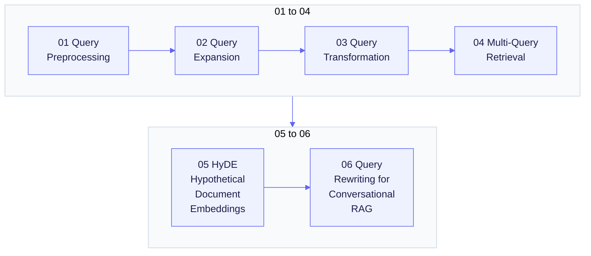

# 08 · Query Understanding and Transformation

 

**Cleaning, expanding and rewriting the query before retrieval.**

<a href="../07.%20Hybrid%20Search/README.md">Previous group: 07 Hybrid Search</a> | <a href="../README.md">Home</a> | <a href="../09.%20Advanced%20Retrieval%20Strategies/README.md">Next group: 09 Advanced Retrieval Strategies</a>

## Learning flow

## Chapters

**Done** = notes + notebook · **Notebook** = notebook ready, notes coming · **Planned** = folder ready

<table width="100%">
<thead><tr><th width="6%">Sr&nbsp;No</th><th width="22%">Chapter</th><th width="46%">Key Concepts</th><th width="8%">Interview Priority</th><th width="6%">Notes</th><th width="6%">Notebook</th><th width="6%">Status</th></tr></thead>
<tbody>
<tr><td align="center">01</td><td><b>Query Preprocessing</b></td><td>Lowercasing, punctuation, stopwords, spell correction, preserving IDs and numbers; Spell correction, intent detection, entity extraction before retrieval</td><td align="center">Medium</td><td align="center">-</td><td align="center">-</td><td align="center">Planned</td></tr>
<tr><td align="center">02</td><td><b>Query Expansion</b></td><td>Synonym expansion, LLM expansion, metadata expansion, domain dictionaries</td><td align="center">Medium</td><td align="center">-</td><td align="center">-</td><td align="center">Planned</td></tr>
<tr><td align="center">03</td><td><b>Query Transformation</b></td><td>Query expansion, HyDE, Query2Doc, step-back prompting, multi-query retrieval</td><td align="center">Medium</td><td align="center">-</td><td align="center">-</td><td align="center">Planned</td></tr>
<tr><td align="center">04</td><td><b>Multi-Query Retrieval</b></td><td>LLM-generated sub-queries, parallel retrieval, fusing multiple result lists</td><td align="center">Medium</td><td align="center">-</td><td align="center">-</td><td align="center">Planned</td></tr>
<tr><td align="center">05</td><td><b>HyDE Hypothetical Document Embeddings</b></td><td>Hypothetical answer generation, embedding the answer, vector search</td><td align="center">Medium</td><td align="center">-</td><td align="center">-</td><td align="center">Planned</td></tr>
<tr><td align="center">06</td><td><b>Query Rewriting for Conversational RAG</b></td><td>Conversational context, follow-up rewriting, standalone queries</td><td align="center">High</td><td align="center">-</td><td align="center">-</td><td align="center">Planned</td></tr>
</tbody>
</table>
