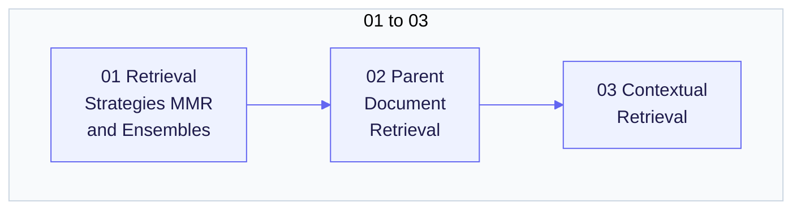

# 09 · Advanced Retrieval Strategies

 

**Retrieving the right unit of context, not just the most similar chunk.**

<a href="../08.%20Query%20Understanding%20and%20Transformation/README.md">Previous group: 08 Query Understanding and Transformation</a> | <a href="../README.md">Home</a> | <a href="../10.%20Reranking/README.md">Next group: 10 Reranking</a>

## Learning flow

## Chapters

**Done** = notes + notebook · **Notebook** = notebook ready, notes coming · **Planned** = folder ready

<table width="100%">
<thead><tr><th width="6%">Sr&nbsp;No</th><th width="22%">Chapter</th><th width="46%">Key Concepts</th><th width="8%">Interview Priority</th><th width="6%">Notes</th><th width="6%">Notebook</th><th width="6%">Status</th></tr></thead>
<tbody>
<tr><td align="center">01</td><td><b>Retrieval Strategies MMR and Ensembles</b></td><td>MMR, parent-document retrieval, contextual retrieval, ensemble retrievers, Top-K and candidate pools</td><td align="center">Medium</td><td align="center">-</td><td align="center">-</td><td align="center">Planned</td></tr>
<tr><td align="center">02</td><td><b>Parent Document Retrieval</b></td><td>Small chunks for retrieval, parent documents for context</td><td align="center">Medium</td><td align="center">-</td><td align="center">-</td><td align="center">Planned</td></tr>
<tr><td align="center">03</td><td><b>Contextual Retrieval</b></td><td>Adding document context to chunks before embedding and BM25</td><td align="center">Medium</td><td align="center">-</td><td align="center">-</td><td align="center">Planned</td></tr>
</tbody>
</table>
