<div align="center">

# 9a · Lexical vs Semantic Retrieval

  

**Do the words match, or does the meaning match? Hybrid uses both.**

</div>

<p align="center"><a href="../../README.md">Previous: 09 Sparse Retrieval and Keyword Search</a> | <a href="../../../README.md">Home</a> | <a href="../README.md">Module index</a> | <a href="../../README.md">Chapter 09: Sparse Retrieval and Keyword Search</a> | <a href="../../9b.%20Inverted%20Index%20Fundamentals/README.md">Next: 9b Inverted Index Fundamentals</a></p>

## Contents

<table width="100%">
<thead><tr><th width="8%">Sr No</th><th width="38%">Section</th><th width="54%">Subtopics</th></tr></thead>
<tbody>
<tr><td align="center">01</td><td><a href="#1-what-is-a-vector"><b>1. What Is a Vector?</b></a></td><td>-</td></tr>
<tr><td align="center">02</td><td><a href="#2-why-do-we-need-two-retrieval-styles"><b>2. Why Do We Need Two Retrieval Styles?</b></a></td><td>-</td></tr>
<tr><td align="center">03</td><td><a href="#3-build-a-small-enterprise-style-corpus"><b>3. Build a Small Enterprise-Style Corpus</b></a></td><td>-</td></tr>
<tr><td align="center">04</td><td><a href="#4-basic-retrieval-vocabulary"><b>4. Basic Retrieval Vocabulary</b></a></td><td>-</td></tr>
<tr><td align="center">05</td><td><a href="#5-lexical-retrieval--first-principles"><b>5. Lexical Retrieval — First Principles</b></a></td><td><a href="#51-tokenization">5.1 Tokenization</a><br><a href="#52-tokenization-can-affect-ids">5.2 Tokenization Can Affect IDs</a></td></tr>
<tr><td align="center">06</td><td><a href="#6-simplest-lexical-idea--token-overlap"><b>6. Simplest Lexical Idea — Token Overlap</b></a></td><td>-</td></tr>
<tr><td align="center">07</td><td><a href="#7-vocabulary-mismatch"><b>7. Vocabulary Mismatch</b></a></td><td>-</td></tr>
<tr><td align="center">08</td><td><a href="#8-tf-idf--better-lexical-weighting"><b>8. TF-IDF — Better Lexical Weighting</b></a></td><td><a href="#81-inspect-one-sparse-document-vector">8.1 Inspect One Sparse Document Vector</a></td></tr>
<tr><td align="center">09</td><td><a href="#9-sparse-search--full-internal-flow"><b>9. Sparse Search — Full Internal Flow</b></a></td><td>-</td></tr>
<tr><td align="center">10</td><td><a href="#10-exact-match-strength"><b>10. Exact-Match Strength</b></a></td><td>-</td></tr>
<tr><td align="center">11</td><td><a href="#checkpoint-1"><b>CHECKPOINT 1</b></a></td><td>-</td></tr>
<tr><td align="center">12</td><td><a href="#11-semantic--dense-retrieval"><b>11. Semantic / Dense Retrieval</b></a></td><td><a href="#why-is-it-called-dense">Why is it called dense?</a><br><a href="#111-inspect-an-embedding">11.1 Inspect an Embedding</a></td></tr>
<tr><td align="center">13</td><td><a href="#12-cosine-similarity--from-zero"><b>12. Cosine Similarity — From Zero</b></a></td><td>-</td></tr>
<tr><td align="center">14</td><td><a href="#13-dense-search--full-internal-flow"><b>13. Dense Search — Full Internal Flow</b></a></td><td>-</td></tr>
<tr><td align="center">15</td><td><a href="#14-semantic-neighborhood"><b>14. Semantic Neighborhood</b></a></td><td>-</td></tr>
<tr><td align="center">16</td><td><a href="#15-visualize-embeddings-in-2d"><b>15. Visualize Embeddings in 2D</b></a></td><td>-</td></tr>
<tr><td align="center">17</td><td><a href="#checkpoint-2"><b>CHECKPOINT 2</b></a></td><td>-</td></tr>
<tr><td align="center">18</td><td><a href="#16-compare-sparse-and-dense-search-directly"><b>16. Compare Sparse and Dense Search Directly</b></a></td><td><a href="#161-exact-query">16.1 Exact Query</a><br><a href="#162-semantic-query">16.2 Semantic Query</a><br><a href="#163-mixed-query">16.3 Mixed Query</a></td></tr>
<tr><td align="center">19</td><td><a href="#17-product-ids--dense-search-weakness"><b>17. Product IDs — Dense Search Weakness</b></a></td><td>-</td></tr>
<tr><td align="center">20</td><td><a href="#18-article-numbers"><b>18. Article Numbers</b></a></td><td>-</td></tr>
<tr><td align="center">21</td><td><a href="#19-version-numbers"><b>19. Version Numbers</b></a></td><td>-</td></tr>
<tr><td align="center">22</td><td><a href="#20-number-sensitivity"><b>20. Number Sensitivity</b></a></td><td>-</td></tr>
<tr><td align="center">23</td><td><a href="#21-negation"><b>21. Negation</b></a></td><td>-</td></tr>
<tr><td align="center">24</td><td><a href="#22-acronyms-and-domain-language"><b>22. Acronyms and Domain Language</b></a></td><td>-</td></tr>
<tr><td align="center">25</td><td><a href="#23-three-practical-query-types"><b>23. Three Practical Query Types</b></a></td><td>-</td></tr>
<tr><td align="center">26</td><td><a href="#24-visualize-sparse-vs-dense-score-distributions"><b>24. Visualize Sparse vs Dense Score Distributions</b></a></td><td>-</td></tr>
<tr><td align="center">27</td><td><a href="#25-hybrid-search--combine-both-signals"><b>25. Hybrid Search — Combine Both Signals</b></a></td><td><a href="#why-normalize">Why normalize?</a><br><a href="#251-hybrid-search-with-full-internal-prints">25.1 Hybrid Search With Full Internal Prints</a></td></tr>
<tr><td align="center">28</td><td><a href="#26-alpha-as-a-dial"><b>26. Alpha as a Dial</b></a></td><td>-</td></tr>
<tr><td align="center">29</td><td><a href="#27-dynamic-weighting--advanced-preview"><b>27. Dynamic Weighting — Advanced Preview</b></a></td><td>-</td></tr>
<tr><td align="center">30</td><td><a href="#28-retrieval-evaluation"><b>28. Retrieval Evaluation</b></a></td><td>-</td></tr>
<tr><td align="center">31</td><td><a href="#29-retrieval-debugging-framework"><b>29. Retrieval Debugging Framework</b></a></td><td>-</td></tr>
<tr><td align="center">32</td><td><a href="#30-production-mental-model"><b>30. Production Mental Model</b></a></td><td>-</td></tr>
<tr><td align="center">33</td><td><a href="#31-retrieval-is-not-reasoning"><b>31. Retrieval Is Not Reasoning</b></a></td><td>-</td></tr>
<tr><td align="center">34</td><td><a href="#32-failure-matrix"><b>32. Failure Matrix</b></a></td><td>-</td></tr>
<tr><td align="center">35</td><td><a href="#checkpoint-3"><b>CHECKPOINT 3</b></a></td><td>-</td></tr>
<tr><td align="center">36</td><td><a href="#33-interview-questions"><b>33. Interview Questions</b></a></td><td>-</td></tr>
<tr><td align="center">37</td><td><a href="#34-interview-scenarios"><b>34. Interview Scenarios</b></a></td><td>-</td></tr>
<tr><td align="center">38</td><td><a href="#35-one-page-revision-map"><b>35. One-Page Revision Map</b></a></td><td>-</td></tr>
<tr><td align="center">39</td><td><a href="#36-practice-tasks"><b>36. Practice Tasks</b></a></td><td>-</td></tr>
<tr><td align="center">40</td><td><a href="#37-final-takeaways"><b>37. Final Takeaways</b></a></td><td>-</td></tr>
<tr><td align="center">41</td><td><a href="#next-chapter"><b>Next Chapter</b></a></td><td><a href="#chapter-3--inverted-index-fundamentals">Chapter 3 — Inverted Index Fundamentals</a></td></tr>
</tbody>
</table>

#### By the end, you should understand

- lexical / sparse retrieval
- semantic / dense retrieval
- vocabulary mismatch
- tokenization
- TF-IDF intuition
- embeddings
- cosine similarity
- exact IDs and error codes
- regulation/article numbers
- version and number sensitivity
- acronyms
- negation
- exact vs semantic vs mixed queries
- simple Hybrid Search
- score normalization
- alpha weighting
- retrieval evaluation
- retrieval debugging

---

### Main mental model

```text
LEXICAL SEARCH
"Do the WORDS match?"

SEMANTIC SEARCH
"Does the MEANING match?"

HYBRID SEARCH
"Use BOTH signals."
```

## 1. What Is a Vector?

A vector is simply a list of numbers.

```text
[0.21, -0.42, 0.77, 0.11]
```

Search systems convert text into numerical representations so queries and documents can be compared mathematically.

## 2. Why Do We Need Two Retrieval Styles?

Imagine these documents:

```text
D1: REACH Article 33 requires suppliers to communicate SVHC information.

D2: European law requires companies to disclose harmful substances in products.

D3: Error E401 means authentication failure.

D4: Users who cannot sign in should reset expired credentials.
```

A user may search:

```text
REACH Article 33
```

This is an **exact query**.

Another user may ask:

```text
Why can't a user log in?
```

This is a **semantic query**.

One retrieval method is not equally good at both.

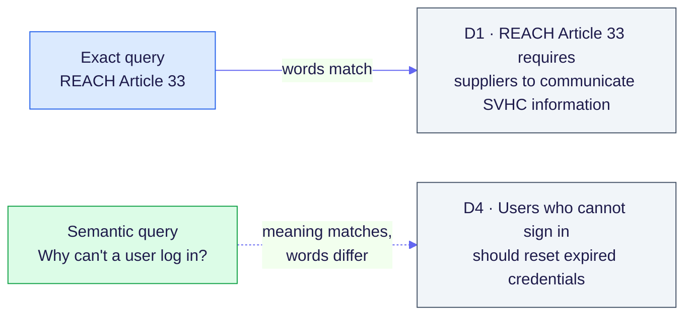

## 3. Build a Small Enterprise-Style Corpus

We intentionally include:

- legal references
- error codes
- product IDs
- policy wording
- software versions
- retention durations
- negation
- battery obligations

This allows us to reproduce real retrieval problems.

The 20-document corpus used in every experiment:

<table width="100%">
<thead><tr><th>id</th><th>category</th><th>text</th></tr></thead>
<tbody>
<tr><td>D1</td><td>regulation</td><td>REACH Regulation EC 1907/2006 governs registration, evaluation, authorisation and restriction of chemical substances.</td></tr>
<tr><td>D2</td><td>regulation</td><td>REACH Article 33 requires suppliers to communicate information about substances of very high concern, commonly called SVHCs.</td></tr>
<tr><td>D3</td><td>regulation</td><td>REACH Article 34 contains separate information duties and is distinct from Article 33.</td></tr>
<tr><td>D4</td><td>regulation</td><td>Regulation EU 2023/1542 establishes requirements for batteries and waste batteries.</td></tr>
<tr><td>D5</td><td>regulation</td><td>Regulation EU 2025/40 establishes requirements for packaging and packaging waste.</td></tr>
<tr><td>D6</td><td>support</td><td>Error code E401 indicates an authentication failure caused by invalid or expired credentials.</td></tr>
<tr><td>D7</td><td>support</td><td>Users who cannot sign in should verify their login credentials and reset the password if required.</td></tr>
<tr><td>D8</td><td>support</td><td>Error code E503 indicates that the service is temporarily unavailable.</td></tr>
<tr><td>D9</td><td>product</td><td>Siemens product 6ES7513-1AL02-0AB0 is an industrial automation CPU.</td></tr>
<tr><td>D10</td><td>product</td><td>Industrial automation controllers are selected based on processing capacity, communication interfaces and system requirements.</td></tr>
<tr><td>D11</td><td>policy</td><td>Employees may work remotely for two days each week.</td></tr>
<tr><td>D12</td><td>policy</td><td>The work-from-home allowance permits eligible employees to perform their duties away from the office.</td></tr>
<tr><td>D13</td><td>software</td><td>Python 3.12 installation troubleshooting includes dependency checks and environment configuration.</td></tr>
<tr><td>D14</td><td>software</td><td>Python 3.11 installation troubleshooting includes dependency checks and environment configuration.</td></tr>
<tr><td>D15</td><td>retention</td><td>Records must be retained for 24 months.</td></tr>
<tr><td>D16</td><td>retention</td><td>Records must be retained for 36 months.</td></tr>
<tr><td>D17</td><td>compliance</td><td>Products containing substance X are prohibited.</td></tr>
<tr><td>D18</td><td>compliance</td><td>Products containing substance X are not prohibited.</td></tr>
<tr><td>D19</td><td>battery</td><td>Producers shall finance the collection and treatment of waste batteries.</td></tr>
<tr><td>D20</td><td>battery</td><td>Battery fire safety guidance describes thermal runaway and emergency response procedures.</td></tr>
</tbody>
</table>

## 4. Basic Retrieval Vocabulary

#### Query
What the user searches.

```text
REACH Article 33
```

#### Document
One searchable text unit.

#### Corpus
All searchable documents.

#### Token
A piece of text produced during tokenization.

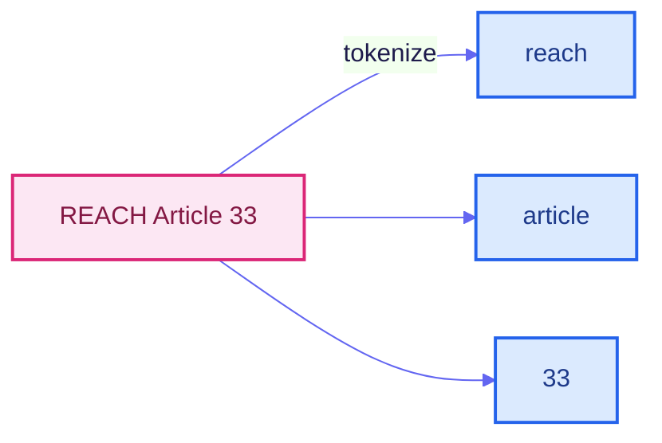

#### Score
A number estimating relevance.

#### Ranking
Documents sorted by score.

#### Top-K
Return only the best K results.

#### Retriever
The component that maps:

```text
query → relevant candidate documents
```

## 5. Lexical Retrieval — First Principles

Lexical retrieval focuses on actual terms.

For:

```text
REACH Article 33
```

the strongest clues are:

```text
REACH
Article
33
```

A lexical search engine does not need to understand what `33` means.

It only needs to observe:

```text
query contains 33
document contains 33
```

That is why lexical retrieval is excellent for exact references.

### 5.1 Tokenization

Search engines normally process text before indexing.

A simplified pipeline:

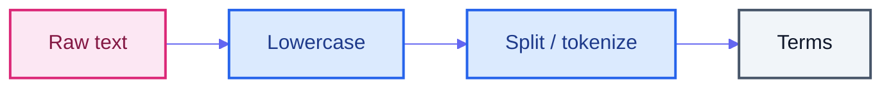

```python
import re

def tokenize(text):
    # Lowercase so case differences do not create different terms
    text = text.lower()

    # Split on anything that is not a letter or digit
    return re.findall(r"[a-z0-9]+", text)

tokenize("REACH Article 33")
# ['reach', 'article', '33']

tokenize("6ES7513-1AL02-0AB0")
# ['6es7513', '1al02', '0ab0']  -> the product code is split
```

### 5.2 Tokenization Can Affect IDs

Consider:

```text
6ES7513-1AL02-0AB0
```

A generic tokenizer may split it.

That can be problematic when the complete product code is meaningful as one identifier.

In production, you may need special analyzers for:

```text
product IDs
CAS numbers
error codes
SKUs
regulation numbers
versions
URLs
```

## 6. Simplest Lexical Idea — Token Overlap

Before TF-IDF and BM25, understand the simplest relevance signal:

> How many query tokens also occur in the document?

Result for query `REACH Article 33` against D2: query tokens `{reach, article, 33}`, overlap = **3 of 3 tokens**.

## 7. Vocabulary Mismatch

Now consider:

```text
Query:
work from home policy

Document:
Employees may work remotely for two days each week.
```

A human understands:

```text
work from home ≈ work remotely
```

But the exact vocabulary differs.

This is called **vocabulary mismatch**.

```text
MEANING matches
but
WORDS do not match well
```

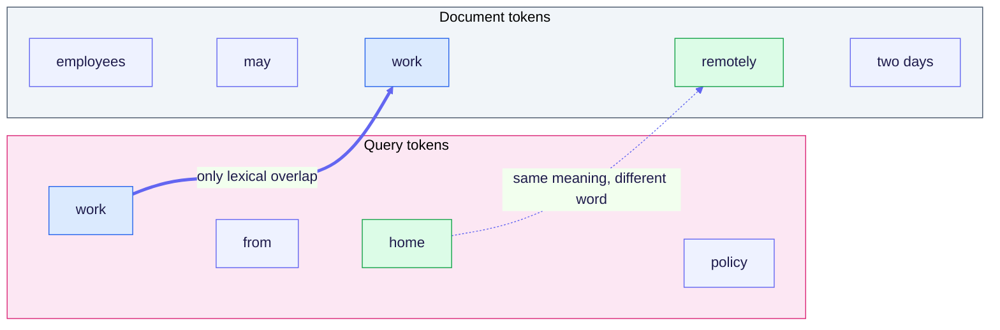

## 8. TF-IDF — Better Lexical Weighting

Simple overlap treats every word equally.

But:

```text
information
```

is much less specific than:

```text
E401
```

TF-IDF gives more importance to useful terms.

For now remember:

```text
rare / discriminative term → higher importance
common term → lower importance
```

We will study TF-IDF mathematics in its dedicated chapter.

```python
from sklearn.feature_extraction.text import TfidfVectorizer
from sklearn.metrics.pairwise import cosine_similarity

# Learn vocabulary + IDF from the corpus; bigrams keep short phrases together
tfidf_vectorizer = TfidfVectorizer(lowercase=True, ngram_range=(1, 2))
tfidf_matrix = tfidf_vectorizer.fit_transform(df["text"])

# Shape (20, 326): 20 documents, 326 unigram + bigram features
print(tfidf_matrix.shape)

def sparse_search(query, top_k=5):
    # Map the query into the same vocabulary space
    query_vector = tfidf_vectorizer.transform([query])

    # Cosine similarity against every document
    scores = cosine_similarity(query_vector, tfidf_matrix).flatten()

    # Return the best K documents
    ranked = scores.argsort()[::-1][:top_k]
    return df.iloc[ranked].assign(sparse_score=scores[ranked])
```

If the matrix shape were:

```text
(20, 250)
```

that would mean:

```text
20 documents
250 possible lexical features
```

Most values are zero.

This is one reason lexical representations are called **sparse**.

### 8.1 Inspect One Sparse Document Vector

D2 (*REACH Article 33 requires suppliers to communicate information about substances of very high concern, commonly called SVHCs.*) has only a few dozen non-zero cells out of 326. Its features include `requires`, `suppliers`, `svhcs`, and bigrams such as `33 requires` and `suppliers to`, each with weight 0.1806. Every term appears once in D2 and the vector is L2-normalized, so many weights are equal. Every non-zero feature maps to a visible word, which makes sparse scores easy to explain.

## 9. Sparse Search — Full Internal Flow


## 10. Exact-Match Strength

Lexical search is especially valuable for:

```text
E401
6ES7513-1AL02-0AB0
REACH Article 33
Regulation 2023/1542
Python 3.12
```

The important information is often the exact token itself.

## CHECKPOINT 1

You should now be able to explain:

1. What tokenization is.
2. Why tokenization can matter for product codes.
3. What vocabulary mismatch means.
4. Why lexical representations are sparse.
5. Why `E401` is an excellent lexical query.

## 11. Semantic / Dense Retrieval

Semantic search focuses on meaning.

For example:

```text
cannot log in
```

and:

```text
authentication failure
```

have different words but related meanings.

An embedding model converts text into a dense vector:

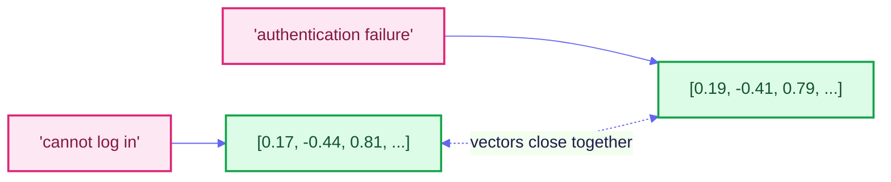

Related meanings should ideally produce vectors that are close together.

### Why is it called dense?

A dense embedding may contain hundreds of numbers, and most are non-zero.

```text
[0.12, -0.08, 0.55, 0.21, ...]
```

Meaning is distributed across many dimensions.

```python
from sentence_transformers import SentenceTransformer

# 384-dimensional sentence embedding model
embedding_model = SentenceTransformer("all-MiniLM-L6-v2")

# Normalize so dot product = cosine similarity
document_embeddings = embedding_model.encode(df["text"].tolist(), normalize_embeddings=True)

def dense_search(query, top_k=5):
    # Embed the query
    query_embedding = embedding_model.encode([query], normalize_embeddings=True)[0]

    # Similarity with every document
    scores = document_embeddings @ query_embedding

    # Return the best K documents
    ranked = scores.argsort()[::-1][:top_k]
    return df.iloc[ranked].assign(dense_score=scores[ranked])
```

### 11.1 Inspect an Embedding

The numbers are not individually human-readable, but looking at them makes the concept concrete.

The same D2 sentence as an embedding: shape `(384,)`, values between -0.167 and 0.173, mean 0.0004. No single dimension means a word such as `REACH`. Meaning is spread across all 384 numbers, so dense scores are hard to explain term by term.

<table width="100%">
<thead><tr><th width="20%">Property</th><th width="40%">Sparse TF-IDF vector</th><th width="40%">Dense embedding</th></tr></thead>
<tbody>
<tr><td><b>Size</b></td><td>326 (vocabulary size)</td><td>384 (model size)</td></tr>
<tr><td><b>Non-zero cells</b></td><td>a few dozen</td><td>almost all</td></tr>
<tr><td><b>One dimension means</b></td><td>a visible word or bigram</td><td>nothing readable on its own</td></tr>
<tr><td><b>Explainability</b></td><td>high</td><td>low</td></tr>
</tbody>
</table>

## 12. Cosine Similarity — From Zero

We need a mathematical way to compare vectors.

One common method is **cosine similarity**.

```math
\cos(\theta)=\frac{A \cdot B}{\|A\| \|B\|}
```

Intuition:

```text
same direction      → high similarity
different direction → lower similarity
```

Because we normalize embeddings, their magnitudes are approximately 1.

So the dot product can be used as cosine similarity.

## 13. Dense Search — Full Internal Flow


## 14. Semantic Neighborhood

Dense embeddings try to place semantically related phrases near each other.

Expected relationships:

```text
work from home ≈ remote working
cannot log in ≈ authentication failure
battery recycling ≈ waste battery collection
```

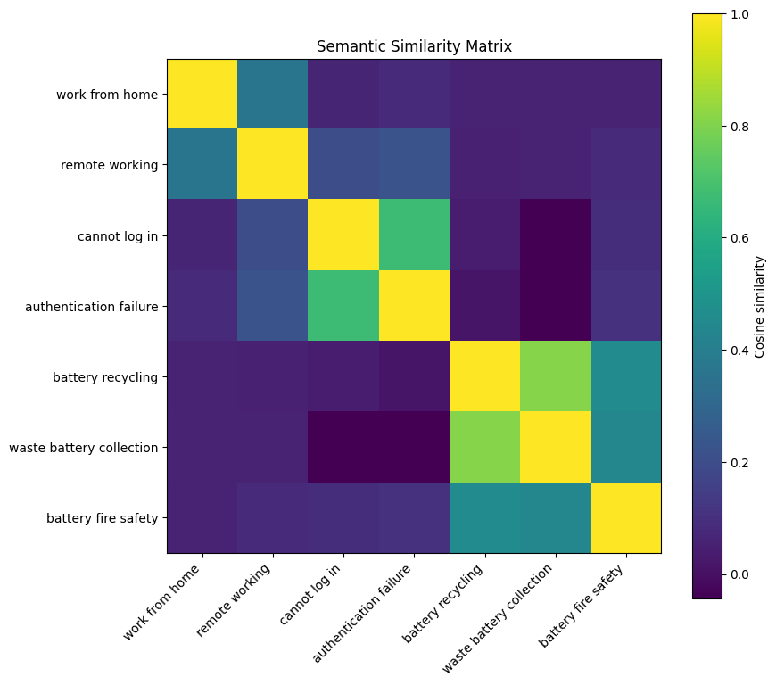

## 15. Visualize Embeddings in 2D

Embeddings actually live in hundreds of dimensions.

We use PCA only to create a 2D visualization.

Important:

```text
The chart is an approximation.
Actual search uses the full-dimensional vectors.
```

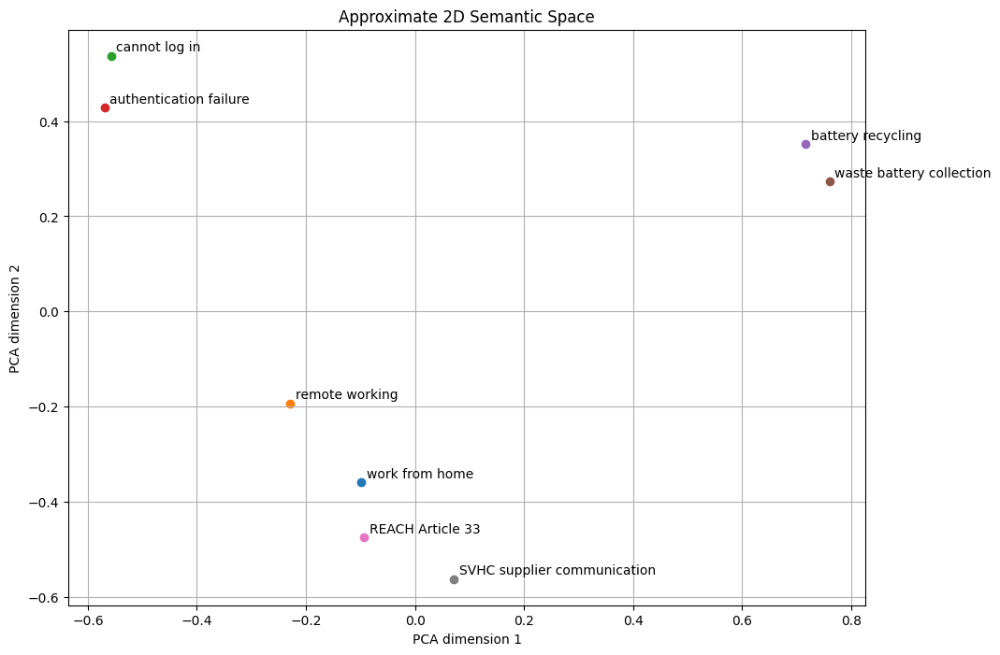

## CHECKPOINT 2

Explain these before continuing:

1. What is an embedding?
2. Why is the representation dense?
3. What does cosine similarity measure?
4. Why can `cannot log in` match `authentication failure`?
5. Why is the PCA plot only an approximation?

## 16. Compare Sparse and Dense Search Directly

Now both retrievers are ready.

### 16.1 Exact Query

```text
E401
```

Prediction:

> Sparse retrieval should be very strong.

### 16.2 Semantic Query

```text
Why can't users authenticate into the application?
```

Prediction:

> Dense retrieval should benefit from semantic similarity.

### 16.3 Mixed Query

```text
What disclosure obligations apply under REACH Article 33?
```

This contains:

```text
Exact:
REACH
Article 33

Semantic:
disclosure obligations
```

This is the classic Hybrid Search case.

##### Results of 16.1 to 16.3 and the other comparisons

<table width="100%">
<thead><tr><th width="30%">Query</th><th width="35%">Sparse Top-1 (score)</th><th width="35%">Dense Top-1 (score)</th></tr></thead>
<tbody>
<tr><td><code>E401</code></td><td>D6 E401 doc (0.2057), all others 0</td><td>D6 (0.5415), then unrelated D9 (0.3010)</td></tr>
<tr><td><code>Why can't users authenticate into the application?</code></td><td>D7 sign-in doc (0.2283), then a WFH policy (0.1533)</td><td>D7 (0.5082), then D6 E401 auth failure (0.3337)</td></tr>
<tr><td><code>6ES7513-1AL02-0AB0</code></td><td>D9 product (0.5312), all others 0</td><td>D9 (0.5363), then E503 doc (0.3391)</td></tr>
<tr><td><code>SVHC supplier communication</code></td><td>D10 controllers (0.2007), D2 scores 0</td><td>D2 REACH Article 33 (0.6536)</td></tr>
</tbody>
</table>

**Reading the table**

- Exact codes: sparse gives a clean signal (one match, rest zero). Dense also finds the doc but ranks unrelated documents close behind.
- Paraphrase: dense pulls in the related E401 authentication doc; sparse pulls in an unrelated policy.
- Word forms: the query says `SVHC supplier communication`, the document says `SVHCs`, `suppliers`, `communicate`. No token matches without stemming, so sparse misses D2. Dense still finds it.

## 17. Product IDs — Dense Search Weakness

A product ID such as:

```text
6ES7513-1AL02-0AB0
```

has little natural-language meaning.

The user normally wants:

```text
THIS exact item
```

not a conceptually related product.

## 18. Article Numbers

Compare:

```text
Article 33
Article 34
```

Their surrounding legal language may be similar.

But:

```text
33 ≠ 34
```

Exact numerical identity matters.

## 19. Version Numbers

Compare:

```text
Python 3.12
Python 3.11
```

The documentation can be nearly identical semantically.

But the version can determine whether instructions are correct.

## 20. Number Sensitivity

Compare:

```text
retain records for 24 months
retain records for 36 months
```

Most words are identical.

Only one number changes.

Yet the compliance obligation changes.

##### Small token change, big meaning change

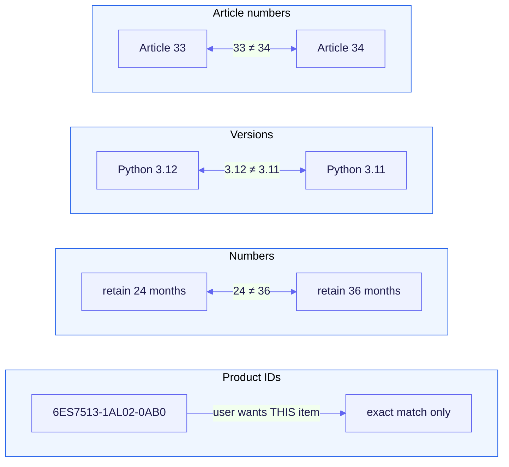

> [!WARNING]
> Dense embeddings can place these pairs very close together because almost all surrounding words are identical. Lexical retrieval keeps the exact token difference visible.

## 21. Negation

Compare:

```text
Products containing substance X are prohibited.
```

with:

```text
Products containing substance X are not prohibited.
```

These statements are highly related topically.

But their meaning is opposite.

This demonstrates an important rule:

> Retrieval relevance is not the same as factual reasoning.

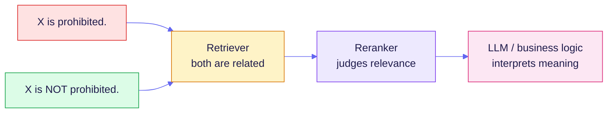

##### Results for sections 18 to 21

<table width="100%">
<thead><tr><th width="28%">Query</th><th width="24%">Sparse: right vs near-miss</th><th width="24%">Dense: right vs near-miss</th><th width="24%">Lesson</th></tr></thead>
<tbody>
<tr><td><code>Python 3.12 installation troubleshooting</code></td><td>0.6408 vs 0.3252</td><td>0.8778 vs 0.7812</td><td>Sparse keeps a wider gap on the version</td></tr>
<tr><td><code>records retained for 24 months</code></td><td>0.7929 vs 0.4293</td><td>0.9167 vs 0.8808</td><td>Dense similarity of the two sentences is <b>0.9681</b></td></tr>
<tr><td><code>Are products containing substance X prohibited?</code></td><td>0.8649 vs 0.7633</td><td>0.9547 vs 0.9039</td><td>The two statements have dense similarity <b>0.9642</b></td></tr>
<tr><td><code>REACH Article 33</code></td><td>D3 (Art. 34) 0.4833 above D2 (Art. 33) 0.3483</td><td>D3 0.7341 above D2 0.4912</td><td>D3 also mentions "Article 33", so both rank it first</td></tr>
</tbody>
</table>

## 22. Acronyms and Domain Language

Enterprise corpora contain:

```text
SVHC
EPR
PFAS
WEEE
RoHS
MFA
WO
```

A pretrained embedding model may understand some acronyms well.

But internal or rare abbreviations may be poorly represented.

Lexical retrieval still preserves the exact string.

## 23. Three Practical Query Types

#### Type A — Exact

```text
E401
6ES7513-1AL02-0AB0
REACH Article 33
```

Usually sparse-heavy.

#### Type B — Semantic

```text
Why can't users sign in?
What is the remote-work policy?
```

Usually dense-heavy.

#### Type C — Mixed

```text
What does REACH Article 33 require suppliers to disclose?
```

Usually Hybrid Search.

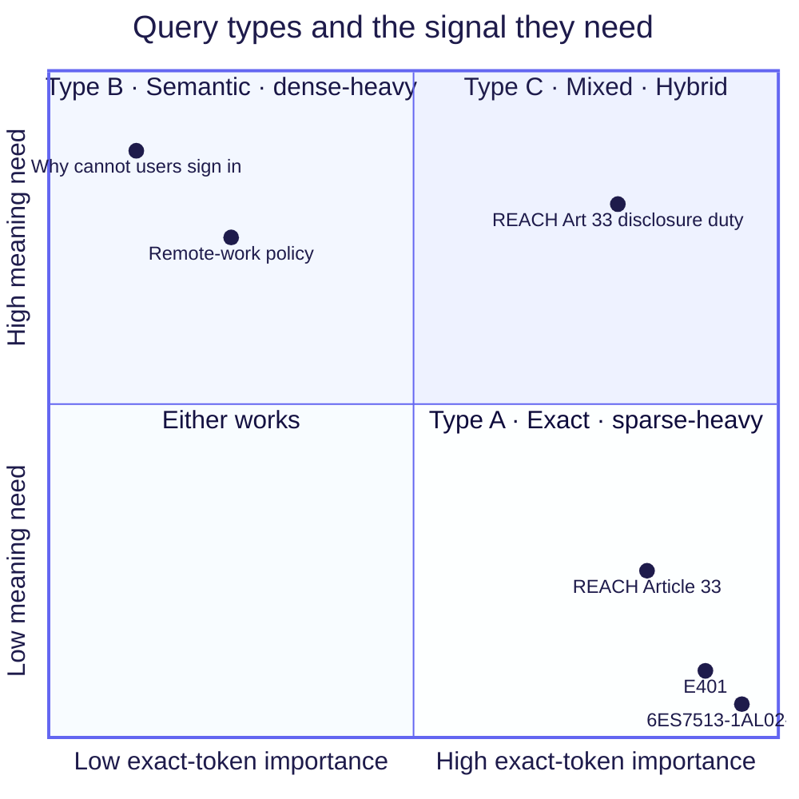

## 24. Visualize Sparse vs Dense Score Distributions

Let's use one semantic query.

Remember:

> Sparse and dense scores are not guaranteed to use the same numerical scale.

For *Why can't users authenticate?* sparse gives non-zero scores to only a few documents, while dense gives every document a score, including small negative ones. The two ranges are not comparable, so they must be normalized before fusion.

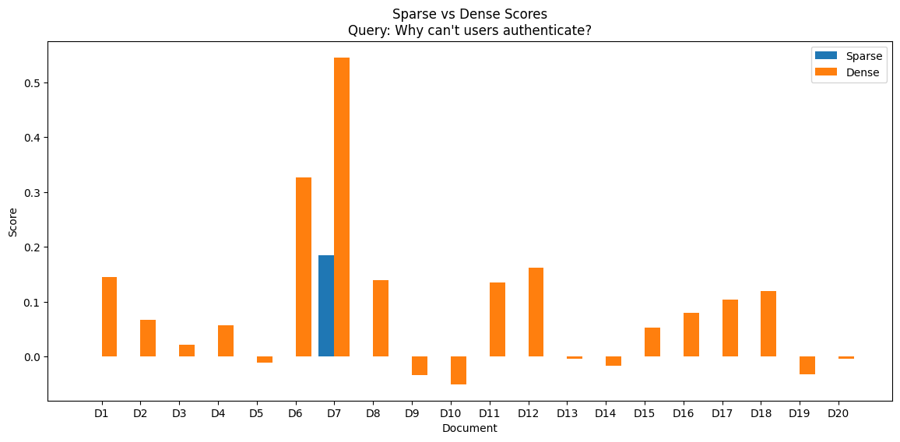

## 25. Hybrid Search — Combine Both Signals

A simple educational fusion formula is:

```math
\text{HybridScore} = (1-\alpha)\times \text{SparseNormalized} + \alpha\times \text{DenseNormalized}
```

Where:

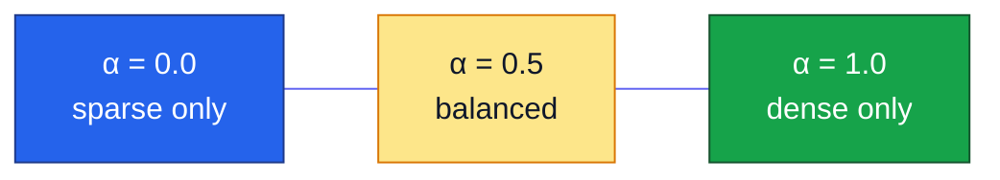

### Why normalize?

Raw sparse and dense scores may use different ranges.

We first convert them to a comparable 0–1 range.

```python
import numpy as np

def min_max(scores):
    # Scale into 0..1; the small epsilon avoids division by zero
    return (scores - scores.min()) / (scores.max() - scores.min() + 1e-12)

def hybrid_search(query, top_k=5, alpha=0.5):
    # Sparse branch
    sparse_scores = cosine_similarity(tfidf_vectorizer.transform([query]), tfidf_matrix).flatten()

    # Dense branch
    dense_scores = document_embeddings @ embedding_model.encode([query], normalize_embeddings=True)[0]

    # Fuse normalized scores; alpha is the dense weight
    hybrid_scores = (1 - alpha) * min_max(sparse_scores) + alpha * min_max(dense_scores)

    # Best K documents
    ranked = np.argsort(hybrid_scores)[::-1][:top_k]
    return df.iloc[ranked].assign(hybrid_score=hybrid_scores[ranked])
```

### 25.1 Hybrid Search With Full Internal Prints

Query: *What disclosure obligations apply under REACH Article 33 for SVHCs?* (alpha = 0.5)

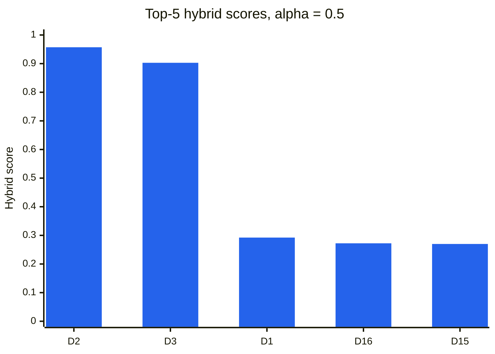

D2 (Article 33) now wins. Sparse alone preferred D3 (Article 34), but dense gave D2 its maximum score, and fusion combined both.

> [!TIP]
> For *What obligations apply under Regulation 2023/1542 for battery waste?* the top document is D4 for every alpha from 0.0 to 1.0. When both signals agree, alpha does not matter. There is no universal best alpha: tune it on real queries.

## 26. Alpha as a Dial

```text
alpha = 0.0
Sparse only

alpha = 0.2
Sparse-heavy

alpha = 0.5
Balanced

alpha = 0.8
Dense-heavy

alpha = 1.0
Dense only
```

There is no universal best alpha.

You should tune it using real evaluation queries.

## 27. Dynamic Weighting — Advanced Preview

A production system may adapt retrieval based on query type.

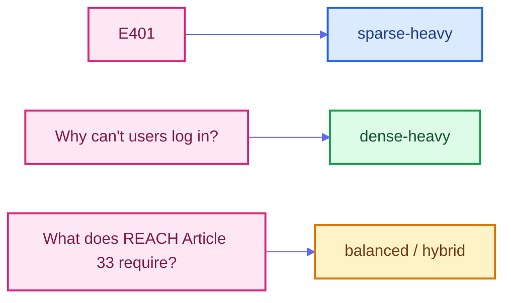

We implement a simple heuristic only to understand the idea.

##### The heuristic as a decision tree (same logic as `detect_query_type` / `choose_alpha`)

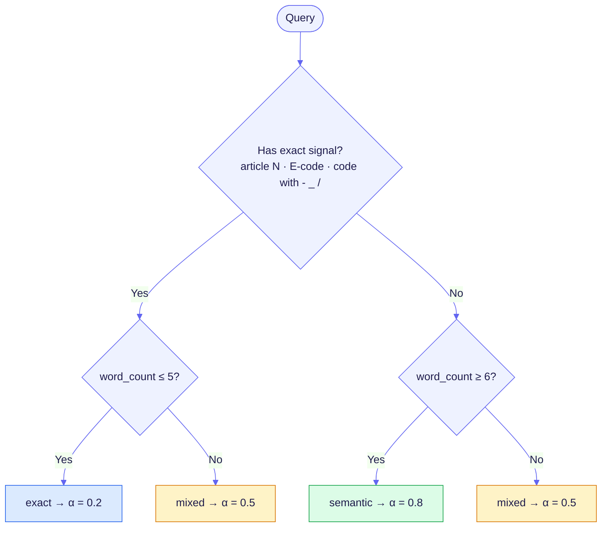

<table width="100%">
<thead><tr><th width="6%">Sr No</th><th width="54%">Query</th><th width="20%">Detected</th><th width="20%">Chosen α</th></tr></thead>
<tbody>
<tr><td align="center">01</td><td><code>E401</code></td><td align="center">exact</td><td align="center">0.2</td></tr>
<tr><td align="center">02</td><td><code>REACH Article 33</code></td><td align="center">exact</td><td align="center">0.2</td></tr>
<tr><td align="center">03</td><td><code>Why can't users authenticate into the application?</code></td><td align="center">semantic</td><td align="center">0.8</td></tr>
<tr><td align="center">04</td><td><code>What does REACH Article 33 require suppliers to disclose?</code></td><td align="center">mixed</td><td align="center">0.5</td></tr>
</tbody>
</table>

This heuristic is **not production-grade**.

A production system might use:

- deterministic ID detection
- query classifiers
- metadata
- RRF
- learned ranking
- offline evaluation

## 28. Retrieval Evaluation

Do not rely on:

```text
"This looks better."
```

Use labeled queries.

We will begin with **Hit@K**.

#### Hit@K

If at least one relevant document appears in Top-K:

```text
Hit@K = 1
```

Otherwise:

```text
Hit@K = 0
```

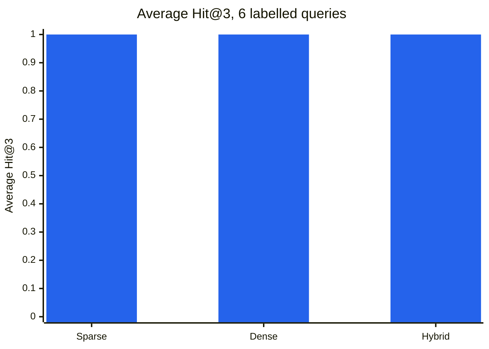

> [!NOTE]
> All three methods score 1.0 on this tiny set, but the **rank** of the relevant document differs (for example, `Who pays for collecting discarded batteries?` puts `D19` at rank 2 for sparse and hybrid, rank 1 for dense). Hit@K ignores rank; MRR and NDCG (Part 10) do not.

```python
def hit_at_k(retrieved_ids, expected_ids):
    # 1 if any expected document was retrieved, else 0
    return int(len(set(retrieved_ids) & set(expected_ids)) > 0)
```

The dataset above is intentionally tiny.

For production work, use many representative queries and human relevance labels.

## 29. Retrieval Debugging Framework

When a RAG answer is wrong:

```text
1. Does the correct document exist?
2. Did sparse retrieval find it?
3. Did dense retrieval find it?
4. Did fusion keep it?
5. Did reranking remove it?
6. Did the evidence reach the LLM?
7. Did the LLM misinterpret it?
```

This helps you avoid incorrectly blaming the LLM.

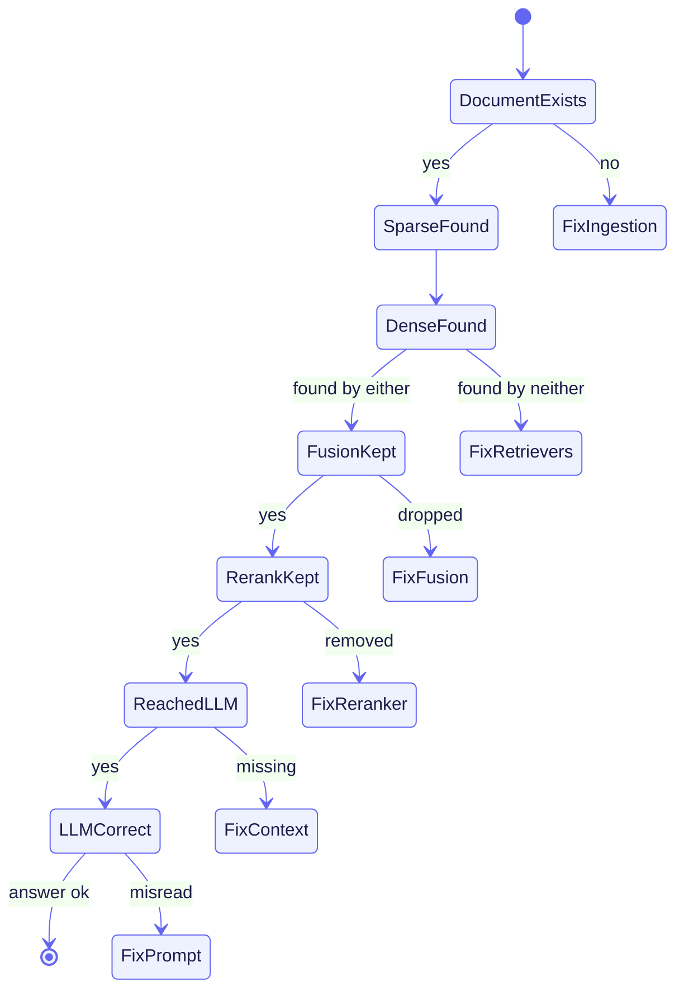

## 30. Production Mental Model

Real ranking may use more than sparse and dense relevance.

Conceptually:

```math
\text{Relevance} = f(\text{Lexical}, \text{Semantic}, \text{Metadata}, \text{Freshness}, \text{Authority}, \text{BusinessRules})
```

Example:

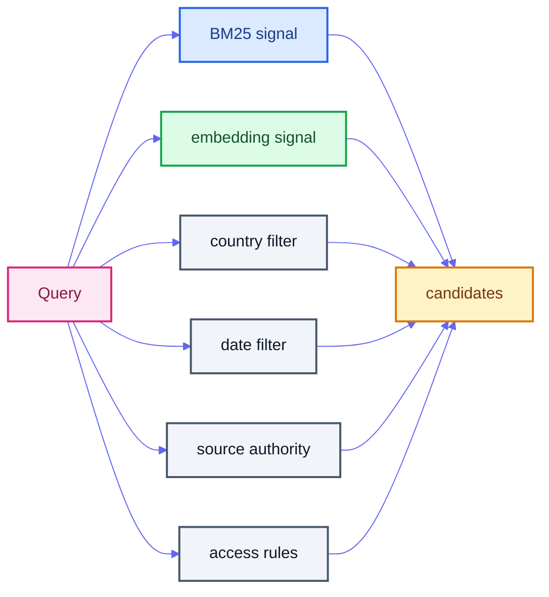

## 31. Retrieval Is Not Reasoning

Retriever:

```text
Find related evidence.
```

Reranker:

```text
Judge candidate relevance more carefully.
```

LLM / business logic:

```text
Interpret evidence and answer.
```

This distinction is critical for legal, regulatory, medical and technical RAG.

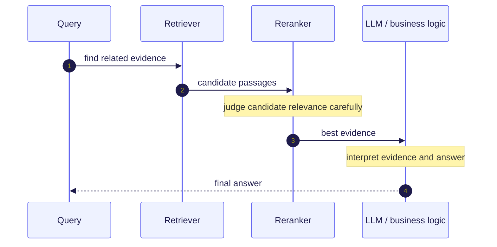

## 32. Failure Matrix

| Situation | Sparse | Dense |
|---|---|---|
| `car` vs `automobile` | can miss | strong |
| `work from home` vs `remote work` | can miss | strong |
| `E401` | strong | variable |
| product ID | strong | weak/variable |
| Article 33 vs Article 34 | strong distinction | can blur |
| Python 3.12 vs 3.11 | strong distinction | can blur |
| 24 vs 36 months | strong distinction | can blur |
| negation | related | related |
| internal acronym | exact match strong | model-dependent |

## CHECKPOINT 3

Explain these without looking back:

1. Why does lexical search handle product IDs well?
2. What is vocabulary mismatch?
3. Why can dense search confuse 24 and 36 months?
4. Why is negation difficult?
5. What is a mixed query?
6. Why normalize before weighted fusion?
7. What does alpha control?
8. Why is retrieval different from reasoning?

## 33. Interview Questions

#### What is lexical retrieval?

Lexical retrieval ranks documents using term-level evidence such as exact terms, phrases and term statistics. It is particularly strong for exact identifiers, rare terms, article numbers, product codes and versions.

#### What is semantic retrieval?

Semantic retrieval encodes queries and documents into dense vectors and ranks them using vector similarity. It is useful for synonyms, paraphrases and natural-language questions.

#### What is vocabulary mismatch?

When the query and relevant document describe the same concept using different vocabulary.

```text
work from home
vs
remote working
```

#### Why can dense search fail on IDs?

IDs have little semantic meaning. Their exact identity may be diluted in the embedding.

#### Why can dense search fail on numbers?

Two sentences with different numbers may remain nearly identical semantically even when the factual meaning changes.

#### Why Hybrid Search?

Sparse and dense retrieval contribute complementary signals.

## 34. Interview Scenarios

#### Scenario 1

```text
Query: 6ES7513-1AL02-0AB0
```

Use:

```text
exact / sparse-heavy retrieval
```

#### Scenario 2

```text
Query: Why can't users sign in?
Document: authentication failure caused by expired credentials
```

Dense retrieval helps bridge the vocabulary mismatch.

#### Scenario 3

```text
What does REACH Article 33 require suppliers to disclose?
```

Use Hybrid Search because both exact legal references and semantic intent matter.

#### Scenario 4

Dense retrieval ranks Python 3.11 over Python 3.12.

Reason:

The surrounding semantic context is almost identical and the version number may contribute little to the embedding.

#### Scenario 5

Retriever returns both:

```text
X is prohibited.
X is not prohibited.
```

This does not automatically mean retrieval is broken. Both are related passages. Final factual interpretation belongs to later stages.

## 35. One-Page Revision Map

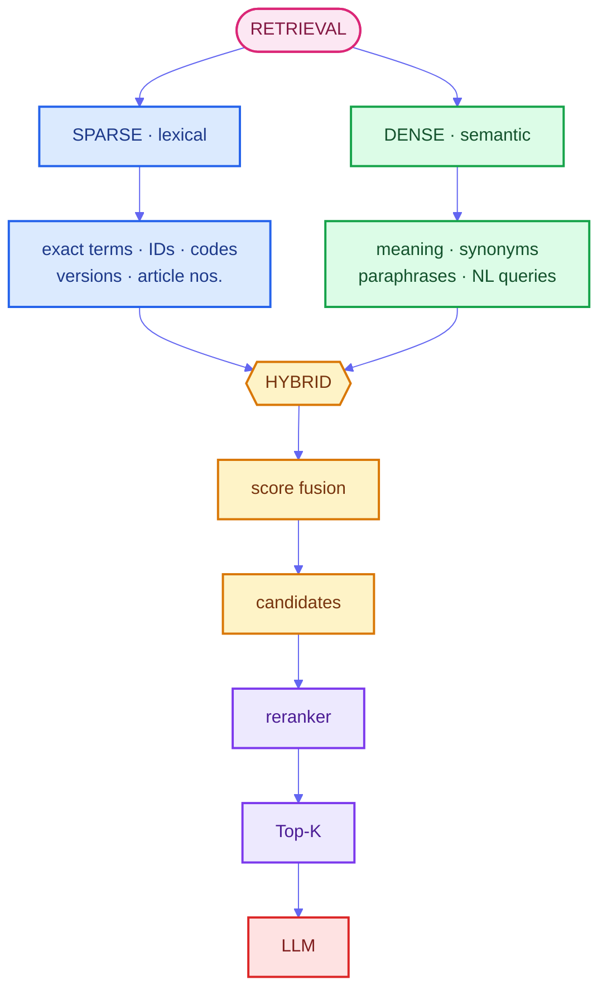

#### Sparse asks

```text
Do the words match?
```

#### Dense asks

```text
Does the meaning match?
```

#### Hybrid asks

```text
Considering both signals, what are the best candidates?
```

## 36. Practice Tasks

#### Task 1 — Vocabulary mismatch

Document:

```text
The employee can perform duties remotely.
```

Query:

```text
work from home policy
```

Compare sparse and dense retrieval.

#### Task 2 — Product IDs

Add:

```text
ABC-12345
ABC-12346
ABC-12347
```

Search exact IDs.

#### Task 3 — Versions

Add:

```text
FastAPI 0.110
FastAPI 0.111
FastAPI 0.112
```

Test exact-version retrieval.

#### Task 4 — Number sensitivity

Add:

```text
retain 12 months
retain 24 months
retain 36 months
```

#### Task 5 — Negation

Compare:

```text
feature is enabled
feature is not enabled
```

#### Task 6 — Query classification

Create:

- 5 exact queries
- 5 semantic queries
- 5 mixed queries

Predict the best retrieval style first.

#### Task 7 — Evaluation

Build 20 labeled queries and calculate:

```text
Hit@1
Hit@3
Hit@5
```

## 37. Final Takeaways

Remember these ten ideas:

1. Lexical retrieval matches exact terms.
2. Semantic retrieval matches meaning.
3. Vocabulary mismatch is a lexical-search weakness.
4. Exact IDs are a dense-search weakness.
5. Product IDs, article numbers and versions are powerful lexical signals.
6. Synonyms and paraphrases are strong dense-search use cases.
7. Numbers and negation can be semantically close but factually different.
8. Hybrid Search combines complementary signals.
9. Retrieval finds candidate evidence; it does not perform final reasoning.
10. Evaluate retrieval instead of assuming one method is better.

---

## Next Chapter

### Chapter 3 — Inverted Index Fundamentals


The next notebook will show exactly how a lexical search engine can find terms across very large corpora efficiently.

<p align="center"><a href="../../README.md">Previous: 09 Sparse Retrieval and Keyword Search</a> | <a href="../../../README.md">Home</a> | <a href="../README.md">Module index</a> | <a href="../../README.md">Chapter 09: Sparse Retrieval and Keyword Search</a> | <a href="../../9b.%20Inverted%20Index%20Fundamentals/README.md">Next: 9b Inverted Index Fundamentals</a></p>
