<div align="center">

# 9b · Inverted Index Fundamentals

  

**Map each term to the documents that contain it, so search becomes a lookup.**

</div>

<p align="center"><a href="../../9a.%20Lexical%20vs%20Semantic%20Retrieval/README.md">Previous: 9a Lexical vs Semantic Retrieval</a> | <a href="../../../README.md">Home</a> | <a href="../README.md">Module index</a> | <a href="../../README.md">Chapter 09: Sparse Retrieval and Keyword Search</a> | <a href="../../9c.%20TF-IDF/README.md">Next: 9c TF-IDF</a></p>

## Contents

<table width="100%">
<thead><tr><th width="8%">Sr No</th><th width="38%">Section</th><th width="54%">Subtopics</th></tr></thead>
<tbody>
<tr><td align="center">01</td><td><a href="#2-why-do-we-need-an-index"><b>2. Why Do We Need an Index?</b></a></td><td>-</td></tr>
<tr><td align="center">02</td><td><a href="#3-naive-search"><b>3. Naive Search</b></a></td><td><a href="#problem-with-naive-search">Problem with naive search</a></td></tr>
<tr><td align="center">03</td><td><a href="#4-forward-index"><b>4. Forward Index</b></a></td><td>-</td></tr>
<tr><td align="center">04</td><td><a href="#5-inverted-index"><b>5. Inverted Index</b></a></td><td>-</td></tr>
<tr><td align="center">05</td><td><a href="#6-vocabulary-and-posting-lists"><b>6. Vocabulary and Posting Lists</b></a></td><td>-</td></tr>
<tr><td align="center">06</td><td><a href="#7-indexed-search"><b>7. Indexed Search</b></a></td><td>-</td></tr>
<tr><td align="center">07</td><td><a href="#checkpoint-1"><b>CHECKPOINT 1</b></a></td><td>-</td></tr>
<tr><td align="center">08</td><td><a href="#8-document-frequency-df"><b>8. Document Frequency (DF)</b></a></td><td><a href="#why-df-matters">Why DF matters</a></td></tr>
<tr><td align="center">09</td><td><a href="#9-term-frequency-tf"><b>9. Term Frequency (TF)</b></a></td><td>-</td></tr>
<tr><td align="center">10</td><td><a href="#10-rich-posting-lists"><b>10. Rich Posting Lists</b></a></td><td>-</td></tr>
<tr><td align="center">11</td><td><a href="#11-boolean-search"><b>11. Boolean Search</b></a></td><td>-</td></tr>
<tr><td align="center">12</td><td><a href="#12-multi-term-and-search"><b>12. Multi-Term AND Search</b></a></td><td>-</td></tr>
<tr><td align="center">13</td><td><a href="#checkpoint-2"><b>CHECKPOINT 2</b></a></td><td>-</td></tr>
<tr><td align="center">14</td><td><a href="#13-positional-index"><b>13. Positional Index</b></a></td><td>-</td></tr>
<tr><td align="center">15</td><td><a href="#14-exact-phrase-search"><b>14. Exact Phrase Search</b></a></td><td>-</td></tr>
<tr><td align="center">16</td><td><a href="#15-general-phrase-search"><b>15. General Phrase Search</b></a></td><td>-</td></tr>
<tr><td align="center">17</td><td><a href="#16-tokenization-and-normalization"><b>16. Tokenization and Normalization</b></a></td><td>-</td></tr>
<tr><td align="center">18</td><td><a href="#17-stopwords"><b>17. Stopwords</b></a></td><td>-</td></tr>
<tr><td align="center">19</td><td><a href="#18-stemming--simple-intuition"><b>18. Stemming — Simple Intuition</b></a></td><td>-</td></tr>
<tr><td align="center">20</td><td><a href="#19-lemmatization--intuition-only"><b>19. Lemmatization — Intuition Only</b></a></td><td>-</td></tr>
<tr><td align="center">21</td><td><a href="#checkpoint-3"><b>CHECKPOINT 3</b></a></td><td>-</td></tr>
<tr><td align="center">22</td><td><a href="#20-full-indexing-pipeline"><b>20. Full Indexing Pipeline</b></a></td><td>-</td></tr>
<tr><td align="center">23</td><td><a href="#21-query-time-pipeline"><b>21. Query-Time Pipeline</b></a></td><td>-</td></tr>
<tr><td align="center">24</td><td><a href="#22-index-time-vs-query-time"><b>22. Index Time vs Query Time</b></a></td><td>-</td></tr>
<tr><td align="center">25</td><td><a href="#23-sorted-posting-lists"><b>23. Sorted Posting Lists</b></a></td><td>-</td></tr>
<tr><td align="center">26</td><td><a href="#24-candidate-retrieval-vs-ranking"><b>24. Candidate Retrieval vs Ranking</b></a></td><td>-</td></tr>
<tr><td align="center">27</td><td><a href="#25-why-this-matters-for-bm25"><b>25. Why This Matters for BM25</b></a></td><td>-</td></tr>
<tr><td align="center">28</td><td><a href="#26-inverted-index-vs-vector-index"><b>26. Inverted Index vs Vector Index</b></a></td><td>-</td></tr>
<tr><td align="center">29</td><td><a href="#27-common-misconceptions"><b>27. Common Misconceptions</b></a></td><td>-</td></tr>
<tr><td align="center">30</td><td><a href="#28-debugging-an-inverted-index"><b>28. Debugging an Inverted Index</b></a></td><td>-</td></tr>
<tr><td align="center">31</td><td><a href="#checkpoint-4"><b>CHECKPOINT 4</b></a></td><td>-</td></tr>
<tr><td align="center">32</td><td><a href="#29-interview-questions"><b>29. Interview Questions</b></a></td><td>-</td></tr>
<tr><td align="center">33</td><td><a href="#30-interview-scenarios"><b>30. Interview Scenarios</b></a></td><td>-</td></tr>
<tr><td align="center">34</td><td><a href="#31-one-page-revision-map"><b>31. One-Page Revision Map</b></a></td><td>-</td></tr>
<tr><td align="center">35</td><td><a href="#32-practice-tasks"><b>32. Practice Tasks</b></a></td><td>-</td></tr>
<tr><td align="center">36</td><td><a href="#33-final-takeaways"><b>33. Final Takeaways</b></a></td><td>-</td></tr>
<tr><td align="center">37</td><td><a href="#next-chapter--chapter-4-tf-idf"><b>Next Chapter — Chapter 4: TF-IDF</b></a></td><td>-</td></tr>
</tbody>
</table>

### You will learn

- Why search engines need indexes
- Forward index
- Inverted index
- Vocabulary
- Posting lists
- Document IDs
- Term Frequency (TF)
- Document Frequency (DF)
- Boolean AND / OR search
- Positional index
- Phrase search
- Tokenization
- Lowercasing
- Stopwords
- Stemming / lemmatization intuition
- Index-time vs query-time
- Why inverted indexes make search fast
- How BM25 depends on inverted indexes
- Inverted index vs vector index

### Core mental model

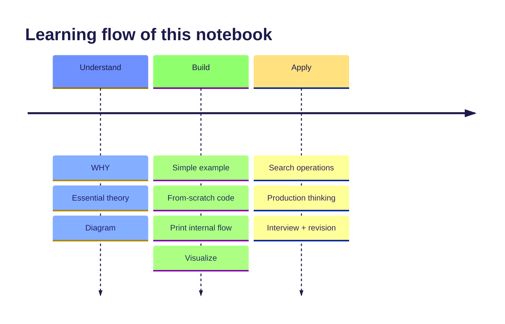

## 2. Why Do We Need an Index?

Suppose we have:

```text
D1: cat drinks milk
D2: dog eats food
D3: cat eats fish
D4: bird eats seeds
```

User searches:

```text
cat
```

A naive approach checks every document.

For 4 documents, this is fine.

For millions of documents, it becomes expensive.

So search engines do extra work **before queries arrive** and create an index.

Corpus used in the notebook:

```text
D1: cat drinks milk
D2: dog eats food
D3: cat eats fish
D4: bird eats seeds
D5: dog drinks water
```

## 3. Naive Search

Naive search:

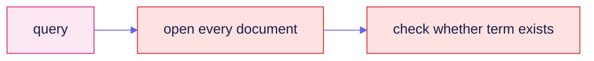

### Problem with naive search

If there are `N` documents, naive search may inspect almost all `N`.

Conceptually:

```text
10 documents      → about 10 checks
1,000 documents   → about 1,000 checks
1,000,000 docs    → about 1,000,000 checks
```

> [!TIP]
> Naive search cost grows with the number of documents **N**. Indexed search cost depends mainly on the **length of the posting lists** for the query terms.

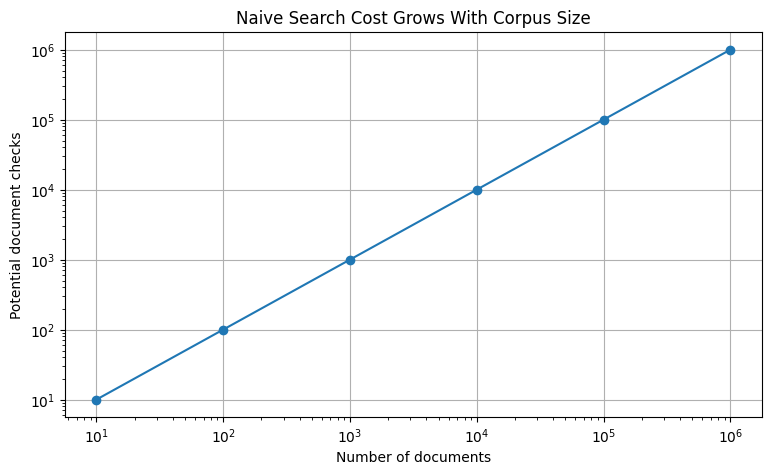

## 4. Forward Index

A **forward index** maps:

```text
document → terms
```

Example:

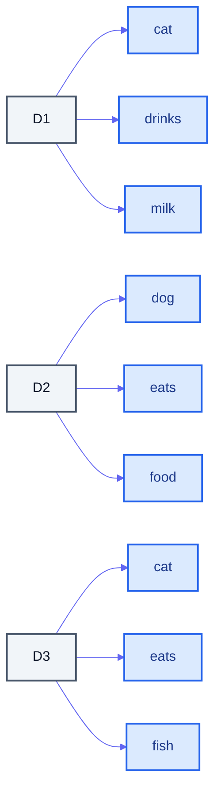

It answers:

> What words are inside this document?

## 5. Inverted Index

Search usually asks the opposite question:

> Which documents contain this term?

So we invert the mapping:

```text
term → documents
```

Example:

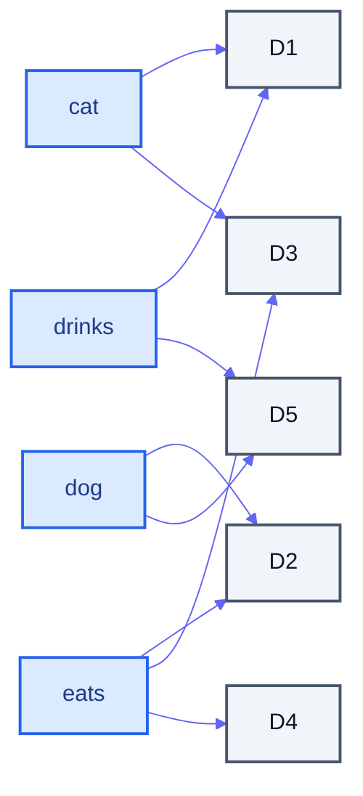

This structure is the **inverted index**.

```python
from collections import defaultdict

def build_inverted_index(docs):
    # term -> list of document IDs
    index = defaultdict(list)

    for doc_id, text in docs.items():
        # Each document adds itself once per unique term
        for term in set(tokenize(text)):
            index[term].append(doc_id)

    return dict(index)

inverted_index = build_inverted_index(documents)

# Search is now a dictionary lookup
inverted_index["cat"]
# ['D1', 'D3']
```

## 6. Vocabulary and Posting Lists

#### Vocabulary

All unique indexed terms.

#### Posting list

The documents associated with one term.

Example:

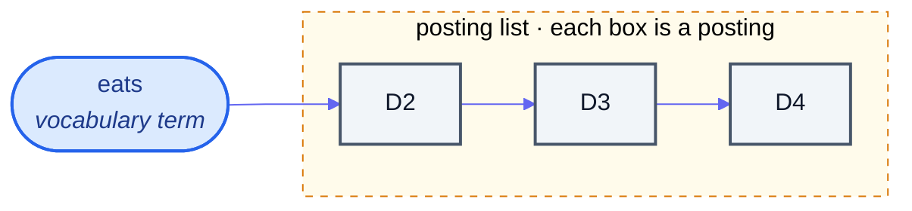

Each entry such as `D2` is a **posting**.

Result: vocabulary of **10 terms** `bird, cat, dog, drinks, eats, fish, food, milk, seeds, water`; posting list `eats → [D2, D3, D4]`.

## 7. Indexed Search

Instead of scanning every document, we do:

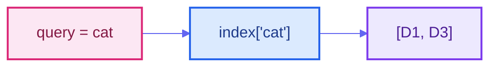

## CHECKPOINT 1

Explain:

1. What is a forward index?
2. What is an inverted index?
3. What is a vocabulary?
4. What is a posting list?
5. Why is an inverted index faster than scanning every document?

## 8. Document Frequency (DF)

Document Frequency means:

> In how many documents does this term occur?

Example:

```text
eats → [D2, D3, D4]

DF(eats) = 3
```

This tells us whether a term is common or rare.

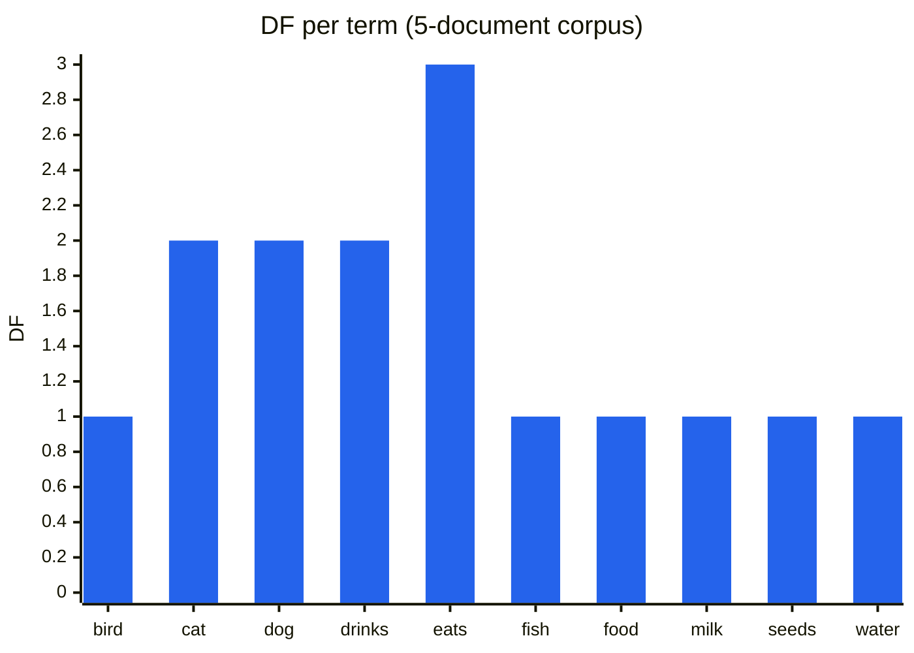

### Why DF matters

If a word appears in almost every document, it is not very distinctive.

If it appears in only one or two documents, it may be very useful.

This leads later to:

```text
IDF = Inverse Document Frequency
```

## 9. Term Frequency (TF)

Term Frequency means:

> How many times does a term appear inside one document?

Example:

```text
D1: cat cat cat drinks milk

TF(cat, D1) = 3
```

## 10. Rich Posting Lists

Real posting lists can store more than a document ID.

For example:

```text
cat →
[
  {doc_id: D1, tf: 3},
  {doc_id: D2, tf: 1}
]
```

This information becomes useful for ranking.

##### Data model of a rich inverted index

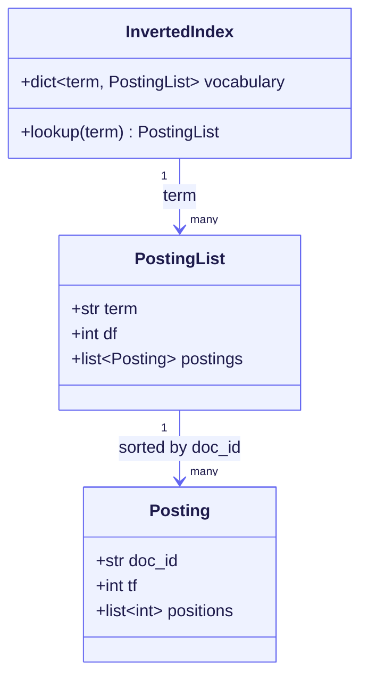

```python
from collections import Counter

def build_tf_index(docs):
    # term -> list of {"doc_id", "tf"} postings
    index = defaultdict(list)

    for doc_id, text in docs.items():
        # Count each term inside this document
        counts = Counter(tokenize(text))

        for term, tf in counts.items():
            index[term].append({"doc_id": doc_id, "tf": tf})

    return dict(index)

# cat -> [{'doc_id': 'D1', 'tf': 3}, {'doc_id': 'D2', 'tf': 1}]
```

## 11. Boolean Search

Posting lists make Boolean search easy.

#### AND

```text
cat AND eats
```

means both terms must occur.

#### OR

```text
cat OR dog
```

means at least one must occur.

##### AND vs OR on posting lists (notebook results)

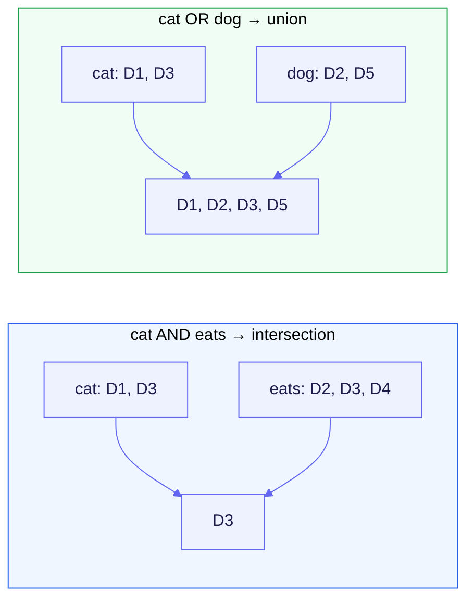

## 12. Multi-Term AND Search

For:

```text
cat eats fish
```

we intersect all three posting lists.

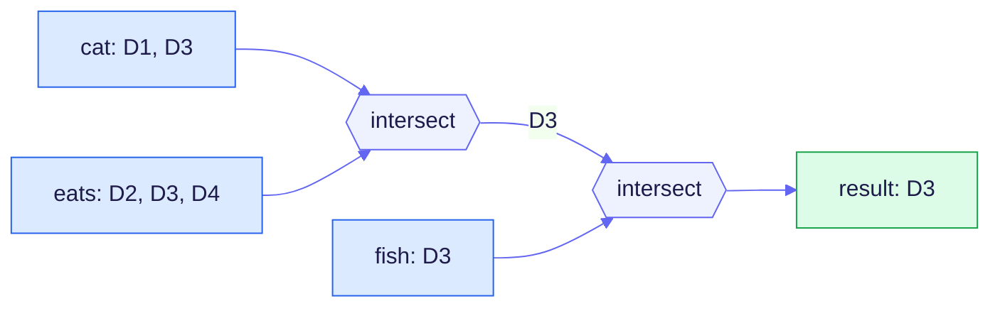

```python
def multi_and(query, index):
    # One posting set per query term
    posting_sets = [set(index.get(term, [])) for term in tokenize(query)]

    # No terms -> no results
    if not posting_sets:
        return []

    # Keep only documents present in every posting set
    return sorted(set.intersection(*posting_sets))

multi_and("cat eats fish", inverted_index)
# ['D3']
```

## CHECKPOINT 2

Explain:

1. Difference between TF and DF.
2. What `cat AND eats` means.
3. What `cat OR dog` means.
4. Why richer postings store TF.
5. Why Boolean operations fit naturally with posting lists.

## 13. Positional Index

A normal inverted index can say:

```text
red appears in D1
apple appears in D1
```

But it cannot tell whether:

```text
red apple
```

appears as an exact phrase.

For phrase search we need token positions.

Positional index built by the notebook:

```text
apple  -> {'D1': [1], 'D2': [1], 'D4': [4]}
car    -> {'D3': [1]}
fast   -> {'D3': [3]}
good   -> {'D1': [3], 'D2': [3]}
green  -> {'D2': [0]}
i      -> {'D4': [0]}
like   -> {'D4': [1]}
moves  -> {'D3': [2]}
red    -> {'D1': [0], 'D3': [0], 'D4': [2]}
sweet  -> {'D4': [3]}
tastes -> {'D1': [2], 'D2': [2]}
```

## 14. Exact Phrase Search

For:

```text
red apple
```

we need:

```text
red at position p
apple at position p + 1
```

in the same document.

Why doesn't this match:

```text
D4: I like red sweet apple
```

Because:

```text
red position   = 2
apple position = 4
```

They are not adjacent.

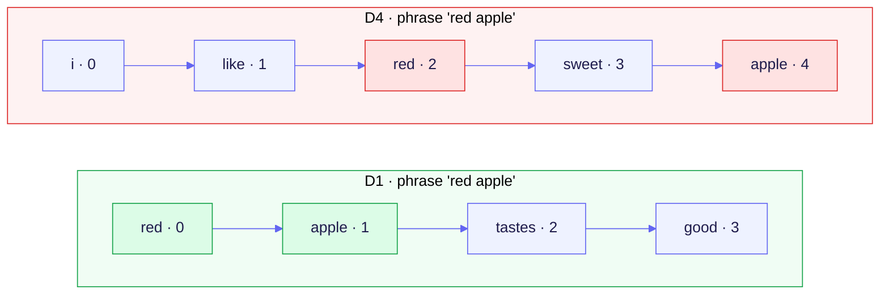

Match rule: `apple position = red position + 1`. In D4, `4 ≠ 2 + 1`.

## 15. General Phrase Search

Now let's support longer phrases such as:

```text
green apple tastes
```

```python
def phrase_search(phrase, index):
    # index: term -> {doc_id: [positions]}
    terms = tokenize(phrase)

    # Candidate docs must contain every term
    candidates = set.intersection(*(set(index.get(t, {})) for t in terms))

    matches = []
    for doc_id in sorted(candidates):
        for start in index[terms[0]][doc_id]:
            # Term k must sit at position start + k
            if all(start + k in index[t][doc_id] for k, t in enumerate(terms[1:], start=1)):
                matches.append(doc_id)
                break

    return matches

phrase_search("green apple tastes", positional_index)
# ['D2']
```

## 16. Tokenization and Normalization

Search quality depends on preprocessing.

Example:

```text
Cat
cat
CAT
```

Without lowercasing they could become different terms.

With lowercasing:

```text
cat
cat
cat
```

## 17. Stopwords

Common words include:

```text
the
is
of
and
to
```

They often carry less retrieval value.

But do not assume they can always be deleted.

For phrase search:

```text
to be or not to be
```

the common words are part of the phrase.

## 18. Stemming — Simple Intuition

Stemming reduces word variants to a rough root.

Example:

```text
connected
connecting
connects
```

might be reduced toward:

```text
connect
```

This can improve lexical recall.

Our demo below is intentionally simple and is **not** a production stemmer.

```python
def tiny_stem(word):
    # Strip a common suffix if enough of the word remains
    for suffix in ["ing", "ed", "s"]:
        if word.endswith(suffix) and len(word) > len(suffix) + 2:
            return word[:-len(suffix)]

    return word

# connected -> connect, connecting -> connect, cats -> cat
```

## 19. Lemmatization — Intuition Only

Lemmatization uses linguistic knowledge to find a base form.

Examples:

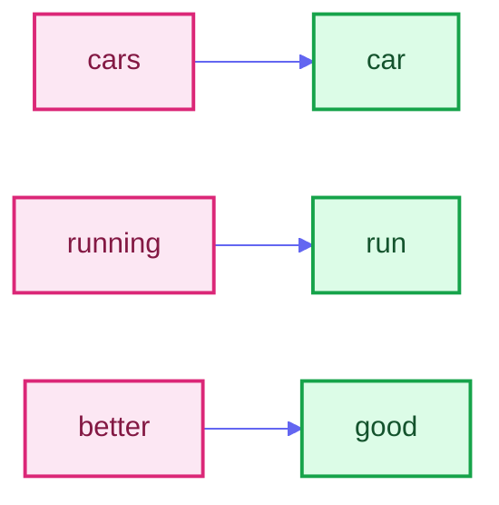

Difference:

```text
stemming      = rough string reduction
lemmatization = linguistic base form
```

We do not need a full NLP deep dive here.

## CHECKPOINT 3

Explain:

1. Why lowercasing helps.
2. What stopwords are.
3. Why removing stopwords can sometimes hurt phrase search.
4. What stemming tries to do.
5. Difference between stemming and lemmatization.
6. Why preprocessing changes the inverted index.

## 20. Full Indexing Pipeline

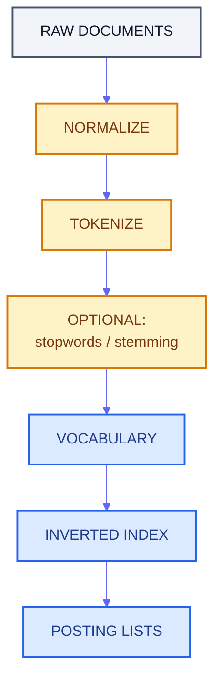

## 21. Query-Time Pipeline

After the index exists:

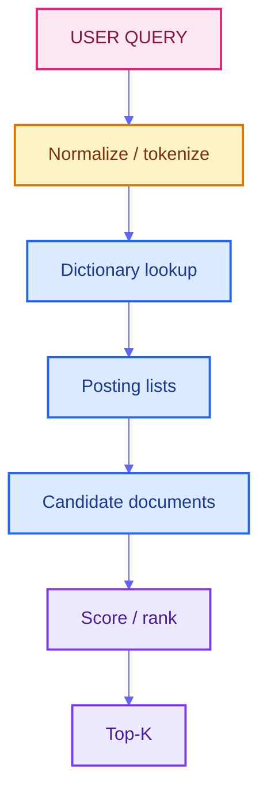

The expensive document analysis happened earlier.

## 22. Index Time vs Query Time

#### Index time

Happens before users search.


#### Query time

Happens when a user searches.


Search engines spend more work up front so queries can be fast.

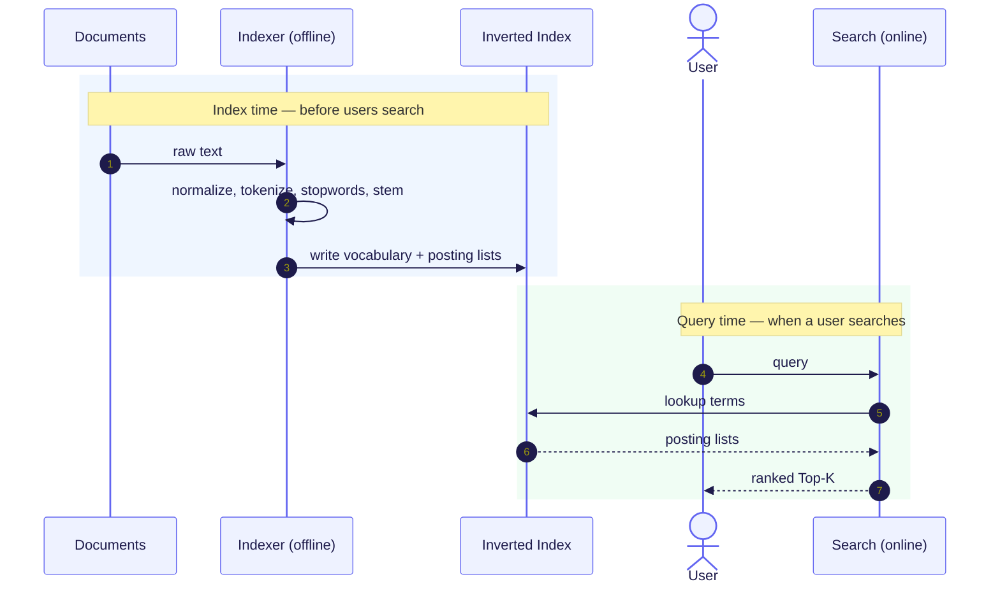

## 23. Sorted Posting Lists

Real posting lists are often sorted by document ID.

Example:

```text
cat  → [1, 3, 8, 10]
eats → [2, 3, 7, 8]
```

To compute AND, we can move through both lists with two pointers.

##### Two-pointer walk (steps from the notebook run)

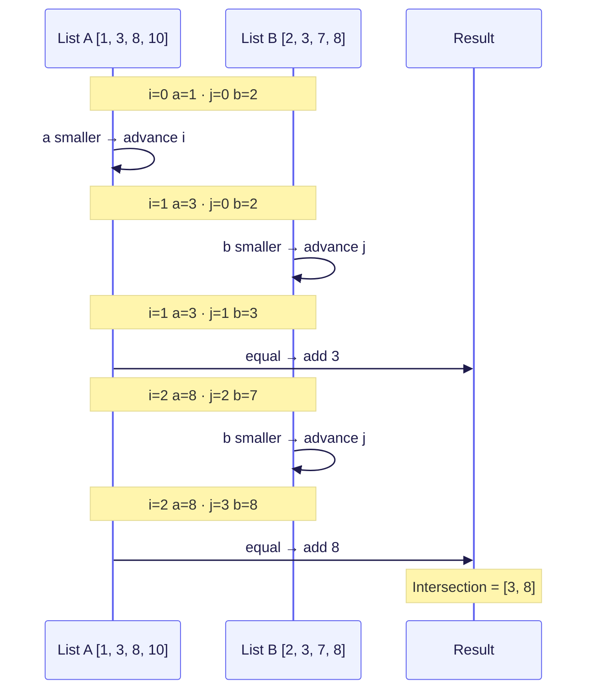

```python
def intersect_sorted(a, b):
    # One pointer per list
    i, j, result = 0, 0, []

    while i < len(a) and j < len(b):
        # Same doc in both lists -> keep it, move both pointers
        if a[i] == b[j]:
            result.append(a[i])
            i += 1
            j += 1

        # a is behind: move its pointer
        elif a[i] < b[j]:
            i += 1

        # b is behind: move its pointer
        else:
            j += 1

    return result


# Two sorted posting lists
intersect_sorted([1, 3, 8, 10], [2, 3, 7, 8])
# [3, 8]
```

## 24. Candidate Retrieval vs Ranking

The inverted index tells us:

```text
which documents contain query terms
```

But if many documents match, we still need ranking.

That is where:

```text
TF-IDF
BM25
```

come in.

Pipeline:

```mermaid
%%{init: {'theme':'base','themeVariables':{'primaryColor':'#EEF2FF','primaryBorderColor':'#6366F1','primaryTextColor':'#1E1B4B','lineColor':'#6366F1','pie1':'#22C55E','pie2':'#F59E0B','pie3':'#EF4444','pie4':'#3B82F6','pie5':'#8B5CF6','xyChart':{'plotColorPalette':'#2563EB, #16A34A, #D97706, #DC2626, #7C3AED'}}}}%%
flowchart LR
    A["Inverted Index"] --> B["Candidate Documents"] --> C["Scoring"] --> D["Ranking"] --> E["Top-K"]
    classDef q fill:#FCE7F3,stroke:#DB2777,color:#831843,stroke-width:2px
    classDef sp fill:#DBEAFE,stroke:#2563EB,color:#1E3A8A,stroke-width:2px
    classDef de fill:#DCFCE7,stroke:#16A34A,color:#14532D,stroke-width:2px
    classDef fu fill:#FEF3C7,stroke:#D97706,color:#78350F,stroke-width:2px
    classDef rr fill:#EDE9FE,stroke:#7C3AED,color:#4C1D95,stroke-width:2px
    classDef llm fill:#FEE2E2,stroke:#DC2626,color:#7F1D1D,stroke-width:2px
    classDef neu fill:#F1F5F9,stroke:#475569,color:#0F172A,stroke-width:2px
    class A,B sp
    class C,D fu
    class E rr
```

## 25. Why This Matters for BM25

BM25 needs:

```text
term frequency
document frequency
document length
average document length
```

An inverted index can efficiently provide much of this information.

So:

```mermaid
%%{init: {'theme':'base','themeVariables':{'primaryColor':'#EEF2FF','primaryBorderColor':'#6366F1','primaryTextColor':'#1E1B4B','lineColor':'#6366F1','pie1':'#22C55E','pie2':'#F59E0B','pie3':'#EF4444','pie4':'#3B82F6','pie5':'#8B5CF6','xyChart':{'plotColorPalette':'#2563EB, #16A34A, #D97706, #DC2626, #7C3AED'}}}}%%
flowchart LR
    A["Inverted Index"] --> B["Posting Lists"] --> C["TF + DF statistics"] --> D["BM25 scoring"]
    classDef q fill:#FCE7F3,stroke:#DB2777,color:#831843,stroke-width:2px
    classDef sp fill:#DBEAFE,stroke:#2563EB,color:#1E3A8A,stroke-width:2px
    classDef de fill:#DCFCE7,stroke:#16A34A,color:#14532D,stroke-width:2px
    classDef fu fill:#FEF3C7,stroke:#D97706,color:#78350F,stroke-width:2px
    classDef rr fill:#EDE9FE,stroke:#7C3AED,color:#4C1D95,stroke-width:2px
    classDef llm fill:#FEE2E2,stroke:#DC2626,color:#7F1D1D,stroke-width:2px
    classDef neu fill:#F1F5F9,stroke:#475569,color:#0F172A,stroke-width:2px
    class A,B,C sp
    class D fu
```

This chapter is the foundation for the BM25 chapter.

## 26. Inverted Index vs Vector Index

Hybrid Search commonly uses two different index families.

#### Lexical side

```mermaid
%%{init: {'theme':'base','themeVariables':{'primaryColor':'#EEF2FF','primaryBorderColor':'#6366F1','primaryTextColor':'#1E1B4B','lineColor':'#6366F1','pie1':'#22C55E','pie2':'#F59E0B','pie3':'#EF4444','pie4':'#3B82F6','pie5':'#8B5CF6','xyChart':{'plotColorPalette':'#2563EB, #16A34A, #D97706, #DC2626, #7C3AED'}}}}%%
flowchart LR
    A["query terms"] --> B["inverted index"] --> C["posting lists"]
    classDef q fill:#FCE7F3,stroke:#DB2777,color:#831843,stroke-width:2px
    classDef sp fill:#DBEAFE,stroke:#2563EB,color:#1E3A8A,stroke-width:2px
    classDef de fill:#DCFCE7,stroke:#16A34A,color:#14532D,stroke-width:2px
    classDef fu fill:#FEF3C7,stroke:#D97706,color:#78350F,stroke-width:2px
    classDef rr fill:#EDE9FE,stroke:#7C3AED,color:#4C1D95,stroke-width:2px
    classDef llm fill:#FEE2E2,stroke:#DC2626,color:#7F1D1D,stroke-width:2px
    classDef neu fill:#F1F5F9,stroke:#475569,color:#0F172A,stroke-width:2px
    class A q
    class B,C sp
```

#### Semantic side

```mermaid
%%{init: {'theme':'base','themeVariables':{'primaryColor':'#EEF2FF','primaryBorderColor':'#6366F1','primaryTextColor':'#1E1B4B','lineColor':'#6366F1','pie1':'#22C55E','pie2':'#F59E0B','pie3':'#EF4444','pie4':'#3B82F6','pie5':'#8B5CF6','xyChart':{'plotColorPalette':'#2563EB, #16A34A, #D97706, #DC2626, #7C3AED'}}}}%%
flowchart LR
    A["query"] --> B["embedding"] --> C["vector index"] --> D["nearest vectors"]
    classDef q fill:#FCE7F3,stroke:#DB2777,color:#831843,stroke-width:2px
    classDef sp fill:#DBEAFE,stroke:#2563EB,color:#1E3A8A,stroke-width:2px
    classDef de fill:#DCFCE7,stroke:#16A34A,color:#14532D,stroke-width:2px
    classDef fu fill:#FEF3C7,stroke:#D97706,color:#78350F,stroke-width:2px
    classDef rr fill:#EDE9FE,stroke:#7C3AED,color:#4C1D95,stroke-width:2px
    classDef llm fill:#FEE2E2,stroke:#DC2626,color:#7F1D1D,stroke-width:2px
    classDef neu fill:#F1F5F9,stroke:#475569,color:#0F172A,stroke-width:2px
    class A q
    class B,C,D de
```

Then Hybrid Search combines the results.

## 27. Common Misconceptions

#### "The inverted index stores the full document for every term."

Usually no.

It stores compact references such as document IDs and optional statistics.

#### "An inverted index automatically ranks documents."

Not necessarily.

It enables fast lookup. Ranking is another stage.

#### "Vocabulary and posting list mean the same thing."

No.

```text
Vocabulary = unique terms
Posting list = documents for one term
```

#### "Normal posting lists are enough for phrase search."

No.

Phrase search usually needs positions.

## 28. Debugging an Inverted Index

If lexical search behaves strangely, inspect:

```text
1. Was the document indexed?
2. Did tokenization create the expected term?
3. Did lowercasing change it?
4. Was it removed as a stopword?
5. Did stemming alter it?
6. Is the posting list correct?
7. Did Boolean logic filter it out?
8. Did ranking push it too low?
```

```mermaid
%%{init: {'theme':'base','themeVariables':{'primaryColor':'#EEF2FF','primaryBorderColor':'#6366F1','primaryTextColor':'#1E1B4B','lineColor':'#6366F1','pie1':'#22C55E','pie2':'#F59E0B','pie3':'#EF4444','pie4':'#3B82F6','pie5':'#8B5CF6','xyChart':{'plotColorPalette':'#2563EB, #16A34A, #D97706, #DC2626, #7C3AED'}}}}%%
stateDiagram-v2
    [*] --> Indexed
    Indexed --> Tokenized : 1 · document indexed?
    Tokenized --> Lowercased : 2 · expected term created?
    Lowercased --> NotStopword : 3 · lowercasing changed it?
    NotStopword --> Stemmed : 4 · removed as stopword?
    Stemmed --> PostingOK : 5 · stemming altered it?
    PostingOK --> BooleanOK : 6 · posting list correct?
    BooleanOK --> RankedOK : 7 · Boolean logic filtered it?
    RankedOK --> [*] : 8 · ranking pushed it too low?
```

## CHECKPOINT 4

Explain:

1. Why sorted posting lists are useful.
2. Difference between index time and query time.
3. Why inverted index is not itself a ranking algorithm.
4. How BM25 uses information from the index.
5. Difference between inverted index and vector index.

## 29. Interview Questions

#### What is an inverted index?

A mapping from terms to documents containing those terms.

```text
cat → [D1, D3]
```

#### Why is it called inverted?

Because:

```text
document → terms
```

is reversed into:

```text
term → documents
```

#### What is a posting list?

The list of postings for one term. A posting may include document ID, frequency, positions and other metadata.

#### What is TF?

How many times a term appears inside a specific document.

#### What is DF?

How many documents contain a term.

#### Why are inverted indexes fast?

They avoid scanning the entire corpus for each query and directly retrieve matching document references.

#### Why do phrase queries need positions?

Because knowing both words exist is not enough; we need their order and adjacency.

#### How does BM25 use the index?

It uses term statistics and candidate documents from the lexical index to calculate relevance scores.

## 30. Interview Scenarios

#### Scenario 1

```text
red apple
```

Document:

```text
red sweet apple
```

Does exact phrase search match?

**No**, because the terms are not adjacent.

#### Scenario 2

The word exists in the original document but search returns nothing.

Inspect:

```text
tokenization
normalization
stopwords
stemming
index construction
```

#### Scenario 3

```text
cat  → [1, 3, 8]
eats → [2, 3, 8]
```

`cat AND eats` returns:

```text
[3, 8]
```

#### Scenario 4

Why does Hybrid Search need an inverted index and vector index?

```text
inverted index → lexical evidence
vector index   → semantic evidence
```

## 31. One-Page Revision Map

```mermaid
%%{init: {'theme':'base','themeVariables':{'primaryColor':'#EEF2FF','primaryBorderColor':'#6366F1','primaryTextColor':'#1E1B4B','lineColor':'#6366F1','pie1':'#22C55E','pie2':'#F59E0B','pie3':'#EF4444','pie4':'#3B82F6','pie5':'#8B5CF6','xyChart':{'plotColorPalette':'#2563EB, #16A34A, #D97706, #DC2626, #7C3AED'}}}}%%
flowchart TB
    A["RAW DOCUMENTS"] --> B["NORMALIZATION"] --> C["TOKENIZATION"] --> D["VOCABULARY"] --> E["INVERTED INDEX"]
    E --- e1["cat → D1, D3"]
    E --- e2["dog → D2, D5"]
    E --- e3["eats → D2, D3, D4"]
    E --> F["POSTING LISTS"]
    F --> G["Boolean Search<br/>AND / OR"]
    F --> H["Ranking<br/>TF-IDF / BM25"]
    G --> K["Top-K"]
    H --> K
    classDef q fill:#FCE7F3,stroke:#DB2777,color:#831843,stroke-width:2px
    classDef sp fill:#DBEAFE,stroke:#2563EB,color:#1E3A8A,stroke-width:2px
    classDef de fill:#DCFCE7,stroke:#16A34A,color:#14532D,stroke-width:2px
    classDef fu fill:#FEF3C7,stroke:#D97706,color:#78350F,stroke-width:2px
    classDef rr fill:#EDE9FE,stroke:#7C3AED,color:#4C1D95,stroke-width:2px
    classDef llm fill:#FEE2E2,stroke:#DC2626,color:#7F1D1D,stroke-width:2px
    classDef neu fill:#F1F5F9,stroke:#475569,color:#0F172A,stroke-width:2px
    class A neu
    class B,C fu
    class D,E,F,e1,e2,e3 sp
    class G q
    class H de
    class K rr
```

Key definitions:

```text
TF = occurrences inside one document

DF = number of documents containing term

Positions = where term occurs in a document
```

## 32. Practice Tasks

#### Task 1

Build an inverted index for:

```text
D1: apple banana mango
D2: banana orange
D3: apple orange grape
D4: mango grape
```

#### Task 2

Search:

```text
apple AND orange
```

Expected:

```text
D3
```

#### Task 3

Search:

```text
banana OR grape
```

#### Task 4

Create:

```text
D1: apple apple apple banana
```

Store TF inside the posting.

#### Task 5

Create positional indexes for:

```text
red apple
green apple
red sweet apple
```

Search exact phrase:

```text
red apple
```

#### Task 6

Compare index terms before and after stopword removal.

#### Task 7

For 10 simple documents, manually compute TF and DF for three terms.

## 33. Final Takeaways

Remember these ten points:

1. Naive search scans documents; indexed search performs direct lookups.
2. Forward index maps `document → terms`.
3. Inverted index maps `term → documents`.
4. Vocabulary contains unique searchable terms.
5. Posting lists store matching document references.
6. TF counts occurrences inside one document.
7. DF counts documents containing the term.
8. Positional indexes enable exact phrase search.
9. Tokenization and normalization strongly affect retrieval.
10. Inverted indexes are the foundation of TF-IDF, BM25 and the lexical side of Hybrid Search.

---

## Next Chapter — Chapter 4: TF-IDF

Next we answer:

> Why should rare terms matter more than common terms?

We will cover:

```text
Term Frequency
Document Frequency
Inverse Document Frequency
TF-IDF formula
manual calculations
from-scratch implementation
visualizations
limitations
why BM25 improves on TF-IDF
```

<p align="center"><a href="../../9a.%20Lexical%20vs%20Semantic%20Retrieval/README.md">Previous: 9a Lexical vs Semantic Retrieval</a> | <a href="../../../README.md">Home</a> | <a href="../README.md">Module index</a> | <a href="../../README.md">Chapter 09: Sparse Retrieval and Keyword Search</a> | <a href="../../9c.%20TF-IDF/README.md">Next: 9c TF-IDF</a></p>
