<div align="center">

# 9c · TF-IDF

  

**Local importance (TF) times global rarity (IDF) gives a lexical weight.**

</div>

<p align="center"><a href="../../9b.%20Inverted%20Index%20Fundamentals/README.md">Previous: 9b Inverted Index Fundamentals</a> | <a href="../../../README.md">Home</a> | <a href="../README.md">Module index</a> | <a href="../../README.md">Chapter 09: Sparse Retrieval and Keyword Search</a> | <a href="../../9d.%20BM25/README.md">Next: 9d BM25</a></p>

## Contents

<table width="100%">
<thead><tr><th width="8%">Sr No</th><th width="38%">Section</th><th width="54%">Subtopics</th></tr></thead>
<tbody>
<tr><td align="center">01</td><td><a href="#what-you-will-learn"><b>What You Will Learn</b></a></td><td>-</td></tr>
<tr><td align="center">02</td><td><a href="#core-mental-model"><b>Core Mental Model</b></a></td><td>-</td></tr>
<tr><td align="center">03</td><td><a href="#2-why-is-simple-word-counting-not-enough"><b>2. Why Is Simple Word Counting Not Enough?</b></a></td><td>-</td></tr>
<tr><td align="center">04</td><td><a href="#3-visual-intuition--tf-and-idf-answer-different-questions"><b>3. Visual Intuition — TF and IDF Answer Different Questions</b></a></td><td>-</td></tr>
<tr><td align="center">05</td><td><a href="#4-first-step--tokenization"><b>4. First Step — Tokenization</b></a></td><td>-</td></tr>
<tr><td align="center">06</td><td><a href="#5-term-frequency-tf"><b>5. Term Frequency (TF)</b></a></td><td>-</td></tr>
<tr><td align="center">07</td><td><a href="#6-visualize-tf"><b>6. Visualize TF</b></a></td><td>-</td></tr>
<tr><td align="center">08</td><td><a href="#7-raw-tf-limitation--repetition-keeps-increasing-the-score"><b>7. Raw TF Limitation — Repetition Keeps Increasing the Score</b></a></td><td>-</td></tr>
<tr><td align="center">09</td><td><a href="#8-normalized-tf"><b>8. Normalized TF</b></a></td><td>-</td></tr>
<tr><td align="center">10</td><td><a href="#9-log-scaled-tf"><b>9. Log-Scaled TF</b></a></td><td><a href="#interpretation">Interpretation</a></td></tr>
<tr><td align="center">11</td><td><a href="#checkpoint-1"><b>CHECKPOINT 1</b></a></td><td><a href="#checkpoint-1--answers">CHECKPOINT 1 — Answers</a></td></tr>
<tr><td align="center">12</td><td><a href="#10-document-frequency-df"><b>10. Document Frequency (DF)</b></a></td><td>-</td></tr>
<tr><td align="center">13</td><td><a href="#11-df-for-the-entire-vocabulary"><b>11. DF for the Entire Vocabulary</b></a></td><td>-</td></tr>
<tr><td align="center">14</td><td><a href="#12-inverse-document-frequency-idf"><b>12. Inverse Document Frequency (IDF)</b></a></td><td><a href="#intuition">Intuition</a></td></tr>
<tr><td align="center">15</td><td><a href="#13-visual--idf-falls-as-df-increases"><b>13. Visual — IDF Falls as DF Increases</b></a></td><td>-</td></tr>
<tr><td align="center">16</td><td><a href="#14-build-an-idf-table"><b>14. Build an IDF Table</b></a></td><td>-</td></tr>
<tr><td align="center">17</td><td><a href="#15-common-word-vs-rare-word-example"><b>15. Common Word vs Rare Word Example</b></a></td><td>-</td></tr>
<tr><td align="center">18</td><td><a href="#checkpoint-2"><b>CHECKPOINT 2</b></a></td><td><a href="#checkpoint-2--answers">CHECKPOINT 2 — Answers</a></td></tr>
<tr><td align="center">19</td><td><a href="#16-tf-idf-formula"><b>16. TF-IDF Formula</b></a></td><td>-</td></tr>
<tr><td align="center">20</td><td><a href="#17-manual-tf-idf-calculation"><b>17. Manual TF-IDF Calculation</b></a></td><td>-</td></tr>
<tr><td align="center">21</td><td><a href="#18-compare-two-terms-in-the-same-document"><b>18. Compare Two Terms in the Same Document</b></a></td><td>-</td></tr>
<tr><td align="center">22</td><td><a href="#19-build-a-complete-tf-idf-matrix-from-scratch"><b>19. Build a Complete TF-IDF Matrix From Scratch</b></a></td><td>-</td></tr>
<tr><td align="center">23</td><td><a href="#20-visualize-the-tf-idf-matrix"><b>20. Visualize the TF-IDF Matrix</b></a></td><td>-</td></tr>
<tr><td align="center">24</td><td><a href="#21-why-tf-idf-is-sparse"><b>21. Why TF-IDF Is Sparse</b></a></td><td>-</td></tr>
<tr><td align="center">25</td><td><a href="#checkpoint-3"><b>CHECKPOINT 3</b></a></td><td><a href="#checkpoint-3--answers">CHECKPOINT 3 — Answers</a></td></tr>
<tr><td align="center">26</td><td><a href="#22-query-tf-idf-vector"><b>22. Query TF-IDF Vector</b></a></td><td>-</td></tr>
<tr><td align="center">27</td><td><a href="#23-cosine-similarity-for-ranking"><b>23. Cosine Similarity for Ranking</b></a></td><td>-</td></tr>
<tr><td align="center">28</td><td><a href="#24-end-to-end-tf-idf-search-from-scratch"><b>24. End-to-End TF-IDF Search From Scratch</b></a></td><td>-</td></tr>
<tr><td align="center">29</td><td><a href="#25-scikit-learn-tf-idf"><b>25. Scikit-Learn TF-IDF</b></a></td><td>-</td></tr>
<tr><td align="center">30</td><td><a href="#26-important-fit_transform-vs-transform"><b>26. Important: fit_transform() vs transform()</b></a></td><td>-</td></tr>
<tr><td align="center">31</td><td><a href="#27-out-of-vocabulary-oov-query-terms"><b>27. Out-of-Vocabulary (OOV) Query Terms</b></a></td><td>-</td></tr>
<tr><td align="center">32</td><td><a href="#28-synonym-failure"><b>28. Synonym Failure</b></a></td><td>-</td></tr>
<tr><td align="center">33</td><td><a href="#29-long-document-limitation"><b>29. Long-Document Limitation</b></a></td><td>-</td></tr>
<tr><td align="center">34</td><td><a href="#30-repeated-term-limitation"><b>30. Repeated-Term Limitation</b></a></td><td>-</td></tr>
<tr><td align="center">35</td><td><a href="#31-binary-match-vs-tf-idf"><b>31. Binary Match vs TF-IDF</b></a></td><td>-</td></tr>
<tr><td align="center">36</td><td><a href="#32-tf-idf-end-to-end-visual"><b>32. TF-IDF End-to-End Visual</b></a></td><td>-</td></tr>
<tr><td align="center">37</td><td><a href="#checkpoint-4"><b>CHECKPOINT 4</b></a></td><td><a href="#checkpoint-4--answers">CHECKPOINT 4 — Answers</a></td></tr>
<tr><td align="center">38</td><td><a href="#33-why-bm25-improves-on-tf-idf"><b>33. Why BM25 Improves on TF-IDF</b></a></td><td><a href="#improvement-1--tf-saturation">Improvement 1 — TF Saturation</a><br><a href="#improvement-2--document-length-normalization">Improvement 2 — Document-Length Normalization</a></td></tr>
<tr><td align="center">39</td><td><a href="#34-tf-idf-strengths-and-weaknesses"><b>34. TF-IDF Strengths and Weaknesses</b></a></td><td>-</td></tr>
<tr><td align="center">40</td><td><a href="#35-tf-idf-debugging-framework"><b>35. TF-IDF Debugging Framework</b></a></td><td>-</td></tr>
<tr><td align="center">41</td><td><a href="#end-to-end-example--tf-idf-search-from-scratch-and-with-scikit-learn"><b>End-to-End Example — TF-IDF Search From Scratch and With scikit-learn</b></a></td><td><a href="#step-1-corpus-and-queries">Step 1. Corpus and queries</a><br><a href="#step-2-tokenize">Step 2. Tokenize</a><br><a href="#step-3-vocabulary-and-document-frequency">Step 3. Vocabulary and document frequency</a><br><a href="#step-4-idf">Step 4. IDF</a><br><a href="#step-5-tf-idf-document-matrix">Step 5. TF-IDF document matrix</a><br><a href="#step-6-search-from-scratch">Step 6. Search from scratch</a><br><a href="#step-7-same-pipeline-with-scikit-learn">Step 7. Same pipeline with scikit-learn</a><br><a href="#step-8-check-that-both-versions-agree">Step 8. Check that both versions agree</a><br><a href="#what-the-results-show">What the results show</a></td></tr>
<tr><td align="center">42</td><td><a href="#36-interview-questions"><b>36. Interview Questions</b></a></td><td>-</td></tr>
<tr><td align="center">43</td><td><a href="#37-interview-scenarios"><b>37. Interview Scenarios</b></a></td><td>-</td></tr>
<tr><td align="center">44</td><td><a href="#38-one-page-revision-map"><b>38. One-Page Revision Map</b></a></td><td>-</td></tr>
<tr><td align="center">45</td><td><a href="#39-practice-tasks"><b>39. Practice Tasks</b></a></td><td>-</td></tr>
<tr><td align="center">46</td><td><a href="#40-final-takeaways"><b>40. Final Takeaways</b></a></td><td>-</td></tr>
<tr><td align="center">47</td><td><a href="#next-chapter--chapter-5-bm25"><b>Next Chapter — Chapter 5: BM25</b></a></td><td>-</td></tr>
</tbody>
</table>

### TF-IDF — Term Frequency × Inverse Document Frequency

## What You Will Learn

By the end of this notebook, you should be able to explain and implement:

- Why simple keyword counting is not enough
- Term Frequency (TF)
- Raw TF
- Normalized TF
- Log-scaled TF
- Document Frequency (DF)
- Inverse Document Frequency (IDF)
- Why rare words matter more
- Why common words matter less
- TF-IDF formula
- Manual TF-IDF calculation
- TF-IDF vectors
- Query TF-IDF
- Cosine similarity
- Search ranking
- Vocabulary matrix
- Sparse representation
- TF-IDF visualization
- TF-IDF from scratch
- Scikit-learn TF-IDF
- TF-IDF failure cases
- Long-document problem
- Repeated-term saturation problem
- Vocabulary mismatch
- Why BM25 improves on TF-IDF

---

## Core Mental Model

```text
TF asks:

"How important is this word INSIDE this document?"

IDF asks:

"How rare is this word ACROSS all documents?"

TF-IDF asks:

"Is this word important here AND uncommon globally?"
```

## 2. Why Is Simple Word Counting Not Enough?

Suppose we have:

```text
D1: cat cat milk
D2: cat dog food
D3: dog dog food
```

User searches:

```text
cat
```

Simple counting says:

```text
D1 → cat appears 2 times
D2 → cat appears 1 time
D3 → cat appears 0 times
```

So D1 should rank above D2. That makes sense.

But counting alone ignores another question:

> Is the word rare and informative across the whole collection?

This gives us two signals:

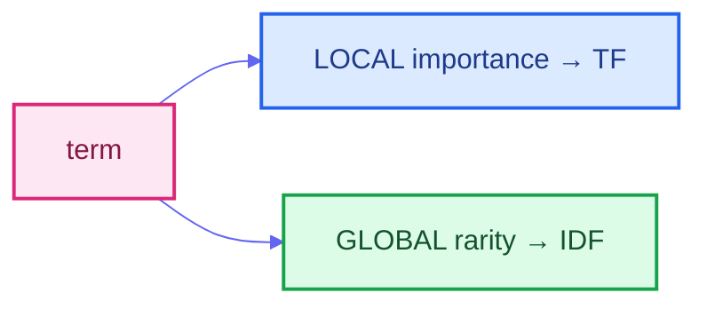

Corpus used throughout:

<table width="100%">
<thead><tr><th width="15%">Doc</th><th width="85%">Text</th></tr></thead>
<tbody>
<tr><td align="center">D1</td><td><code>cat cat milk</code></td></tr>
<tr><td align="center">D2</td><td><code>cat dog food</code></td></tr>
<tr><td align="center">D3</td><td><code>dog dog food</code></td></tr>
<tr><td align="center">D4</td><td><code>apple banana fruit</code></td></tr>
<tr><td align="center">D5</td><td><code>apple fruit salad</code></td></tr>
</tbody>
</table>

## 3. Visual Intuition — TF and IDF Answer Different Questions

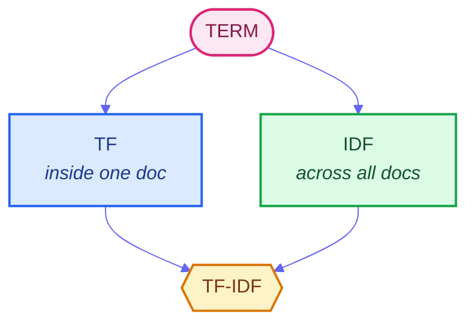

Final importance:

```text
TF-IDF = TF × IDF
```

## 4. First Step — Tokenization

Before counting terms, we convert text into tokens.

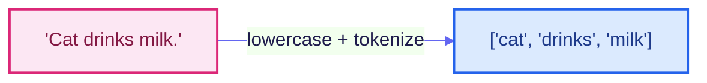

## 5. Term Frequency (TF)

TF asks:

> How often does a term appear inside this document?

Simplest formula:

```math
TF(t,d)=\text{count}(t,d)
```

Example:

```text
D1: cat cat milk

TF(cat, D1)  = 2
TF(milk, D1) = 1
TF(dog, D1)  = 0
```

## 6. Visualize TF

For:

```text
D1: cat cat milk
```

we have:

```text
cat  → 2
milk → 1
```

## 7. Raw TF Limitation — Repetition Keeps Increasing the Score

Compare:

```text
D1: cat cat
D2: cat cat cat cat cat cat cat cat
```

Raw TF gives:

```text
D1 → 2
D2 → 8
```

But should D2 be four times more relevant only because `cat` is repeated?

Not always.

This motivates later ideas such as:

```text
log-scaled TF
BM25 TF saturation
```

## 8. Normalized TF

Long documents naturally contain more words.

One alternative is:

```math
TF_{\text{norm}}(t,d) = \frac{\text{count}(t,d)}{\text{total terms in document}}
```

Example:

```text
D1: cat cat milk

cat count = 2
total terms = 3

Normalized TF(cat) = 2/3
```

Result: `cat` in D1 (`cat cat milk`) → count 2, total terms 3, **normalized TF = 0.667**.

## 9. Log-Scaled TF

Another idea is to reduce the effect of repeated terms:

```math
TF_{\text{log}} = 1 + \log(tf), \quad tf > 0
```

Instead of growing linearly, the score grows more slowly.

### Interpretation

```text
Raw TF
→ grows linearly

Log-scaled TF
→ grows, but each extra repetition matters less
```

This is a preview of the idea behind BM25 saturation.

##### Raw TF vs log-scaled TF

Computed with the formulas above (`raw = tf`, `log = 1 + ln(tf)`).

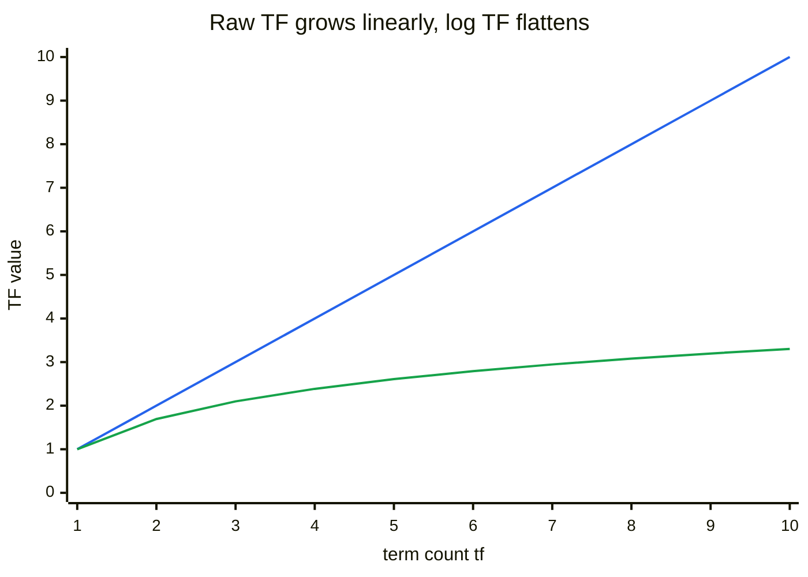

<p align="center"> Raw TF ·  Log-scaled TF</p>

## CHECKPOINT 1

#### Questions

1. What does TF measure?
2. What is the difference between raw TF and normalized TF?
3. Why can raw TF over-reward repeated words?
4. Why does log-scaled TF grow more slowly?

### CHECKPOINT 1 — Answers

#### 1. What does TF measure?

How often a term appears inside a specific document.

#### 2. Raw TF vs normalized TF?

```text
Raw TF
= number of occurrences

Normalized TF
= occurrences / total document terms
```

#### 3. Why can raw TF over-reward repeated words?

Because every repetition increases the score linearly even when later repetitions add little information.

#### 4. Why use log-scaled TF?

To preserve the importance of repetition while reducing its effect as counts become large.

## 10. Document Frequency (DF)

DF asks:

> In how many documents does this term appear?

```math
DF(t) = \text{number of documents containing } t
```

Example:

```text
D1: cat cat milk
D2: cat dog food
D3: dog dog food

DF(cat)  = 2
DF(dog)  = 2
DF(milk) = 1
```

Result: `cat` appears in D1 and D2 → **DF = 2**.

## 11. DF for the Entire Vocabulary

## 12. Inverse Document Frequency (IDF)

IDF asks:

> How rare is this term across the corpus?

A simplified formula is:

```math
IDF(t) = \log\left(\frac{N}{DF(t)}\right)
```

where:

- `N` = total number of documents
- `DF(t)` = number of documents containing the term

### Intuition

```text
Large DF
→ term is common
→ lower IDF

Small DF
→ term is rare
→ higher IDF
```

```python
import math

def simple_idf(term, docs):
    # Total number of documents
    N = len(docs)

    # Number of documents containing the term
    df = sum(1 for text in docs.values() if term in set(tokenize(text)))

    # Unknown term: no IDF
    if df == 0:
        return None

    return math.log(N / df)

simple_idf("milk", documents)
# N=5, DF=1 -> log(5) = 1.6094
```

## 13. Visual — IDF Falls as DF Increases

For a fixed corpus size:

```text
DF = 1
→ very rare
→ high IDF

DF = N
→ appears everywhere
→ IDF = 0
```

##### IDF vs DF for this corpus (N = 5)

`IDF = ln(5 / DF)`

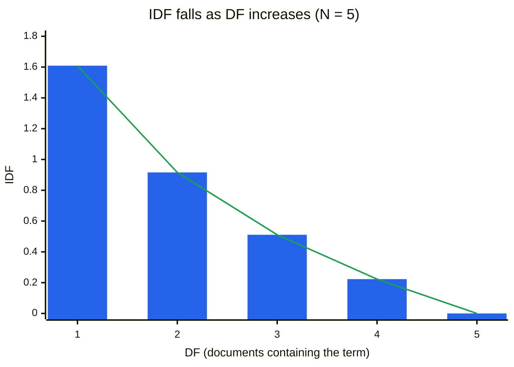

## 14. Build an IDF Table

Now let's calculate both DF and IDF for every term.

##### IDF per term (notebook results)

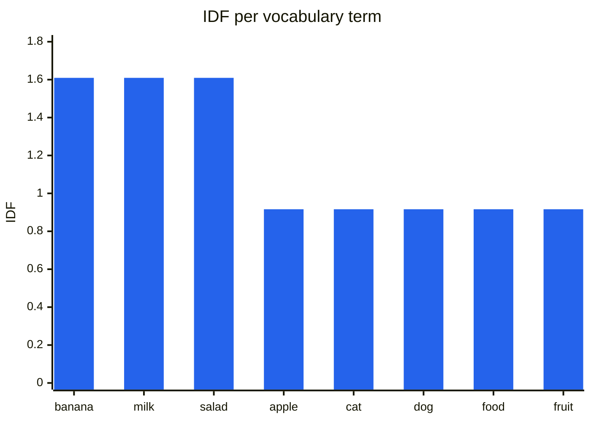

> [!TIP]
> Terms with **DF = 1** (`banana`, `milk`, `salad`) get the highest IDF. Terms shared by two documents get less.

## 15. Common Word vs Rare Word Example

Imagine 100 documents.

Common word:

```text
DF = 100
IDF = log(100/100) = 0
```

Rare word:

```text
DF = 1
IDF = log(100/1)
```

The rare word is much more informative for search.

Result (N = 100): a term in all 100 documents has **IDF 0.0**; a term in 1 document has **IDF 4.6052**.

## CHECKPOINT 2

#### Questions

1. What does DF measure?
2. What does IDF measure?
3. Why do rare words get higher IDF?
4. What happens when DF = N?

### CHECKPOINT 2 — Answers

#### 1. What does DF measure?

How many documents contain the term.

#### 2. What does IDF measure?

How rare or discriminative a term is across the corpus.

#### 3. Why do rare words get higher IDF?

Because they occur in fewer documents and therefore provide stronger evidence for distinguishing relevant documents.

#### 4. What happens when DF = N?

```math
IDF = \log\left(\frac{N}{N}\right) = \log(1) = 0
```

So a term appearing everywhere contributes almost no discriminative value.

## 16. TF-IDF Formula

Now combine local frequency and global rarity:

```math
\text{TF-IDF}(t,d) = TF(t,d) \times IDF(t)
```

The ideal high-scoring term is:

```text
frequent in this document
AND
rare across the corpus
```

## 17. Manual TF-IDF Calculation

Let's calculate:

```text
TF-IDF(cat, D1)
```

for:

```text
D1: cat cat milk
```

Result for `cat` in D1: TF 2 · DF 2 · N 5 · IDF 0.9163 · **TF-IDF = 2 × 0.9163 = 1.8326**.

## 18. Compare Two Terms in the Same Document

In:

```text
D1: cat cat milk
```

- `cat` has higher TF
- `milk` may have higher IDF

So final TF-IDF depends on both.

##### Same document, two terms (notebook results)

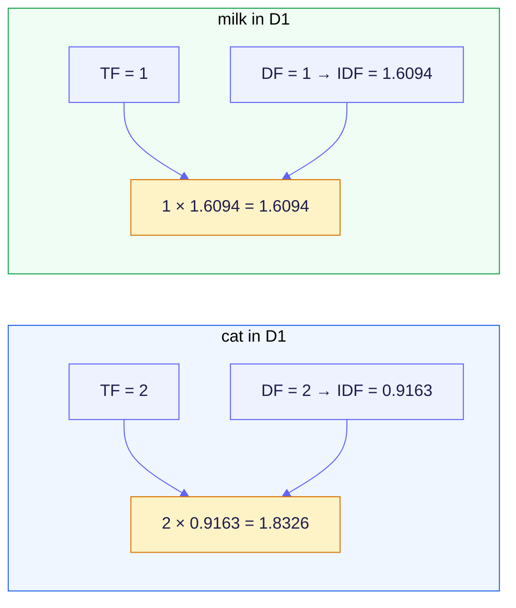

`cat` wins on TF, `milk` wins on IDF. The final weight needs both.

## 19. Build a Complete TF-IDF Matrix From Scratch

Conceptually:

```text
         cat  dog  milk  food  apple  fruit ...
D1
D2
D3
D4
D5
```

Rows:

```text
documents
```

Columns:

```text
vocabulary terms
```

Cells:

```text
TF-IDF weights
```

```python
from collections import Counter

import pandas as pd

def build_tfidf_matrix(docs):
    # Vocabulary = every unique term in the corpus
    vocab = sorted({t for text in docs.values() for t in tokenize(text)})
    N = len(docs)

    # IDF for each term
    idf = {t: math.log(N / sum(t in set(tokenize(x)) for x in docs.values())) for t in vocab}

    rows = {}
    for doc_id, text in docs.items():
        # Raw term counts for this document
        counts = Counter(tokenize(text))

        # One TF-IDF weight per vocabulary term (0 if absent)
        rows[doc_id] = [counts[t] * idf[t] for t in vocab]

    return pd.DataFrame.from_dict(rows, orient="index", columns=vocab), idf
```

<table width="100%">
<thead><tr><th>Doc</th><th>apple</th><th>banana</th><th>cat</th><th>dog</th><th>food</th><th>fruit</th><th>milk</th><th>salad</th></tr></thead>
<tbody>
<tr><td>D1</td><td>0</td><td>0</td><td><b>1.833</b></td><td>0</td><td>0</td><td>0</td><td><b>1.609</b></td><td>0</td></tr>
<tr><td>D2</td><td>0</td><td>0</td><td>0.916</td><td>0.916</td><td>0.916</td><td>0</td><td>0</td><td>0</td></tr>
<tr><td>D3</td><td>0</td><td>0</td><td>0</td><td><b>1.833</b></td><td>0.916</td><td>0</td><td>0</td><td>0</td></tr>
<tr><td>D4</td><td>0.916</td><td><b>1.609</b></td><td>0</td><td>0</td><td>0</td><td>0.916</td><td>0</td><td>0</td></tr>
<tr><td>D5</td><td>0.916</td><td>0</td><td>0</td><td>0</td><td>0</td><td>0.916</td><td>0</td><td><b>1.609</b></td></tr>
</tbody>
</table>

## 20. Visualize the TF-IDF Matrix

A heatmap makes the sparse structure easier to see.

## 21. Why TF-IDF Is Sparse

Imagine a vocabulary of 100,000 terms.

A short document may contain only 20.

Conceptually:

```text
[0, 0, 0, 0.72, 0, 0, 1.31, 0, 0, ...]
```

Most dimensions are zero.

Hence:

```text
TF-IDF = sparse vector representation
```

## CHECKPOINT 3

#### Questions

1. What does TF-IDF combine?
2. When does a term get high TF-IDF?
3. Why is the TF-IDF matrix sparse?
4. What do rows and columns represent?

### CHECKPOINT 3 — Answers

#### 1. What does TF-IDF combine?

```text
TF  → local frequency
IDF → global rarity
```

#### 2. When is TF-IDF high?

When a term:

```text
appears frequently in this document
AND
appears in relatively few other documents
```

#### 3. Why sparse?

Each document contains only a small fraction of the entire vocabulary.

#### 4. Rows and columns?

```text
Rows    = documents
Columns = terms
Cells   = TF-IDF weights
```

## 22. Query TF-IDF Vector

Suppose the user searches:

```text
cat milk
```

The query must use the **same vocabulary dimensions** as the documents.

Pipeline:

```mermaid
%%{init: {'theme':'base','themeVariables':{'primaryColor':'#EEF2FF','primaryBorderColor':'#6366F1','primaryTextColor':'#1E1B4B','lineColor':'#6366F1','pie1':'#22C55E','pie2':'#F59E0B','pie3':'#EF4444','pie4':'#3B82F6','pie5':'#8B5CF6','xyChart':{'plotColorPalette':'#2563EB, #16A34A, #D97706, #DC2626, #7C3AED'}}}}%%
flowchart LR
    A["Query"] --> B["Tokenize"] --> C["Count terms"] --> D["Apply corpus<br/>IDF values"] --> E["Query TF-IDF vector"]
    classDef q fill:#FCE7F3,stroke:#DB2777,color:#831843,stroke-width:2px
    classDef sp fill:#DBEAFE,stroke:#2563EB,color:#1E3A8A,stroke-width:2px
    classDef de fill:#DCFCE7,stroke:#16A34A,color:#14532D,stroke-width:2px
    classDef fu fill:#FEF3C7,stroke:#D97706,color:#78350F,stroke-width:2px
    classDef rr fill:#EDE9FE,stroke:#7C3AED,color:#4C1D95,stroke-width:2px
    classDef llm fill:#FEE2E2,stroke:#DC2626,color:#7F1D1D,stroke-width:2px
    classDef neu fill:#F1F5F9,stroke:#475569,color:#0F172A,stroke-width:2px
    class A q
    class B,C sp
    class D de
    class E fu
```

## 23. Cosine Similarity for Ranking

Now we compare:

```text
query TF-IDF vector
vs
document TF-IDF vectors
```

using:

```math
\cos(\theta) = \frac{Q \cdot D}{\|Q\| \, \|D\|}
```

Higher cosine similarity means stronger lexical alignment.

```python
import numpy as np

def build_query_vector(query, vocabulary, idf_map):
    # Count query terms
    counts = Counter(tokenize(query))

    # Same dimensions as the documents; unknown terms get IDF 0
    return np.array([counts[t] * idf_map.get(t, 0) for t in vocabulary], dtype=float)

def cosine(a, b):
    # Guard against empty vectors
    if np.linalg.norm(a) == 0 or np.linalg.norm(b) == 0:
        return 0.0

    return np.dot(a, b) / (np.linalg.norm(a) * np.linalg.norm(b))
```

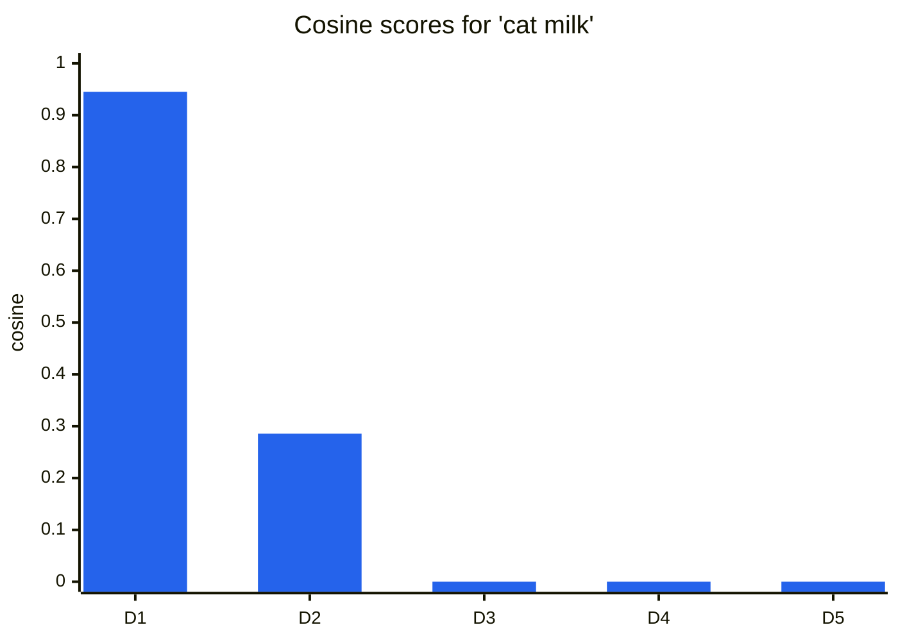

## 24. End-to-End TF-IDF Search From Scratch


##### Query `apple fruit` — cosine scores (notebook results)

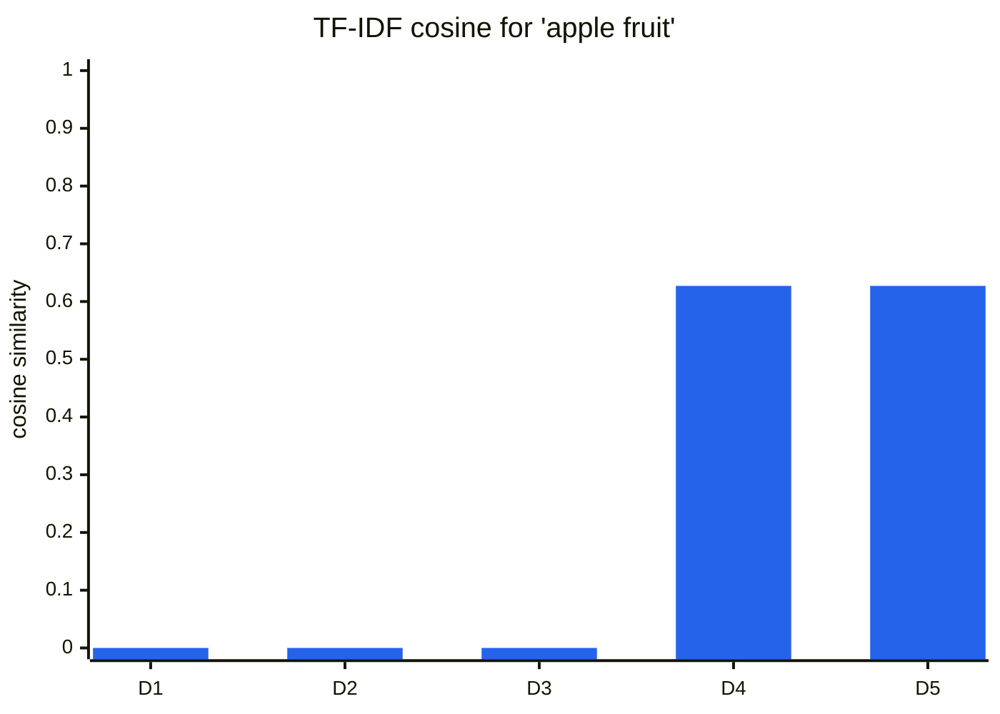

## 25. Scikit-Learn TF-IDF

Now that we understand the internals, we can use:

```python
TfidfVectorizer
```

It handles:

```text
tokenization
vocabulary
TF
IDF
TF-IDF matrix
normalization
```

```python
from sklearn.feature_extraction.text import TfidfVectorizer
from sklearn.metrics.pairwise import cosine_similarity

# fit_transform on the corpus: learn vocabulary + IDF, return document matrix
vectorizer = TfidfVectorizer()
doc_matrix = vectorizer.fit_transform(doc_texts)

# transform on the query: reuse the same vocabulary + IDF
query_vector = vectorizer.transform(["apple fruit"])

# Rank documents by cosine similarity
scores = cosine_similarity(query_vector, doc_matrix).flatten()
# D4 = D5 = 0.7520, others 0
```

## 26. Important: `fit_transform()` vs `transform()`

For documents:

```python
fit_transform()
```

because we need to learn:

```text
vocabulary
IDF statistics
```

For a new query:

```python
transform()
```

because the query must reuse the existing corpus vocabulary and IDF values.

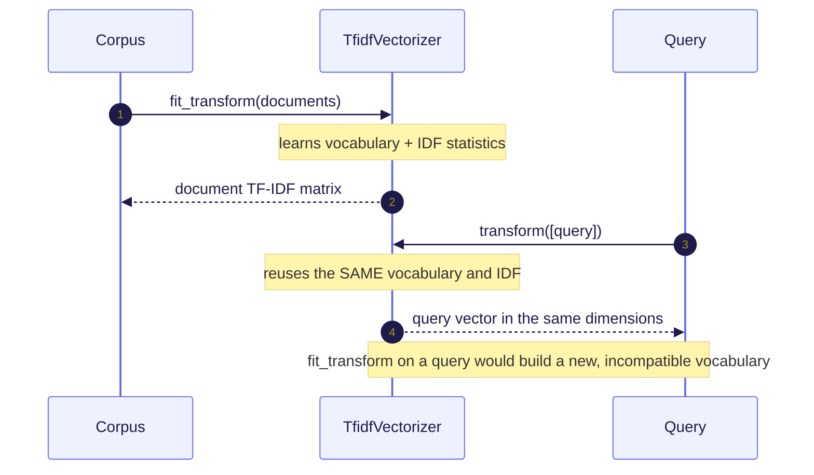

Result for `apple fruit` with scikit-learn: D4 = D5 = **0.7520**, all others 0. The manual version gave 0.6271 because scikit-learn uses smoothed IDF `ln((1+N)/(1+DF)) + 1` and L2-normalizes each row. The ranking is the same.

## 27. Out-of-Vocabulary (OOV) Query Terms

Suppose the query contains:

```text
orange
```

but `orange` never appeared in the indexed corpus.

Then the vocabulary has no feature for it.

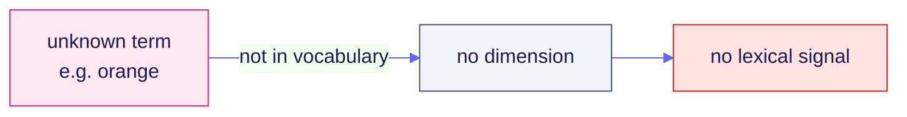

Result: **0 non-zero values**; the query vector is all zeros.

This is one reason dense semantic retrieval is useful in Hybrid Search.

## 28. Synonym Failure

TF-IDF is lexical.

So:

```text
car
```

and:

```text
automobile
```

are different terms.

TF-IDF does not automatically know they are synonyms.

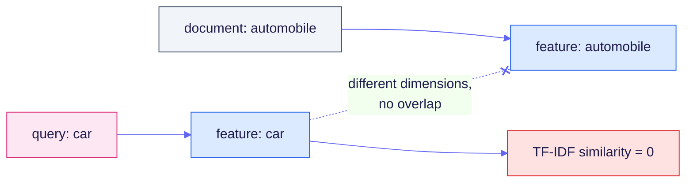

> [!NOTE]
> This gap is exactly what the **dense** side of Hybrid Search fills.

Result for `car repair`: *car insurance policy* **0.4595** beats *automobile repair guide* 0.2867 and *bicycle repair manual* 0.2867. The shared word `car` wins over the shared meaning.

## 29. Long-Document Limitation

Consider:

```text
D1: cat milk

D2: cat milk + hundreds of unrelated words
```

TF-IDF can normalize vectors, but classical TF-IDF does not model document length in the same explicit way BM25 does.

BM25 later introduces:

```text
document length normalization
average document length
parameter b
```

## 30. Repeated-Term Limitation

Raw TF-based TF-IDF keeps increasing as a term repeats.

```text
1 apple
2 apples
10 apples
100 apples
```

Each increase can continue raising raw TF contribution.

BM25 instead uses **term-frequency saturation**.

## 31. Binary Match vs TF-IDF

Boolean search asks:

```text
Does the term exist?
```

TF-IDF asks:

```text
How strongly does this document represent the term?
```

Example:

```text
D1: cat
D2: cat cat cat
```

Boolean:

```text
both match
```

TF-based weighting:

```text
D2 can receive stronger term weight
```

<table width="100%">
<thead><tr><th width="22%">Approach</th><th width="38%">Question</th><th width="40%">D1 = <code>cat</code>, D2 = <code>cat cat cat</code></th></tr></thead>
<tbody>
<tr><td><b>Boolean</b></td><td>Does the term exist?</td><td>Both match equally (1 and 1)</td></tr>
<tr><td><b>TF-based</b></td><td>How strongly does the document represent the term?</td><td>D2 gets a higher weight (TF 1 vs 3)</td></tr>
</tbody>
</table>

## 32. TF-IDF End-to-End Visual

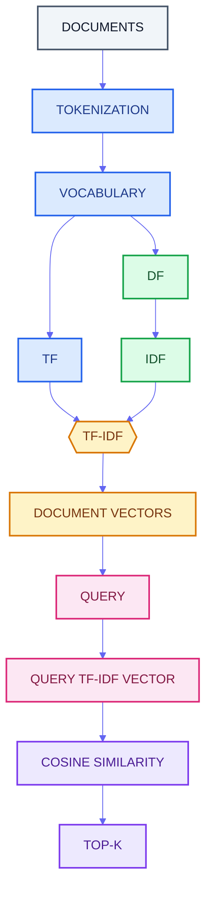

## CHECKPOINT 4

#### Questions

1. Why must query and document vectors use the same vocabulary?
2. Why does TF-IDF fail on unseen query terms?
3. Why do synonyms cause trouble?
4. What is cosine similarity doing?
5. Why is repeated-term growth a limitation?

### CHECKPOINT 4 — Answers

#### 1. Why the same vocabulary?

Because every vector dimension must represent the same term in query and documents.

#### 2. Why do unseen terms fail?

There is no learned vocabulary dimension for them, so they contribute no lexical signal.

#### 3. Why do synonyms cause trouble?

TF-IDF matches words rather than meaning.

```text
car ≠ automobile
```

#### 4. What does cosine similarity do?

It measures how strongly the query and document TF-IDF vectors align.

#### 5. Why is repeated-term growth a limitation?

Raw TF can keep increasing with every repetition even when later repetitions add little extra relevance.

## 33. Why BM25 Improves on TF-IDF

BM25 adds two major improvements.

### Improvement 1 — TF Saturation

Instead of:

```text
10 occurrences = 10× as valuable as 1
```

BM25 makes later repetitions matter less.

### Improvement 2 — Document-Length Normalization

BM25 explicitly adjusts for long vs short documents.

Learning progression:

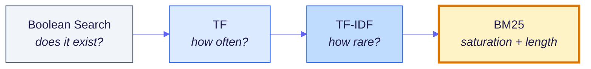

## 34. TF-IDF Strengths and Weaknesses

| Capability | TF-IDF |
|---|---|
| Exact keywords | Strong |
| Rare terms | Strong |
| Explainability | Strong |
| Sparse storage | Strong |
| Synonyms | Weak |
| Semantic meaning | Weak |
| Unseen vocabulary | Weak |
| Repetition handling | Limited |
| Explicit length normalization | Limited |
| Exact IDs/codes | Strong |

This is why TF-IDF is foundational but not the final lexical ranking method.

## 35. TF-IDF Debugging Framework

If search looks wrong, inspect:

```text
1. Was tokenization correct?
2. Is the query term in vocabulary?
3. What is TF?
4. What is DF?
5. What is IDF?
6. Is TF-IDF too small?
7. Is query vector mostly zero?
8. Is cosine similarity low?
9. Is vocabulary mismatch happening?
10. Is the document long/noisy?
```

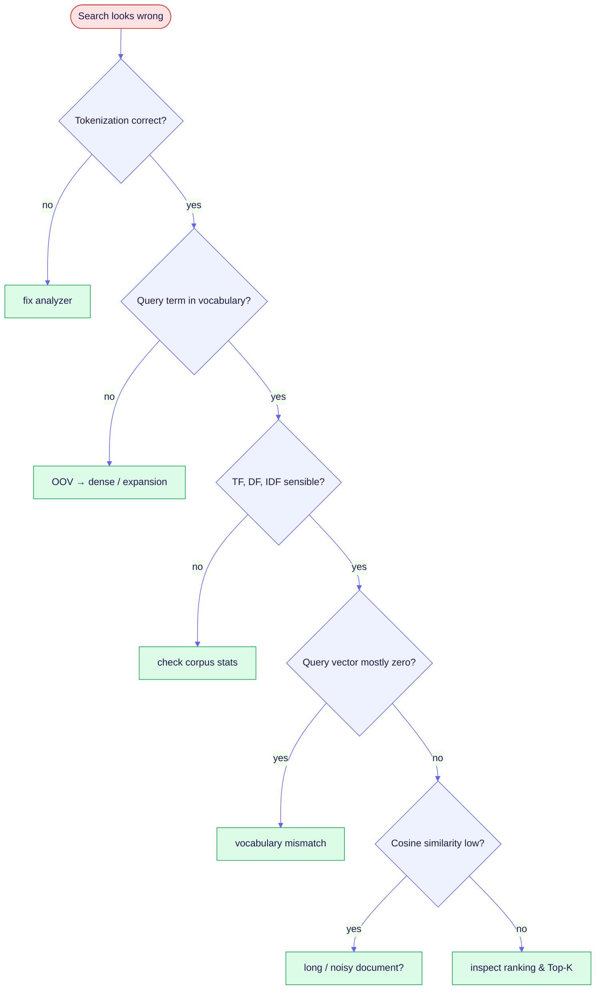

## End-to-End Example — TF-IDF Search From Scratch and With scikit-learn

This section puts every idea of the chapter into one working search engine: tokenize, build the vocabulary, compute DF and IDF, build the TF-IDF matrix, vectorize the query, rank by cosine similarity. It is built twice, once from scratch with NumPy and once with `TfidfVectorizer`, and both give the same numbers. All outputs below are real results from running the code.

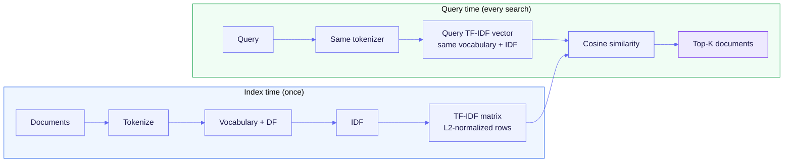

### Step 1. Corpus and queries

A small support and compliance knowledge base with two typical user queries.

```python
# Five short documents: support articles and regulatory text
documents = {
    "D1": "Error code E401 means authentication failed",
    "D2": "Reset your password if authentication keeps failing",
    "D3": "REACH Article 33 requires suppliers to share SVHC information",
    "D4": "Battery regulation requires collection of waste batteries",
    "D5": "Suppliers must share safety information with customers",
}

# One exact-code query and one regulatory query
queries = ["authentication error E401", "suppliers share SVHC information"]

for doc_id, text in documents.items():
    print(f"{doc_id}: {text}")
```

**Output**

```text
D1: Error code E401 means authentication failed
D2: Reset your password if authentication keeps failing
D3: REACH Article 33 requires suppliers to share SVHC information
D4: Battery regulation requires collection of waste batteries
D5: Suppliers must share safety information with customers
```

### Step 2. Tokenize

Lowercase and keep runs of letters and digits. The same function must run on documents and queries.

```python
import re

def tokenize(text):
    # Lowercase so "Suppliers" and "suppliers" become one term
    text = text.lower()

    # Keep letters and digits; punctuation and spaces split tokens
    return re.findall(r"[a-z0-9]+", text)

tokenized = {doc_id: tokenize(text) for doc_id, text in documents.items()}

for doc_id, tokens in tokenized.items():
    print(f"{doc_id}: {tokens}")
```

**Output**

```text
D1: ['error', 'code', 'e401', 'means', 'authentication', 'failed']
D2: ['reset', 'your', 'password', 'if', 'authentication', 'keeps', 'failing']
D3: ['reach', 'article', '33', 'requires', 'suppliers', 'to', 'share', 'svhc', 'information']
D4: ['battery', 'regulation', 'requires', 'collection', 'of', 'waste', 'batteries']
D5: ['suppliers', 'must', 'share', 'safety', 'information', 'with', 'customers']
```

### Step 3. Vocabulary and document frequency

The vocabulary fixes the vector dimensions. DF counts how many documents contain each term.

```python
# Sorted vocabulary = one dimension per unique term
vocabulary = sorted({term for tokens in tokenized.values() for term in tokens})

# DF: number of documents that contain the term at least once
df_counts = {term: sum(term in set(tokens) for tokens in tokenized.values()) for term in vocabulary}

print("Vocabulary size:", len(vocabulary))
print("Terms with DF > 1:", {t: d for t, d in df_counts.items() if d > 1})
```

**Output**

```text
Vocabulary size: 31
Terms with DF > 1: {'authentication': 2, 'information': 2, 'requires': 2, 'share': 2, 'suppliers': 2}
```

### Step 4. IDF

Two common formulas. The smoothed one is what scikit-learn uses by default, so Step 9 can match it exactly.

```python
import math

N = len(documents)

# Classic IDF: log(N / DF)
idf_classic = {t: math.log(N / df_counts[t]) for t in vocabulary}

# Smoothed IDF (scikit-learn default): ln((1 + N) / (1 + DF)) + 1
idf_smooth = {t: math.log((1 + N) / (1 + df_counts[t])) + 1 for t in vocabulary}

for term in ["authentication", "suppliers", "e401", "svhc"]:
    print(f"{term:<15} DF={df_counts[term]}  classic={idf_classic[term]:.4f}  smooth={idf_smooth[term]:.4f}")
```

**Output**

```text
authentication  DF=2  classic=0.9163  smooth=1.6931
suppliers       DF=2  classic=0.9163  smooth=1.6931
e401            DF=1  classic=1.6094  smooth=2.0986
svhc            DF=1  classic=1.6094  smooth=2.0986
```

### Step 5. TF-IDF document matrix

Raw TF times smoothed IDF, then L2-normalize each row so long documents do not get bigger vectors.

```python
from collections import Counter

import numpy as np
import pandas as pd

def tfidf_vector(tokens):
    # Raw term counts for this text
    counts = Counter(tokens)

    # TF x IDF for every vocabulary term; unknown terms are ignored
    vec = np.array([counts[t] * idf_smooth[t] for t in vocabulary], dtype=float)

    # L2 normalization: vector length becomes 1
    norm = np.linalg.norm(vec)
    return vec / norm if norm > 0 else vec

doc_ids = list(documents)
doc_matrix = np.vstack([tfidf_vector(tokenized[d]) for d in doc_ids])

print("Matrix shape:", doc_matrix.shape)
print("Non-zero cells:", int((doc_matrix > 0).sum()), "of", doc_matrix.size)

# Show the strongest terms of D3
d3 = pd.Series(doc_matrix[doc_ids.index("D3")], index=vocabulary)
print(d3[d3 > 0].sort_values(ascending=False).round(4).to_string())
```

**Output**

```text
Matrix shape: (5, 31)
Non-zero cells: 36 of 155
33             0.3627
article        0.3627
reach          0.3627
svhc           0.3627
to             0.3627
information    0.2926
requires       0.2926
share          0.2926
suppliers      0.2926
```

### Step 6. Search from scratch

Turn the query into a vector with the same vocabulary and IDF, then rank documents by cosine similarity. Rows are already unit length, so cosine is a dot product.

```python
def search_scratch(query, top_k=3):
    # Query uses the corpus vocabulary and IDF
    q = tfidf_vector(tokenize(query))

    # Cosine similarity = dot product of unit vectors
    scores = doc_matrix @ q

    # Highest scores first
    order = np.argsort(scores)[::-1][:top_k]
    return [(doc_ids[i], round(float(scores[i]), 4)) for i in order]

for query in queries:
    print(query, "->", search_scratch(query))
```

**Output**

```text
authentication error E401 -> [('D1', 0.6849), ('D2', 0.155), ('D5', 0.0)]
suppliers share SVHC information -> [('D3', 0.6232), ('D5', 0.4658), ('D4', 0.0)]
```

### Step 7. Same pipeline with scikit-learn

`fit_transform` learns vocabulary and IDF from the corpus. `transform` reuses them for the query.

```python
from sklearn.feature_extraction.text import TfidfVectorizer
from sklearn.metrics.pairwise import cosine_similarity

# Same tokenization rule as the scratch version
vectorizer = TfidfVectorizer(lowercase=True, token_pattern=r"[a-z0-9]+")

# Learn vocabulary + IDF and build the document matrix
sk_matrix = vectorizer.fit_transform(documents.values())

print("Matrix shape:", sk_matrix.shape)
print("Stored non-zero values:", sk_matrix.nnz)

def search_sklearn(query, top_k=3):
    # Reuse the fitted vocabulary and IDF
    q = vectorizer.transform([query])

    # Cosine similarity against every document
    scores = cosine_similarity(q, sk_matrix).flatten()

    order = np.argsort(scores)[::-1][:top_k]
    return [(doc_ids[i], round(float(scores[i]), 4)) for i in order]

for query in queries:
    print(query, "->", search_sklearn(query))
```

**Output**

```text
Matrix shape: (5, 31)
Stored non-zero values: 36
authentication error E401 -> [('D1', 0.6849), ('D2', 0.155), ('D5', 0.0)]
suppliers share SVHC information -> [('D3', 0.6232), ('D5', 0.4658), ('D4', 0.0)]
```

### Step 8. Check that both versions agree

Same vocabulary, same smoothed IDF and same L2 normalization should give the same matrix.

```python
# scikit-learn sorts its vocabulary alphabetically, like the scratch version
same_vocab = list(vectorizer.get_feature_names_out()) == vocabulary

# Largest absolute difference between the two matrices
max_diff = np.abs(sk_matrix.toarray() - doc_matrix).max()

print("Same vocabulary:", same_vocab)
print("Max difference:", f"{max_diff:.2e}")
```

**Output**

```text
Same vocabulary: True
Max difference: 0.00e+00
```

### What the results show

```mermaid
%%{init: {'theme':'base','themeVariables':{'primaryColor':'#EEF2FF','primaryBorderColor':'#6366F1','primaryTextColor':'#1E1B4B','lineColor':'#6366F1','pie1':'#22C55E','pie2':'#F59E0B','pie3':'#EF4444','pie4':'#3B82F6','pie5':'#8B5CF6','xyChart':{'plotColorPalette':'#2563EB, #16A34A, #D97706, #DC2626, #7C3AED'}}}}%%
xychart-beta
    title "Cosine scores per document"
    x-axis [D1, D2, D3, D4, D5]
    y-axis "cosine similarity" 0 --> 1
    bar [0.6849, 0.155, 0.0, 0.0, 0.0]
    bar [0.0, 0.0, 0.6232, 0.0, 0.4658]
```

<p align="center">Blue: "authentication error E401" · Green: "suppliers share SVHC information"</p>

<table width="100%">
<thead><tr><th width="28%">Query</th><th width="14%">Rank 1</th><th width="14%">Rank 2</th><th width="44%">Why</th></tr></thead>
<tbody>
<tr><td><code>authentication error E401</code></td><td>D1 (0.6849)</td><td>D2 (0.1550)</td><td>D1 matches <code>e401</code>, <code>error</code> and <code>authentication</code>. D2 shares only <code>authentication</code>, which appears in 2 documents and so has a lower IDF.</td></tr>
<tr><td><code>suppliers share SVHC information</code></td><td>D3 (0.6232)</td><td>D5 (0.4658)</td><td>Both share <code>suppliers</code>, <code>share</code>, <code>information</code>. Only D3 has the rare term <code>svhc</code> (DF = 1), and that decides the ranking.</td></tr>
</tbody>
</table>

<table width="100%">
<thead><tr><th width="22%">Aspect</th><th width="39%">From scratch</th><th width="39%">scikit-learn</th></tr></thead>
<tbody>
<tr><td><b>Best for</b></td><td>Learning and debugging every number</td><td>Real projects: fast, sparse storage, tested</td></tr>
<tr><td><b>Storage</b></td><td>Dense NumPy array (155 cells)</td><td>Sparse CSR matrix (36 stored values)</td></tr>
<tr><td><b>IDF</b></td><td>Any formula you choose</td><td>Smoothed <code>ln((1+N)/(1+DF)) + 1</code> by default (<code>smooth_idf=True</code>)</td></tr>
<tr><td><b>Normalization</b></td><td>Manual L2</td><td><code>norm="l2"</code> by default</td></tr>
<tr><td><b>Result here</b></td><td colspan="2" align="center">Identical matrix (max difference 0.00e+00) and identical rankings</td></tr>
</tbody>
</table>

> [!TIP]
> To reproduce scikit-learn by hand you must match three settings: the tokenizer (`token_pattern`), the IDF formula (smoothed) and the row normalization (L2). If any one differs, scores change, but the ranking usually stays similar.

## 36. Interview Questions

#### What is TF-IDF?

A lexical weighting method combining term frequency in one document with inverse document frequency across the corpus.

#### Why use IDF?

Common words are weak discriminators; rare words are more informative.

#### What if a term appears in every document?

Its simplified IDF becomes zero.

#### Why is TF-IDF sparse?

Each document contains only a small subset of the vocabulary.

#### How does TF-IDF search work?

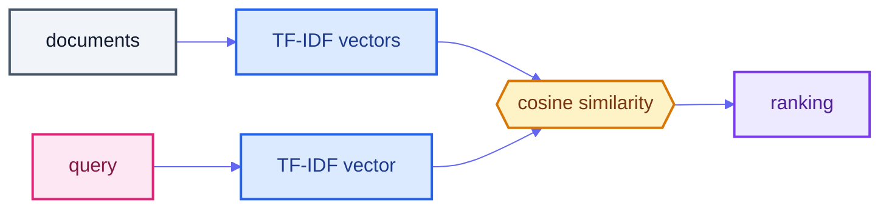

#### Why does TF-IDF fail on synonyms?

Because it matches lexical features, not semantic meaning.

#### Why does BM25 improve on TF-IDF?

It adds TF saturation and document-length normalization.

## 37. Interview Scenarios

#### Scenario 1

```text
D1: apple apple banana
D2: apple orange
```

Query:

```text
apple
```

Which document has higher raw TF for `apple`?

**D1**.

---

#### Scenario 2

A term appears in only 1 of 10,000 documents.

Is IDF high or low?

**High**, because the term is rare.

---

#### Scenario 3

Query:

```text
car repair
```

Document:

```text
automobile maintenance
```

Why can TF-IDF fail?

Because vocabulary differs despite related meaning.

---

#### Scenario 4

Why use `transform()` for a query instead of `fit_transform()`?

Because the query must reuse the corpus vocabulary and IDF statistics.

---

#### Scenario 5

Why can a term repeated 100 times be overvalued by raw TF?

Because raw TF grows approximately linearly. BM25 reduces this using saturation.

## 38. One-Page Revision Map

```mermaid
%%{init: {'theme':'base','themeVariables':{'primaryColor':'#EEF2FF','primaryBorderColor':'#6366F1','primaryTextColor':'#1E1B4B','lineColor':'#6366F1','pie1':'#22C55E','pie2':'#F59E0B','pie3':'#EF4444','pie4':'#3B82F6','pie5':'#8B5CF6','xyChart':{'plotColorPalette':'#2563EB, #16A34A, #D97706, #DC2626, #7C3AED'}}}}%%
flowchart TB
    T(["TF-IDF"]) --> TF["TF<br/>frequency in doc"] --> TF2["count / normalized"]
    T --> IDF["IDF<br/>rarity in corpus"] --> IDF2["log(N / DF)"]
    TF2 --> X{{"TF × IDF"}}
    IDF2 --> X
    X --> V["Sparse Vector"] --> QV["Query TF-IDF Vector"] --> CS["Cosine Similarity"] --> R["Ranking"]
    classDef q fill:#FCE7F3,stroke:#DB2777,color:#831843,stroke-width:2px
    classDef sp fill:#DBEAFE,stroke:#2563EB,color:#1E3A8A,stroke-width:2px
    classDef de fill:#DCFCE7,stroke:#16A34A,color:#14532D,stroke-width:2px
    classDef fu fill:#FEF3C7,stroke:#D97706,color:#78350F,stroke-width:2px
    classDef rr fill:#EDE9FE,stroke:#7C3AED,color:#4C1D95,stroke-width:2px
    classDef llm fill:#FEE2E2,stroke:#DC2626,color:#7F1D1D,stroke-width:2px
    classDef neu fill:#F1F5F9,stroke:#475569,color:#0F172A,stroke-width:2px
    class T q
    class TF,TF2 sp
    class IDF,IDF2 de
    class X,V fu
    class QV,CS,R rr
```

Key formulas:

```math
TF(t,d) = \text{count}(t,d)
```

```math
DF(t) = \text{number of documents containing } t
```

```math
IDF(t) = \log\left(\frac{N}{DF(t)}\right)
```

```math
\text{TF-IDF}(t,d) = TF(t,d) \times IDF(t)
```

## 39. Practice Tasks

#### Task 1

Use:

```text
D1: apple apple banana
D2: apple orange banana
D3: grape orange
```

Calculate manually:

```text
TF(apple, D1)
DF(apple)
IDF(apple)
TF-IDF(apple, D1)
```

#### Task 2

Compare IDF of:

```text
banana
grape
```

Which is larger and why?

#### Task 3

Build the full TF-IDF matrix manually.

#### Task 4

Search:

```text
apple banana
```

using cosine similarity.

#### Task 5

Add the word `fruit` to every document and inspect how IDF changes.

#### Task 6

Compare:

```text
D1: cat
D2: cat cat cat cat cat
```

#### Task 7

Test vocabulary mismatch:

```text
query: car
document: automobile
```

#### Task 8

Compare your manual matrix with `TfidfVectorizer`.

## 40. Final Takeaways

Remember these ten ideas:

1. TF measures local term frequency.
2. DF counts documents containing a term.
3. IDF measures global rarity.
4. Rare terms receive higher IDF.
5. TF-IDF combines local importance and global rarity.
6. TF-IDF documents are sparse vectors.
7. Queries must use the same vocabulary as documents.
8. Cosine similarity can rank query-document TF-IDF vectors.
9. TF-IDF is lexical and therefore weak on synonyms/semantics.
10. BM25 improves TF-IDF with TF saturation and document-length normalization.

---

## Next Chapter — Chapter 5: BM25

Chapter 5 will be a **deep-dive notebook** because BM25 is one of the most important Hybrid Search topics.

We will cover:

```text
Why TF-IDF is insufficient
BM25 formula
BM25 IDF
TF saturation
k1
b
document length normalization
average document length
manual calculations
visual parameter experiments
BM25 from scratch
rank_bm25
BM25 vs TF-IDF
failure cases
interview questions
```

<p align="center"><a href="../../9b.%20Inverted%20Index%20Fundamentals/README.md">Previous: 9b Inverted Index Fundamentals</a> | <a href="../../../README.md">Home</a> | <a href="../README.md">Module index</a> | <a href="../../README.md">Chapter 09: Sparse Retrieval and Keyword Search</a> | <a href="../../9d.%20BM25/README.md">Next: 9d BM25</a></p>
