<div align="center">

# 9d · BM25

  

**Rarity times saturated, length-normalized term frequency: the core sparse retriever.**

</div>

<p align="center"><a href="../../9c.%20TF-IDF/README.md">Previous: 9c TF-IDF</a> | <a href="../../../README.md">Home</a> | <a href="../README.md">Module index</a> | <a href="../../README.md">Chapter 09: Sparse Retrieval and Keyword Search</a> | <a href="../../9e.%20BM25%20Implementation%20in%20Practice/README.md">Next: 9e BM25 Implementation in Practice</a></p>

## Contents

<table width="100%">
<thead><tr><th width="8%">Sr No</th><th width="38%">Section</th><th width="54%">Subtopics</th></tr></thead>
<tbody>
<tr><td align="center">01</td><td><a href="#1-simple-corpus"><b>1. Simple Corpus</b></a></td><td>-</td></tr>
<tr><td align="center">02</td><td><a href="#2-why-do-we-need-bm25"><b>2. Why Do We Need BM25?</b></a></td><td><a href="#problem-a--repetition">Problem A — Repetition</a><br><a href="#problem-b--document-length">Problem B — Document length</a></td></tr>
<tr><td align="center">03</td><td><a href="#3-bm25-intuition"><b>3. BM25 Intuition</b></a></td><td>-</td></tr>
<tr><td align="center">04</td><td><a href="#4-the-bm25-formula"><b>4. The BM25 Formula</b></a></td><td>-</td></tr>
<tr><td align="center">05</td><td><a href="#5-corpus-statistics"><b>5. Corpus Statistics</b></a></td><td>-</td></tr>
<tr><td align="center">06</td><td><a href="#6-document-frequency-and-bm25-idf"><b>6. Document Frequency and BM25 IDF</b></a></td><td>-</td></tr>
<tr><td align="center">07</td><td><a href="#checkpoint-1"><b>CHECKPOINT 1</b></a></td><td><a href="#answers">Answers</a></td></tr>
<tr><td align="center">08</td><td><a href="#7-term-frequency-saturation"><b>7. Term-Frequency Saturation</b></a></td><td>-</td></tr>
<tr><td align="center">09</td><td><a href="#8-the-k1-parameter"><b>8. The k1 Parameter</b></a></td><td>-</td></tr>
<tr><td align="center">10</td><td><a href="#9-document-length-normalization"><b>9. Document-Length Normalization</b></a></td><td>-</td></tr>
<tr><td align="center">11</td><td><a href="#10-the-b-parameter"><b>10. The b Parameter</b></a></td><td>-</td></tr>
<tr><td align="center">12</td><td><a href="#checkpoint-2"><b>CHECKPOINT 2</b></a></td><td><a href="#answers-1">Answers</a></td></tr>
<tr><td align="center">13</td><td><a href="#11-manual-bm25-calculation"><b>11. Manual BM25 Calculation</b></a></td><td>-</td></tr>
<tr><td align="center">14</td><td><a href="#12-multi-term-query"><b>12. Multi-Term Query</b></a></td><td>-</td></tr>
<tr><td align="center">15</td><td><a href="#13-bm25-from-scratch"><b>13. BM25 From Scratch</b></a></td><td>-</td></tr>
<tr><td align="center">16</td><td><a href="#14-experiment--tf-saturation-with-real-documents"><b>14. Experiment — TF Saturation With Real Documents</b></a></td><td>-</td></tr>
<tr><td align="center">17</td><td><a href="#15-experiment--short-vs-long-documents"><b>15. Experiment — Short vs Long Documents</b></a></td><td>-</td></tr>
<tr><td align="center">18</td><td><a href="#16-experiment--what-happens-when-b--0"><b>16. Experiment — What Happens When b = 0?</b></a></td><td>-</td></tr>
<tr><td align="center">19</td><td><a href="#checkpoint-3"><b>CHECKPOINT 3</b></a></td><td><a href="#answers-2">Answers</a></td></tr>
<tr><td align="center">20</td><td><a href="#17-bm25-vs-tf-idf"><b>17. BM25 vs TF-IDF</b></a></td><td>-</td></tr>
<tr><td align="center">21</td><td><a href="#18-compare-rankings-on-the-same-corpus"><b>18. Compare Rankings on the Same Corpus</b></a></td><td>-</td></tr>
<tr><td align="center">22</td><td><a href="#19-tune-k1"><b>19. Tune k1</b></a></td><td>-</td></tr>
<tr><td align="center">23</td><td><a href="#20-tune-b"><b>20. Tune b</b></a></td><td>-</td></tr>
<tr><td align="center">24</td><td><a href="#21-optional-rank_bm25-library"><b>21. Optional: rank_bm25 Library</b></a></td><td>-</td></tr>
<tr><td align="center">25</td><td><a href="#22-bm25-limitation--vocabulary-mismatch"><b>22. BM25 Limitation — Vocabulary Mismatch</b></a></td><td>-</td></tr>
<tr><td align="center">26</td><td><a href="#23-bm25-strength--exact-terms"><b>23. BM25 Strength — Exact Terms</b></a></td><td>-</td></tr>
<tr><td align="center">27</td><td><a href="#24-why-bm25-is-excellent-for-hybrid-search"><b>24. Why BM25 Is Excellent for Hybrid Search</b></a></td><td>-</td></tr>
<tr><td align="center">28</td><td><a href="#checkpoint-4"><b>CHECKPOINT 4</b></a></td><td><a href="#answers-3">Answers</a></td></tr>
<tr><td align="center">29</td><td><a href="#25-bm25-debugging-framework"><b>25. BM25 Debugging Framework</b></a></td><td>-</td></tr>
<tr><td align="center">30</td><td><a href="#end-to-end-example--bm25-search-from-scratch-and-with-rank_bm25"><b>End-to-End Example — BM25 Search From Scratch and With rank_bm25</b></a></td><td><a href="#step-1-corpus-and-queries">Step 1. Corpus and queries</a><br><a href="#step-2-tokenize">Step 2. Tokenize</a><br><a href="#step-3-corpus-statistics-n-d-and-avgdl">Step 3. Corpus statistics: N, |D| and avgdl</a><br><a href="#step-4-document-frequency-and-bm25-idf">Step 4. Document frequency and BM25 IDF</a><br><a href="#step-5-score-one-term-by-hand">Step 5. Score one term by hand</a><br><a href="#step-6-full-bm25-score-with-a-per-term-breakdown">Step 6. Full BM25 score with a per-term breakdown</a><br><a href="#step-7-search-rank-every-document">Step 7. Search: rank every document</a><br><a href="#step-8-why-bm25-ranked-it-this-way-raw-tf-x-idf-vs-bm25">Step 8. Why BM25 ranked it this way: raw TF x IDF vs BM25</a><br><a href="#step-9-turn-the-knobs-k1-and-b">Step 9. Turn the knobs: k1 and b</a><br><a href="#step-10-same-search-with-the-rank_bm25-library">Step 10. Same search with the rank_bm25 library</a><br><a href="#step-11-why-the-library-numbers-differ-and-how-to-make-them-match">Step 11. Why the library numbers differ, and how to make them match</a><br><a href="#what-the-results-show">What the results show</a></td></tr>
<tr><td align="center">31</td><td><a href="#26-interview-questions"><b>26. Interview Questions</b></a></td><td>-</td></tr>
<tr><td align="center">32</td><td><a href="#27-interview-scenarios"><b>27. Interview Scenarios</b></a></td><td>-</td></tr>
<tr><td align="center">33</td><td><a href="#28-one-page-revision-map"><b>28. One-Page Revision Map</b></a></td><td>-</td></tr>
<tr><td align="center">34</td><td><a href="#29-practice-tasks"><b>29. Practice Tasks</b></a></td><td>-</td></tr>
<tr><td align="center">35</td><td><a href="#30-final-takeaways"><b>30. Final Takeaways</b></a></td><td>-</td></tr>
<tr><td align="center">36</td><td><a href="#next-chapter--chapter-6-dense-retrieval"><b>Next Chapter — Chapter 6: Dense Retrieval</b></a></td><td>-</td></tr>
</tbody>
</table>

### BM25 (Best Matching 25)

### Core mental model

```text
TF-IDF:
"More repeats = more weight"

BM25:
"More repeats help, but only up to a point."

TF-IDF:
"Document length is only indirectly handled."

BM25:
"Long documents are explicitly normalized."
```

## 1. Simple Corpus

We use only simple examples.

```text
D1: cat drinks milk
D2: cat cat drinks milk
D3: dog eats food
D4: cat eats fish
D5: apple banana fruit salad
D6: apple apple fruit
```

## 2. Why Do We Need BM25?

TF-IDF is useful, but two issues matter in real search.

### Problem A — Repetition

```text
D1: cat
D2: cat cat
D3: cat cat cat cat cat cat cat cat cat cat
```

Raw TF treats ten occurrences as ten times the count of one occurrence.

But relevance usually behaves more like:

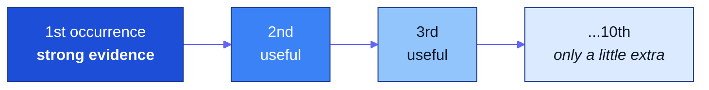

BM25 solves this using **term-frequency saturation**.

### Problem B — Document length

Compare:

```text
D1: cat milk

D2: cat milk + 100 unrelated words
```

D1 is more focused. BM25 explicitly normalizes for document length.

## 3. BM25 Intuition

For every query term, BM25 asks:

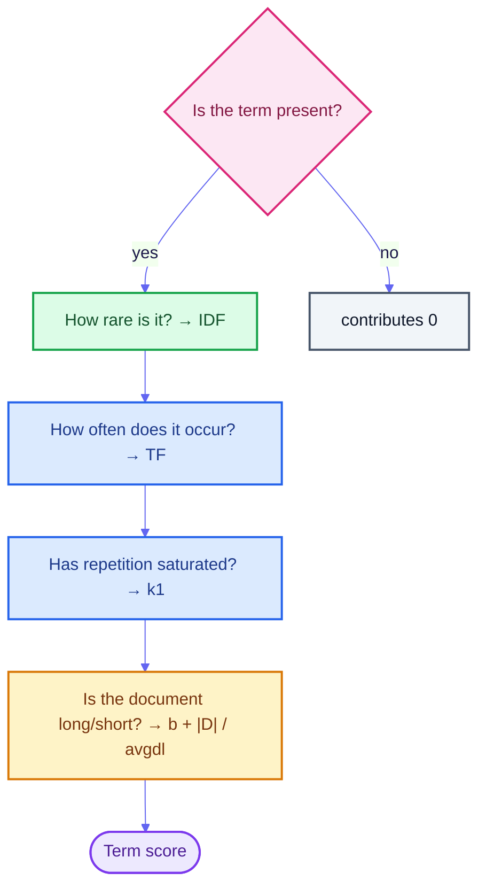

For multi-word queries, BM25 sums the term scores.

## 4. The BM25 Formula

A common form is:

```math
BM25(D,Q) = \sum_{q_i \in Q} IDF(q_i) \cdot \frac{ TF(q_i,D)(k_1+1) }{ TF(q_i,D)+ k_1\left( 1-b+b\frac{|D|}{\text{avgdl}} \right) }
```

#### Symbols

```text
TF(q,D)  = count of query term q in document D
IDF(q)   = rarity of q across documents
k1       = TF saturation control
b        = document-length normalization control
|D|      = current document length
avgdl    = average document length in corpus
```

## 5. Corpus Statistics

BM25 needs:

```text
N      = number of documents
DF     = document frequency of each term
|D|    = current document length
avgdl  = average document length
```

<table width="100%">
<thead><tr><th width="10%">Doc</th><th width="50%">Text</th><th width="20%">|D|</th><th width="20%">|D| / avgdl</th></tr></thead>
<tbody>
<tr><td align="center">D1</td><td><code>cat drinks milk</code></td><td align="center">3</td><td align="center">0.90</td></tr>
<tr><td align="center">D2</td><td><code>cat cat drinks milk</code></td><td align="center">4</td><td align="center">1.20</td></tr>
<tr><td align="center">D3</td><td><code>dog eats food</code></td><td align="center">3</td><td align="center">0.90</td></tr>
<tr><td align="center">D4</td><td><code>cat eats fish</code></td><td align="center">3</td><td align="center">0.90</td></tr>
<tr><td align="center">D5</td><td><code>apple banana fruit salad</code></td><td align="center">4</td><td align="center">1.20</td></tr>
<tr><td align="center">D6</td><td><code>apple apple fruit</code></td><td align="center">3</td><td align="center">0.90</td></tr>
</tbody>
</table>

`N = 6`, `avgdl = 20 / 6 = 3.333` (notebook results).

## 6. Document Frequency and BM25 IDF

BM25 needs DF:

```text
DF(term) = number of documents containing the term
```

A common BM25 IDF formula is:

```math
IDF(q) = \log\left( 1 + \frac{N - DF(q) + 0.5}{DF(q) + 0.5} \right)
```

Rare term:

```text
small DF → larger IDF
```

Common term:

```text
large DF → smaller IDF
```

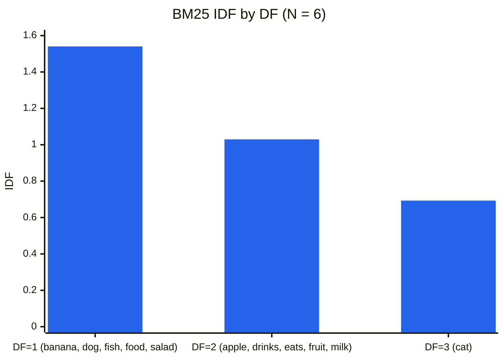

## CHECKPOINT 1

#### Questions

1. What is `avgdl`?
2. Why does BM25 need DF?
3. What does IDF represent?
4. Why are rare terms useful?

### Answers

1. `avgdl` is the average number of tokens per document in the corpus.
2. DF is needed to determine how common or rare a query term is.
3. IDF is the rarity/discriminative importance of a term across the corpus.
4. Rare terms narrow the search space more strongly, so they usually provide stronger evidence of relevance.

## 7. Term-Frequency Saturation

BM25 does **not** allow repeated terms to grow relevance linearly forever.

Think:

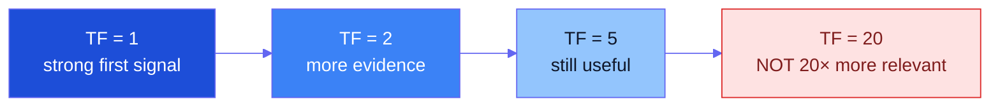

## 8. The `k1` Parameter

`k1` controls how quickly TF saturation happens.

```text
smaller k1 → saturation happens sooner
larger k1  → repetitions keep helping longer
```

A common range is roughly:

```text
1.2 to 2.0
```

but it should be tuned on evaluation data.

##### Saturation curves for different k1 (computed, b = 0)

`saturated TF = TF·(k1+1) / (TF + k1)` — the ceiling is `k1 + 1`.

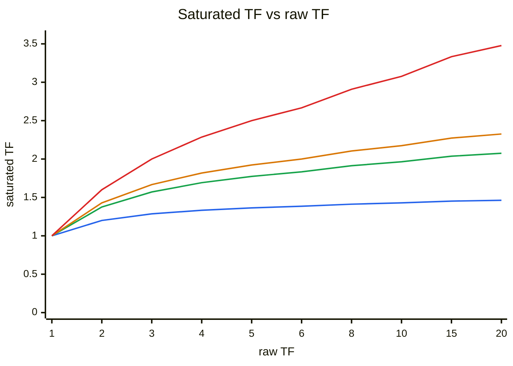

<p align="center"> k1 = 0.5 ·  k1 = 1.2 ·  k1 = 1.5 ·  k1 = 3.0</p>

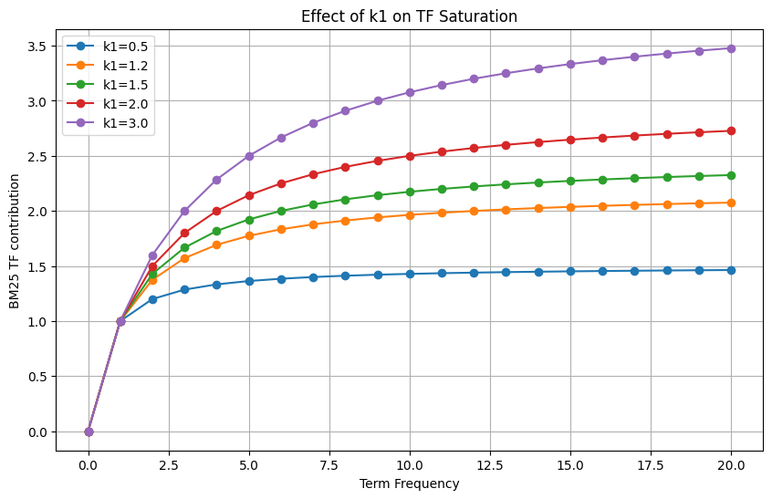

#### Visual intuition

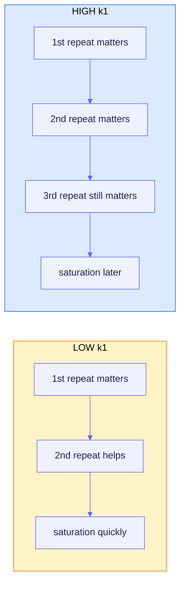

## 9. Document-Length Normalization

Compare:

```text
Short:
cat milk

Long:
cat milk dog food book table chair apple banana orange ...
```

Both contain the same query terms.

But the short document is much more focused.

BM25 uses:

```math
\frac{|D|}{\text{avgdl}}
```

to tell whether the document is shorter or longer than average.

## 10. The `b` Parameter

`b` controls how much document length matters.

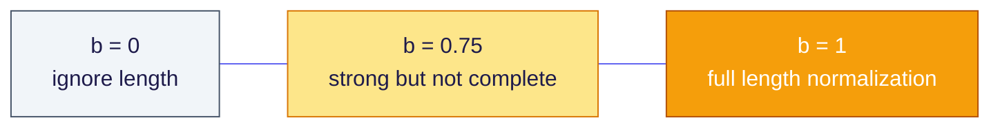

##### Length factor `1 − b + b·|D|/avgdl` (computed)

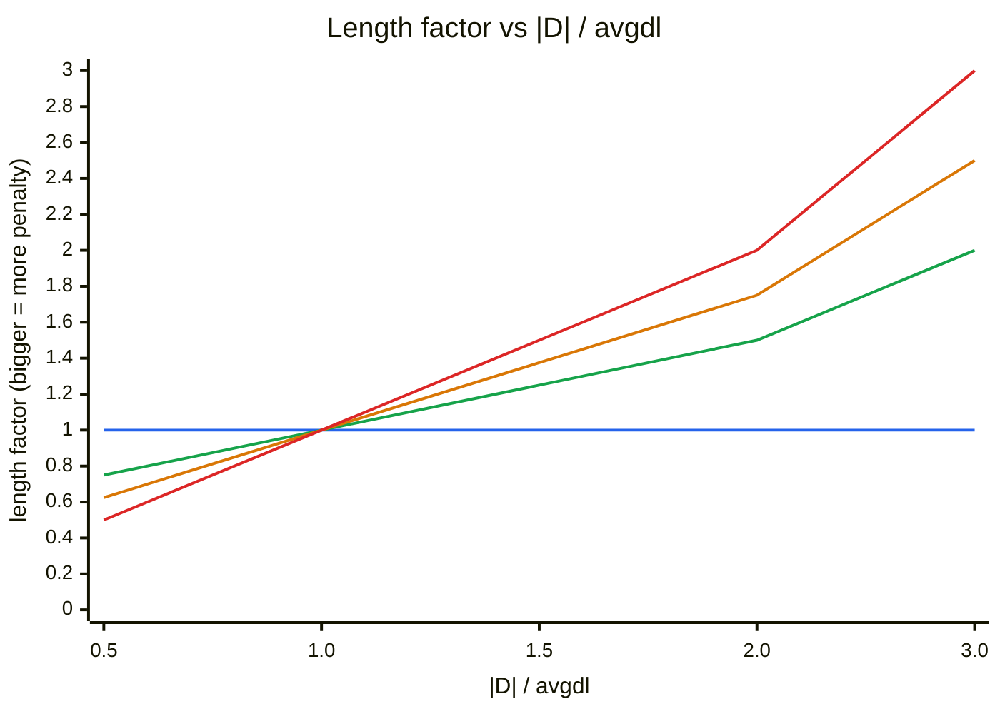

<p align="center"> b = 0 ·  b = 0.5 ·  b = 0.75 ·  b = 1</p>

> [!TIP]
> Every curve passes through **1.0** at `|D| = avgdl`. An average-length document is never penalized or boosted.

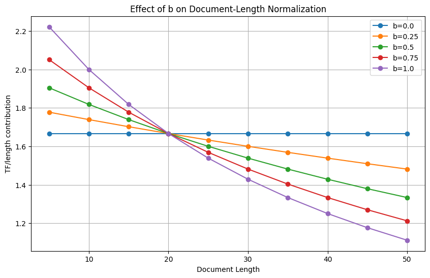

## CHECKPOINT 2

#### Questions

1. What is TF saturation?
2. What does `k1` control?
3. What does `b` control?
4. What happens when `b=0`?
5. What happens when `b=1`?

### Answers

1. TF saturation means repeated occurrences help less and less as frequency grows.
2. `k1` controls how quickly repeated-term contribution saturates.
3. `b` controls the strength of document-length normalization.
4. At `b=0`, document length is ignored.
5. At `b=1`, full document-length normalization is applied.

## 11. Manual BM25 Calculation

Let's calculate the score contribution for:

```text
Query term: cat
Document: D2 = cat cat drinks milk
k1 = 1.5
b  = 0.75
```

We will print every step.

##### The steps as one pipeline

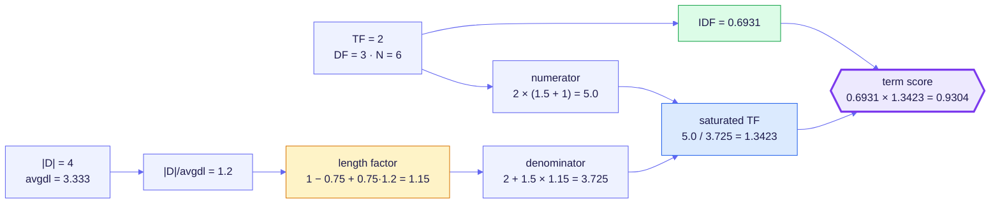

## 12. Multi-Term Query

For:

```text
Query: cat milk
```

BM25 calculates:

```text
BM25(cat, document)
+
BM25(milk, document)
```

and sums the contributions.

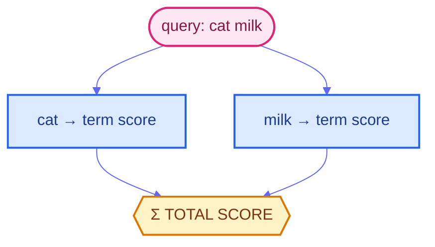

## 13. BM25 From Scratch

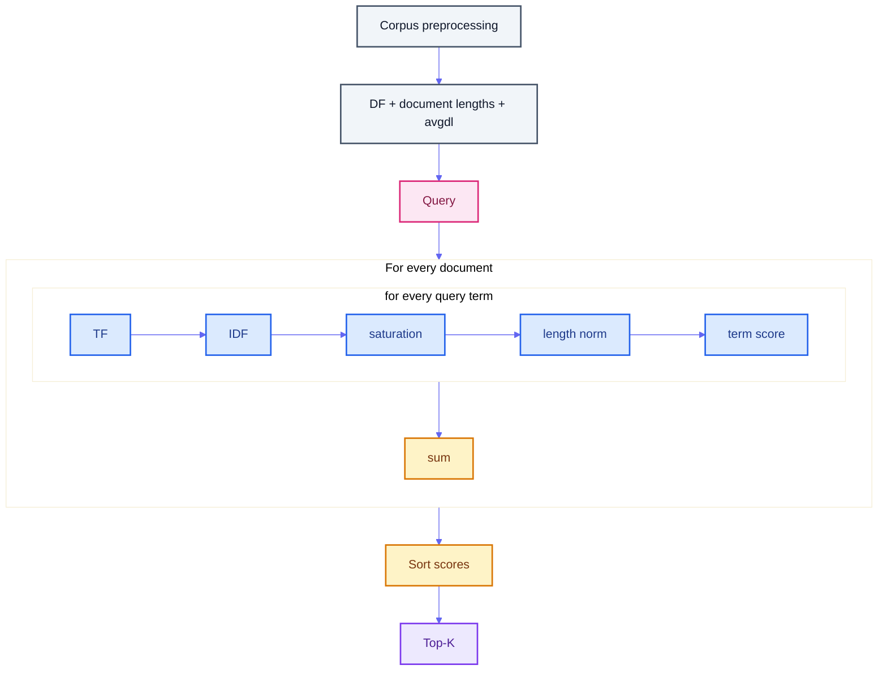

```python
import math
from collections import Counter

class SimpleBM25:
    def __init__(self, documents, k1=1.5, b=0.75):
        # Parameters
        self.k1, self.b = k1, b

        # Tokenize every document once
        self.tokenized = {d: tokenize(t) for d, t in documents.items()}

        # Corpus statistics: N, document lengths, average length
        self.N = len(self.tokenized)
        self.doc_len = {d: len(toks) for d, toks in self.tokenized.items()}
        self.avgdl = sum(self.doc_len.values()) / self.N

        # Document frequency for every term
        vocab = {t for toks in self.tokenized.values() for t in toks}
        self.df = {t: sum(t in set(toks) for toks in self.tokenized.values()) for t in vocab}

    def idf(self, term):
        # BM25 IDF with +1 to stay positive
        df = self.df.get(term, 0)
        return math.log(1 + (self.N - df + 0.5) / (df + 0.5))

    def score(self, query, doc_id):
        counts = Counter(self.tokenized[doc_id])
        total = 0.0

        for term in tokenize(query):
            tf = counts[term]

            # Absent terms contribute nothing
            if tf == 0:
                continue

            # Length normalization
            length_factor = 1 - self.b + self.b * self.doc_len[doc_id] / self.avgdl

            # Saturated TF
            tf_part = tf * (self.k1 + 1) / (tf + self.k1 * length_factor)

            # Add this term's contribution
            total += self.idf(term) * tf_part

        return total

    def search(self, query, top_k=5):
        # Score every document and sort descending
        scores = {d: self.score(query, d) for d in self.tokenized}
        return sorted(scores.items(), key=lambda x: x[1], reverse=True)[:top_k]
```

##### BM25 for `cat milk` (from the notebook run, k1 = 1.5, b = 0.75)

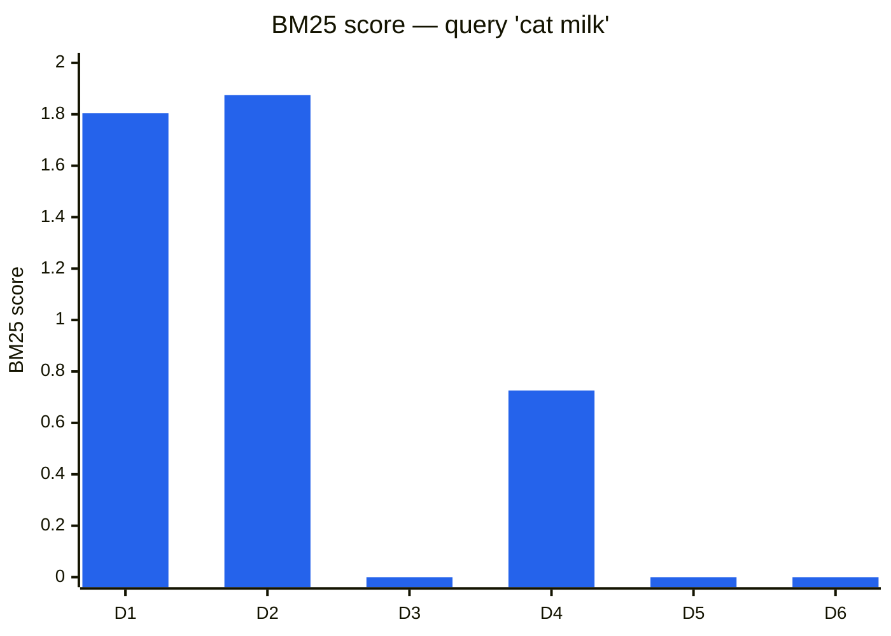

D2 (`cat cat drinks milk`) beats D1 only slightly: the second `cat` adds little because of saturation, and D2 is longer than average.

## 14. Experiment — TF Saturation With Real Documents

```text
D1: apple
D2: apple apple
D3: apple × 4
D4: apple × 10
```

Prediction:

```text
scores increase,
but not linearly
```

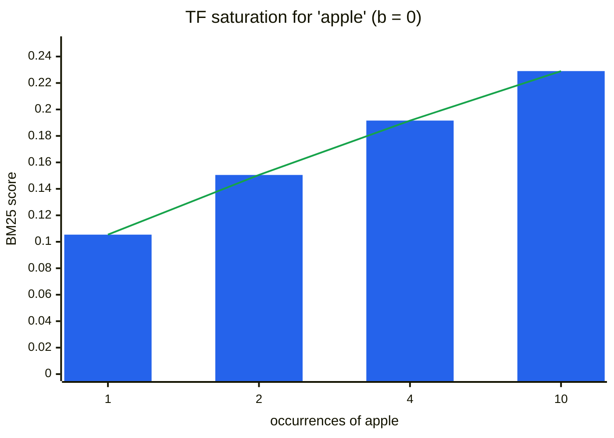

10× the occurrences gives only about **2.2×** the score.

## 15. Experiment — Short vs Long Documents

All documents contain:

```text
cat milk
```

but with different amounts of unrelated content.

```python
length_docs = {
    "Short": "cat milk",
    "Medium": "cat milk dog food book table",
    "Long": "cat milk dog food book table chair apple banana orange school pen pencil paper water bird fish house road tree green blue red",
}

# Same query, same k1 and b, only the document length changes
length_model = SimpleBM25(length_docs, k1=1.5, b=0.75)

for doc_id in length_docs:
    print(doc_id, length_model.score("cat milk", doc_id))
```

Result (`N = 3`, `avgdl = 10.333`):

<table width="100%">
<thead><tr><th width="16%">Doc</th><th width="14%">|D|</th><th width="20%">|D| / avgdl</th><th width="22%">Length factor</th><th width="28%">BM25 <code>cat milk</code></th></tr></thead>
<tbody>
<tr><td align="center">Short</td><td align="center">2</td><td align="center">0.19</td><td align="center">0.395</td><td align="center"><b>0.4192</b></td></tr>
<tr><td align="center">Medium</td><td align="center">6</td><td align="center">0.58</td><td align="center">0.685</td><td align="center">0.3292</td></tr>
<tr><td align="center">Long</td><td align="center">23</td><td align="center">2.23</td><td align="center">1.919</td><td align="center">0.1721</td></tr>
</tbody>
</table>

All three documents contain `cat` and `milk` exactly once. Only the length differs, and the short, focused document scores **2.4x** the long one.

## 16. Experiment — What Happens When `b = 0`?

At `b=0`, length normalization is disabled.

Let's compare:

```text
b = 0
vs
b = 0.75
```

##### Short vs medium vs long (notebook results)

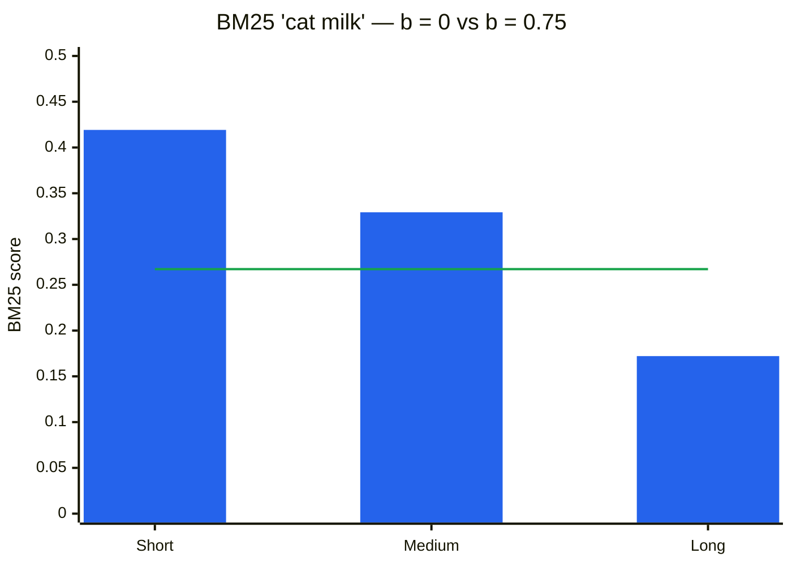

<p align="center"> bars: b = 0.75 (short, focused document wins) ·  line: b = 0 (length ignored, all equal at 0.2671)</p>

## CHECKPOINT 3

#### Questions

1. Why does BM25 not grow linearly with TF?
2. Why can a short focused document beat a long noisy document?
3. Why does `b=0` remove the length penalty?
4. Why does BM25 sum term scores?

### Answers

1. BM25 uses TF saturation, so each additional repetition contributes less.
2. The length-normalization factor penalizes unusually long documents when `b > 0`.
3. The length-dependent part is multiplied by `b`; at zero, it disappears.
4. A multi-term query provides multiple pieces of lexical evidence, so BM25 adds them.

## 17. BM25 vs TF-IDF

| Capability | TF-IDF | BM25 |
|---|---|---|
| Exact term matching | Yes | Yes |
| Rare-term weighting | Yes | Yes |
| TF saturation | Limited | **Yes** |
| Explicit length normalization | Limited | **Yes** |
| Sparse lexical retrieval | Yes | Yes |
| Semantic understanding | No | No |

Both are lexical.

BM25 is generally the stronger retrieval baseline for search.

## 18. Compare Rankings on the Same Corpus

Query:

```text
cat milk
```

Important:

> TF-IDF cosine scores and BM25 scores use different scales.

Compare rankings or normalized scores, not raw magnitudes.

```python
# TF-IDF cosine scores for the same query
vec = TfidfVectorizer()
tfidf_scores = cosine_similarity(vec.fit_transform(texts), vec.transform(["cat milk"])).flatten()

# BM25 scores for the same query
bm25_scores = np.array([bm25.score("cat milk", d) for d in doc_ids])

# Divide by the max so both fit in 0..1 before comparing
tfidf_norm = tfidf_scores / (tfidf_scores.max() + 1e-12)
bm25_norm = bm25_scores / (bm25_scores.max() + 1e-12)
```

Result (notebook corpus, query `cat milk`):

<table width="100%">
<thead><tr><th width="8%">Doc</th><th width="30%">Text</th><th width="15%">TF-IDF cosine</th><th width="15%">BM25</th><th width="16%">TF-IDF / max</th><th width="16%">BM25 / max</th></tr></thead>
<tbody>
<tr><td align="center">D1</td><td align="center"><code>cat drinks milk</code></td><td align="center">0.7946</td><td align="center">1.8039</td><td align="center">0.9443</td><td align="center">0.9621</td></tr>
<tr><td align="center">D2</td><td align="center"><code>cat cat drinks milk</code></td><td align="center">0.8415</td><td align="center">1.8750</td><td align="center">1.0000</td><td align="center">1.0000</td></tr>
<tr><td align="center">D4</td><td align="center"><code>cat eats fish</code></td><td align="center">0.3045</td><td align="center">0.7258</td><td align="center">0.3618</td><td align="center">0.3871</td></tr>
<tr><td align="center">D3, D5, D6</td><td align="center">no query term</td><td align="center">0</td><td align="center">0</td><td align="center">0</td><td align="center">0</td></tr>
</tbody>
</table>

Same ranking (D2 > D1 > D4). The raw scales are very different (cosine is at most 1, BM25 is not bounded), which is why the scores are divided by their maximum before comparing. After that, BM25 puts D1 closer to D2, because the extra `cat` in D2 is saturated and D2 is longer than average.

## 19. Tune `k1`

`k1` sets how much repeated terms are worth. Score the `apple` documents from section 14 with length switched off (`b = 0`):

```python
for k1 in [0.3, 0.8, 1.2, 1.5, 2.0, 3.0]:
    # Length ignored, so only saturation changes
    model = SimpleBM25(repeat_docs, k1=k1, b=0.0)

    # apple x 10 vs apple x 1
    print(k1, model.score("apple", "D4"), model.score("apple", "D1"))
```

<table width="100%">
<thead><tr><th width="12%">k1</th><th width="22%">D4 (apple x 10)</th><th width="22%">D1 (apple x 1)</th><th width="22%">D4 / D1</th><th width="22%">Max saturated TF (k1 + 1)</th></tr></thead>
<tbody>
<tr><td align="center">0.3</td><td align="center">0.1330</td><td align="center">0.1054</td><td align="center">1.26</td><td align="center">1.3</td></tr>
<tr><td align="center">0.8</td><td align="center">0.1756</td><td align="center">0.1054</td><td align="center">1.67</td><td align="center">1.8</td></tr>
<tr><td align="center">1.2</td><td align="center">0.2070</td><td align="center">0.1054</td><td align="center">1.96</td><td align="center">2.2</td></tr>
<tr><td align="center">1.5</td><td align="center">0.2290</td><td align="center">0.1054</td><td align="center">2.17</td><td align="center">2.5</td></tr>
<tr><td align="center">2.0</td><td align="center">0.2634</td><td align="center">0.1054</td><td align="center">2.50</td><td align="center">3.0</td></tr>
<tr><td align="center">3.0</td><td align="center">0.3242</td><td align="center">0.1054</td><td align="center">3.08</td><td align="center">4.0</td></tr>
</tbody>
</table>

> [!NOTE]
> With `b = 0`, a single occurrence always gives saturated TF = `1·(k1+1)/(1+k1) = 1`, so D1 does not change with `k1`. A higher `k1` only raises the value of the repeats: the 10x document goes from 1.26x to 3.08x of D1.

## 20. Tune `b`

Let's see how short and long documents behave as `b` increases.

```python
for b in [0.0, 0.25, 0.5, 0.75, 1.0]:
    # k1 fixed, only the length penalty changes
    model = SimpleBM25(length_docs, k1=1.5, b=b)

    print(b, model.score("cat milk", "Short"), model.score("cat milk", "Long"))
```

<table width="100%">
<thead><tr><th width="16%">b</th><th width="28%">Short (2 tokens)</th><th width="28%">Long (23 tokens)</th><th width="28%">Short / Long</th></tr></thead>
<tbody>
<tr><td align="center">0.0</td><td align="center">0.2671</td><td align="center">0.2671</td><td align="center">1.00</td></tr>
<tr><td align="center">0.25</td><td align="center">0.3038</td><td align="center">0.2256</td><td align="center">1.35</td></tr>
<tr><td align="center">0.5</td><td align="center">0.3523</td><td align="center">0.1953</td><td align="center">1.80</td></tr>
<tr><td align="center">0.75</td><td align="center">0.4192</td><td align="center">0.1721</td><td align="center">2.44</td></tr>
<tr><td align="center">1.0</td><td align="center">0.5174</td><td align="center">0.1539</td><td align="center">3.36</td></tr>
</tbody>
</table>

As `b` grows, the short document goes up and the long one goes down. At `b = 0` they tie.

## 21. Optional: `rank_bm25` Library

After understanding the algorithm from scratch, you can use:

```text
rank_bm25
```

Install:

```python
%pip install rank-bm25
```

```python
from rank_bm25 import BM25Okapi

# Build the index from tokenized documents
bm25 = BM25Okapi([tokenize(t) for t in documents.values()])

# Score every document for the query
scores = bm25.get_scores(tokenize("cat milk"))
```

Result for `cat milk`:

<table width="100%">
<thead><tr><th width="20%">Doc</th><th width="40%">Scratch <code>SimpleBM25</code></th><th width="40%"><code>BM25Okapi</code></th></tr></thead>
<tbody>
<tr><td align="center">D1</td><td align="center">1.8039</td><td align="center"><b>0.6155</b></td></tr>
<tr><td align="center">D2</td><td align="center"><b>1.8750</b></td><td align="center">0.5393</td></tr>
<tr><td align="center">D4</td><td align="center">0.7258</td><td align="center">0.0000</td></tr>
<tr><td align="center">D3, D5, D6</td><td align="center">0</td><td align="center">0</td></tr>
</tbody>
</table>

> [!WARNING]
> The rankings differ. `BM25Okapi` uses IDF `log((N - DF + 0.5) / (DF + 0.5))` without the `1 +`. `cat` is in 3 of 6 documents, so its library IDF is `log(3.5 / 3.5) = 0` and `cat` adds nothing. Only `milk` counts, D2 is longer than D1, so D1 now wins, and D4 drops to 0. The TF and length parts are the same as the scratch version. See Step 11 of the end-to-end example below for how to make them match exactly.

## 22. BM25 Limitation — Vocabulary Mismatch

BM25 still matches **words**, not meanings.

Query:

```text
car repair
```

Document:

```text
automobile maintenance guide
```

Humans see a relationship.

BM25 does not inherently know:

```text
car ≈ automobile
repair ≈ maintenance
```

That is why dense retrieval is needed.

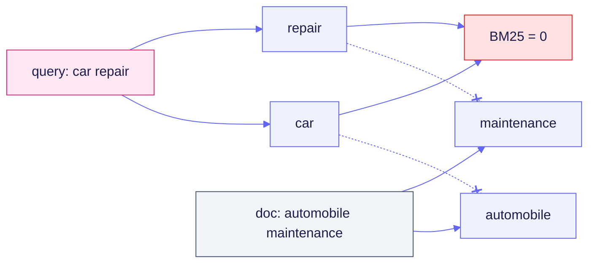

Result of the notebook experiment (`car repair` against three documents):

<table width="100%">
<thead><tr><th width="10%">Doc</th><th width="40%">Text</th><th width="25%">Shared terms</th><th width="25%">BM25</th></tr></thead>
<tbody>
<tr><td align="center">D1</td><td align="center"><code>automobile maintenance guide</code></td><td align="center">none</td><td align="center"><b>0</b></td></tr>
<tr><td align="center">D2</td><td align="center"><code>car insurance policy</code></td><td align="center"><code>car</code></td><td align="center">0.9808</td></tr>
<tr><td align="center">D3</td><td align="center"><code>bicycle repair manual</code></td><td align="center"><code>repair</code></td><td align="center">0.9808</td></tr>
</tbody>
</table>

The only document that is really about car repair scores **0**, and two off-topic documents share the top spot.

## 23. BM25 Strength — Exact Terms

BM25 is particularly useful for:

```text
exact words
rare names
codes
IDs
versions
article numbers
technical terminology
```

Because lexical overlap is explicit and interpretable.

## 24. Why BM25 Is Excellent for Hybrid Search

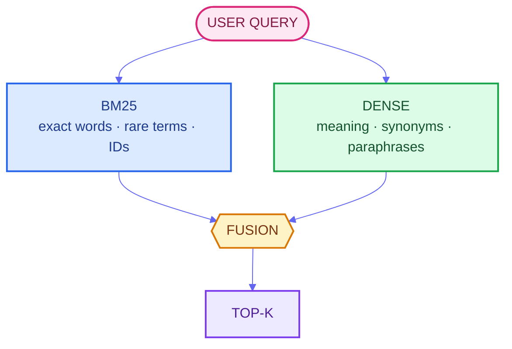

BM25 and dense retrieval fail in different ways.

That complementarity is the core reason Hybrid Search works.

## CHECKPOINT 4

#### Questions

1. Why is BM25 still lexical retrieval?
2. Why is BM25 strong for exact IDs?
3. Why can BM25 fail on synonyms?
4. Why should raw TF-IDF and BM25 scores not be compared directly?
5. Why is BM25 useful in Hybrid Search?

### Answers

1. It scores exact query terms found in indexed document terms.
2. Exact IDs are highly discriminative lexical tokens.
3. BM25 does not inherently understand semantic equivalence between different words.
4. The scoring formulas and numerical ranges differ.
5. BM25 supplies exact lexical relevance while dense retrieval supplies semantic relevance.

## 25. BM25 Debugging Framework

If BM25 results look wrong, inspect:

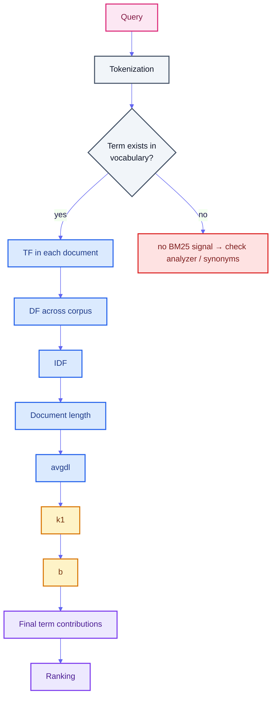

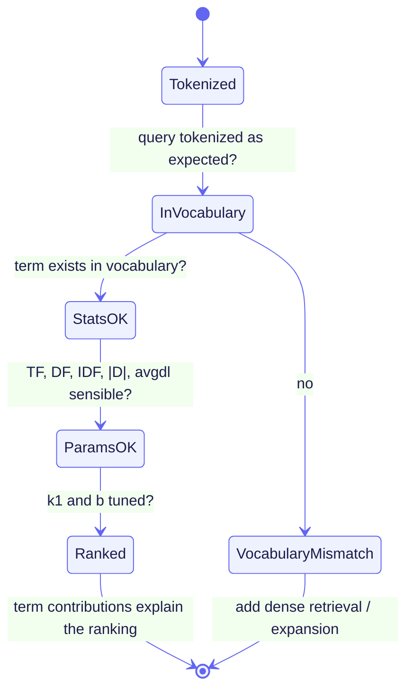

Debug output for `cat milk` on the notebook corpus (`N = 6`, `avgdl = 3.333`, `k1 = 1.5`, `b = 0.75`):

<table width="100%">
<thead><tr><th width="12%">Term</th><th width="8%">DF</th><th width="12%">IDF</th><th width="11%">D1 TF</th><th width="11%">D2 TF</th><th width="11%">D3 TF</th><th width="11%">D4 TF</th><th width="12%">D5 TF</th><th width="12%">D6 TF</th></tr></thead>
<tbody>
<tr><td align="center">cat</td><td align="center">3</td><td align="center">0.6931</td><td align="center">1</td><td align="center">2</td><td align="center">0</td><td align="center">1</td><td align="center">0</td><td align="center">0</td></tr>
<tr><td align="center">milk</td><td align="center">2</td><td align="center">1.0296</td><td align="center">1</td><td align="center">1</td><td align="center">0</td><td align="center">0</td><td align="center">0</td><td align="center">0</td></tr>
<tr><td align="center"><i>length</i></td><td align="center"></td><td align="center"></td><td align="center">3</td><td align="center">4</td><td align="center">3</td><td align="center">3</td><td align="center">4</td><td align="center">3</td></tr>
</tbody>
</table>

## End-to-End Example — BM25 Search From Scratch and With rank_bm25

This section builds a small BM25 search engine one step at a time on a six-document help-desk corpus. Each step adds one piece of the formula and prints its numbers. The same search then runs with the `rank_bm25` library, and the last step shows how to make the two match exactly. All outputs below are real results from running the code.

What each piece of the formula does in this example:

<table width="100%">
<thead><tr><th width="20%">Formula piece</th><th width="35%">Question it answers</th><th width="45%">Where you see it below</th></tr></thead>
<tbody>
<tr><td><b>IDF</b></td><td>How rare is the term?</td><td><code>e401</code> (DF 2) is worth more than <code>password</code> (DF 4). Step 4</td></tr>
<tr><td><b>TF + k1</b></td><td>How often does it occur, and when do repeats stop helping?</td><td>D2 repeats <code>reset password</code> 3 times but beats D1 by only 17%. Steps 5, 8 and 9</td></tr>
<tr><td><b>|D|, avgdl + b</b></td><td>Is the document focused or long?</td><td>Long D6 drops behind short D4 for <code>error E401</code>. Steps 3 and 9</td></tr>
<tr><td><b>Sum over terms</b></td><td>How much evidence does the whole query give?</td><td>Per-term breakdown in Step 6</td></tr>
</tbody>
</table>

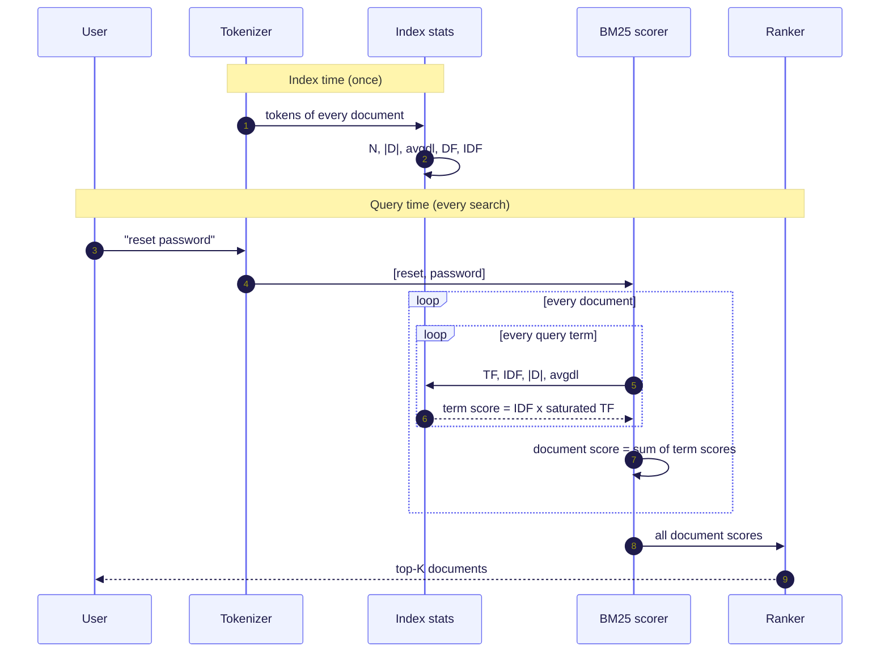

### Step 1. Corpus and queries

Six short help-desk documents. They are picked so that the two BM25 ideas show up clearly: D2 repeats words (saturation) and D6 is very long (length normalization).

```python
documents = {
    "D1": "reset password",
    "D2": "reset password reset password reset password",
    "D3": "how to reset your password from the login page",
    "D4": "error E401 authentication failed",
    "D5": "error E500 server failed",
    "D6": "the login page shows error E401 when the password is wrong and the account is locked for security reasons",
}

queries = ["reset password", "error E401"]

for doc_id, text in documents.items():
    print(f"{doc_id}: {text}")
```

**Output**

```text
D1: reset password
D2: reset password reset password reset password
D3: how to reset your password from the login page
D4: error E401 authentication failed
D5: error E500 server failed
D6: the login page shows error E401 when the password is wrong and the account is locked for security reasons
```

### Step 2. Tokenize

Lowercase and keep runs of letters and digits. Documents and queries must use the same function, otherwise `E401` and `e401` never match.

```python
import re

def tokenize(text):
    # Lowercase, then keep letters and digits as tokens
    return re.findall(r"[a-z0-9]+", text.lower())

tokenized = {doc_id: tokenize(text) for doc_id, text in documents.items()}

for doc_id, tokens in tokenized.items():
    print(f"{doc_id}: {tokens}")
```

**Output**

```text
D1: ['reset', 'password']
D2: ['reset', 'password', 'reset', 'password', 'reset', 'password']
D3: ['how', 'to', 'reset', 'your', 'password', 'from', 'the', 'login', 'page']
D4: ['error', 'e401', 'authentication', 'failed']
D5: ['error', 'e500', 'server', 'failed']
D6: ['the', 'login', 'page', 'shows', 'error', 'e401', 'when', 'the', 'password', 'is', 'wrong', 'and', 'the', 'account', 'is', 'locked', 'for', 'security', 'reasons']
```

### Step 3. Corpus statistics: N, |D| and avgdl

BM25 needs the length of every document and the average length, so it can tell a focused document from a long one.

```python
# Number of documents
N = len(tokenized)

# Length of each document in tokens
doc_len = {doc_id: len(tokens) for doc_id, tokens in tokenized.items()}

# Average document length
avgdl = sum(doc_len.values()) / N

print("N =", N)
print("avgdl =", round(avgdl, 3))

for doc_id, length in doc_len.items():
    print(f"{doc_id}: |D| = {length:<3} |D|/avgdl = {length / avgdl:.2f}")
```

**Output**

```text
N = 6
avgdl = 7.333
D1: |D| = 2   |D|/avgdl = 0.27
D2: |D| = 6   |D|/avgdl = 0.82
D3: |D| = 9   |D|/avgdl = 1.23
D4: |D| = 4   |D|/avgdl = 0.55
D5: |D| = 4   |D|/avgdl = 0.55
D6: |D| = 19  |D|/avgdl = 2.59
```

### Step 4. Document frequency and BM25 IDF

DF counts documents, not occurrences: `password` appears 3 times in D2 but D2 adds only 1 to its DF.

```python
import math

# DF: number of documents that contain the term at least once
vocabulary = sorted({term for tokens in tokenized.values() for term in tokens})
df = {term: sum(term in set(tokens) for tokens in tokenized.values()) for term in vocabulary}

def idf(term):
    # BM25 IDF; the "1 +" keeps it positive even for very common terms
    n = df.get(term, 0)
    return math.log(1 + (N - n + 0.5) / (n + 0.5))

for term in ["password", "reset", "error", "e401", "failed", "login"]:
    print(f"{term:<9} DF={df[term]}  IDF={idf(term):.4f}")
```

**Output**

```text
password  DF=4  IDF=0.4418
reset     DF=3  IDF=0.6931
error     DF=3  IDF=0.6931
e401      DF=2  IDF=1.0296
failed    DF=2  IDF=1.0296
login     DF=2  IDF=1.0296
```

### Step 5. Score one term by hand

Score the term `password` in D2. Every part of the formula is printed, so you can follow it with the formula from section 4.

```python
from collections import Counter

k1, b = 1.5, 0.75

term, doc_id = "password", "D2"

# TF: how many times the term appears in this document
tf = Counter(tokenized[doc_id])[term]

# Length factor: above 1 for long documents, below 1 for short ones
length_factor = 1 - b + b * doc_len[doc_id] / avgdl

# Saturated TF: grows with tf, but can never exceed k1 + 1
tf_part = tf * (k1 + 1) / (tf + k1 * length_factor)

# Term score = rarity x saturated frequency
term_score = idf(term) * tf_part

print("TF            =", tf)
print("IDF           =", round(idf(term), 4))
print("length factor =", round(length_factor, 4))
print("saturated TF  =", round(tf_part, 4), "(ceiling k1 + 1 =", k1 + 1, ")")
print("term score    =", round(term_score, 4))
```

**Output**

```text
TF            = 3
IDF           = 0.4418
length factor = 0.8636
saturated TF  = 1.746 (ceiling k1 + 1 = 2.5 )
term score    = 0.7715
```

### Step 6. Full BM25 score with a per-term breakdown

The document score is the sum of the term scores. Terms missing from the document add 0.

```python
def bm25_score(query, doc_id, k1=1.5, b=0.75, explain=False):
    counts = Counter(tokenized[doc_id])
    length_factor = 1 - b + b * doc_len[doc_id] / avgdl
    total = 0.0

    for term in tokenize(query):
        tf = counts[term]

        # A missing term adds nothing
        if tf == 0:
            continue

        # Same formula as Step 5
        tf_part = tf * (k1 + 1) / (tf + k1 * length_factor)
        contribution = idf(term) * tf_part
        total += contribution

        if explain:
            print(f"  {term:<9} tf={tf}  idf={idf(term):.4f}  saturated_tf={tf_part:.4f}  -> {contribution:.4f}")

    return total

for doc_id in ["D1", "D2", "D3"]:
    print(doc_id, documents[doc_id])
    total = bm25_score("reset password", doc_id, explain=True)
    print(f"  TOTAL = {total:.4f}\n")
```

**Output**

```text
D1 reset password
  reset     tf=1  idf=0.6931  saturated_tf=1.4865  -> 1.0304
  password  tf=1  idf=0.4418  saturated_tf=1.4865  -> 0.6568
  TOTAL = 1.6871

D2 reset password reset password reset password
  reset     tf=3  idf=0.6931  saturated_tf=1.7460  -> 1.2103
  password  tf=3  idf=0.4418  saturated_tf=1.7460  -> 0.7715
  TOTAL = 1.9817

D3 how to reset your password from the login page
  reset     tf=1  idf=0.6931  saturated_tf=0.9072  -> 0.6288
  password  tf=1  idf=0.4418  saturated_tf=0.9072  -> 0.4008
  TOTAL = 1.0297
```

### Step 7. Search: rank every document

Score every document, sort, keep the top results.

```python
def search(query, top_k=3, k1=1.5, b=0.75):
    # Score all documents for the query
    scores = {doc_id: bm25_score(query, doc_id, k1, b) for doc_id in documents}

    # Highest score first
    ranked = sorted(scores.items(), key=lambda item: item[1], reverse=True)
    return [(doc_id, round(score, 4)) for doc_id, score in ranked[:top_k]]

for query in queries:
    print(query, "->", search(query))
```

**Output**

```text
reset password -> [('D2', 1.9817), ('D1', 1.6871), ('D3', 1.0297)]
error E401 -> [('D4', 2.1658), ('D6', 1.004), ('D5', 0.8714)]
```

### Step 8. Why BM25 ranked it this way: raw TF x IDF vs BM25

Raw TF x IDF (no saturation, no length) lets D2 win just by repeating words, three times the score of D1. BM25 keeps D2 ahead only a little.

```python
def raw_tfidf(query, doc_id):
    # Linear TF, no saturation, no length normalization
    counts = Counter(tokenized[doc_id])
    return sum(counts[t] * idf(t) for t in tokenize(query))

print(f"{'doc':<4}{'raw TF x IDF':>14}{'BM25':>9}")

for doc_id in ["D1", "D2", "D3"]:
    print(f"{doc_id:<4}{raw_tfidf('reset password', doc_id):>14.4f}{bm25_score('reset password', doc_id):>9.4f}")
```

**Output**

```text
doc   raw TF x IDF     BM25
D1          1.1350   1.6871
D2          3.4049   1.9817
D3          1.1350   1.0297
```

### Step 9. Turn the knobs: k1 and b

`k1` decides how much the repeats in D2 help. `b` decides how hard the long D6 is pushed down for `error E401`.

```python
# k1: score of the repetitive D2 relative to the clean D1
for k1_value in [0.5, 1.2, 1.5, 3.0]:
    d1 = bm25_score("reset password", "D1", k1=k1_value)
    d2 = bm25_score("reset password", "D2", k1=k1_value)
    print(f"k1={k1_value:<4} D2/D1 = {d2 / d1:.2f}")

print()

# b: focused D4 vs long D6 for "error E401"
for b_value in [0.0, 0.5, 0.75, 1.0]:
    d4 = bm25_score("error E401", "D4", b=b_value)
    d6 = bm25_score("error E401", "D6", b=b_value)
    print(f"b={b_value:<4} D4={d4:.4f}  D6={d6:.4f}")
```

**Output**

```text
k1=0.5  D2/D1 = 1.07
k1=1.2  D2/D1 = 1.15
k1=1.5  D2/D1 = 1.17
k1=3.0  D2/D1 = 1.27

b=0.0  D4=1.7228  D6=1.7228
b=0.5  D4=1.9948  D6=1.1662
b=0.75 D4=2.1658  D6=1.0040
b=1.0  D4=2.3688  D6=0.8814
```

### Step 10. Same search with the `rank_bm25` library

`BM25Okapi` takes the tokenized corpus and returns one score per document. Install it with `pip install rank-bm25`.

```python
from rank_bm25 import BM25Okapi

# Build the index from the same tokens
library_bm25 = BM25Okapi(list(tokenized.values()), k1=1.5, b=0.75)

doc_ids = list(documents)

for query in queries:
    # One score per document, in corpus order
    scores = library_bm25.get_scores(tokenize(query))
    ranked = sorted(zip(doc_ids, scores), key=lambda item: item[1], reverse=True)[:3]
    print(query, "->", [(d, round(float(s), 4)) for d, s in ranked])
```

**Output**

```text
reset password -> [('D2', 0.4267), ('D1', 0.3633), ('D3', 0.2217)]
error E401 -> [('D4', 0.7389), ('D6', 0.3426), ('D1', 0.0)]
```

### Step 11. Why the library numbers differ, and how to make them match

`BM25Okapi` uses the IDF `log((N - DF + 0.5) / (DF + 0.5))` without the `1 +`. Terms in half or more of the documents get IDF 0 or below; the library then replaces negative values with a small floor. Same TF and length parts, different IDF. Give it our IDF and the scores match exactly.

```python
import numpy as np

# Library IDF vs our IDF for a few terms
for term in ["password", "reset", "error", "e401"]:
    print(f"{term:<9} library={library_bm25.idf[term]:.4f}  ours={idf(term):.4f}")

# Replace the library IDF with ours
library_bm25.idf = {term: idf(term) for term in vocabulary}

# Compare all scores for both queries
max_diff = max(
    np.abs(library_bm25.get_scores(tokenize(q)) - np.array([bm25_score(q, d) for d in doc_ids])).max()
    for q in queries
)

print("\nMax difference after using our IDF:", f"{max_diff:.2e}")
```

**Output**

```text
password  library=0.2444  ours=0.4418
reset     library=0.0000  ours=0.6931
error     library=0.0000  ours=0.6931
e401      library=0.5878  ours=1.0296

Max difference after using our IDF: 0.00e+00
```

### What the results show

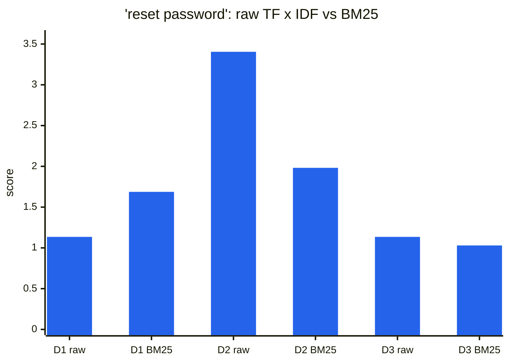

<p align="center">raw = TF x IDF (linear, no length) · BM25 = k1 1.5, b 0.75</p>

<table width="100%">
<thead><tr><th width="22%">Query</th><th width="14%">Rank 1</th><th width="14%">Rank 2</th><th width="14%">Rank 3</th><th width="36%">Why</th></tr></thead>
<tbody>
<tr><td><code>reset password</code></td><td>D2 (1.9817)</td><td>D1 (1.6871)</td><td>D3 (1.0297)</td><td>D2 wins, but by 17%, not 3x: saturation caps the repeats. D3 has the same terms as D1 once each, but it is longer than average, so it falls to third.</td></tr>
<tr><td><code>error E401</code></td><td>D4 (2.1658)</td><td>D6 (1.0040)</td><td>D5 (0.8714)</td><td>D4 and D6 both contain <code>error</code> and <code>e401</code>. D6 is 2.6x the average length, so its score drops from 1.72 (with b = 0) to 1.00. D5 matches only the common term <code>error</code>.</td></tr>
</tbody>
</table>

<table width="100%">
<thead><tr><th width="22%">Aspect</th><th width="39%">From scratch</th><th width="39%">rank_bm25 (<code>BM25Okapi</code>)</th></tr></thead>
<tbody>
<tr><td><b>Best for</b></td><td>Learning and debugging every number</td><td>Quick prototypes and small corpora</td></tr>
<tr><td><b>IDF</b></td><td><code>log(1 + (N - DF + 0.5) / (DF + 0.5))</code>, always positive</td><td><code>log((N - DF + 0.5) / (DF + 0.5))</code>; 0 or a small floor for terms in half or more of the documents</td></tr>
<tr><td><b>TF and length parts</b></td><td colspan="2" align="center">Identical: <code>tf·(k1+1) / (tf + k1·(1 − b + b·|D|/avgdl))</code>, defaults k1 = 1.5, b = 0.75</td></tr>
<tr><td><b>Result here</b></td><td colspan="2" align="center">Same top-2 rankings; identical scores (max difference 0.00e+00) once the IDF is the same</td></tr>
</tbody>
</table>

> [!WARNING]
> On a small corpus, the `BM25Okapi` IDF can be 0 for a common query term. Here `reset` and `error` (3 of 6 documents) get IDF 0 in the library, so they add nothing to the score. Production engines such as Lucene, Elasticsearch and OpenSearch use the `1 +` form from this chapter, which never goes to zero.

> [!TIP]
> To debug any BM25 ranking, print the per-term breakdown from Step 6. Each line shows TF, IDF and saturated TF, so you can see which term, and which part of the formula, decided the order.

## 26. Interview Questions

#### What is BM25?

A lexical ranking function that combines term rarity, term frequency saturation, and document-length normalization.

#### Why is BM25 better than basic TF-IDF?

Because it explicitly handles:

```text
TF saturation
document-length normalization
```

#### What is `k1`?

The parameter controlling how repeated-term contribution saturates.

#### What is `b`?

The parameter controlling document-length normalization.

#### What is `avgdl`?

Average document length in the corpus.

#### Why use IDF?

Rare query terms usually provide stronger evidence of relevance.

#### Why can BM25 miss semantic matches?

It matches lexical terms, not meaning.

#### Why is BM25 important in Hybrid Search?

It complements dense semantic retrieval with strong exact lexical retrieval.

## 27. Interview Scenarios

#### Scenario A

A word appears 100 times.

Should BM25 become 100× stronger?

**No.** TF saturation prevents linear growth.

#### Scenario B

Two docs contain the same query terms, but one is much longer.

BM25 may prefer the shorter, more focused document because of length normalization.

#### Scenario C

`b=0`.

Document length is ignored.

#### Scenario D

Increase `k1`.

Repeated terms keep contributing for longer.

#### Scenario E

Query: `car repair`, document: `automobile maintenance`.

BM25 may fail because of vocabulary mismatch.

#### Scenario F

Why combine BM25 and dense retrieval?

```text
BM25 → exact lexical evidence
Dense → semantic evidence
```

## 28. One-Page Revision Map

```mermaid
%%{init: {'theme':'base','themeVariables':{'primaryColor':'#EEF2FF','primaryBorderColor':'#6366F1','primaryTextColor':'#1E1B4B','lineColor':'#6366F1','pie1':'#22C55E','pie2':'#F59E0B','pie3':'#EF4444','pie4':'#3B82F6','pie5':'#8B5CF6','xyChart':{'plotColorPalette':'#2563EB, #16A34A, #D97706, #DC2626, #7C3AED'}}}}%%
flowchart TB
    B(["BM25"]) --> I["IDF<br/>rarity"]
    B --> T["TF<br/>frequency"] --> S["saturation · k1"]
    B --> L["DOC LENGTH"] --> N["normalization · b"]
    I --> TS{{"TERM SCORE"}}
    S --> TS
    N --> TS
    TS --> SUM["SUM QUERY TERMS"] --> R["RANKING"] --> K["TOP-K"]
    classDef q fill:#FCE7F3,stroke:#DB2777,color:#831843,stroke-width:2px
    classDef sp fill:#DBEAFE,stroke:#2563EB,color:#1E3A8A,stroke-width:2px
    classDef de fill:#DCFCE7,stroke:#16A34A,color:#14532D,stroke-width:2px
    classDef fu fill:#FEF3C7,stroke:#D97706,color:#78350F,stroke-width:2px
    classDef rr fill:#EDE9FE,stroke:#7C3AED,color:#4C1D95,stroke-width:2px
    classDef llm fill:#FEE2E2,stroke:#DC2626,color:#7F1D1D,stroke-width:2px
    classDef neu fill:#F1F5F9,stroke:#475569,color:#0F172A,stroke-width:2px
    class B q
    class I de
    class T,S sp
    class L,N fu
    class TS,SUM rr
    class R,K llm
```

```math
BM25(D,Q) = \sum_{q_i \in Q} IDF(q_i) \frac{ TF(q_i,D)(k_1+1) }{ TF(q_i,D)+k_1 \left(1-b+b\frac{|D|}{\text{avgdl}}\right) }
```

Remember:

```text
k1 → TF saturation
b  → length normalization
```

## 29. Practice Tasks

#### Task 1
Create documents with TF values 1, 2, 4, 8, 16 and plot BM25 scores.

#### Task 2
Repeat with `k1 = 0.5, 1.2, 2.0, 4.0`.

#### Task 3
Create short and long documents with identical query terms. Compare `b = 0, 0.5, 1`.

#### Task 4
Manually calculate one complete BM25 term score.

#### Task 5
Implement BM25 without the class in this notebook.

#### Task 6
Compare TF-IDF and BM25 rankings on 10 simple documents.

#### Task 7
Create a synonym failure such as `car` vs `automobile`.

#### Task 8
Use `rank_bm25` and compare the ranking with your own implementation.

## 30. Final Takeaways

1. BM25 is a lexical ranking algorithm.
2. It builds on the ideas behind TF-IDF.
3. IDF rewards rare query terms.
4. TF should not increase relevance forever.
5. BM25 uses TF saturation.
6. `k1` controls saturation.
7. BM25 normalizes document length.
8. `b` controls length normalization.
9. BM25 is strong for exact terms but weak for semantic vocabulary mismatch.
10. Hybrid Search combines BM25 with dense retrieval.

---

## Next Chapter — Chapter 6: Dense Retrieval

We will study:

```text
embeddings
dense vectors
semantic similarity
cosine similarity
dot product
Euclidean distance
query embeddings
document embeddings
bi-encoders
semantic neighborhoods
failure cases
exact-ID weakness
embedding-model selection
```

<p align="center"><a href="../../9c.%20TF-IDF/README.md">Previous: 9c TF-IDF</a> | <a href="../../../README.md">Home</a> | <a href="../README.md">Module index</a> | <a href="../../README.md">Chapter 09: Sparse Retrieval and Keyword Search</a> | <a href="../../9e.%20BM25%20Implementation%20in%20Practice/README.md">Next: 9e BM25 Implementation in Practice</a></p>
