<div align="center">

# 9e · BM25 Implementation in Practice

  

**Turn the BM25 formula into a reusable, testable, debuggable retriever.**

</div>

<p align="center"><a href="../../9d.%20BM25/README.md">Previous: 9d BM25</a> | <a href="../../../README.md">Home</a> | <a href="../README.md">Module index</a> | <a href="../../README.md">Chapter 09: Sparse Retrieval and Keyword Search</a> | <a href="../../9f.%20Sparse%20Neural%20Retrieval/README.md">Next: 9f Sparse Neural Retrieval</a></p>

## Contents

<table width="100%">
<thead><tr><th width="8%">Sr No</th><th width="38%">Section</th><th width="54%">Subtopics</th></tr></thead>
<tbody>
<tr><td align="center">01</td><td><a href="#1-where-chapter-6-fits"><b>1. Where Chapter 6 Fits</b></a></td><td>-</td></tr>
<tr><td align="center">02</td><td><a href="#2-core-mental-model"><b>2. Core Mental Model</b></a></td><td>-</td></tr>
<tr><td align="center">03</td><td><a href="#3-bm25-recap"><b>3. BM25 Recap</b></a></td><td>-</td></tr>
<tr><td align="center">04</td><td><a href="#4-practical-corpus-design"><b>4. Practical Corpus Design</b></a></td><td>-</td></tr>
<tr><td align="center">05</td><td><a href="#5-consistent-tokenization"><b>5. Consistent Tokenization</b></a></td><td>-</td></tr>
<tr><td align="center">06</td><td><a href="#6-index-time-corpus-preparation"><b>6. Index-Time Corpus Preparation</b></a></td><td>-</td></tr>
<tr><td align="center">07</td><td><a href="#7-reusable-bm25-retriever"><b>7. Reusable BM25 Retriever</b></a></td><td>-</td></tr>
<tr><td align="center">08</td><td><a href="#8-query-time-search"><b>8. Query-Time Search</b></a></td><td>-</td></tr>
<tr><td align="center">09</td><td><a href="#9-explaining-bm25-scores"><b>9. Explaining BM25 Scores</b></a></td><td>-</td></tr>
<tr><td align="center">10</td><td><a href="#10-batch-search"><b>10. Batch Search</b></a></td><td>-</td></tr>
<tr><td align="center">11</td><td><a href="#11-corpus-updates-and-reindexing"><b>11. Corpus Updates and Reindexing</b></a></td><td>-</td></tr>
<tr><td align="center">12</td><td><a href="#12-rank_bm25-in-practice"><b>12. rank_bm25 in Practice</b></a></td><td>-</td></tr>
<tr><td align="center">13</td><td><a href="#13-scores-top-k-and-thresholds"><b>13. Scores, Top-K, and Thresholds</b></a></td><td><a href="#131-bm25-scores-are-not-probabilities">13.1 BM25 scores are not probabilities</a><br><a href="#132-why-fixed-thresholds-are-risky">13.2 Why fixed thresholds are risky</a></td></tr>
<tr><td align="center">14</td><td><a href="#14-benchmarking"><b>14. Benchmarking</b></a></td><td>-</td></tr>
<tr><td align="center">15</td><td><a href="#15-scaling-with-an-inverted-index"><b>15. Scaling With an Inverted Index</b></a></td><td>-</td></tr>
<tr><td align="center">16</td><td><a href="#16-edge-cases"><b>16. Edge Cases</b></a></td><td><a href="#161-empty-query">16.1 Empty query</a><br><a href="#162-unknown-term">16.2 Unknown term</a><br><a href="#163-mixed-known--unknown">16.3 Mixed known + unknown</a><br><a href="#164-vocabulary-mismatch">16.4 Vocabulary mismatch</a></td></tr>
<tr><td align="center">17</td><td><a href="#17-metadata-filtering"><b>17. Metadata Filtering</b></a></td><td>-</td></tr>
<tr><td align="center">18</td><td><a href="#18-api-response-shape"><b>18. API Response Shape</b></a></td><td>-</td></tr>
<tr><td align="center">19</td><td><a href="#19-regression-tests"><b>19. Regression Tests</b></a></td><td>-</td></tr>
<tr><td align="center">20</td><td><a href="#20-debugging-bm25"><b>20. Debugging BM25</b></a></td><td>-</td></tr>
<tr><td align="center">21</td><td><a href="#21-production-architecture"><b>21. Production Architecture</b></a></td><td>-</td></tr>
<tr><td align="center">22</td><td><a href="#22-bm25-inside-hybrid-search"><b>22. BM25 Inside Hybrid Search</b></a></td><td>-</td></tr>
<tr><td align="center">23</td><td><a href="#23-checkpoints-with-answers"><b>23. Checkpoints With Answers</b></a></td><td><a href="#checkpoint-1--index-time-thinking">Checkpoint 1 — Index-Time Thinking</a><br><a href="#checkpoint-2--retriever-design">Checkpoint 2 — Retriever Design</a><br><a href="#checkpoint-3--corpus-mutations">Checkpoint 3 — Corpus Mutations</a><br><a href="#checkpoint-4--scaling">Checkpoint 4 — Scaling</a><br><a href="#checkpoint-5--production-integration">Checkpoint 5 — Production Integration</a></td></tr>
<tr><td align="center">24</td><td><a href="#24-interview-questions"><b>24. Interview Questions</b></a></td><td><a href="#what-happens-at-index-time">What happens at index time?</a><br><a href="#what-happens-at-query-time">What happens at query time?</a></td></tr>
<tr><td align="center">25</td><td><a href="#25-interview-scenarios"><b>25. Interview Scenarios</b></a></td><td><a href="#scenario-1--stale-index">Scenario 1 — Stale Index</a><br><a href="#scenario-2--vocabulary-mismatch">Scenario 2 — Vocabulary Mismatch</a><br><a href="#scenario-3--score-62">Scenario 3 — Score 6.2</a><br><a href="#scenario-4--millions-of-documents">Scenario 4 — Millions of Documents</a><br><a href="#scenario-5--passing-bm25-to-a-reranker">Scenario 5 — Passing BM25 to a Reranker</a></td></tr>
<tr><td align="center">26</td><td><a href="#26-one-page-revision-map"><b>26. One-Page Revision Map</b></a></td><td>-</td></tr>
<tr><td align="center">27</td><td><a href="#27-practice-tasks"><b>27. Practice Tasks</b></a></td><td>-</td></tr>
<tr><td align="center">28</td><td><a href="#28-final-takeaways"><b>28. Final Takeaways</b></a></td><td><a href="#final-architecture-to-remember">Final Architecture to Remember</a></td></tr>
<tr><td align="center">29</td><td><a href="#next-chapter--chapter-7-dense-vector-retrieval"><b>Next Chapter — Chapter 7: Dense Vector Retrieval</b></a></td><td>-</td></tr>
</tbody>
</table>

> [!NOTE]
> **Goal:** move from *understanding BM25 mathematically* to *building, using, debugging, updating, benchmarking, and integrating a practical BM25 retriever*.

This chapter focuses on the engineering layer around BM25: corpus preparation, reusable retriever design, metadata, query-time scoring, score explanation, batch retrieval, corpus updates, `rank_bm25`, benchmarking, edge cases, tests, debugging, and Hybrid Search integration.

## 1. Where Chapter 6 Fits

Chapter 5 explains **why BM25 works mathematically**. Chapter 6 explains **how to turn BM25 into a usable retrieval component**.

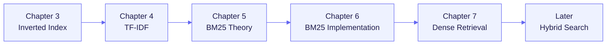

The engineering progression is:

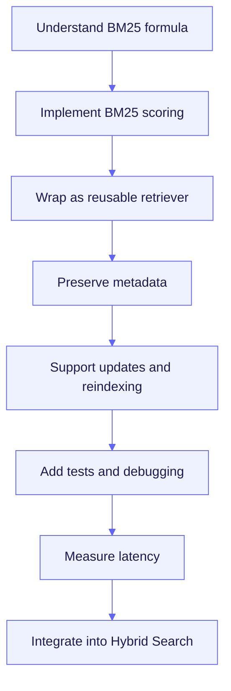

## 2. Core Mental Model

The most important engineering distinction is **index time vs query time**.

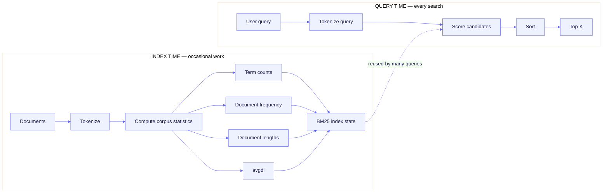

> [!IMPORTANT]
> **Engineering rule:** do expensive corpus-wide work once, not on every query.

## 3. BM25 Recap

A common BM25 query-term contribution is:

```math
IDF(q) \times \frac{TF(q,D)\,(k_1+1)}{TF(q,D)+k_1\left(1-b+b\,\frac{|D|}{\text{avgdl}}\right)}
```

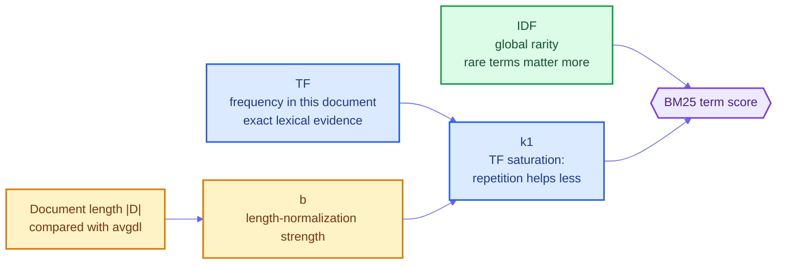

<table width="100%">
<thead><tr><th width="8%">Sr No</th><th width="28%">Symbol</th><th width="64%">Meaning</th></tr></thead>
<tbody>
<tr><td align="center">01</td><td><code>TF(q,D)</code></td><td>Frequency of query term <code>q</code> in document <code>D</code></td></tr>
<tr><td align="center">02</td><td><code>IDF(q)</code></td><td>Rarity of <code>q</code> across the corpus</td></tr>
<tr><td align="center">03</td><td><code>k1</code></td><td>TF-saturation control</td></tr>
<tr><td align="center">04</td><td><code>b</code></td><td>Length-normalization strength</td></tr>
<tr><td align="center">05</td><td><code>|D|</code></td><td>Current document length</td></tr>
<tr><td align="center">06</td><td><code>avgdl</code></td><td>Average document length</td></tr>
</tbody>
</table>

Chapter 6 assumes the mathematics is already understood and concentrates on **operationalizing** it.

## 4. Practical Corpus Design

A retrieval system should preserve more than plain text.

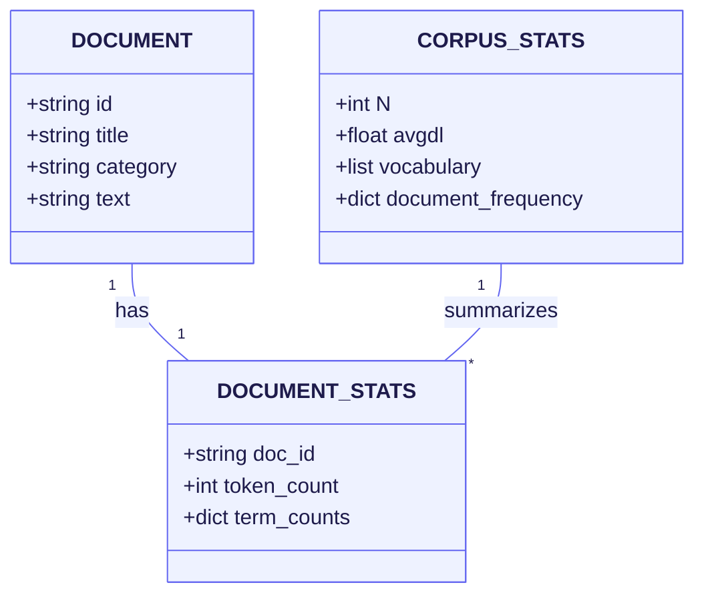

Example:

```python
documents = [
    {
        "id": "D1",
        "title": "Cat Nutrition",
        "category": "animals",
        "text": "cat drinks milk",
    },
    {
        "id": "D2",
        "title": "Cat Food",
        "category": "animals",
        "text": "cat cat eats fish",
    },
]
```

Full corpus used in the notebook:

<table width="100%">
<thead><tr><th width="10%">Id</th><th width="22%">Title</th><th width="18%">Category</th><th width="50%">Text</th></tr></thead>
<tbody>
<tr><td align="center">D1</td><td>Cat Nutrition</td><td>animals</td><td><code>cat drinks milk</code></td></tr>
<tr><td align="center">D2</td><td>Cat Food</td><td>animals</td><td><code>cat cat eats fish</code></td></tr>
<tr><td align="center">D3</td><td>Dog Food</td><td>animals</td><td><code>dog eats food</code></td></tr>
<tr><td align="center">D4</td><td>Apple Salad</td><td>food</td><td><code>apple banana fruit salad</code></td></tr>
<tr><td align="center">D5</td><td>Apple Snack</td><td>food</td><td><code>apple apple fruit</code></td></tr>
<tr><td align="center">D6</td><td>Reading Habit</td><td>books</td><td><code>reading books improves vocabulary</code></td></tr>
<tr><td align="center">D7</td><td>Travel Note</td><td>travel</td><td><code>train travel is comfortable for short trips</code></td></tr>
</tbody>
</table>

Why metadata matters:

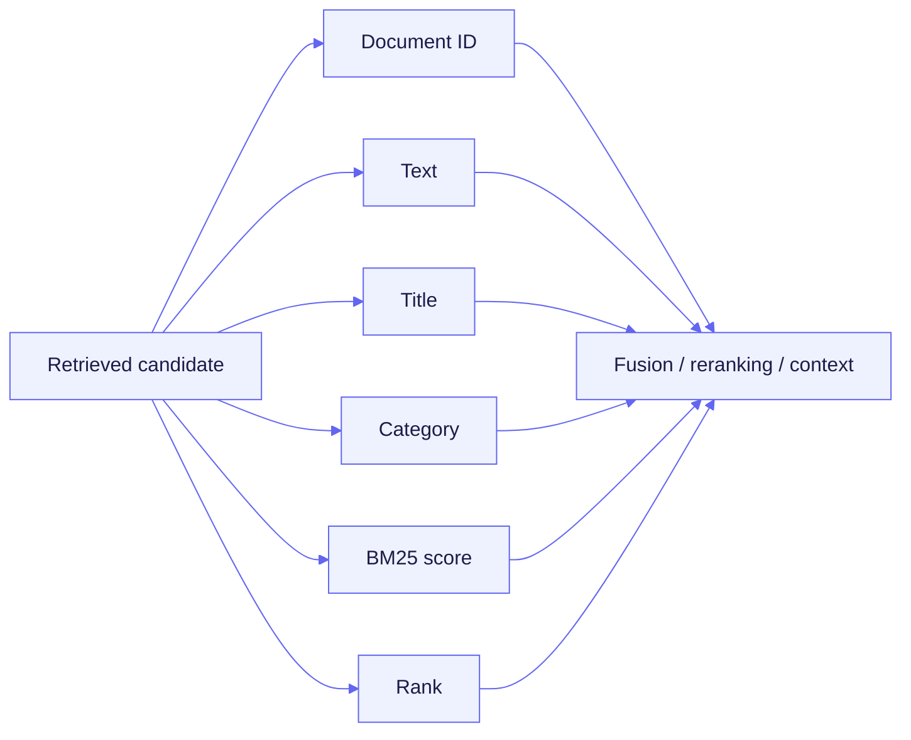

## 5. Consistent Tokenization

BM25 is lexical. Documents and queries must use the **same tokenization rules**.

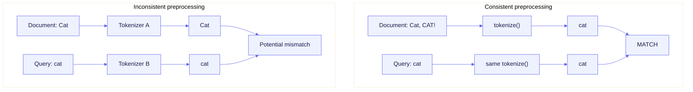

Simple tokenizer:

```python
import re

def tokenize(text):
    # Lowercase, then keep runs of letters and digits
    return re.findall(r"[a-z0-9]+", text.lower())
```

Result: `tokenize("Cat, CAT, cat!")` returns `['cat', 'cat', 'cat']`. All three forms become one term.

Tokenizer lifecycle:

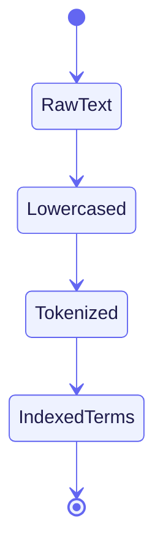

If tokenizer behavior changes, think of it as an **index compatibility change**.

## 6. Index-Time Corpus Preparation

At index time calculate reusable state.

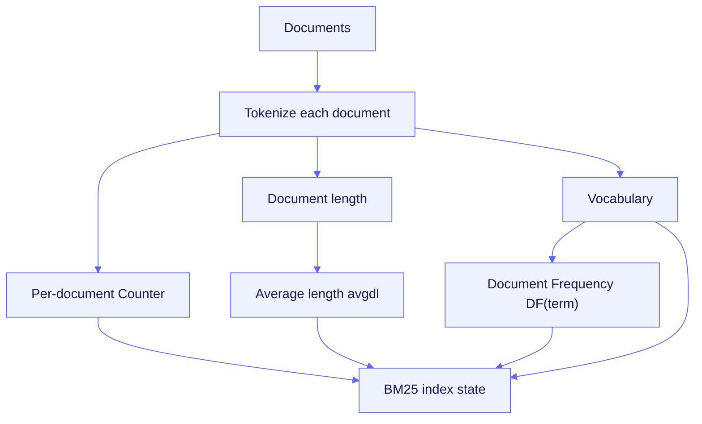

Per-document preparation:

```python
from collections import Counter

def prepare_corpus(documents):
    tokenized_docs = {}
    term_counts = {}
    doc_lengths = {}

    for doc in documents:
        doc_id = doc["id"]

        # Same tokenizer as the query side
        tokens = tokenize(doc["text"])

        # Keep tokens, per-term counts (TF) and length |D|
        tokenized_docs[doc_id] = tokens
        term_counts[doc_id] = Counter(tokens)
        doc_lengths[doc_id] = len(tokens)

    return tokenized_docs, term_counts, doc_lengths
```

Corpus-wide statistics:

```python
# Number of documents
N = len(documents)

# Every unique term in the corpus
vocabulary = sorted({term for tokens in tokenized_docs.values() for term in tokens})

# DF: number of documents that contain each term
df_map = {
    term: sum(1 for tokens in tokenized_docs.values() if term in set(tokens))
    for term in vocabulary
}

# Average document length
avgdl = sum(doc_lengths.values()) / N
```

Result on the notebook corpus: `N = 7`, vocabulary size **22**, `avgdl = 4.0`. Only `apple`, `cat`, `eats` and `fruit` have DF = 2; every other term has DF = 1.

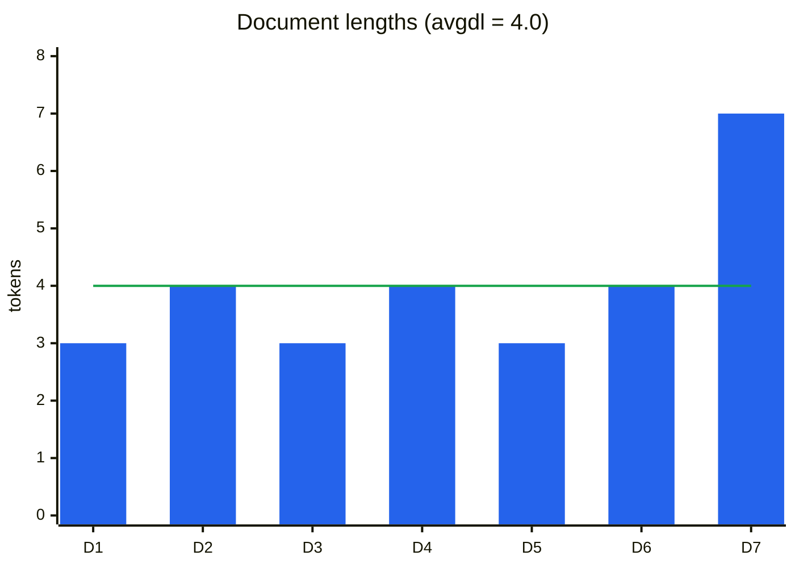

Dependencies:

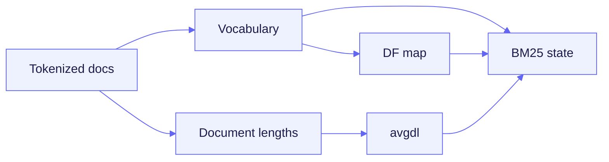

What should be precomputed?

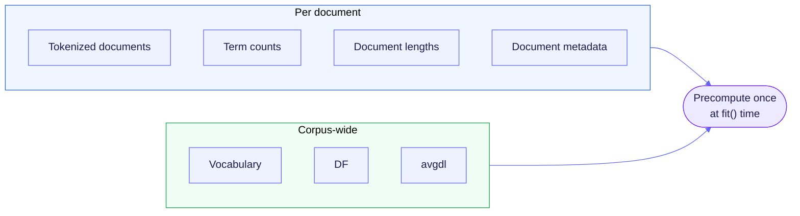

## 7. Reusable BM25 Retriever

A reusable component separates `fit()` from `search()`.

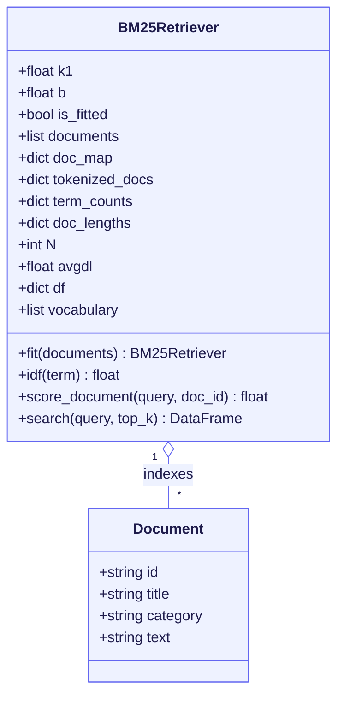

Minimal structure:

```python
class BM25Retriever:
    def __init__(self, k1=1.5, b=0.75):
        self.k1 = k1
        self.b = b
        self.is_fitted = False

    def fit(self, documents):
        # Build corpus statistics / index state
        self.is_fitted = True
        return self

    def idf(self, term):
        ...

    def score_document(self, query, doc_id):
        ...

    def search(self, query, top_k=5):
        ...
```

Full working version (from the notebook):

```python
import math
from collections import Counter

import pandas as pd

class BM25Retriever:
    def __init__(self, k1=1.5, b=0.75):
        self.k1 = k1
        self.b = b
        self.is_fitted = False

    def fit(self, documents):
        # Copy documents and index them by id
        self.documents = [dict(d) for d in documents]
        self.doc_map = {d["id"]: d for d in self.documents}

        # Per-document tokens, term counts and lengths
        self.tokenized_docs = {d["id"]: tokenize(d["text"]) for d in self.documents}
        self.term_counts = {i: Counter(t) for i, t in self.tokenized_docs.items()}
        self.doc_lengths = {i: len(t) for i, t in self.tokenized_docs.items()}

        # Corpus-wide statistics: N, vocabulary, DF, avgdl
        self.N = len(self.documents)
        self.vocabulary = sorted({t for toks in self.tokenized_docs.values() for t in toks})
        self.df = {
            term: sum(1 for toks in self.tokenized_docs.values() if term in set(toks))
            for term in self.vocabulary
        }
        self.avgdl = sum(self.doc_lengths.values()) / self.N if self.N else 0.0

        self.is_fitted = True
        return self

    def idf(self, term):
        # Refuse to score before fit()
        if not self.is_fitted:
            raise RuntimeError("Call fit() first")

        # BM25 IDF, always positive
        df = self.df.get(term, 0)
        return math.log(1 + (self.N - df + 0.5) / (df + 0.5))

    def score_document(self, query, doc_id):
        counts = self.term_counts[doc_id]

        # Length factor: > 1 for long documents, < 1 for short ones
        length_factor = 1 - self.b + self.b * self.doc_lengths[doc_id] / self.avgdl

        score = 0.0

        for term in tokenize(query):
            tf = counts[term]

            # Missing terms add nothing
            if tf == 0:
                continue

            # IDF x saturated TF
            score += self.idf(term) * tf * (self.k1 + 1) / (tf + self.k1 * length_factor)

        return score

    def search(self, query, top_k=5):
        # Score every document and keep its metadata
        rows = [
            {**doc, "score": self.score_document(query, doc_id)}
            for doc_id, doc in self.doc_map.items()
        ]

        # Highest score first, keep Top-K
        return (pd.DataFrame(rows)
                .sort_values("score", ascending=False)
                .head(top_k)
                .reset_index(drop=True))
```

Result of `BM25Retriever(k1=1.5, b=0.75).fit(documents)`: 7 documents, vocabulary 22, `avgdl = 4.0`.

Retriever lifecycle:

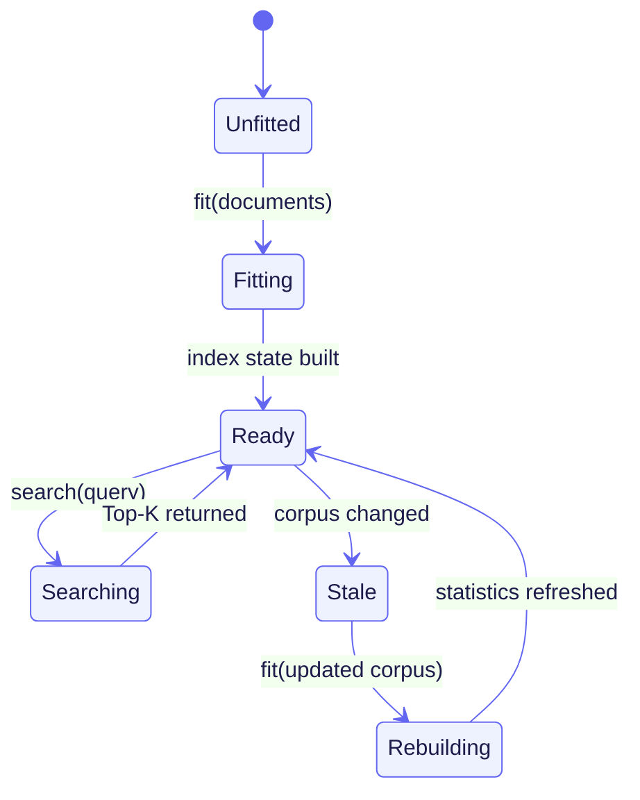

The `Stale` state is critical. Corpus mutation without index refresh can invalidate BM25 statistics.

## 8. Query-Time Search

Once fitted, the retriever can serve many queries.

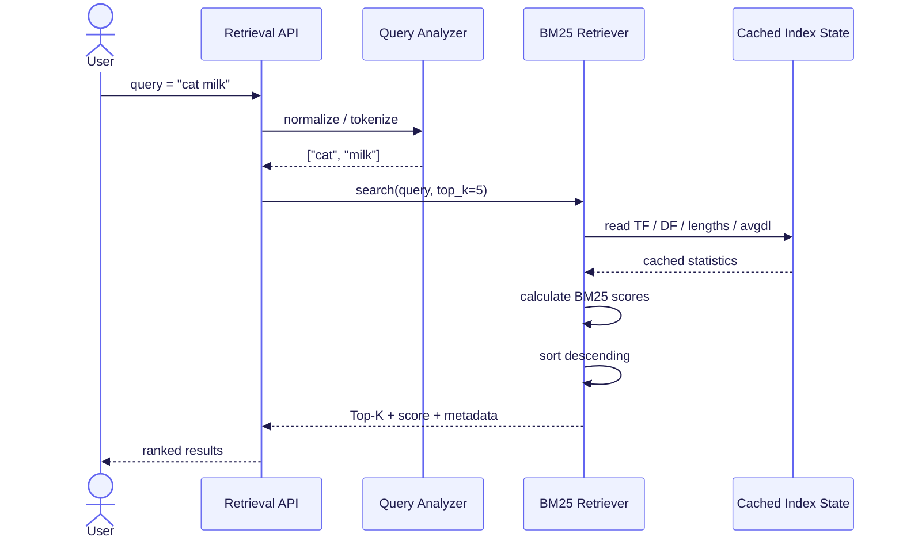

Query-time responsibilities:


Basic call:

```python
# Top-5 documents for a two-term query
result = retriever.search("cat milk", top_k=5)
```

Result:

<table width="100%">
<thead><tr><th width="10%">Rank</th><th width="10%">Id</th><th width="25%">Title</th><th width="35%">Text</th><th width="20%">BM25 score</th></tr></thead>
<tbody>
<tr><td align="center">1</td><td>D1</td><td>Cat Nutrition</td><td><code>cat drinks milk</code></td><td><b>3.1968</b></td></tr>
<tr><td align="center">2</td><td>D2</td><td>Cat Food</td><td><code>cat cat eats fish</code></td><td align="center">1.6616</td></tr>
<tr><td align="center">3-5</td><td>D3, D4, D5</td><td align="center">-</td><td>no query term</td><td align="center">0.0000</td></tr>
</tbody>
</table>

D1 has both terms; D2 has `cat` twice but no `milk`. One extra rare term (`milk`, DF = 1) beats a repeated common one.

## 9. Explaining BM25 Scores

A final score such as `3.82` is not enough for debugging.

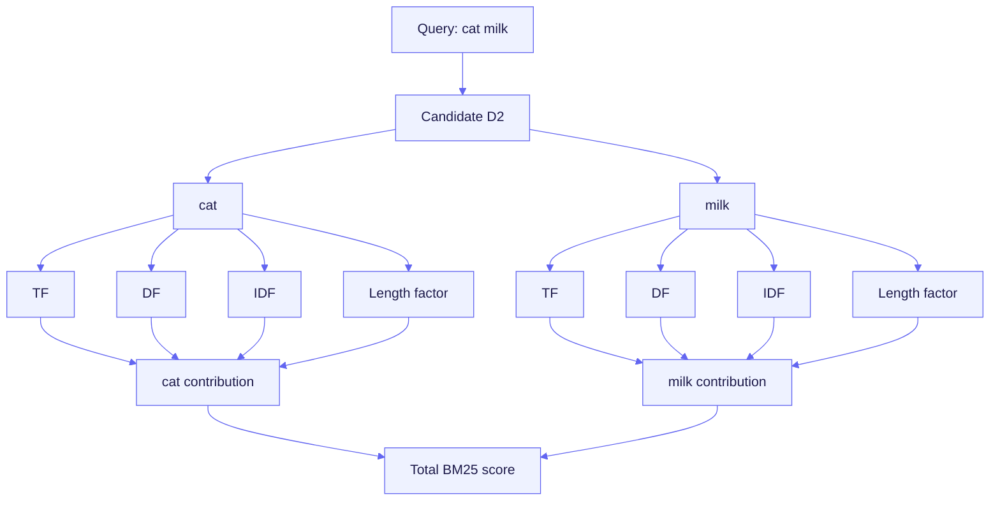

Useful explanation fields:

<table width="100%">
<thead><tr><th width="8%">Sr No</th><th width="28%">Field</th><th width="64%">Debugging value</th></tr></thead>
<tbody>
<tr><td align="center">01</td><td><code>term</code></td><td>Which query term contributed?</td></tr>
<tr><td align="center">02</td><td><code>tf</code></td><td>Is repetition boosting the candidate?</td></tr>
<tr><td align="center">03</td><td><code>df</code></td><td>How common is the term?</td></tr>
<tr><td align="center">04</td><td><code>idf</code></td><td>How much rarity weight does it receive?</td></tr>
<tr><td align="center">05</td><td><code>doc_length</code></td><td>Is the document unusually long?</td></tr>
<tr><td align="center">06</td><td><code>length_factor</code></td><td>How strongly is length normalization acting?</td></tr>
<tr><td align="center">07</td><td><code>tf_component</code></td><td>What did TF saturation produce?</td></tr>
<tr><td align="center">08</td><td><code>term_score</code></td><td>Final contribution of that term</td></tr>
</tbody>
</table>

Conceptual helper:

```python
def explain_bm25_score(retriever, query, doc_id):
    counts = retriever.term_counts[doc_id]
    doc_length = retriever.doc_lengths[doc_id]

    total = 0.0
    rows = []

    for term in tokenize(query):
        tf = counts[term]
        df = retriever.df.get(term, 0)
        idf = retriever.idf(term)

        if tf == 0:
            # Absent term: no contribution
            tf_component = 0.0
            term_score = 0.0

        else:
            # Length normalization
            length_factor = 1 - retriever.b + retriever.b * (doc_length / retriever.avgdl)

            # Saturated TF
            tf_component = (tf * (retriever.k1 + 1)) / (tf + retriever.k1 * length_factor)

            # Term contribution
            term_score = idf * tf_component

        total += term_score

        rows.append({
            "term": term,
            "tf": tf,
            "df": df,
            "idf": idf,
            "tf_component": tf_component,
            "term_score": term_score,
        })

    return rows, total
```

Result for `cat milk` on D2 (`cat cat eats fish`, length 4 = avgdl):

<table width="100%">
<thead><tr><th width="12%">Term</th><th width="10%">TF</th><th width="10%">DF</th><th width="16%">IDF</th><th width="16%">Length factor</th><th width="18%">TF component</th><th width="18%">Term score</th></tr></thead>
<tbody>
<tr><td align="center">cat</td><td align="center">2</td><td align="center">2</td><td align="center">1.1632</td><td align="center">1.0</td><td align="center">1.4286</td><td align="center">1.6616</td></tr>
<tr><td align="center">milk</td><td align="center">0</td><td align="center">1</td><td align="center">1.6740</td><td align="center">-</td><td align="center">0.0000</td><td align="center">0.0000</td></tr>
<tr><td align="center"><b>Total</b></td><td></td><td></td><td></td><td></td><td></td><td><b>1.6616</b></td></tr>
</tbody>
</table>

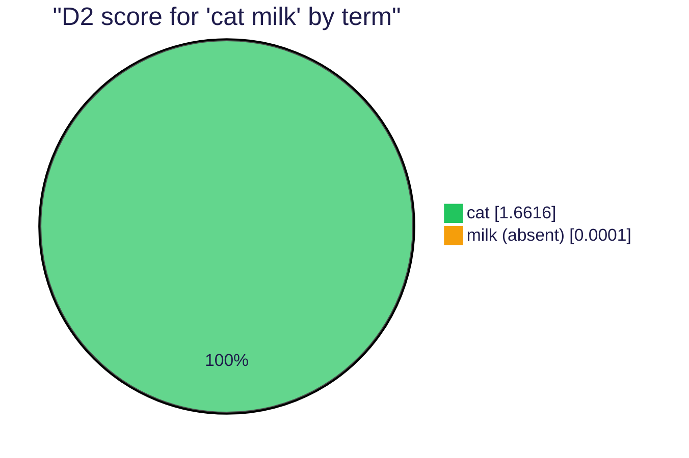

The whole D2 score comes from `cat`. `milk` is the rarer term (IDF 1.674), but D2 does not contain it.

## 10. Batch Search

Batch search is useful for evaluation, regression tests, debugging, and benchmarking.

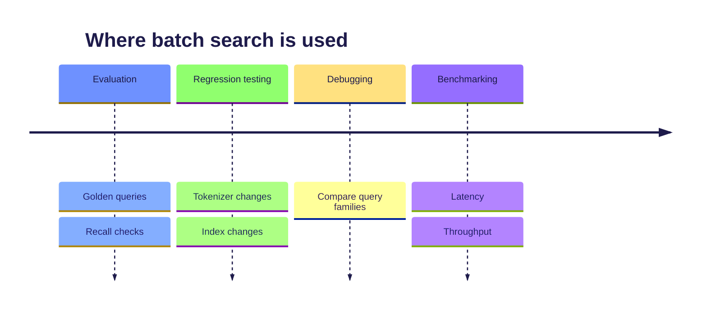

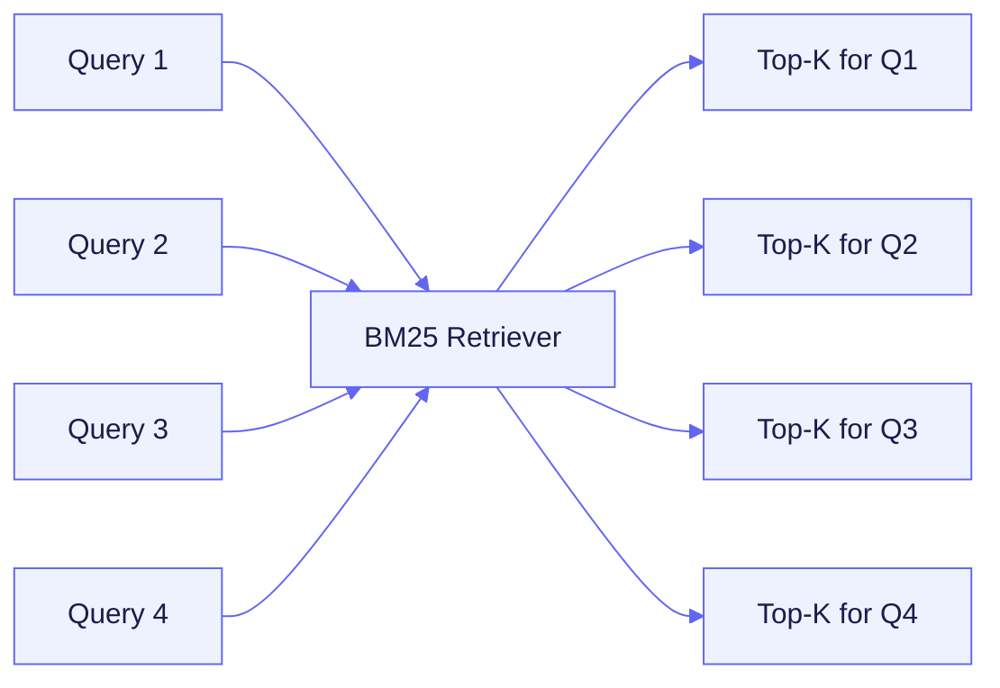

Example:

```python
def batch_search(retriever, queries, top_k=3):
    rows = []

    for query in queries:
        # Same retriever, many queries
        results = retriever.search(query, top_k=top_k)

        # One row per (query, rank)
        for rank, row in results.iterrows():
            rows.append({
                "query": query,
                "rank": rank + 1,
                "doc_id": row["id"],
                "score": row["score"],
            })

    return pd.DataFrame(rows)
```

Result for four queries (non-zero hits only):

<table width="100%">
<thead><tr><th width="30%">Query</th><th width="35%">Rank 1</th><th width="35%">Rank 2</th></tr></thead>
<tbody>
<tr><td><code>cat milk</code></td><td>D1 (3.1968)</td><td>D2 (1.6616)</td></tr>
<tr><td><code>apple fruit</code></td><td>D5 (3.1174)</td><td>D4 (2.3263)</td></tr>
<tr><td><code>reading vocabulary</code></td><td>D6 (3.3480)</td><td align="center">-</td></tr>
<tr><td><code>train travel</code></td><td>D7 (2.5031)</td><td align="center">-</td></tr>
</tbody>
</table>

## 11. Corpus Updates and Reindexing

BM25 scores are **corpus-dependent**.

```mermaid
%%{init: {'theme':'base','themeVariables':{'primaryColor':'#EEF2FF','primaryBorderColor':'#6366F1','primaryTextColor':'#1E1B4B','lineColor':'#6366F1','pie1':'#22C55E','pie2':'#F59E0B','pie3':'#EF4444','pie4':'#3B82F6','pie5':'#8B5CF6','xyChart':{'plotColorPalette':'#2563EB, #16A34A, #D97706, #DC2626, #7C3AED'}}}}%%
flowchart TD
    M["Corpus Mutation"] --> Q{"What changed?"}

    Q -->|Add| A["N / DF / avgdl may change"]
    Q -->|Update| U["TF / DF / doc length may change"]
    Q -->|Delete| D["N / DF / avgdl may change"]

    A --> ST["Old index may be stale"]
    U --> ST
    D --> ST

    ST --> R["Refresh / rebuild"]
    R --> READY["Search-ready index"]
```

Why one added document can affect old scores:

```mermaid
%%{init: {'theme':'base','themeVariables':{'primaryColor':'#EEF2FF','primaryBorderColor':'#6366F1','primaryTextColor':'#1E1B4B','lineColor':'#6366F1','pie1':'#22C55E','pie2':'#F59E0B','pie3':'#EF4444','pie4':'#3B82F6','pie5':'#8B5CF6','xyChart':{'plotColorPalette':'#2563EB, #16A34A, #D97706, #DC2626, #7C3AED'}}}}%%
flowchart LR
    ADD["Add D8"] --> N["N changes"]
    ADD --> DF["DF may change"]
    ADD --> AVG["avgdl may change"]

    N --> IDF["IDF may change"]
    DF --> IDF

    IDF --> SCORE["Existing scores may change"]
    AVG --> SCORE
```

Result: add D8 `cat milk food nutrition` and refit. `N` goes from 7 to 8, so every IDF changes:

<table width="100%">
<thead><tr><th width="16%">Id</th><th width="28%">Before (N = 7)</th><th width="28%">After (N = 8)</th><th width="28%">Change</th></tr></thead>
<tbody>
<tr><td align="center">D1</td><td align="center">3.1968</td><td align="center">2.5075</td><td align="center">-0.69</td></tr>
<tr><td align="center">D8</td><td align="center">-</td><td align="center">2.2254</td><td>new</td></tr>
<tr><td align="center">D2</td><td align="center">1.6616</td><td align="center">1.3492</td><td align="center">-0.31</td></tr>
</tbody>
</table>

```mermaid
%%{init: {'theme':'base','themeVariables':{'primaryColor':'#EEF2FF','primaryBorderColor':'#6366F1','primaryTextColor':'#1E1B4B','lineColor':'#6366F1','pie1':'#22C55E','pie2':'#F59E0B','pie3':'#EF4444','pie4':'#3B82F6','pie5':'#8B5CF6','xyChart':{'plotColorPalette':'#2563EB, #16A34A, #D97706, #DC2626, #7C3AED'}}}}%%
xychart-beta
    title "'cat milk' before and after adding D8"
    x-axis ["D1 before", "D1 after", "D2 before", "D2 after", "D8 after"]
    y-axis "BM25 score" 0 --> 3.5
    bar [3.1968, 2.5075, 1.6616, 1.3492, 2.2254]
```

<p align="center">before = N 7 · after = N 8 (D8 added)</p>

D1 and D2 did not change, but their scores dropped because `cat` and `milk` became more common.

#### Safe small-corpus strategy

```mermaid
%%{init: {'theme':'base','themeVariables':{'primaryColor':'#EEF2FF','primaryBorderColor':'#6366F1','primaryTextColor':'#1E1B4B','lineColor':'#6366F1','pie1':'#22C55E','pie2':'#F59E0B','pie3':'#EF4444','pie4':'#3B82F6','pie5':'#8B5CF6','xyChart':{'plotColorPalette':'#2563EB, #16A34A, #D97706, #DC2626, #7C3AED'}}}}%%
flowchart LR
    A["Add / Update / Delete"] --> B["Modify source documents"]
    B --> C["fit() again"]
    C --> D["Recompute statistics"]
    D --> E["New BM25 index"]
    E --> F["Resume search"]
```

Update helper:

```python
def update_document(documents, doc_id, new_text):
    updated = []

    for doc in documents:
        # Copy so the original list is not changed
        new_doc = dict(doc)

        # Replace the text of the target document
        if doc["id"] == doc_id:
            new_doc["text"] = new_text

        updated.append(new_doc)

    return updated
```

Result: D3 changed to `dog eats food and drinks water`, then `fit()` again. `avgdl` moves from 4.0 to **4.375** and the vocabulary from 23 to 25. Query `dog water` now returns D3 with score **3.0703**.

Delete helper:

```python
def delete_document(documents, doc_id):
    # Keep every document except the deleted one
    return [doc for doc in documents if doc["id"] != doc_id]
```

Result: deleting D7 from the 8-document corpus leaves **7** documents. Call `fit()` again before searching.

## 12. `rank_bm25` in Practice

After understanding the internals, a library reduces boilerplate.

```mermaid
%%{init: {'theme':'base','themeVariables':{'primaryColor':'#EEF2FF','primaryBorderColor':'#6366F1','primaryTextColor':'#1E1B4B','lineColor':'#6366F1','pie1':'#22C55E','pie2':'#F59E0B','pie3':'#EF4444','pie4':'#3B82F6','pie5':'#8B5CF6','xyChart':{'plotColorPalette':'#2563EB, #16A34A, #D97706, #DC2626, #7C3AED'}}}}%%
flowchart LR
    D["Raw documents"] --> T["Tokenize corpus"]
    T --> B["BM25Okapi"]
    Q["Query"] --> QT["Tokenize query"]
    QT --> S["get_scores()"]
    B --> S
    S --> R["Sort + Top-K"]
```

Install:

```bash
pip install rank-bm25
```

Usage:

```python
from rank_bm25 import BM25Okapi

# Same tokenizer as the custom retriever
corpus_tokens = [tokenize(doc["text"]) for doc in documents]

# Build the index
library_bm25 = BM25Okapi(corpus_tokens)

# One score per document, in corpus order
query_tokens = tokenize("cat milk")
scores = library_bm25.get_scores(query_tokens)
```

Result for `cat milk`:

<table width="100%">
<thead><tr><th width="10%">Id</th><th width="40%">Text</th><th width="25%">Custom BM25Retriever</th><th width="25%">rank_bm25 BM25Okapi</th></tr></thead>
<tbody>
<tr><td align="center">D1</td><td><code>cat drinks milk</code></td><td align="center">3.1968</td><td align="center">2.5406</td></tr>
<tr><td align="center">D2</td><td><code>cat cat eats fish</code></td><td align="center">1.6616</td><td align="center">1.1264</td></tr>
<tr><td align="center">D3-D7</td><td>no query term</td><td align="center">0</td><td align="center">0</td></tr>
</tbody>
</table>

Same ranking, different numbers. `BM25Okapi` uses IDF `log((N - DF + 0.5) / (DF + 0.5))` without the `1 +`: `cat` gets 0.7885 instead of 1.1632 and `milk` 1.4663 instead of 1.6740. The TF and length parts are the same.

#### `get_scores()` vs `get_top_n()`

```mermaid
%%{init: {'theme':'base','themeVariables':{'primaryColor':'#EEF2FF','primaryBorderColor':'#6366F1','primaryTextColor':'#1E1B4B','lineColor':'#6366F1','pie1':'#22C55E','pie2':'#F59E0B','pie3':'#EF4444','pie4':'#3B82F6','pie5':'#8B5CF6','xyChart':{'plotColorPalette':'#2563EB, #16A34A, #D97706, #DC2626, #7C3AED'}}}}%%
flowchart TB
    A["What do you need?"] --> Q{"Use case"}
    Q -->|"IDs + scores + metadata + custom sorting"| GS["get_scores()"]
    Q -->|"Quick top documents"| GN["get_top_n()"]
    GS --> FLEX["Usually better for retrieval services"]
    GN --> DEMO["Convenient for simple demos"]
```

Result of `get_top_n(tokenize("apple fruit"), texts, n=3)`:

```text
- apple apple fruit
- apple banana fruit salad
- train travel is comfortable for short trips
```

> [!WARNING]
> The third result has score 0. `get_top_n()` always returns `n` documents, even non-matching ones. Use `get_scores()` and drop zero scores when you need only real matches.

Different BM25 implementations may use slightly different IDF handling, smoothing, or common-term handling. Compare **rankings and retrieval quality**, not only raw score magnitudes.

## 13. Scores, Top-K, and Thresholds

### 13.1 BM25 scores are not probabilities

```mermaid
%%{init: {'theme':'base','themeVariables':{'primaryColor':'#EEF2FF','primaryBorderColor':'#6366F1','primaryTextColor':'#1E1B4B','lineColor':'#6366F1','pie1':'#22C55E','pie2':'#F59E0B','pie3':'#EF4444','pie4':'#3B82F6','pie5':'#8B5CF6','xyChart':{'plotColorPalette':'#2563EB, #16A34A, #D97706, #DC2626, #7C3AED'}}}}%%
flowchart LR
    S["BM25 score = 4.2"] --> X{"Interpretation"}
    X -->|Correct| R["Ranking signal for this query/corpus"]
    X -->|Wrong| P["42% relevance"]
    X -->|Wrong| C["0.42 confidence"]
```

BM25 scores are **uncalibrated ranking signals**.

### 13.2 Why fixed thresholds are risky

A threshold such as `score > 2.0` can behave differently across queries because score distributions depend on term rarity and corpus statistics.

A common approach is:

```mermaid
%%{init: {'theme':'base','themeVariables':{'primaryColor':'#EEF2FF','primaryBorderColor':'#6366F1','primaryTextColor':'#1E1B4B','lineColor':'#6366F1','pie1':'#22C55E','pie2':'#F59E0B','pie3':'#EF4444','pie4':'#3B82F6','pie5':'#8B5CF6','xyChart':{'plotColorPalette':'#2563EB, #16A34A, #D97706, #DC2626, #7C3AED'}}}}%%
flowchart TD
    Q["Query"] --> BM["BM25"]
    BM --> K["Lexical Top-K"]
    K --> F["Hybrid Fusion"]
    F --> R["Reranker"]
    R --> FK["Final Top-K"]
```

At candidate-generation time, the goal is often **high recall**: do not miss strong lexical candidates.

Result of `retriever.search("cat milk", top_k=5)`: only D1 (3.1968) and D2 (1.6616) match. Ranks 3 to 5 are documents with score **0**. Top-K fills the list anyway, so filter `score > 0` before passing candidates on.

## 14. Benchmarking

Measure **index build time** and **query latency** separately.

```mermaid
%%{init: {'theme':'base','themeVariables':{'primaryColor':'#EEF2FF','primaryBorderColor':'#6366F1','primaryTextColor':'#1E1B4B','lineColor':'#6366F1','pie1':'#22C55E','pie2':'#F59E0B','pie3':'#EF4444','pie4':'#3B82F6','pie5':'#8B5CF6','xyChart':{'plotColorPalette':'#2563EB, #16A34A, #D97706, #DC2626, #7C3AED'}}}}%%
flowchart LR
    subgraph IDX["Index Benchmark"]
        D["Documents"] --> F["fit()"]
        F --> IT["Index time"]
    end

    subgraph QRY["Query Benchmark"]
        QS["Test queries"] --> S["search()"]
        S --> L["Per-query latency"]
        L --> A["Average / p95 / p99 later"]
    end
```

Index timing:

```python
import time

# Time one full index build
start = time.perf_counter()
retriever.fit(documents)
index_time = time.perf_counter() - start
```

Query timing:

```python
# Time one query
start = time.perf_counter()
retriever.search("cat milk", top_k=3)
query_time = time.perf_counter() - start
```

Result on the 7-document corpus (one laptop run; numbers vary by machine): index build **0.058 ms**, average query **0.172 ms**.

```mermaid
%%{init: {'theme':'base','themeVariables':{'primaryColor':'#EEF2FF','primaryBorderColor':'#6366F1','primaryTextColor':'#1E1B4B','lineColor':'#6366F1','pie1':'#22C55E','pie2':'#F59E0B','pie3':'#EF4444','pie4':'#3B82F6','pie5':'#8B5CF6','xyChart':{'plotColorPalette':'#2563EB, #16A34A, #D97706, #DC2626, #7C3AED'}}}}%%
xychart-beta
    title "Query latency, 7-document corpus (ms)"
    x-axis ["cat milk", "apple fruit", "dog food", "reading vocab.", "train travel"]
    y-axis "milliseconds" 0 --> 0.3
    bar [0.225, 0.181, 0.163, 0.150, 0.143]
```

This retriever scores every document, so query time grows linearly with corpus size. Section 15 fixes that.

Performance mental model:

```mermaid
%%{init: {'theme':'base','themeVariables':{'primaryColor':'#EEF2FF','primaryBorderColor':'#6366F1','primaryTextColor':'#1E1B4B','lineColor':'#6366F1','pie1':'#22C55E','pie2':'#F59E0B','pie3':'#EF4444','pie4':'#3B82F6','pie5':'#8B5CF6','xyChart':{'plotColorPalette':'#2563EB, #16A34A, #D97706, #DC2626, #7C3AED'}}}}%%
quadrantChart
    title Performance mental model
    x-axis Occasional --> Every request
    y-axis Internal --> User-facing
    quadrant-1 Must be predictable
    quadrant-2 Watch closely
    quadrant-3 Can be heavier
    quadrant-4 Optimize throughput
    Index build: [0.15, 0.2]
    Reindex after update: [0.3, 0.35]
    Batch evaluation: [0.45, 0.15]
    Query latency: [0.9, 0.9]
```

## 15. Scaling With an Inverted Index

The educational implementation scores every document. That is excellent for learning but not ideal for millions of documents.

```mermaid
%%{init: {'theme':'base','themeVariables':{'primaryColor':'#EEF2FF','primaryBorderColor':'#6366F1','primaryTextColor':'#1E1B4B','lineColor':'#6366F1','pie1':'#22C55E','pie2':'#F59E0B','pie3':'#EF4444','pie4':'#3B82F6','pie5':'#8B5CF6','xyChart':{'plotColorPalette':'#2563EB, #16A34A, #D97706, #DC2626, #7C3AED'}}}}%%
flowchart TB
    subgraph LEARN["Educational Implementation"]
        Q1["Query"] --> ALL["Loop over every document"]
        ALL --> SC1["BM25 score"]
        SC1 --> RK1["Rank"]
    end

    subgraph PROD["Search-Engine Style"]
        Q2["Query terms"] --> INV["Inverted index"]
        INV --> P["Posting lists"]
        P --> C["Matching candidates only"]
        C --> SC2["BM25 scoring"]
        SC2 --> RK2["Rank"]
    end
```

For `cat milk`:

```mermaid
%%{init: {'theme':'base','themeVariables':{'primaryColor':'#EEF2FF','primaryBorderColor':'#6366F1','primaryTextColor':'#1E1B4B','lineColor':'#6366F1','pie1':'#22C55E','pie2':'#F59E0B','pie3':'#EF4444','pie4':'#3B82F6','pie5':'#8B5CF6','xyChart':{'plotColorPalette':'#2563EB, #16A34A, #D97706, #DC2626, #7C3AED'}}}}%%
flowchart LR
    Q["cat milk"] --> CAT["cat postings"]
    Q --> MILK["milk postings"]
    CAT --> C["Candidate set"]
    MILK --> C
    C --> B["BM25 score candidates"]
    B --> K["Top-K"]
```

The inverted index prevents unrelated documents from being evaluated unnecessarily.

## 16. Edge Cases

### 16.1 Empty query

```mermaid
%%{init: {'theme':'base','themeVariables':{'primaryColor':'#EEF2FF','primaryBorderColor':'#6366F1','primaryTextColor':'#1E1B4B','lineColor':'#6366F1','pie1':'#22C55E','pie2':'#F59E0B','pie3':'#EF4444','pie4':'#3B82F6','pie5':'#8B5CF6','xyChart':{'plotColorPalette':'#2563EB, #16A34A, #D97706, #DC2626, #7C3AED'}}}}%%
flowchart LR
    Q["Empty query"] --> T["No tokens"]
    T --> S["No term contributions"]
    S --> Z["All scores = 0"]
    Z --> API["API should reject or handle explicitly"]
```

Result: `search("")` returns D1, D2, D3 all with score **0.0**. The order is just the corpus order.

### 16.2 Unknown term

```mermaid
%%{init: {'theme':'base','themeVariables':{'primaryColor':'#EEF2FF','primaryBorderColor':'#6366F1','primaryTextColor':'#1E1B4B','lineColor':'#6366F1','pie1':'#22C55E','pie2':'#F59E0B','pie3':'#EF4444','pie4':'#3B82F6','pie5':'#8B5CF6','xyChart':{'plotColorPalette':'#2563EB, #16A34A, #D97706, #DC2626, #7C3AED'}}}}%%
flowchart LR
    Q["Query: zebra"] --> V{"In vocabulary?"}
    V -->|No| TF["TF = 0 everywhere"]
    TF --> S["No lexical contribution"]
    S --> Z["All scores = 0"]
```

Result: `search("zebra")` returns score **0.0** for every document.

### 16.3 Mixed known + unknown

```mermaid
%%{init: {'theme':'base','themeVariables':{'primaryColor':'#EEF2FF','primaryBorderColor':'#6366F1','primaryTextColor':'#1E1B4B','lineColor':'#6366F1','pie1':'#22C55E','pie2':'#F59E0B','pie3':'#EF4444','pie4':'#3B82F6','pie5':'#8B5CF6','xyChart':{'plotColorPalette':'#2563EB, #16A34A, #D97706, #DC2626, #7C3AED'}}}}%%
flowchart LR
    Q["cat zebra"] --> CAT["cat = known"]
    Q --> Z["zebra = unknown"]
    CAT --> C1["Contributes"]
    Z --> C2["0 contribution"]
    C1 --> TOTAL["Total score"]
    C2 --> TOTAL
```

Result for `cat zebra`: D2 **1.6616**, D1 1.3106, everything else 0. Only `cat` counts, so D2 (`cat` twice) now beats D1. With `cat milk`, D1 won because of `milk`.

### 16.4 Vocabulary mismatch

```mermaid
%%{init: {'theme':'base','themeVariables':{'primaryColor':'#EEF2FF','primaryBorderColor':'#6366F1','primaryTextColor':'#1E1B4B','lineColor':'#6366F1','pie1':'#22C55E','pie2':'#F59E0B','pie3':'#EF4444','pie4':'#3B82F6','pie5':'#8B5CF6','xyChart':{'plotColorPalette':'#2563EB, #16A34A, #D97706, #DC2626, #7C3AED'}}}}%%
flowchart LR
    Q["Query: car"] --> B["BM25 lexical match"]
    D["Document: automobile"] --> B
    B --> W["Weak / no match"]
    W --> H["Dense retrieval can help"]
```

BM25 does not invent semantic equivalence.

## 17. Metadata Filtering

Example request:

```text
query = apple fruit
category = food
```

```mermaid
%%{init: {'theme':'base','themeVariables':{'primaryColor':'#EEF2FF','primaryBorderColor':'#6366F1','primaryTextColor':'#1E1B4B','lineColor':'#6366F1','pie1':'#22C55E','pie2':'#F59E0B','pie3':'#EF4444','pie4':'#3B82F6','pie5':'#8B5CF6','xyChart':{'plotColorPalette':'#2563EB, #16A34A, #D97706, #DC2626, #7C3AED'}}}}%%
flowchart TD
    Q["Query + filter"] --> F["Apply allowed metadata"]
    F --> C["Filtered candidate corpus"]
    C --> B["BM25 ranking"]
    B --> K["Top-K"]
```

Simple educational pattern:

```python
# Keep only documents allowed by the filter
food_documents = [doc for doc in documents if doc["category"] == "food"]

# Build a retriever on the filtered corpus and search it
food_retriever = BM25Retriever().fit(food_documents)
food_retriever.search("apple fruit", top_k=5)
```

Result: D5 **0.4678**, D4 0.3426. On the full corpus the same documents scored 3.1174 and 2.3263. The filtered index has `N = 2`, so `apple` and `fruit` are in every document and their IDF drops. Ranking is the same; scores are not comparable across indexes.

## 18. API Response Shape

A retriever should return a machine-friendly result structure.

```mermaid
%%{init: {'theme':'base','themeVariables':{'primaryColor':'#EEF2FF','primaryBorderColor':'#6366F1','primaryTextColor':'#1E1B4B','lineColor':'#6366F1','pie1':'#22C55E','pie2':'#F59E0B','pie3':'#EF4444','pie4':'#3B82F6','pie5':'#8B5CF6','xyChart':{'plotColorPalette':'#2563EB, #16A34A, #D97706, #DC2626, #7C3AED'}}}}%%
classDiagram
    class SearchResponse {
        +string query
        +int top_k
        +SearchResult[] results
    }

    class SearchResult {
        +int rank
        +string id
        +string title
        +string text
        +float bm25_score
        +object metadata
    }

    SearchResponse "1" *-- "*" SearchResult
```

Example:

```json
{
  "query": "cat milk",
  "top_k": 2,
  "results": [
    {
      "id": "D1",
      "title": "Cat Nutrition",
      "category": "animals",
      "text": "cat drinks milk",
      "score": 3.1968
    },
    {
      "id": "D2",
      "title": "Cat Food",
      "category": "animals",
      "text": "cat cat eats fish",
      "score": 1.6616
    }
  ]
}
```

Downstream consumers:

```mermaid
%%{init: {'theme':'base','themeVariables':{'primaryColor':'#EEF2FF','primaryBorderColor':'#6366F1','primaryTextColor':'#1E1B4B','lineColor':'#6366F1','pie1':'#22C55E','pie2':'#F59E0B','pie3':'#EF4444','pie4':'#3B82F6','pie5':'#8B5CF6','xyChart':{'plotColorPalette':'#2563EB, #16A34A, #D97706, #DC2626, #7C3AED'}}}}%%
flowchart LR
    B["BM25 result"] --> F["Fusion"]
    B --> R["Reranker"]
    B --> L["Logging"]
    B --> E["Evaluation"]
    B --> C["Context Builder"]
```

## 19. Regression Tests

Retriever behavior can change silently when you modify tokenization, indexing, parameters, or corpus data.

```mermaid
%%{init: {'theme':'base','themeVariables':{'primaryColor':'#EEF2FF','primaryBorderColor':'#6366F1','primaryTextColor':'#1E1B4B','lineColor':'#6366F1','pie1':'#22C55E','pie2':'#F59E0B','pie3':'#EF4444','pie4':'#3B82F6','pie5':'#8B5CF6','xyChart':{'plotColorPalette':'#2563EB, #16A34A, #D97706, #DC2626, #7C3AED'}}}}%%
flowchart TD
    C["Code / corpus change"] --> T["Run retrieval regression tests"]

    T --> Q1{"cat milk finds cat docs?"}
    T --> Q2{"apple fruit finds food docs?"}
    T --> Q3{"unknown term gives zero evidence?"}

    Q1 -->|Yes| P["Pass"]
    Q2 -->|Yes| P
    Q3 -->|Yes| P

    Q1 -->|No| F["Investigate regression"]
    Q2 -->|No| F
    Q3 -->|No| F
```

Example:

```python
def run_basic_tests(retriever):
    # cat milk must return a cat document
    cat_result = retriever.search("cat milk", top_k=2)
    assert set(cat_result["id"]).intersection({"D1", "D2"})

    # apple fruit must return a food document
    apple_result = retriever.search("apple fruit", top_k=2)
    assert set(apple_result["id"]).intersection({"D4", "D5"})

    # an unknown term must give no evidence
    zebra_result = retriever.search("zebra", top_k=3)
    assert zebra_result["score"].max() == 0
```

Result: `All basic tests passed.`

## 20. Debugging BM25

When ranking is surprising, inspect the pipeline systematically.

```mermaid
%%{init: {'theme':'base','themeVariables':{'primaryColor':'#EEF2FF','primaryBorderColor':'#6366F1','primaryTextColor':'#1E1B4B','lineColor':'#6366F1','pie1':'#22C55E','pie2':'#F59E0B','pie3':'#EF4444','pie4':'#3B82F6','pie5':'#8B5CF6','xyChart':{'plotColorPalette':'#2563EB, #16A34A, #D97706, #DC2626, #7C3AED'}}}}%%
flowchart TD
    START["Wrong / surprising result"] --> D{"Document indexed?"}

    D -->|No| FIX1["Fix ingestion / indexing"]
    D -->|Yes| T{"Expected token created?"}

    T -->|No| FIX2["Inspect tokenizer"]
    T -->|Yes| V{"Query term in vocabulary?"}

    V -->|No| VM["Unknown term / vocabulary mismatch"]
    V -->|Yes| TF{"TF sensible?"}

    TF -->|No| FIX3["Inspect document tokens"]
    TF -->|Yes| DF{"DF / IDF sensible?"}

    DF -->|No| FIX4["Inspect corpus stats / stale index"]
    DF -->|Yes| L{"Length normalization sensible?"}

    L -->|No| FIX5["Inspect |D|, avgdl, b"]
    L -->|Yes| C{"Corpus changed after fit()?"}

    C -->|Yes| RE["Rebuild index"]
    C -->|No| M{"Metadata filter excluded it?"}

    M -->|Yes| FIX6["Inspect filters"]
    M -->|No| LIMIT["Likely lexical limitation or ranking issue"]
```

Debug output from the notebook for `cat milk`:

```text
QUERY: cat milk
TOKENS: ['cat', 'milk']
N: 7 avgdl: 4.0
cat: DF=2, IDF=1.1632
milk: DF=1, IDF=1.6740
```

Debug checklist:

<table width="100%">
<thead><tr><th width="8%">Sr No</th><th width="28%">Layer</th><th width="64%">Question</th></tr></thead>
<tbody>
<tr><td align="center">01</td><td>Ingestion</td><td>Is the document present?</td></tr>
<tr><td align="center">02</td><td>Tokenization</td><td>Did preprocessing create expected terms?</td></tr>
<tr><td align="center">03</td><td>Vocabulary</td><td>Is the query term known?</td></tr>
<tr><td align="center">04</td><td>TF</td><td>Does the document contain the term as expected?</td></tr>
<tr><td align="center">05</td><td>DF / IDF</td><td>Is rarity reasonable?</td></tr>
<tr><td align="center">06</td><td>Length</td><td>Are <code>|D|</code> and <code>avgdl</code> correct?</td></tr>
<tr><td align="center">07</td><td>Parameters</td><td>Are <code>k1</code> and <code>b</code> correct?</td></tr>
<tr><td align="center">08</td><td>Freshness</td><td>Was corpus changed without reindexing?</td></tr>
<tr><td align="center">09</td><td>Filters</td><td>Was the document removed by metadata rules?</td></tr>
<tr><td align="center">10</td><td>Retrieval type</td><td>Is the query actually semantic rather than lexical?</td></tr>
</tbody>
</table>

## 21. Production Architecture

```mermaid
%%{init: {'theme':'base','themeVariables':{'primaryColor':'#EEF2FF','primaryBorderColor':'#6366F1','primaryTextColor':'#1E1B4B','lineColor':'#6366F1','pie1':'#22C55E','pie2':'#F59E0B','pie3':'#EF4444','pie4':'#3B82F6','pie5':'#8B5CF6','xyChart':{'plotColorPalette':'#2563EB, #16A34A, #D97706, #DC2626, #7C3AED'}}}}%%
flowchart TB
    subgraph INGESTION["Document / Indexing Path"]
        DOC["Source Documents"] --> PARSE["Parse / Clean"]
        PARSE --> TOK["Tokenize / Analyze"]
        TOK --> IDX["Lexical Search Index<br/>BM25 + postings"]
    end

    subgraph ONLINE["Online Query Path"]
        USER["User"] --> API["Retrieval API"]
        API --> QA["Query Analyzer"]
        QA --> BM["BM25 Search"]
        IDX --> BM
        BM --> TOP["Lexical Top-K"]
    end

    TOP --> HF["Hybrid Fusion"]
    HF --> RR["Reranker"]
    RR --> CTX["Context Builder"]
    CTX --> LLM["LLM"]
```

Responsibilities:

```mermaid
%%{init: {'theme':'base','themeVariables':{'primaryColor':'#EEF2FF','primaryBorderColor':'#6366F1','primaryTextColor':'#1E1B4B','lineColor':'#6366F1','pie1':'#22C55E','pie2':'#F59E0B','pie3':'#EF4444','pie4':'#3B82F6','pie5':'#8B5CF6','xyChart':{'plotColorPalette':'#2563EB, #16A34A, #D97706, #DC2626, #7C3AED'}}}}%%
flowchart LR
    subgraph I1["Ingestion"]
        direction TB
        i1["Parse"] --> i2["Clean"] --> i3["Metadata"]
    end
    subgraph I2["Indexing"]
        direction TB
        x1["Tokenize"] --> x2["Posting lists"] --> x3["DF, lengths, avgdl"]
    end
    subgraph I3["Serving"]
        direction TB
        s1["Query analyzer"] --> s2["BM25 search"] --> s3["Top-K"]
    end
    subgraph I4["Reliability"]
        direction TB
        r1["Cached state"] --> r2["Refresh after updates"] --> r3["Regression tests, debugging"]
    end
    subgraph I5["Observability"]
        direction TB
        o1["Index time"] --> o2["Query latency"] --> o3["Query logs, ranks, scores"]
    end
    I1 --> I2 --> I3
    I4 -.-> I3
    I5 -.-> I3
    style I1 fill:#F1F5F9,stroke:#475569
    style I2 fill:#EFF6FF,stroke:#2563EB
    style I3 fill:#F0FDF4,stroke:#16A34A
    style I4 fill:#FEF3C7,stroke:#D97706
    style I5 fill:#EDE9FE,stroke:#7C3AED
```

## 22. BM25 Inside Hybrid Search

BM25 is the **lexical candidate-generation branch**, not the entire Hybrid Search system.

```mermaid
%%{init: {'theme':'base','themeVariables':{'primaryColor':'#EEF2FF','primaryBorderColor':'#6366F1','primaryTextColor':'#1E1B4B','lineColor':'#6366F1','pie1':'#22C55E','pie2':'#F59E0B','pie3':'#EF4444','pie4':'#3B82F6','pie5':'#8B5CF6','xyChart':{'plotColorPalette':'#2563EB, #16A34A, #D97706, #DC2626, #7C3AED'}}}}%%
flowchart LR
    Q["User Query"] --> SP["Sparse Branch"]
    Q --> DE["Dense Branch"]

    SP --> QA1["Tokenize / analyze"]
    QA1 --> BM["BM25"]
    BM --> ST["Sparse Top-K"]

    DE --> EMB["Query embedding"]
    EMB --> VS["Vector search"]
    VS --> DT["Dense Top-K"]

    ST --> FU["Fusion"]
    DT --> FU

    FU --> RR["Reranker"]
    RR --> FINAL["Final Top-K"]
    FINAL --> LLM["LLM / Context"]
```

Complementary strengths:

```mermaid
%%{init: {'theme':'base','themeVariables':{'primaryColor':'#EEF2FF','primaryBorderColor':'#6366F1','primaryTextColor':'#1E1B4B','lineColor':'#6366F1','pie1':'#22C55E','pie2':'#F59E0B','pie3':'#EF4444','pie4':'#3B82F6','pie5':'#8B5CF6','xyChart':{'plotColorPalette':'#2563EB, #16A34A, #D97706, #DC2626, #7C3AED'}}}}%%
quadrantChart
    title Complementary strengths
    x-axis Weak exact match --> Strong exact match
    y-axis Weak semantic match --> Strong semantic match
    quadrant-1 Hybrid target
    quadrant-2 Dense retrieval
    quadrant-3 Neither
    quadrant-4 BM25
    BM25 keywords, IDs, codes: [0.85, 0.2]
    Dense synonyms, paraphrases: [0.2, 0.85]
    Fusion of both: [0.75, 0.75]
    Fusion + reranking: [0.88, 0.88]
```

<table width="100%">
<thead><tr><th width="8%">Sr No</th><th width="22%">Component</th><th width="70%">Strength</th></tr></thead>
<tbody>
<tr><td align="center">01</td><td><b>BM25</b></td><td>Exact keywords, rare terms, IDs, codes, lexical evidence</td></tr>
<tr><td align="center">02</td><td><b>Dense retrieval</b></td><td>Synonyms, paraphrases, semantic similarity, natural-language intent</td></tr>
<tr><td align="center">03</td><td><b>Fusion</b></td><td>Combines the two candidate sets</td></tr>
<tr><td align="center">04</td><td><b>Reranking</b></td><td>Improves precision of the final Top-K</td></tr>
</tbody>
</table>

## 23. Checkpoints With Answers

### Checkpoint 1 — Index-Time Thinking

**Q1. What should happen at index time?**  
Tokenization, term counts, document lengths, vocabulary, DF, and `avgdl` should be prepared before queries.

**Q2. Why must document/query tokenization match?**  
BM25 relies on exact lexical tokens; inconsistent preprocessing breaks matching.

**Q3. What is `avgdl`?**  
Average token length across indexed documents.

**Q4. Why precompute DF?**  
IDF depends on DF, so precomputing it reduces query-time work.

```mermaid
%%{init: {'theme':'base','themeVariables':{'primaryColor':'#EEF2FF','primaryBorderColor':'#6366F1','primaryTextColor':'#1E1B4B','lineColor':'#6366F1','pie1':'#22C55E','pie2':'#F59E0B','pie3':'#EF4444','pie4':'#3B82F6','pie5':'#8B5CF6','xyChart':{'plotColorPalette':'#2563EB, #16A34A, #D97706, #DC2626, #7C3AED'}}}}%%
flowchart LR
    D["Documents"] --> P["Precompute"]
    P --> DF["DF"]
    P --> AVG["avgdl"]
    P --> TC["Term counts"]
    DF --> FAST["Fast query-time access"]
    AVG --> FAST
    TC --> FAST
```

### Checkpoint 2 — Retriever Design

**Q1. Why separate `fit()` from `search()`?**  
Index construction happens far less frequently than searches.

**Q2. Why keep metadata?**  
Downstream systems need stable IDs, titles, categories, and attributes.

**Q3. Why explain term-level scores?**  
It shows whether TF, IDF, length normalization, or tokenization caused a ranking.

### Checkpoint 3 — Corpus Mutations

**Q1. Why can adding one document change scores?**  
BM25 depends on corpus-wide statistics.

**Q2. What can become stale?**  
`N`, DF, IDF, document lengths, and `avgdl`.

**Q3. Safest strategy for a small corpus?**  
Modify the source corpus and rebuild the index.

```mermaid
%%{init: {'theme':'base','themeVariables':{'primaryColor':'#EEF2FF','primaryBorderColor':'#6366F1','primaryTextColor':'#1E1B4B','lineColor':'#6366F1','pie1':'#22C55E','pie2':'#F59E0B','pie3':'#EF4444','pie4':'#3B82F6','pie5':'#8B5CF6','xyChart':{'plotColorPalette':'#2563EB, #16A34A, #D97706, #DC2626, #7C3AED'}}}}%%
stateDiagram-v2
    Ready --> Stale : corpus mutation
    Stale --> Rebuilding : fit(updated corpus)
    Rebuilding --> Ready : refreshed stats
```

### Checkpoint 4 — Scaling

**Q1. Why is scoring every document inefficient?**  
Cost grows with corpus size.

**Q2. How does an inverted index help?**  
Posting lists restrict scoring to lexically matching candidates.

**Q3. Why measure index and query time separately?**  
Indexing is occasional; query latency affects every user request.

**Q4. Why prefer Top-K over one universal threshold?**  
BM25 score ranges vary by query and corpus.

### Checkpoint 5 — Production Integration

**Q1. What should be cached?**  
Tokenized documents, term counts, DF, lengths, `avgdl`, vocabulary, and index structures.

**Q2. When is an index stale?**  
When corpus content changes without refreshing index state.

**Q3. Why use regression tests?**  
To catch unintended retrieval behavior changes.

**Q4. Where does BM25 sit in Hybrid Search?**  
As the lexical branch before fusion and reranking.

## 24. Interview Questions

### What happens at index time?

```mermaid
%%{init: {'theme':'base','themeVariables':{'primaryColor':'#EEF2FF','primaryBorderColor':'#6366F1','primaryTextColor':'#1E1B4B','lineColor':'#6366F1','pie1':'#22C55E','pie2':'#F59E0B','pie3':'#EF4444','pie4':'#3B82F6','pie5':'#8B5CF6','xyChart':{'plotColorPalette':'#2563EB, #16A34A, #D97706, #DC2626, #7C3AED'}}}}%%
flowchart LR
    D["Documents"] --> T["Tokenize"]
    T --> TF["Term counts"]
    T --> DL["Doc lengths"]
    T --> DF["Document frequency"]
    DL --> A["avgdl"]
    TF --> I["BM25 index"]
    DF --> I
    A --> I
```

### What happens at query time?

```mermaid
%%{init: {'theme':'base','themeVariables':{'primaryColor':'#EEF2FF','primaryBorderColor':'#6366F1','primaryTextColor':'#1E1B4B','lineColor':'#6366F1','pie1':'#22C55E','pie2':'#F59E0B','pie3':'#EF4444','pie4':'#3B82F6','pie5':'#8B5CF6','xyChart':{'plotColorPalette':'#2563EB, #16A34A, #D97706, #DC2626, #7C3AED'}}}}%%
flowchart LR
    Q["Query"] --> T["Tokenize"]
    T --> C["Lexical candidates"]
    C --> B["BM25 scoring"]
    B --> S["Sort"]
    S --> K["Top-K"]
```

#### Why is BM25 score not a probability?
Because it is an uncalibrated ranking signal whose magnitude depends on the query and corpus.

#### Why can adding documents change old scores?
Because DF, IDF, `N`, and `avgdl` can change.

#### Why use an inverted index?
To avoid scoring every document and instead score documents associated with query-term posting lists.

#### Why preserve metadata?
Fusion, reranking, filters, logging, APIs, and context building need stable identity and attributes.

#### Why use `rank_bm25` after writing BM25 yourself?
The custom version teaches the internals; the library reduces boilerplate once those internals are understood.

#### What comes after BM25?
Dense retrieval; later both branches are fused and often reranked.

## 25. Interview Scenarios

### Scenario 1 — Stale Index

You add 5,000 documents but do not refresh BM25.

```mermaid
%%{init: {'theme':'base','themeVariables':{'primaryColor':'#EEF2FF','primaryBorderColor':'#6366F1','primaryTextColor':'#1E1B4B','lineColor':'#6366F1','pie1':'#22C55E','pie2':'#F59E0B','pie3':'#EF4444','pie4':'#3B82F6','pie5':'#8B5CF6','xyChart':{'plotColorPalette':'#2563EB, #16A34A, #D97706, #DC2626, #7C3AED'}}}}%%
flowchart LR
    A["Documents added"] --> S["Old stats remain"]
    S --> W["DF / IDF / avgdl may be stale"]
    W --> R["Ranking inconsistency"]
    R --> F["Refresh / rebuild"]
```

### Scenario 2 — Vocabulary Mismatch

Query uses `car`; document uses `automobile`.

BM25 may miss the relation because it matches lexical tokens, not meaning.

### Scenario 3 — Score 6.2

Does BM25 `6.2` mean 62% relevance? **No.**

### Scenario 4 — Millions of Documents

If query latency is slow and your implementation loops through every document, move toward inverted-index candidate retrieval.

### Scenario 5 — Passing BM25 to a Reranker

```mermaid
%%{init: {'theme':'base','themeVariables':{'primaryColor':'#EEF2FF','primaryBorderColor':'#6366F1','primaryTextColor':'#1E1B4B','lineColor':'#6366F1','pie1':'#22C55E','pie2':'#F59E0B','pie3':'#EF4444','pie4':'#3B82F6','pie5':'#8B5CF6','xyChart':{'plotColorPalette':'#2563EB, #16A34A, #D97706, #DC2626, #7C3AED'}}}}%%
flowchart LR
    R["BM25 Result"] --> ID["Document ID"]
    R --> TX["Text"]
    R --> SC["BM25 score"]
    R --> RK["Rank"]
    R --> MD["Metadata"]

    ID --> RR["Reranker input"]
    TX --> RR
    SC --> RR
    RK --> RR
    MD --> RR
```

## 26. One-Page Revision Map

```mermaid
%%{init: {'theme':'base','themeVariables':{'primaryColor':'#EEF2FF','primaryBorderColor':'#6366F1','primaryTextColor':'#1E1B4B','lineColor':'#6366F1','pie1':'#22C55E','pie2':'#F59E0B','pie3':'#EF4444','pie4':'#3B82F6','pie5':'#8B5CF6','xyChart':{'plotColorPalette':'#2563EB, #16A34A, #D97706, #DC2626, #7C3AED'}}}}%%
flowchart TB
    subgraph IT["INDEX TIME"]
        SD["Source Documents"] --> TK["Tokenize"]
        TK --> TC["Term Counts"]
        TK --> DL["Document Lengths"]
        TK --> VOC["Vocabulary"]
        VOC --> DF["Document Frequency"]
        DL --> AVG["avgdl"]

        TC --> IDX["BM25 Index State"]
        DF --> IDX
        AVG --> IDX
    end

    subgraph QT["QUERY TIME"]
        Q["Query"] --> QTOK["Query Tokens"]
        QTOK --> CAND["Lexical Candidates"]
        CAND --> SCORE["BM25 Scoring"]
        SCORE --> SORT["Sort"]
        SORT --> TOP["Top-K"]
    end

    IDX -. reused .-> SCORE

    TOP --> FUSION["Hybrid Fusion"]
    FUSION --> RERANK["Reranker"]
    RERANK --> CONTEXT["Context / LLM"]
```

```mermaid
%%{init: {'theme':'base','themeVariables':{'primaryColor':'#EEF2FF','primaryBorderColor':'#6366F1','primaryTextColor':'#1E1B4B','lineColor':'#6366F1','pie1':'#22C55E','pie2':'#F59E0B','pie3':'#EF4444','pie4':'#3B82F6','pie5':'#8B5CF6','xyChart':{'plotColorPalette':'#2563EB, #16A34A, #D97706, #DC2626, #7C3AED'}}}}%%
timeline
    title Chapter 6 at a glance
    Indexing : fit() : tokenizer : TF, DF, lengths, avgdl
    Retrieval : score_document() : search() : Top-K
    Explainability : TF contribution : IDF : length factor
    Corpus operations : Add, Update, Delete : Rebuild
    Libraries : rank_bm25 : BM25Okapi
    Reliability : Edge cases : Regression tests : Debugging
    Performance : Index time : Query latency : Inverted index scaling
    Integration : Metadata : API response : Fusion and reranking
```

## 27. Practice Tasks

1. Add 10 simple documents and rebuild the retriever.
2. Compare rankings before and after adding one highly relevant document.
3. Update a document and inspect how DF and `avgdl` change.
4. Implement `delete_document()`.
5. Add category filtering.
6. Create 20 regression queries.
7. Measure average query latency over 100 queries.
8. Compare custom BM25 ranking with `rank_bm25`.
9. Move `explain()` inside the `BM25Retriever` class.
10. Return JSON-ready results containing ID, rank, text, score, and metadata.
11. Add explicit empty-query validation.
12. Add an `index_version` field to search logs.

## 28. Final Takeaways

```mermaid
%%{init: {'theme':'base','themeVariables':{'primaryColor':'#EEF2FF','primaryBorderColor':'#6366F1','primaryTextColor':'#1E1B4B','lineColor':'#6366F1','pie1':'#22C55E','pie2':'#F59E0B','pie3':'#EF4444','pie4':'#3B82F6','pie5':'#8B5CF6','xyChart':{'plotColorPalette':'#2563EB, #16A34A, #D97706, #DC2626, #7C3AED'}}}}%%
flowchart LR
    subgraph BUILD["Build it right"]
        direction TB
        t1["1. Practical BM25 is more than a formula"] --> t2["2. Separate index time and query time"] --> t3["3. Tokenization must be consistent"] --> t4["4. Cache corpus statistics"] --> t5["5. Scores are corpus-dependent"]
    end
    subgraph RUN["Run it right"]
        direction TB
        t6["6. Corpus mutations may require reindexing"] --> t7["7. Libraries are useful after internals are understood"] --> t8["8. Large systems need inverted-index candidate retrieval"] --> t9["9. Retrieval needs tests and debugging tools"] --> t10["10. BM25 is the lexical branch of Hybrid Search"]
    end
    BUILD --> RUN
    style BUILD fill:#EFF6FF,stroke:#2563EB
    style RUN fill:#F0FDF4,stroke:#16A34A
```

### Final Architecture to Remember

```mermaid
%%{init: {'theme':'base','themeVariables':{'primaryColor':'#EEF2FF','primaryBorderColor':'#6366F1','primaryTextColor':'#1E1B4B','lineColor':'#6366F1','pie1':'#22C55E','pie2':'#F59E0B','pie3':'#EF4444','pie4':'#3B82F6','pie5':'#8B5CF6','xyChart':{'plotColorPalette':'#2563EB, #16A34A, #D97706, #DC2626, #7C3AED'}}}}%%
flowchart LR
    Q["User Query"] --> BM["BM25 Lexical Search"]
    Q --> DV["Dense Vector Search"]

    BM --> BS["Sparse Top-K"]
    DV --> DS["Dense Top-K"]

    BS --> F["Fusion"]
    DS --> F

    F --> R["Reranker"]
    R --> K["Final Top-K"]
    K --> L["LLM / Context Builder"]
```

## Next Chapter — Chapter 7: Dense Vector Retrieval

```mermaid
%%{init: {'theme':'base','themeVariables':{'primaryColor':'#EEF2FF','primaryBorderColor':'#6366F1','primaryTextColor':'#1E1B4B','lineColor':'#6366F1','pie1':'#22C55E','pie2':'#F59E0B','pie3':'#EF4444','pie4':'#3B82F6','pie5':'#8B5CF6','xyChart':{'plotColorPalette':'#2563EB, #16A34A, #D97706, #DC2626, #7C3AED'}}}}%%
flowchart LR
    T["Text"] --> E["Embedding Model"]
    E --> V["Dense Vector"]
    Q["Query"] --> QE["Query Embedding"]
    QE --> S["Vector Similarity"]
    V --> S
    S --> R["Semantic Ranking"]
```

The next chapter covers embeddings, dense vectors, query/document embeddings, semantic similarity, bi-encoders, semantic strengths, and exact-match weaknesses.

> [!TIP]
> **Study rule:** understand BM25 as a self-contained lexical retriever first. Hybrid Search becomes much easier when the sparse and dense branches are independently clear, testable, and debuggable.

<p align="center"><a href="../../9d.%20BM25/README.md">Previous: 9d BM25</a> | <a href="../../../README.md">Home</a> | <a href="../README.md">Module index</a> | <a href="../../README.md">Chapter 09: Sparse Retrieval and Keyword Search</a> | <a href="../../9f.%20Sparse%20Neural%20Retrieval/README.md">Next: 9f Sparse Neural Retrieval</a></p>
