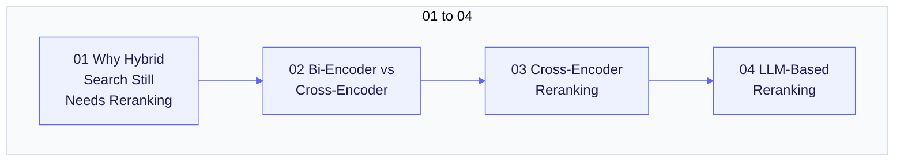

# 10 · Reranking

 

**A second, more precise pass over the retrieved candidates.**

<a href="../09.%20Advanced%20Retrieval%20Strategies/README.md">Previous group: 09 Advanced Retrieval Strategies</a> | <a href="../README.md">Home</a> | <a href="../11.%20Context%20and%20Generation/README.md">Next group: 11 Context and Generation</a>

## Learning flow

## Chapters

**Done** = notes + notebook · **Notebook** = notebook ready, notes coming · **Planned** = folder ready

<table width="100%">
<thead><tr><th width="6%">Sr&nbsp;No</th><th width="22%">Chapter</th><th width="46%">Key Concepts</th><th width="8%">Interview Priority</th><th width="6%">Notes</th><th width="6%">Notebook</th><th width="6%">Status</th></tr></thead>
<tbody>
<tr><td align="center">01</td><td><b>Why Hybrid Search Still Needs Reranking</b></td><td>Hybrid gives candidates, reranker gives precision, Top-50 to Top-5; Cross-encoders vs bi-encoders, LLM reranking, why similar isn't relevant</td><td align="center">High</td><td align="center">-</td><td align="center">-</td><td align="center">Planned</td></tr>
<tr><td align="center">02</td><td><b>Bi-Encoder vs Cross-Encoder</b></td><td>Bi-encoder vs cross-encoder, joint query-document scoring, speed vs accuracy</td><td align="center">High</td><td align="center">-</td><td align="center">-</td><td align="center">Planned</td></tr>
<tr><td align="center">03</td><td><b>Cross-Encoder Reranking</b></td><td>BGE, Cohere and Jina rerankers, candidate size, latency budget</td><td align="center">Medium</td><td align="center">-</td><td align="center">-</td><td align="center">Planned</td></tr>
<tr><td align="center">04</td><td><b>LLM-Based Reranking</b></td><td>Pointwise, pairwise and listwise LLM reranking, token cost, latency</td><td align="center">Medium</td><td align="center">-</td><td align="center">-</td><td align="center">Planned</td></tr>
</tbody>
</table>
