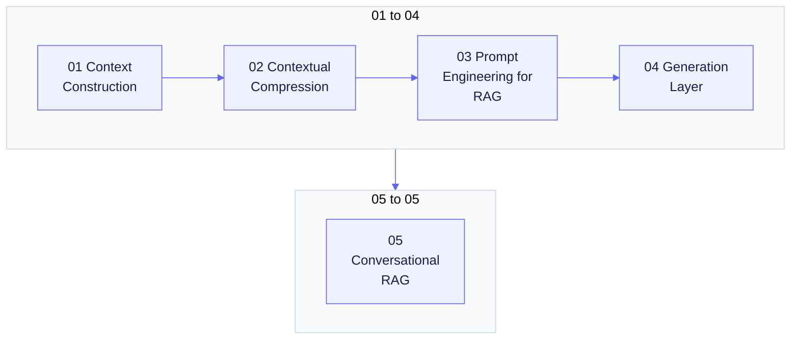

# 11 · Context and Generation

 

**From retrieved chunks to a grounded, cited answer.**

<a href="../10.%20Reranking/README.md">Previous group: 10 Reranking</a> | <a href="../README.md">Home</a> | <a href="../12.%20Evaluation/README.md">Next group: 12 Evaluation</a>

## Learning flow

## Chapters

**Done** = notes + notebook · **Notebook** = notebook ready, notes coming · **Planned** = folder ready

<table width="100%">
<thead><tr><th width="6%">Sr&nbsp;No</th><th width="22%">Chapter</th><th width="46%">Key Concepts</th><th width="8%">Interview Priority</th><th width="6%">Notes</th><th width="6%">Notebook</th><th width="6%">Status</th></tr></thead>
<tbody>
<tr><td align="center">01</td><td><b>Context Construction</b></td><td>The lost-in-the-middle problem, deduplication, ordering retrieved chunks</td><td align="center">High</td><td align="center">-</td><td align="center">-</td><td align="center">Planned</td></tr>
<tr><td align="center">02</td><td><b>Contextual Compression</b></td><td>Extractive vs LLM-based compression under a token budget</td><td align="center">Medium</td><td align="center">-</td><td align="center">-</td><td align="center">Planned</td></tr>
<tr><td align="center">03</td><td><b>Prompt Engineering for RAG</b></td><td>Grounding instructions, citation prompting, handling insufficient evidence</td><td align="center">High</td><td align="center">-</td><td align="center">-</td><td align="center">Planned</td></tr>
<tr><td align="center">04</td><td><b>Generation Layer</b></td><td>Temperature, faithfulness, structured and citation-backed output</td><td align="center">Medium</td><td align="center">-</td><td align="center">-</td><td align="center">Planned</td></tr>
<tr><td align="center">05</td><td><b>Conversational RAG</b></td><td>History-aware retrieval, query rewriting, short vs long-term memory, token-efficient history</td><td align="center">Medium</td><td align="center">-</td><td align="center">-</td><td align="center">Planned</td></tr>
</tbody>
</table>
