<div align="center">

# 12.01 · RAG Evaluation Fundamentals

   

**How to measure a RAG system stage by stage: retrieval, generation and end to end, with golden datasets, slices and regression gates.**

</div>

<p align="center"><a href="../../../11.%20Context%20and%20Generation/05.%20Conversational%20RAG/README.md">Previous: 11.05 Conversational RAG</a> | <a href="../../../README.md">Home</a> | <a href="../../README.md">Group 12: Evaluation</a> | <a href="../README.md">Chapter page</a> | <a href="../../02.%20Precision%20at%20K%20and%20Recall%20at%20K/README.md">Next: 12.02 Precision at K and Recall at K</a></p>

## Contents

<table width="100%">
<thead><tr><th width="8%">Sr No</th><th width="38%">Section</th><th width="54%">Subtopics</th></tr></thead>
<tbody>
<tr><td align="center">01</td><td><a href="#basic-definitions-in-simple-words"><b>Basic Definitions in Simple Words</b></a></td><td>-</td></tr>
<tr><td align="center">02</td><td><a href="#1-why-rag-evaluation-is-harder-than-normal-llm-evaluation"><b>1. Why RAG evaluation is harder than normal LLM evaluation</b></a></td><td>-</td></tr>
<tr><td align="center">03</td><td><a href="#2-possible-causes-of-the-same-wrong-answer"><b>2. Possible causes of the same wrong answer</b></a></td><td><a href="#case-a--ingestion-failure">Case A — ingestion failure</a><br><a href="#case-b--chunking-failure">Case B — chunking failure</a><br><a href="#case-c--retrieval-failure">Case C — retrieval failure</a><br><a href="#case-d--reranking-failure">Case D — reranking failure</a><br><a href="#case-e--context-construction-failure">Case E — context construction failure</a><br><a href="#case-f--generation-failure">Case F — generation failure</a></td></tr>
<tr><td align="center">04</td><td><a href="#3-three-levels-of-rag-evaluation"><b>3. Three levels of RAG evaluation</b></a></td><td>-</td></tr>
<tr><td align="center">05</td><td><a href="#4-retrieval-evaluation"><b>4. Retrieval evaluation</b></a></td><td><a href="#hands-on-added-a-tiny-golden-set-measured">Hands-on (added): a tiny golden set, measured</a></td></tr>
<tr><td align="center">06</td><td><a href="#5-generation-evaluation"><b>5. Generation evaluation</b></a></td><td>-</td></tr>
<tr><td align="center">07</td><td><a href="#6-end-to-end-evaluation"><b>6. End-to-end evaluation</b></a></td><td>-</td></tr>
<tr><td align="center">08</td><td><a href="#7-why-all-three-levels-are-required"><b>7. Why all three levels are required</b></a></td><td><a href="#system-a">System A</a><br><a href="#system-b">System B</a><br><a href="#check-in-code-added">Check in code (added)</a></td></tr>
<tr><td align="center">09</td><td><a href="#8-the-most-important-evaluation-decomposition"><b>8. The most important evaluation decomposition</b></a></td><td><a href="#hands-on-added-find-the-failing-stage-for-every-question">Hands-on (added): find the failing stage for every question</a></td></tr>
<tr><td align="center">10</td><td><a href="#9-offline-evaluation"><b>9. Offline evaluation</b></a></td><td>-</td></tr>
<tr><td align="center">11</td><td><a href="#10-offline-evaluation-architecture"><b>10. Offline evaluation architecture</b></a></td><td>-</td></tr>
<tr><td align="center">12</td><td><a href="#11-why-offline-evaluation-is-useful"><b>11. Why offline evaluation is useful</b></a></td><td>-</td></tr>
<tr><td align="center">13</td><td><a href="#12-offline-evaluation-example"><b>12. Offline evaluation example</b></a></td><td>-</td></tr>
<tr><td align="center">14</td><td><a href="#13-online-evaluation"><b>13. Online evaluation</b></a></td><td>-</td></tr>
<tr><td align="center">15</td><td><a href="#14-ab-testing"><b>14. A/B testing</b></a></td><td>-</td></tr>
<tr><td align="center">16</td><td><a href="#15-offline-vs-online"><b>15. Offline vs online</b></a></td><td>-</td></tr>
<tr><td align="center">17</td><td><a href="#16-why-offline-and-online-can-disagree"><b>16. Why offline and online can disagree</b></a></td><td>-</td></tr>
<tr><td align="center">18</td><td><a href="#17-evaluation-is-not-one-metric"><b>17. Evaluation is not one metric</b></a></td><td>-</td></tr>
<tr><td align="center">19</td><td><a href="#18-example"><b>18. Example</b></a></td><td>-</td></tr>
<tr><td align="center">20</td><td><a href="#19-reference-based-evaluation"><b>19. Reference-based evaluation</b></a></td><td>-</td></tr>
<tr><td align="center">21</td><td><a href="#20-reference-based-retrieval-evaluation"><b>20. Reference-based retrieval evaluation</b></a></td><td>-</td></tr>
<tr><td align="center">22</td><td><a href="#21-reference-free-evaluation"><b>21. Reference-free evaluation</b></a></td><td>-</td></tr>
<tr><td align="center">23</td><td><a href="#22-reference-based-vs-reference-free"><b>22. Reference-based vs reference-free</b></a></td><td><a href="#reference-based">Reference-based</a><br><a href="#reference-free">Reference-free</a></td></tr>
<tr><td align="center">24</td><td><a href="#23-human-evaluation"><b>23. Human evaluation</b></a></td><td>-</td></tr>
<tr><td align="center">25</td><td><a href="#24-why-human-evaluation-is-valuable"><b>24. Why human evaluation is valuable</b></a></td><td>-</td></tr>
<tr><td align="center">26</td><td><a href="#25-human-evaluation-problems"><b>25. Human evaluation problems</b></a></td><td><a href="#check-in-code-added-agreement-between-two-annotators">Check in code (added): agreement between two annotators</a></td></tr>
<tr><td align="center">27</td><td><a href="#26-automated-evaluation"><b>26. Automated evaluation</b></a></td><td>-</td></tr>
<tr><td align="center">28</td><td><a href="#27-golden-evaluation-dataset"><b>27. Golden evaluation dataset</b></a></td><td>-</td></tr>
<tr><td align="center">29</td><td><a href="#28-why-do-we-need-relevant-chunk-ids"><b>28. Why do we need relevant chunk IDs?</b></a></td><td>-</td></tr>
<tr><td align="center">30</td><td><a href="#29-ideal-evaluation-record"><b>29. Ideal evaluation record</b></a></td><td>-</td></tr>
<tr><td align="center">31</td><td><a href="#30-why-only-question-answer-pairs-are-not-enough"><b>30. Why only question-answer pairs are not enough</b></a></td><td>-</td></tr>
<tr><td align="center">32</td><td><a href="#31-relevance-labels"><b>31. Relevance labels</b></a></td><td>-</td></tr>
<tr><td align="center">33</td><td><a href="#32-graded-relevance"><b>32. Graded relevance</b></a></td><td>-</td></tr>
<tr><td align="center">34</td><td><a href="#33-what-does-relevant-actually-mean"><b>33. What does relevant actually mean?</b></a></td><td>-</td></tr>
<tr><td align="center">35</td><td><a href="#34-topic-relevance-vs-answer-relevance"><b>34. Topic relevance vs answer relevance</b></a></td><td>-</td></tr>
<tr><td align="center">36</td><td><a href="#35-evidence-sufficiency"><b>35. Evidence sufficiency</b></a></td><td>-</td></tr>
<tr><td align="center">37</td><td><a href="#36-multi-hop-evaluation"><b>36. Multi-hop evaluation</b></a></td><td>-</td></tr>
<tr><td align="center">38</td><td><a href="#37-query-categories"><b>37. Query categories</b></a></td><td>-</td></tr>
<tr><td align="center">39</td><td><a href="#38-slice-based-evaluation"><b>38. Slice-based evaluation</b></a></td><td><a href="#hands-on-added-slices-on-the-golden-set">Hands-on (added): slices on the golden set</a></td></tr>
<tr><td align="center">40</td><td><a href="#39-dataset-representativeness"><b>39. Dataset representativeness</b></a></td><td>-</td></tr>
<tr><td align="center">41</td><td><a href="#40-difficulty-distribution"><b>40. Difficulty distribution</b></a></td><td><a href="#easy">Easy</a><br><a href="#medium">Medium</a><br><a href="#hard">Hard</a></td></tr>
<tr><td align="center">42</td><td><a href="#41-evaluation-set-size"><b>41. Evaluation set size</b></a></td><td><a href="#calculator-added-how-precise-is-a-score-from-n-questions">Calculator (added): how precise is a score from n questions?</a></td></tr>
<tr><td align="center">43</td><td><a href="#42-evaluation-leakage"><b>42. Evaluation leakage</b></a></td><td>-</td></tr>
<tr><td align="center">44</td><td><a href="#43-baseline"><b>43. Baseline</b></a></td><td>-</td></tr>
<tr><td align="center">45</td><td><a href="#44-controlled-experiments"><b>44. Controlled experiments</b></a></td><td>-</td></tr>
<tr><td align="center">46</td><td><a href="#45-evaluation-as-scientific-experimentation"><b>45. Evaluation as scientific experimentation</b></a></td><td>-</td></tr>
<tr><td align="center">47</td><td><a href="#46-regression-testing"><b>46. Regression testing</b></a></td><td>-</td></tr>
<tr><td align="center">48</td><td><a href="#47-example-evaluation-gates"><b>47. Example evaluation gates</b></a></td><td><a href="#code-added-the-gates-as-a-check">Code (added): the gates as a check</a></td></tr>
<tr><td align="center">49</td><td><a href="#48-rag-evaluation-pipeline"><b>48. RAG evaluation pipeline</b></a></td><td>-</td></tr>
<tr><td align="center">50</td><td><a href="#49-diagnostic-logging"><b>49. Diagnostic logging</b></a></td><td>-</td></tr>
<tr><td align="center">51</td><td><a href="#50-why-final-answer-logs-alone-arent-enough"><b>50. Why final answer logs alone aren't enough</b></a></td><td>-</td></tr>
<tr><td align="center">52</td><td><a href="#51-metric-selection-depends-on-use-case"><b>51. Metric selection depends on use case</b></a></td><td><a href="#faq-bot">FAQ bot</a><br><a href="#research-assistant">Research assistant</a><br><a href="#legal-compliance">Legal compliance</a><br><a href="#search-engine">Search engine</a></td></tr>
<tr><td align="center">53</td><td><a href="#52-precision-vs-recall-intuition"><b>52. Precision vs recall intuition</b></a></td><td><a href="#precision">Precision</a><br><a href="#recall">Recall</a></td></tr>
<tr><td align="center">54</td><td><a href="#53-two-stage-evaluation-intuition"><b>53. Two-stage evaluation intuition</b></a></td><td>-</td></tr>
<tr><td align="center">55</td><td><a href="#54-ann-recall-is-not-the-same-as-semantic-recallk"><b>54. ANN recall is not the same as semantic Recall@K</b></a></td><td>-</td></tr>
<tr><td align="center">56</td><td><a href="#55-example"><b>55. Example</b></a></td><td><a href="#check-in-code-added-the-two-recalls">Check in code (added): the two recalls</a></td></tr>
<tr><td align="center">57</td><td><a href="#56-generation-correctness-vs-faithfulness"><b>56. Generation correctness vs faithfulness</b></a></td><td>-</td></tr>
<tr><td align="center">58</td><td><a href="#57-opposite-case"><b>57. Opposite case</b></a></td><td>-</td></tr>
<tr><td align="center">59</td><td><a href="#58-context-quality-vs-answer-quality"><b>58. Context quality vs answer quality</b></a></td><td>-</td></tr>
<tr><td align="center">60</td><td><a href="#59-unanswerable-questions"><b>59. Unanswerable questions</b></a></td><td>-</td></tr>
<tr><td align="center">61</td><td><a href="#60-why-unanswerable-evaluation-matters"><b>60. Why unanswerable evaluation matters</b></a></td><td>-</td></tr>
<tr><td align="center">62</td><td><a href="#61-adversarial-evaluation"><b>61. Adversarial evaluation</b></a></td><td><a href="#contradiction">Contradiction</a><br><a href="#numerical-precision">Numerical precision</a><br><a href="#negation">Negation</a><br><a href="#exact-id">Exact ID</a><br><a href="#temporal">Temporal</a></td></tr>
<tr><td align="center">63</td><td><a href="#62-end-to-end-success-criteria"><b>62. End-to-end success criteria</b></a></td><td>-</td></tr>
<tr><td align="center">64</td><td><a href="#63-evaluation-dashboard"><b>63. Evaluation dashboard</b></a></td><td>-</td></tr>
<tr><td align="center">65</td><td><a href="#64-core-production-principle"><b>64. Core production principle</b></a></td><td><a href="#measurement">Measurement</a><br><a href="#diagnosis">Diagnosis</a><br><a href="#experimentation">Experimentation</a></td></tr>
<tr><td align="center">66</td><td><a href="#65-interview-question--why-is-rag-evaluation-difficult"><b>65. Interview question — Why is RAG evaluation difficult?</b></a></td><td>-</td></tr>
<tr><td align="center">67</td><td><a href="#66-interview-question--offline-vs-online-evaluation"><b>66. Interview question — Offline vs online evaluation?</b></a></td><td>-</td></tr>
<tr><td align="center">68</td><td><a href="#67-interview-question--what-should-a-rag-golden-dataset-contain"><b>67. Interview question — What should a RAG golden dataset contain?</b></a></td><td>-</td></tr>
<tr><td align="center">69</td><td><a href="#68-interview-question--why-isnt-final-answer-accuracy-sufficient"><b>68. Interview question — Why isn't final-answer accuracy sufficient?</b></a></td><td>-</td></tr>
<tr><td align="center">70</td><td><a href="#69-interview-question--reference-based-vs-reference-free"><b>69. Interview question — Reference-based vs reference-free?</b></a></td><td>-</td></tr>
<tr><td align="center">71</td><td><a href="#70-interview-question--human-vs-automated-evaluation"><b>70. Interview question — Human vs automated evaluation?</b></a></td><td>-</td></tr>
<tr><td align="center">72</td><td><a href="#71-interview-question--what-does-relevance-mean-in-retrieval-evaluation"><b>71. Interview question — What does relevance mean in retrieval evaluation?</b></a></td><td>-</td></tr>
<tr><td align="center">73</td><td><a href="#72-interview-question--how-would-you-evaluate-a-new-embedding-model"><b>72. Interview question — How would you evaluate a new embedding model?</b></a></td><td>-</td></tr>
<tr><td align="center">74</td><td><a href="#73-interview-question--how-do-you-know-whether-a-wrong-answer-was-retrieval-or-generation-failure"><b>73. Interview question — How do you know whether a wrong answer was retrieval or generation failure?</b></a></td><td>-</td></tr>
<tr><td align="center">75</td><td><a href="#74-common-evaluation-mistakes"><b>74. Common evaluation mistakes</b></a></td><td><a href="#mistake-1">Mistake 1</a><br><a href="#mistake-2">Mistake 2</a><br><a href="#mistake-3">Mistake 3</a><br><a href="#mistake-4">Mistake 4</a><br><a href="#mistake-5">Mistake 5</a><br><a href="#mistake-6">Mistake 6</a><br><a href="#mistake-7">Mistake 7</a><br><a href="#mistake-8">Mistake 8</a><br><a href="#mistake-9">Mistake 9</a><br><a href="#mistake-10">Mistake 10</a></td></tr>
<tr><td align="center">76</td><td><a href="#75-evaluation-maturity-levels"><b>75. Evaluation maturity levels</b></a></td><td>-</td></tr>
<tr><td align="center">77</td><td><a href="#76-chapter-1201-core-architecture"><b>76. Chapter 12.01 core architecture</b></a></td><td>-</td></tr>
<tr><td align="center">78</td><td><a href="#77-the-three-evaluation-layers-to-memorize"><b>77. The three evaluation layers to memorize</b></a></td><td>-</td></tr>
<tr><td align="center">79</td><td><a href="#78-final-revision-sheet"><b>78. Final revision sheet</b></a></td><td><a href="#rag-evaluation-is-difficult-because">RAG evaluation is difficult because:</a><br><a href="#evaluation-should-separate">Evaluation should separate:</a><br><a href="#evaluation-can-be">Evaluation can be:</a><br><a href="#evaluation-can-use">Evaluation can use:</a><br><a href="#evaluation-can-be-performed-by">Evaluation can be performed by:</a><br><a href="#a-strong-golden-dataset-ideally-contains">A strong golden dataset ideally contains:</a><br><a href="#important-dataset-qualities">Important dataset qualities:</a><br><a href="#always-evaluate-slices">Always evaluate slices:</a><br><a href="#never-optimize-only">Never optimize only:</a><br><a href="#most-important-debugging-sequence">Most important debugging sequence:</a><br><a href="#chapter-1201-interview-ready-definition">Chapter 12.01 interview-ready definition</a></td></tr>
<tr><td align="center">80</td><td><a href="#79-practice-tasks"><b>79. Practice Tasks</b></a></td><td>-</td></tr>
<tr><td align="center">81</td><td><a href="#80-final-takeaways"><b>80. Final Takeaways</b></a></td><td>-</td></tr>
</tbody>
</table>

This chapter is the foundation for the entire evaluation section.

Before learning Precision@K, Recall@K, MRR, NDCG, Faithfulness, RAGAS, or LLM-as-a-Judge, you need one mental model:

> **A RAG system is not one model. It is a pipeline, and every stage can fail independently.**

So when a final answer is wrong, evaluation should tell us **where it went wrong**.

## Basic Definitions in Simple Words

<table width="100%">
<thead><tr><th width="8%">Sr No</th><th width="28%">Term</th><th width="64%">Meaning in simple words</th></tr></thead>
<tbody>
<tr><td align="center">01</td><td><b>Golden dataset</b></td><td>A trusted test set: questions, reference answers and the chunks that hold the evidence.</td></tr>
<tr><td align="center">02</td><td><b>Ground truth</b></td><td>The answer or evidence we treat as correct.</td></tr>
<tr><td align="center">03</td><td><b>Relevant chunk</b></td><td>A chunk that gives evidence needed to answer the question correctly.</td></tr>
<tr><td align="center">04</td><td><b>Retrieval evaluation</b></td><td>Did the right evidence come back, and how high was it ranked?</td></tr>
<tr><td align="center">05</td><td><b>Generation evaluation</b></td><td>Given the context, was the answer correct, grounded and relevant?</td></tr>
<tr><td align="center">06</td><td><b>End-to-end evaluation</b></td><td>Did the whole system answer the user's question?</td></tr>
<tr><td align="center">07</td><td><b>Offline evaluation</b></td><td>Running the system on a fixed test set during development.</td></tr>
<tr><td align="center">08</td><td><b>Online evaluation</b></td><td>Measuring real users: feedback, clicks, A/B tests.</td></tr>
<tr><td align="center">09</td><td><b>Reference-based</b></td><td>Compare against a known correct answer or chunk list.</td></tr>
<tr><td align="center">10</td><td><b>Reference-free</b></td><td>Judge the answer from question and context only, often with an LLM judge.</td></tr>
<tr><td align="center">11</td><td><b>Faithfulness</b></td><td>The answer only says what the context supports.</td></tr>
<tr><td align="center">12</td><td><b>Correctness</b></td><td>The answer is actually true.</td></tr>
<tr><td align="center">13</td><td><b>Slice</b></td><td>A subset of questions, e.g. numerical or multi-hop, scored separately.</td></tr>
<tr><td align="center">14</td><td><b>Regression test</b></td><td>Re-running the evaluation after a change to catch anything that got worse.</td></tr>
<tr><td align="center">15</td><td><b>Baseline</b></td><td>The current system you compare a change against.</td></tr>
<tr><td align="center">16</td><td><b>Abstention</b></td><td>Saying the evidence is insufficient instead of guessing.</td></tr>
</tbody>
</table>

## 1. Why RAG evaluation is harder than normal LLM evaluation

> [!TIP]
> **In simple words:** A wrong RAG answer has many possible causes. Evaluation must tell you which stage broke, not only that something broke.

Suppose a normal LLM receives:

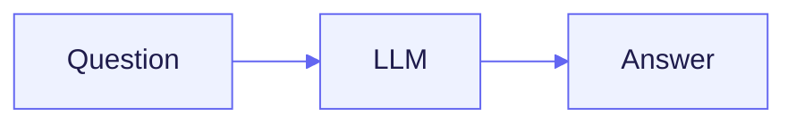

If the answer is wrong, there is essentially one major system to investigate:

```text
LLM generation
```

RAG is different:

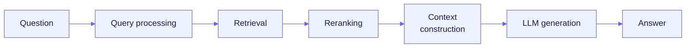

A wrong answer can come from any stage.

For example:

```text
User:
How many annual leave days are employees entitled to?

Correct source:
Employees receive 24 annual leave days.
```

The final system answers:

```text
Employees receive 20 annual leave days.
```

Why?

There are many possibilities.

## 2. Possible causes of the same wrong answer

### Case A — ingestion failure

The source PDF actually says:

```text
24 days
```

but parsing extracted:

```text
20 days
```

Then retrieval and generation could both work perfectly and still produce a wrong answer.

### Case B — chunking failure

Original:

```text
Employees with five years of service
receive 30 annual leave days.
```

Chunks:

```text
Chunk 1:
Employees with five years of service

Chunk 2:
receive 30 annual leave days.
```

Retriever gets only Chunk 2.

The evidence is incomplete.

### Case C — retrieval failure

Correct chunk exists in the vector database but never appears in Top-K.

```text
Correct chunk rank = 57

Top K = 10
```

The LLM never sees it.

### Case D — reranking failure

Retriever finds the right chunk:

```text
Initial rank = 6
```

but reranker pushes it to:

```text
rank = 32
```

and only Top-5 goes to the LLM.

<p align="center">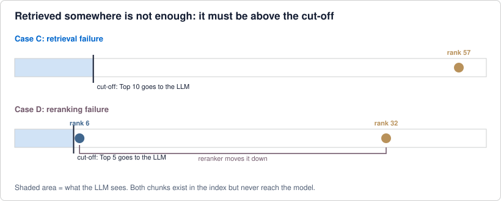</p>

### Case E — context construction failure

Correct chunk was retrieved but removed because of token budgeting or deduplication.

### Case F — generation failure

Correct evidence reaches the LLM:

```text
Employees receive 24 annual leave days.
```

but the model responds:

```text
20 days.
```

Now the failure is generation.

This gives us the central idea of RAG evaluation:

```math
\boxed{ \text{Evaluate each stage separately} }
```

## 3. Three levels of RAG evaluation

> [!TIP]
> **In simple words:** Check the evidence, check the answer, check the whole result. Three separate scores.

At the highest level, divide evaluation into:

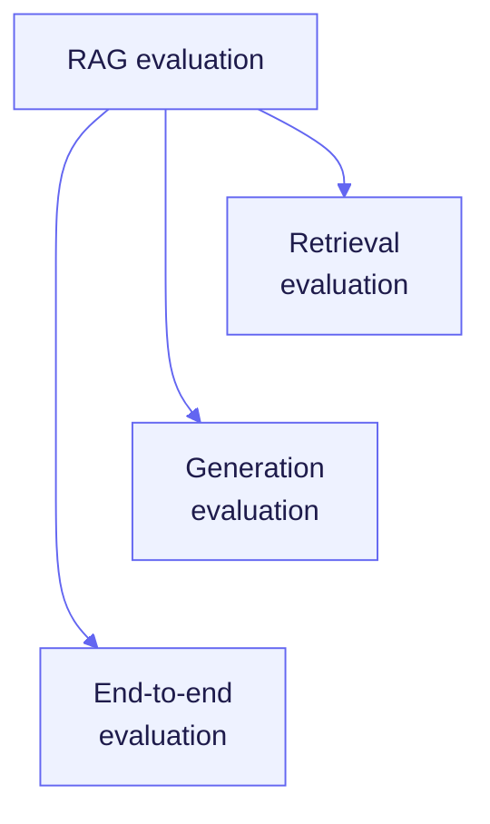

These answer different questions.

## 4. Retrieval evaluation

Retrieval evaluation asks:

> Did the system retrieve the correct evidence?

Suppose query:

```text
How many annual leave days are provided?
```

Ground-truth relevant chunk:

```text
D7:
Employees receive 24 annual leave days.
```

Retriever returns:

<p align="center">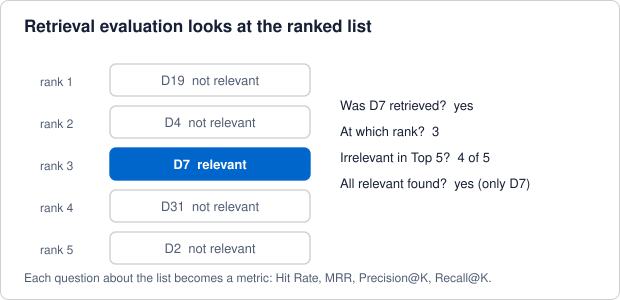</p>

D7 was found.

Retrieval evaluation measures things like:

```text
Was D7 retrieved?
How highly was D7 ranked?
How many irrelevant chunks were also returned?
Were all relevant chunks retrieved?
```

Metrics:

```text
Precision@K
Recall@K
Hit Rate
MRR
MAP
NDCG
```

These are Chapters 12.02–12.06.

### Hands-on (added): a tiny golden set, measured

A 12-chunk HR handbook and 10 labelled questions. The same data is used in the rest of this chapter.

```python
# A tiny knowledge base: 12 chunks of an HR handbook
chunks = {
    "C01": "Employees receive 24 days of annual leave per calendar year.",
    "C02": "Employees with five years of service receive 30 days of annual leave.",
    "C03": "Up to 5 unused annual leave days can be carried forward to the next year.",
    "C04": "Maternity leave is available for eligible employees.",
    "C05": "Eligible employees may receive up to 26 weeks of maternity leave.",
    "C06": "Business travel expenses are reimbursed up to 150 euros per day.",
    "C07": "Working from home requires written approval from the line manager.",
    "C08": "All company laptops must use full-disk encryption.",
    "C09": "Passwords must be at least 14 characters long.",
    "C10": "Policy HR-17 covers parental leave for adoptive parents.",
    "C11": "The office is closed on public holidays.",
    "C12": "Sick leave longer than three days requires a medical certificate.",
}

# Golden dataset: question, reference answer, relevant chunk IDs and category
golden = [
    {"query_id": "Q01", "question": "How many days of annual leave do employees get?",
     "reference_answer": "24", "relevant_chunk_ids": ["C01"], "category": "factual"},
    {"query_id": "Q02", "question": "How long can maternity leave last?",
     "reference_answer": "26 weeks", "relevant_chunk_ids": ["C05"], "category": "factual"},
    {"query_id": "Q03", "question": "Who gets 30 leave days and how many unused days can be carried over?",
     "reference_answer": "5", "relevant_chunk_ids": ["C02", "C03"], "category": "multi-hop"},
    {"query_id": "Q04", "question": "What is the minimum password length?",
     "reference_answer": "14", "relevant_chunk_ids": ["C09"], "category": "numerical"},
    {"query_id": "Q05", "question": "What does HR-17 cover?",
     "reference_answer": "adoptive", "relevant_chunk_ids": ["C10"], "category": "exact ID"},
    {"query_id": "Q06", "question": "Do I need a doctor's note when I am ill?",
     "reference_answer": "medical certificate", "relevant_chunk_ids": ["C12"], "category": "paraphrase"},
    {"query_id": "Q07", "question": "What is the daily limit for travel costs?",
     "reference_answer": "150", "relevant_chunk_ids": ["C06"], "category": "numerical"},
    {"query_id": "Q08", "question": "Can I work remotely without asking anyone?",
     "reference_answer": "approval", "relevant_chunk_ids": ["C07"], "category": "paraphrase"},
    {"query_id": "Q09", "question": "What is the CEO's favourite food?",
     "reference_answer": None, "relevant_chunk_ids": [], "category": "unanswerable"},
    {"query_id": "Q10", "question": "Is the office open on public holidays?",
     "reference_answer": "closed", "relevant_chunk_ids": ["C11"], "category": "factual"},
]

# Count the questions per category
from collections import Counter
print(len(chunks), "chunks,", len(golden), "questions")
print(Counter(item["category"] for item in golden))
```

**Output**

```text
12 chunks, 10 questions
Counter({'factual': 3, 'numerical': 2, 'paraphrase': 2, 'multi-hop': 1, 'exact ID': 1, 'unanswerable': 1})
```

Two retrievers on the same golden set: dense (all-MiniLM-L6-v2) and sparse (BM25). Local run.

```python
import os
os.environ["HF_HUB_OFFLINE"] = "1"

import re
import numpy as np
from rank_bm25 import BM25Okapi
from sentence_transformers import SentenceTransformer

chunk_ids = list(chunks)
chunk_texts = [chunks[c] for c in chunk_ids]

# Dense retriever: all-MiniLM-L6-v2, cosine on unit vectors
model = SentenceTransformer("all-MiniLM-L6-v2", device="cpu")
chunk_vectors = model.encode(chunk_texts, normalize_embeddings=True)

# Sparse retriever: BM25 on lowercase word tokens
def words(text):
    return re.findall(r"[a-z0-9-]+", text.lower())

bm25 = BM25Okapi([words(t) for t in chunk_texts])

def rank_dense(question):
    # All chunk IDs, best first
    scores = chunk_vectors @ model.encode([question], normalize_embeddings=True)[0]
    return [chunk_ids[i] for i in np.argsort(-scores)]

def rank_bm25(question):
    # All chunk IDs, best first (ties keep chunk order)
    scores = bm25.get_scores(words(question))
    return [chunk_ids[i] for i in np.argsort(-scores, kind="stable")]

def retrieval_metrics(ranking, relevant, k=3):
    # Rank of the first relevant chunk (1-based)
    first = min(ranking.index(c) + 1 for c in relevant)

    # Hit@1, Recall@k and reciprocal rank for this one question
    hit1 = 1.0 if first == 1 else 0.0
    recall = len(set(ranking[:k]) & set(relevant)) / len(relevant)
    return first, hit1, recall, 1 / first

rankers = {"dense": rank_dense, "bm25": rank_bm25}
results = {name: {} for name in rankers}

for item in golden:
    # Unanswerable questions have no relevant chunk, so no retrieval score
    if not item["relevant_chunk_ids"]:
        continue

    for name, ranker in rankers.items():
        results[name][item["query_id"]] = retrieval_metrics(ranker(item["question"]), item["relevant_chunk_ids"])

# Per-question view: rank of the first relevant chunk for both retrievers
print("query  category      dense rank  bm25 rank")
for item in golden:
    if item["relevant_chunk_ids"]:
        qid = item["query_id"]
        print(f"{qid:<6} {item['category']:<13} {results['dense'][qid][0]:>10} {results['bm25'][qid][0]:>10}")

# Averages over the 9 answerable questions
for name in rankers:
    rows = list(results[name].values())
    print(f"{name:<6} Hit@1 = {np.mean([r[1] for r in rows]):.2f}   "
          f"Recall@3 = {np.mean([r[2] for r in rows]):.2f}   MRR = {np.mean([r[3] for r in rows]):.2f}")
```

**Output**

```text
query  category      dense rank  bm25 rank
Q01    factual                1          2
Q02    factual                1          4
Q03    multi-hop              1          1
Q04    numerical              1         10
Q05    exact ID               1          1
Q06    paraphrase             1          1
Q07    numerical              1          3
Q08    paraphrase             1          7
Q10    factual                1          1
dense  Hit@1 = 1.00   Recall@3 = 1.00   MRR = 1.00
bm25   Hit@1 = 0.44   Recall@3 = 0.67   MRR = 0.59
```

<p align="center">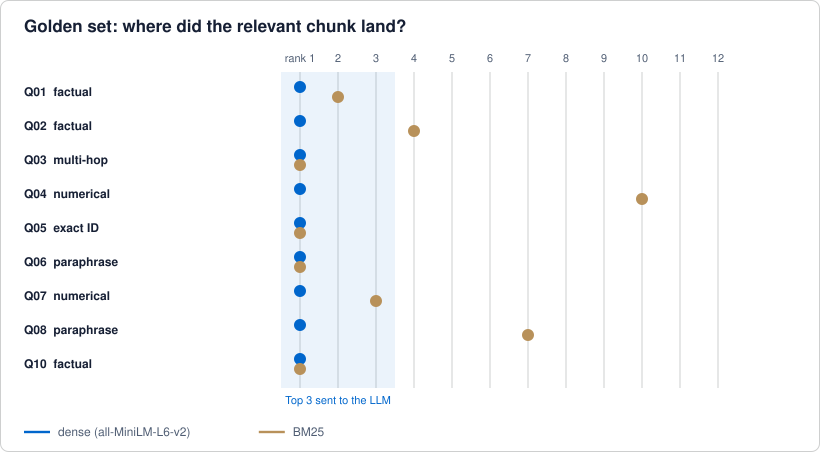</p>

Dense retrieval puts the relevant chunk first for all 9 answerable questions. BM25 drops it below the Top 3 for Q02, Q04, Q08: paraphrases and questions whose key words differ from the chunk. These numbers only say something about this tiny set, not about the methods in general.

## 5. Generation evaluation

Generation evaluation asks:

> Given the context supplied to the LLM, did it produce a good answer?

Suppose context is:

```text
Employees receive 24 annual leave days.
```

Generated answer:

```text
Employees receive 30 annual leave days.
```

Retrieval succeeded.

Generation failed.

Generation metrics inspect dimensions such as:

```text
Correctness
Faithfulness
Groundedness
Answer relevance
Hallucination
Citation quality
```

## 6. End-to-end evaluation

End-to-end evaluation asks:

> Did the complete RAG application successfully answer the user's question?

You don't care which component caused the error yet.

Example:

```text
Question:
How many leave days?

Expected:
24

System answer:
24
```

End-to-end:

```text
SUCCESS
```

Another query:

```text
Expected:
30

System:
24
```

End-to-end:

```text
FAIL
```

Then you investigate the pipeline to determine the cause.

## 7. Why all three levels are required

Suppose System A and System B both have:

```text
Final answer accuracy = 80%
```

You might assume they're equivalent.

But:

### System A

```text
Retrieval recall = 95%
Generation accuracy given correct context = 84%
```

Problem:

```text
generation
```

### System B

```text
Retrieval recall = 82%
Generation accuracy given correct context = 98%
```

Problem:

```text
retrieval
```

Same end-to-end result.

Completely different engineering action.

For System A:

```text
improve prompts/model/generation
```

For System B:

```text
improve chunking/embedding/retrieval
```

This is exactly why end-to-end accuracy alone is insufficient.

### Check in code (added)

If retrieval and generation fail independently, end-to-end accuracy is roughly their product.

```python
systems = {"System A": (0.95, 0.84), "System B": (0.82, 0.98)}

for name, (retrieval_recall, generation_accuracy) in systems.items():
    # End-to-end success needs both stages to work
    end_to_end = retrieval_recall * generation_accuracy

    # The weaker stage is where to invest first
    weaker = "generation" if generation_accuracy < retrieval_recall else "retrieval"
    print(f"{name}: end-to-end = {end_to_end:.1%}, fix {weaker} first")
```

**Output**

```text
System A: end-to-end = 79.8%, fix generation first
System B: end-to-end = 80.4%, fix retrieval first
```

<p align="center">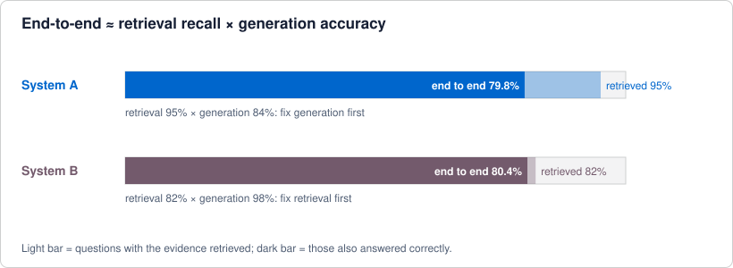</p>

## 8. The most important evaluation decomposition

For every test question, conceptually ask:

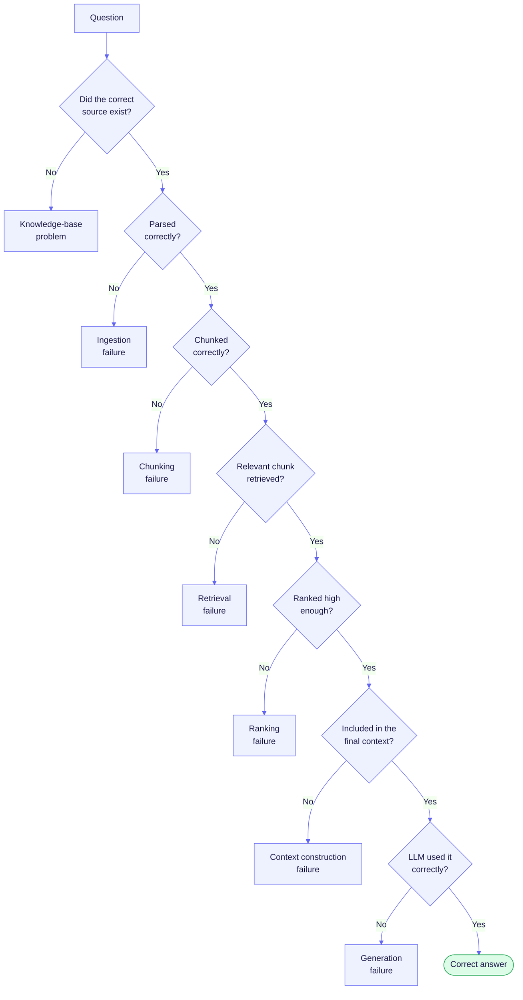

This debugging tree is one of the most important things in the entire evaluation section.

### Hands-on (added): find the failing stage for every question

Full RAG on the golden set: retrieve the top 3 chunks, generate with a local **llama3.2 (3B)** through Ollama, then apply the debugging tree above in code.

```python
import json
import urllib.request

def generate(prompt, temperature=0.0, num_predict=80, raw=False, top_logprobs=0, seed=7):
    # Local llama3.2 (3B) through Ollama, same helper as in 01.07
    body = {"model": "llama3.2", "prompt": prompt, "stream": False, "raw": raw,
            "options": {"temperature": temperature, "num_predict": num_predict, "seed": seed}}
    if top_logprobs:
        body["logprobs"] = True
        body["top_logprobs"] = top_logprobs
    request = urllib.request.Request("http://localhost:11434/api/generate", data=json.dumps(body).encode(),
                                     headers={"Content-Type": "application/json"})
    return json.load(urllib.request.urlopen(request, timeout=300))

ABSTAIN = "The available evidence is insufficient."

def answer(question, context_ids):
    # Grounded prompt with an explicit abstain rule
    context = "\n".join(chunks[c] for c in context_ids)
    prompt = (f"Use only the context. If the context does not contain the answer, reply exactly: {ABSTAIN}\n\n"
              f"Context:\n{context}\n\nQuestion: {question}\nAnswer in one sentence.")
    return generate(prompt)["response"].strip()

def diagnose(item, top_ids, reply):
    # Unanswerable: the only correct behaviour is to abstain
    if not item["relevant_chunk_ids"]:
        return "correct abstain" if ABSTAIN in reply else "hallucination"

    # Evidence never reached the LLM
    if not set(item["relevant_chunk_ids"]) <= set(top_ids):
        return "retrieval failure"

    # Evidence reached the LLM but the answer misses the reference
    if item["reference_answer"].lower() not in reply.lower():
        return "generation failure"

    return "correct"

end_to_end = {}
for name, ranker in rankers.items():
    print(f"--- RAG with {name} retrieval (top 3 chunks to the LLM)")
    for item in golden:
        # Retrieve, generate, then find the stage that failed
        top_ids = ranker(item["question"])[:3]
        reply = answer(item["question"], top_ids)
        verdict = diagnose(item, top_ids, reply)
        end_to_end[(name, item["query_id"])] = verdict
        print(f"{item['query_id']}  {verdict:<18} {reply[:70]}")
```

**Output**

```text
--- RAG with dense retrieval (top 3 chunks to the LLM)
Q01  correct            Employees receive 24 days of annual leave per calendar year.
Q02  correct            Maternity leave can last up to 26 weeks.
Q03  correct            Employees with five years of service receive 30 days of annual leave a
Q04  correct            The minimum password length is 14 characters.
Q05  correct            HR-17 covers parental leave for adoptive parents.
Q06  correct            Yes, sick leave longer than three days requires a medical certificate.
Q07  correct            The daily limit for travel costs is 150 euros.
Q08  generation failure The available evidence is insufficient.
Q09  correct abstain    The available evidence is insufficient.
Q10  correct            The office is closed on public holidays.
--- RAG with bm25 retrieval (top 3 chunks to the LLM)
Q01  correct            Employees receive 24 days of annual leave per calendar year.
Q02  retrieval failure  The context does not contain information about the length of maternity
Q03  correct            Employees with five years of service receive 30 days of annual leave a
Q04  retrieval failure  The context does not contain the answer.
Q05  correct            HR-17 covers parental leave for adoptive parents.
Q06  correct            Yes, sick leave longer than three days requires a medical certificate.
Q07  correct            The daily limit for travel costs is 150 euros.
Q08  retrieval failure  The available evidence is insufficient.
Q09  correct abstain    The available evidence is insufficient.
Q10  correct            The office is closed on public holidays.
```

<table width="100%">
<thead><tr><th width="8%">Sr No</th><th width="24%">Retriever</th><th width="17%">Correct</th><th width="17%">Correct abstain</th><th width="17%">Retrieval failure</th><th width="17%">Generation failure</th></tr></thead>
<tbody>
<tr><td align="center">01</td><td>dense</td><td>8</td><td>1</td><td>0</td><td>1</td></tr>
<tr><td align="center">02</td><td>BM25</td><td>6</td><td>1</td><td>3</td><td>0</td></tr>
</tbody>
</table>

The same question Q08 fails in two different places: with BM25 the approval rule never reaches the LLM (retrieval failure); with dense retrieval it is chunk 1 in the context, yet the model still says the evidence is insufficient (generation failure). Only the chunk labels make that difference visible.

## 9. Offline evaluation

> [!TIP]
> **In simple words:** Offline means a fixed exam you can re-run any time; online means watching real users.

Now another major distinction:

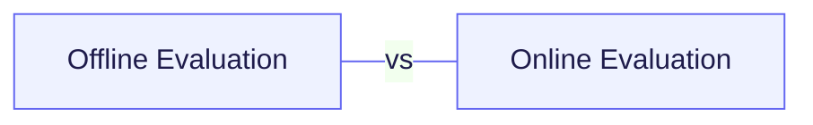

Offline evaluation happens using a predefined evaluation dataset.

Example:

```python
{
    "question": "How many annual leave days?",
    "expected_answer": "24 days",
    "relevant_chunk_ids": ["D17_C03"]
}
```

You run:

```text
1000 test queries
```

against your system.

Then compute metrics.

## 10. Offline evaluation architecture

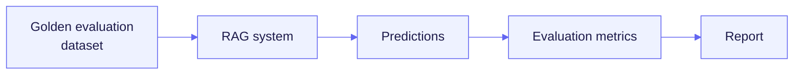

Example report:

<table width="100%">
<thead><tr><th width="8%">Sr No</th><th width="28%">Metric</th><th width="64%">Value</th></tr></thead>
<tbody>
<tr><td align="center">01</td><td>Recall@5</td><td>0.91</td></tr>
<tr><td align="center">02</td><td>MRR</td><td>0.84</td></tr>
<tr><td align="center">03</td><td>NDCG@10</td><td>0.88</td></tr>
<tr><td align="center">04</td><td>Faithfulness</td><td>0.93</td></tr>
<tr><td align="center">05</td><td>Answer accuracy</td><td>0.86</td></tr>
</tbody>
</table>

## 11. Why offline evaluation is useful

Because it is:

```text
repeatable
cheap compared with production experiments
safe
fast
controlled
```

You can compare:

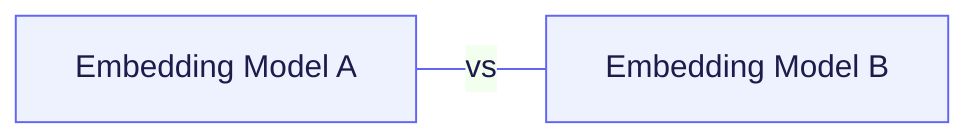

or:

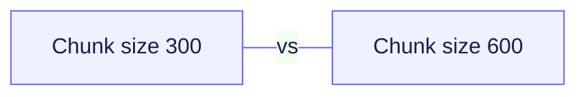

without exposing real users.

## 12. Offline evaluation example

Suppose baseline:

```text
Embedding = Model A
Chunk = 500 tokens
Top K = 5

Recall@5 = 82%
```

New configuration:

```text
Embedding = Model B
Chunk = 500 tokens
Top K = 5

Recall@5 = 91%
```

Because all other variables remained constant, you have evidence:

```text
Model B improved retrieval.
```

## 13. Online evaluation

Online evaluation happens in real production traffic.

Examples:

```text
user thumbs up/down
click-through
successful task completion
abandonment
follow-up questions
escalation rate
answer acceptance
latency
cost
```

Or controlled:

```text
A/B testing
```

## 14. A/B testing

Suppose:

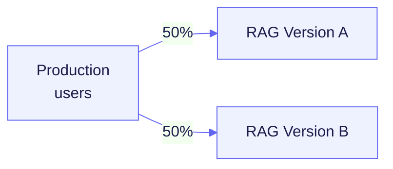

Version A:

```text
BM25 + Dense
```

Version B:

```text
BM25 + Dense + Reranker
```

Measure:

```text
answer acceptance
user satisfaction
latency
cost
```

This evaluates real-world impact.

## 15. Offline vs online

<table width="100%">
<thead><tr><th width="8%">Sr No</th><th width="24%">Property</th><th width="34%">Offline</th><th width="34%">Online</th></tr></thead>
<tbody>
<tr><td align="center">01</td><td>Uses test dataset</td><td>Yes</td><td>Usually production users</td></tr>
<tr><td align="center">02</td><td>Repeatable</td><td>Highly</td><td>Less controlled</td></tr>
<tr><td align="center">03</td><td>Cheap</td><td>Relatively</td><td>More expensive</td></tr>
<tr><td align="center">04</td><td>Safe</td><td>Yes</td><td>User-facing</td></tr>
<tr><td align="center">05</td><td>Measures real user behavior</td><td>No</td><td>Yes</td></tr>
<tr><td align="center">06</td><td>Useful during development</td><td>Excellent</td><td>Limited</td></tr>
<tr><td align="center">07</td><td>Detects production reality</td><td>Limited</td><td>Excellent</td></tr>
</tbody>
</table>

Best systems use both.

## 16. Why offline and online can disagree

Suppose Model B gets:

```text
offline accuracy = 93%
```

versus Model A:

```text
90%
```

But Model B has latency:

```text
8 seconds
```

Model A:

```text
1.5 seconds
```

Users prefer Model A.

So online satisfaction might be higher despite slightly lower offline accuracy.

This is why production evaluation is multidimensional.

## 17. Evaluation is not one metric

This is another foundational principle.

A RAG system has multiple goals:

```math
\text{Quality}, \qquad \text{Latency}, \qquad \text{Cost}, \qquad \text{Safety}
```

```math
\text{Coverage}, \qquad \text{Freshness}
```

Therefore optimization looks more like:

```math
\max \text{Quality}
```

subject to:

```math
\text{Latency} < L_{\text{max}}, \qquad \text{Cost} < C_{\text{max}}
```

and required security/freshness constraints.

## 18. Example

System A:

```text
Recall@5 = 94%
Latency  = 5 sec
Cost     = $0.08/query
```

System B:

```text
Recall@5 = 92%
Latency  = 1 sec
Cost     = $0.02/query
```

Which is better?

There is no universal answer.

Depends on business requirements.

Legal compliance search may prefer:

```text
higher recall
```

A consumer chatbot may value:

```text
latency + cost
```

more strongly.

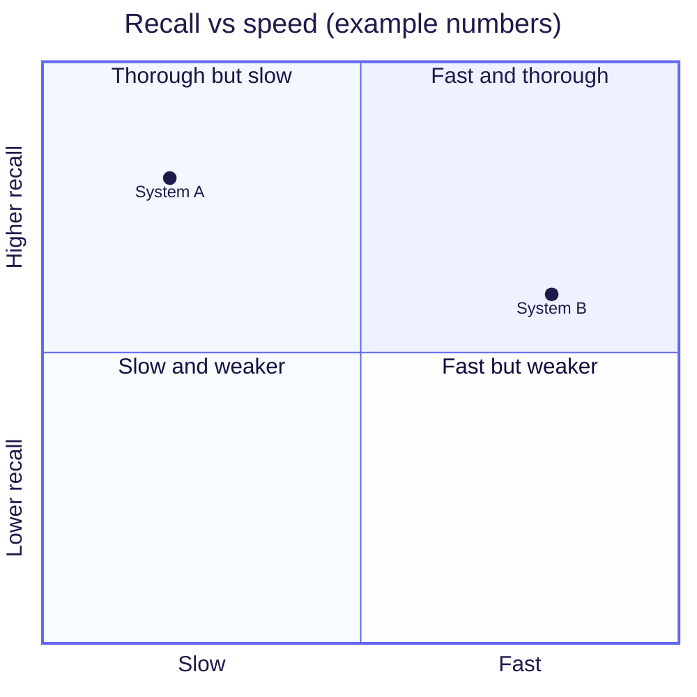

System A sits top left (higher recall, 5 s), System B to the right (slightly lower recall, 1 s). Which quadrant wins depends on the use case.

## 19. Reference-based evaluation

> [!TIP]
> **In simple words:** Reference-based needs an answer key. Reference-free grades without one.

Another major distinction:

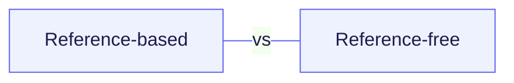

Reference-based evaluation has a ground-truth answer.

Example:

```text
Question:
How many leave days?

Reference answer:
24 days

Generated:
24 days
```

You compare generated output against expected output.

## 20. Reference-based retrieval evaluation

You might also have ground-truth chunks.

```python
{
    "question": "...",
    "relevant_chunk_ids": [
        "D123_C7",
        "D123_C8"
    ]
}
```

Then you can calculate:

```text
Recall@K
Precision@K
MRR
NDCG
```

This is generally the strongest way to evaluate retrieval.

## 21. Reference-free evaluation

Sometimes no perfect answer exists.

Example:

> Summarize the company's environmental obligations.

There may be many valid summaries.

You can instead evaluate:

```text
Is answer supported by context?
Is answer relevant?
Does it contain unsupported claims?
```

An LLM judge may inspect:

```text
question
context
generated answer
```

without a reference answer.

## 22. Reference-based vs reference-free

### Reference-based

Best when:

```text
clear expected answer exists
```

Advantages:

```text
more objective
reproducible
```

Disadvantages:

```text
expensive to create references
reference may itself be incomplete
```

### Reference-free

Useful for:

```text
open-ended answers
```

Advantages:

```text
scalable
does not need gold answer
```

Disadvantages:

```text
judge errors
bias
less objective
```

## 23. Human evaluation

Humans can assess:

```text
correctness
usefulness
clarity
faithfulness
completeness
```

Humans are particularly useful for difficult domain cases.

Example rubric:

```text
Score 1:
Incorrect

Score 2:
Partially correct

Score 3:
Mostly correct

Score 4:
Fully correct
```

## 24. Why human evaluation is valuable

Some things are hard to capture automatically.

For example:

```text
Answer A:
Technically correct but confusing.

Answer B:
Correct, concise and actionable.
```

Automated metrics may not fully distinguish them.

Humans can.

## 25. Human evaluation problems

It is:

```text
slow
expensive
hard to scale
subjective
```

Different evaluators may disagree.

Suppose:

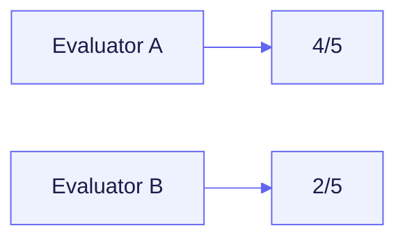

This leads to the concept of:

> inter-annotator agreement

You don't need to go deeply into Cohen's Kappa now, but know that human labels themselves can be noisy.

### Check in code (added): agreement between two annotators

Ten answers graded 1 to 4 by two people (example labels). Cohen's kappa corrects raw agreement for agreement by chance.

```python
from sklearn.metrics import cohen_kappa_score

annotator_a = [4, 3, 4, 2, 1, 4, 3, 2, 4, 1]
annotator_b = [4, 3, 3, 2, 1, 4, 2, 2, 4, 2]

# Share of items with exactly the same grade
raw = sum(a == b for a, b in zip(annotator_a, annotator_b)) / len(annotator_a)

print(f"raw agreement = {raw:.2f}")
print(f"Cohen's kappa = {cohen_kappa_score(annotator_a, annotator_b):.2f}")
```

**Output**

```text
raw agreement = 0.70
Cohen's kappa = 0.59
```

## 26. Automated evaluation

Automated evaluation can use:

```text
exact match
token F1
retrieval metrics
semantic similarity
LLM-as-a-Judge
rule-based validators
```

Advantages:

```text
fast
cheap
repeatable
scalable
```

Best practice:

> Use automated evaluation broadly, then periodically validate it against human judgment.

## 27. Golden evaluation dataset

> [!TIP]
> **In simple words:** The golden set is your answer key. Without the chunk IDs you cannot tell retrieval and generation apart.

A **golden dataset** is one of the most important production assets for RAG.

It contains representative questions and trusted expected results.

Example:

```python
{
    "query_id": "Q001",
    "question": "How many annual leave days are provided?",
    "reference_answer": "24 days",
    "relevant_document_ids": [
        "employee_handbook"
    ],
    "relevant_chunk_ids": [
        "employee_handbook_C17"
    ]
}
```

## 28. Why do we need relevant chunk IDs?

Suppose final answer is wrong.

Without ground-truth chunks, you can only say:

```text
RAG failed.
```

With chunk labels:

```text
Correct chunk = C17
Retrieved Top-5 = C2, C8, C19, C31, C40
```

Now you know:

```text
retrieval failed
```

not generation.

This is extremely valuable.

## 29. Ideal evaluation record

For a strong RAG benchmark:

```python
{
    "question": "...",

    "reference_answer": "...",

    "relevant_document_ids": [
        "..."
    ],

    "relevant_chunk_ids": [
        "..."
    ],

    "category": "factual",

    "difficulty": "medium",

    "metadata": {
        "country": "Germany",
        "document_type": "regulation"
    }
}
```

Later you can slice evaluation results by category.

## 30. Why only question-answer pairs are not enough

Suppose dataset only contains:

```text
question
expected answer
```

You can evaluate final generation.

But you cannot directly know:

```text
Did retrieval work?
```

Therefore for RAG evaluation, ideally store:

```text
question
reference answer
relevant evidence
```

This is much stronger.

## 31. Relevance labels

Retrieval evaluation requires deciding:

> Which documents are relevant?

Simplest:

```text
1 = relevant
0 = irrelevant
```

This is **binary relevance**.

Example:

```text
D1 = 1
D2 = 0
D3 = 1
D4 = 0
```

## 32. Graded relevance

Sometimes documents are not simply relevant/irrelevant.

Example:

```text
3 = highly relevant
2 = relevant
1 = partially relevant
0 = irrelevant
```

For query:

> Explain the entire annual leave policy.

<table width="100%">
<thead><tr><th width="8%">Sr No</th><th width="24%">Document</th><th width="34%">Content</th><th width="34%">Grade</th></tr></thead>
<tbody>
<tr><td align="center">01</td><td>D1</td><td>complete policy</td><td>3</td></tr>
<tr><td align="center">02</td><td>D2</td><td>only leave duration</td><td>2</td></tr>
<tr><td align="center">03</td><td>D3</td><td>general HR benefits</td><td>1</td></tr>
<tr><td align="center">04</td><td>D4</td><td>cybersecurity</td><td>0</td></tr>
</tbody>
</table>

NDCG is particularly useful for graded relevance.

## 33. What does relevant actually mean?

This is surprisingly difficult.

Possible definitions:

```text
Topically related?
Contains the exact answer?
Provides necessary evidence?
Useful for generating answer?
```

For RAG, I recommend thinking in terms of:

> **Does this chunk provide evidence necessary or useful to answer the question correctly?**

This is stronger than mere semantic similarity.

## 34. Topic relevance vs answer relevance

Query:

> How many maternity leave weeks are provided?

Chunk A:

```text
Maternity leave is available for eligible employees.
```

Topically relevant:

```text
YES
```

Contains answer:

```text
NO
```

Chunk B:

```text
Eligible employees may receive up to 26 weeks.
```

Contains answer:

```text
YES
```

This distinction is fundamental for evaluating retrieval.

## 35. Evidence sufficiency

Sometimes one chunk is not enough.

Query:

> Which employees qualify and how much leave do they receive?

Chunk A:

```text
Employees with five years of service qualify.
```

Chunk B:

```text
Eligible employees receive 30 days.
```

Need both.

Relevant evidence set: $R_q=\{A,B\}$

Retrieval evaluation should recognize multi-chunk requirements.

This becomes important for Recall@K.

## 36. Multi-hop evaluation

Example question:

> Which environmental obligations apply to companies that exceed threshold X?

Answer requires:

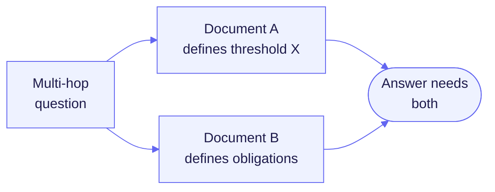

Retrieval must discover multiple evidence sources.

This is more complex than single-hit retrieval.

Later, synthetic evaluation datasets should include these cases.

## 37. Query categories

A golden set should include multiple kinds of queries.

For example:

```text
Factual
Definition
Comparison
Multi-hop
Numerical
Temporal
Identifier lookup
Summarization
Unanswerable
Ambiguous
```

Why?

Because a system can be strong on:

```text
simple factual questions
```

but weak on:

```text
multi-hop questions
```

A single average score hides this.

## 38. Slice-based evaluation

> [!TIP]
> **In simple words:** Do not trust one average. Score each kind of question separately to see where the system is weak.

Instead of:

```text
Overall accuracy = 85%
```

look at:

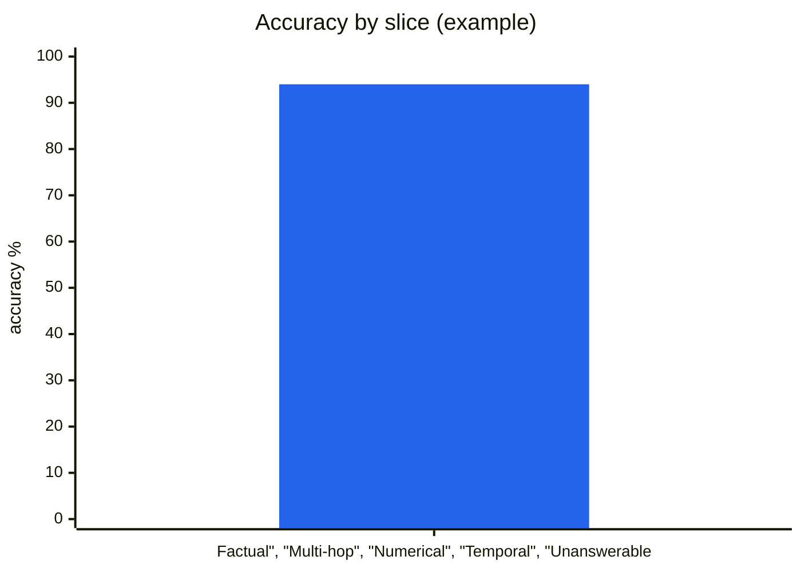

Now you know exactly where to improve.

This is called:

> **evaluation slicing**

Very important in production.

### Hands-on (added): slices on the golden set

```python
# Recall@3 per category and retriever (answerable questions only)
categories = []
for item in golden:
    if item["relevant_chunk_ids"] and item["category"] not in categories:
        categories.append(item["category"])

for category in categories:
    ids = [i["query_id"] for i in golden if i["category"] == category and i["relevant_chunk_ids"]]
    dense = np.mean([results["dense"][q][2] for q in ids])
    sparse = np.mean([results["bm25"][q][2] for q in ids])
    print(f"{category:<11} n = {len(ids)}   dense Recall@3 = {dense:.2f}   BM25 Recall@3 = {sparse:.2f}")
```

**Output**

```text
factual     n = 3   dense Recall@3 = 1.00   BM25 Recall@3 = 0.67
multi-hop   n = 1   dense Recall@3 = 1.00   BM25 Recall@3 = 1.00
numerical   n = 2   dense Recall@3 = 1.00   BM25 Recall@3 = 0.50
exact ID    n = 1   dense Recall@3 = 1.00   BM25 Recall@3 = 1.00
paraphrase  n = 2   dense Recall@3 = 1.00   BM25 Recall@3 = 0.50
```

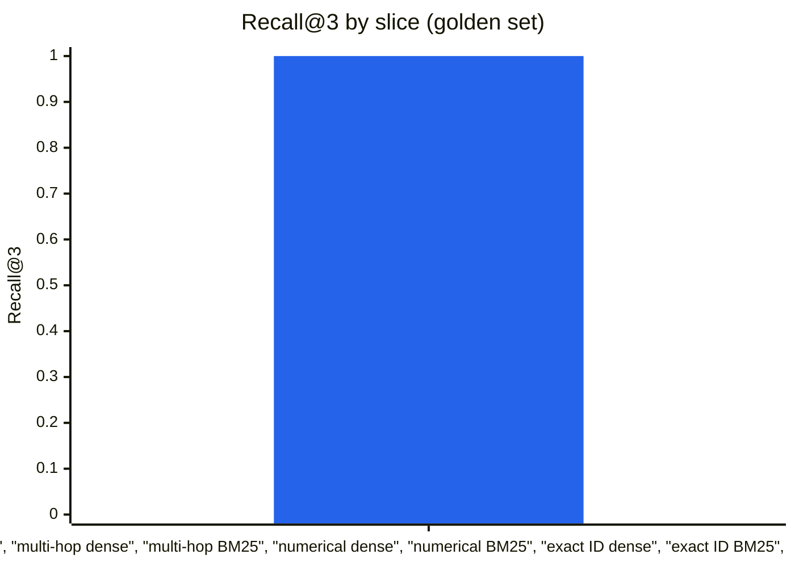

The BM25 average hides where it fails: numerical, paraphrase and one factual question. Exact IDs and the multi-hop question are fine. With only 1 to 3 questions per slice, these are examples, not reliable estimates.

## 39. Dataset representativeness

Suppose your real traffic is:

```text
40% regulatory obligations
30% definitions
20% applicability
10% dates
```

But evaluation dataset is:

```text
90% definitions
10% everything else
```

Your evaluation score will be misleading.

The test set should resemble production usage.

## 40. Difficulty distribution

Also include:

```text
Easy
Medium
Hard
```

Example:

### Easy

```text
What is the effective date?
```

### Medium

```text
Which companies are affected?
```

### Hard

```text
Which obligations apply to private-sector manufacturers exceeding threshold X after amendment Y?
```

A system scoring 95% on easy queries may still be poor for real use.

## 41. Evaluation set size

No universal magic number.

During early development:

```text
50–100 carefully selected examples
```

can reveal major problems.

For serious benchmarking:

```text
hundreds or thousands
```

are better.

But:

> **100 high-quality representative examples can be more useful than 10,000 poor synthetic examples.**

### Calculator (added): how precise is a score from n questions?

```python
import math

# 95% margin of error for an accuracy of 85% measured on n questions
accuracy = 0.85
for n in [25, 50, 100, 200, 500, 1000]:
    margin = 1.96 * math.sqrt(accuracy * (1 - accuracy) / n)
    print(f"n = {n:>4}: 85% ± {margin * 100:.1f} points")
```

**Output**

```text
n =   25: 85% ± 14.0 points
n =   50: 85% ± 9.9 points
n =  100: 85% ± 7.0 points
n =  200: 85% ± 4.9 points
n =  500: 85% ± 3.1 points
n = 1000: 85% ± 2.2 points
```

```mermaid
%%{init: {'theme':'base','themeVariables':{'primaryColor':'#EEF2FF','primaryBorderColor':'#6366F1','primaryTextColor':'#1E1B4B','lineColor':'#6366F1','pie1':'#22C55E','pie2':'#F59E0B','pie3':'#EF4444','pie4':'#3B82F6','pie5':'#8B5CF6','xyChart':{'plotColorPalette':'#2563EB, #16A34A, #D97706, #DC2626, #7C3AED'}}}}%%
xychart-beta
    title "Margin of error at 85% accuracy"
    x-axis "questions n" ["25#quot;, #quot;50#quot;, #quot;100#quot;, #quot;200#quot;, #quot;500#quot;, #quot;1000"]
    y-axis "± points (95%)" 0 --> 15
    line [14.0, 9.9, 7.0, 4.9, 3.1, 2.2]
```

With 100 questions a 3-point improvement is inside the noise. Small sets find big problems; small differences need bigger sets.

## 42. Evaluation leakage

Suppose you repeatedly optimize the system on the same 100 questions.

Eventually you may accidentally overfit:

```text
prompts
retrieval thresholds
chunking
```

to those queries.

Then benchmark looks excellent but production does not improve.

Better split:

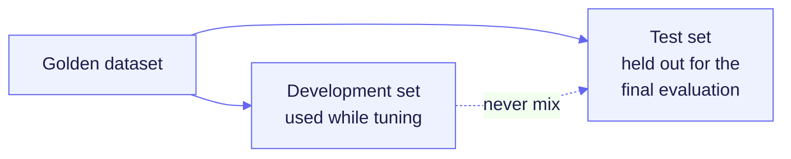

Same concept as machine-learning validation.

## 43. Baseline

Never evaluate a new system in isolation.

You need a baseline.

Example:

```text
Baseline:
Dense retrieval
Recall@5 = 83%
```

New:

```text
Hybrid + reranker
Recall@5 = 93%
```

Improvement: $+10$

percentage points.

Without baseline, "93%" has less meaning.

## 44. Controlled experiments

Suppose you change:

```text
embedding model
chunk size
Top K
prompt
reranker
```

at the same time.

Accuracy improves.

What caused it?

You don't know.

Instead:

```text
Experiment 1:
Change embedding only

Experiment 2:
Change chunking only

Experiment 3:
Add reranker
```

This is fundamental evaluation discipline.

## 45. Evaluation as scientific experimentation

Think:

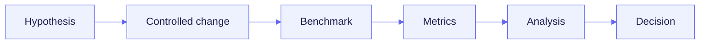

Example:

Hypothesis:

> Hybrid search improves exact legal identifier retrieval.

Experiment:

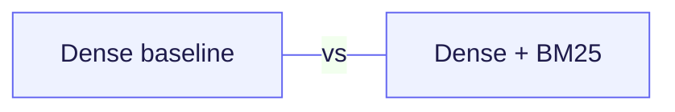

Measure exact-ID query slice.

That is much stronger than:

> "Hybrid search feels better."

## 46. Regression testing

> [!TIP]
> **In simple words:** Every change gets the same exam. If any important score drops below its limit, the change does not ship.

Suppose your production RAG has:

```text
Recall@5 = 91%
Faithfulness = 94%
```

You modify chunking.

New:

```text
Recall@5 = 94%
Faithfulness = 88%
```

Retrieval improved.

Generation grounding got worse.

Should you deploy?

Not automatically.

You need regression thresholds.

## 47. Example evaluation gates

Deployment rule:

```text
Recall@10 must not fall below 90%

Faithfulness must be >= 92%

P95 latency < 2 seconds

Cost/query < $0.04
```

A change that violates any important gate is rejected.

This turns evaluation into CI/CD quality control.

### Code (added): the gates as a check

```python
gates = {
    "recall_at_10": lambda v: v >= 0.90,
    "faithfulness": lambda v: v >= 0.92,
    "p95_latency_s": lambda v: v < 2.0,
    "cost_per_query": lambda v: v < 0.04,
}

candidate = {"recall_at_10": 0.95, "faithfulness": 0.88, "p95_latency_s": 1.7, "cost_per_query": 0.031}

# Every gate must pass before deployment
failed = [name for name, check in gates.items() if not check(candidate[name])]

print("failed gates:", failed or "none")
print("decision:", "reject" if failed else "deploy")
```

**Output**

```text
failed gates: ['faithfulness']
decision: reject
```

The chunking change from section 46 improves retrieval but fails the faithfulness gate, so it is rejected automatically.

## 48. RAG evaluation pipeline

Production architecture:

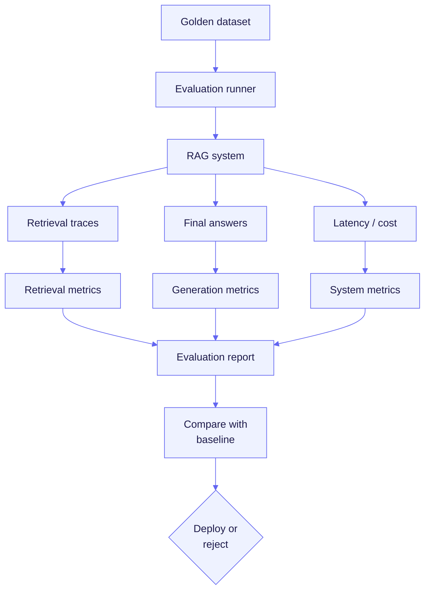

## 49. Diagnostic logging

To evaluate and debug properly, log each stage.

For one request:

```python
{
    "query": "...",

    "rewritten_query": "...",

    "retrieved_chunks": [
        {
            "chunk_id": "C13",
            "dense_score": 0.83,
            "bm25_score": 11.7
        }
    ],

    "reranked_chunks": [...],

    "final_context_chunk_ids": [...],

    "generated_answer": "...",

    "latency_ms": {...},

    "token_usage": {...}
}
```

Without traces, failure analysis becomes guesswork.

## 50. Why final answer logs alone aren't enough

Suppose you only store:

```text
Question
Answer
```

When answer is wrong, you can't determine:

```text
what did retrieval return?
what score?
which chunks reached LLM?
did query rewriting change intent?
did reranker remove evidence?
```

So evaluation requires observability.

## 51. Metric selection depends on use case

There is no universal best evaluation metric.

Example:

### FAQ bot

One correct chunk is enough.

Useful metric:

```text
Hit Rate@K
MRR
```

### Research assistant

Need multiple relevant sources.

Useful:

```text
Recall@K
NDCG
```

### Legal compliance

Missing one obligation can be serious.

Prioritize:

```text
high retrieval recall
context recall
answer completeness
faithfulness
```

### Search engine

Ranking quality is crucial.

```text
NDCG
MRR
```

## 52. Precision vs recall intuition

We'll derive these fully in Chapter 12.02.

For now:

### Precision

> Of what I retrieved, how much was useful?

### Recall

> Of all useful evidence that existed, how much did I retrieve?

For high-stakes RAG, missing relevant evidence can be worse than retrieving some extra evidence.

So retrieval stage may intentionally optimize high recall.

Then reranker increases precision.

## 53. Two-stage evaluation intuition

Typical architecture:

```mermaid
%%{init: {'theme':'base','themeVariables':{'primaryColor':'#EEF2FF','primaryBorderColor':'#6366F1','primaryTextColor':'#1E1B4B','lineColor':'#6366F1','pie1':'#22C55E','pie2':'#F59E0B','pie3':'#EF4444','pie4':'#3B82F6','pie5':'#8B5CF6','xyChart':{'plotColorPalette':'#2563EB, #16A34A, #D97706, #DC2626, #7C3AED'}}}}%%
flowchart LR
    Q["Query"] --> R["Retriever<br/>Top 50"] -->|"aim: high recall"| RR["Reranker<br/>Top 5"] -->|"aim: high precision"| L["LLM"]
```

Evaluate both stages separately.

Example:

```text
Retriever Recall@50 = 97%

Reranker Recall@5 = 91%
```

If final retrieval is poor, you can see where loss happened.

## 54. ANN recall is not the same as semantic Recall@K

This is an advanced but important distinction.

Suppose exact vector search says true nearest neighbors are:

```text
A B C D E
```

HNSW returns:

```text
A B C D F
```

ANN recall: $4/5=80\%$

This measures:

> How accurately ANN approximates exact vector search.

But semantic retrieval Recall@K measures:

> Did we retrieve the human-labeled relevant evidence?

Different metrics.

<p align="center">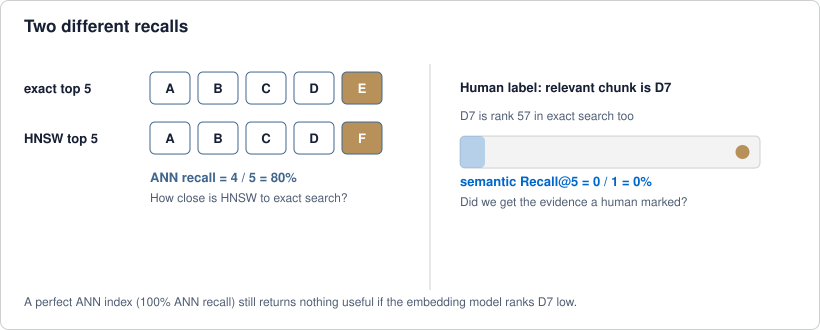</p>

A perfect ANN index can still have terrible semantic retrieval if the embedding model is bad.

## 55. Example

Embedding model ranks:

```text
Irrelevant D10 = #1
Relevant D7    = #57
```

Exact search returns exactly that ranking.

ANN recall:

```text
100%
```

Semantic Recall@5:

```text
0%
```

So:

```math
\text{ANN quality} \neq \text{retrieval relevance}
```

Very important interview point.

### Check in code (added): the two recalls

```python
exact_top5 = ["A", "B", "C", "D", "E"]
hnsw_top5 = ["A", "B", "C", "D", "F"]

# ANN recall: overlap with exact search
ann_recall = len(set(exact_top5) & set(hnsw_top5)) / len(exact_top5)

# Semantic Recall@5: overlap with the human-labelled relevant chunks
relevant = {"D7"}
semantic_recall = len(relevant & set(hnsw_top5)) / len(relevant)

print(f"ANN recall@5      = {ann_recall:.0%}")
print(f"semantic Recall@5 = {semantic_recall:.0%}")
```

**Output**

```text
ANN recall@5      = 80%
semantic Recall@5 = 0%
```

## 56. Generation correctness vs faithfulness

Suppose context says:

```text
No information is provided about annual leave.
```

LLM answers:

```text
Employees receive 24 days.
```

Maybe 24 happens to be correct in reality.

Answer correctness:

```text
possibly correct
```

Faithfulness:

```text
bad
```

because answer was unsupported by retrieved context.

## 57. Opposite case

Context:

```text
The outdated policy states employees receive 20 days.
```

LLM answers:

```text
Employees receive 20 days.
```

Faithfulness:

```text
excellent
```

Correctness relative to current truth:

```text
wrong
```

Therefore:

```math
\text{Correctness} \neq \text{Faithfulness}
```

This will become central in Chapter 12.08.

## 58. Context quality vs answer quality

Think of evaluation layers:

```mermaid
%%{init: {'theme':'base','themeVariables':{'primaryColor':'#EEF2FF','primaryBorderColor':'#6366F1','primaryTextColor':'#1E1B4B','lineColor':'#6366F1','pie1':'#22C55E','pie2':'#F59E0B','pie3':'#EF4444','pie4':'#3B82F6','pie5':'#8B5CF6','xyChart':{'plotColorPalette':'#2563EB, #16A34A, #D97706, #DC2626, #7C3AED'}}}}%%
flowchart TB
    Q["Question"] --> C["Retrieved context"] --> A["Generated answer"]
    C --- C1["Relevant?<br/>Complete?<br/>Precise?"]
    A --- A1["Correct?<br/>Relevant?<br/>Faithful?<br/>Complete?"]
```

Do not collapse these into one score.

## 59. Unanswerable questions

A good evaluation dataset must contain questions where the corpus **does not contain the answer**.

Example:

```text
What is the CEO's favorite food?
```

No evidence exists.

Correct behavior:

```text
The provided sources do not contain this information.
```

A RAG system that invents an answer fails.

This evaluates:

```text
abstention
```

## 60. Why unanswerable evaluation matters

If every test question is answerable, you never test whether the model knows when to stop.

Production users will ask out-of-scope questions.

So evaluate both:

```text
answerable queries
unanswerable queries
```

## 61. Adversarial evaluation

Include difficult cases.

Examples:

### Contradiction

```text
Old document says 20.
New document says 24.
```

### Numerical precision

```text
0.01% vs 0.1%
```

### Negation

```mermaid
%%{init: {'theme':'base','themeVariables':{'primaryColor':'#EEF2FF','primaryBorderColor':'#6366F1','primaryTextColor':'#1E1B4B','lineColor':'#6366F1','pie1':'#22C55E','pie2':'#F59E0B','pie3':'#EF4444','pie4':'#3B82F6','pie5':'#8B5CF6','xyChart':{'plotColorPalette':'#2563EB, #16A34A, #D97706, #DC2626, #7C3AED'}}}}%%
flowchart LR
    n0["must"] ---|"vs"| n1["must not"]
```

### Exact ID

```text
Article 7(2)(a)
```

### Temporal

```text
What applied in 2025?
```

These expose weaknesses hidden by ordinary questions.

## 62. End-to-end success criteria

A production query may be considered successful only if:

```mermaid
%%{init: {'theme':'base','themeVariables':{'primaryColor':'#EEF2FF','primaryBorderColor':'#6366F1','primaryTextColor':'#1E1B4B','lineColor':'#6366F1','pie1':'#22C55E','pie2':'#F59E0B','pie3':'#EF4444','pie4':'#3B82F6','pie5':'#8B5CF6','xyChart':{'plotColorPalette':'#2563EB, #16A34A, #D97706, #DC2626, #7C3AED'}}}}%%
flowchart LR
    R["R: correct evidence<br/>retrieved"] -->|"AND"| G["G: correct answer<br/>generated"] -->|"AND"| F["F: answer<br/>grounded"] -->|"AND"| C["C: citation<br/>correct"] -->|"AND"| L["L: latency<br/>acceptable"] --> S(["Success"])
    style S fill:#DCFCE7,stroke:#16A34A
```

Conceptually:

```math
\text{Success} = R \land G \land F \land C \land L
```

This is a stricter and more realistic definition than simple answer accuracy.

## 63. Evaluation dashboard

A strong RAG dashboard might show:

<table width="100%">
<thead><tr><th width="8%">Sr No</th><th width="24%">Area</th><th width="34%">Metric</th><th width="34%">Value</th></tr></thead>
<tbody>
<tr><td align="center">01</td><td>Retrieval</td><td>Recall@5</td><td>89%</td></tr>
<tr><td align="center">02</td><td>Retrieval</td><td>Recall@20</td><td>97%</td></tr>
<tr><td align="center">03</td><td>Retrieval</td><td>MRR</td><td>0.84</td></tr>
<tr><td align="center">04</td><td>Retrieval</td><td>NDCG@10</td><td>0.90</td></tr>
<tr><td align="center">05</td><td>Generation</td><td>Correctness</td><td>87%</td></tr>
<tr><td align="center">06</td><td>Generation</td><td>Faithfulness</td><td>94%</td></tr>
<tr><td align="center">07</td><td>Generation</td><td>Answer relevance</td><td>92%</td></tr>
<tr><td align="center">08</td><td>System</td><td>P50 latency</td><td>1.1 s</td></tr>
<tr><td align="center">09</td><td>System</td><td>P95 latency</td><td>2.4 s</td></tr>
<tr><td align="center">10</td><td>System</td><td>Cost per query</td><td>$0.021</td></tr>
<tr><td align="center">11</td><td>Slices</td><td>Numerical</td><td>71%</td></tr>
<tr><td align="center">12</td><td>Slices</td><td>Temporal</td><td>68%</td></tr>
<tr><td align="center">13</td><td>Slices</td><td>Multi-hop</td><td>76%</td></tr>
<tr><td align="center">14</td><td>Slices</td><td>Factual</td><td>94%</td></tr>
</tbody>
</table>

Now you understand the system.

A single:

```text
Accuracy = 87%
```

would hide most of this.

## 64. Core production principle

You should think of RAG evaluation as:

```math
\boxed{ \text{Evaluation} = \text{Measurement} + \text{Diagnosis} + \text{Experimentation} }
```

### Measurement

How good is the system?

### Diagnosis

Why did it fail?

### Experimentation

Did the new change improve it?

All three matter.

## 65. Interview question — Why is RAG evaluation difficult?

Strong answer:

> RAG evaluation is difficult because the final answer depends on multiple independently fallible components such as ingestion, chunking, retrieval, reranking, context construction and generation. End-to-end answer correctness alone cannot identify which stage caused a failure, so a robust evaluation framework needs stage-level retrieval metrics, generation metrics and end-to-end metrics.

## 66. Interview question — Offline vs online evaluation?

> Offline evaluation uses a fixed benchmark or golden dataset and is useful for repeatable development experiments and regression testing. Online evaluation measures real production behavior through signals such as user feedback, task completion or A/B tests. Offline evaluation provides control, while online evaluation validates real-world impact; strong systems use both.

## 67. Interview question — What should a RAG golden dataset contain?

Strong answer:

> Ideally each example contains the user query, a trusted reference answer where applicable, ground-truth relevant documents or chunks, and useful metadata such as query type, difficulty and domain. Ground-truth evidence is especially important because it lets us distinguish retrieval failure from generation failure.

## 68. Interview question — Why isn't final-answer accuracy sufficient?

> Two systems can have the same end-to-end accuracy for completely different reasons. One may retrieve evidence reliably but have a weak generator, while another may have a strong generator but frequently fail retrieval. Stage-level evaluation tells us where to invest engineering effort.

## 69. Interview question — Reference-based vs reference-free?

> Reference-based evaluation compares against trusted ground truth and is generally more objective, but requires expensive labeled data. Reference-free evaluation judges properties such as faithfulness or relevance directly from the question, context and generated answer, often using an LLM judge. It's more scalable but inherits judge bias and uncertainty.

## 70. Interview question — Human vs automated evaluation?

> Human evaluation is useful for subjective or complex quality judgments but is slow, expensive and can have annotator disagreement. Automated metrics are scalable and repeatable, so they are useful for continuous regression testing. In practice I would automate broad evaluation and periodically calibrate automated metrics against expert human labels.

## 71. Interview question — What does relevance mean in retrieval evaluation?

A strong answer:

> For RAG, I would define a relevant chunk as one that supplies evidence necessary or useful for correctly answering the query, rather than merely being topically similar. This distinction matters because a chunk can mention the same topic without containing the information the generator needs.

## 72. Interview question — How would you evaluate a new embedding model?

You should say:

```text
1. Keep chunking fixed.
2. Keep retrieval parameters fixed.
3. Use same golden dataset.
4. Re-index with each embedding model.
5. Compare Recall@K, MRR/NDCG as appropriate.
6. Compare latency/storage/cost.
7. Run downstream generation evaluation.
8. Slice results by query type.
```

This is a strong Applied AI answer.

## 73. Interview question — How do you know whether a wrong answer was retrieval or generation failure?

> First inspect whether the ground-truth evidence was available and correctly parsed. Then check whether it was retrieved and survived reranking/context construction. If the correct evidence reached the LLM but the answer is still wrong, it's primarily a generation failure; if the evidence never reached the model, it's a retrieval or upstream pipeline failure.

## 74. Common evaluation mistakes

### Mistake 1

Only evaluate final answers.

### Mistake 2

Use only easy questions.

### Mistake 3

No ground-truth evidence labels.

### Mistake 4

Tune on the same dataset used for final reporting.

### Mistake 5

Change multiple components simultaneously.

### Mistake 6

Report only average metrics.

### Mistake 7

Ignore latency and cost.

### Mistake 8

No unanswerable questions.

### Mistake 9

Treat semantic similarity as answer correctness.

### Mistake 10

Evaluate ANN recall and assume retrieval quality is good.

## 75. Evaluation maturity levels

A useful mental model:

```mermaid
%%{init: {'theme':'base','themeVariables':{'primaryColor':'#EEF2FF','primaryBorderColor':'#6366F1','primaryTextColor':'#1E1B4B','lineColor':'#6366F1','pie1':'#22C55E','pie2':'#F59E0B','pie3':'#EF4444','pie4':'#3B82F6','pie5':'#8B5CF6','xyChart':{'plotColorPalette':'#2563EB, #16A34A, #D97706, #DC2626, #7C3AED'}}}}%%
flowchart TB
    L0["Level 0<br/>It seems to work"] --> L1["Level 1<br/>Check a few<br/>examples manually"] --> L2["Level 2<br/>Golden Q&A dataset"]
    L2 --> L3["Level 3<br/>Retrieval and generation<br/>metrics separately"] --> L4["Level 4<br/>Slices and<br/>regression tests"] --> L5["Level 5<br/>Offline + online<br/>A/B evaluation"]
    L5 --> L6["Level 6<br/>Continuous production<br/>evaluation and feedback"]
    style L4 fill:#DCFCE7,stroke:#16A34A
    style L5 fill:#DCFCE7,stroke:#16A34A
    style L6 fill:#DCFCE7,stroke:#16A34A
```

For production RAG, aim toward Levels 4–6.

## 76. Chapter 12.01 core architecture

Memorize this:

```mermaid
%%{init: {'theme':'base','themeVariables':{'primaryColor':'#EEF2FF','primaryBorderColor':'#6366F1','primaryTextColor':'#1E1B4B','lineColor':'#6366F1','pie1':'#22C55E','pie2':'#F59E0B','pie3':'#EF4444','pie4':'#3B82F6','pie5':'#8B5CF6','xyChart':{'plotColorPalette':'#2563EB, #16A34A, #D97706, #DC2626, #7C3AED'}}}}%%
flowchart TB
    Q["Query"] --> I["Ingestion"] -->|"Was the source valid?"| C["Chunking"]
    C -->|"Was the evidence preserved?"| R["Retrieval"]
    R -->|"Was the evidence retrieved?"| RR["Reranking"]
    RR -->|"Was the evidence retained?"| CB["Context builder"]
    CB -->|"Did the LLM receive the evidence?"| G["Generation"]
    G -->|"Was the answer correct and grounded?"| U(["User"])
```

Evaluation should observe every important boundary.

## 77. The three evaluation layers to memorize

```math
\boxed{ \text{Retrieval} }
```

> Did we get the right evidence?

```math
\boxed{ \text{Generation} }
```

> Did we use the evidence correctly?

```math
\boxed{ \text{End-to-End} }
```

> Did the overall application successfully solve the user's problem?

If you remember nothing else from this chapter, remember these three layers.

## 78. Final revision sheet

### RAG evaluation is difficult because:

```text
many pipeline stages can independently fail
```

### Evaluation should separate:

```text
Retrieval
Generation
End-to-End
```

### Evaluation can be:

```text
Offline
Online
```

### Evaluation can use:

```text
Reference-based
Reference-free
```

### Evaluation can be performed by:

```text
Humans
Rules/metrics
LLM judges
```

### A strong golden dataset ideally contains:

```text
Query
Reference answer
Relevant documents
Relevant chunks
Category
Difficulty
```

### Important dataset qualities:

```text
Representative
Diverse
Includes hard cases
Includes unanswerable cases
Held-out test set
```

### Always evaluate slices:

```text
Factual
Numerical
Temporal
Multi-hop
Exact ID
Unanswerable
```

### Never optimize only:

```text
accuracy
```

Also track:

```text
latency
cost
faithfulness
retrieval coverage
```

### Most important debugging sequence:

```mermaid
%%{init: {'theme':'base','themeVariables':{'primaryColor':'#EEF2FF','primaryBorderColor':'#6366F1','primaryTextColor':'#1E1B4B','lineColor':'#6366F1','pie1':'#22C55E','pie2':'#F59E0B','pie3':'#EF4444','pie4':'#3B82F6','pie5':'#8B5CF6','xyChart':{'plotColorPalette':'#2563EB, #16A34A, #D97706, #DC2626, #7C3AED'}}}}%%
flowchart LR
    n0["Was source<br/>present?"] --> n1["Was it parsed?"] --> n2["Was it chunked?"] --> n3["Was it retrieved?"] --> n4["Was it reranked?"] --> n5["Did it reach LLM?"] --> n6["Did LLM use it<br/>correctly?"]
```

### Chapter 12.01 interview-ready definition

A compact answer worth memorizing:

> **RAG evaluation is the systematic measurement of retrieval quality, generation quality and end-to-end task success. Because a RAG answer depends on multiple stages, a good evaluation framework uses a representative golden dataset with ground-truth evidence, evaluates retrieval and generation independently, performs slice-based failure analysis, and combines offline regression testing with online production feedback.**

Next: **12.02 Precision at K and Recall at K** starts the mathematics. Precision and Recall are the base for Hit Rate, MRR, MAP, NDCG and reranker evaluation.

## 79. Practice Tasks

1. Add three new questions to the golden set: one temporal, one with negation and one more unanswerable.
2. Change the retrieval cut-off from Top 3 to Top 1 and recount the failing stages.
3. Rewrite the Q08 prompt so the model answers it, and check the other answers still pass.
4. Add a gate for the unanswerable slice: every unanswerable question must abstain.
5. Compute the margin of error for 92% accuracy on 300 questions.
6. Design five adversarial questions for your own documents using section 61.

## 80. Final Takeaways

```mermaid
%%{init: {'theme':'base','themeVariables':{'primaryColor':'#EEF2FF','primaryBorderColor':'#6366F1','primaryTextColor':'#1E1B4B','lineColor':'#6366F1','pie1':'#22C55E','pie2':'#F59E0B','pie3':'#EF4444','pie4':'#3B82F6','pie5':'#8B5CF6','xyChart':{'plotColorPalette':'#2563EB, #16A34A, #D97706, #DC2626, #7C3AED'}}}}%%
timeline
    title RAG evaluation fundamentals
    Decompose : retrieval, generation, end to end : find the failing stage
    Golden set : question, answer, chunk IDs : category and difficulty
    Measure : offline for control : online for real users
    Slices : one average hides weak spots : include unanswerable questions
    Discipline : baseline and one change at a time : regression gates before deploy
```

> [!TIP]
> **Study rule:** for any wrong answer, walk the chain in order: source present, parsed, chunked, retrieved, ranked, in the context, used correctly. The first "no" is the stage to fix.

<p align="center"><a href="../../../11.%20Context%20and%20Generation/05.%20Conversational%20RAG/README.md">Previous: 11.05 Conversational RAG</a> | <a href="../../../README.md">Home</a> | <a href="../../README.md">Group 12: Evaluation</a> | <a href="../README.md">Chapter page</a> | <a href="../../02.%20Precision%20at%20K%20and%20Recall%20at%20K/README.md">Next: 12.02 Precision at K and Recall at K</a></p>
