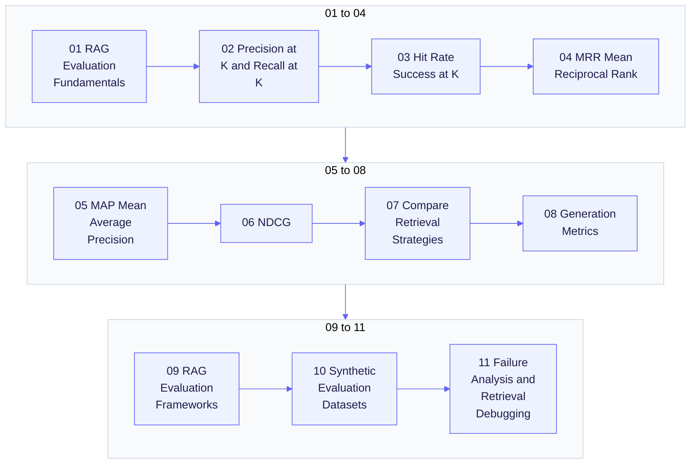

# 12 · Evaluation

 

**Measuring retrieval and generation, and finding where a wrong answer came from.**

<a href="../11.%20Context%20and%20Generation/README.md">Previous group: 11 Context and Generation</a> | <a href="../README.md">Home</a> | <a href="../13.%20Advanced%20RAG%20Architectures/README.md">Next group: 13 Advanced RAG Architectures</a>

## Learning flow

## Chapters

**Done** = notes + notebook · **Notebook** = notebook ready, notes coming · **Planned** = folder ready

<table width="100%">
<thead><tr><th width="6%">Sr&nbsp;No</th><th width="22%">Chapter</th><th width="46%">Key Concepts</th><th width="8%">Interview Priority</th><th width="6%">Notes</th><th width="6%">Notebook</th><th width="6%">Status</th></tr></thead>
<tbody>
<tr><td align="center">01</td><td><b>RAG Evaluation Fundamentals</b></td><td>Why evaluating RAG is hard; offline vs online evaluation; retrieval evaluation basics; Relevance labels, offline evaluation, metric selection</td><td align="center">Medium</td><td align="center">-</td><td align="center">-</td><td align="center">Planned</td></tr>
<tr><td align="center">02</td><td><b>Precision at K and Recall at K</b></td><td>Precision@K, Recall@K, worked examples; Precision@K, Recall@K, Hit rate, MRR, MAP, NDCG derived and computed by hand</td><td align="center">High</td><td align="center">-</td><td align="center">-</td><td align="center">Planned</td></tr>
<tr><td align="center">03</td><td><b>Hit Rate Success at K</b></td><td>Hit rate, Success@K, when a single hit is enough</td><td align="center">Medium</td><td align="center">-</td><td align="center">-</td><td align="center">Planned</td></tr>
<tr><td align="center">04</td><td><b>MRR Mean Reciprocal Rank</b></td><td>Reciprocal rank, MRR across queries</td><td align="center">High</td><td align="center">-</td><td align="center">-</td><td align="center">Planned</td></tr>
<tr><td align="center">05</td><td><b>MAP Mean Average Precision</b></td><td>Average precision, MAP across queries</td><td align="center">Medium</td><td align="center">-</td><td align="center">-</td><td align="center">Planned</td></tr>
<tr><td align="center">06</td><td><b>NDCG</b></td><td>Graded relevance, DCG, IDCG, NDCG@K</td><td align="center">High</td><td align="center">-</td><td align="center">-</td><td align="center">Planned</td></tr>
<tr><td align="center">07</td><td><b>Compare Retrieval Strategies</b></td><td>BM25 vs dense vs weighted vs RRF vs reranker on Recall, MRR, NDCG, latency, cost</td><td align="center">Medium</td><td align="center">-</td><td align="center">-</td><td align="center">Planned</td></tr>
<tr><td align="center">08</td><td><b>Generation Metrics</b></td><td>Faithfulness, groundedness, hallucination rate</td><td align="center">Medium</td><td align="center">-</td><td align="center">-</td><td align="center">Planned</td></tr>
<tr><td align="center">09</td><td><b>RAG Evaluation Frameworks</b></td><td>RAGAS, DeepEval, TruLens, LLM-as-a-judge</td><td align="center">Medium</td><td align="center">-</td><td align="center">-</td><td align="center">Planned</td></tr>
<tr><td align="center">10</td><td><b>Synthetic Evaluation Datasets</b></td><td>Generating ground truth, hard negatives, evaluation-set design</td><td align="center">Medium</td><td align="center">-</td><td align="center">-</td><td align="center">Planned</td></tr>
<tr><td align="center">11</td><td><b>Failure Analysis and Retrieval Debugging</b></td><td>Attributing a wrong answer to ingestion, retrieval or generation; retrieval debugging; Failure modes, diagnostic logging per stage, debugging retrieval</td><td align="center">High</td><td align="center">-</td><td align="center">-</td><td align="center">Planned</td></tr>
</tbody>
</table>
