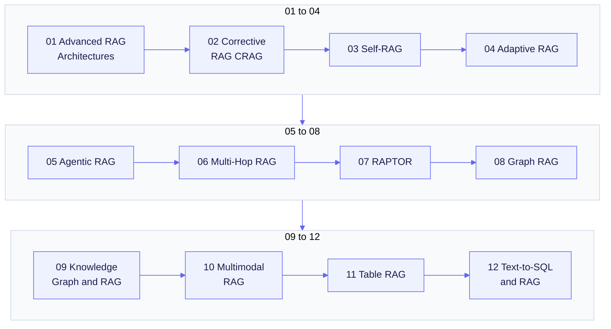

# 13 · Advanced RAG Architectures

 

**Corrective, self-reflective, agentic, graph, multimodal and structured-data RAG.**

<a href="../12.%20Evaluation/README.md">Previous group: 12 Evaluation</a> | <a href="../README.md">Home</a> | <a href="../14.%20Production%20RAG/README.md">Next group: 14 Production RAG</a>

## Learning flow

## Chapters

**Done** = notes + notebook · **Notebook** = notebook ready, notes coming · **Planned** = folder ready

<table width="100%">
<thead><tr><th width="6%">Sr&nbsp;No</th><th width="22%">Chapter</th><th width="46%">Key Concepts</th><th width="8%">Interview Priority</th><th width="6%">Notes</th><th width="6%">Notebook</th><th width="6%">Status</th></tr></thead>
<tbody>
<tr><td align="center">01</td><td><b>Advanced RAG Architectures</b></td><td>Naive vs advanced vs modular RAG, where each variant earns its complexity</td><td align="center">Medium</td><td align="center">-</td><td align="center">-</td><td align="center">Planned</td></tr>
<tr><td align="center">02</td><td><b>Corrective RAG CRAG</b></td><td>Relevance grading and web-search fallback when retrieval confidence is low</td><td align="center">Medium</td><td align="center">-</td><td align="center">-</td><td align="center">Planned</td></tr>
<tr><td align="center">03</td><td><b>Self-RAG</b></td><td>Reflection tokens: the model checking its own retrieval and output</td><td align="center">Medium</td><td align="center">-</td><td align="center">-</td><td align="center">Planned</td></tr>
<tr><td align="center">04</td><td><b>Adaptive RAG</b></td><td>Routing simple vs complex queries to different retrieval strategies</td><td align="center">Medium</td><td align="center">-</td><td align="center">-</td><td align="center">Planned</td></tr>
<tr><td align="center">05</td><td><b>Agentic RAG</b></td><td>Tool-calling retrievers, multi-hop reasoning, retry loops with LangGraph</td><td align="center">Medium</td><td align="center">-</td><td align="center">-</td><td align="center">Planned</td></tr>
<tr><td align="center">06</td><td><b>Multi-Hop RAG</b></td><td>Query decomposition and evidence chaining across documents</td><td align="center">Medium</td><td align="center">-</td><td align="center">-</td><td align="center">Planned</td></tr>
<tr><td align="center">07</td><td><b>RAPTOR</b></td><td>Recursive summarization trees for hierarchical retrieval</td><td align="center">Medium</td><td align="center">-</td><td align="center">-</td><td align="center">Planned</td></tr>
<tr><td align="center">08</td><td><b>Graph RAG</b></td><td>Knowledge graphs, community detection, local vs global search</td><td align="center">Medium</td><td align="center">-</td><td align="center">-</td><td align="center">Planned</td></tr>
<tr><td align="center">09</td><td><b>Knowledge Graph and RAG</b></td><td>Entity linking, Cypher/SPARQL, hybrid vector + graph retrieval</td><td align="center">Medium</td><td align="center">-</td><td align="center">-</td><td align="center">Planned</td></tr>
<tr><td align="center">10</td><td><b>Multimodal RAG</b></td><td>Text + images, CLIP-style embeddings, vision-language retrieval</td><td align="center">Medium</td><td align="center">-</td><td align="center">-</td><td align="center">Planned</td></tr>
<tr><td align="center">11</td><td><b>Table RAG</b></td><td>Why serialization alone fails on numeric tables, and what to do instead</td><td align="center">Medium</td><td align="center">-</td><td align="center">-</td><td align="center">Planned</td></tr>
<tr><td align="center">12</td><td><b>Text-to-SQL and RAG</b></td><td>Schema retrieval, SQL generation, grounding results back to natural language</td><td align="center">Medium</td><td align="center">-</td><td align="center">-</td><td align="center">Planned</td></tr>
</tbody>
</table>
