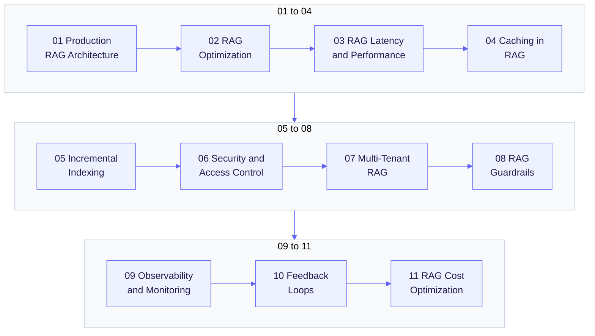

# 14 · Production RAG

 

**Running RAG for real users: architecture, speed, cost, security and monitoring.**

<a href="../13.%20Advanced%20RAG%20Architectures/README.md">Previous group: 13 Advanced RAG Architectures</a> | <a href="../README.md">Home</a> | <a href="../15.%20Frameworks%20System%20Design%20and%20Interviews/README.md">Next group: 15 Frameworks System Design and Interviews</a>

## Learning flow

## Chapters

**Done** = notes + notebook · **Notebook** = notebook ready, notes coming · **Planned** = folder ready

<table width="100%">
<thead><tr><th width="7%">Sr No</th><th width="25%">Chapter</th><th width="44%">Key Concepts</th><th width="8%">Notes</th><th width="8%">Notebook</th><th width="8%">Status</th></tr></thead>
<tbody>
<tr><td align="center">01</td><td><a href="01.%20Production%20RAG%20Architecture"><b>Production RAG Architecture</b></a></td><td>API layer, ingestion workers, retriever service, LLM gateway, production hybrid search; Services, async retrieval, caching, batching, timeouts, latency budget</td><td align="center">-</td><td align="center">-</td><td align="center">Planned</td></tr>
<tr><td align="center">02</td><td><a href="02.%20RAG%20Optimization"><b>RAG Optimization</b></a></td><td>Systematically tuning chunk size, top-K, thresholds and prompts</td><td align="center">-</td><td align="center">-</td><td align="center">Planned</td></tr>
<tr><td align="center">03</td><td><a href="03.%20RAG%20Latency%20and%20Performance"><b>RAG Latency and Performance</b></a></td><td>Where time goes in a RAG request, and how to cut it</td><td align="center">-</td><td align="center">-</td><td align="center">Planned</td></tr>
<tr><td align="center">04</td><td><a href="04.%20Caching%20in%20RAG"><b>Caching in RAG</b></a></td><td>Embedding, retrieval and semantic caches with Redis</td><td align="center">-</td><td align="center">-</td><td align="center">Planned</td></tr>
<tr><td align="center">05</td><td><a href="05.%20Incremental%20Indexing"><b>Incremental Indexing</b></a></td><td>Re-embedding only what changed, deduplication at scale</td><td align="center">-</td><td align="center">-</td><td align="center">Planned</td></tr>
<tr><td align="center">06</td><td><a href="06.%20Security%20and%20Access%20Control"><b>Security and Access Control</b></a></td><td>RBAC/ABAC, tenant isolation, why prompts aren't a security boundary</td><td align="center">-</td><td align="center">-</td><td align="center">Planned</td></tr>
<tr><td align="center">07</td><td><a href="07.%20Multi-Tenant%20RAG"><b>Multi-Tenant RAG</b></a></td><td>Shared vs isolated indexes, namespace design, cost trade-offs</td><td align="center">-</td><td align="center">-</td><td align="center">Planned</td></tr>
<tr><td align="center">08</td><td><a href="08.%20RAG%20Guardrails"><b>RAG Guardrails</b></a></td><td>Prompt injection detection, output validation, grounding checks</td><td align="center">-</td><td align="center">-</td><td align="center">Planned</td></tr>
<tr><td align="center">09</td><td><a href="09.%20Observability%20and%20Monitoring"><b>Observability and Monitoring</b></a></td><td>Tracing retrieval, tracking hallucination rate in production</td><td align="center">-</td><td align="center">-</td><td align="center">Planned</td></tr>
<tr><td align="center">10</td><td><a href="10.%20Feedback%20Loops"><b>Feedback Loops</b></a></td><td>Turning thumbs-down signals into hard negatives and better retrieval</td><td align="center">-</td><td align="center">-</td><td align="center">Planned</td></tr>
<tr><td align="center">11</td><td><a href="11.%20RAG%20Cost%20Optimization"><b>RAG Cost Optimization</b></a></td><td>Model routing, small-vs-large-model strategy, where the money goes</td><td align="center">-</td><td align="center">-</td><td align="center">Planned</td></tr>
</tbody>
</table>
