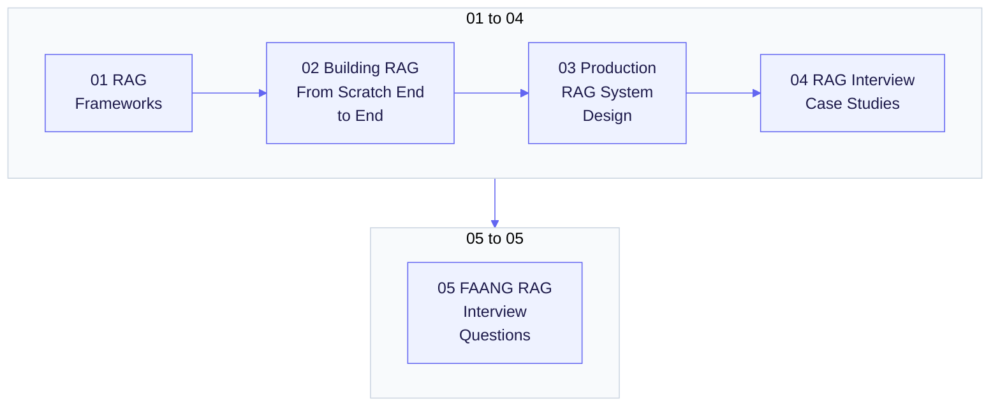

# 15 · Frameworks System Design and Interviews

 

**Frameworks, a full from-scratch build, system design and interview preparation.**

<a href="../14.%20Production%20RAG/README.md">Previous group: 14 Production RAG</a> | <a href="../README.md">Home</a> | <a href="../16.%20Projects/README.md">Next group: 16 Projects</a>

## Learning flow

## Chapters

**Done** = notes + notebook · **Notebook** = notebook ready, notes coming · **Planned** = folder ready

<table width="100%">
<thead><tr><th width="6%">Sr&nbsp;No</th><th width="22%">Chapter</th><th width="46%">Key Concepts</th><th width="8%">Interview Priority</th><th width="6%">Notes</th><th width="6%">Notebook</th><th width="6%">Status</th></tr></thead>
<tbody>
<tr><td align="center">01</td><td><b>RAG Frameworks</b></td><td>LangChain, LangGraph, LlamaIndex, Haystack, and when to skip all of them</td><td align="center">Medium</td><td align="center">-</td><td align="center">-</td><td align="center">Planned</td></tr>
<tr><td align="center">02</td><td><b>Building RAG From Scratch End to End</b></td><td>The entire pipeline with zero frameworks, end to end, including hybrid search; Full pipeline: BM25 + vector index, RRF, reranker, context builder, LLM answer</td><td align="center">Medium</td><td align="center">-</td><td align="center">-</td><td align="center">Planned</td></tr>
<tr><td align="center">03</td><td><b>Production RAG System Design</b></td><td>Designing for 100M chunks and thousands of concurrent users</td><td align="center">High</td><td align="center">-</td><td align="center">-</td><td align="center">Planned</td></tr>
<tr><td align="center">04</td><td><b>RAG Interview Case Studies</b></td><td>Legal, healthcare, financial and codebase RAG worked examples</td><td align="center">Medium</td><td align="center">-</td><td align="center">-</td><td align="center">Planned</td></tr>
<tr><td align="center">05</td><td><b>FAANG RAG Interview Questions</b></td><td>The questions interviewers ask, with model answers</td><td align="center">High</td><td align="center">-</td><td align="center">-</td><td align="center">Planned</td></tr>
</tbody>
</table>
