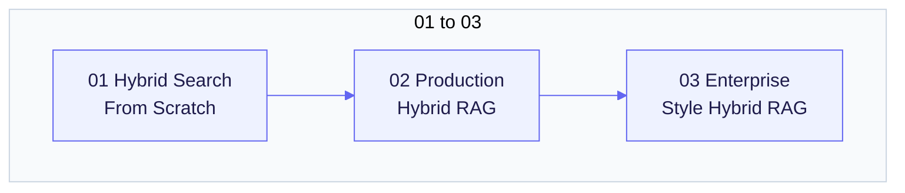

# 16 · Projects

 

**Three end-to-end hybrid RAG builds.**

<a href="../15.%20Frameworks%20System%20Design%20and%20Interviews/README.md">Previous group: 15 Frameworks System Design and Interviews</a> | <a href="../README.md">Home</a>

## Learning flow

## Chapters

**Done** = notes + notebook · **Notebook** = notebook ready, notes coming · **Planned** = folder ready

<table width="100%">
<thead><tr><th width="7%">Sr No</th><th width="25%">Chapter</th><th width="44%">Key Concepts</th><th width="8%">Notes</th><th width="8%">Notebook</th><th width="8%">Status</th></tr></thead>
<tbody>
<tr><td align="center">01</td><td><a href="01.%20Hybrid%20Search%20From%20Scratch"><b>Hybrid Search From Scratch</b></a></td><td>BM25 + dense + fusion + reranking + evaluation, no frameworks</td><td align="center">-</td><td align="center">-</td><td align="center">Planned</td></tr>
<tr><td align="center">02</td><td><a href="02.%20Production%20Hybrid%20RAG"><b>Production Hybrid RAG</b></a></td><td>Hybrid retrieval service with a vector DB, caching and an API</td><td align="center">-</td><td align="center">-</td><td align="center">Planned</td></tr>
<tr><td align="center">03</td><td><a href="03.%20Enterprise%20Style%20Hybrid%20RAG"><b>Enterprise Style Hybrid RAG</b></a></td><td>Metadata, access control, monitoring and evaluation at enterprise scale</td><td align="center">-</td><td align="center">-</td><td align="center">Planned</td></tr>
</tbody>
</table>
