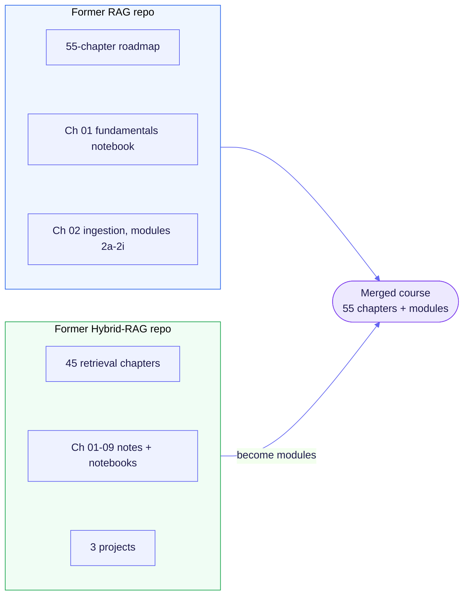
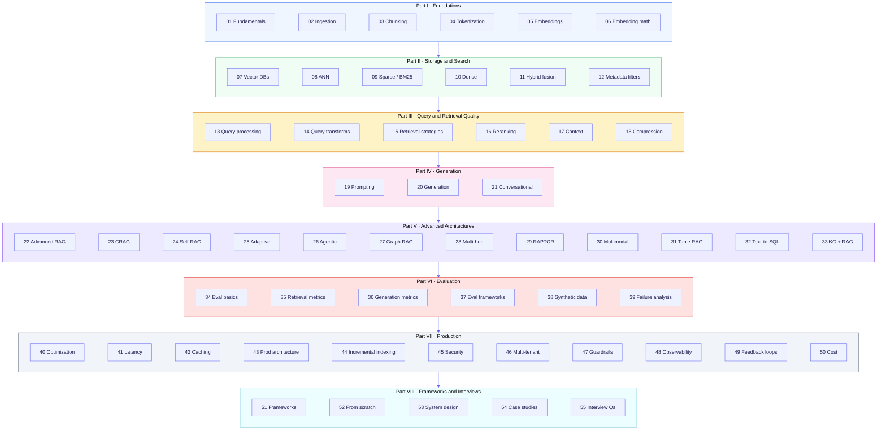

<div align="center">

# RAG · From Fundamentals to Hybrid Search and Production

   

**One course, two former repos: the broad RAG roadmap plus the deep Hybrid Search track, merged where they overlap.**

</div>

## How this course is organised

- **55 chapters** follow the RAG roadmap: foundations, storage and search, query quality, generation, advanced architectures, evaluation, production and interviews.
- **Modules** (`2a`, `9c`, `11f` ...) are deep-dive topics inside a chapter. The former Hybrid-RAG chapters now live here as modules, next to the RAG topics they overlap with.
- Each finished module has **Markdown notes** (`notes/`) with Mermaid diagrams, clean commented code and real outputs, plus the **original notebook** (`notebooks/`).
- RAG chapters 01-02 currently ship as **notebooks**; their Markdown notes come next.



## Setup (one time)

```bash
# Create and activate a virtual environment
python3 -m venv .venv
source .venv/bin/activate

# Install dependencies
pip install -r requirements.txt

# Add your API credentials, then edit .env
cp .env.example .env

# Launch Jupyter
jupyter lab
```

<table width="100%">
<thead><tr><th width="8%">Sr No</th><th width="22%">Purpose</th><th width="25%">Default model</th><th width="45%">Why this one</th></tr></thead>
<tbody>
<tr><td align="center">01</td><td>Embeddings (API)</td><td><code>text-embedding-3-small</code></td><td>1536 dimensions, cheap enough to embed everything</td></tr>
<tr><td align="center">02</td><td>Generation</td><td><code>gpt-4o-mini</code></td><td>Fast, cheap, strong enough to expose RAG failure modes clearly</td></tr>
<tr><td align="center">03</td><td>Embeddings (local)</td><td><code>all-MiniLM-L6-v2</code></td><td>384 dimensions, runs on a laptop CPU; used in the dense and similarity modules</td></tr>
</tbody>
</table>

## Roadmap



## Chapter index

Legend: **Done** = notes + notebook · **Notebook** = notebook ready, notes coming · **In progress** = some modules done · **Planned**

### Part I · Foundations

<table width="100%">
<thead><tr><th width="6%">Sr&nbsp;No</th><th width="22%">Topic Name</th><th width="40%">Key Concepts</th><th width="8%">Interview Priority</th><th width="6%">Notes</th><th width="6%">Notebook</th><th width="6%">Folder</th><th width="6%">Status</th></tr></thead>
<tbody>
<tr><td align="center">01</td><td><b>Chapter 01 · RAG Fundamentals</b></td><td>What RAG is and isn't, the two pipelines, cosine similarity from scratch, a naive RAG system built with no framework, the retrieval-vs-generation debugging split</td><td align="center">High</td><td align="center">Soon</td><td align="center"><a href="01.%20Rag%20fundamentals/01.%20Rag%20fundamentals.ipynb">Open</a></td><td align="center"><a href="01.%20Rag%20fundamentals">Open</a></td><td align="center">Notebook</td></tr>
<tr><td align="center">1a</td><td>&nbsp;&nbsp;&nbsp;1a · What is Hybrid Search RAG</td><td>RAG recap, retrieval pipeline, sparse vs dense limits, hybrid architecture, when to use hybrid</td><td align="center">Medium</td><td align="center"><a href="01.%20Rag%20fundamentals/1a.%20What%20is%20Hybrid%20Search%20RAG/notes/1a.%20What%20is%20Hybrid%20Search%20RAG.md">Read</a></td><td align="center"><a href="01.%20Rag%20fundamentals/1a.%20What%20is%20Hybrid%20Search%20RAG/notebooks/1a.%20What%20is%20Hybrid%20Search%20RAG.ipynb">Open</a></td><td align="center"><a href="01.%20Rag%20fundamentals/1a.%20What%20is%20Hybrid%20Search%20RAG">Open</a></td><td align="center">Done</td></tr>
<tr><td align="center">02</td><td><b>Chapter 02 · Documents, Data Sources and Ingestion</b></td><td>Why ingestion caps everything downstream, real PDF/OCR/DOCX parsing on real documents, metadata, dedup, versioning, incremental ingestion</td><td align="center">High</td><td align="center">Soon</td><td align="center"><a href="02.%20Documents%20data%20sources%20ingestion/02.%20Documents%20data%20sources%20ingestion.ipynb">Open</a></td><td align="center"><a href="02.%20Documents%20data%20sources%20ingestion">Open</a></td><td align="center">Notebook</td></tr>
<tr><td align="center">2a</td><td>&nbsp;&nbsp;&nbsp;2a · Why Ingestion Matters & The Canonical Document</td><td>The quality ceiling, ingestion ≠ chunking, canonical schema, `raw_text` vs `clean_text`, connectors</td><td align="center">High</td><td align="center">Soon</td><td align="center"><a href="02.%20Documents%20data%20sources%20ingestion/2a.%20Why%20ingestion%20and%20canonical%20documents/2a.%20Why%20ingestion%20and%20canonical%20documents.ipynb">Open</a></td><td align="center"><a href="02.%20Documents%20data%20sources%20ingestion/2a.%20Why%20ingestion%20and%20canonical%20documents">Open</a></td><td align="center">Notebook</td></tr>
<tr><td align="center">2b</td><td>&nbsp;&nbsp;&nbsp;2b · PDF Parsing</td><td>PDF is not a text format, page provenance, reading order, heading detection by font weight, what `get_text()` silently misses</td><td align="center">High</td><td align="center">Soon</td><td align="center"><a href="02.%20Documents%20data%20sources%20ingestion/2b.%20PDF%20parsing/2b.%20PDF%20parsing.ipynb">Open</a></td><td align="center"><a href="02.%20Documents%20data%20sources%20ingestion/2b.%20PDF%20parsing">Open</a></td><td align="center">Notebook</td></tr>
<tr><td align="center">2c</td><td>&nbsp;&nbsp;&nbsp;2c · OCR & Scanned Documents</td><td>Rendering to image, real Tesseract confidence scores, three-tier routing, character confusions, cost modelling</td><td align="center">High</td><td align="center">Soon</td><td align="center"><a href="02.%20Documents%20data%20sources%20ingestion/2c.%20OCR%20and%20scanned%20documents/2c.%20OCR%20and%20scanned%20documents.ipynb">Open</a></td><td align="center"><a href="02.%20Documents%20data%20sources%20ingestion/2c.%20OCR%20and%20scanned%20documents">Open</a></td><td align="center">Notebook</td></tr>
<tr><td align="center">2d</td><td>&nbsp;&nbsp;&nbsp;2d · DOCX, HTML & Markdown</td><td>Native structure extraction, heading context, boilerplate removal</td><td align="center">High</td><td align="center">Soon</td><td align="center"><a href="02.%20Documents%20data%20sources%20ingestion/2d.%20DOCX%20HTML%20and%20markdown/2d.%20DOCX%20HTML%20and%20markdown.ipynb">Open</a></td><td align="center"><a href="02.%20Documents%20data%20sources%20ingestion/2d.%20DOCX%20HTML%20and%20markdown">Open</a></td><td align="center">Notebook</td></tr>
<tr><td align="center">2e</td><td>&nbsp;&nbsp;&nbsp;2e · Structured Data: CSV, JSON, DB, API</td><td>What is one retrievable unit, row serialization, nested JSON, when not to embed, live APIs</td><td align="center">High</td><td align="center">Soon</td><td align="center"><a href="02.%20Documents%20data%20sources%20ingestion/2e.%20Structured%20data%20CSV%20JSON%20DB%20API/2e.%20Structured%20data%20CSV%20JSON%20DB%20API.ipynb">Open</a></td><td align="center"><a href="02.%20Documents%20data%20sources%20ingestion/2e.%20Structured%20data%20CSV%20JSON%20DB%20API">Open</a></td><td align="center">Notebook</td></tr>
<tr><td align="center">2f</td><td>&nbsp;&nbsp;&nbsp;2f · Metadata & Provenance</td><td>Six metadata categories, filtering precision, deterministic vs LLM extraction, citation chains</td><td align="center">High</td><td align="center">Soon</td><td align="center"><a href="02.%20Documents%20data%20sources%20ingestion/2f.%20Metadata%20and%20provenance/2f.%20Metadata%20and%20provenance.ipynb">Open</a></td><td align="center"><a href="02.%20Documents%20data%20sources%20ingestion/2f.%20Metadata%20and%20provenance">Open</a></td><td align="center">Notebook</td></tr>
<tr><td align="center">2g</td><td>&nbsp;&nbsp;&nbsp;2g · Cleaning & Normalization</td><td>Whitespace, line wrap, hyphenation, Unicode, header/footer detection on real pages, the over-cleaning trap</td><td align="center">High</td><td align="center">Soon</td><td align="center"><a href="02.%20Documents%20data%20sources%20ingestion/2g.%20Cleaning%20and%20normalization/2g.%20Cleaning%20and%20normalization.ipynb">Open</a></td><td align="center"><a href="02.%20Documents%20data%20sources%20ingestion/2g.%20Cleaning%20and%20normalization">Open</a></td><td align="center">Notebook</td></tr>
<tr><td align="center">2h</td><td>&nbsp;&nbsp;&nbsp;2h · Deduplication & Versioning</td><td>SHA-256, Jaccard similarity, MinHash/LSH at scale, effective vs publication date, amendments</td><td align="center">High</td><td align="center">Soon</td><td align="center"><a href="02.%20Documents%20data%20sources%20ingestion/2h.%20Deduplication%20and%20versioning/2h.%20Deduplication%20and%20versioning.ipynb">Open</a></td><td align="center"><a href="02.%20Documents%20data%20sources%20ingestion/2h.%20Deduplication%20and%20versioning">Open</a></td><td align="center">Notebook</td></tr>
<tr><td align="center">2i</td><td>&nbsp;&nbsp;&nbsp;2i · Incremental Ingestion</td><td>Change detection, deletion handling, stable IDs, idempotency, atomic replacement</td><td align="center">High</td><td align="center">Soon</td><td align="center"><a href="02.%20Documents%20data%20sources%20ingestion/2i.%20Incremental%20ingestion/2i.%20Incremental%20ingestion.ipynb">Open</a></td><td align="center"><a href="02.%20Documents%20data%20sources%20ingestion/2i.%20Incremental%20ingestion">Open</a></td><td align="center">Notebook</td></tr>
<tr><td align="center">2j</td><td>&nbsp;&nbsp;&nbsp;2j · Tables, Images & Special Formats</td><td>Table serialization, figures, PowerPoint, Excel, email, code, legal documents</td><td align="center">High</td><td align="center">Soon</td><td align="center">Soon</td><td align="center"><a href="02.%20Documents%20data%20sources%20ingestion/2j.%20Tables%20images%20and%20special%20formats">Open</a></td><td align="center">Planned</td></tr>
<tr><td align="center">2k</td><td>&nbsp;&nbsp;&nbsp;2k · Security & Access Control</td><td>Permissions travel with the document, ACL inheritance, PII handling</td><td align="center">High</td><td align="center">Soon</td><td align="center">Soon</td><td align="center"><a href="02.%20Documents%20data%20sources%20ingestion/2k.%20Security%20and%20access%20control">Open</a></td><td align="center">Planned</td></tr>
<tr><td align="center">2l</td><td>&nbsp;&nbsp;&nbsp;2l · Production Architecture</td><td>Three-layer storage, batch vs event-driven, backpressure, retries, dead-letter queues, cost</td><td align="center">High</td><td align="center">Soon</td><td align="center">Soon</td><td align="center"><a href="02.%20Documents%20data%20sources%20ingestion/2l.%20Production%20architecture">Open</a></td><td align="center">Planned</td></tr>
<tr><td align="center">2m</td><td>&nbsp;&nbsp;&nbsp;2m · Validation & Observability</td><td>Pre-chunking validation, anomaly detection, metrics, golden document sets, parser benchmarking</td><td align="center">High</td><td align="center">Soon</td><td align="center">Soon</td><td align="center"><a href="02.%20Documents%20data%20sources%20ingestion/2m.%20Validation%20and%20observability">Open</a></td><td align="center">Planned</td></tr>
<tr><td align="center">2n</td><td>&nbsp;&nbsp;&nbsp;2n · End-to-End Pipeline</td><td>Anti-patterns, the debugging ladder, interview preparation</td><td align="center">High</td><td align="center">Soon</td><td align="center">Soon</td><td align="center"><a href="02.%20Documents%20data%20sources%20ingestion/2n.%20End%20to%20end%20pipeline">Open</a></td><td align="center">Planned</td></tr>
<tr><td align="center">03</td><td><b>Chapter 03 · Document Chunking</b></td><td>Why chunk size and overlap decide retrieval quality; fixed, semantic, recursive and structure-aware chunking</td><td align="center">High</td><td align="center">-</td><td align="center">-</td><td align="center"><a href="03.%20Document%20Chunking">Open</a></td><td align="center">Planned</td></tr>
<tr><td align="center">3a</td><td>&nbsp;&nbsp;&nbsp;3a · Chunking for Hybrid Search</td><td>Fixed, recursive, semantic, paragraph, sliding-window, parent-child chunking</td><td align="center">High</td><td align="center">Soon</td><td align="center">Soon</td><td align="center"><a href="03.%20Document%20Chunking/3a.%20Chunking%20for%20Hybrid%20Search">Open</a></td><td align="center">Planned</td></tr>
<tr><td align="center">04</td><td><b>Chapter 04 · Tokens and Tokenization</b></td><td>BPE/WordPiece/SentencePiece, token-budget math, how tokenization silently breaks retrieval on non-English text</td><td align="center">Medium</td><td align="center">-</td><td align="center">-</td><td align="center"><a href="04.%20Tokens%20and%20Tokenization">Open</a></td><td align="center">Planned</td></tr>
<tr><td align="center">05</td><td><b>Chapter 05 · Embeddings Fundamentals</b></td><td>Dense vectors, model selection, domain-specific and multilingual embeddings</td><td align="center">High</td><td align="center">-</td><td align="center">-</td><td align="center"><a href="05.%20Embeddings%20Fundamentals">Open</a></td><td align="center">Planned</td></tr>
<tr><td align="center">06</td><td><b>Chapter 06 · Embedding Mathematics</b></td><td>Vector spaces, distance metrics, the curse of dimensionality</td><td align="center">Medium</td><td align="center">-</td><td align="center">-</td><td align="center"><a href="06.%20Embedding%20Mathematics">Open</a></td><td align="center">Done</td></tr>
<tr><td align="center">6a</td><td>&nbsp;&nbsp;&nbsp;6a · Similarity Metrics for Dense Search</td><td>Cosine similarity, dot product, Euclidean distance, normalization effects</td><td align="center">Medium</td><td align="center"><a href="06.%20Embedding%20Mathematics/6a.%20Similarity%20Metrics%20for%20Dense%20Search/notes/6a.%20Similarity%20Metrics%20for%20Dense%20Search.md">Read</a></td><td align="center">Not yet</td><td align="center"><a href="06.%20Embedding%20Mathematics/6a.%20Similarity%20Metrics%20for%20Dense%20Search">Open</a></td><td align="center">Done</td></tr>
</tbody>
</table>

### Part II · Storage and Search

<table width="100%">
<thead><tr><th width="6%">Sr&nbsp;No</th><th width="22%">Topic Name</th><th width="40%">Key Concepts</th><th width="8%">Interview Priority</th><th width="6%">Notes</th><th width="6%">Notebook</th><th width="6%">Folder</th><th width="6%">Status</th></tr></thead>
<tbody>
<tr><td align="center">07</td><td><b>Chapter 07 · Vector Databases</b></td><td>FAISS, Milvus, Pinecone, Qdrant, pgvector: when each one fits</td><td align="center">Medium</td><td align="center">-</td><td align="center">-</td><td align="center"><a href="07.%20Vector%20Databases">Open</a></td><td align="center">Planned</td></tr>
<tr><td align="center">08</td><td><b>Chapter 08 · Approximate Nearest Neighbor Search</b></td><td>HNSW, IVF, product quantization, the recall-vs-latency trade-off</td><td align="center">High</td><td align="center">-</td><td align="center">-</td><td align="center"><a href="08.%20Approximate%20Nearest%20Neighbor%20Search">Open</a></td><td align="center">In progress</td></tr>
<tr><td align="center">8a</td><td>&nbsp;&nbsp;&nbsp;8a · Approximate Nearest Neighbor Search</td><td>Exact vs approximate nearest neighbor, recall vs latency, vector databases</td><td align="center">Medium</td><td align="center"><a href="08.%20Approximate%20Nearest%20Neighbor%20Search/8a.%20Approximate%20Nearest%20Neighbor%20Search/notes/8a.%20Approximate%20Nearest%20Neighbor%20Search.md">Read</a></td><td align="center">Not yet</td><td align="center"><a href="08.%20Approximate%20Nearest%20Neighbor%20Search/8a.%20Approximate%20Nearest%20Neighbor%20Search">Open</a></td><td align="center">Done</td></tr>
<tr><td align="center">8b</td><td>&nbsp;&nbsp;&nbsp;8b · HNSW Fundamentals</td><td>HNSW graph layers, M, efConstruction, efSearch, recall and speed trade-offs</td><td align="center">Medium</td><td align="center">Soon</td><td align="center">Soon</td><td align="center"><a href="08.%20Approximate%20Nearest%20Neighbor%20Search/8b.%20HNSW%20Fundamentals">Open</a></td><td align="center">Planned</td></tr>
<tr><td align="center">8c</td><td>&nbsp;&nbsp;&nbsp;8c · IVF-Flat and PQ Indexes</td><td>IVF clustering, nlist and nprobe, flat search, product quantization, memory vs accuracy</td><td align="center">Medium</td><td align="center">Soon</td><td align="center">Soon</td><td align="center"><a href="08.%20Approximate%20Nearest%20Neighbor%20Search/8c.%20IVF-Flat%20and%20PQ%20Indexes">Open</a></td><td align="center">Planned</td></tr>
<tr><td align="center">09</td><td><b>Chapter 09 · Sparse Retrieval and Keyword Search</b></td><td>Lexical vs semantic, inverted indexes, TF-IDF, BM25 from first principles, learned sparse retrieval</td><td align="center">High</td><td align="center">-</td><td align="center">-</td><td align="center"><a href="09.%20Sparse%20Retrieval%20and%20Keyword%20Search">Open</a></td><td align="center">In progress</td></tr>
<tr><td align="center">9a</td><td>&nbsp;&nbsp;&nbsp;9a · Lexical vs Semantic Retrieval</td><td>Exact keyword match, semantic similarity, vocabulary mismatch, synonyms, acronyms, IDs, numbers, negation</td><td align="center">Medium</td><td align="center"><a href="09.%20Sparse%20Retrieval%20and%20Keyword%20Search/9a.%20Lexical%20vs%20Semantic%20Retrieval/notes/9a.%20Lexical%20vs%20Semantic%20Retrieval.md">Read</a></td><td align="center"><a href="09.%20Sparse%20Retrieval%20and%20Keyword%20Search/9a.%20Lexical%20vs%20Semantic%20Retrieval/notebooks/9a.%20Lexical%20vs%20Semantic%20Retrieval.ipynb">Open</a></td><td align="center"><a href="09.%20Sparse%20Retrieval%20and%20Keyword%20Search/9a.%20Lexical%20vs%20Semantic%20Retrieval">Open</a></td><td align="center">Done</td></tr>
<tr><td align="center">9b</td><td>&nbsp;&nbsp;&nbsp;9b · Inverted Index Fundamentals</td><td>Forward vs inverted index, posting lists, TF, DF, Boolean AND/OR, phrase search, tokenization, stemming</td><td align="center">Medium</td><td align="center"><a href="09.%20Sparse%20Retrieval%20and%20Keyword%20Search/9b.%20Inverted%20Index%20Fundamentals/notes/9b.%20Inverted%20Index%20Fundamentals.md">Read</a></td><td align="center"><a href="09.%20Sparse%20Retrieval%20and%20Keyword%20Search/9b.%20Inverted%20Index%20Fundamentals/notebooks/9b.%20Inverted%20Index%20Fundamentals.ipynb">Open</a></td><td align="center"><a href="09.%20Sparse%20Retrieval%20and%20Keyword%20Search/9b.%20Inverted%20Index%20Fundamentals">Open</a></td><td align="center">Done</td></tr>
<tr><td align="center">9c</td><td>&nbsp;&nbsp;&nbsp;9c · TF-IDF</td><td>TF variants, DF, IDF, TF-IDF formula, sparse matrix, cosine ranking, OOV and synonym limits</td><td align="center">Medium</td><td align="center"><a href="09.%20Sparse%20Retrieval%20and%20Keyword%20Search/9c.%20TF-IDF/notes/9c.%20TF-IDF.md">Read</a></td><td align="center"><a href="09.%20Sparse%20Retrieval%20and%20Keyword%20Search/9c.%20TF-IDF/notebooks/9c.%20TF-IDF.ipynb">Open</a></td><td align="center"><a href="09.%20Sparse%20Retrieval%20and%20Keyword%20Search/9c.%20TF-IDF">Open</a></td><td align="center">Done</td></tr>
<tr><td align="center">9d</td><td>&nbsp;&nbsp;&nbsp;9d · BM25</td><td>BM25 formula, BM25 IDF, TF saturation (k1), length normalization (b), BM25 vs TF-IDF</td><td align="center">High</td><td align="center"><a href="09.%20Sparse%20Retrieval%20and%20Keyword%20Search/9d.%20BM25/notes/9d.%20BM25.md">Read</a></td><td align="center"><a href="09.%20Sparse%20Retrieval%20and%20Keyword%20Search/9d.%20BM25/notebooks/9d.%20BM25.ipynb">Open</a></td><td align="center"><a href="09.%20Sparse%20Retrieval%20and%20Keyword%20Search/9d.%20BM25">Open</a></td><td align="center">Done</td></tr>
<tr><td align="center">9e</td><td>&nbsp;&nbsp;&nbsp;9e · BM25 Implementation in Practice</td><td>rank_bm25, simplified BM25 from scratch, tokenization pipeline, BM25 index to Top-K</td><td align="center">Medium</td><td align="center"><a href="09.%20Sparse%20Retrieval%20and%20Keyword%20Search/9e.%20BM25%20Implementation%20in%20Practice/notes/9e.%20BM25%20Implementation%20in%20Practice.md">Read</a></td><td align="center"><a href="09.%20Sparse%20Retrieval%20and%20Keyword%20Search/9e.%20BM25%20Implementation%20in%20Practice/notebooks/9e.%20BM25%20Implementation%20in%20Practice.ipynb">Open</a></td><td align="center"><a href="09.%20Sparse%20Retrieval%20and%20Keyword%20Search/9e.%20BM25%20Implementation%20in%20Practice">Open</a></td><td align="center">Done</td></tr>
<tr><td align="center">9f</td><td>&nbsp;&nbsp;&nbsp;9f · Sparse Neural Retrieval</td><td>Learned sparse representations, vocabulary-space neural retrieval</td><td align="center">Medium</td><td align="center">Soon</td><td align="center">Soon</td><td align="center"><a href="09.%20Sparse%20Retrieval%20and%20Keyword%20Search/9f.%20Sparse%20Neural%20Retrieval">Open</a></td><td align="center">Planned</td></tr>
<tr><td align="center">9g</td><td>&nbsp;&nbsp;&nbsp;9g · SPLADE</td><td>SPLADE term expansion, BM25 + dense vs SPLADE + dense</td><td align="center">Medium</td><td align="center">Soon</td><td align="center">Soon</td><td align="center"><a href="09.%20Sparse%20Retrieval%20and%20Keyword%20Search/9g.%20SPLADE">Open</a></td><td align="center">Planned</td></tr>
<tr><td align="center">10</td><td><b>Chapter 10 · Dense Retrieval</b></td><td>Bi-encoders, Dense Passage Retrieval, why dense alone misses exact matches</td><td align="center">High</td><td align="center">-</td><td align="center">-</td><td align="center"><a href="10.%20Dense%20Retrieval">Open</a></td><td align="center">Done</td></tr>
<tr><td align="center">10a</td><td>&nbsp;&nbsp;&nbsp;10a · Dense Vector Retrieval</td><td>Embeddings, query and document vectors, embedding models, dense Top-K search</td><td align="center">High</td><td align="center"><a href="10.%20Dense%20Retrieval/10a.%20Dense%20Vector%20Retrieval/notes/10a.%20Dense%20Vector%20Retrieval.md">Read</a></td><td align="center">Not yet</td><td align="center"><a href="10.%20Dense%20Retrieval/10a.%20Dense%20Vector%20Retrieval">Open</a></td><td align="center">Done</td></tr>
<tr><td align="center">11</td><td><b>Chapter 11 · Hybrid Search</b></td><td>Why combine BM25 and dense, score normalization, weighted fusion, Reciprocal Rank Fusion, tuning alpha</td><td align="center">High</td><td align="center">-</td><td align="center">-</td><td align="center"><a href="11.%20Hybrid%20Search">Open</a></td><td align="center">Planned</td></tr>
<tr><td align="center">11a</td><td>&nbsp;&nbsp;&nbsp;11a · Why Combine BM25 and Dense Retrieval</td><td>Where BM25 wins, where dense wins, both succeed, both fail, complementary signals</td><td align="center">Medium</td><td align="center">Soon</td><td align="center">Soon</td><td align="center"><a href="11.%20Hybrid%20Search/11a.%20Why%20Combine%20BM25%20and%20Dense%20Retrieval">Open</a></td><td align="center">Planned</td></tr>
<tr><td align="center">11b</td><td>&nbsp;&nbsp;&nbsp;11b · Hybrid Search Architecture</td><td>Parallel sparse and dense branches, candidate pools, fusion, reranker, LLM</td><td align="center">High</td><td align="center">Soon</td><td align="center">Soon</td><td align="center"><a href="11.%20Hybrid%20Search/11b.%20Hybrid%20Search%20Architecture">Open</a></td><td align="center">Planned</td></tr>
<tr><td align="center">11c</td><td>&nbsp;&nbsp;&nbsp;11c · Score Normalization</td><td>Min-max, z-score, score scaling, relative score normalization</td><td align="center">High</td><td align="center">Soon</td><td align="center">Soon</td><td align="center"><a href="11.%20Hybrid%20Search/11c.%20Score%20Normalization">Open</a></td><td align="center">Planned</td></tr>
<tr><td align="center">11d</td><td>&nbsp;&nbsp;&nbsp;11d · Weighted Score Fusion</td><td>HybridScore = alpha x dense + (1 - alpha) x sparse, choosing weights</td><td align="center">High</td><td align="center">Soon</td><td align="center">Soon</td><td align="center"><a href="11.%20Hybrid%20Search/11d.%20Weighted%20Score%20Fusion">Open</a></td><td align="center">Planned</td></tr>
<tr><td align="center">11e</td><td>&nbsp;&nbsp;&nbsp;11e · Dynamic Hybrid Weighting</td><td>Query-dependent alpha, exact vs semantic query detection, production heuristics</td><td align="center">Medium</td><td align="center">Soon</td><td align="center">Soon</td><td align="center"><a href="11.%20Hybrid%20Search/11e.%20Dynamic%20Hybrid%20Weighting">Open</a></td><td align="center">Planned</td></tr>
<tr><td align="center">11f</td><td>&nbsp;&nbsp;&nbsp;11f · Reciprocal Rank Fusion RRF</td><td>RRF formula, k parameter, rank-based fusion, why RRF is robust, RRF vs weighted</td><td align="center">High</td><td align="center">Soon</td><td align="center">Soon</td><td align="center"><a href="11.%20Hybrid%20Search/11f.%20Reciprocal%20Rank%20Fusion%20RRF">Open</a></td><td align="center">Planned</td></tr>
<tr><td align="center">11g</td><td>&nbsp;&nbsp;&nbsp;11g · Alpha Fusion Weight Optimization</td><td>Alpha grid search on evaluation sets, picking the best weight</td><td align="center">High</td><td align="center">Soon</td><td align="center">Soon</td><td align="center"><a href="11.%20Hybrid%20Search/11g.%20Alpha%20Fusion%20Weight%20Optimization">Open</a></td><td align="center">Planned</td></tr>
<tr><td align="center">12</td><td><b>Chapter 12 · Metadata and Filtered Retrieval</b></td><td>Pre- vs post-filtering, self-query retrieval, access-control filters, field-aware search</td><td align="center">Medium</td><td align="center">-</td><td align="center">-</td><td align="center"><a href="12.%20Metadata%20and%20Filtered%20Retrieval">Open</a></td><td align="center">Planned</td></tr>
<tr><td align="center">12a</td><td>&nbsp;&nbsp;&nbsp;12a · Metadata Indexing and Filtering</td><td>Metadata schema, pre-filtering vs post-filtering, structured + unstructured search</td><td align="center">High</td><td align="center">Soon</td><td align="center">Soon</td><td align="center"><a href="12.%20Metadata%20and%20Filtered%20Retrieval/12a.%20Metadata%20Indexing%20and%20Filtering">Open</a></td><td align="center">Planned</td></tr>
<tr><td align="center">12b</td><td>&nbsp;&nbsp;&nbsp;12b · Field-Aware Search</td><td>Title, summary and body fields, field weights, BM25F-style boosting</td><td align="center">Medium</td><td align="center">Soon</td><td align="center">Soon</td><td align="center"><a href="12.%20Metadata%20and%20Filtered%20Retrieval/12b.%20Field-Aware%20Search">Open</a></td><td align="center">Planned</td></tr>
</tbody>
</table>

### Part III · Query and Retrieval Quality

<table width="100%">
<thead><tr><th width="6%">Sr&nbsp;No</th><th width="22%">Topic Name</th><th width="40%">Key Concepts</th><th width="8%">Interview Priority</th><th width="6%">Notes</th><th width="6%">Notebook</th><th width="6%">Folder</th><th width="6%">Status</th></tr></thead>
<tbody>
<tr><td align="center">13</td><td><b>Chapter 13 · Query Processing</b></td><td>Spell correction, intent detection, entity extraction before retrieval</td><td align="center">Medium</td><td align="center">-</td><td align="center">-</td><td align="center"><a href="13.%20Query%20Processing">Open</a></td><td align="center">Planned</td></tr>
<tr><td align="center">13a</td><td>&nbsp;&nbsp;&nbsp;13a · Query Preprocessing</td><td>Lowercasing, punctuation, stopwords, spell correction, preserving IDs and numbers</td><td align="center">Medium</td><td align="center">Soon</td><td align="center">Soon</td><td align="center"><a href="13.%20Query%20Processing/13a.%20Query%20Preprocessing">Open</a></td><td align="center">Planned</td></tr>
<tr><td align="center">14</td><td><b>Chapter 14 · Query Transformation</b></td><td>Query expansion, HyDE, Query2Doc, step-back prompting, multi-query retrieval</td><td align="center">Medium</td><td align="center">-</td><td align="center">-</td><td align="center"><a href="14.%20Query%20Transformation">Open</a></td><td align="center">Planned</td></tr>
<tr><td align="center">14a</td><td>&nbsp;&nbsp;&nbsp;14a · Query Expansion</td><td>Synonym expansion, LLM expansion, metadata expansion, domain dictionaries</td><td align="center">Medium</td><td align="center">Soon</td><td align="center">Soon</td><td align="center"><a href="14.%20Query%20Transformation/14a.%20Query%20Expansion">Open</a></td><td align="center">Planned</td></tr>
<tr><td align="center">14b</td><td>&nbsp;&nbsp;&nbsp;14b · Multi-Query Retrieval</td><td>LLM-generated sub-queries, parallel retrieval, fusing multiple result lists</td><td align="center">Medium</td><td align="center">Soon</td><td align="center">Soon</td><td align="center"><a href="14.%20Query%20Transformation/14b.%20Multi-Query%20Retrieval">Open</a></td><td align="center">Planned</td></tr>
<tr><td align="center">14c</td><td>&nbsp;&nbsp;&nbsp;14c · HyDE Hypothetical Document Embeddings</td><td>Hypothetical answer generation, embedding the answer, vector search</td><td align="center">Medium</td><td align="center">Soon</td><td align="center">Soon</td><td align="center"><a href="14.%20Query%20Transformation/14c.%20HyDE%20Hypothetical%20Document%20Embeddings">Open</a></td><td align="center">Planned</td></tr>
<tr><td align="center">15</td><td><b>Chapter 15 · Retrieval Strategies</b></td><td>MMR, parent-document retrieval, contextual retrieval, ensemble retrievers, Top-K and candidate pools</td><td align="center">Medium</td><td align="center">-</td><td align="center">-</td><td align="center"><a href="15.%20Retrieval%20Strategies">Open</a></td><td align="center">Planned</td></tr>
<tr><td align="center">15a</td><td>&nbsp;&nbsp;&nbsp;15a · Parent Document Retrieval</td><td>Small chunks for retrieval, parent documents for context</td><td align="center">Medium</td><td align="center">Soon</td><td align="center">Soon</td><td align="center"><a href="15.%20Retrieval%20Strategies/15a.%20Parent%20Document%20Retrieval">Open</a></td><td align="center">Planned</td></tr>
<tr><td align="center">15b</td><td>&nbsp;&nbsp;&nbsp;15b · Contextual Retrieval</td><td>Adding document context to chunks before embedding and BM25</td><td align="center">Medium</td><td align="center">Soon</td><td align="center">Soon</td><td align="center"><a href="15.%20Retrieval%20Strategies/15b.%20Contextual%20Retrieval">Open</a></td><td align="center">Planned</td></tr>
<tr><td align="center">15c</td><td>&nbsp;&nbsp;&nbsp;15c · Top-K Strategy and Candidate Pool Tuning</td><td>Top-K per retriever, candidate pool size, recall vs reranker cost</td><td align="center">Medium</td><td align="center">Soon</td><td align="center">Soon</td><td align="center"><a href="15.%20Retrieval%20Strategies/15c.%20Top-K%20Strategy%20and%20Candidate%20Pool%20Tuning">Open</a></td><td align="center">Planned</td></tr>
<tr><td align="center">16</td><td><b>Chapter 16 · Reranking</b></td><td>Cross-encoders vs bi-encoders, LLM reranking, why similar isn't relevant</td><td align="center">High</td><td align="center">-</td><td align="center">-</td><td align="center"><a href="16.%20Reranking">Open</a></td><td align="center">Planned</td></tr>
<tr><td align="center">16a</td><td>&nbsp;&nbsp;&nbsp;16a · Why Hybrid Search Still Needs Reranking</td><td>Hybrid gives candidates, reranker gives precision, Top-50 to Top-5</td><td align="center">High</td><td align="center">Soon</td><td align="center">Soon</td><td align="center"><a href="16.%20Reranking/16a.%20Why%20Hybrid%20Search%20Still%20Needs%20Reranking">Open</a></td><td align="center">Planned</td></tr>
<tr><td align="center">16b</td><td>&nbsp;&nbsp;&nbsp;16b · Bi-Encoder vs Cross-Encoder</td><td>Bi-encoder vs cross-encoder, joint query-document scoring, speed vs accuracy</td><td align="center">High</td><td align="center">Soon</td><td align="center">Soon</td><td align="center"><a href="16.%20Reranking/16b.%20Bi-Encoder%20vs%20Cross-Encoder">Open</a></td><td align="center">Planned</td></tr>
<tr><td align="center">16c</td><td>&nbsp;&nbsp;&nbsp;16c · Cross-Encoder Reranking</td><td>BGE, Cohere and Jina rerankers, candidate size, latency budget</td><td align="center">Medium</td><td align="center">Soon</td><td align="center">Soon</td><td align="center"><a href="16.%20Reranking/16c.%20Cross-Encoder%20Reranking">Open</a></td><td align="center">Planned</td></tr>
<tr><td align="center">16d</td><td>&nbsp;&nbsp;&nbsp;16d · LLM-Based Reranking</td><td>Pointwise, pairwise and listwise LLM reranking, token cost, latency</td><td align="center">Medium</td><td align="center">Soon</td><td align="center">Soon</td><td align="center"><a href="16.%20Reranking/16d.%20LLM-Based%20Reranking">Open</a></td><td align="center">Planned</td></tr>
<tr><td align="center">17</td><td><b>Chapter 17 · Context Construction</b></td><td>The lost-in-the-middle problem, deduplication, ordering retrieved chunks</td><td align="center">High</td><td align="center">-</td><td align="center">-</td><td align="center"><a href="17.%20Context%20Construction">Open</a></td><td align="center">Planned</td></tr>
<tr><td align="center">18</td><td><b>Chapter 18 · Contextual Compression</b></td><td>Extractive vs LLM-based compression under a token budget</td><td align="center">Medium</td><td align="center">-</td><td align="center">-</td><td align="center"><a href="18.%20Contextual%20Compression">Open</a></td><td align="center">Planned</td></tr>
</tbody>
</table>

### Part IV · Generation

<table width="100%">
<thead><tr><th width="6%">Sr&nbsp;No</th><th width="22%">Topic Name</th><th width="40%">Key Concepts</th><th width="8%">Interview Priority</th><th width="6%">Notes</th><th width="6%">Notebook</th><th width="6%">Folder</th><th width="6%">Status</th></tr></thead>
<tbody>
<tr><td align="center">19</td><td><b>Chapter 19 · Prompt Engineering for RAG</b></td><td>Grounding instructions, citation prompting, handling insufficient evidence</td><td align="center">High</td><td align="center">-</td><td align="center">-</td><td align="center"><a href="19.%20Prompt%20Engineering%20for%20RAG">Open</a></td><td align="center">Planned</td></tr>
<tr><td align="center">20</td><td><b>Chapter 20 · Generation Layer</b></td><td>Temperature, faithfulness, structured and citation-backed output</td><td align="center">Medium</td><td align="center">-</td><td align="center">-</td><td align="center"><a href="20.%20Generation%20Layer">Open</a></td><td align="center">Planned</td></tr>
<tr><td align="center">21</td><td><b>Chapter 21 · Conversational RAG</b></td><td>History-aware retrieval, query rewriting, short vs long-term memory, token-efficient history</td><td align="center">Medium</td><td align="center">-</td><td align="center">-</td><td align="center"><a href="21.%20Conversational%20RAG">Open</a></td><td align="center">Planned</td></tr>
<tr><td align="center">21a</td><td>&nbsp;&nbsp;&nbsp;21a · Query Rewriting for Conversational RAG</td><td>Conversational context, follow-up rewriting, standalone queries</td><td align="center">High</td><td align="center">Soon</td><td align="center">Soon</td><td align="center"><a href="21.%20Conversational%20RAG/21a.%20Query%20Rewriting%20for%20Conversational%20RAG">Open</a></td><td align="center">Planned</td></tr>
</tbody>
</table>

### Part V · Advanced Architectures

<table width="100%">
<thead><tr><th width="6%">Sr&nbsp;No</th><th width="22%">Topic Name</th><th width="40%">Key Concepts</th><th width="8%">Interview Priority</th><th width="6%">Notes</th><th width="6%">Notebook</th><th width="6%">Folder</th><th width="6%">Status</th></tr></thead>
<tbody>
<tr><td align="center">22</td><td><b>Chapter 22 · Advanced RAG Architectures</b></td><td>Naive vs advanced vs modular RAG, where each variant earns its complexity</td><td align="center">Medium</td><td align="center">-</td><td align="center">-</td><td align="center"><a href="22.%20Advanced%20RAG%20Architectures">Open</a></td><td align="center">Planned</td></tr>
<tr><td align="center">23</td><td><b>Chapter 23 · Corrective RAG (CRAG)</b></td><td>Relevance grading and web-search fallback when retrieval confidence is low</td><td align="center">Medium</td><td align="center">-</td><td align="center">-</td><td align="center"><a href="23.%20Corrective%20RAG%20CRAG">Open</a></td><td align="center">Planned</td></tr>
<tr><td align="center">24</td><td><b>Chapter 24 · Self-RAG</b></td><td>Reflection tokens: the model checking its own retrieval and output</td><td align="center">Medium</td><td align="center">-</td><td align="center">-</td><td align="center"><a href="24.%20Self-RAG">Open</a></td><td align="center">Planned</td></tr>
<tr><td align="center">25</td><td><b>Chapter 25 · Adaptive RAG</b></td><td>Routing simple vs complex queries to different retrieval strategies</td><td align="center">Medium</td><td align="center">-</td><td align="center">-</td><td align="center"><a href="25.%20Adaptive%20RAG">Open</a></td><td align="center">Planned</td></tr>
<tr><td align="center">26</td><td><b>Chapter 26 · Agentic RAG</b></td><td>Tool-calling retrievers, multi-hop reasoning, retry loops with LangGraph</td><td align="center">Medium</td><td align="center">-</td><td align="center">-</td><td align="center"><a href="26.%20Agentic%20RAG">Open</a></td><td align="center">Planned</td></tr>
<tr><td align="center">27</td><td><b>Chapter 27 · Graph RAG</b></td><td>Knowledge graphs, community detection, local vs global search</td><td align="center">Medium</td><td align="center">-</td><td align="center">-</td><td align="center"><a href="27.%20Graph%20RAG">Open</a></td><td align="center">Planned</td></tr>
<tr><td align="center">28</td><td><b>Chapter 28 · Multi-Hop RAG</b></td><td>Query decomposition and evidence chaining across documents</td><td align="center">Medium</td><td align="center">-</td><td align="center">-</td><td align="center"><a href="28.%20Multi-Hop%20RAG">Open</a></td><td align="center">Planned</td></tr>
<tr><td align="center">29</td><td><b>Chapter 29 · RAPTOR</b></td><td>Recursive summarization trees for hierarchical retrieval</td><td align="center">Medium</td><td align="center">-</td><td align="center">-</td><td align="center"><a href="29.%20RAPTOR">Open</a></td><td align="center">Planned</td></tr>
<tr><td align="center">30</td><td><b>Chapter 30 · Multimodal RAG</b></td><td>Text + images, CLIP-style embeddings, vision-language retrieval</td><td align="center">Medium</td><td align="center">-</td><td align="center">-</td><td align="center"><a href="30.%20Multimodal%20RAG">Open</a></td><td align="center">Planned</td></tr>
<tr><td align="center">31</td><td><b>Chapter 31 · Table RAG</b></td><td>Why serialization alone fails on numeric tables, and what to do instead</td><td align="center">Medium</td><td align="center">-</td><td align="center">-</td><td align="center"><a href="31.%20Table%20RAG">Open</a></td><td align="center">Planned</td></tr>
<tr><td align="center">32</td><td><b>Chapter 32 · Text-to-SQL and RAG</b></td><td>Schema retrieval, SQL generation, grounding results back to natural language</td><td align="center">Medium</td><td align="center">-</td><td align="center">-</td><td align="center"><a href="32.%20Text-to-SQL%20and%20RAG">Open</a></td><td align="center">Planned</td></tr>
<tr><td align="center">33</td><td><b>Chapter 33 · Knowledge Graph and RAG</b></td><td>Entity linking, Cypher/SPARQL, hybrid vector + graph retrieval</td><td align="center">Medium</td><td align="center">-</td><td align="center">-</td><td align="center"><a href="33.%20Knowledge%20Graph%20and%20RAG">Open</a></td><td align="center">Planned</td></tr>
</tbody>
</table>

### Part VI · Evaluation

<table width="100%">
<thead><tr><th width="6%">Sr&nbsp;No</th><th width="22%">Topic Name</th><th width="40%">Key Concepts</th><th width="8%">Interview Priority</th><th width="6%">Notes</th><th width="6%">Notebook</th><th width="6%">Folder</th><th width="6%">Status</th></tr></thead>
<tbody>
<tr><td align="center">34</td><td><b>Chapter 34 · RAG Evaluation Fundamentals</b></td><td>Why evaluating RAG is hard; offline vs online evaluation; retrieval evaluation basics</td><td align="center">Medium</td><td align="center">-</td><td align="center">-</td><td align="center"><a href="34.%20RAG%20Evaluation%20Fundamentals">Open</a></td><td align="center">Planned</td></tr>
<tr><td align="center">34a</td><td>&nbsp;&nbsp;&nbsp;34a · Retrieval Evaluation Fundamentals</td><td>Relevance labels, offline evaluation, metric selection</td><td align="center">Medium</td><td align="center">Soon</td><td align="center">Soon</td><td align="center"><a href="34.%20RAG%20Evaluation%20Fundamentals/34a.%20Retrieval%20Evaluation%20Fundamentals">Open</a></td><td align="center">Planned</td></tr>
<tr><td align="center">35</td><td><b>Chapter 35 · Retrieval Metrics</b></td><td>Precision@K, Recall@K, Hit rate, MRR, MAP, NDCG derived and computed by hand</td><td align="center">High</td><td align="center">-</td><td align="center">-</td><td align="center"><a href="35.%20Retrieval%20Metrics">Open</a></td><td align="center">Planned</td></tr>
<tr><td align="center">35a</td><td>&nbsp;&nbsp;&nbsp;35a · Precision at K and Recall at K</td><td>Precision@K, Recall@K, worked examples</td><td align="center">High</td><td align="center">Soon</td><td align="center">Soon</td><td align="center"><a href="35.%20Retrieval%20Metrics/35a.%20Precision%20at%20K%20and%20Recall%20at%20K">Open</a></td><td align="center">Planned</td></tr>
<tr><td align="center">35b</td><td>&nbsp;&nbsp;&nbsp;35b · Hit Rate Success at K</td><td>Hit rate, Success@K, when a single hit is enough</td><td align="center">Medium</td><td align="center">Soon</td><td align="center">Soon</td><td align="center"><a href="35.%20Retrieval%20Metrics/35b.%20Hit%20Rate%20Success%20at%20K">Open</a></td><td align="center">Planned</td></tr>
<tr><td align="center">35c</td><td>&nbsp;&nbsp;&nbsp;35c · MRR Mean Reciprocal Rank</td><td>Reciprocal rank, MRR across queries</td><td align="center">High</td><td align="center">Soon</td><td align="center">Soon</td><td align="center"><a href="35.%20Retrieval%20Metrics/35c.%20MRR%20Mean%20Reciprocal%20Rank">Open</a></td><td align="center">Planned</td></tr>
<tr><td align="center">35d</td><td>&nbsp;&nbsp;&nbsp;35d · MAP Mean Average Precision</td><td>Average precision, MAP across queries</td><td align="center">Medium</td><td align="center">Soon</td><td align="center">Soon</td><td align="center"><a href="35.%20Retrieval%20Metrics/35d.%20MAP%20Mean%20Average%20Precision">Open</a></td><td align="center">Planned</td></tr>
<tr><td align="center">35e</td><td>&nbsp;&nbsp;&nbsp;35e · NDCG</td><td>Graded relevance, DCG, IDCG, NDCG@K</td><td align="center">High</td><td align="center">Soon</td><td align="center">Soon</td><td align="center"><a href="35.%20Retrieval%20Metrics/35e.%20NDCG">Open</a></td><td align="center">Planned</td></tr>
<tr><td align="center">35f</td><td>&nbsp;&nbsp;&nbsp;35f · Compare Retrieval Strategies</td><td>BM25 vs dense vs weighted vs RRF vs reranker on Recall, MRR, NDCG, latency, cost</td><td align="center">Medium</td><td align="center">Soon</td><td align="center">Soon</td><td align="center"><a href="35.%20Retrieval%20Metrics/35f.%20Compare%20Retrieval%20Strategies">Open</a></td><td align="center">Planned</td></tr>
<tr><td align="center">36</td><td><b>Chapter 36 · Generation Metrics</b></td><td>Faithfulness, groundedness, hallucination rate</td><td align="center">Medium</td><td align="center">-</td><td align="center">-</td><td align="center"><a href="36.%20Generation%20Metrics">Open</a></td><td align="center">Planned</td></tr>
<tr><td align="center">37</td><td><b>Chapter 37 · RAG Evaluation Frameworks</b></td><td>RAGAS, DeepEval, TruLens, LLM-as-a-judge</td><td align="center">Medium</td><td align="center">-</td><td align="center">-</td><td align="center"><a href="37.%20RAG%20Evaluation%20Frameworks">Open</a></td><td align="center">Planned</td></tr>
<tr><td align="center">38</td><td><b>Chapter 38 · Synthetic Evaluation Datasets</b></td><td>Generating ground truth, hard negatives, evaluation-set design</td><td align="center">Medium</td><td align="center">-</td><td align="center">-</td><td align="center"><a href="38.%20Synthetic%20Evaluation%20Datasets">Open</a></td><td align="center">Planned</td></tr>
<tr><td align="center">39</td><td><b>Chapter 39 · Failure Analysis</b></td><td>Attributing a wrong answer to ingestion, retrieval or generation; retrieval debugging</td><td align="center">High</td><td align="center">-</td><td align="center">-</td><td align="center"><a href="39.%20Failure%20Analysis">Open</a></td><td align="center">Planned</td></tr>
<tr><td align="center">39a</td><td>&nbsp;&nbsp;&nbsp;39a · Failure Analysis and Retrieval Debugging</td><td>Failure modes, diagnostic logging per stage, debugging retrieval</td><td align="center">Medium</td><td align="center">Soon</td><td align="center">Soon</td><td align="center"><a href="39.%20Failure%20Analysis/39a.%20Failure%20Analysis%20and%20Retrieval%20Debugging">Open</a></td><td align="center">Planned</td></tr>
</tbody>
</table>

### Part VII · Production

<table width="100%">
<thead><tr><th width="6%">Sr&nbsp;No</th><th width="22%">Topic Name</th><th width="40%">Key Concepts</th><th width="8%">Interview Priority</th><th width="6%">Notes</th><th width="6%">Notebook</th><th width="6%">Folder</th><th width="6%">Status</th></tr></thead>
<tbody>
<tr><td align="center">40</td><td><b>Chapter 40 · RAG Optimization</b></td><td>Systematically tuning chunk size, top-K, thresholds and prompts</td><td align="center">Medium</td><td align="center">-</td><td align="center">-</td><td align="center"><a href="40.%20RAG%20Optimization">Open</a></td><td align="center">Planned</td></tr>
<tr><td align="center">41</td><td><b>Chapter 41 · RAG Latency and Performance</b></td><td>Where time goes in a RAG request, and how to cut it</td><td align="center">Medium</td><td align="center">-</td><td align="center">-</td><td align="center"><a href="41.%20RAG%20Latency%20and%20Performance">Open</a></td><td align="center">Planned</td></tr>
<tr><td align="center">42</td><td><b>Chapter 42 · Caching in RAG</b></td><td>Embedding, retrieval and semantic caches with Redis</td><td align="center">Medium</td><td align="center">-</td><td align="center">-</td><td align="center"><a href="42.%20Caching%20in%20RAG">Open</a></td><td align="center">Planned</td></tr>
<tr><td align="center">43</td><td><b>Chapter 43 · Production RAG Architecture</b></td><td>API layer, ingestion workers, retriever service, LLM gateway, production hybrid search</td><td align="center">High</td><td align="center">-</td><td align="center">-</td><td align="center"><a href="43.%20Production%20RAG%20Architecture">Open</a></td><td align="center">Planned</td></tr>
<tr><td align="center">43a</td><td>&nbsp;&nbsp;&nbsp;43a · Production Hybrid RAG Architecture</td><td>Services, async retrieval, caching, batching, timeouts, latency budget</td><td align="center">High</td><td align="center">Soon</td><td align="center">Soon</td><td align="center"><a href="43.%20Production%20RAG%20Architecture/43a.%20Production%20Hybrid%20RAG%20Architecture">Open</a></td><td align="center">Planned</td></tr>
<tr><td align="center">44</td><td><b>Chapter 44 · Incremental Indexing</b></td><td>Re-embedding only what changed, deduplication at scale</td><td align="center">Medium</td><td align="center">-</td><td align="center">-</td><td align="center"><a href="44.%20Incremental%20Indexing">Open</a></td><td align="center">Planned</td></tr>
<tr><td align="center">45</td><td><b>Chapter 45 · Security and Access-Control RAG</b></td><td>RBAC/ABAC, tenant isolation, why prompts aren't a security boundary</td><td align="center">Medium</td><td align="center">-</td><td align="center">-</td><td align="center"><a href="45.%20Security%20and%20Access-Control%20RAG">Open</a></td><td align="center">Planned</td></tr>
<tr><td align="center">46</td><td><b>Chapter 46 · Multi-Tenant RAG</b></td><td>Shared vs isolated indexes, namespace design, cost trade-offs</td><td align="center">Medium</td><td align="center">-</td><td align="center">-</td><td align="center"><a href="46.%20Multi-Tenant%20RAG">Open</a></td><td align="center">Planned</td></tr>
<tr><td align="center">47</td><td><b>Chapter 47 · RAG Guardrails</b></td><td>Prompt injection detection, output validation, grounding checks</td><td align="center">Medium</td><td align="center">-</td><td align="center">-</td><td align="center"><a href="47.%20RAG%20Guardrails">Open</a></td><td align="center">Planned</td></tr>
<tr><td align="center">48</td><td><b>Chapter 48 · Observability and Monitoring</b></td><td>Tracing retrieval, tracking hallucination rate in production</td><td align="center">Medium</td><td align="center">-</td><td align="center">-</td><td align="center"><a href="48.%20Observability%20and%20Monitoring">Open</a></td><td align="center">Planned</td></tr>
<tr><td align="center">49</td><td><b>Chapter 49 · Feedback Loops</b></td><td>Turning thumbs-down signals into hard negatives and better retrieval</td><td align="center">Medium</td><td align="center">-</td><td align="center">-</td><td align="center"><a href="49.%20Feedback%20Loops">Open</a></td><td align="center">Planned</td></tr>
<tr><td align="center">50</td><td><b>Chapter 50 · RAG Cost Optimization</b></td><td>Model routing, small-vs-large-model strategy, where the money goes</td><td align="center">Medium</td><td align="center">-</td><td align="center">-</td><td align="center"><a href="50.%20RAG%20Cost%20Optimization">Open</a></td><td align="center">Planned</td></tr>
</tbody>
</table>

### Part VIII · Frameworks and Interviews

<table width="100%">
<thead><tr><th width="6%">Sr&nbsp;No</th><th width="22%">Topic Name</th><th width="40%">Key Concepts</th><th width="8%">Interview Priority</th><th width="6%">Notes</th><th width="6%">Notebook</th><th width="6%">Folder</th><th width="6%">Status</th></tr></thead>
<tbody>
<tr><td align="center">51</td><td><b>Chapter 51 · RAG Frameworks</b></td><td>LangChain, LangGraph, LlamaIndex, Haystack, and when to skip all of them</td><td align="center">Medium</td><td align="center">-</td><td align="center">-</td><td align="center"><a href="51.%20RAG%20Frameworks">Open</a></td><td align="center">Planned</td></tr>
<tr><td align="center">52</td><td><b>Chapter 52 · Building RAG From Scratch in Python</b></td><td>The entire pipeline with zero frameworks, end to end, including hybrid search</td><td align="center">Medium</td><td align="center">-</td><td align="center">-</td><td align="center"><a href="52.%20Building%20RAG%20From%20Scratch%20in%20Python">Open</a></td><td align="center">Planned</td></tr>
<tr><td align="center">52a</td><td>&nbsp;&nbsp;&nbsp;52a · End-to-End Hybrid Search RAG</td><td>Full pipeline: BM25 + vector index, RRF, reranker, context builder, LLM answer</td><td align="center">Medium</td><td align="center">Soon</td><td align="center">Soon</td><td align="center"><a href="52.%20Building%20RAG%20From%20Scratch%20in%20Python/52a.%20End-to-End%20Hybrid%20Search%20RAG">Open</a></td><td align="center">Planned</td></tr>
<tr><td align="center">53</td><td><b>Chapter 53 · Production RAG System Design</b></td><td>Designing for 100M chunks and thousands of concurrent users</td><td align="center">High</td><td align="center">-</td><td align="center">-</td><td align="center"><a href="53.%20Production%20RAG%20System%20Design">Open</a></td><td align="center">Planned</td></tr>
<tr><td align="center">54</td><td><b>Chapter 54 · RAG Interview Case Studies</b></td><td>Legal, healthcare, financial and codebase RAG worked examples</td><td align="center">Medium</td><td align="center">-</td><td align="center">-</td><td align="center"><a href="54.%20RAG%20Interview%20Case%20Studies">Open</a></td><td align="center">Planned</td></tr>
<tr><td align="center">55</td><td><b>Chapter 55 · FAANG RAG Interview Questions and System Design</b></td><td>The questions interviewers ask, with model answers</td><td align="center">High</td><td align="center">-</td><td align="center">-</td><td align="center"><a href="55.%20FAANG%20RAG%20Interview%20Questions%20and%20System%20Design">Open</a></td><td align="center">Planned</td></tr>
</tbody>
</table>

## Where the former Hybrid-RAG chapters are now

<table width="100%">
<thead><tr><th width="8%">Sr No</th><th width="12%">Old chapter</th><th width="35%">Topic</th><th width="12%">New module</th><th width="33%">Inside chapter</th></tr></thead>
<tbody>
<tr><td align="center">01</td><td align="center">01</td><td>What is Hybrid Search RAG</td><td align="center"><a href="01.%20Rag%20fundamentals/1a.%20What%20is%20Hybrid%20Search%20RAG">1a</a></td><td>01. RAG Fundamentals</td></tr>
<tr><td align="center">02</td><td align="center">02</td><td>Lexical vs Semantic Retrieval</td><td align="center"><a href="09.%20Sparse%20Retrieval%20and%20Keyword%20Search/9a.%20Lexical%20vs%20Semantic%20Retrieval">9a</a></td><td>09. Sparse Retrieval and Keyword Search</td></tr>
<tr><td align="center">03</td><td align="center">03</td><td>Inverted Index Fundamentals</td><td align="center"><a href="09.%20Sparse%20Retrieval%20and%20Keyword%20Search/9b.%20Inverted%20Index%20Fundamentals">9b</a></td><td>09. Sparse Retrieval and Keyword Search</td></tr>
<tr><td align="center">04</td><td align="center">04</td><td>TF-IDF</td><td align="center"><a href="09.%20Sparse%20Retrieval%20and%20Keyword%20Search/9c.%20TF-IDF">9c</a></td><td>09. Sparse Retrieval and Keyword Search</td></tr>
<tr><td align="center">05</td><td align="center">05</td><td>BM25</td><td align="center"><a href="09.%20Sparse%20Retrieval%20and%20Keyword%20Search/9d.%20BM25">9d</a></td><td>09. Sparse Retrieval and Keyword Search</td></tr>
<tr><td align="center">06</td><td align="center">06</td><td>BM25 Implementation in Practice</td><td align="center"><a href="09.%20Sparse%20Retrieval%20and%20Keyword%20Search/9e.%20BM25%20Implementation%20in%20Practice">9e</a></td><td>09. Sparse Retrieval and Keyword Search</td></tr>
<tr><td align="center">07</td><td align="center">07</td><td>Dense Vector Retrieval</td><td align="center"><a href="10.%20Dense%20Retrieval/10a.%20Dense%20Vector%20Retrieval">10a</a></td><td>10. Dense Retrieval</td></tr>
<tr><td align="center">08</td><td align="center">08</td><td>Similarity Metrics for Dense Search</td><td align="center"><a href="06.%20Embedding%20Mathematics/6a.%20Similarity%20Metrics%20for%20Dense%20Search">6a</a></td><td>06. Embedding Mathematics</td></tr>
<tr><td align="center">09</td><td align="center">09</td><td>Approximate Nearest Neighbor Search</td><td align="center"><a href="08.%20Approximate%20Nearest%20Neighbor%20Search/8a.%20Approximate%20Nearest%20Neighbor%20Search">8a</a></td><td>08. Approximate Nearest Neighbor Search</td></tr>
<tr><td align="center">10</td><td align="center">10</td><td>HNSW Fundamentals</td><td align="center"><a href="08.%20Approximate%20Nearest%20Neighbor%20Search/8b.%20HNSW%20Fundamentals">8b</a></td><td>08. Approximate Nearest Neighbor Search</td></tr>
<tr><td align="center">11</td><td align="center">11</td><td>IVF-Flat and PQ Indexes</td><td align="center"><a href="08.%20Approximate%20Nearest%20Neighbor%20Search/8c.%20IVF-Flat%20and%20PQ%20Indexes">8c</a></td><td>08. Approximate Nearest Neighbor Search</td></tr>
<tr><td align="center">12</td><td align="center">12</td><td>Why Combine BM25 and Dense Retrieval</td><td align="center"><a href="11.%20Hybrid%20Search/11a.%20Why%20Combine%20BM25%20and%20Dense%20Retrieval">11a</a></td><td>11. Hybrid Search</td></tr>
<tr><td align="center">13</td><td align="center">13</td><td>Hybrid Search Architecture</td><td align="center"><a href="11.%20Hybrid%20Search/11b.%20Hybrid%20Search%20Architecture">11b</a></td><td>11. Hybrid Search</td></tr>
<tr><td align="center">14</td><td align="center">14</td><td>Score Normalization</td><td align="center"><a href="11.%20Hybrid%20Search/11c.%20Score%20Normalization">11c</a></td><td>11. Hybrid Search</td></tr>
<tr><td align="center">15</td><td align="center">15</td><td>Weighted Score Fusion</td><td align="center"><a href="11.%20Hybrid%20Search/11d.%20Weighted%20Score%20Fusion">11d</a></td><td>11. Hybrid Search</td></tr>
<tr><td align="center">16</td><td align="center">16</td><td>Dynamic Hybrid Weighting</td><td align="center"><a href="11.%20Hybrid%20Search/11e.%20Dynamic%20Hybrid%20Weighting">11e</a></td><td>11. Hybrid Search</td></tr>
<tr><td align="center">17</td><td align="center">17</td><td>Reciprocal Rank Fusion RRF</td><td align="center"><a href="11.%20Hybrid%20Search/11f.%20Reciprocal%20Rank%20Fusion%20RRF">11f</a></td><td>11. Hybrid Search</td></tr>
<tr><td align="center">18</td><td align="center">18</td><td>Query Preprocessing</td><td align="center"><a href="13.%20Query%20Processing/13a.%20Query%20Preprocessing">13a</a></td><td>13. Query Processing</td></tr>
<tr><td align="center">19</td><td align="center">19</td><td>Query Expansion</td><td align="center"><a href="14.%20Query%20Transformation/14a.%20Query%20Expansion">14a</a></td><td>14. Query Transformation</td></tr>
<tr><td align="center">20</td><td align="center">20</td><td>Multi-Query Retrieval</td><td align="center"><a href="14.%20Query%20Transformation/14b.%20Multi-Query%20Retrieval">14b</a></td><td>14. Query Transformation</td></tr>
<tr><td align="center">21</td><td align="center">21</td><td>Query Rewriting for Conversational RAG</td><td align="center"><a href="21.%20Conversational%20RAG/21a.%20Query%20Rewriting%20for%20Conversational%20RAG">21a</a></td><td>21. Conversational RAG</td></tr>
<tr><td align="center">22</td><td align="center">22</td><td>Chunking for Hybrid Search</td><td align="center"><a href="03.%20Document%20Chunking/3a.%20Chunking%20for%20Hybrid%20Search">3a</a></td><td>03. Document Chunking</td></tr>
<tr><td align="center">23</td><td align="center">23</td><td>Metadata Indexing and Filtering</td><td align="center"><a href="12.%20Metadata%20and%20Filtered%20Retrieval/12a.%20Metadata%20Indexing%20and%20Filtering">12a</a></td><td>12. Metadata and Filtered Retrieval</td></tr>
<tr><td align="center">24</td><td align="center">24</td><td>Field-Aware Search</td><td align="center"><a href="12.%20Metadata%20and%20Filtered%20Retrieval/12b.%20Field-Aware%20Search">12b</a></td><td>12. Metadata and Filtered Retrieval</td></tr>
<tr><td align="center">25</td><td align="center">25</td><td>Why Hybrid Search Still Needs Reranking</td><td align="center"><a href="16.%20Reranking/16a.%20Why%20Hybrid%20Search%20Still%20Needs%20Reranking">16a</a></td><td>16. Reranking</td></tr>
<tr><td align="center">26</td><td align="center">26</td><td>Bi-Encoder vs Cross-Encoder</td><td align="center"><a href="16.%20Reranking/16b.%20Bi-Encoder%20vs%20Cross-Encoder">16b</a></td><td>16. Reranking</td></tr>
<tr><td align="center">27</td><td align="center">27</td><td>Cross-Encoder Reranking</td><td align="center"><a href="16.%20Reranking/16c.%20Cross-Encoder%20Reranking">16c</a></td><td>16. Reranking</td></tr>
<tr><td align="center">28</td><td align="center">28</td><td>LLM-Based Reranking</td><td align="center"><a href="16.%20Reranking/16d.%20LLM-Based%20Reranking">16d</a></td><td>16. Reranking</td></tr>
<tr><td align="center">29</td><td align="center">29</td><td>End-to-End Hybrid Search RAG</td><td align="center"><a href="52.%20Building%20RAG%20From%20Scratch%20in%20Python/52a.%20End-to-End%20Hybrid%20Search%20RAG">52a</a></td><td>52. Building RAG From Scratch in Python</td></tr>
<tr><td align="center">30</td><td align="center">30</td><td>Retrieval Evaluation Fundamentals</td><td align="center"><a href="34.%20RAG%20Evaluation%20Fundamentals/34a.%20Retrieval%20Evaluation%20Fundamentals">34a</a></td><td>34. RAG Evaluation Fundamentals</td></tr>
<tr><td align="center">31</td><td align="center">31</td><td>Precision at K and Recall at K</td><td align="center"><a href="35.%20Retrieval%20Metrics/35a.%20Precision%20at%20K%20and%20Recall%20at%20K">35a</a></td><td>35. Retrieval Metrics</td></tr>
<tr><td align="center">32</td><td align="center">32</td><td>Hit Rate Success at K</td><td align="center"><a href="35.%20Retrieval%20Metrics/35b.%20Hit%20Rate%20Success%20at%20K">35b</a></td><td>35. Retrieval Metrics</td></tr>
<tr><td align="center">33</td><td align="center">33</td><td>MRR Mean Reciprocal Rank</td><td align="center"><a href="35.%20Retrieval%20Metrics/35c.%20MRR%20Mean%20Reciprocal%20Rank">35c</a></td><td>35. Retrieval Metrics</td></tr>
<tr><td align="center">34</td><td align="center">34</td><td>MAP Mean Average Precision</td><td align="center"><a href="35.%20Retrieval%20Metrics/35d.%20MAP%20Mean%20Average%20Precision">35d</a></td><td>35. Retrieval Metrics</td></tr>
<tr><td align="center">35</td><td align="center">35</td><td>NDCG</td><td align="center"><a href="35.%20Retrieval%20Metrics/35e.%20NDCG">35e</a></td><td>35. Retrieval Metrics</td></tr>
<tr><td align="center">36</td><td align="center">36</td><td>Compare Retrieval Strategies</td><td align="center"><a href="35.%20Retrieval%20Metrics/35f.%20Compare%20Retrieval%20Strategies">35f</a></td><td>35. Retrieval Metrics</td></tr>
<tr><td align="center">37</td><td align="center">37</td><td>Top-K Strategy and Candidate Pool Tuning</td><td align="center"><a href="15.%20Retrieval%20Strategies/15c.%20Top-K%20Strategy%20and%20Candidate%20Pool%20Tuning">15c</a></td><td>15. Retrieval Strategies</td></tr>
<tr><td align="center">38</td><td align="center">38</td><td>Alpha Fusion Weight Optimization</td><td align="center"><a href="11.%20Hybrid%20Search/11g.%20Alpha%20Fusion%20Weight%20Optimization">11g</a></td><td>11. Hybrid Search</td></tr>
<tr><td align="center">39</td><td align="center">39</td><td>Sparse Neural Retrieval</td><td align="center"><a href="09.%20Sparse%20Retrieval%20and%20Keyword%20Search/9f.%20Sparse%20Neural%20Retrieval">9f</a></td><td>09. Sparse Retrieval and Keyword Search</td></tr>
<tr><td align="center">40</td><td align="center">40</td><td>SPLADE</td><td align="center"><a href="09.%20Sparse%20Retrieval%20and%20Keyword%20Search/9g.%20SPLADE">9g</a></td><td>09. Sparse Retrieval and Keyword Search</td></tr>
<tr><td align="center">41</td><td align="center">41</td><td>HyDE Hypothetical Document Embeddings</td><td align="center"><a href="14.%20Query%20Transformation/14c.%20HyDE%20Hypothetical%20Document%20Embeddings">14c</a></td><td>14. Query Transformation</td></tr>
<tr><td align="center">42</td><td align="center">42</td><td>Parent Document Retrieval</td><td align="center"><a href="15.%20Retrieval%20Strategies/15a.%20Parent%20Document%20Retrieval">15a</a></td><td>15. Retrieval Strategies</td></tr>
<tr><td align="center">43</td><td align="center">43</td><td>Contextual Retrieval</td><td align="center"><a href="15.%20Retrieval%20Strategies/15b.%20Contextual%20Retrieval">15b</a></td><td>15. Retrieval Strategies</td></tr>
<tr><td align="center">44</td><td align="center">44</td><td>Failure Analysis and Retrieval Debugging</td><td align="center"><a href="39.%20Failure%20Analysis/39a.%20Failure%20Analysis%20and%20Retrieval%20Debugging">39a</a></td><td>39. Failure Analysis</td></tr>
<tr><td align="center">45</td><td align="center">45</td><td>Production Hybrid RAG Architecture</td><td align="center"><a href="43.%20Production%20RAG%20Architecture/43a.%20Production%20Hybrid%20RAG%20Architecture">43a</a></td><td>43. Production RAG Architecture</td></tr>
</tbody>
</table>

## Projects

<table width="100%">
<thead><tr><th width="8%">Sr No</th><th width="30%">Project</th><th width="50%">Goal</th><th width="12%">Status</th></tr></thead><tbody>
<tr><td align="center">01</td><td><a href="Projects/Project%2001%20Hybrid%20Search%20From%20Scratch">Project 01 Hybrid Search From Scratch</a></td><td>BM25 + dense + fusion + reranking + evaluation, no frameworks</td><td align="center">Planned</td></tr>
<tr><td align="center">02</td><td><a href="Projects/Project%2002%20Production%20Hybrid%20RAG">Project 02 Production Hybrid RAG</a></td><td>Hybrid retrieval service with a vector DB, caching and an API</td><td align="center">Planned</td></tr>
<tr><td align="center">03</td><td><a href="Projects/Project%2003%20Enterprise%20Style%20Hybrid%20RAG">Project 03 Enterprise Style Hybrid RAG</a></td><td>Metadata, access control, monitoring and evaluation at enterprise scale</td><td align="center">Planned</td></tr>
</tbody></table>

## Repository layout

<table width="100%">
<thead><tr><th width="8%">Sr No</th><th width="30%">Path</th><th width="62%">What it holds</th></tr></thead>
<tbody>
<tr><td align="center">01</td><td><code>NN. Chapter Name/</code></td><td>Chapter README (modules table, status), chapter-level notebook if any</td></tr>
<tr><td align="center">02</td><td><code>NN. Chapter Name/Na. Module/</code></td><td>One module: <code>notes/</code>, <code>notebooks/</code>, <code>diagrams/</code>, <code>datasets/</code>, <code>exercises/</code> and its README</td></tr>
<tr><td align="center">03</td><td><code>Projects/</code></td><td>Three end-to-end hybrid RAG projects</td></tr>
<tr><td align="center">04</td><td><code>utils/</code>, <code>assets/</code></td><td>Shared helpers and sample data for the RAG notebooks</td></tr>
<tr><td align="center">05</td><td><code>00. Course material/</code></td><td>Source syllabi and the mapping from both former repos</td></tr>
</tbody>
</table>
