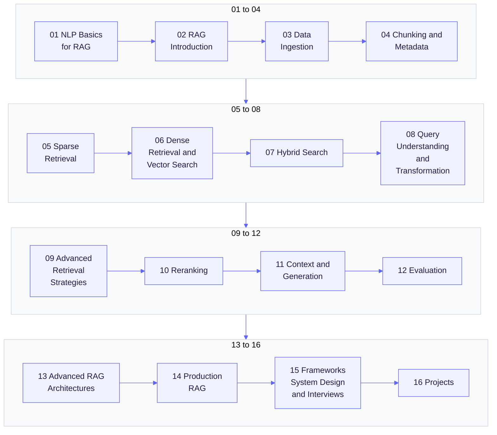
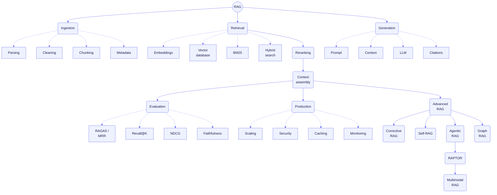

<div align="center">

# RAG · From NLP Basics to Production

   

**A hands-on course on Retrieval-Augmented Generation: NLP basics, ingestion, sparse, dense and hybrid retrieval, reranking, generation, evaluation and production.**

</div>

## Course map



## Chapters

**Done** = notes + notebook · **Notebook** = notebook ready, notes coming · **Planned** = folder ready

### 01 · NLP Basics for RAG

Only the NLP needed for retrieval: text cleaning, tokens, representations, embeddings, similarity, LLM basics.

<table width="100%">
<thead><tr><th width="6%">Sr&nbsp;No</th><th width="22%">Chapter</th><th width="46%">Key Concepts</th><th width="8%">Interview Priority</th><th width="6%">Notes</th><th width="6%">Notebook</th><th width="6%">Status</th></tr></thead>
<tbody>
<tr><td align="center">01.01</td><td><a href="01.%20NLP%20Basics%20for%20RAG/01.%20Text%20Preprocessing%20for%20Retrieval/notes/01.%20Text%20Preprocessing%20for%20Retrieval.md"><b>Text Preprocessing for Retrieval</b></a></td><td>Normalization, stop words, stemming vs lemmatization, n-grams, why the same preprocessing must run on documents and queries</td><td align="center">Medium</td><td align="center"><a href="01.%20NLP%20Basics%20for%20RAG/01.%20Text%20Preprocessing%20for%20Retrieval/notes/01.%20Text%20Preprocessing%20for%20Retrieval.md">Read</a></td><td align="center"><a href="01.%20NLP%20Basics%20for%20RAG/01.%20Text%20Preprocessing%20for%20Retrieval/notebooks/01.%20Text%20Preprocessing%20for%20Retrieval.ipynb">Open</a></td><td align="center">Done</td></tr>
<tr><td align="center">01.02</td><td><a href="01.%20NLP%20Basics%20for%20RAG/02.%20Tokens%20and%20Tokenization/notes/02.%20Tokens%20and%20Tokenization.md"><b>Tokens and Tokenization</b></a></td><td>BPE/WordPiece/SentencePiece, token-budget math, how tokenization silently breaks retrieval on non-English text</td><td align="center">Medium</td><td align="center"><a href="01.%20NLP%20Basics%20for%20RAG/02.%20Tokens%20and%20Tokenization/notes/02.%20Tokens%20and%20Tokenization.md">Read</a></td><td align="center"><a href="01.%20NLP%20Basics%20for%20RAG/02.%20Tokens%20and%20Tokenization/notebooks/02.%20Tokens%20and%20Tokenization.ipynb">Open</a></td><td align="center">Done</td></tr>
<tr><td align="center">01.03</td><td><b>From Bag of Words to Embeddings</b></td><td>One-hot and bag-of-words vectors, word2vec intuition, contextual embeddings, why meaning needs dense vectors</td><td align="center">Medium</td><td align="center">-</td><td align="center">-</td><td align="center">Planned</td></tr>
<tr><td align="center">01.04</td><td><a href="01.%20NLP%20Basics%20for%20RAG/04.%20Embeddings%20Fundamentals/notes/04.%20Embeddings%20Fundamentals.md"><b>Embeddings Fundamentals</b></a></td><td>Dense vectors, model selection, domain-specific and multilingual embeddings</td><td align="center">High</td><td align="center"><a href="01.%20NLP%20Basics%20for%20RAG/04.%20Embeddings%20Fundamentals/notes/04.%20Embeddings%20Fundamentals.md">Read</a></td><td align="center"><a href="01.%20NLP%20Basics%20for%20RAG/04.%20Embeddings%20Fundamentals/notebooks/04.%20Embeddings%20Fundamentals.ipynb">Open</a></td><td align="center">Done</td></tr>
<tr><td align="center">01.05</td><td><a href="01.%20NLP%20Basics%20for%20RAG/05.%20Embedding%20Mathematics/notes/05.%20Embedding%20Mathematics.md"><b>Embedding Mathematics</b></a></td><td>Vector spaces, distance metrics, the curse of dimensionality</td><td align="center">Medium</td><td align="center"><a href="01.%20NLP%20Basics%20for%20RAG/05.%20Embedding%20Mathematics/notes/05.%20Embedding%20Mathematics.md">Read</a></td><td align="center"><a href="01.%20NLP%20Basics%20for%20RAG/05.%20Embedding%20Mathematics/notebooks/05.%20Embedding%20Mathematics.ipynb">Open</a></td><td align="center">Done</td></tr>
<tr><td align="center">01.06</td><td><a href="01.%20NLP%20Basics%20for%20RAG/06.%20Similarity%20Metrics%20for%20Dense%20Search/notes/06.%20Similarity%20Metrics%20for%20Dense%20Search.md"><b>Similarity Metrics for Dense Search</b></a></td><td>Cosine similarity, dot product, Euclidean distance, normalization effects</td><td align="center">Medium</td><td align="center"><a href="01.%20NLP%20Basics%20for%20RAG/06.%20Similarity%20Metrics%20for%20Dense%20Search/notes/06.%20Similarity%20Metrics%20for%20Dense%20Search.md">Read</a></td><td align="center">-</td><td align="center">Done</td></tr>
<tr><td align="center">01.07</td><td><b>LLM Basics for RAG</b></td><td>What an LLM does, context window, token cost, temperature, why LLMs hallucinate and why retrieval helps</td><td align="center">Medium</td><td align="center">-</td><td align="center">-</td><td align="center">Planned</td></tr>
</tbody>
</table>

### 02 · RAG Introduction

What RAG is, why it exists, and the two retrieval families it builds on.

<table width="100%">
<thead><tr><th width="6%">Sr&nbsp;No</th><th width="22%">Chapter</th><th width="46%">Key Concepts</th><th width="8%">Interview Priority</th><th width="6%">Notes</th><th width="6%">Notebook</th><th width="6%">Status</th></tr></thead>
<tbody>
<tr><td align="center">02.01</td><td><b>RAG Fundamentals</b></td><td>What RAG is and isn't, the two pipelines, cosine similarity from scratch, a naive RAG system built with no framework, the retrieval-vs-generation debugging split</td><td align="center">High</td><td align="center">-</td><td align="center"><a href="02.%20RAG%20Introduction/01.%20RAG%20Fundamentals/notebooks/01.%20RAG%20Fundamentals.ipynb">Open</a></td><td align="center">Notebook</td></tr>
<tr><td align="center">02.02</td><td><a href="02.%20RAG%20Introduction/02.%20What%20is%20Hybrid%20Search%20RAG/notes/02.%20What%20is%20Hybrid%20Search%20RAG.md"><b>What is Hybrid Search RAG</b></a></td><td>RAG recap, retrieval pipeline, sparse vs dense limits, hybrid architecture, when to use hybrid</td><td align="center">Medium</td><td align="center"><a href="02.%20RAG%20Introduction/02.%20What%20is%20Hybrid%20Search%20RAG/notes/02.%20What%20is%20Hybrid%20Search%20RAG.md">Read</a></td><td align="center"><a href="02.%20RAG%20Introduction/02.%20What%20is%20Hybrid%20Search%20RAG/notebooks/02.%20What%20is%20Hybrid%20Search%20RAG.ipynb">Open</a></td><td align="center">Done</td></tr>
<tr><td align="center">02.03</td><td><a href="02.%20RAG%20Introduction/03.%20Lexical%20vs%20Semantic%20Retrieval/notes/03.%20Lexical%20vs%20Semantic%20Retrieval.md"><b>Lexical vs Semantic Retrieval</b></a></td><td>Exact keyword match, semantic similarity, vocabulary mismatch, synonyms, acronyms, IDs, numbers, negation</td><td align="center">Medium</td><td align="center"><a href="02.%20RAG%20Introduction/03.%20Lexical%20vs%20Semantic%20Retrieval/notes/03.%20Lexical%20vs%20Semantic%20Retrieval.md">Read</a></td><td align="center"><a href="02.%20RAG%20Introduction/03.%20Lexical%20vs%20Semantic%20Retrieval/notebooks/03.%20Lexical%20vs%20Semantic%20Retrieval.ipynb">Open</a></td><td align="center">Done</td></tr>
</tbody>
</table>

### 03 · Data Ingestion

Turning PDFs, scans, office files and structured data into clean, versioned, retrievable documents.

<table width="100%">
<thead><tr><th width="6%">Sr&nbsp;No</th><th width="22%">Chapter</th><th width="46%">Key Concepts</th><th width="8%">Interview Priority</th><th width="6%">Notes</th><th width="6%">Notebook</th><th width="6%">Status</th></tr></thead>
<tbody>
<tr><td align="center">03.01</td><td><b>Ingestion Overview</b></td><td>Why ingestion caps everything downstream, real PDF/OCR/DOCX parsing on real documents, metadata, dedup, versioning, incremental ingestion</td><td align="center">High</td><td align="center">-</td><td align="center"><a href="03.%20Data%20Ingestion/01.%20Ingestion%20Overview/notebooks/01.%20Ingestion%20Overview.ipynb">Open</a></td><td align="center">Notebook</td></tr>
<tr><td align="center">03.02</td><td><b>Why Ingestion and Canonical Documents</b></td><td>The quality ceiling, ingestion ≠ chunking, canonical schema, `raw_text` vs `clean_text`, connectors</td><td align="center">Medium</td><td align="center">-</td><td align="center"><a href="03.%20Data%20Ingestion/02.%20Why%20Ingestion%20and%20Canonical%20Documents/notebooks/02.%20Why%20Ingestion%20and%20Canonical%20Documents.ipynb">Open</a></td><td align="center">Notebook</td></tr>
<tr><td align="center">03.03</td><td><b>PDF Parsing</b></td><td>PDF is not a text format, page provenance, reading order, heading detection by font weight, what `get_text()` silently misses</td><td align="center">Medium</td><td align="center">-</td><td align="center"><a href="03.%20Data%20Ingestion/03.%20PDF%20Parsing/notebooks/03.%20PDF%20Parsing.ipynb">Open</a></td><td align="center">Notebook</td></tr>
<tr><td align="center">03.04</td><td><b>OCR and Scanned Documents</b></td><td>Rendering to image, real Tesseract confidence scores, three-tier routing, character confusions, cost modelling</td><td align="center">Medium</td><td align="center">-</td><td align="center"><a href="03.%20Data%20Ingestion/04.%20OCR%20and%20Scanned%20Documents/notebooks/04.%20OCR%20and%20Scanned%20Documents.ipynb">Open</a></td><td align="center">Notebook</td></tr>
<tr><td align="center">03.05</td><td><b>DOCX HTML and Markdown</b></td><td>Native structure extraction, heading context, boilerplate removal</td><td align="center">Medium</td><td align="center">-</td><td align="center"><a href="03.%20Data%20Ingestion/05.%20DOCX%20HTML%20and%20Markdown/notebooks/05.%20DOCX%20HTML%20and%20Markdown.ipynb">Open</a></td><td align="center">Notebook</td></tr>
<tr><td align="center">03.06</td><td><b>Structured Data CSV JSON DB API</b></td><td>What is one retrievable unit, row serialization, nested JSON, when not to embed, live APIs</td><td align="center">Medium</td><td align="center">-</td><td align="center"><a href="03.%20Data%20Ingestion/06.%20Structured%20Data%20CSV%20JSON%20DB%20API/notebooks/06.%20Structured%20Data%20CSV%20JSON%20DB%20API.ipynb">Open</a></td><td align="center">Notebook</td></tr>
<tr><td align="center">03.07</td><td><b>Metadata and Provenance</b></td><td>Six metadata categories, filtering precision, deterministic vs LLM extraction, citation chains</td><td align="center">Medium</td><td align="center">-</td><td align="center"><a href="03.%20Data%20Ingestion/07.%20Metadata%20and%20Provenance/notebooks/07.%20Metadata%20and%20Provenance.ipynb">Open</a></td><td align="center">Notebook</td></tr>
<tr><td align="center">03.08</td><td><b>Cleaning and Normalization</b></td><td>Whitespace, line wrap, hyphenation, Unicode, header/footer detection on real pages, the over-cleaning trap</td><td align="center">Medium</td><td align="center">-</td><td align="center"><a href="03.%20Data%20Ingestion/08.%20Cleaning%20and%20Normalization/notebooks/08.%20Cleaning%20and%20Normalization.ipynb">Open</a></td><td align="center">Notebook</td></tr>
<tr><td align="center">03.09</td><td><b>Deduplication and Versioning</b></td><td>SHA-256, Jaccard similarity, MinHash/LSH at scale, effective vs publication date, amendments</td><td align="center">Medium</td><td align="center">-</td><td align="center"><a href="03.%20Data%20Ingestion/09.%20Deduplication%20and%20Versioning/notebooks/09.%20Deduplication%20and%20Versioning.ipynb">Open</a></td><td align="center">Notebook</td></tr>
<tr><td align="center">03.10</td><td><b>Incremental Ingestion</b></td><td>Change detection, deletion handling, stable IDs, idempotency, atomic replacement</td><td align="center">Medium</td><td align="center">-</td><td align="center"><a href="03.%20Data%20Ingestion/10.%20Incremental%20Ingestion/notebooks/10.%20Incremental%20Ingestion.ipynb">Open</a></td><td align="center">Notebook</td></tr>
<tr><td align="center">03.11</td><td><b>Tables Images and Special Formats</b></td><td>Table serialization, figures, PowerPoint, Excel, email, code, legal documents</td><td align="center">Medium</td><td align="center">-</td><td align="center">-</td><td align="center">Planned</td></tr>
<tr><td align="center">03.12</td><td><b>Security and Access Control in Ingestion</b></td><td>Permissions travel with the document, ACL inheritance, PII handling</td><td align="center">Medium</td><td align="center">-</td><td align="center">-</td><td align="center">Planned</td></tr>
<tr><td align="center">03.13</td><td><b>Production Ingestion Architecture</b></td><td>Three-layer storage, batch vs event-driven, backpressure, retries, dead-letter queues, cost</td><td align="center">Medium</td><td align="center">-</td><td align="center">-</td><td align="center">Planned</td></tr>
<tr><td align="center">03.14</td><td><b>Validation and Observability</b></td><td>Pre-chunking validation, anomaly detection, metrics, golden document sets, parser benchmarking</td><td align="center">Medium</td><td align="center">-</td><td align="center">-</td><td align="center">Planned</td></tr>
<tr><td align="center">03.15</td><td><b>End-to-End Ingestion Pipeline</b></td><td>Anti-patterns, the debugging ladder, interview preparation</td><td align="center">Medium</td><td align="center">-</td><td align="center">-</td><td align="center">Planned</td></tr>
</tbody>
</table>

### 04 · Chunking and Metadata

How documents are split and labelled before indexing.

<table width="100%">
<thead><tr><th width="6%">Sr&nbsp;No</th><th width="22%">Chapter</th><th width="46%">Key Concepts</th><th width="8%">Interview Priority</th><th width="6%">Notes</th><th width="6%">Notebook</th><th width="6%">Status</th></tr></thead>
<tbody>
<tr><td align="center">04.01</td><td><b>Document Chunking</b></td><td>Why chunk size and overlap decide retrieval quality; fixed, semantic, recursive and structure-aware chunking</td><td align="center">High</td><td align="center">-</td><td align="center">-</td><td align="center">Planned</td></tr>
<tr><td align="center">04.02</td><td><b>Chunking for Hybrid Search</b></td><td>Fixed, recursive, semantic, paragraph, sliding-window, parent-child chunking</td><td align="center">High</td><td align="center">-</td><td align="center">-</td><td align="center">Planned</td></tr>
<tr><td align="center">04.03</td><td><b>Metadata Indexing and Filtering</b></td><td>Metadata schema, pre-filtering vs post-filtering, structured + unstructured search; Pre- vs post-filtering, self-query retrieval, access-control filters, field-aware search</td><td align="center">High</td><td align="center">-</td><td align="center">-</td><td align="center">Planned</td></tr>
<tr><td align="center">04.04</td><td><b>Field-Aware Search</b></td><td>Title, summary and body fields, field weights, BM25F-style boosting</td><td align="center">Medium</td><td align="center">-</td><td align="center">-</td><td align="center">Planned</td></tr>
</tbody>
</table>

### 05 · Sparse Retrieval

Keyword search from the inverted index to BM25 and learned sparse models.

<table width="100%">
<thead><tr><th width="6%">Sr&nbsp;No</th><th width="22%">Chapter</th><th width="46%">Key Concepts</th><th width="8%">Interview Priority</th><th width="6%">Notes</th><th width="6%">Notebook</th><th width="6%">Status</th></tr></thead>
<tbody>
<tr><td align="center">05.01</td><td><a href="05.%20Sparse%20Retrieval/01.%20Inverted%20Index%20Fundamentals/notes/01.%20Inverted%20Index%20Fundamentals.md"><b>Inverted Index Fundamentals</b></a></td><td>Forward vs inverted index, posting lists, TF, DF, Boolean AND/OR, phrase search, tokenization, stemming; Lexical vs semantic, inverted indexes, TF-IDF, BM25 from first principles, learned sparse retrieval</td><td align="center">High</td><td align="center"><a href="05.%20Sparse%20Retrieval/01.%20Inverted%20Index%20Fundamentals/notes/01.%20Inverted%20Index%20Fundamentals.md">Read</a></td><td align="center"><a href="05.%20Sparse%20Retrieval/01.%20Inverted%20Index%20Fundamentals/notebooks/01.%20Inverted%20Index%20Fundamentals.ipynb">Open</a></td><td align="center">Done</td></tr>
<tr><td align="center">05.02</td><td><a href="05.%20Sparse%20Retrieval/02.%20TF-IDF/notes/02.%20TF-IDF.md"><b>TF-IDF</b></a></td><td>TF variants, DF, IDF, TF-IDF formula, sparse matrix, cosine ranking, OOV and synonym limits</td><td align="center">Medium</td><td align="center"><a href="05.%20Sparse%20Retrieval/02.%20TF-IDF/notes/02.%20TF-IDF.md">Read</a></td><td align="center"><a href="05.%20Sparse%20Retrieval/02.%20TF-IDF/notebooks/02.%20TF-IDF.ipynb">Open</a></td><td align="center">Done</td></tr>
<tr><td align="center">05.03</td><td><a href="05.%20Sparse%20Retrieval/03.%20BM25/notes/03.%20BM25.md"><b>BM25</b></a></td><td>BM25 formula, BM25 IDF, TF saturation (k1), length normalization (b), BM25 vs TF-IDF</td><td align="center">High</td><td align="center"><a href="05.%20Sparse%20Retrieval/03.%20BM25/notes/03.%20BM25.md">Read</a></td><td align="center"><a href="05.%20Sparse%20Retrieval/03.%20BM25/notebooks/03.%20BM25.ipynb">Open</a></td><td align="center">Done</td></tr>
<tr><td align="center">05.04</td><td><a href="05.%20Sparse%20Retrieval/04.%20BM25%20Implementation%20in%20Practice/notes/04.%20BM25%20Implementation%20in%20Practice.md"><b>BM25 Implementation in Practice</b></a></td><td>rank_bm25, simplified BM25 from scratch, tokenization pipeline, BM25 index to Top-K</td><td align="center">Medium</td><td align="center"><a href="05.%20Sparse%20Retrieval/04.%20BM25%20Implementation%20in%20Practice/notes/04.%20BM25%20Implementation%20in%20Practice.md">Read</a></td><td align="center"><a href="05.%20Sparse%20Retrieval/04.%20BM25%20Implementation%20in%20Practice/notebooks/04.%20BM25%20Implementation%20in%20Practice.ipynb">Open</a></td><td align="center">Done</td></tr>
<tr><td align="center">05.05</td><td><b>Sparse Neural Retrieval</b></td><td>Learned sparse representations, vocabulary-space neural retrieval</td><td align="center">Medium</td><td align="center">-</td><td align="center">-</td><td align="center">Planned</td></tr>
<tr><td align="center">05.06</td><td><b>SPLADE</b></td><td>SPLADE term expansion, BM25 + dense vs SPLADE + dense</td><td align="center">Medium</td><td align="center">-</td><td align="center">-</td><td align="center">Planned</td></tr>
</tbody>
</table>

### 06 · Dense Retrieval and Vector Search

Embedding-based retrieval and the indexes that make it fast.

<table width="100%">
<thead><tr><th width="6%">Sr&nbsp;No</th><th width="22%">Chapter</th><th width="46%">Key Concepts</th><th width="8%">Interview Priority</th><th width="6%">Notes</th><th width="6%">Notebook</th><th width="6%">Status</th></tr></thead>
<tbody>
<tr><td align="center">06.01</td><td><a href="06.%20Dense%20Retrieval%20and%20Vector%20Search/01.%20Dense%20Vector%20Retrieval/notes/01.%20Dense%20Vector%20Retrieval.md"><b>Dense Vector Retrieval</b></a></td><td>Embeddings, query and document vectors, embedding models, dense Top-K search; Bi-encoders, Dense Passage Retrieval, why dense alone misses exact matches</td><td align="center">High</td><td align="center"><a href="06.%20Dense%20Retrieval%20and%20Vector%20Search/01.%20Dense%20Vector%20Retrieval/notes/01.%20Dense%20Vector%20Retrieval.md">Read</a></td><td align="center">-</td><td align="center">Done</td></tr>
<tr><td align="center">06.02</td><td><b>Vector Databases</b></td><td>FAISS, Milvus, Pinecone, Qdrant, pgvector: when each one fits</td><td align="center">Medium</td><td align="center">-</td><td align="center">-</td><td align="center">Planned</td></tr>
<tr><td align="center">06.03</td><td><a href="06.%20Dense%20Retrieval%20and%20Vector%20Search/03.%20Approximate%20Nearest%20Neighbor%20Search/notes/03.%20Approximate%20Nearest%20Neighbor%20Search.md"><b>Approximate Nearest Neighbor Search</b></a></td><td>Exact vs approximate nearest neighbor, recall vs latency, vector databases; HNSW, IVF, product quantization, the recall-vs-latency trade-off</td><td align="center">High</td><td align="center"><a href="06.%20Dense%20Retrieval%20and%20Vector%20Search/03.%20Approximate%20Nearest%20Neighbor%20Search/notes/03.%20Approximate%20Nearest%20Neighbor%20Search.md">Read</a></td><td align="center">-</td><td align="center">Done</td></tr>
<tr><td align="center">06.04</td><td><b>HNSW Fundamentals</b></td><td>HNSW graph layers, M, efConstruction, efSearch, recall and speed trade-offs</td><td align="center">Medium</td><td align="center">-</td><td align="center">-</td><td align="center">Planned</td></tr>
<tr><td align="center">06.05</td><td><b>IVF-Flat and PQ Indexes</b></td><td>IVF clustering, nlist and nprobe, flat search, product quantization, memory vs accuracy</td><td align="center">Medium</td><td align="center">-</td><td align="center">-</td><td align="center">Planned</td></tr>
</tbody>
</table>

### 07 · Hybrid Search

Combining sparse and dense retrieval: normalization, fusion, RRF and tuning.

<table width="100%">
<thead><tr><th width="6%">Sr&nbsp;No</th><th width="22%">Chapter</th><th width="46%">Key Concepts</th><th width="8%">Interview Priority</th><th width="6%">Notes</th><th width="6%">Notebook</th><th width="6%">Status</th></tr></thead>
<tbody>
<tr><td align="center">07.01</td><td><b>Why Combine BM25 and Dense Retrieval</b></td><td>Where BM25 wins, where dense wins, both succeed, both fail, complementary signals</td><td align="center">Medium</td><td align="center">-</td><td align="center">-</td><td align="center">Planned</td></tr>
<tr><td align="center">07.02</td><td><b>Hybrid Search Architecture</b></td><td>Parallel sparse and dense branches, candidate pools, fusion, reranker, LLM; Why combine BM25 and dense, score normalization, weighted fusion, Reciprocal Rank Fusion, tuning alpha</td><td align="center">High</td><td align="center">-</td><td align="center">-</td><td align="center">Planned</td></tr>
<tr><td align="center">07.03</td><td><b>Score Normalization</b></td><td>Min-max, z-score, score scaling, relative score normalization</td><td align="center">High</td><td align="center">-</td><td align="center">-</td><td align="center">Planned</td></tr>
<tr><td align="center">07.04</td><td><b>Weighted Score Fusion</b></td><td>HybridScore = alpha x dense + (1 - alpha) x sparse, choosing weights</td><td align="center">High</td><td align="center">-</td><td align="center">-</td><td align="center">Planned</td></tr>
<tr><td align="center">07.05</td><td><b>Dynamic Hybrid Weighting</b></td><td>Query-dependent alpha, exact vs semantic query detection, production heuristics</td><td align="center">Medium</td><td align="center">-</td><td align="center">-</td><td align="center">Planned</td></tr>
<tr><td align="center">07.06</td><td><b>Reciprocal Rank Fusion RRF</b></td><td>RRF formula, k parameter, rank-based fusion, why RRF is robust, RRF vs weighted</td><td align="center">High</td><td align="center">-</td><td align="center">-</td><td align="center">Planned</td></tr>
<tr><td align="center">07.07</td><td><b>Alpha Fusion Weight Optimization</b></td><td>Alpha grid search on evaluation sets, picking the best weight</td><td align="center">High</td><td align="center">-</td><td align="center">-</td><td align="center">Planned</td></tr>
<tr><td align="center">07.08</td><td><b>Top-K Strategy and Candidate Pool Tuning</b></td><td>Top-K per retriever, candidate pool size, recall vs reranker cost</td><td align="center">Medium</td><td align="center">-</td><td align="center">-</td><td align="center">Planned</td></tr>
</tbody>
</table>

### 08 · Query Understanding and Transformation

Cleaning, expanding and rewriting the query before retrieval.

<table width="100%">
<thead><tr><th width="6%">Sr&nbsp;No</th><th width="22%">Chapter</th><th width="46%">Key Concepts</th><th width="8%">Interview Priority</th><th width="6%">Notes</th><th width="6%">Notebook</th><th width="6%">Status</th></tr></thead>
<tbody>
<tr><td align="center">08.01</td><td><b>Query Preprocessing</b></td><td>Lowercasing, punctuation, stopwords, spell correction, preserving IDs and numbers; Spell correction, intent detection, entity extraction before retrieval</td><td align="center">Medium</td><td align="center">-</td><td align="center">-</td><td align="center">Planned</td></tr>
<tr><td align="center">08.02</td><td><b>Query Expansion</b></td><td>Synonym expansion, LLM expansion, metadata expansion, domain dictionaries</td><td align="center">Medium</td><td align="center">-</td><td align="center">-</td><td align="center">Planned</td></tr>
<tr><td align="center">08.03</td><td><b>Query Transformation</b></td><td>Query expansion, HyDE, Query2Doc, step-back prompting, multi-query retrieval</td><td align="center">Medium</td><td align="center">-</td><td align="center">-</td><td align="center">Planned</td></tr>
<tr><td align="center">08.04</td><td><b>Multi-Query Retrieval</b></td><td>LLM-generated sub-queries, parallel retrieval, fusing multiple result lists</td><td align="center">Medium</td><td align="center">-</td><td align="center">-</td><td align="center">Planned</td></tr>
<tr><td align="center">08.05</td><td><b>HyDE Hypothetical Document Embeddings</b></td><td>Hypothetical answer generation, embedding the answer, vector search</td><td align="center">Medium</td><td align="center">-</td><td align="center">-</td><td align="center">Planned</td></tr>
<tr><td align="center">08.06</td><td><b>Query Rewriting for Conversational RAG</b></td><td>Conversational context, follow-up rewriting, standalone queries</td><td align="center">High</td><td align="center">-</td><td align="center">-</td><td align="center">Planned</td></tr>
</tbody>
</table>

### 09 · Advanced Retrieval Strategies

Retrieving the right unit of context, not just the most similar chunk.

<table width="100%">
<thead><tr><th width="6%">Sr&nbsp;No</th><th width="22%">Chapter</th><th width="46%">Key Concepts</th><th width="8%">Interview Priority</th><th width="6%">Notes</th><th width="6%">Notebook</th><th width="6%">Status</th></tr></thead>
<tbody>
<tr><td align="center">09.01</td><td><b>Retrieval Strategies MMR and Ensembles</b></td><td>MMR, parent-document retrieval, contextual retrieval, ensemble retrievers, Top-K and candidate pools</td><td align="center">Medium</td><td align="center">-</td><td align="center">-</td><td align="center">Planned</td></tr>
<tr><td align="center">09.02</td><td><b>Parent Document Retrieval</b></td><td>Small chunks for retrieval, parent documents for context</td><td align="center">Medium</td><td align="center">-</td><td align="center">-</td><td align="center">Planned</td></tr>
<tr><td align="center">09.03</td><td><b>Contextual Retrieval</b></td><td>Adding document context to chunks before embedding and BM25</td><td align="center">Medium</td><td align="center">-</td><td align="center">-</td><td align="center">Planned</td></tr>
</tbody>
</table>

### 10 · Reranking

A second, more precise pass over the retrieved candidates.

<table width="100%">
<thead><tr><th width="6%">Sr&nbsp;No</th><th width="22%">Chapter</th><th width="46%">Key Concepts</th><th width="8%">Interview Priority</th><th width="6%">Notes</th><th width="6%">Notebook</th><th width="6%">Status</th></tr></thead>
<tbody>
<tr><td align="center">10.01</td><td><b>Why Hybrid Search Still Needs Reranking</b></td><td>Hybrid gives candidates, reranker gives precision, Top-50 to Top-5; Cross-encoders vs bi-encoders, LLM reranking, why similar isn't relevant</td><td align="center">High</td><td align="center">-</td><td align="center">-</td><td align="center">Planned</td></tr>
<tr><td align="center">10.02</td><td><b>Bi-Encoder vs Cross-Encoder</b></td><td>Bi-encoder vs cross-encoder, joint query-document scoring, speed vs accuracy</td><td align="center">High</td><td align="center">-</td><td align="center">-</td><td align="center">Planned</td></tr>
<tr><td align="center">10.03</td><td><b>Cross-Encoder Reranking</b></td><td>BGE, Cohere and Jina rerankers, candidate size, latency budget</td><td align="center">Medium</td><td align="center">-</td><td align="center">-</td><td align="center">Planned</td></tr>
<tr><td align="center">10.04</td><td><b>LLM-Based Reranking</b></td><td>Pointwise, pairwise and listwise LLM reranking, token cost, latency</td><td align="center">Medium</td><td align="center">-</td><td align="center">-</td><td align="center">Planned</td></tr>
</tbody>
</table>

### 11 · Context and Generation

From retrieved chunks to a grounded, cited answer.

<table width="100%">
<thead><tr><th width="6%">Sr&nbsp;No</th><th width="22%">Chapter</th><th width="46%">Key Concepts</th><th width="8%">Interview Priority</th><th width="6%">Notes</th><th width="6%">Notebook</th><th width="6%">Status</th></tr></thead>
<tbody>
<tr><td align="center">11.01</td><td><b>Context Construction</b></td><td>The lost-in-the-middle problem, deduplication, ordering retrieved chunks</td><td align="center">High</td><td align="center">-</td><td align="center">-</td><td align="center">Planned</td></tr>
<tr><td align="center">11.02</td><td><b>Contextual Compression</b></td><td>Extractive vs LLM-based compression under a token budget</td><td align="center">Medium</td><td align="center">-</td><td align="center">-</td><td align="center">Planned</td></tr>
<tr><td align="center">11.03</td><td><b>Prompt Engineering for RAG</b></td><td>Grounding instructions, citation prompting, handling insufficient evidence</td><td align="center">High</td><td align="center">-</td><td align="center">-</td><td align="center">Planned</td></tr>
<tr><td align="center">11.04</td><td><b>Generation Layer</b></td><td>Temperature, faithfulness, structured and citation-backed output</td><td align="center">Medium</td><td align="center">-</td><td align="center">-</td><td align="center">Planned</td></tr>
<tr><td align="center">11.05</td><td><b>Conversational RAG</b></td><td>History-aware retrieval, query rewriting, short vs long-term memory, token-efficient history</td><td align="center">Medium</td><td align="center">-</td><td align="center">-</td><td align="center">Planned</td></tr>
</tbody>
</table>

### 12 · Evaluation

Measuring retrieval and generation, and finding where a wrong answer came from.

<table width="100%">
<thead><tr><th width="6%">Sr&nbsp;No</th><th width="22%">Chapter</th><th width="46%">Key Concepts</th><th width="8%">Interview Priority</th><th width="6%">Notes</th><th width="6%">Notebook</th><th width="6%">Status</th></tr></thead>
<tbody>
<tr><td align="center">12.01</td><td><b>RAG Evaluation Fundamentals</b></td><td>Why evaluating RAG is hard; offline vs online evaluation; retrieval evaluation basics; Relevance labels, offline evaluation, metric selection</td><td align="center">Medium</td><td align="center">-</td><td align="center">-</td><td align="center">Planned</td></tr>
<tr><td align="center">12.02</td><td><b>Precision at K and Recall at K</b></td><td>Precision@K, Recall@K, worked examples; Precision@K, Recall@K, Hit rate, MRR, MAP, NDCG derived and computed by hand</td><td align="center">High</td><td align="center">-</td><td align="center">-</td><td align="center">Planned</td></tr>
<tr><td align="center">12.03</td><td><b>Hit Rate Success at K</b></td><td>Hit rate, Success@K, when a single hit is enough</td><td align="center">Medium</td><td align="center">-</td><td align="center">-</td><td align="center">Planned</td></tr>
<tr><td align="center">12.04</td><td><b>MRR Mean Reciprocal Rank</b></td><td>Reciprocal rank, MRR across queries</td><td align="center">High</td><td align="center">-</td><td align="center">-</td><td align="center">Planned</td></tr>
<tr><td align="center">12.05</td><td><b>MAP Mean Average Precision</b></td><td>Average precision, MAP across queries</td><td align="center">Medium</td><td align="center">-</td><td align="center">-</td><td align="center">Planned</td></tr>
<tr><td align="center">12.06</td><td><b>NDCG</b></td><td>Graded relevance, DCG, IDCG, NDCG@K</td><td align="center">High</td><td align="center">-</td><td align="center">-</td><td align="center">Planned</td></tr>
<tr><td align="center">12.07</td><td><b>Compare Retrieval Strategies</b></td><td>BM25 vs dense vs weighted vs RRF vs reranker on Recall, MRR, NDCG, latency, cost</td><td align="center">Medium</td><td align="center">-</td><td align="center">-</td><td align="center">Planned</td></tr>
<tr><td align="center">12.08</td><td><b>Generation Metrics</b></td><td>Faithfulness, groundedness, hallucination rate</td><td align="center">Medium</td><td align="center">-</td><td align="center">-</td><td align="center">Planned</td></tr>
<tr><td align="center">12.09</td><td><b>RAG Evaluation Frameworks</b></td><td>RAGAS, DeepEval, TruLens, LLM-as-a-judge</td><td align="center">Medium</td><td align="center">-</td><td align="center">-</td><td align="center">Planned</td></tr>
<tr><td align="center">12.10</td><td><b>Synthetic Evaluation Datasets</b></td><td>Generating ground truth, hard negatives, evaluation-set design</td><td align="center">Medium</td><td align="center">-</td><td align="center">-</td><td align="center">Planned</td></tr>
<tr><td align="center">12.11</td><td><b>Failure Analysis and Retrieval Debugging</b></td><td>Attributing a wrong answer to ingestion, retrieval or generation; retrieval debugging; Failure modes, diagnostic logging per stage, debugging retrieval</td><td align="center">High</td><td align="center">-</td><td align="center">-</td><td align="center">Planned</td></tr>
</tbody>
</table>

### 13 · Advanced RAG Architectures

Corrective, self-reflective, agentic, graph, multimodal and structured-data RAG.

<table width="100%">
<thead><tr><th width="6%">Sr&nbsp;No</th><th width="22%">Chapter</th><th width="46%">Key Concepts</th><th width="8%">Interview Priority</th><th width="6%">Notes</th><th width="6%">Notebook</th><th width="6%">Status</th></tr></thead>
<tbody>
<tr><td align="center">13.01</td><td><b>Advanced RAG Architectures</b></td><td>Naive vs advanced vs modular RAG, where each variant earns its complexity</td><td align="center">Medium</td><td align="center">-</td><td align="center">-</td><td align="center">Planned</td></tr>
<tr><td align="center">13.02</td><td><b>Corrective RAG CRAG</b></td><td>Relevance grading and web-search fallback when retrieval confidence is low</td><td align="center">Medium</td><td align="center">-</td><td align="center">-</td><td align="center">Planned</td></tr>
<tr><td align="center">13.03</td><td><b>Self-RAG</b></td><td>Reflection tokens: the model checking its own retrieval and output</td><td align="center">Medium</td><td align="center">-</td><td align="center">-</td><td align="center">Planned</td></tr>
<tr><td align="center">13.04</td><td><b>Adaptive RAG</b></td><td>Routing simple vs complex queries to different retrieval strategies</td><td align="center">Medium</td><td align="center">-</td><td align="center">-</td><td align="center">Planned</td></tr>
<tr><td align="center">13.05</td><td><b>Agentic RAG</b></td><td>Tool-calling retrievers, multi-hop reasoning, retry loops with LangGraph</td><td align="center">Medium</td><td align="center">-</td><td align="center">-</td><td align="center">Planned</td></tr>
<tr><td align="center">13.06</td><td><b>Multi-Hop RAG</b></td><td>Query decomposition and evidence chaining across documents</td><td align="center">Medium</td><td align="center">-</td><td align="center">-</td><td align="center">Planned</td></tr>
<tr><td align="center">13.07</td><td><b>RAPTOR</b></td><td>Recursive summarization trees for hierarchical retrieval</td><td align="center">Medium</td><td align="center">-</td><td align="center">-</td><td align="center">Planned</td></tr>
<tr><td align="center">13.08</td><td><b>Graph RAG</b></td><td>Knowledge graphs, community detection, local vs global search</td><td align="center">Medium</td><td align="center">-</td><td align="center">-</td><td align="center">Planned</td></tr>
<tr><td align="center">13.09</td><td><b>Knowledge Graph and RAG</b></td><td>Entity linking, Cypher/SPARQL, hybrid vector + graph retrieval</td><td align="center">Medium</td><td align="center">-</td><td align="center">-</td><td align="center">Planned</td></tr>
<tr><td align="center">13.10</td><td><b>Multimodal RAG</b></td><td>Text + images, CLIP-style embeddings, vision-language retrieval</td><td align="center">Medium</td><td align="center">-</td><td align="center">-</td><td align="center">Planned</td></tr>
<tr><td align="center">13.11</td><td><b>Table RAG</b></td><td>Why serialization alone fails on numeric tables, and what to do instead</td><td align="center">Medium</td><td align="center">-</td><td align="center">-</td><td align="center">Planned</td></tr>
<tr><td align="center">13.12</td><td><b>Text-to-SQL and RAG</b></td><td>Schema retrieval, SQL generation, grounding results back to natural language</td><td align="center">Medium</td><td align="center">-</td><td align="center">-</td><td align="center">Planned</td></tr>
</tbody>
</table>

### 14 · Production RAG

Running RAG for real users: architecture, speed, cost, security and monitoring.

<table width="100%">
<thead><tr><th width="6%">Sr&nbsp;No</th><th width="22%">Chapter</th><th width="46%">Key Concepts</th><th width="8%">Interview Priority</th><th width="6%">Notes</th><th width="6%">Notebook</th><th width="6%">Status</th></tr></thead>
<tbody>
<tr><td align="center">14.01</td><td><b>Production RAG Architecture</b></td><td>API layer, ingestion workers, retriever service, LLM gateway, production hybrid search; Services, async retrieval, caching, batching, timeouts, latency budget</td><td align="center">High</td><td align="center">-</td><td align="center">-</td><td align="center">Planned</td></tr>
<tr><td align="center">14.02</td><td><b>RAG Optimization</b></td><td>Systematically tuning chunk size, top-K, thresholds and prompts</td><td align="center">Medium</td><td align="center">-</td><td align="center">-</td><td align="center">Planned</td></tr>
<tr><td align="center">14.03</td><td><b>RAG Latency and Performance</b></td><td>Where time goes in a RAG request, and how to cut it</td><td align="center">Medium</td><td align="center">-</td><td align="center">-</td><td align="center">Planned</td></tr>
<tr><td align="center">14.04</td><td><b>Caching in RAG</b></td><td>Embedding, retrieval and semantic caches with Redis</td><td align="center">Medium</td><td align="center">-</td><td align="center">-</td><td align="center">Planned</td></tr>
<tr><td align="center">14.05</td><td><b>Incremental Indexing</b></td><td>Re-embedding only what changed, deduplication at scale</td><td align="center">Medium</td><td align="center">-</td><td align="center">-</td><td align="center">Planned</td></tr>
<tr><td align="center">14.06</td><td><b>Security and Access Control</b></td><td>RBAC/ABAC, tenant isolation, why prompts aren't a security boundary</td><td align="center">Medium</td><td align="center">-</td><td align="center">-</td><td align="center">Planned</td></tr>
<tr><td align="center">14.07</td><td><b>Multi-Tenant RAG</b></td><td>Shared vs isolated indexes, namespace design, cost trade-offs</td><td align="center">Medium</td><td align="center">-</td><td align="center">-</td><td align="center">Planned</td></tr>
<tr><td align="center">14.08</td><td><b>RAG Guardrails</b></td><td>Prompt injection detection, output validation, grounding checks</td><td align="center">Medium</td><td align="center">-</td><td align="center">-</td><td align="center">Planned</td></tr>
<tr><td align="center">14.09</td><td><b>Observability and Monitoring</b></td><td>Tracing retrieval, tracking hallucination rate in production</td><td align="center">Medium</td><td align="center">-</td><td align="center">-</td><td align="center">Planned</td></tr>
<tr><td align="center">14.10</td><td><b>Feedback Loops</b></td><td>Turning thumbs-down signals into hard negatives and better retrieval</td><td align="center">Medium</td><td align="center">-</td><td align="center">-</td><td align="center">Planned</td></tr>
<tr><td align="center">14.11</td><td><b>RAG Cost Optimization</b></td><td>Model routing, small-vs-large-model strategy, where the money goes</td><td align="center">Medium</td><td align="center">-</td><td align="center">-</td><td align="center">Planned</td></tr>
</tbody>
</table>

### 15 · Frameworks System Design and Interviews

Frameworks, a full from-scratch build, system design and interview preparation.

<table width="100%">
<thead><tr><th width="6%">Sr&nbsp;No</th><th width="22%">Chapter</th><th width="46%">Key Concepts</th><th width="8%">Interview Priority</th><th width="6%">Notes</th><th width="6%">Notebook</th><th width="6%">Status</th></tr></thead>
<tbody>
<tr><td align="center">15.01</td><td><b>RAG Frameworks</b></td><td>LangChain, LangGraph, LlamaIndex, Haystack, and when to skip all of them</td><td align="center">Medium</td><td align="center">-</td><td align="center">-</td><td align="center">Planned</td></tr>
<tr><td align="center">15.02</td><td><b>Building RAG From Scratch End to End</b></td><td>The entire pipeline with zero frameworks, end to end, including hybrid search; Full pipeline: BM25 + vector index, RRF, reranker, context builder, LLM answer</td><td align="center">Medium</td><td align="center">-</td><td align="center">-</td><td align="center">Planned</td></tr>
<tr><td align="center">15.03</td><td><b>Production RAG System Design</b></td><td>Designing for 100M chunks and thousands of concurrent users</td><td align="center">High</td><td align="center">-</td><td align="center">-</td><td align="center">Planned</td></tr>
<tr><td align="center">15.04</td><td><b>RAG Interview Case Studies</b></td><td>Legal, healthcare, financial and codebase RAG worked examples</td><td align="center">Medium</td><td align="center">-</td><td align="center">-</td><td align="center">Planned</td></tr>
<tr><td align="center">15.05</td><td><b>FAANG RAG Interview Questions</b></td><td>The questions interviewers ask, with model answers</td><td align="center">High</td><td align="center">-</td><td align="center">-</td><td align="center">Planned</td></tr>
</tbody>
</table>

### 16 · Projects

Three end-to-end hybrid RAG builds.

<table width="100%">
<thead><tr><th width="6%">Sr&nbsp;No</th><th width="22%">Chapter</th><th width="46%">Key Concepts</th><th width="8%">Interview Priority</th><th width="6%">Notes</th><th width="6%">Notebook</th><th width="6%">Status</th></tr></thead>
<tbody>
<tr><td align="center">16.01</td><td><b>Hybrid Search From Scratch</b></td><td>BM25 + dense + fusion + reranking + evaluation, no frameworks</td><td align="center">Medium</td><td align="center">-</td><td align="center">-</td><td align="center">Planned</td></tr>
<tr><td align="center">16.02</td><td><b>Production Hybrid RAG</b></td><td>Hybrid retrieval service with a vector DB, caching and an API</td><td align="center">Medium</td><td align="center">-</td><td align="center">-</td><td align="center">Planned</td></tr>
<tr><td align="center">16.03</td><td><b>Enterprise Style Hybrid RAG</b></td><td>Metadata, access control, monitoring and evaluation at enterprise scale</td><td align="center">Medium</td><td align="center">-</td><td align="center">-</td><td align="center">Planned</td></tr>
</tbody>
</table>

## The whole curriculum as one flow



## Hybrid retrieval pipeline


## Setup (one time)

```bash
# Create and activate a virtual environment
python3 -m venv .venv
source .venv/bin/activate

# Install dependencies
pip install -r requirements.txt

# Add your API credentials, then edit .env
cp .env.example .env

# Launch Jupyter
jupyter lab
```

<table width="100%">
<thead><tr><th width="8%">Sr No</th><th width="22%">Purpose</th><th width="25%">Default model</th><th width="45%">Why this one</th></tr></thead>
<tbody>
<tr><td align="center">01</td><td>Embeddings (API)</td><td><code>text-embedding-3-small</code></td><td>1536 dimensions, cheap enough to embed everything</td></tr>
<tr><td align="center">02</td><td>Generation</td><td><code>gpt-4o-mini</code></td><td>Fast and cheap; strong enough to expose RAG failure modes clearly</td></tr>
<tr><td align="center">03</td><td>Embeddings (local)</td><td><code>all-MiniLM-L6-v2</code></td><td>384 dimensions, runs on a laptop CPU</td></tr>
</tbody>
</table>

Cost note: the whole course costs well under a dollar in API calls.
