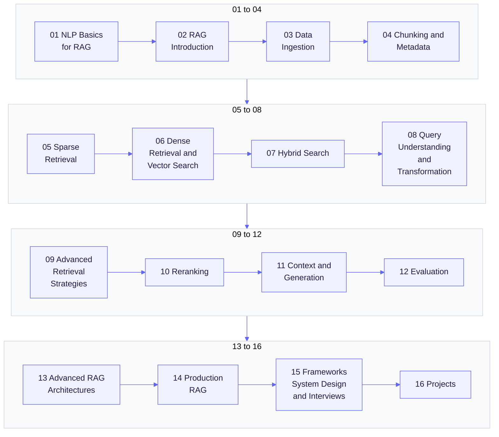
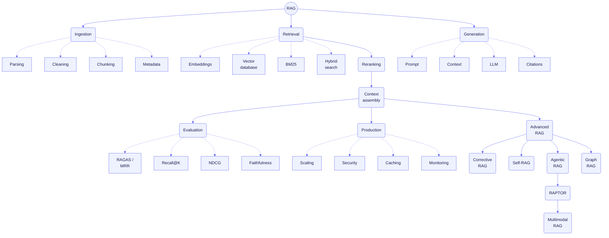
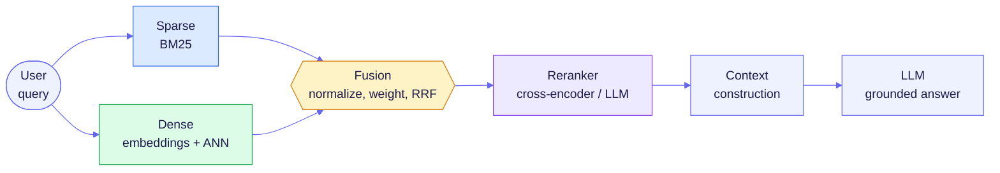

<div align="center">

# RAG · From NLP Basics to Production

   

**A hands-on course on Retrieval-Augmented Generation: NLP basics, ingestion, sparse, dense and hybrid retrieval, reranking, generation, evaluation and production.**

</div>

## Course map



## Chapters

**Done** = notes + notebook · **Notebook** = notebook ready, notes coming · **Planned** = folder ready

### [01 · NLP Basics for RAG](01.%20NLP%20Basics%20for%20RAG/README.md)

<table width="100%">
<thead><tr><th width="10%">Sr No</th><th width="75%">Chapter</th><th width="15%">Status</th></tr></thead>
<tbody>
<tr><td align="center">01.01</td><td><a href="01.%20NLP%20Basics%20for%20RAG/01.%20Text%20Preprocessing%20for%20Retrieval">Text Preprocessing for Retrieval</a></td><td align="center">Planned</td></tr>
<tr><td align="center">01.02</td><td><a href="01.%20NLP%20Basics%20for%20RAG/02.%20Tokens%20and%20Tokenization">Tokens and Tokenization</a></td><td align="center">Planned</td></tr>
<tr><td align="center">01.03</td><td><a href="01.%20NLP%20Basics%20for%20RAG/03.%20From%20Bag%20of%20Words%20to%20Embeddings">From Bag of Words to Embeddings</a></td><td align="center">Planned</td></tr>
<tr><td align="center">01.04</td><td><a href="01.%20NLP%20Basics%20for%20RAG/04.%20Embeddings%20Fundamentals">Embeddings Fundamentals</a></td><td align="center">Planned</td></tr>
<tr><td align="center">01.05</td><td><a href="01.%20NLP%20Basics%20for%20RAG/05.%20Embedding%20Mathematics">Embedding Mathematics</a></td><td align="center">Planned</td></tr>
<tr><td align="center">01.06</td><td><a href="01.%20NLP%20Basics%20for%20RAG/06.%20Similarity%20Metrics%20for%20Dense%20Search">Similarity Metrics for Dense Search</a></td><td align="center">Done</td></tr>
<tr><td align="center">01.07</td><td><a href="01.%20NLP%20Basics%20for%20RAG/07.%20LLM%20Basics%20for%20RAG">LLM Basics for RAG</a></td><td align="center">Planned</td></tr>
</tbody>
</table>

### [02 · RAG Introduction](02.%20RAG%20Introduction/README.md)

<table width="100%">
<thead><tr><th width="10%">Sr No</th><th width="75%">Chapter</th><th width="15%">Status</th></tr></thead>
<tbody>
<tr><td align="center">02.01</td><td><a href="02.%20RAG%20Introduction/01.%20RAG%20Fundamentals">RAG Fundamentals</a></td><td align="center">Notebook</td></tr>
<tr><td align="center">02.02</td><td><a href="02.%20RAG%20Introduction/02.%20What%20is%20Hybrid%20Search%20RAG">What is Hybrid Search RAG</a></td><td align="center">Done</td></tr>
<tr><td align="center">02.03</td><td><a href="02.%20RAG%20Introduction/03.%20Lexical%20vs%20Semantic%20Retrieval">Lexical vs Semantic Retrieval</a></td><td align="center">Done</td></tr>
</tbody>
</table>

### [03 · Data Ingestion](03.%20Data%20Ingestion/README.md)

<table width="100%">
<thead><tr><th width="10%">Sr No</th><th width="75%">Chapter</th><th width="15%">Status</th></tr></thead>
<tbody>
<tr><td align="center">03.01</td><td><a href="03.%20Data%20Ingestion/01.%20Ingestion%20Overview">Ingestion Overview</a></td><td align="center">Notebook</td></tr>
<tr><td align="center">03.02</td><td><a href="03.%20Data%20Ingestion/02.%20Why%20Ingestion%20and%20Canonical%20Documents">Why Ingestion and Canonical Documents</a></td><td align="center">Notebook</td></tr>
<tr><td align="center">03.03</td><td><a href="03.%20Data%20Ingestion/03.%20PDF%20Parsing">PDF Parsing</a></td><td align="center">Notebook</td></tr>
<tr><td align="center">03.04</td><td><a href="03.%20Data%20Ingestion/04.%20OCR%20and%20Scanned%20Documents">OCR and Scanned Documents</a></td><td align="center">Notebook</td></tr>
<tr><td align="center">03.05</td><td><a href="03.%20Data%20Ingestion/05.%20DOCX%20HTML%20and%20Markdown">DOCX HTML and Markdown</a></td><td align="center">Notebook</td></tr>
<tr><td align="center">03.06</td><td><a href="03.%20Data%20Ingestion/06.%20Structured%20Data%20CSV%20JSON%20DB%20API">Structured Data CSV JSON DB API</a></td><td align="center">Notebook</td></tr>
<tr><td align="center">03.07</td><td><a href="03.%20Data%20Ingestion/07.%20Metadata%20and%20Provenance">Metadata and Provenance</a></td><td align="center">Notebook</td></tr>
<tr><td align="center">03.08</td><td><a href="03.%20Data%20Ingestion/08.%20Cleaning%20and%20Normalization">Cleaning and Normalization</a></td><td align="center">Notebook</td></tr>
<tr><td align="center">03.09</td><td><a href="03.%20Data%20Ingestion/09.%20Deduplication%20and%20Versioning">Deduplication and Versioning</a></td><td align="center">Notebook</td></tr>
<tr><td align="center">03.10</td><td><a href="03.%20Data%20Ingestion/10.%20Incremental%20Ingestion">Incremental Ingestion</a></td><td align="center">Notebook</td></tr>
<tr><td align="center">03.11</td><td><a href="03.%20Data%20Ingestion/11.%20Tables%20Images%20and%20Special%20Formats">Tables Images and Special Formats</a></td><td align="center">Planned</td></tr>
<tr><td align="center">03.12</td><td><a href="03.%20Data%20Ingestion/12.%20Security%20and%20Access%20Control%20in%20Ingestion">Security and Access Control in Ingestion</a></td><td align="center">Planned</td></tr>
<tr><td align="center">03.13</td><td><a href="03.%20Data%20Ingestion/13.%20Production%20Ingestion%20Architecture">Production Ingestion Architecture</a></td><td align="center">Planned</td></tr>
<tr><td align="center">03.14</td><td><a href="03.%20Data%20Ingestion/14.%20Validation%20and%20Observability">Validation and Observability</a></td><td align="center">Planned</td></tr>
<tr><td align="center">03.15</td><td><a href="03.%20Data%20Ingestion/15.%20End-to-End%20Ingestion%20Pipeline">End-to-End Ingestion Pipeline</a></td><td align="center">Planned</td></tr>
</tbody>
</table>

### [04 · Chunking and Metadata](04.%20Chunking%20and%20Metadata/README.md)

<table width="100%">
<thead><tr><th width="10%">Sr No</th><th width="75%">Chapter</th><th width="15%">Status</th></tr></thead>
<tbody>
<tr><td align="center">04.01</td><td><a href="04.%20Chunking%20and%20Metadata/01.%20Document%20Chunking">Document Chunking</a></td><td align="center">Planned</td></tr>
<tr><td align="center">04.02</td><td><a href="04.%20Chunking%20and%20Metadata/02.%20Chunking%20for%20Hybrid%20Search">Chunking for Hybrid Search</a></td><td align="center">Planned</td></tr>
<tr><td align="center">04.03</td><td><a href="04.%20Chunking%20and%20Metadata/03.%20Metadata%20Indexing%20and%20Filtering">Metadata Indexing and Filtering</a></td><td align="center">Planned</td></tr>
<tr><td align="center">04.04</td><td><a href="04.%20Chunking%20and%20Metadata/04.%20Field-Aware%20Search">Field-Aware Search</a></td><td align="center">Planned</td></tr>
</tbody>
</table>

### [05 · Sparse Retrieval](05.%20Sparse%20Retrieval/README.md)

<table width="100%">
<thead><tr><th width="10%">Sr No</th><th width="75%">Chapter</th><th width="15%">Status</th></tr></thead>
<tbody>
<tr><td align="center">05.01</td><td><a href="05.%20Sparse%20Retrieval/01.%20Inverted%20Index%20Fundamentals">Inverted Index Fundamentals</a></td><td align="center">Done</td></tr>
<tr><td align="center">05.02</td><td><a href="05.%20Sparse%20Retrieval/02.%20TF-IDF">TF-IDF</a></td><td align="center">Done</td></tr>
<tr><td align="center">05.03</td><td><a href="05.%20Sparse%20Retrieval/03.%20BM25">BM25</a></td><td align="center">Done</td></tr>
<tr><td align="center">05.04</td><td><a href="05.%20Sparse%20Retrieval/04.%20BM25%20Implementation%20in%20Practice">BM25 Implementation in Practice</a></td><td align="center">Done</td></tr>
<tr><td align="center">05.05</td><td><a href="05.%20Sparse%20Retrieval/05.%20Sparse%20Neural%20Retrieval">Sparse Neural Retrieval</a></td><td align="center">Planned</td></tr>
<tr><td align="center">05.06</td><td><a href="05.%20Sparse%20Retrieval/06.%20SPLADE">SPLADE</a></td><td align="center">Planned</td></tr>
</tbody>
</table>

### [06 · Dense Retrieval and Vector Search](06.%20Dense%20Retrieval%20and%20Vector%20Search/README.md)

<table width="100%">
<thead><tr><th width="10%">Sr No</th><th width="75%">Chapter</th><th width="15%">Status</th></tr></thead>
<tbody>
<tr><td align="center">06.01</td><td><a href="06.%20Dense%20Retrieval%20and%20Vector%20Search/01.%20Dense%20Vector%20Retrieval">Dense Vector Retrieval</a></td><td align="center">Done</td></tr>
<tr><td align="center">06.02</td><td><a href="06.%20Dense%20Retrieval%20and%20Vector%20Search/02.%20Vector%20Databases">Vector Databases</a></td><td align="center">Planned</td></tr>
<tr><td align="center">06.03</td><td><a href="06.%20Dense%20Retrieval%20and%20Vector%20Search/03.%20Approximate%20Nearest%20Neighbor%20Search">Approximate Nearest Neighbor Search</a></td><td align="center">Done</td></tr>
<tr><td align="center">06.04</td><td><a href="06.%20Dense%20Retrieval%20and%20Vector%20Search/04.%20HNSW%20Fundamentals">HNSW Fundamentals</a></td><td align="center">Planned</td></tr>
<tr><td align="center">06.05</td><td><a href="06.%20Dense%20Retrieval%20and%20Vector%20Search/05.%20IVF-Flat%20and%20PQ%20Indexes">IVF-Flat and PQ Indexes</a></td><td align="center">Planned</td></tr>
</tbody>
</table>

### [07 · Hybrid Search](07.%20Hybrid%20Search/README.md)

<table width="100%">
<thead><tr><th width="10%">Sr No</th><th width="75%">Chapter</th><th width="15%">Status</th></tr></thead>
<tbody>
<tr><td align="center">07.01</td><td><a href="07.%20Hybrid%20Search/01.%20Why%20Combine%20BM25%20and%20Dense%20Retrieval">Why Combine BM25 and Dense Retrieval</a></td><td align="center">Planned</td></tr>
<tr><td align="center">07.02</td><td><a href="07.%20Hybrid%20Search/02.%20Hybrid%20Search%20Architecture">Hybrid Search Architecture</a></td><td align="center">Planned</td></tr>
<tr><td align="center">07.03</td><td><a href="07.%20Hybrid%20Search/03.%20Score%20Normalization">Score Normalization</a></td><td align="center">Planned</td></tr>
<tr><td align="center">07.04</td><td><a href="07.%20Hybrid%20Search/04.%20Weighted%20Score%20Fusion">Weighted Score Fusion</a></td><td align="center">Planned</td></tr>
<tr><td align="center">07.05</td><td><a href="07.%20Hybrid%20Search/05.%20Dynamic%20Hybrid%20Weighting">Dynamic Hybrid Weighting</a></td><td align="center">Planned</td></tr>
<tr><td align="center">07.06</td><td><a href="07.%20Hybrid%20Search/06.%20Reciprocal%20Rank%20Fusion%20RRF">Reciprocal Rank Fusion RRF</a></td><td align="center">Planned</td></tr>
<tr><td align="center">07.07</td><td><a href="07.%20Hybrid%20Search/07.%20Alpha%20Fusion%20Weight%20Optimization">Alpha Fusion Weight Optimization</a></td><td align="center">Planned</td></tr>
<tr><td align="center">07.08</td><td><a href="07.%20Hybrid%20Search/08.%20Top-K%20Strategy%20and%20Candidate%20Pool%20Tuning">Top-K Strategy and Candidate Pool Tuning</a></td><td align="center">Planned</td></tr>
</tbody>
</table>

### [08 · Query Understanding and Transformation](08.%20Query%20Understanding%20and%20Transformation/README.md)

<table width="100%">
<thead><tr><th width="10%">Sr No</th><th width="75%">Chapter</th><th width="15%">Status</th></tr></thead>
<tbody>
<tr><td align="center">08.01</td><td><a href="08.%20Query%20Understanding%20and%20Transformation/01.%20Query%20Preprocessing">Query Preprocessing</a></td><td align="center">Planned</td></tr>
<tr><td align="center">08.02</td><td><a href="08.%20Query%20Understanding%20and%20Transformation/02.%20Query%20Expansion">Query Expansion</a></td><td align="center">Planned</td></tr>
<tr><td align="center">08.03</td><td><a href="08.%20Query%20Understanding%20and%20Transformation/03.%20Query%20Transformation">Query Transformation</a></td><td align="center">Planned</td></tr>
<tr><td align="center">08.04</td><td><a href="08.%20Query%20Understanding%20and%20Transformation/04.%20Multi-Query%20Retrieval">Multi-Query Retrieval</a></td><td align="center">Planned</td></tr>
<tr><td align="center">08.05</td><td><a href="08.%20Query%20Understanding%20and%20Transformation/05.%20HyDE%20Hypothetical%20Document%20Embeddings">HyDE Hypothetical Document Embeddings</a></td><td align="center">Planned</td></tr>
<tr><td align="center">08.06</td><td><a href="08.%20Query%20Understanding%20and%20Transformation/06.%20Query%20Rewriting%20for%20Conversational%20RAG">Query Rewriting for Conversational RAG</a></td><td align="center">Planned</td></tr>
</tbody>
</table>

### [09 · Advanced Retrieval Strategies](09.%20Advanced%20Retrieval%20Strategies/README.md)

<table width="100%">
<thead><tr><th width="10%">Sr No</th><th width="75%">Chapter</th><th width="15%">Status</th></tr></thead>
<tbody>
<tr><td align="center">09.01</td><td><a href="09.%20Advanced%20Retrieval%20Strategies/01.%20Retrieval%20Strategies%20MMR%20and%20Ensembles">Retrieval Strategies MMR and Ensembles</a></td><td align="center">Planned</td></tr>
<tr><td align="center">09.02</td><td><a href="09.%20Advanced%20Retrieval%20Strategies/02.%20Parent%20Document%20Retrieval">Parent Document Retrieval</a></td><td align="center">Planned</td></tr>
<tr><td align="center">09.03</td><td><a href="09.%20Advanced%20Retrieval%20Strategies/03.%20Contextual%20Retrieval">Contextual Retrieval</a></td><td align="center">Planned</td></tr>
</tbody>
</table>

### [10 · Reranking](10.%20Reranking/README.md)

<table width="100%">
<thead><tr><th width="10%">Sr No</th><th width="75%">Chapter</th><th width="15%">Status</th></tr></thead>
<tbody>
<tr><td align="center">10.01</td><td><a href="10.%20Reranking/01.%20Why%20Hybrid%20Search%20Still%20Needs%20Reranking">Why Hybrid Search Still Needs Reranking</a></td><td align="center">Planned</td></tr>
<tr><td align="center">10.02</td><td><a href="10.%20Reranking/02.%20Bi-Encoder%20vs%20Cross-Encoder">Bi-Encoder vs Cross-Encoder</a></td><td align="center">Planned</td></tr>
<tr><td align="center">10.03</td><td><a href="10.%20Reranking/03.%20Cross-Encoder%20Reranking">Cross-Encoder Reranking</a></td><td align="center">Planned</td></tr>
<tr><td align="center">10.04</td><td><a href="10.%20Reranking/04.%20LLM-Based%20Reranking">LLM-Based Reranking</a></td><td align="center">Planned</td></tr>
</tbody>
</table>

### [11 · Context and Generation](11.%20Context%20and%20Generation/README.md)

<table width="100%">
<thead><tr><th width="10%">Sr No</th><th width="75%">Chapter</th><th width="15%">Status</th></tr></thead>
<tbody>
<tr><td align="center">11.01</td><td><a href="11.%20Context%20and%20Generation/01.%20Context%20Construction">Context Construction</a></td><td align="center">Planned</td></tr>
<tr><td align="center">11.02</td><td><a href="11.%20Context%20and%20Generation/02.%20Contextual%20Compression">Contextual Compression</a></td><td align="center">Planned</td></tr>
<tr><td align="center">11.03</td><td><a href="11.%20Context%20and%20Generation/03.%20Prompt%20Engineering%20for%20RAG">Prompt Engineering for RAG</a></td><td align="center">Planned</td></tr>
<tr><td align="center">11.04</td><td><a href="11.%20Context%20and%20Generation/04.%20Generation%20Layer">Generation Layer</a></td><td align="center">Planned</td></tr>
<tr><td align="center">11.05</td><td><a href="11.%20Context%20and%20Generation/05.%20Conversational%20RAG">Conversational RAG</a></td><td align="center">Planned</td></tr>
</tbody>
</table>

### [12 · Evaluation](12.%20Evaluation/README.md)

<table width="100%">
<thead><tr><th width="10%">Sr No</th><th width="75%">Chapter</th><th width="15%">Status</th></tr></thead>
<tbody>
<tr><td align="center">12.01</td><td><a href="12.%20Evaluation/01.%20RAG%20Evaluation%20Fundamentals">RAG Evaluation Fundamentals</a></td><td align="center">Planned</td></tr>
<tr><td align="center">12.02</td><td><a href="12.%20Evaluation/02.%20Precision%20at%20K%20and%20Recall%20at%20K">Precision at K and Recall at K</a></td><td align="center">Planned</td></tr>
<tr><td align="center">12.03</td><td><a href="12.%20Evaluation/03.%20Hit%20Rate%20Success%20at%20K">Hit Rate Success at K</a></td><td align="center">Planned</td></tr>
<tr><td align="center">12.04</td><td><a href="12.%20Evaluation/04.%20MRR%20Mean%20Reciprocal%20Rank">MRR Mean Reciprocal Rank</a></td><td align="center">Planned</td></tr>
<tr><td align="center">12.05</td><td><a href="12.%20Evaluation/05.%20MAP%20Mean%20Average%20Precision">MAP Mean Average Precision</a></td><td align="center">Planned</td></tr>
<tr><td align="center">12.06</td><td><a href="12.%20Evaluation/06.%20NDCG">NDCG</a></td><td align="center">Planned</td></tr>
<tr><td align="center">12.07</td><td><a href="12.%20Evaluation/07.%20Compare%20Retrieval%20Strategies">Compare Retrieval Strategies</a></td><td align="center">Planned</td></tr>
<tr><td align="center">12.08</td><td><a href="12.%20Evaluation/08.%20Generation%20Metrics">Generation Metrics</a></td><td align="center">Planned</td></tr>
<tr><td align="center">12.09</td><td><a href="12.%20Evaluation/09.%20RAG%20Evaluation%20Frameworks">RAG Evaluation Frameworks</a></td><td align="center">Planned</td></tr>
<tr><td align="center">12.10</td><td><a href="12.%20Evaluation/10.%20Synthetic%20Evaluation%20Datasets">Synthetic Evaluation Datasets</a></td><td align="center">Planned</td></tr>
<tr><td align="center">12.11</td><td><a href="12.%20Evaluation/11.%20Failure%20Analysis%20and%20Retrieval%20Debugging">Failure Analysis and Retrieval Debugging</a></td><td align="center">Planned</td></tr>
</tbody>
</table>

### [13 · Advanced RAG Architectures](13.%20Advanced%20RAG%20Architectures/README.md)

<table width="100%">
<thead><tr><th width="10%">Sr No</th><th width="75%">Chapter</th><th width="15%">Status</th></tr></thead>
<tbody>
<tr><td align="center">13.01</td><td><a href="13.%20Advanced%20RAG%20Architectures/01.%20Advanced%20RAG%20Architectures">Advanced RAG Architectures</a></td><td align="center">Planned</td></tr>
<tr><td align="center">13.02</td><td><a href="13.%20Advanced%20RAG%20Architectures/02.%20Corrective%20RAG%20CRAG">Corrective RAG CRAG</a></td><td align="center">Planned</td></tr>
<tr><td align="center">13.03</td><td><a href="13.%20Advanced%20RAG%20Architectures/03.%20Self-RAG">Self-RAG</a></td><td align="center">Planned</td></tr>
<tr><td align="center">13.04</td><td><a href="13.%20Advanced%20RAG%20Architectures/04.%20Adaptive%20RAG">Adaptive RAG</a></td><td align="center">Planned</td></tr>
<tr><td align="center">13.05</td><td><a href="13.%20Advanced%20RAG%20Architectures/05.%20Agentic%20RAG">Agentic RAG</a></td><td align="center">Planned</td></tr>
<tr><td align="center">13.06</td><td><a href="13.%20Advanced%20RAG%20Architectures/06.%20Multi-Hop%20RAG">Multi-Hop RAG</a></td><td align="center">Planned</td></tr>
<tr><td align="center">13.07</td><td><a href="13.%20Advanced%20RAG%20Architectures/07.%20RAPTOR">RAPTOR</a></td><td align="center">Planned</td></tr>
<tr><td align="center">13.08</td><td><a href="13.%20Advanced%20RAG%20Architectures/08.%20Graph%20RAG">Graph RAG</a></td><td align="center">Planned</td></tr>
<tr><td align="center">13.09</td><td><a href="13.%20Advanced%20RAG%20Architectures/09.%20Knowledge%20Graph%20and%20RAG">Knowledge Graph and RAG</a></td><td align="center">Planned</td></tr>
<tr><td align="center">13.10</td><td><a href="13.%20Advanced%20RAG%20Architectures/10.%20Multimodal%20RAG">Multimodal RAG</a></td><td align="center">Planned</td></tr>
<tr><td align="center">13.11</td><td><a href="13.%20Advanced%20RAG%20Architectures/11.%20Table%20RAG">Table RAG</a></td><td align="center">Planned</td></tr>
<tr><td align="center">13.12</td><td><a href="13.%20Advanced%20RAG%20Architectures/12.%20Text-to-SQL%20and%20RAG">Text-to-SQL and RAG</a></td><td align="center">Planned</td></tr>
</tbody>
</table>

### [14 · Production RAG](14.%20Production%20RAG/README.md)

<table width="100%">
<thead><tr><th width="10%">Sr No</th><th width="75%">Chapter</th><th width="15%">Status</th></tr></thead>
<tbody>
<tr><td align="center">14.01</td><td><a href="14.%20Production%20RAG/01.%20Production%20RAG%20Architecture">Production RAG Architecture</a></td><td align="center">Planned</td></tr>
<tr><td align="center">14.02</td><td><a href="14.%20Production%20RAG/02.%20RAG%20Optimization">RAG Optimization</a></td><td align="center">Planned</td></tr>
<tr><td align="center">14.03</td><td><a href="14.%20Production%20RAG/03.%20RAG%20Latency%20and%20Performance">RAG Latency and Performance</a></td><td align="center">Planned</td></tr>
<tr><td align="center">14.04</td><td><a href="14.%20Production%20RAG/04.%20Caching%20in%20RAG">Caching in RAG</a></td><td align="center">Planned</td></tr>
<tr><td align="center">14.05</td><td><a href="14.%20Production%20RAG/05.%20Incremental%20Indexing">Incremental Indexing</a></td><td align="center">Planned</td></tr>
<tr><td align="center">14.06</td><td><a href="14.%20Production%20RAG/06.%20Security%20and%20Access%20Control">Security and Access Control</a></td><td align="center">Planned</td></tr>
<tr><td align="center">14.07</td><td><a href="14.%20Production%20RAG/07.%20Multi-Tenant%20RAG">Multi-Tenant RAG</a></td><td align="center">Planned</td></tr>
<tr><td align="center">14.08</td><td><a href="14.%20Production%20RAG/08.%20RAG%20Guardrails">RAG Guardrails</a></td><td align="center">Planned</td></tr>
<tr><td align="center">14.09</td><td><a href="14.%20Production%20RAG/09.%20Observability%20and%20Monitoring">Observability and Monitoring</a></td><td align="center">Planned</td></tr>
<tr><td align="center">14.10</td><td><a href="14.%20Production%20RAG/10.%20Feedback%20Loops">Feedback Loops</a></td><td align="center">Planned</td></tr>
<tr><td align="center">14.11</td><td><a href="14.%20Production%20RAG/11.%20RAG%20Cost%20Optimization">RAG Cost Optimization</a></td><td align="center">Planned</td></tr>
</tbody>
</table>

### [15 · Frameworks System Design and Interviews](15.%20Frameworks%20System%20Design%20and%20Interviews/README.md)

<table width="100%">
<thead><tr><th width="10%">Sr No</th><th width="75%">Chapter</th><th width="15%">Status</th></tr></thead>
<tbody>
<tr><td align="center">15.01</td><td><a href="15.%20Frameworks%20System%20Design%20and%20Interviews/01.%20RAG%20Frameworks">RAG Frameworks</a></td><td align="center">Planned</td></tr>
<tr><td align="center">15.02</td><td><a href="15.%20Frameworks%20System%20Design%20and%20Interviews/02.%20Building%20RAG%20From%20Scratch%20End%20to%20End">Building RAG From Scratch End to End</a></td><td align="center">Planned</td></tr>
<tr><td align="center">15.03</td><td><a href="15.%20Frameworks%20System%20Design%20and%20Interviews/03.%20Production%20RAG%20System%20Design">Production RAG System Design</a></td><td align="center">Planned</td></tr>
<tr><td align="center">15.04</td><td><a href="15.%20Frameworks%20System%20Design%20and%20Interviews/04.%20RAG%20Interview%20Case%20Studies">RAG Interview Case Studies</a></td><td align="center">Planned</td></tr>
<tr><td align="center">15.05</td><td><a href="15.%20Frameworks%20System%20Design%20and%20Interviews/05.%20FAANG%20RAG%20Interview%20Questions">FAANG RAG Interview Questions</a></td><td align="center">Planned</td></tr>
</tbody>
</table>

### [16 · Projects](16.%20Projects/README.md)

<table width="100%">
<thead><tr><th width="10%">Sr No</th><th width="75%">Chapter</th><th width="15%">Status</th></tr></thead>
<tbody>
<tr><td align="center">16.01</td><td><a href="16.%20Projects/01.%20Hybrid%20Search%20From%20Scratch">Hybrid Search From Scratch</a></td><td align="center">Planned</td></tr>
<tr><td align="center">16.02</td><td><a href="16.%20Projects/02.%20Production%20Hybrid%20RAG">Production Hybrid RAG</a></td><td align="center">Planned</td></tr>
<tr><td align="center">16.03</td><td><a href="16.%20Projects/03.%20Enterprise%20Style%20Hybrid%20RAG">Enterprise Style Hybrid RAG</a></td><td align="center">Planned</td></tr>
</tbody>
</table>

## The whole curriculum as one flow



## Hybrid retrieval pipeline



## Setup (one time)

```bash
# Create and activate a virtual environment
python3 -m venv .venv
source .venv/bin/activate

# Install dependencies
pip install -r requirements.txt

# Add your API credentials, then edit .env
cp .env.example .env

# Launch Jupyter
jupyter lab
```

<table width="100%">
<thead><tr><th width="8%">Sr No</th><th width="22%">Purpose</th><th width="25%">Default model</th><th width="45%">Why this one</th></tr></thead>
<tbody>
<tr><td align="center">01</td><td>Embeddings (API)</td><td><code>text-embedding-3-small</code></td><td>1536 dimensions, cheap enough to embed everything</td></tr>
<tr><td align="center">02</td><td>Generation</td><td><code>gpt-4o-mini</code></td><td>Fast and cheap; strong enough to expose RAG failure modes clearly</td></tr>
<tr><td align="center">03</td><td>Embeddings (local)</td><td><code>all-MiniLM-L6-v2</code></td><td>384 dimensions, runs on a laptop CPU</td></tr>
</tbody>
</table>

Cost note: the whole course costs well under a dollar in API calls.

## Repository layout

<table width="100%">
<thead><tr><th width="8%">Sr No</th><th width="32%">Path</th><th width="60%">What it holds</th></tr></thead>
<tbody>
<tr><td align="center">01</td><td><code>NN. Group/</code></td><td>One topic group with its README: learning flow and chapter table</td></tr>
<tr><td align="center">02</td><td><code>NN. Group/NN. Chapter/</code></td><td>One chapter: README, <code>notes/</code>, <code>notebooks/</code>, <code>diagrams/</code>, <code>datasets/</code>, <code>exercises/</code></td></tr>
<tr><td align="center">03</td><td><code>utils/</code>, <code>assets/</code></td><td>Shared helpers and sample data for the notebooks</td></tr>
<tr><td align="center">04</td><td><code>00. Course material/</code></td><td>Source syllabi and where every chapter of the two former repos now lives</td></tr>
</tbody>
</table>
